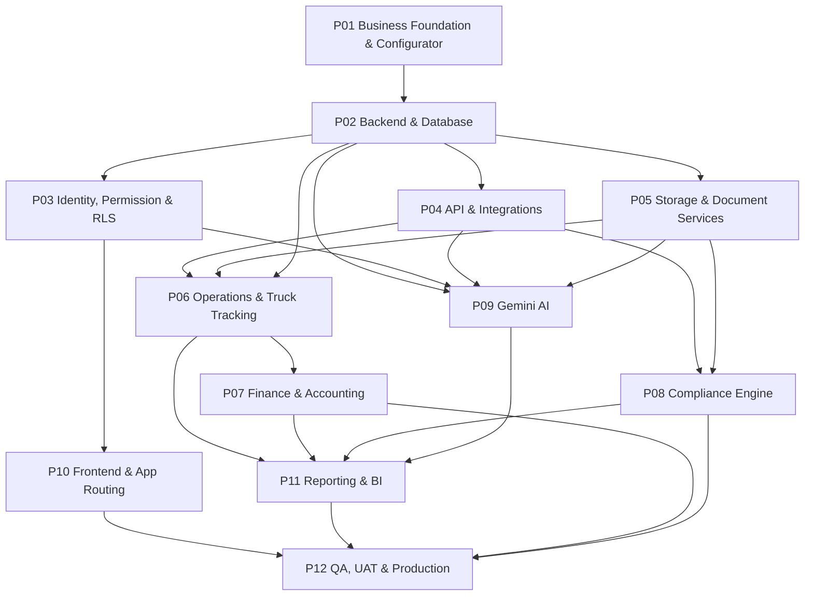

# PKE Export Intelligence & Project Control Platform
## Master Implementation Plan — Paket Plan v1.1

**Baseline arsitektur:** `PKE_Export_Platform_v4.2.2_Master_System_Architecture_Review_Rev02.md`  
**Tambahan keputusan:** Checkpoint-Based Truck Tracking & Geotagged Evidence System (diskusi setelah v4.2.2)  
**Status:** Draft pemecahan arsitektur untuk review sebelum coding — user decisions 1 November 2026 incorporated  
**Tanggal:** 1 November 2026  
**Bahasa:** Indonesia

---

## 1. Tujuan paket plan

Dokumen Architecture Review v4.2.2 adalah acuan arah produk dan arsitektur. Paket ini memecahnya menjadi rencana implementasi yang dapat dibangun, diuji, dan disetujui satu per satu. Paket ini **belum merupakan SQL final, API contract final, desain visual final, atau izin memulai produksi**.

Setiap plan menjawab: hasil yang harus dicapai, ruang lingkup, aktor, alur bisnis, domain data, aturan utama, kontrol akses, dependensi, kriteria penerimaan, dan keputusan yang perlu ditutup sebelum coding.

## 2. Keputusan baseline yang tidak boleh berubah tanpa change request

| Area | Keputusan baseline |
|---|---|
| Komoditas | PKE saja pada fase implementasi dan pilot awal. Penambahan komoditas dilakukan kemudian melalui keputusan dan paket perubahan tersendiri. |
| Perusahaan | Single company / satu eksportir. Buyer, PKS, supplier, vendor dan pihak eksternal menjadi partner accounts dengan scope terbatas. |
| Project concurrency | Satu database perusahaan untuk target awal 2–3 project aktif bersamaan. Ini target awal yang harus diverifikasi melalui load test. |
| Backend | Neon Postgres. Production menggunakan paid plan; compute production tidak scale-to-zero. Region Singapore dipilih bila tersedia dan hasil uji latency mendukung. |
| Object storage | Neon Object Storage / Neon Buckets, private untuk seluruh dokumen dan bukti operasional. Adapter disiapkan untuk migrasi provider. |
| Currency | IDR sebagai functional/base currency perusahaan. Reporting currency bisa ditetapkan per project. Setiap transaksi mempertahankan currency asli, kurs, jenis kurs dan nilai ekuivalen IDR. |
| Keuangan | Full project accounting: RAB, commitment, accrual, AP/AR, cash, double-entry ledger, settlement, FX, funder, audit. Pembayaran bank tetap manual pada fase awal. |
| Kontrak berulang | Admin mengonfigurasi Contract Program/Framework Contract, Delivery Schedule, settlement unit dan recurring cycle. Setiap Project Instance mewakili satu unit pemenuhan/settlement buyer; dapat memuat beberapa shipment dan pembayaran parsial. |
| Close project | Project ditutup setelah penyelesaian kuantitas, dokumen, piutang, hutang, advance, funder, klaim, dan ledger sesuai kebijakan. On-board tidak otomatis berarti project closed. |
| Pasar awal | China dan Pakistan sebagai country packs pertama; setiap syarat diverifikasi terhadap HS, produk, importir, intended use, metode kirim, tanggal ekspor dan sumber primer. |
| Admin | Tepat satu Admin Aplikasi principal/login aktif. Hanya Admin membuat, menyetujui dan mengaktifkan Contract Program serta mengubah konfigurasi otoritatif. Tidak ada alternate approver; jika Admin tidak tersedia, action menunggu. Admin tidak mengubah SQL/RLS policy secara langsung. |
| AI | Gemini paid tier untuk data bisnis nyata. Free tier hanya untuk development dengan data sintetis/anonim. AI memberi analisis/draft; bukan pembuat keputusan hukum, jurnal, approval atau pembayaran. |
| Tracking truk | Checkpoint-based tracking dengan foto bukti dan GPS perangkat checker. GPS kendaraan tidak diwajibkan. Posisi yang ditampilkan adalah checkpoint terakhir terverifikasi, bukan live tracking. |
| Implementasi | Controlled pilot dengan pembelajaran dari shipment nyata. Asumsi yang belum dikonfirmasi harus diberi label dan tidak dianggap fakta. |

## 3. Daftar paket plan

| ID | Nama plan | Hasil utama |
|---|---|---|
| P01 | Business Foundation & Admin Project Configurator | Contract Program, recurring delivery cycle, project templates, konfigurasi Admin |
| P02 | Backend, Database & Neon Platform | Domain model, schema, migrations, service layer, event/outbox, performance |
| P03 | Identity, Authorization, Role & RLS | Login, invitation, project membership, permission, partner scope, RLS |
| P04 | API Architecture & External Integrations | Internal API, webhook, provider adapters, API health and retry |
| P05 | Object Storage & Document File Services | Neon Buckets, upload/download, metadata, evidence storage, retention and backup |
| P06 | Operational Workflow, Inventory & Truck Checkpoint Tracking | PKS-to-vessel operations, lots, weights, checkpoints, loading, reconciliation |
| P07 | Finance, RAB, Manual Payment & Accounting | Budget, obligations, payment instruction, AP/AR, GL, FX, settlement |
| P08 | Export Compliance & Regulatory Document Engine | Indonesia-China-Pakistan requirement assessment and document lifecycle |
| P09 | Gemini AI, RAG & Intelligence Orchestrator | LLM routing, document analysis, tools, insight, AI governance |
| P10 | Frontend, UX, App Routing & Stakeholder Portals | Admin app, PM workspace, buyer/supplier/vendor portals, field PWA |
| P11 | Reporting, Notifications & Business Intelligence | Operational/financial reports, dashboard, scheduled delivery, BI |
| P12 | QA, UAT, DevOps & Production Readiness | Test strategy, field pilot, deployment, observability, DR and go-live gates |

## 3A. Keputusan tata kelola dan siklus proyek yang telah ditetapkan

### Single Admin authority
- Hanya satu Admin Aplikasi principal/login aktif. Admin adalah satu-satunya pihak yang membuat, menyetujui, mengaktifkan dan mengubah Contract Program serta konfigurasi otoritatif.
- PM, Finance, Owner atau role lain tidak dapat menggantikan approval Admin. Jika Admin tidak tersedia, Admin-only actions tetap `pending_admin_action`.
- Untuk keamanan, gunakan MFA/passkey, step-up authentication, session monitoring, session revocation dan controlled recovery. Jika satu kredensial digunakan beberapa orang, audit hanya mengidentifikasi Admin principal/session, bukan memastikan individu fisik.

### Recurring cycle dan settlement-unit Project Instance
- Admin mengatur cycle cadence, basis volume/periode/call-off, settlement unit dan generation mode sejak Contract Program dibuat. Admin dapat mengubahnya ketika project berjalan melalui versi/effective date.
- Pilihan generation mode: `scheduled_draft` (rekomendasi default), `admin_manual`, atau `quantity_triggered_draft`. Tidak ada cycle yang otomatis aktif; semua activation memerlukan Admin.
- Project Instance mewakili satu unit pemenuhan/settlement menurut kontrak, misalnya 10.000 MT per tranche pembayaran. Satu instance dapat mempunyai banyak shipment dan beberapa pembayaran parsial. Pembayaran parsial tidak otomatis membuat instance baru.
- Project ditutup setelah settlement unit dan seluruh close checklist operasional/keuangan/dokumen yang berlaku dipenuhi.

### Contract amendment options
Admin memilih tindakan sistem setelah bukti negosiasi buyer/supplier tersedia: amendment record only/future cycles, revise current project dengan versi baru/change order, successor project, split project, supplemental scope, temporary variation, atau opsi custom yang direview. AI hanya menganalisis dampak; Admin menyetujui konfigurasi, bukan bertindak sebagai pihak komersial yang menyepakati kontrak. Histori transaksi tidak ditimpa.

### First-cycle readiness
Cycle live pertama tidak diaktifkan sampai seluruh plan P01–P13 dalam scope pilot telah diterapkan, berjalan dan lulus acceptance/UAT. Tidak boleh ada defect yang diketahui pada acceptance criteria seluruh plan yang dinyatakan selesai dalam scope cycle pertama, termasuk defect minor. Seluruh defect harus diperbaiki dan diuji ulang. “Tanpa bugs” berarti tidak ada defect yang diketahui pada scope/versi yang diuji, bukan jaminan matematis bahwa tidak akan pernah timbul defect baru. Kriteria terukur dan bukti sign-off didefinisikan di P12.

## 4. Hubungan antar-plan

Dependencies are logical, not a rigid waterfall. UX discovery and test design can start early, tetapi implementasi produksi tidak boleh melewati fondasi backend, authorization, audit, dan financial controls.

## 5. Urutan implementasi yang disarankan

### Gate 0 — Architecture lock
- Review dan sign-off paket plan.
- Konfirmasi aturan bisnis pilot pertama: buyer, kontrak, produk PKE, PKS, rute, metode pengiriman, payment terms, dokumen, role, dan currency.
- Putuskan stack frontend/backend, auth provider, ORM/migration, hosting, email/notification, dan worker.
- Buat threat model serta data classification.

### Gate 1 — Foundation
- P01 baseline project configuration.
- P02 Neon environments, schema conventions, migrations and core domain.
- P03 authentication, authorization, RLS, audit.
- P05 private bucket and secure file metadata.

### Gate 2 — First operational journey
- P06 procurement → dispatch → truck checkpoint → warehouse receipt → inventory lot.
- Uji geotagged evidence menggunakan perangkat checker nyata.
- Uji timbang, selisih, dan rekonsiliasi lot.

### Gate 3 — Money and compliance
- P07 RAB, commitments, manual payment instruction, AP/AR, cash advances, double-entry ledger, FX baseline.
- P08 Indonesia/China/Pakistan compliance assessment dan document checklist.

### Gate 4 — Stakeholder product
- P10 app routing dan role-based portals.
- P11 report templates, dashboards and notifications.
- P04 integrasi AIS/FX/geocoding/weather/regulatory sources sesuai kebutuhan aktual.

### Gate 5 — Intelligence
- P09 Gemini paid production integration, RAG, function calling dan AI insights.
- Batasi AI ke read-only dan draft operations pada pilot pertama.

### Gate 6 — Controlled production pilot
- P12 UAT, security test, financial reconciliation, operational drill, DR test, monitoring, go/no-go.

## 6. Artefak wajib sebelum development feature dimulai

Setiap plan harus menghasilkan:
1. Functional specification yang disetujui.
2. Logical data model dan data dictionary.
3. State/status lifecycle dan transition rules.
4. API contracts atau command/query interface.
5. Permission matrix dan test cases.
6. Error, retry, audit, notification behavior.
7. UI wireframe atau interaction flow bila berhubungan dengan frontend.
8. Acceptance tests yang dapat dijalankan.
9. Open decisions dengan owner dan due gate.

## 7. Aturan konfigurasi Admin versus pengembangan kode

Admin boleh mengonfigurasi pilihan yang sudah disediakan aplikasi: role, permission set, fitur aktif, workflow template, checkpoint, geofence, approval threshold, reporting audience, cash obligation, dokumen, currency policy, dan notifikasi.

Admin **tidak** boleh membuat SQL/RLS policy, menambahkan executable code, mengeksekusi arbitrary API, mengubah schema, mengubah secret, atau memberi akses database superuser. Perubahan kemampuan yang belum tersedia dalam katalog harus melalui change request dan release software.

## 8. Prinsip lintas-plan

- Server/database adalah source of truth; client/LLM tidak dipercaya untuk status final.
- Semua event penting punya actor, timestamp, project, source, correlation ID, dan evidence bila relevan.
- Semua transaksi uang dan quantity memakai `NUMERIC`, satuan eksplisit, dan koreksi melalui reversal/superseding event.
- Setiap project menyimpan configuration snapshot saat aktivasi.
- Data publikasi buyer/supplier adalah whitelist; bukan query langsung ke seluruh data internal.
- External APIs harus memiliki timeout, retry policy, circuit breaker, freshness timestamp, dan manual fallback.
- AI tidak diberi wewenang approval, transfer bank, penghapusan bukti, atau perubahan access control.
- Tracking checkpoint tidak boleh divisualisasikan sebagai GPS live.
- Setiap asumsi awal ditandai sumber dan confidence; setelah proyek selesai, data aktual menjadi basis kalibrasi.

## 9. Definition of Ready dan Definition of Done

**Definition of Ready:** kebutuhan, aktor, alur, data, permission, acceptance test, dependensi, dan source-of-truth ditentukan; keputusan terbuka yang berpengaruh terhadap keselamatan finansial/security ditutup.

**Definition of Done:** acceptance tests lulus; security/RLS tests lulus; audit trail tersedia; error handling dan monitoring ada; docs diperbarui; tidak ada data sensitif bocor; pilot owner menerima hasil.

## 10. Keputusan yang masih perlu ditutup sebelum coding

- Frontend framework/hosting final dan backend runtime.
- Neon Auth vs OIDC provider, berdasarkan POC invitation/MFA/session revocation dan RLS context.
- ORM/migration tool dan durable job runner.
- Email/SMS/WhatsApp notification provider serta consent/cost.
- AIS provider dan penggunaan geocoding/routing provider.
- Penyedia FX rate dan metode actual rate per bank.
- Chart of accounts, fiscal policy, inventory valuation, revenue recognition, FX accounting, tax treatment — disahkan akuntan/perusahaan.
- Country-specific PKE requirements untuk buyer/importer China dan Pakistan — disahkan compliance officer/customs broker/importer.
- Backup external storage, retention, RPO/RTO, dan incident response.
- SLO dan load-test thresholds yang disepakati.
- Shared Admin credential policy: prefer one controlled Admin identity; if shared, record and accept the human-attribution limitation.
- Default recurring generation mode: `scheduled_draft` is recommended, but Admin sets the mode per Contract Program.
- Exact settlement unit and payment-close rule must be transcribed from each signed buyer contract.

## 11. Referensi arsitektur

- [Neon backend GA](https://neon.com/blog/neon-backend-is-ga)
- [Neon Object Storage GA](https://neon.com/blog/building-neon-object-storage)
- [Neon compute autoscaling recommendations](https://neon.com/blog/neon-autoscaling-is-generally-available)
- [Neon Managed Auth / Better Auth](https://neon.com/blog/neon-auth-branchable-identity-in-your-database)
- [Gemini API models](https://ai.google.dev/gemini-api/docs/models)
- [Gemini Interactions API](https://ai.google.dev/gemini-api/docs/interactions-overview)
- [Gemini Function Calling](https://ai.google.dev/gemini-api/docs/function-calling)
- [Gemini Structured Output](https://ai.google.dev/gemini-api/docs/structured-output)
