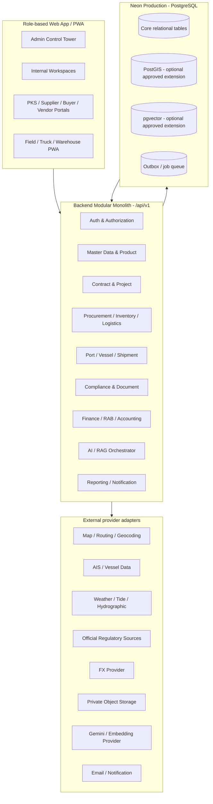
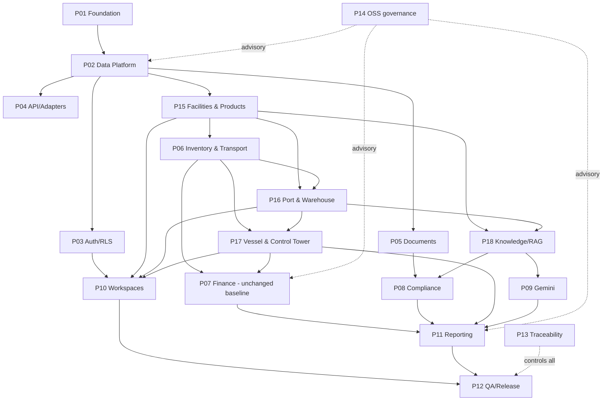

# PKE Export Intelligence & Project Control Platform
# Master Implementation Plan Rev1.4 — Single-Source Execution Edition

**Status:** Satu-satunya dokumen referensi dan catatan eksekusi aktif PKE — living document  
**Revision:** 1.4  
**Tanggal dokumen:** 11 November 2026  
**Repository:** `D:\PKE`  
**Target database:** Neon project `PKE-export-platform` / branch `production` (`br-calm-glade-b3nrleet`) / database `neondb`  
**Bahasa:** Indonesia  
**Dokumen tunggal untuk:** seluruh spesifikasi, keputusan, status implementasi, backlog, bukti validasi, blocker, dan instruksi Cline PKE

> **Tujuan dokumen:** menjadi SATU-SATUNYA acuan kerja aktif untuk menyelesaikan PKE. Semua revisi status, keputusan, backlog, mapping API/database/frontend, dan catatan eksekusi Cline wajib diperbarui di file ini. Jangan membuat atau meminta owner menyimpan dokumen status/laporan/plan lain. Isi dokumen tetap merupakan rencana dan catatan bukti; bukan bukti otomatis bahwa fitur selesai atau izin otomatis mengubah Production.

---

## 0. Pengendalian dokumen, sumber, dan cara membaca

### 0.1 Asal-usul baseline dan kebijakan dokumen tunggal

Rev1.4 mempertahankan substansi bisnis/arsitektur Rev1.3 yang sebelumnya menggabungkan keputusan dari Master Architecture v4.2.3 Rev03, Implementation Plans Rev1.2, P07 Finance v1.2, P14 OSS/BI, serta audit keuangan. Referensi tersebut dicatat sebagai provenance historis, bukan daftar dokumen aktif yang wajib dipelihara.

**Mulai 11 November 2026, file Master Implementation Plan ini adalah satu-satunya dokumen referensi dan kontrol revisi aktif.** Seluruh hal berikut ditulis/di-update di sini: spesifikasi, owner decisions, phase status, requirement-to-code traceability, schema/API mapping, execution log, test evidence summary, risk, blocker, serta next action.

Aturan dokumen:
1. Cline dan pelaksana revisi harus membaca file Master ini terlebih dahulu dan menjadikannya satu-satunya dokumen acuan proyek.
2. Jangan membuat, meminta, atau mengharuskan owner menyimpan `PKE_P03_PLAN.md`, `IMPLEMENTATION_STATUS.md`, `TRACEABILITY_MATRIX.md`, `DECISION_LOG.md`, `CHANGELOG_EXECUTION.md`, sprint reports, audit reports, README tambahan, atau paket ZIP sebagai dokumen status paralel.
3. File kode, SQL migration, automated tests, konfigurasi build, dan file aplikasi yang memang diperlukan untuk menjalankan produk tetap boleh dibuat/diubah sebagai source artifacts. Yang dilarang adalah memecah catatan referensi/kemajuan menjadi dokumen-dokumen Markdown/CSV/laporan terpisah.
4. Setiap akhir sesi, ringkas perubahan dan bukti yang relevan langsung di Section 32 `Living Execution Ledger` dan checklist/section domain yang sesuai pada file ini.
5. Jika dokumen lama ditemukan di repository, perlakukan sebagai arsip/historical input. Jangan mengubahnya sebagai kewajiban dan jangan menjadikannya sumber status yang mengalahkan file ini.

### 0.2 Hierarki otoritas

Jika ditemukan konflik, gunakan urutan berikut:

1. Instruksi/keputusan owner paling baru yang dinyatakan secara langsung.
2. Catatan keputusan dan execution ledger terbaru dalam dokumen ini.
3. Spesifikasi target dan aturan Rev1.4 dalam dokumen ini.
4. Baseline khusus P07 Finance v1.2 yang telah dipertahankan di bagian finance dokumen ini; tidak boleh didesain ulang tanpa Change Request owner.
5. Source code, migration, konfigurasi dan database aktual sebagai kondisi implementasi yang harus diperiksa — bukan otomatis bukti requirement terpenuhi.
6. Laporan/dokumen terdahulu hanya sebagai bukti historis, bukan status terkini tanpa pemeriksaan ulang.

### 0.3 Kategori informasi

Setiap informasi dalam dokumen/implementation wajib dibedakan sebagai:

- **FACT — VERIFIED:** didukung pemeriksaan langsung, sumber resmi, atau artefak test yang dapat diulang.
- **DECISION — OWNER APPROVED:** keputusan bisnis/teknis yang telah ditetapkan owner.
- **DESIGN — PROPOSED:** rekomendasi rancangan target yang belum tentu sudah ada di source/database.
- **ASSUMPTION — TO VERIFY:** dugaan kerja yang tidak boleh diperlakukan sebagai fakta.
- **BLOCKED_EXTERNAL:** implementasi kode dapat selesai, tetapi aktivasi memerlukan akun, lisensi, API key, akses, atau persetujuan provider.
- **LEGAL_REVIEW_REQUIRED:** penafsiran atau persetujuan hukum/kepabeanan/pajak/standardisasi belum disahkan oleh ahli berwenang.

### 0.4 Makna “running 100%”

Target “100%” pada dokumen ini berarti seluruh ruang lingkup aplikasi yang telah disepakati selesai dibangun dan lulus acceptance gate yang relevan. Target ini **tidak** berarti semua data eksternal selalu tersedia, semua otoritas pemerintah menyediakan API, kapal memiliki AIS di setiap wilayah, atau semua transaksi bisnis sudah pernah terjadi.

Status hasil akhir dipisahkan menjadi:

**APPLICATION COMPLETE** — seluruh fitur aplikasi dalam scope rilis selesai, UI/API/database terintegrasi, automated tests yang diizinkan owner lulus, hak akses terbukti, workflow end-to-end memiliki bukti yang sah, build/deployment/monitoring siap, dan blocker kode S1/S2 tidak ada. Static/mock tests tidak menggantikan bukti integrasi SQL/RLS/provider nyata; gate yang belum dapat dibuktikan tetap BLOCKED dan tidak boleh disamarkan sebagai COMPLETE.

**BUSINESS PRODUCTION READY** — selain Application Complete, data mitra nyata telah diverifikasi, legal/accounting sign-off diterima, provider eksternal yang wajib telah aktif, user acceptance oleh pihak terkait selesai, prosedur operasi dan backup/restore telah diuji, serta owner memberi keputusan go-live.

Aplikasi dapat dinyatakan Application Complete sebelum transaksi bisnis riil pertama. Namun, sesuai instruksi owner saat ini, jangan menggunakan database PostgreSQL lokal, Docker database, Neon branch lain, atau data bisnis dummy Production untuk menguji workflow. Gunakan static/type checks, unit tests, API contract tests, mock adapters, serta pemeriksaan Production yang read-only. Pengujian E2E yang membutuhkan penulisan data bisnis sintetis harus berstatus `BLOCKED_OWNER` sampai owner menentukan metode/target pengujian yang diizinkan. Mock bukan bukti integrasi database nyata. Business Production Ready tetap menunggu verifikasi lapangan dan persetujuan yang memerlukan data/aktor riil.

---

# 1. Ringkasan eksekutif dan tujuan produk

PKE adalah **Export Intelligence & Project Control Platform** untuk mengelola rantai pasok Palm Kernel Expeller/Palm Kernel Meal (PKE/PKM) dari pemasok/fasilitas produksi sampai buyer dan pelaporan ekspor. PKE mengintegrasikan master data mitra dan fasilitas, spesifikasi produk, stock lot, procurement, truck checkpoint, gudang, port, loading, kapal/voyage, dokumen ekspor, finance/accounting, compliance, AI/RAG, dashboard, serta stakeholder portal.

PKE bukan hanya aplikasi pencatat transaksi. Sistem harus membantu menjawab pertanyaan operasional berikut secara cepat dan dapat ditelusuri:

1. Fasilitas/PKS/KCP mana yang benar-benar mampu memasok produk dan volume tertentu?
2. Produk mana yang mempunyai spesifikasi paling sesuai dengan permintaan buyer?
3. Berapa stok tersedia, di lokasi mana, berasal dari lot mana, sudah di-reserve berapa, dan sedang berada di tahap logistik mana?
4. Pelabuhan, terminal, gudang, moda transportasi, dan metode loading mana yang layak dipertimbangkan?
5. Apakah karakteristik kapal dan batasan pelabuhan/terminal kompatibel berdasarkan data yang masih berlaku?
6. Apakah data kapal, voyage, cargo, shipping instruction, dan dokumen ekspor konsisten?
7. Buyer dapat melihat progres dan kuantitas sesuai kontraknya tanpa memperoleh akses ke stok/kontrak buyer lain.
8. Admin dan setiap pihak terkait melihat serta mengubah hanya informasi dalam scope otorisasinya.
9. AI dapat mencari regulasi dan dokumen resmi, menjelaskan persyaratan, menemukan gap, membandingkan pemasok/produk, dan menyusun draft laporan dengan kutipan sumber.
10. Finance/RAB/GL tetap menjadi system of record keuangan, dengan pemisahan budget, commitment, accrual, expense, cash paid, dan journal.

## 1.1 Prinsip produk utama

- **Single company / single exporter** pada tahap awal. Buyer, supplier/PKS, transporter, warehouse, port operator, shipping agent, surveyor, dan pihak eksternal lain direpresentasikan sebagai partner dengan hubungan dan scope tersendiri.
- **PKE-first:** PKE/PKM merupakan komoditas awal. Multi-commodity tidak menjadi alasan memperumit rilis pertama; product taxonomy harus extensible untuk fase berikutnya.
- **Neon PostgreSQL Production is the cloud system of record.** Semua business records, authorization, inventory, shipment dan finance berada dalam satu database Production.
- **Modular monolith first:** satu backend modular dengan domain/service boundary jelas. Jangan memecah menjadi microservices sebelum kebutuhan, skala, dan alasan operasional terbukti.
- **Existing-schema-first:** gunakan dan perluas tabel Production yang sudah ada. Dilarang membuat tabel duplikat hanya karena nama entitas di kode berbeda.
- **Event and audit trail:** perubahan status dan inventory/quantity wajib terlacak melalui event, actor, timestamp, source, dan referensi transaksi.
- **Human approval for critical actions:** legal interpretation, posting jurnal, approval pembayaran, perubahan dokumen final, vessel/loading exception, dan publikasi regulasi tidak dilakukan AI secara otonom.
- **Provider-neutral adapters:** AIS, map routing, geocoding, FX, weather, email, object storage, dan LLM terisolasi di adapter agar provider dapat diganti.
- **Frontend workflow completeness:** setiap fitur backend yang dapat digunakan harus memiliki halaman, form, validation, empty/loading/error state, permission-aware action, dan user feedback yang sesuai.

## 1.2 Batas fase implementasi

Termasuk dalam target:

- P01–P13 baseline yang sudah ada.
- P14 OSS/BI governance sebagai evaluasi dan referensi, bukan kewajiban memasang ERPNext.
- P15 Supplier, Facility & Product Master Intelligence.
- P16 Port, Port Warehouse & Multimodal Logistics Intelligence.
- P17 Maritime, Vessel Intelligence & Export Control Tower.
- P18 Regulatory Knowledge Graph, RAG & AI Intelligence.

Tidak otomatis termasuk tanpa Change Request:

- Menjadi marketplace terbuka lintas eksportir/perusahaan.
- Mengoperasikan terminal/pelabuhan atau memberikan izin navigasi.
- Menggantikan sistem resmi Bea Cukai, karantina, otoritas pelabuhan, bank, atau shipping line.
- Melakukan transfer bank otomatis pada fase awal.
- Memberikan legal opinion otomatis atau menerbitkan sertifikat resmi.
- Menjamin cakupan AIS global penuh atau memperkirakan posisi kapal ketika data provider tidak tersedia.
- Mengganti kebijakan akuntansi, perpajakan, atau standar kualitas tanpa persetujuan ahli.

---

# 2. Baseline teknis dan kebijakan Production-only

## 2.1 Target Neon yang telah diperiksa

Snapshot pemeriksaan read-only pada 9 November 2026:

| Item | Kondisi |
|---|---|
| Neon project | `PKE-export-platform` |
| Project ID | `lucky-glitter-99553107` |
| Branch | `production` |
| Branch ID | `br-calm-glade-b3nrleet` |
| Database | `neondb` |
| PostgreSQL | 18.6 |
| Runtime role | `app_runtime_secure` |
| Runtime `BYPASSRLS` | `false` pada query yang diperiksa |
| Public tables | 81 pada saat audit |
| RLS enabled | 81/81 pada saat audit |
| `FORCE ROW LEVEL SECURITY` | 0/81 pada snapshot tersebut; perlu evaluasi per tabel, jangan ubah massal |
| Migration history | Row 001–028 terlihat melalui owner connection saat pemeriksaan; 001–016 berstatus baselined, 017–028 applied |
| Extensions | `postgis` 3.6.4 dan `vector` 0.8.6 tersedia di daftar extension Neon tetapi belum ter-install pada snapshot pemeriksaan |

Angka di atas adalah snapshot historis dan wajib diverifikasi ulang oleh Cline sebelum pekerjaan yang memerlukan perubahan Production. Keberadaan RLS pada tabel tidak membuktikan seluruh policy benar atau cross-tenant isolation telah lulus.

## 2.2 Satu-satunya target backend cloud — Production only

- Target database cloud satu-satunya adalah Neon project `PKE-export-platform`, branch `production` (`br-calm-glade-b3nrleet`), database `neondb`.
- Jangan membuat, menggunakan, mempromosikan, memulihkan, atau menguji pada Neon branch lain dalam proyek ini. Jangan membuat branch dev, staging, test, rehearsal, pre-promotion, temporary, atau branch migrasi.
- Jangan menggunakan PostgreSQL lokal, Docker database, database alternatif, atau branch database lain sebagai jalur kerja/pengujian proyek. Jangan mengalihkan scope ke database lokal.
- Revisi source code dilakukan di repository `D:\PKE`; ini bukan izin untuk membuat database lokal.
- Pengujian rutin yang diperbolehkan: static analysis, TypeScript/typecheck, lint, unit tests, API contract tests, mock adapters, frontend component tests, security tests yang tidak memerlukan business writes, serta pemeriksaan Production yang read-only.
- Pengujian yang membutuhkan penulisan data bisnis sintetis, perubahan state Production, atau database test terpisah harus ditandai `BLOCKED_OWNER`; jangan mencari jalan pintas dengan dummy rows atau branch baru.
- Production smoke check dilakukan secara read-only dengan role yang sesuai. Write smoke hanya untuk operasi bisnis nyata yang dikendalikan owner dan bukan fixture/test.
- Tidak boleh memasukkan dummy buyer, PKS, supplier, stock, shipment, invoice, payment, voyage, user, atau transaksi ke Production.
- Data referensi resmi yang nyata hanya boleh diimpor setelah sumber, hak penggunaan, kualitas, provenance, dan persetujuan owner diverifikasi.

## 2.3 Aturan migration Production

1. Migration `001–028` adalah sejarah yang tidak boleh diubah atau dijalankan ulang.
2. Pada 11 November 2026, migration `029–032` sudah diterapkan pada Neon Production dan tercatat `applied` dengan checksum di `migration_history`.
3. Perubahan schema baru berikutnya memakai nomor mulai `033+`, setelah schema reconciliation terhadap object Production aktual. Jangan menebak nomor migration dari file lokal tanpa memeriksa `migration_history`.
4. Sebelum migration baru dibuat, cocokkan entity/tabel/kolom/index/FK/RLS policy/grant/fungsi `SECURITY DEFINER` dengan Production. Utamakan memperbaiki mapping aplikasi terhadap tabel yang sudah ada; jangan membuat tabel duplikat hanya untuk mengakomodasi nama tabel yang salah di kode.
5. Setiap migration baru harus mempunyai tujuan, exact SQL, SHA-256, preflight/read-only impact check, lock/data-risk review, RLS/grant review, rollback/recovery plan, dan post-apply read-only verification.
6. Jangan memakai Neon branch lain atau PostgreSQL lokal untuk migration replay. Karena jalur database test tersebut tidak diizinkan owner, setiap klaim yang memerlukan replay harus diberi status `BLOCKED_OWNER`; jangan mengklaim replay lulus.
7. Migration Production hanya boleh diterapkan setelah owner memberikan persetujuan eksplisit atas SQL/rencana migration spesifik tersebut. Instruksi umum untuk melanjutkan pekerjaan bukan persetujuan otomatis untuk destructive migration.
8. Setelah migration yang disetujui diterapkan, catat ID/checksum/waktu/status di Section 32 dan verifikasi read-only terhadap `migration_history` serta schema aktual.
9. Untuk perubahan destructive/irreversible, jangan lanjut tanpa backup/restore procedure yang terbukti dan persetujuan khusus.
10. Dilarang menjalankan `DROP`, `TRUNCATE`, bulk `DELETE`, reset, atau mengganti data Production untuk menguji fitur.

## 2.4 Extension PostGIS dan pgvector

- `postgis` dan `vector` tersedia sebagai extension pada Neon menurut pemeriksaan `pg_available_extensions`, tetapi belum ter-install pada snapshot 9 November 2026.
- PostGIS direkomendasikan untuk spatial query (jarak, radius, point-in-polygon, spatial index) setelah compatibility, cost, security, dan lisensinya ditinjau.
- pgvector direkomendasikan untuk embedding search/RAG setelah strategi embedding dan ACL filtering disepakati.
- Aktivasi extension adalah perubahan schema Production. Jangan `CREATE EXTENSION` langsung tanpa migration, preflight, review license, dan persetujuan owner.
- Jika PostGIS belum diaktifkan, MVP dapat menyimpan `latitude`/`longitude` dan menghitung jarak geodesik di service secara terbatas; jangan mengklaim routing/nautical compatibility yang belum ada.

## 2.5 Existing schema inventory — prioritas reuse

Tabel berikut telah ditemukan pada Production snapshot. Ini bukan persetujuan bahwa semua kolom sudah cukup. Cline wajib memeriksa detail saat coding:

| Domain | Tabel existing | Fungsi/keputusan target |
|---|---|---|
| Identity | `users`, `project_members`, `project_roles`, `project_role_permissions`, `permissions`, `role_catalog` | Reuse; audit tenant/facility/partner scope dan provider claim mapping |
| Partner/customer | `buyers`, `buyer_parties`, `vendors`, `service_vendors` | Reuse sebagai role-specific profile; identitas perusahaan bersama perlu direkonsiliasi |
| Facilities | `pks_sites` | Reuse sebagai facility/site awal; perlu tipe fasilitas, owner organization, kapasitas, fasilitas proses, status verifikasi |
| Product | `product_catalog`, `product_specifications`, `project_product_specifications` | Reuse; lengkapi taxonomy, attributes, quality result dan buyer requirement |
| Route/Port | `ports`, `pks_port_routes` | Reuse; tambah terminal/berth/channel/depth observations/loading services dan route provenance |
| Warehouse | `warehouses`, `warehouse_receipts` | Reuse; lengkapi mode storage, zones/bins/capacity/equipment/stock reconciliation |
| Inventory | `inventory_lots`, `inventory_movements`, `packing_batches` | Reuse dan perluas; satu lot hanya dihitung pada satu posisi/status stok per waktu |
| Transport | `transport_legs`, `truck_trips`, `tracking_events` | Reuse; checkpoint device bukan klaim live truck GPS |
| Shipment/maritime | `shipments`, `shipment_allocations`, `vessels`, `voyages`, `loading_operations` | Reuse; lengkapi IMO/MMSI/dimensions/AIS snapshots/vessel-port assessment/loading event |
| Export compliance | `regulatory_sources`, `country_export_document_requirements`, `project_export_document_requirements`, `project_export_documents`, `export_document_types` | Reuse; perlu rule versions, source citation, jurisdiction, product/HS conditions |
| Finance | `rab`, `cost_obligations`, `payment_obligations`, `ap_invoices`, `ar_invoices`, `cash_advances`, `cash_schedules`, `journal_entries`, `journal_lines`, `chart_of_accounts`, FX tables | P07 tetap baseline; audit gap dan link ke operational events, tanpa ledger ganda |
| Project | `contracts`, `contract_programs`, `projects`, `project_operating_profiles`, `project_versions`, `project_workflows` | Reuse; jangan mengubah settlement-unit Project Instance model |
| Notifications | `user_notifications`, `notification_deliveries` | Reuse sebelum mempertimbangkan tabel `notifications` baru |
| Reporting | `report_runs`, `report_schedules`, `report_export_audit` | Reuse untuk reporting dan scheduled reports |

**Peringatan:** laporan Sprint Completion pernah menyebut `rab_items`, `payments`, `compliance_rules`, `compliance_documents`, dan `notifications` yang tidak ditemukan di Production saat pemeriksaan. Jangan langsung membuat tabel tersebut. Rekonsiliasi dahulu dengan `rab`, `payment_obligations`, `ap_invoices`/`ar_invoices`, `regulatory_sources`, `project_export_documents`, `user_notifications`, dan desain logical model. Tabel baru hanya dibuat bila kebutuhan entitas dan relasinya memang berbeda.


## 2.6 Fakta Neon Production terverifikasi — 11 November 2026

> Status berikut berasal dari pemeriksaan langsung branch `production` pada sesi 11 November 2026. Angka ini adalah snapshot; pemeriksaan ulang tetap diperlukan sebelum perubahan berikutnya. Tidak ada branch Neon lain dibuat/digunakan.

| Area | Fakta terverifikasi | Implikasi |
|---|---|---|
| Target | Project `lucky-glitter-99553107`, branch `production` / `br-calm-glade-b3nrleet`, database `neondb`, region `aws-ap-southeast-1`, PostgreSQL 18.6 | Tetap menjadi satu-satunya system of record cloud |
| Migration history | 32 baris; ID 1–32 lengkap; 001–016 `baselined`; 017–032 `applied`; status lain 0 | 001–028 tidak berubah; 029–032 adalah revisi aktif terbaru |
| Public schema | 81 base tables; RLS enabled 81/81; semua tabel memiliki policy; tabel tanpa RLS/policy 0 | Jangan menambah policy/tabel tanpa kebutuhan dan review |
| Referential integrity | 153 foreign keys tervalidasi; unvalidated FK 0 | FK validation selesai pada snapshot ini |
| Index | Invalid/not-ready indexes 0 | Tidak ada indeks rusak yang terdeteksi pada snapshot |
| SECURITY DEFINER | 17 fungsi; seluruhnya memakai fixed `search_path`; tidak satu pun dapat dieksekusi role `PUBLIC` | Tetap review setiap fungsi baru/ubah |
| Runtime role | `app_runtime_secure`: non-superuser, `NOBYPASSRLS`, tanpa CREATEDB/CREATEROLE, tidak dapat CREATE pada schema `public` | Runtime role least-privilege pada pemeriksaan |
| RLS context | `set_rls_context(uuid)` adalah `SECURITY INVOKER`; `PUBLIC EXECUTE=false`; `app_runtime_secure EXECUTE=true`; null user ditolak | Smoke test transaksi berhasil menetapkan identitas admin; konteks lokal transaksi dibersihkan saat transaksi berakhir |
| User admin | Satu user aplikasi aktif ber-role admin; `mfa_enabled=false` | MFA Admin belum aktif; jangan mengubah flag menjadi true tanpa MFA nyata |
| Neon Auth | Better Auth aktif; email/password aktif; sign-up dinonaktifkan; email OTP verification diwajibkan; nama aplikasi `PKE Export Platform` | Jangan mengubah metode login tanpa keputusan/tes |
| Auth origins | Trusted origin hanya `http://localhost:3001`; `allow_localhost=true` | BLOCKER sebelum deployment publik; jangan menebak domain frontend atau mengunci akses admin |
| Email | Shared provider `auth@mail.myneon.app` | Custom SMTP masih belum dikonfigurasi |
| MFA plugin | Plugin config tidak memuat MFA; tidak ditemukan tabel two-factor/MFA dalam schema yang diperiksa | MFA tetap `BLOCKED_EXTERNAL/BLOCKED_OWNER`; provider-backed factor/claim belum terbukti |
| Object storage | Neon Object Storage aktif; bucket `pke-private-documents` sudah dibuat dengan access `private`; bucket kosong | Infrastruktur bucket tersedia; signed upload/download, metadata/ACL dan adapter aplikasi belum dibuktikan |
| Neon Functions | Tidak ada function yang ter-deploy; custom function domains 0 | Jangan mengklaim API serverless Neon tersedia; API harus diselaraskan pada aplikasi yang ada atau implementasi baru yang dipilih owner |
| Business data | `projects=0`, `project_members=0`, `buyers=0`, `pks_sites=0`, `ports=0`, `warehouses=0`, `vendors=0` | Database schema tidak kosong; business records belum dimasukkan |
| Reference data | `countries=3`, `currencies=4` (IDR satu-satunya functional currency), `export_document_types=8`, active permissions `88`, product catalog memiliki satu item PKC | Referensi dasar tersedia; tidak berarti country-pack legal rules sudah diverifikasi |
| Finance setup | `payment_methods=0`, `cost_categories=0`, `chart_of_accounts=0` | Finance master-data/setup belum lengkap; jangan mengarang COA atau metode pembayaran tanpa baseline/approval |
| Branch protection | `production.protected=false`; permintaan protect ditolak oleh limit protected branch paket Neon | Jangan meng-unprotect branch lain; catat sebagai keterbatasan paket dan mitigasi operational control |

Catatan penting: `users` tidak memiliki direct table grants ke `app_runtime_secure`; akses identitas menggunakan fungsi `SECURITY DEFINER` yang sudah dibatasi. Ini bukan alasan untuk memberi grant CRUD langsung pada tabel `users`.

## 2.7 Prioritas revisi aktif — API system lalu frontend

Audit kode yang tersedia dan skema Production menunjukkan mismatch berikut. Temuan source harus dicek ulang terhadap working tree `D:\PKE` sebelum perubahan, karena file source di repo adalah kondisi yang harus dipastikan Cline sendiri.

| Domain | Kondisi tabel/fisik Production | Mismatch yang harus diselesaikan di API/frontend | Urutan |
|---|---|---|---|
| Operations/truck | `truck_trips` memakai `transport_leg_id` dan `license_plate` (bukan `plate_number`) | Selaraskan DTO, validasi, query, form dan payload. Pastikan `transport_leg_id` wajib disediakan dari transport leg yang sah | Tinggi |
| Tracking | `tracking_events` memakai `gps_accuracy`, `notes`, event type `departure/checkpoint/arrival`, dan status terbatas oleh CHECK constraint | Selaraskan nama field dan enum UI/API; server wajib validasi sebelum SQL |
| Finance/P07 | Production memiliki `rab`, `cost_obligations`, `payment_obligations`, `ap_invoices`, `ar_invoices`, `cash_advances`, `cash_schedules`, `chart_of_accounts`, `journal_entries`, `journal_lines`, `fx_rates`, `fx_exposure`/`fx_exposures` | Jangan membuat `rab_items` atau `payments` sekadar agar route lama berjalan. Mapping API ke tabel aktual; pertahankan P07 Finance v1.2 |
| Compliance/P08 | Production memiliki `regulatory_sources`, `export_document_types`, `country_export_document_requirements`, `project_export_document_requirements`, `project_export_documents` | Jangan membuat `compliance_rules`/`compliance_documents` duplikat. Cocokkan rule/source, checklist, metadata file dan project document dengan schema aktual |
| Notifications/P11 | Production memiliki `user_notifications` dan `notification_deliveries` | Jangan merujuk tabel `notifications` yang tidak ada; mapping query dan mark-read mengikuti tabel aktual |
| User/RBAC | `users`, `role_catalog`, `permissions`, `project_roles`, `project_role_permissions`, `project_members`; RLS policies ada | Pertahankan identity resolver dan permission checks; jangan berikan direct table access ke runtime untuk memudahkan route |
| Storage/P05 | Private bucket `pke-private-documents` sudah ada | Implementasikan adapter server-side, metadata linkage, presigned access, checksum/version dan scope check; jangan membuat bucket publik untuk mempercepat UI |
| Auth/P03 | Managed Better Auth saat ini belum memperlihatkan MFA plugin/factor | Jangan mengklaim MFA. Tuntaskan backend/frontend auth guard dengan fail-closed Admin policy; pilihan provider MFA menjadi dependency nyata |
| API route registration | Audit source snapshot mencatat beberapa kelompok route berulang/collision (8 kelompok perlu direkonsiliasi) | Cline telah inventarisasi route dari working tree, menyisakan satu registration per method+path dan mempertahankan middleware/handler yang benar (8 kelompok diselesaikan, uji regresi uniqueness ditambahkan di `src/route-registry.test.ts`). Tidak ada route yang dihapus tanpa tracing caller/tests. |

Urutan kerja sekarang:
1. **API contract/schema alignment** — audit route registration, DTO, repository/query dan error handling terhadap kolom/constraint/grant Production aktual. Utamakan route `/api/v1` yang sudah ada; tidak perlu membangun backend paralel.
2. **Authorization & API security** — periksa `requireAuth`, admin gate, project/partner scope, RLS transaction setup, CORS/origin, session handling, rate limit, audit events; semua tindakan harus fail-closed.
3. **Frontend integration** — sesuaikan `frontend/src` terhadap request/response API yang telah disepakati; perbaiki form, table, detail, loading/empty/error/unauthorized states, dan permission-aware action.
4. **Contract/regression validation** — static/type checks, lint, unit, mock repository/API contract, frontend component/E2E tanpa database lain. Production checks tetap read-only.
5. **Backend sign-off** — jangan menyebut backend selesai selama mismatch kritis, MFA, origin domain, storage adapter atau test yang wajib masih terbuka.
6. **Pindah ke frontend polishing/workspaces** setelah API contract stabil; perubahan berikutnya tetap dikerjakan end-to-end per workflow.


---

# 3. Arsitektur target dan prinsip implementasi

## 3.1 Arsitektur logis



## 3.2 Batas modul backend

Backend tetap modular monolith dengan pemisahan domain folder/service/controller/repository/schema/validation/test. Jangan menaruh seluruh business logic di `src/index.ts` atau satu route file.

Target struktur konseptual:

```text
src/
  app/                 # bootstrap, middleware, route registration
  auth/                # authentication provider, session, MFA, token claims
  authorization/       # permission resolver, scope, RLS context
  domains/
    foundation/
    partners/
    facilities/
    products/
    buyer-demand/
    procurement/
    inventory/
    transport/
    warehouses/
    ports/
    vessels/
    shipments/
    documents/
    compliance/
    finance/            # preserve P07 implementation
    ai-knowledge/
    reporting/
    notifications/
  integrations/
    maps/
    routing/
    ais/
    hydrography/
    fx/
    storage/
    llm/
    email/
  jobs/                 # outbox dispatcher, scheduled ingestion, retries
  shared/               # errors, validation, pagination, idempotency, audit
  tests/
```

Ini logical target, bukan instruksi memindahkan semua file sekaligus. Refactor dilakukan incremental dan tidak boleh merusak route/API existing.

## 3.3 Frontend application areas

Frontend memiliki satu shell, route guard, design system, navigation registry dan reusable data layer. Page dibagi per workspace:

- Admin Control Tower.
- Project Management.
- Procurement & Supplier.
- Facility/PKS/KCP Portal.
- Product & Quality Lab.
- Inventory & Warehouse.
- Transport / Field PWA.
- Port & Loading Operations.
- Shipping Agent / Vessel Operations.
- Buyer Portal.
- Compliance & Document Center.
- Finance & Accounting (P07).
- AI Knowledge Assistant.
- Reporting & Analytics.
- Notifications / Task Inbox.

Jangan membuat aplikasi frontend terpisah untuk setiap role. Role menentukan navigation, data projection, permitted actions, dan route guard; backend/RLS tetap menjadi enforcement utama.

## 3.4 Data ownership, provenance, dan confidence

Setiap data eksternal/master penting minimal mencatat:

- `source_type` (official_registry, partner_submission, contract, field_observation, provider_api, manual_admin, imported_dataset, AI_extracted).
- `source_reference` (URL, file key, registry ID, provider response ID, document ID).
- `source_checksum` bila sumber berupa file/dokumen.
- `observed_at` / `effective_from` / `effective_to` bila relevan.
- `retrieved_at` / `recorded_at`.
- `verified_status` dan `verified_by`.
- `verification_notes`.
- `confidence_level` bila nilai diekstrak/diperkirakan.
- `is_current` atau version relation; jangan menimpa histori tanpa versi.

AI-extracted, partner-submitted, public-directory, estimated, and verified values must be distinguishable in UI and database.

---

# 4. Daftar plan P01–P18 dan hubungan dependensi

| ID | Plan | Outcome wajib | Status strategi |
|---|---|---|---|
| P01 | Business Foundation & Admin Project Configurator | Contract Program, delivery cycle, call-off, Project Instance, configuration snapshot, change request | Pertahankan dan tuntaskan |
| P02 | Backend, Database & Neon Platform | Domain model, PostgreSQL, migrations, event/outbox, jobs, indexing, backup | Production-only cloud; local test DB |
| P03 | Identity, Authorization, Role & RLS | Auth, provider MFA sungguhan, RBAC + resource scope, partner access, audit | Prioritas kritis |
| P04 | API Architecture & External Integrations | REST API standards, provider adapters, retries, webhooks, health checks | Tuntaskan bertahap |
| P05 | Object Storage & Document Services | Private upload/download, metadata, checksum, version, retention, backup | Prioritas kritis |
| P06 | Operational Workflow, Inventory & Truck Checkpoint | Procurement to delivery, lots, weight, checkpoints, warehouse, packing, loading, reconciliation | Perluas |
| P07 | Finance, RAB, Manual Payment & Accounting | RAB, budget control, obligation, payment, AP/AR, GL, FX, settlement | **Pertahankan P07 v1.2; jangan redesign** |
| P08 | Export Compliance & Regulatory Document Engine | Rule engine, document readiness, legal source provenance, country packs | Perluas |
| P09 | Gemini AI, RAG & Intelligence Orchestrator | Grounded RAG, AI matching/reports, governance, audit | Build after data foundation; credentials block only activation |
| P10 | Frontend, UX, Routing & Stakeholder Portals | Complete role workspaces and buyer visibility | Build in parallel per slice |
| P11 | Reporting, Notifications & BI | KPI, reports, alerts, schedules, exports | Integrate all domains |
| P12 | QA, UAT, DevOps & Production Readiness | Automated tests, deployment, monitoring, DR, go/no-go | Local DB testing, Production-only cloud |
| P13 | Change Control & Traceability | Decision log, plan status, requirement-to-code-to-test traceability | Always-on |
| P14 | Open-source Finance & BI Adoption | OSS governance; ERPNext reference, no duplicate ledger | Preserve as advisory |
| P15 | Supplier, Facility & Product Master Intelligence | Organization/PKS/KCP, facility capability, product taxonomy, COA/lab result, capacity, stock availability, buyer matching | New scope |
| P16 | Port, Port Warehouse & Multimodal Logistics Intelligence | Port/terminal/berth/channel/depth, port services, port warehouse, route, modality, facility compatibility | New scope |
| P17 | Maritime, Vessel Intelligence & Export Control Tower | Vessel master, AIS, vessel-port checks, loading, buyer shipment visibility, partner workspace | New scope |
| P18 | Regulatory Knowledge Graph, RAG & AI Intelligence | Official source registry, rules, document knowledge, grounded RAG, AI reports | New scope |

### 4.1 Dependency map



Dependency tidak berarti harus waterfall. UI discovery, API schema, test design dan service scaffolding boleh berjalan paralel; Production migration atau klaim COMPLETE tetap membutuhkan dependency dan evidence yang sesuai.

---

# 5. P15 — Supplier, Facility & Product Master Intelligence

## 5.1 Tujuan

Membangun master data yang dapat dipercaya untuk perusahaan pemasok, fasilitas fisik, PKS/Palm Oil Mill, Kernel Crushing Plant (KCP), produk PKE/PKM, kualitas, kapasitas produksi, ketersediaan stok, sertifikasi, lokasi, dan kebutuhan buyer. Sistem harus dapat memetakan produk yang mirip tanpa mencampur produk yang secara teknis/hukum berbeda.

P15 menjadi sumber kebenaran (master data) bagi procurement, inventory, logistics, buyer matching, compliance dan AI.

## 5.2 Entitas perusahaan dan fasilitas

**Jangan menganggap satu perusahaan sama dengan satu PKS.** Satu grup/perusahaan dapat mempunyai beberapa badan hukum, beberapa mill/KCP, gudang, dan lokasi penerimaan/pengiriman. Satu lokasi dapat berisi fasilitas dengan fungsi berbeda.

Model konseptual:

- `partner_organizations`: identitas badan usaha/partner kanonis (nama legal, negara, alamat legal, identitas registrasi, status aktif).
- `buyers`, `vendors`, `service_vendors`: role profile yang sudah ada; bila tabel tersebut dipertahankan, harus ada relasi yang jelas ke organisasi kanonis. Jangan duplikasi satu entitas perusahaan ke record buyer dan supplier yang tidak saling terhubung.
- `pks_sites`: tabel fasilitas existing yang digunakan sebagai site/facility registry awal. Tambahkan atribut dan relasi dengan migration baru sesuai schema reconciliation. Jangan rename atau drop tabel existing.
- `facility_contacts`: PIC komersial, operasional, QA, dispatch dan administrasi.
- `facility_capacity_records`: kapasitas nominal dan aktual per proses, unit, periode, dan sumber verifikasi.
- `facility_certifications`: sertifikasi, lingkup, site, nomor, tanggal berlaku/kedaluwarsa, penerbit dan bukti.
- `facility_products`: produk/variant yang dapat diproduksi atau dipasok oleh fasilitas.
- `facility_operating_periods`: hari/jam operasi, maintenance, planned shutdown, seasonal constraints.

Tipe fasilitas minimum:

- `palm_oil_mill` — pengolahan TBS dan pemisahan kernel; bukan otomatis produsen PKE.
- `kernel_crushing_plant` — pengolahan palm kernel menjadi produk turunan seperti CPKO dan PKE/PKM.
- `integrated_mill_kcp` — lokasi dengan fasilitas proses berbeda pada satu site; kapasitas tiap proses tetap dipisahkan.
- `warehouse` — penyimpanan; dapat menjadi bagian fasilitas atau lokasi independen.
- `port_terminal` — lokasi handling/loading.
- `collection_point` — titik konsolidasi/serah terima yang bukan pabrik.
- `other` — tipe lain dengan catatan dan approval Admin.

Jangan menetapkan semua PKS sebagai penghasil PKE. PKE/PKM berasal dari proses pengolahan palm kernel di KCP. Sistem harus memisahkan mill, KCP, warehouse dan trading supplier.

## 5.3 Data dictionary — organization and facility

Status tabel: **EXISTING** berarti ditemukan di Production snapshot; **PROPOSED** berarti logical entity target, bukan klaim sudah ada. Nama fisik akhir wajib diputuskan setelah inspeksi schema/FK/policy.

| Logical entity | Table mapping awal | Field | Type logical | Required | Arti/aturan |
|---|---|---|---|---|---|
| Partner Organization | `organizations` (PROPOSED) / reconcile `buyers`, `vendors`, `service_vendors` | `id` | UUID | Yes | Primary key |
| | | `legal_name` | text | Yes | Nama legal sesuai dokumen |
| | | `trading_name` | text | No | Nama dagang |
| | | `organization_type` | enum/text | Yes | buyer, supplier, processor, transporter, warehouse_operator, port_operator, shipping_agent, surveyor, other; multi-role via relationship |
| | | `country_code` | char(2) | Yes | ISO 3166-1 alpha-2 |
| | | `registration_no` | text | No | NIB/registration number, jenisnya disimpan terpisah |
| | | `tax_id` | encrypted/protected text | No | NPWP/TIN; high-sensitivity, mask UI |
| | | `registered_address` | structured address | No | Alamat legal, bukan alamat fasilitas |
| | | `website`, `email`, `phone` | text | No | Contact yang boleh ditampilkan sesuai scope |
| | | `verification_status` | enum | Yes | unverified, submitted, under_review, verified, rejected, expired |
| | | `verified_by`, `verified_at` | UUID/timestamp | No | Reviewer dan waktu |
| | | `source_type`, `source_reference` | text | Yes | Provenance |
| Facility Site | `pks_sites` (EXISTING) | `id`, `name`, `code` | UUID/text | Yes | ID, nama dan kode site yang unik sesuai kebijakan |
| | | `organization_id` | UUID FK | Yes (target) | Perusahaan pemilik/operator; relasi jelas, jangan hanya string company name |
| | | `facility_type` | enum/text | Yes | Jenis fasilitas pada 5.2 |
| | | `address`, `city`, `province`, `country_code` | text/char(2) | Yes/conditional | Alamat lokasi aktual |
| | | `latitude`, `longitude` | decimal | No until verified | WGS84; validasi latitude [-90,90], longitude [-180,180] |
| | | `location_accuracy_m` | decimal | No | Akurasi koordinat |
| | | `site_boundary` | geometry | Optional | PostGIS only after approved enablement |
| | | `access_constraints` | JSONB | No | Kondisi jalan/sungai/jembatan; harus mempunyai sumber dan tanggal verifikasi |
| | | `operating_status` | enum | Yes | planned, operational, maintenance, suspended, closed |
| | | `verification_status` | enum | Yes | Same verification lifecycle |
| Facility Contact | `facility_contacts` (PROPOSED) | `facility_id`, `name`, `role`, `email`, `phone`, `is_primary` | FK/text/bool | Yes | Contact scoped to facility; personal information protected |
| Capacity Record | `facility_capacity_records` (PROPOSED) | `facility_id`, `process_type`, `capacity_value`, `unit`, `period_type` | FK/decimal/text | Yes | Capacity record for a specific processing stage |
| | | `effective_from`, `effective_to` | date | Yes/No | Validity interval |
| | | `capacity_kind` | enum | Yes | nominal, rated, practical, verified_actual |
| | | `source_reference`, `verified_by`, `verified_at` | text/UUID/time | Conditional | Evidence and verifier |
| Certification | `facility_certifications` (PROPOSED) | `facility_id`, `certification_type`, `certificate_no`, `issuer` | FK/text | Yes | Certificate belongs to a facility/scope |
| | | `scope`, `valid_from`, `valid_to`, `status` | text/date/enum | Yes | Include product/process scope |
| | | `document_id` | FK | No | Private document reference |

### 5.3.1 Kapasitas tidak sama dengan stok

Simpan secara terpisah:

1. `nominal_capacity`: kemampuan desain pabrik.
2. `rated_capacity`: kemampuan pada rating/performance test tertentu.
3. `practical_capacity`: batas operasi yang dilaporkan fasilitas.
4. `actual_production`: hasil aktual per hari/minggu/bulan dan period.
5. `available_to_sell`: tonase yang dapat dialokasikan setelah reserved/quality/contract restrictions.
6. `on_hand_stock`: jumlah fisik terhitung di lokasi.
7. `in_transit_stock`: barang yang sedang berpindah lokasi; tidak dihitung sebagai on-hand di lokasi asal dan tujuan sekaligus.

Unit harus eksplisit: `TBS_MT_PER_DAY`, `KERNEL_MT_PER_DAY`, `PKE_MT_PER_DAY`, `WAREHOUSE_MT`, `BAG_COUNT`, atau unit lain yang didefinisikan. Jangan menjumlahkan tonase kapasitas input TBS dengan tonase produk PKE.

## 5.4 Product taxonomy dan klasifikasi

Buat product master canonical dengan hirarki:

`Product Family → Canonical Product → Process/Variant → Commercial Grade → Product Specification Version → Production Lot`.

Contoh kategori konseptual:

- Product family: `palm_kernel_byproducts`.
- Canonical product: `palm_kernel_expeller` / `palm_kernel_meal` sesuai terminologi dan klasifikasi yang telah diverifikasi.
- Process route: `mechanical_screw_press`, `solvent_extraction`, `other_verified`.
- Physical form: meal, cake, pellet, ground, other.
- Commercial grade: internal/contract grade, bukan menggantikan standar legal atau SNI.
- HS classification: country-specific nomenclature, tariff edition, validity date, classification rationale, reviewer, and source.

**Penting:** Nama dagang PKE/PKM tidak cukup untuk menetapkan HS code. Klasifikasi harus mengikuti uraian barang aktual, bentuk fisik, proses, komposisi, BTKI/nomenklatur negara tujuan, dan keputusan klasifikasi resmi bila tersedia. Ex-code tidak boleh diperlakukan sebagai kode final universal.

### 5.4.1 Data dictionary — product and quality

| Logical entity | Table mapping awal | Field | Type logical | Required | Rule |
|---|---|---|---|---|---|
| Product | `product_catalog` (EXISTING) | `id`, `product_code`, `product_name`, `category`, `base_unit` | UUID/text | Yes | Canonical product identity |
| | | `canonical_name`, `synonyms` | text/array | Proposed | Search terms and localized aliases |
| | | `product_family`, `process_route`, `physical_form` | enum/text | Proposed | Distinguish unlike products |
| Product Variant | `product_variants` (PROPOSED) | `product_id`, `variant_code`, `process_route`, `physical_form` | FK/text | Yes | Variant of canonical product |
| | | `description`, `active` | text/bool | No | Variant notes |
| Product Specification | `product_specifications` (EXISTING) | `product_id`, `specification_code`, `version_no`, `specification_name` | FK/text/int | Yes | Versioned spec |
| | | `specification_data` | JSONB | Yes | Thresholds, comparator, value, unit, measurement basis |
| | | `test_methods` | JSONB | Yes | Method identifiers/references |
| | | `status`, `effective_from`, `effective_to` | enum/date | Yes | draft, reviewed, approved, superseded |
| Specification Attribute | `product_attributes` (PROPOSED) | `attribute_code`, `name`, `data_type`, `unit`, `dimension` | text | Yes | Standard machine-readable attribute catalog |
| | | `comparison_basis` | enum | Conditional | as_fed, dry_matter, wet_basis, as_received, other |
| Quality Sample | `product_quality_samples` (PROPOSED) | `lot_id`, `sample_no`, `sampling_method`, `sampled_at`, `sampled_by` | FK/text/time | Yes | Sample provenance |
| | | `sample_location`, `seal_no`, `sample_condition` | text | No | Chain of custody |
| | | `laboratory_id`, `lab_report_document_id` | FK | No | Independent lab and private report |
| Quality Result | `product_quality_results` (PROPOSED) | `sample_id`, `attribute_code`, `result_value`, `unit` | FK/decimal/text | Yes | Numeric/qualitative result |
| | | `basis`, `method_code`, `detection_limit`, `uncertainty` | text/decimal | Conditional | Measurement interpretation |
| | | `review_status`, `reviewed_by`, `reviewed_at` | enum/UUID/time | Yes | Unreviewed results must be visibly marked |
| Product HS Classification | `product_hs_classifications` (PROPOSED) | `product_id`, `country_code`, `hs_code`, `nomenclature_version` | FK/text | Yes | One versioned classification per jurisdiction |
| | | `valid_from`, `valid_to`, `source_document`, `review_status` | date/text/enum | Yes | Legal review required |

### 5.4.2 Atribut kualitas awal PKE/PKM

Attribute catalog awal (bukan klaim batas legal atau buyer specification):

| Attribute code | Parameter | Typical data type | Unit | Catatan |
|---|---|---|---|---|
| `moisture` | Moisture | numeric | % | basis wajib dinyatakan |
| `crude_protein` | Crude protein | numeric | % | basis + method wajib |
| `crude_fibre` | Crude fibre | numeric | % | basis + method wajib |
| `ether_extract` | Crude fat / ether extract | numeric | % | method wajib |
| `ash` | Ash | numeric | % | method wajib |
| `shell_content` | Shell content | numeric | % | definisi/metode disepakati |
| `dry_matter` | Dry matter | numeric | % | periksa hubungan terhadap moisture |
| `bulk_density` | Bulk density | numeric | kg/m3 | relevan untuk storage/stowage estimate |
| `particle_size` | Particle size | numeric/range | mm | distribusi ukuran dapat memerlukan sieve profile |
| `foreign_matter` | Foreign matter | numeric | % | definisi dan metode sampling |
| `aflatoxin` / other contaminant | Contaminant | numeric | ug/kg or agreed unit | hanya jika relevant requirement/test available |
| `colour`, `odour`, `appearance` | Organoleptic | text/enum | N/A | controlled observation values |

Setiap numeric result mempunyai `value`, `unit`, `basis`, `method_code`, `lab`, `sample`, `sampled_at`, dan review status. Nilai `16% protein as-fed` tidak boleh dianggap sebanding dengan `16% dry matter basis`.

### 5.4.3 Sampling, COA dan chain of custody

- Satu production lot dapat memiliki beberapa sample (composite, retained, pre-shipment, discharge/claim sample).
- Sampling procedure, sample size, number of increments, sampling location, seal number, handling, storage, dan witness dicatat.
- COA harus mengikat `lot_id`/sample, laboratory, method, issue date, checksum, dan reviewer.
- Re-test tidak menimpa hasil awal; buat result baru dan tandai relasi supersedes/confirm/disputes.
- ISO 6497:2002 merupakan referensi sampling feed dan dikonfirmasi tetap current pada 14 Agustus 2026 menurut katalog ISO; penerapannya dan standar spesifik parameter harus diverifikasi ahli QA/laboratorium.
- SNI 7856:2017 “Bungkil inti kelapa sawit” tercatat berstatus berlaku pada katalog BSN yang diperiksa; teks standar penuh wajib diperoleh secara sah sebelum mengkodekan threshold normatif.

## 5.5 Buyer demand profile dan kebutuhan produk

Buyer dapat mempunyai beberapa legal entity/facility/destination/end-user. Jangan mencampur:

- Buyer legal (pihak kontrak).
- Importer of Record.
- Consignee.
- End user/mill/feed manufacturer.
- Destination port/warehouse.
- Buyer product requirement per destination facility.

Data dictionary awal:

| Logical entity | Mapping | Field utama | Aturan |
|---|---|---|---|
| Buyer Profile | `buyers` (EXISTING) + organization relation | legal identity, country, buyer code, status, credit flags | Preserve existing buyer key |
| Buyer Party | `buyer_parties` (EXISTING) | `buyer_id`, `name`, `role`, active | Role buyer party must be controlled |
| Buyer Facility | `buyer_facilities` (PROPOSED) | buyer/org, address, coordinates, role, destination port | Multiple receiving plants per buyer |
| Buyer Requirement | `buyer_product_requirements` (PROPOSED) | buyer, facility, product/variant, specification version, required attributes | Versioned and effective-dated |
| Requirement Line | `buyer_requirement_attributes` (PROPOSED) | attribute, operator, target, min/max, unit, basis, mandatory | Hard constraint if mandatory |
| Demand Forecast | `buyer_demand_forecasts` (PROPOSED) | product, monthly period, quantity, currency, confidence, source | Forecast is not committed order |
| Contract Snapshot | `project_product_specifications` (EXISTING) | snapshot and tonnage | Contracted criteria immutable per project version |

`Buyer Requirement` lifecycle: `draft → submitted → reviewed → approved → superseded/expired`. Buyer partner cannot self-approve its own internal contract master unless policy explicitly allows.

## 5.6 Inventory availability and stock truth

P15 integrates with existing `inventory_lots` and `inventory_movements`; it must not create an unrelated stock counter.

A lot must be traceable to:

- Product and product variant.
- Owner/partner organization and source facility.
- Production batch and date (if available).
- Quality sample/COA and approval status.
- Current custody/location.
- Gross/net quantity, unit, packaging, weight basis.
- Contract/project allocation and reservations.
- Expiry/age/condition/hold flag if applicable.
- Movement and reconciliation history.

Availability formula (conceptual):

`available_to_promise = eligible_on_hand - active_reservations - quality_hold - legal_hold - committed_not_shipped - safety_buffer`.

Formula details and reservation accounting must prevent double counting. The same quantity may not be simultaneously available at source PKS, in transit, warehouse, and loaded vessel. Use atomic movements/allocations and controlled reversal, not manual edits to derived totals.

### 5.6.1 Proposed supporting entities

| Entity | Purpose | Relationship |
|---|---|---|
| `production_batches` | Batch/date/shift/process/line/quantity | facility → batches → inventory lots |
| `inventory_reservations` | Reserve quantity for buyer/project | buyer demand/project ↔ lot |
| `inventory_holds` | QC/legal/claim hold | lot ↔ reason/approver |
| `inventory_reconciliations` | Physical count vs ledger | lot/location ↔ count session |
| `inventory_location_balances` (optional derived table/view) | Fast balances | derived from immutable movement ledger; never alternate source of truth |

## 5.7 Product similarity and buyer matching engine

### 5.7.1 Two-stage decision

**Stage 1 — hard eligibility filter:** exclude products that violate required conditions. Mandatory conditions include product identity/process where required, classification, quality limits, test basis, country-of-origin restriction, destination import admissibility, certificates, volume, availability window, packaging, and shipment term constraints.

**Stage 2 — ranking among eligible candidates:** rank by weighted suitability of non-mandatory specifications, quality consistency, supplier reliability, availability timing, distance/route cost, storage/loading capability, buyer history and landed cost estimate.

AI/vector similarity may assist synonym/product-description matching, but it must never override a numeric mandatory threshold, laboratory evidence, legal admissibility, or stock reservation.

### 5.7.2 Result fields

`match_run_id`, `buyer_requirement_id`, `candidate_facility_id`, `product_variant_id`, `lot_ids`, `hard_filter_pass`, `hard_filter_failures[]`, `similarity_score`, `quality_score`, `availability_score`, `logistics_score`, `supplier_reliability_score`, `estimated_fulfillable_quantity`, `score_explanation`, `data_freshness`, `source_evidence[]`, `generated_at`, `review_status`.

Score must be explainable and configurable by Admin with version history. Do not show `96% match` without explaining whether the value is a similarity rank or probability. Prefer label “Fit score 96/100 (ranking score, not probability)” with component breakdown.

### 5.7.3 Matching API contract

| Method | Endpoint | Permission | Purpose |
|---|---|---|---|
| GET | `/api/v1/facilities` | `facility.view` | Search/filter verified facilities |
| POST | `/api/v1/facilities` | `facility.create` | Create facility profile |
| GET/PATCH | `/api/v1/facilities/{facilityId}` | scoped `facility.view/update` | Facility detail/update |
| GET/POST | `/api/v1/facilities/{facilityId}/capacity-records` | `facility.capacity.view/manage` | Capacity history |
| GET/POST | `/api/v1/facilities/{facilityId}/products` | scoped `facility.product.view/manage` | Product capability |
| GET/POST | `/api/v1/products` | `product.view/create` | Product taxonomy/catalog |
| GET/POST | `/api/v1/products/{productId}/specifications` | `product.spec.view/manage` | Versioned specifications |
| POST | `/api/v1/lots/{lotId}/samples` | `quality.sample.create` | Record sample collection |
| POST | `/api/v1/quality-samples/{sampleId}/results` | `quality.result.create` | Record lab results |
| POST | `/api/v1/buyers/{buyerId}/requirements` | `buyer.requirement.manage` or buyer scoped permission | Capture buyer criteria |
| POST | `/api/v1/matching/buyer-requirements/{requirementId}/runs` | `matching.run` | Run matching and store evidence |
| GET | `/api/v1/matching/runs/{runId}` | `matching.view` | Explain candidate results |
| POST | `/api/v1/matching/runs/{runId}/reservations` | `inventory.reserve` | Reserve approved quantities |

### 5.7.4 Acceptance criteria P15

- Company identity and multiple facilities can be represented without duplicate organization records.
- Facility type distinguishes Palm Oil Mill, KCP, integrated site, warehouse and collection point.
- Nominal/rated/practical/actual capacity cannot be accidentally summed across different process stages or units.
- A facility cannot be marked `verified` without required evidence and reviewer.
- Product variant and specification version are distinguishable and historically retained.
- Quality result always records unit, basis, method, sample, lab/source and review state.
- Stock availability is lot-based, reservation-aware and reconciles to movement ledger.
- Buyer product requirements support min/max/exact/operator/basis and mandatory flag.
- Matching excludes candidates failing mandatory filters and explains every exclusion.
- Matching ranking does not claim legal approval or probability without a calibrated model.
- Buyer can see only approved facilities/stock/requirements explicitly shared with that buyer.
- API unit and integration tests cover authorization and negative cases.

---

# 6. P16 — Port, Port Warehouse & Multimodal Logistics Intelligence

## 6.1 Tujuan

Membangun master pelabuhan dan terminal yang cukup rinci untuk merekomendasikan lokasi konsolidasi/loading, memperkirakan rute darat/air, menilai fasilitas loading, menyimpan warehouse port, dan menyaring kesesuaian awal kapal terhadap batas pelabuhan.

PKE harus membedakan **port authority/port area, terminal, berth/jetty, channel, anchorage, warehouse, loading equipment, dan route**. “Port depth” bukan satu angka tunggal.

## 6.2 Entitas pelabuhan dan terminal

| Entity | Table mapping | Key data dictionary |
|---|---|---|
| Port | `ports` (EXISTING) | id, official name, UN/LOCODE (if assigned), national code, country, address, city, province, lat/lon, operator/authority, status, source, verified_at |
| Port terminal | `port_terminals` (PROPOSED) | port_id, terminal_code, name, operator_org_id, cargo_types, status, operating restrictions |
| Berth/Jetty | `port_berths` (PROPOSED) | terminal_id, berth_code, length_m, max_beam_m, declared_depth_m, depth_datum, max_operational_draft_m, max_LOA_m, notes |
| Channel | `port_channels` (PROPOSED) | port_id, channel_name, length, width, declared_depth, datum, one_way/two_way, restrictions |
| Anchorage | `port_anchorages` (PROPOSED) | port_id, position, declared_depth, anchorage type/capacity, restrictions |
| Depth observation | `port_depth_observations` (PROPOSED) | feature type/id, observed depth, unit, datum, survey date, source, validity, reviewer |
| Tide observation/forecast | `port_tide_observations` or provider cache (PROPOSED) | port/berth, timestamp, height, datum, provider, forecast/observed flag |
| Port services | `port_loading_services` (PROPOSED) | terminal/berth, service type, cargo type, rate, unit, operating window, source, verified date |
| Port equipment | `port_equipment` (PROPOSED) | terminal, equipment type, rated capacity, condition, availability, last verified |
| Port operating limits | `port_operating_limits` (PROPOSED) | cargo, vessel type, draft/LOA/beam limit, weather/tide restrictions, validity and authority |
| PKS-port route | `pks_port_routes` (EXISTING) | pks_site_id, port_id, route_mode, distance_km, estimated_travel_minutes, notes, source_reference, verified_at |

## 6.3 Depth, datum, tide and vessel screening

Every depth value must carry:

- `depth_value` and `depth_unit` (store canonical SI metres; preserve original unit/source if supplied in feet/fathoms).
- `depth_feature_type` (channel, berth, jetty, anchorage, fairway, river segment).
- `vertical_datum` (for example chart datum/lowest astronomical tide/other documented reference; do not assume).
- `observed_at` / `survey_date`.
- `source_authority`, `survey_method`, `quality_status`, `valid_to` or review due date.
- `tidal_height` with matching datum and timestamp where the operational assessment uses tide.
- `operational_limit` approved by port authority/master/agent if available; it must not be inferred solely from chart depth.

**Vessel screening guardrail:** The PKE engine may calculate a preliminary compatibility flag using authoritative limits and freshness. It must not issue navigation clearance, safe-under-keel-clearance approval, pilotage instruction, berth permission, or loading approval. Final determination belongs to master, pilot, port authority/terminal and relevant nautical professionals.

Depth in feet is a display conversion only: `feet = metres × 3.280839895`; store original value, unit, datum and source. Do not convert a depth value without converting its datum/context semantics.

A port compatibility assessment should compare:

- channel/approach depth and restrictions;
- anchorage depth where relevant;
- berth/jetty declared and operational depth;
- tide height at expected arrival/departure time;
- vessel draft at arrival and departure;
- under-keel clearance policy supplied/approved by responsible authority;
- vessel LOA, beam, air draft if relevant, type, flag and terminal restrictions;
- river level/seasonal/silt restrictions if applicable;
- bridge width/clearance and turning basin if relevant;
- weather/sea state limits and pilotage requirements.

Do not derive cargo load from port depth alone. Cargo planning also depends on DWT remaining, lightship, fuel, stores, ballast, load line, stability, trim, hold volume, stowage factor, draft survey, port limits and surveyor/master approval.

## 6.4 Route intelligence and multimodal movement

Modes: `road`, `river_barge`, `coastal_feeder`, `sea`, `rail` (future), `transshipment`, `manual_route`.

Existing `pks_port_routes` is a useful starting point. Extend route model to support route alternatives, source geometry/reference, route mode, distance, expected duration, seasonal validity, cost estimate, road restrictions, ferry/bridge/toll, truck class, permitted gross vehicle weight, height/width restrictions and verification date.

For road route engine:

- OpenStreetMap data may be used under ODbL with required attribution and share-alike obligations where applicable.
- OSRM may provide path/duration/distance/map-matching, but standard profiles are not automatically compliant with Indonesian heavy truck restrictions.
- `route_estimate` must be labeled as model-derived, with data timestamp and provider.
- Final dispatch route must be confirmed by local operations when road restrictions/permits are uncertain.

For river/barge/coastal route, road routing engines are not applicable. Use a separate maritime/river route provider/data source and mark coverage limitations. Do not join arbitrary straight-line distance as a navigable route.

## 6.5 Port warehouse and cargo-handling model

Reuse existing `warehouses`; do not create a separate `port_warehouses` table if warehouses can be typed and linked to a port/terminal. Add related entities only if a distinct operational need is proven.

Warehouse capability dimensions:

- `storage_mode`: `bagged`, `loose_bulk`, `containerized`, `bulk_container_stuffing`, `mixed`.
- `storage_capacity_mt`, `floor_area_m2`, `usable_volume_m3`, `stacking_limit`, `max_load_per_area`, `warehouse_height_m`.
- `product_compatibility`, segregation rules, moisture/weather exposure, ventilation, pest control, fire/safety facilities.
- `zones/bins`: physical stock position, bin ID, zone, bay, level, capacity and current occupancy.
- `equipment`: weighbridge, forklift, bagging machine, conveyor, hopper, grab, crane, ship loader, belt scale, sampling station, container stuffing station.
- `loading_rate_mt_per_hour`, rate basis, equipment downtime and operating window.
- `operator`, responsible checker and verified date.

### 6.5.1 Handling methods

**Bagged cargo:** bag size, tare, gross/net weight, count, palletization, label/marking, lot, bag damage, rebagging, container number and seal where used.

**Loose bulk warehouse:** inbound weighbridge, stockpile/bin, moisture/quality hold, reclaim/conveyor, belt scale, dust control, loading tally, outturn and loss/variance.

**Bulk container/container liner:** container ID/type/CSC status where relevant, liner type, tare/max gross payload, stuffing method, net cargo weight, seal, photos, weighbridge/VGM obligation where applicable, shipping line requirements. Do not treat a bulk liner as a bulk carrier loading operation.

## 6.6 Warehouse data dictionary additions

| Entity | Mapping | Fields | Rule |
|---|---|---|---|
| Warehouse | `warehouses` (EXISTING) | id, code, name, operator_org_id, port_id, terminal_id, coordinates, storage_mode, capacity, active, verification | Extend current basic table |
| Warehouse Zone | `warehouse_zones` (PROPOSED) | warehouse_id, zone_code, zone_type, capacity, status | Physical storage location |
| Warehouse Bin | `warehouse_bins` (PROPOSED) | zone_id, bin_code, capacity, UOM, allowed product | Optional where bin-level control needed |
| Warehouse Equipment | `warehouse_equipment` (PROPOSED) | warehouse_id, equipment_type, rated_capacity, rate_unit, status, verified_at | Equipment capability |
| Warehouse Reservation | `warehouse_reservations` (PROPOSED) | warehouse_id, zone/bin, project, lot, quantity, window | Prevent double booking |
| Receiving | `warehouse_receipts` (EXISTING) | project, trip, lot, received_quantity, checker, GPS, weighbridge key, condition, status | Must reconcile to source dispatch quantity |
| Packing | `packing_batches` (EXISTING) | lot, process, output, packaging and quality linkage to be audited | Do not create alternate packing truth |
| Stock movement | `inventory_movements` (EXISTING) | lot, source, destination, movement type, quantity, actor, status | Immutable posted movement; corrections reverse |
| Loading operation | `loading_operations` (EXISTING) | project, vessel, port, quantity, status/times | Extend terminal/berth, method, tickets and events |

## 6.7 Port and warehouse API contract

| Method | Endpoint | Permission | Purpose |
|---|---|---|---|
| GET/POST | `/api/v1/ports` | `port.view/create` | Port master search/create |
| GET/PATCH | `/api/v1/ports/{portId}` | `port.view/update` | Port profile |
| GET/POST | `/api/v1/ports/{portId}/terminals` | `port.terminal.view/manage` | Terminals |
| GET/POST | `/api/v1/terminals/{terminalId}/berths` | `port.berth.view/manage` | Berths |
| GET/POST | `/api/v1/ports/{portId}/depth-observations` | `port.depth.view/submit` | Depth source observations |
| POST | `/api/v1/vessel-port-assessments` | `vessel.port.assess` | Preliminary compatibility screen |
| GET/POST | `/api/v1/ports/{portId}/loading-services` | `port.service.view/manage` | Services/equipment |
| GET/POST | `/api/v1/warehouses` | `warehouse.view/create` | Warehouse master |
| GET/PATCH | `/api/v1/warehouses/{warehouseId}` | scoped `warehouse.view/update` | Warehouse detail |
| GET/POST | `/api/v1/warehouses/{warehouseId}/zones` | `warehouse.zone.view/manage` | Zone/bin setup |
| POST | `/api/v1/routes/estimate` | `route.estimate` | Road/multimodal route estimate via adapter |
| GET | `/api/v1/facilities/{facilityId}/nearby-ports` | `port.view` | Nearby ports by spatial/routed candidate distance |
| POST | `/api/v1/warehouses/{warehouseId}/receipts` | `warehouse.receipt.create` | Receive goods |
| POST | `/api/v1/loading-operations/{operationId}/events` | `loading.event.create` | Loading progress |

## 6.8 Acceptance criteria P16

- Port, terminal, berth, channel and anchorage are separately represented.
- Port master has official/national/UNLOCODE identifiers only when verified.
- Every operational depth figure has datum, measurement/source, date and feature type.
- Expired/stale depth data cannot silently produce `eligible` status.
- Preliminary vessel assessment identifies all missing/uncertain inputs and states it is not navigation clearance.
- Port loading services have cargo type, handling mode, capacity/rate, operating status and verification date.
- Warehouse supports bagged, loose bulk and container stuffing as separately configurable capabilities.
- Warehouse inventory and loading movement are linked to lot IDs and weighbridge/receiving evidence.
- Truck/road routes are not mislabeled as navigable river/sea routes.
- OSM and tile-provider attribution/terms are implemented before production use.
- Portal access is limited to port/warehouse assignments and related projects.
- Tests cover out-of-date depth observations, unit conversion, route provider timeout, missing equipment, capacity overrun and unauthorized access.

---

# 7. P17 — Maritime, Vessel Intelligence & Export Control Tower

## 7.1 Tujuan

P17 menyatukan identitas kapal, voyage, port call, AIS position, vessel nomination, loading, shipping document consistency, shipment event timeline, dan buyer-facing visibility. Modul ini memberi operational picture yang dapat dipercaya tanpa mengklaim data live ketika provider hanya memberi posisi terakhir.

## 7.2 Vessel Master — identitas permanen dan karakteristik

IMO Number digunakan sebagai identifier kapal utama ketika tersedia. Nama kapal bukan kunci unik karena nama dapat berubah atau dapat digunakan lebih dari satu kapal. MMSI adalah identifier komunikasi/AIS yang dapat berubah dan harus disimpan berversi.

### 7.2.1 Data dictionary — vessel

| Entity | Mapping | Field | Type | Required | Rule |
|---|---|---|---|---|---|
| Vessel | `vessels` (EXISTING) | `id` | UUID | Yes | Internal PK |
| | | `imo_number` | text | Conditional | Validate format/check digit where applicable; unique when verified |
| | | `name` | text | Yes | Current known name; retain previous names separately |
| | | `mmsi` | text | No | Time-bounded identity; never rely on MMSI alone |
| | | `flag_code` | char(2)/text | No | ISO/flag registry code plus source |
| | | `vessel_type` | enum/text | No | bulk_carrier, general_cargo, container, tanker, barge, other |
| | | `owner_org_id`, `operator_org_id`, `manager_org_id` | FK | No | Legal/operational party references |
| | | `classification_society` | text | No | Source and date required |
| | | `year_built` | integer | No | Valid range |
| | | `loa_m`, `beam_m`, `depth_m`, `air_draft_m` | decimal | No | SI dimensions |
| | | `summer_draft_m`, `max_draft_m` | decimal | No | Distinguish reference, loaded and operational draft |
| | | `dwt_mt`, `gt`, `nt`, `hold_capacity_m3` | decimal | No | DWT is not cargo payload available for a voyage |
| | | `cargo_capabilities` | JSONB | No | Cargo type, hold/liner constraints, contamination/segregation constraints |
| | | `certificate_status` | JSONB or child table | No | Do not rely on a free-form JSON without verification/audit |
| | | `source_reference`, `verified_at`, `verification_status` | text/time/enum | Yes/conditional | Provenance |
| Vessel Name History | `vessel_name_history` (PROPOSED) | vessel_id, name, valid_from/to, source | FK/text/date | Yes | Preserve historical name |
| Vessel Identifier | `vessel_identifiers` (PROPOSED) | vessel_id, identifier_type (IMO/MMSI/call_sign), value, valid dates, source | FK/text | Yes | Prevent incorrect current identifier assumptions |
| Vessel Certificate | `vessel_certificates` (PROPOSED) | vessel_id, certificate_type, number, issuer, issue/expiry, document_id, verified status | FK/text | Conditional | Scope and expiry |
| AIS Position | `vessel_tracking_positions` (PROPOSED) | vessel_id, provider, position, course, speed, heading, nav status, draft, destination, ETA | FK/decimal | Conditional | Store raw provider timestamp + ingestion timestamp |
| Port Call | `vessel_port_calls` (PROPOSED) | vessel_id, port_id/UNLOCODE, event, ETA/ATA/ETD/ATD, provider/source | FK/time | Conditional | Actual vs predicted must be distinguished |

Existing `vessels` table is basic. Cline must extend it safely, not create a second vessel table. `voyages` (existing) remains the voyage identity linked to one vessel and planned/actual ports/dates; additional port calls or legs may be required for multi-port voyage.

## 7.3 AIS provider adapter and freshness semantics

AIS data must be modeled as provider observations, not as permanent vessel attributes.

Each AIS observation stores:

- `provider_code` and provider response/reference ID;
- `imo_number`/`mmsi` as provider identified;
- `latitude`, `longitude` (WGS84), `position_accuracy` if supplied;
- `position_timestamp` (time represented by AIS position);
- `received_at` (time PKE received provider response);
- `sog_knots`, `cog_degrees`, `heading_degrees`;
- `navigation_status`, `reported_draught_m`, `destination_text`, `eta_provider`;
- `source_quality`, `raw_payload_hash`, and API version.

Freshness bands are configurable, not hardcoded assumptions:

- `fresh`: position age within configured threshold for the data subscription/service area.
- `delayed`: older than fresh threshold but still within a defined operational window.
- `stale`: older than allowed operational window.
- `unknown`: no position or timestamp.
- `provider_unavailable`: latest request failed; last position may still be displayed with timestamp.

Always display “Last reported position at [timestamp]” and provider/freshness indicator. Do not display “Live” for cached or stale positions. A missing AIS report is not proof the vessel has stopped or deviated.

Provider abstraction:

```ts
interface VesselTrackingProvider {
  getVesselSnapshot(identifiers: { imo?: string; mmsi?: string }): Promise<VesselSnapshot | ProviderUnavailable>;
  getPositions(query: VesselPositionQuery): Promise<VesselPositionPage>;
  getPortCalls(query: VesselPortCallQuery): Promise<VesselPortCallPage>;
  healthCheck(): Promise<ProviderHealth>;
}
```

Adapters are expected for one selected commercial AIS provider and optional fallback. Provider price, API quotas, geographical coverage, response SLA, data retention, caching, redistribution/display rights, and customer disclosure must be checked before contracting. Do not copy provider data into an unrestricted public endpoint if license terms restrict redistribution.

## 7.4 Vessel nomination and vessel-port compatibility

Each voyage/shipment should have a nomination lifecycle:

`draft → submitted → vessel_identity_verified → port_screened → documents_checked → approved_for_internal_planning → changed/rejected/withdrawn`.

Internal planning status is not statutory port clearance. Final operational approvals remain with port authority, terminal, pilot, vessel master, shipping line and relevant surveyors.

Assessment inputs:

- nominated vessel/IMO and current identifiers;
- vessel type/LOA/beam/draft/DWT/hold capacity where verified;
- load and discharge port/terminal/berth;
- channel/berth/anchorage depth, datum, source and freshness;
- tide/window and approved under-keel clearance parameters;
- terminal cargo acceptance, equipment and operational limits;
- cargo form (bagged/bulk/bulk container), stowage factor and contamination requirements;
- draft/survey/loading plan supplied by responsible operator.

Assessment result: `eligible_for_review`, `not_eligible`, `insufficient_data`, or `manual_review_required`; never `navigation_cleared`.

## 7.5 Voyage, shipment, allocation and cargo chain

Preserve existing relations:

- Project Instance can contain multiple shipments.
- Project may allocate quantity from multiple PKS/KCPs.
- A shipment can draw from multiple lots, trucks and warehouses.
- A voyage can carry one or more project shipments subject to contract/operational constraints.
- A single shipment may be loaded partially over time or in more than one lot/operation if the contract/logistics allow.
- Financial settlement unit follows Contract Program, not an individual truck trip or each bank transfer.

Recommended child entities when proven absent:

| Entity | Purpose / fields |
|---|---|
| `shipment_events` | Shipment status timeline, actor, quantity delta, source, event time, recorded time, evidence |
| `shipment_lot_allocations` | Shipment ↔ inventory lot, reserved/allocated/loaded/short quantities |
| `vessel_nominations` | Shipment/project/voyage, nominated vessel, nomination status, approved by, evidence |
| `vessel_port_assessments` | Input snapshot, source freshness, assessment outputs, reviewer/override |
| `loading_tickets` | Loading event, lot/hold/container, scale reading, quantity, timestamp, evidence |
| `loading_segments` | Per hold/berth/shift/loading equipment with quantity and timestamps |
| `shipment_document_links` | Documents linked by document type/version/status |
| `buyer_visibility_grants` | Buyer or buyer facility, project/shipment, scopes, expiry, granted/revoked by |

Use existing `shipment_allocations`, `shipments`, `voyages`, `loading_operations`, `tracking_evidence` (if existing) and document tables if their schema supports required invariants. No duplicate entity solely to follow proposed names.

## 7.6 Quantity reconciliation

PKE must reconcile quantities across each handoff:

1. Source lot quantity before dispatch.
2. Truck declared quantity and dispatch weighbridge ticket.
3. Receiving gross/tare/net and accepted quantity at warehouse.
4. Warehouse repacking, drying/handling loss, damage/claim and stock adjustment (with evidence).
5. Port gate-in/terminal received quantity.
6. Loading scale/tally per operation/hold/container.
7. On-board quantity and final survey/weight document.
8. Bill of Lading quantity and contract accepted quantity.

Every variance has a unit, calculation basis, threshold, evidence, reason code, responsible reviewer and disposition. Thresholds are Admin-configurable by contract/product/handling mode; never silently auto-write off differences. Corrections use a reversal/adjustment event, not deletion.

## 7.7 Buyer Export Visibility Portal

Buyer-facing view is a curated read-only projection of its own contracts/projects/shipments, not a query against all stock or other buyers' data.

Page: **My Export Shipments**. Required sections:

- Contract/project and target quantity.
- Quantity summary by state: reserved at origin, dispatched, in transit, received at port warehouse, packed/stuffed, gate-in, loaded on board, departed, arrived, discharged, delivered/accepted.
- Lot and source facility provenance if contract allows disclosure.
- Shipment milestone timeline with timestamps and evidence availability.
- Current/last-known vessel position, provider source, timestamp, freshness and ETA confidence when available.
- Vessel identity (IMO/name/voyage) and internal consistency check status.
- Port, terminal, berth and loading progress, if permitted.
- Document readiness list: required, received, draft, under review, verified, expired, superseded, not applicable, withheld.
- Contract milestones and financial visibility permitted by contract (e.g. invoice due/paid summary); no unrelated cost or margin data.
- Claims/exception notices and authorized communication.
- Tracking access remains active after invoice is paid if contract/shipment visibility permission remains active. Financial completion must not automatically revoke shipment tracking.

Buyer may receive public/project-scoped data only. Sensitive documents can be withheld, redacted or represented by verified status. Download permission is a separate permission from view permission.

## 7.8 Stakeholder Control Tower

Admin Control Tower offers cross-project oversight (subject to the single Admin authority decision and MFA implementation) for:

- active contract programs and project instances;
- supply availability and facility capacity;
- quality holds and COA readiness;
- truck checkpoint and route exceptions;
- warehouse occupancy and receiving variance;
- port/terminal readiness, loading queue and berth window;
- nominated vessel, AIS freshness and compatibility exceptions;
- document readiness/compliance blockers;
- shipment and quantity reconciliation;
- Finance status links (not duplicate ledger); and
- approval queue, overdue task and audit alert.

Project Manager sees assigned projects. Partner operators see own or assigned facility/port/shipment tasks. Every dashboard card is permission-filtered at API and SQL/RLS level.

## 7.9 P17 API contract

| Method | Endpoint | Permission | Purpose |
|---|---|---|---|
| GET/POST | `/api/v1/vessels` | `vessel.view/create` | Vessel master |
| GET/PATCH | `/api/v1/vessels/{vesselId}` | `vessel.view/update` | Vessel profile |
| POST | `/api/v1/vessels/lookup` | `vessel.lookup` | Lookup IMO/MMSI through provider with safe rate limit |
| GET | `/api/v1/vessels/{vesselId}/positions` | `vessel.position.view` | Historical/last known position |
| POST | `/api/v1/vessels/{vesselId}/refresh-position` | `vessel.position.refresh` | Refresh provider data |
| GET/POST | `/api/v1/voyages` | `voyage.view/create` | Voyage operations |
| POST | `/api/v1/shipments/{shipmentId}/vessel-nominations` | `vessel.nominate` | Nominate vessel |
| POST | `/api/v1/vessel-port-assessments` | `vessel.port.assess` | Preliminary eligibility screen |
| POST | `/api/v1/shipments/{shipmentId}/events` | `shipment.event.create` | Record milestone event |
| GET | `/api/v1/shipments/{shipmentId}/timeline` | `shipment.view` | Reconciled timeline |
| POST | `/api/v1/loading-operations/{operationId}/tickets` | `loading.ticket.create` | Loading evidence/scale ticket |
| GET | `/api/v1/buyer/shipments` | buyer scoped `buyer.shipment.view` | Buyer portal only |
| GET | `/api/v1/buyer/shipments/{shipmentId}` | buyer scoped | Shipment projection |
| GET | `/api/v1/buyer/shipments/{shipmentId}/documents` | buyer scoped `document.view` | Approved visible docs/status |
| POST | `/api/v1/admin/buyer-visibility-grants` | `buyer.visibility.manage` | Grant/revoke project shipment visibility |

## 7.10 Acceptance criteria P17

- IMO is preferred vessel identifier; name alone cannot pass identity verification.
- Vessel dimensions, DWT and draft remain independently nullable/verified; no invented defaults.
- AIS position retains provider position timestamp and server ingestion timestamp.
- UI correctly labels fresh/delayed/stale/unknown/provider unavailable.
- Buyer sees only its own authorized shipment projection.
- Buyer tracking access persists after payment where permission/contract permits.
- Quantity milestones reconcile to lot movement and loading evidence; no double count.
- Vessel-port screen is explicitly preliminary and refuses eligible result if required critical data is stale/missing.
- Vessel-document consistency compares IMO, name, voyage, port, cargo, quantity and parties with source records; discrepancies create exception.
- The system never auto-issues port clearance, navigation approval, customs release, BL or regulatory certificate.
- Tests cover provider timeout/stale AIS, wrong IMO, buyer IDOR, cross-project leakage, partial loading, partial payment, document mismatch and quantity variance.

---

# 8. P18 — Regulatory Knowledge Graph, RAG & AI Intelligence

## 8.1 Tujuan

Membangun knowledge layer yang menghubungkan sumber regulasi resmi, pasal/ketentuan, product/HS classification, asal dan tujuan ekspor, facility, importer, shipment mode, dokumen yang diwajibkan, masa berlaku, dan bukti pemenuhan. RAG harus menjawab berdasarkan dokumen dan aturan yang berversi, bukan ingatan model.

## 8.2 Pisahkan tiga kelas data

1. **Authoritative business state:** data transaksi/fasilitas/produk/stok/shipment/keuangan terstruktur dalam database domain.
2. **Regulatory rules and structured obligations:** requirement yang diparsing/dikurasi manusia, memiliki tanggal berlaku, scope, conditions, source section dan approval.
3. **Knowledge documents and chunks:** PDF/HTML/peraturan/pedoman/SOP yang diindeks agar dapat dicari; retrieval bukan sumber otomatis status compliance.

RAG tidak menjadi system of record untuk stock, invoice, shipment, authorization atau legal approval. RAG memberikan sumber/kutipan, dan rule engine mengevaluasi field terstruktur.

## 8.3 Regulatory Source Registry

Reuse `regulatory_sources` existing. Extend only after schema reconciliation.

| Field | Type | Required | Description |
|---|---|---|---|
| `source_id` | text | Yes | Stable source reference |
| `title` | text | Yes | Official title |
| `issuing_authority` | text | Yes | Government/agency/standard body |
| `jurisdiction` | text | Yes | ID, CN, PK, international, port/local |
| `document_type` | enum/text | Yes | law, regulation, circular, standard, official_guide, tariff, permit_rule |
| `regulation_number` | text | Conditional | Number/year |
| `publication_date` | date/time | No | Publish date |
| `effective_date` | date/time | Yes | Effective from |
| `expiry_repeal_date` | date/time | No | End/repeal date if known |
| `status` | enum | Yes | draft, active, amended, repealed, superseded, under_review |
| `official_url` | URL | Yes where public | Canonical primary source URL |
| `source_file_reference` | object key | No | Private stored snapshot where allowed |
| `source_checksum` | SHA-256 | No | File checksum |
| `date_retrieved` | timestamp | Yes | Retrieval date |
| `last_reviewed` | timestamp | No | Last human verification |
| `reviewer_id` | UUID | No | Reviewer |
| `verification_status` | enum | Yes | pending, reviewed, verified, rejected |
| `language`, `version_label` | text | No | Language/version |
| `access_rights` | text | Yes | public, licensed, restricted, internal, unknown |

## 8.4 Regulatory rules and versioning

Proposed logical entities:

- `regulatory_rules`: stable rule identity/code, jurisdiction, subject, scope, active pointer.
- `regulatory_rule_versions`: effective dates, rule text summary, condition schema, outcome, risk category, source reference, status and review.
- `regulatory_rule_conditions`: structured condition rows (product, HS code/version, origin, destination, importer, facility, intended use, packaging, mode, date).
- `regulatory_rule_documents`: document type, mandatory/conditional, issuer, holder, condition, validity window, presentation point and source citations.
- `regulatory_rule_exceptions`: approved exception/waiver with authority, reason, expiry and evidence; never AI-generated waiver.
- `regulatory_assessments`: input snapshot, ruleset version, result, failed/pending rules, documents, evidence, reviewer and timestamp.

Rules are `draft → under_review → approved → effective → superseded/repealed`. A rule change must not rewrite an assessment performed under an older version. Historical assessment points to the exact source/rule versions used.

## 8.5 Knowledge document pipeline

1. Register source URL/file and rights/usage class.
2. Retrieve only through allowed channels; store source URL, publisher, retrieved time, checksum, terms and access rights.
3. Extract text/tables with parser/OCR where permitted; preserve page/heading/table locators.
4. Human check extraction for critical legal text, tables, HS, date and obligation.
5. Normalize metadata and version; detect duplicate and superseded document.
6. Split chunks with source locators (article/section/page/table row); do not chunk away a qualifier or exception.
7. Generate embeddings via approved provider; store model/version/embedding dimension.
8. Index in pgvector only after extension approval; otherwise keyword/full-text index initially.
9. Retrieve by role scope, jurisdiction, effective date, product/HS, facility, importer and doc type.
10. Compose answer with exact citations, date, confidence, known unknowns and requested human action.
11. Log query, retrieved source IDs, prompt/model version, output hash, user, approval and downstream actions.

Proposed entities: `knowledge_documents`, `knowledge_document_versions`, `knowledge_chunks`, `knowledge_embeddings` (or pgvector column), `knowledge_ingestion_runs`, `ai_runs`, `ai_source_citations`, `ai_feedback`, `ai_action_requests`.

## 8.6 Initial regulatory country packs

### Indonesia — export from origin

The country pack must cover at least:

- Product/HS/BTKI classification, export policy, prohibitions/restrictions, exporter/permit/license requirements where applicable.
- PEB and customs process, NPE, inspection, loading, manifest and export declaration evidence.
- Export duty (Bea Keluar) if product is listed by effective tariff rule.
- Palm oil plantation fund levy/other export-related charges as separately classified obligations.
- Tax/VAT/withholding/reporting only as applicable and approved by tax/accounting advisor.
- Ministry of Trade regulations and changes, DG Customs rules, Ministry of Finance rules, BPDP/BLU tariffs, quarantine/plant protection requirements, standards and certificate rules.
- Supplier/facility/product legality and required origin/sustainability certificates as determined by product and buyer.

**Research snapshot (9 Nov 2026):** JDIH Kemenkeu lists PMK 9/2026, effective 1 March 2026, amending PMK 69/2025. Its summary lists Palm Kernel Expeller/Meal at `ex 2306.60.10` and `ex 2306.60.90` with a fixed BPDP service tariff of US$30/MT in the relevant schedule. This is a plantation fund levy/service tariff, not automatically the same as export duty. Store it separately and confirm exact product scope/HS against full annex and official customs classification before use.

**Research snapshot (9 Nov 2026):** PMK 68/2025 amends PMK 38/2024 on export goods subject to Bea Keluar and tariff. Do not infer that PKE is subject to a given export duty simply because it has a BPDP levy; check exact annex/HS/current effective instruments.

**Research snapshot (9 Nov 2026):** Permendag 16/2026 concerning export policy/regulation for strategic natural-resource palm-oil commodities is listed as in force by JDIH Kemendag. Rule engine must assess exact HS/commodity coverage and any amendments rather than assuming every palm by-product is included.

### China — destination country pack

- Check GACC rules for imported feed/feed ingredients, producer/facility registration, allowed country/product scope, quarantine/inspection and importer obligations.
- Check relevant Ministry of Agriculture and Rural Affairs (MARA) feed material/catalog and safety rules where applicable.
- Capture importer/consignee identity, import permit/registration and Chinese-language supporting documents as required.
- Distinguish feed ingredient/product classification from food rules; do not apply all food registration obligations automatically to feed commodity.
- Verify country-of-origin and overseas facility registration eligibility for the exact product, process and exporter.

**Research snapshot (9 Nov 2026):** GACC Order No. 283 of 2026 was issued 27 April 2026 and took effect 1 November 2026. It updates inspection and quarantine regulatory provisions, including the regime relevant to import/export feed and feed additives. The PKE country pack must review this order and applicable underlying rules. It does not mean all Indonesian PKE/facilities are automatically admissible; product/origin/facility-specific eligibility must be verified from official lists and authorities.

### Pakistan — destination country pack

- Verify the current Pakistan Import Policy Order and national tariff classification for palm kernel cake/expeller.
- Check DPP import permit, country-of-origin NPPO phytosanitary certificate, any re-export phytosanitary document, food safety requirements and Plant Protection Release Order when applicable.
- Check importer and Pakistan Single Window submission requirements, port/inspection route, lab/test obligations and any current restrictions for origin/product.

**Research snapshot (9 Nov 2026):** Pakistan Trade Information Portal’s Import Policy Order 2022 entry for HS 2306.6000, Palm Kernel Cake, lists a valid DPP import permit, phytosanitary certificate from NPPO of country of origin (and re-export certificate when applicable), food-safety compliance and DPP Plant Protection Release Order. DPP's official import procedure repeats that import permit is commodity- and country-specific and lists invoice, packing list, bill of lading/entry and other clearance requirements. These provisions must be rechecked for amendment/current country-product acceptance before actual shipment.

### International and other country packs

Use WTO, UNECE, UN/LOCODE, IMO, international standards and buyer terms only for their appropriate role. A standard or industry guidance is not automatically a law. Additional destinations require a dedicated verified country pack and approval before live compliance decision.

## 8.7 AI use cases and safety boundaries

Allowed after authorization and with provenance:

- Summarize legal documents with exact citations and effective date.
- Compare two rule versions and identify impacted projects/shipments.
- Draft export document checklist and compliance gap report.
- Explain why a source/lot does or does not pass buyer product requirements.
- Extract fields from invoice, COA, packing list and regulatory PDF into draft/staging for human verification.
- Prepare draft report for management, customs broker or buyer using authorized data projection.
- Suggest supplier/product/port options with explainable factors.
- Forecast quantity/cash/ETA risk using clearly labeled model confidence and freshness.

Forbidden without human approval:

- Declare a shipment legally compliant based only on LLM response.
- Invent regulation, tariff, HS, duty, levy, permit, or tax value.
- Auto-approve product quality, legal exception, supplier, vessel, payment, journal, or shipment departure.
- Submit PEB, permit, certificate, or government report without approved official integration and authorized user action.
- Retrieve cross-buyer or cross-project private data regardless of user prompt injection.
- Expose secrets, credentials, internal system prompts or data outside authorized scope.

Prompt injection in PDF/web pages must be treated as untrusted source text. RAG ingestion does not execute instructions in retrieved documents.

## 8.8 P18 API contract

| Method | Endpoint | Permission | Purpose |
|---|---|---|---|
| GET/POST | `/api/v1/regulatory/sources` | `regulatory.source.view/manage` | Source registry |
| POST | `/api/v1/regulatory/sources/{sourceId}/ingestions` | `knowledge.ingest` | Ingest allowed source |
| GET/PATCH | `/api/v1/regulatory/rules` | `regulatory.rule.view/manage` | Rules and versions |
| POST | `/api/v1/regulatory/rules/{ruleId}/versions` | `regulatory.rule.version.create` | New rule version |
| POST | `/api/v1/regulatory/assessments` | `compliance.assess` | Run deterministic rules |
| GET | `/api/v1/regulatory/assessments/{assessmentId}` | scoped `compliance.view` | Assessment and evidence |
| POST | `/api/v1/knowledge/search` | `knowledge.search` | Authorized RAG search |
| POST | `/api/v1/ai/runs` | `ai.run` | AI analysis/draft |
| GET | `/api/v1/ai/runs/{runId}` | `ai.run.view` | Result, citations, audit |
| POST | `/api/v1/ai/runs/{runId}/feedback` | `ai.feedback.create` | Quality feedback |
| POST | `/api/v1/ai/action-requests` | `ai.action.request` | Propose change for human approval |

## 8.9 Acceptance criteria P18

- Every active rule has a source authority, official URL/document, source version/checksum, effective interval, product/jurisdiction scope and human reviewer.
- Superseded/repealed source cannot be silently used for a shipment date after its validity interval.
- Assessments store input snapshot and exact rule version IDs.
- RAG retrieval filters by user/tenant/project/buyer scope before context is sent to LLM.
- Every material regulatory answer includes source title, provision/page locator, effective date, retrieved date and uncertainty.
- If no official source supports an answer, system responds “not verified / source not found” rather than inventing a rule.
- AI extraction produces draft data; a human must validate before any master/transaction update.
- Regulatory rules and AI outputs are separately versioned/audited.
- Prompt injection test documents cannot override system authorization or cause tool execution.
- Test cover amended law, repealed law, uncertain HS, missing importer permit, source retrieval failure, wrong jurisdiction, cross-buyer retrieval and hallucination guardrail.

---

# 9. P01–P14 — Baseline yang dipertahankan dan target penyelesaiannya

## 9.1 P01 — Business Foundation & Admin Project Configurator

- Satu Admin Aplikasi menjadi otoritas konfigurasi lintas aplikasi sesuai keputusan baseline. Admin bukan pengganti maker-checker akuntansi atau otoritas hukum.
- Buyer Contract/Framework Contract → Contract Program → Delivery Schedule/Call-off → Project Instance per settlement unit.
- Project Instance adalah unit pemenuhan/settlement komersial. Satu instance dapat memiliki beberapa PKS/KCP, truck, warehouse, shipment, voyage, invoice, dan pembayaran parsial.
- Konfigurasi Admin di-snapshot pada Project Instance. Perubahan konfigurasi/kontrak yang berpengaruh ke transaksi aktif harus melalui change request dengan pilihan revise-current-project, successor project, atau apply-next-cycle.
- Contract amendment tidak boleh menimpa evidence/journal/transaksi historis.
- Project close tidak otomatis saat `loaded_on_board`; perlu quantity acceptance, documents, AR/AP, advances, funding, claims, FX dan GL checklist.

**Acceptance:** Admin membuat program berulang dan menghasilkan Project Instance; settlement unit konsisten; snapshot immutable; amendment/versioning/audit lulus; project tidak dapat ditutup bila checklist wajib belum selesai atau exception belum disetujui.

## 9.2 P02 — Backend, Database & Neon Platform

- PostgreSQL Production sebagai system of record.
- Modular monolith, repository/service/controller, typed DTO, schema validation, transaction boundary, idempotency, outbox, job worker, health checks, migration manifest, query performance dan backup.
- Setiap operation mutating multi-table harus berada dalam transaction yang jelas.
- Gunakan UUID, UTC timestamptz, decimal/numeric untuk uang/kuantitas/koordinat jika sesuai, enum/reference tables dengan versioning.
- Jangan membuat table atau enum tanpa audit schema existing.

**Acceptance:** schema contract terpetakan; migration baru reproducible local; transaction rollback/commit teruji; outbox retry tidak menduplikasi aksi; migration hash dan DB history konsisten.

## 9.3 P03 — Identity, Authorization, Role & RLS

- Provider authentication harus mendukung MFA sungguhan untuk Admin dan peran yang diputuskan owner. Status MFA harus berasal dari cryptographically verified assurance/AMR/provider claims atau flow terverifikasi; tidak boleh hardcoded.
- Neon Managed Auth MFA masih blocker sampai capability resmi dan end-to-end flow terbukti. Jika tidak mendukung, buat keputusan provider external/custom dengan ADR dan migration strategy.
- Backend verify signature, issuer, audience, expiry, nonce/session, revoked session, trusted origins dan claims. Link user provider ID ke PKE user secara controlled.
- Permission meliputi action + resource scope. RLS menjadi enforcement terakhir di database, bukan pengganti route authorization.
- Platform Admin global, tetapi setiap action tetap audited. Partner users scoped by organization/facility/project/shipment/warehouse/port assignment.
- Service role must be `NOBYPASSRLS`; runtime credentials not owner/admin credentials.

**Acceptance:** positive auth + negative auth; MFA enforced on Admin path; route guard and RLS tested; cross-project, cross-buyer and cross-facility isolation; pool reuse context test; audit every privileged action.

## 9.4 P04 — API Architecture & External Integrations

- REST `/api/v1`, OpenAPI specification, idempotency keys, rate limits, timeouts, circuit breaker, bounded retries, provider health, webhook signature/replay protection.
- Adapter catalogue includes AIS, map/routing/geocoding, BMKG weather, port registry, regulatory sources, FX, email, private object storage, Gemini/embedding.
- Provider errors must not turn into false `verified` states.
- Store external provider raw response only if terms allow; otherwise store normalized necessary fields and hash/reference.

**Acceptance:** contract tests for each adapter; provider outage produces safe state; retry is idempotent; secrets never leak; API docs and examples are current.

## 9.5 P05 — Object Storage & Document Services

- Private bucket for contracts, COA, certificates, invoices, packing lists, PEB/NPE evidence, Bills of Lading and checkpoint photos.
- Object metadata: owner/scope, project/shipment, document type, version, filename, MIME, size, SHA-256, uploader, upload/receipt timestamps, expiry, review, retention and deletion state.
- Use short-lived presigned URL and authorization checks before issuing URL; bucket private by default.
- `file_reference` cannot be an unrestricted public URL. No secret/public bucket for sensitive records.
- Support versioned documents, superseded files, legal hold, retention, backup and recoverability.

**Acceptance:** unauthorized download denied; checksum validated; MIME/size/type validated; malware scanning hook defined; presigned URL expiry; evidence cannot be silently replaced; backup/restore test.

## 9.6 P06 — Operational Workflow, Inventory & Truck Checkpoint

- End-to-end facility → truck → warehouse → port → vessel logistics.
- Checkpoint-Based Truck Tracking uses checker device GPS/photo/QR at event. It is not vehicle telematics/live GPS unless a separate provider/device is integrated.
- Store `capture_timestamp` and server `received_at`; offline queue sync must preserve capture time and show delayed evidence.
- Dispatch, arrival, rejection, receiving quantity, packaging, loading and loss all become events/movements.
- One inventory lot has a current custodian/location and movement ledger. Use reservation and allocation states to avoid double count.
- Warehouse receipt requires checker and evidence; weighbridge ticket/reference and variance resolution.

**Acceptance:** offline PWA sync, duplicate event idempotency, GPS quality labeling, QR anti-reuse where designed, dispatch vs receiving reconciliation, lot movement reconciliation, role-based task visibility.

## 9.7 P07 — Finance, RAB, Manual Payment, Accounting & FX (PRESERVE v1.2)

P07 Finance v1.2 is the approved design baseline. Do not redesign the accounting engine or introduce ERPNext as a second ledger. Only implement missing items, reconcile with existing Production tables, and integrate operational evidence.

### 9.7.1 Required financial concepts

- RAB/budget line: approved estimate by project, category, work package, quantity basis, unit rate, currency, tax/charge, source, confidence, payment method and trigger.
- Budget versions: `draft → reviewed → approved → superseded`; approved versions immutable. Amendment creates a new version/change request.
- **Budget ≠ Commitment ≠ Accrual ≠ Actual Expense ≠ Cash Paid ≠ EAC.** Do not sum the same cost repeatedly across these categories.
- Cost commitment: signed PO/vendor contract/approved purchase obligation.
- Accrual: goods/services received or work performed but invoice/payment not yet settled.
- Actual expense: recognized under approved accounting policy.
- Payment instruction: direction to pay; not evidence payment occurred.
- Payment evidence: proof supplied by executor; not automatically a reconciled bank statement.
- Finance verification/reconciliation precedes journal posting.

### 9.7.2 Excel/CSV RAB import

1. Download template/version.
2. Upload file into private document staging.
3. Parse header, worksheet, rows, merged cells/formulas and units.
4. Map columns to cost category/vendor/project/work package/quantity basis/currency/rate/tax/payment trigger.
5. Preview with row-level errors/warnings.
6. Check duplicates and source references.
7. Human confirms mapping and import.
8. Create draft RAB version, never approved budget directly.
9. Review and approve using delegated authority/segregation.
10. Save import batch, checksum, creator, mapping version and rejected rows.

### 9.7.3 Payment, AP/AR and cash

- Cash obligation engine has amount basis, trigger, due date, payment method, evidence requirement, beneficiary and accountable parties.
- Cash readiness gate shows projected cash shortfall; it never issues automatic bank transfer.
- Manual payment path: request → validation → approval → payment instruction → executor acknowledgement → manual bank/cash execution outside PKE → evidence upload → Finance verification → reconciliation → accounting journal.
- Cash advance and petty cash require custodian, expense submission, return of unused funds and reconciliation.
- AP and AR support partial payments, due dates, dispute, debit/credit note, remittance and bank reconciliation.
- Buyer payment milestone can be percentage/fixed/quantity/event based; Incoterms do not determine payment terms.

### 9.7.4 Double-entry, FX, settlement

- PKE native GL with chart of accounts, journal entries/lines, project subledger, AP/AR, cash/bank, advance, inventory cost, funding and FX.
- Posted journals cannot be edited/deleted; corrections use reverse/replacement entry with reference.
- FX baseline, market reference and actual execution rate remain separate.
- Company functional currency IDR; project reporting currency can be configured; original transaction currency always preserved.
- FX exposure aggregates receivables, payables, commitments and forecast by currency and maturity.
- Project settlement follows Project Instance settlement unit; partial payment does not create a new project or close it prematurely.
- Accountant approval required for COA, statutory accounting treatment, inventory valuation, revenue recognition, tax, export levy/duty, FX revaluation and fiscal period policy before actual transactions.

### 9.7.5 Existing Production schema mapping

Known tables include `rab`, `cost_obligations`, `payment_obligations`, `payment_methods`, `ap_invoices`, `ar_invoices`, `cash_advances`, `cash_schedules`, `journal_entries`, `journal_lines`, `chart_of_accounts`, `fx_rates`, `fx_exposure`/`fx_exposures`, `project_profitability`, and related finance entities. The exact canonical choices (including possible singular/plural duplicates such as `fx_exposure` vs `fx_exposures`) must be audited before implementation.

Do not blindly create `rab_items` or `payments` because a prior frontend/backend report referenced those names; reconcile them against current RAB, obligation, payment evidence and invoice model first.

**Acceptance:** RAB import creates draft only; approved RAB immutable; no duplicate budget/commitment/actual; every posted journal balances; payment instruction cannot equal paid; partial AP/AR and advance settlement reconcile; FX rates remain semantically separate; project close enforces settlement checklist.

## 9.8 P08 — Export Compliance & Document Engine

- Deterministic compliance rule engine with product/HS/origin/destination/importer/intended use/facility/mode/date conditions.
- Document registry, requirements, project-level applicability, document version, validation, expiry, review and exception.
- Compliance assessment returns `pass`, `fail`, `pending`, `not_applicable`, or `manual_review` per rule; overall status cannot hide pending critical requirements.
- Admin/Compliance can verify source and rules; only approved user may issue/override exception with legal evidence.

**Acceptance:** country pack effective dates, exact source links, rule versioning, missing-document explanation, expiry alerts, override audit, no false pass where classification/data unknown.

## 9.9 P09 — Gemini AI, RAG & Intelligence Orchestrator

- Gemini paid service for production business data only after approved security/DPA/retention configuration.
- AI gateway abstraction handles model key, quotas, safety and audit; credentials in secret manager, not source/.env committed.
- Tools read scoped data by the authenticated user, not service-wide unrestricted query.
- AI default read-only; write action becomes proposal/draft requiring human approval.
- Use cases: document extraction, RAB mapping, shipment exception summary, supplier-product matching explanation, compliance gap summary, forecasting narrative, draft report.
- AI response citations link to internal record/source document version and/or official source.

**Acceptance:** no cross-scope retrieval; prompt injection defense; output citations; no unapproved financial writes; provider quota/error; model version/latency/cost audit; eval set and human review.

## 9.10 P10 — Frontend, UX, Routing & Stakeholder Portals

- One consistent shell, RBAC aware nav, route guard, responsive desktop/tablet/mobile/PWA, shared form/table/filter/map/timeline components.
- Every list/detail/form has loading/empty/error/unauthorized states, query filters, pagination, optimistic updates only where safe, and audit context.
- Buyer portal tracks its shipment after payment as long as contract grant remains valid.
- Partner users cannot inspect or enumerate other partner resources.

**Acceptance:** every required route/page reachable; route guard consistent with server; frontend does not rely on hidden controls for security; keyboard/screen responsive and accessibility checks; UI tests.

## 9.11 P11 — Reporting, Notification & BI

- Native PKE dashboard/reporting is first priority; `report_runs`, `report_schedules`, `report_export_audit`, `user_notifications`, `notification_deliveries` existing tables are to be reused after schema audit.
- KPIs include stock by lot/location/status, supply availability, truck cycle time, warehouse occupancy, port loading productivity, quantity variance, shipment on-time, document readiness, buyer demand vs fulfillment, budget/commitment/actual/cash, AP/AR ageing, project margin/FX exposure.
- Role-based report templates and delivery channels. Scheduled job must be retry-safe and audited.
- Frappe Insights remains optional POC; if considered, it must not directly read unrestricted Production or bypass RLS. Prefer curated RLS-safe materialized views/API projections.

**Acceptance:** report totals reconcile to source of truth; access scope honored; schedule failures visible; export audit recorded; chart filters don't leak hidden data.

## 9.12 P12 — QA, UAT, DevOps & Production Readiness

- Static/type checks, unit tests, API contract/mock tests, browser-based frontend component/E2E tests yang tidak memerlukan database lain; security, performance, accessibility, provider-failure and deploy rollback checks.
- Tidak menggunakan PostgreSQL lokal dan tidak membuat/menggunakan Neon branch lain; database smoke check pada Production bersifat read-only.
- Write-path integration yang memerlukan data fixture ditandai `BLOCKED_OWNER` sampai owner mengizinkan metode pengujian khusus.
- Real-world UAT and legal/accounting/provider approval remain business readiness gates after Application Complete.

**Acceptance:** evidence bundle, release checklist, runbook, monitoring, backup/recovery and owner sign-off.

## 9.13 P13 — Change Control & Traceability

- Requirement → design → entity → endpoint → UI route → permission/RLS → test → evidence summary in this Master Plan → owner decision mapping.
- Record status accurately; `PARTIAL` or `NOT STARTED` until evidence exists.
- Every Cline work session updates only this Master Implementation Plan: phase status, traceability ledger, owner decisions, change summary, evidence and next action. No parallel Markdown status/report files.

**Acceptance:** no untraceable critical requirement; all blockers/assumptions/decisions named; no unchecked task marked complete.

## 9.14 P14 — Open-source Finance & BI Adoption

- ERPNext is a reference for budget control/process patterns; not a second ledger or replacement for PKE native finance.
- Frappe Insights is optional research/POC, not a Production requirement; evaluate AGPL-3.0 obligations, maturity, RLS integration, data model and operational overhead before adoption.
- Odoo/OCA, Dolibarr and Akaunting remain comparison references only; no installation into PKE environment unless separate approved ADR.
- Keep license inventory/SBOM and source notices for each dependency/data set.

**Acceptance:** keputusan adopt/avoid/defer, license, exact version, architecture, data flows, security and maintenance owner dicatat pada bagian OSS dalam Master Plan ini.

---

# 10. Entity relationship — target logical model

The ERD below is a logical target, not a claim that all shown tables currently exist. Existing names are preserved as starting points; proposed tables are added only after reconciliation. Cline must keep FK, index, check constraints, RLS policies and audit semantics aligned.

```mermaid
erDiagram
  ORGANIZATION ||--o{ PKS_SITE : owns_or_operates
  ORGANIZATION ||--o{ BUYER_PROFILE : acts_as
  ORGANIZATION ||--o{ VENDOR_PROFILE : acts_as
  PKS_SITE ||--o{ FACILITY_CAPACITY_RECORD : has
  PKS_SITE ||--o{ FACILITY_CERTIFICATION : holds
  PKS_SITE ||--o{ FACILITY_PRODUCT : produces
  PRODUCT_CATALOG ||--o{ PRODUCT_VARIANT : has
  PRODUCT_CATALOG ||--o{ PRODUCT_SPECIFICATION : defined_by
  PRODUCT_VARIANT ||--o{ PRODUCT_SPECIFICATION : constrained_by
  PKS_SITE ||--o{ PRODUCTION_BATCH : runs
  PRODUCTION_BATCH ||--o{ INVENTORY_LOT : yields
  PRODUCT_VARIANT ||--o{ INVENTORY_LOT : classified_as
  INVENTORY_LOT ||--o{ PRODUCT_QUALITY_SAMPLE : sampled
  PRODUCT_QUALITY_SAMPLE ||--o{ PRODUCT_QUALITY_RESULT : reports
  BUYER_PROFILE ||--o{ BUYER_FACILITY : receives_at
  BUYER_FACILITY ||--o{ BUYER_PRODUCT_REQUIREMENT : requests
  PRODUCT_CATALOG ||--o{ BUYER_PRODUCT_REQUIREMENT : requested_product
  CONTRACT ||--o{ CONTRACT_PROGRAM : governs
  CONTRACT_PROGRAM ||--o{ PROJECT : creates
  PROJECT ||--o{ PROJECT_SUPPLIER_PARTICIPATION : sources
  PROJECT ||--o{ INVENTORY_RESERVATION : reserves
  INVENTORY_LOT ||--o{ INVENTORY_RESERVATION : allocated
  PKS_SITE ||--o{ PKS_PORT_ROUTE : connects
  PORT ||--o{ PKS_PORT_ROUTE : destination
  PORT ||--o{ PORT_TERMINAL : contains
  PORT_TERMINAL ||--o{ PORT_BERTH : contains
  PORT ||--o{ PORT_DEPTH_OBSERVATION : measured
  PORT_TERMINAL ||--o{ WAREHOUSE : operates
  WAREHOUSE ||--o{ WAREHOUSE_ZONE : divided_into
  WAREHOUSE ||--o{ WAREHOUSE_RECEIPT : receives
  INVENTORY_LOT ||--o{ INVENTORY_MOVEMENT : moves
  TRANSPORT_LEG ||--o{ TRUCK_TRIP : executes
  TRUCK_TRIP ||--o{ TRACKING_EVENT : records
  WAREHOUSE_RECEIPT ||--o{ INVENTORY_MOVEMENT : posts
  PROJECT ||--o{ SHIPMENT : contains
  SHIPMENT ||--o{ SHIPMENT_LOT_ALLOCATION : allocates
  INVENTORY_LOT ||--o{ SHIPMENT_LOT_ALLOCATION : contributes
  VESSEL ||--o{ VOYAGE : sails
  VOYAGE ||--o{ SHIPMENT : carries
  VOYAGE ||--o{ VESSEL_TRACKING_POSITION : observes
  SHIPMENT ||--o{ LOADING_OPERATION : loaded_by
  LOADING_OPERATION ||--o{ LOADING_TICKET : evidenced_by
  REGULATORY_SOURCE ||--o{ REGULATORY_RULE_VERSION : supports
  REGULATORY_RULE_VERSION ||--o{ COUNTRY_EXPORT_DOCUMENT_REQUIREMENT : requires
  PROJECT ||--o{ PROJECT_EXPORT_DOCUMENT_REQUIREMENT : applies
  PROJECT_EXPORT_DOCUMENT_REQUIREMENT ||--o{ PROJECT_EXPORT_DOCUMENT : fulfilled_by
  PROJECT ||--o{ REGULATORY_ASSESSMENT : assessed
  KNOWLEDGE_DOCUMENT ||--o{ KNOWLEDGE_CHUNK : split_into
  AI_RUN ||--o{ AI_SOURCE_CITATION : cites
  PROJECT ||--o{ RAB : budgeted_by
  PROJECT ||--o{ PAYMENT_OBLIGATION : funds
  PROJECT ||--o{ JOURNAL_ENTRY : accounted_by
```



## 10.1 Important relationship rules

- `organizations` is the logical canonical company. Existing buyers/vendors/service vendors may remain profile tables with one organization relationship; avoid identity duplication.
- A `pks_site` belongs to or is operated by one organization but the ownership and operator may differ. If this matters legally/operationally, model separate `owner_org_id` and `operator_org_id`.
- A facility may produce multiple products; a product may be produced by multiple facilities.
- Product specification and buyer requirement are versioned snapshots. A change in catalog should not silently alter a signed contract’s requirements.
- Inventory lot may have a single current physical custody/location at any instant; movement ledger stores history.
- `inventory_reservations` references both lot and buyer/project so availability is explicit.
- One Project Instance can have multiple shipment, voyage and source facilities; do not put one `pks_site_id` on project and assume only one origin.
- One voyage can carry multiple project shipments only with explicit allocations, cargo segregation and documents.
- Document is linked by immutable version and requirement. Superseding a document does not delete prior version.
- Regulatory assessment records source/rule versions used and input snapshot.
- Finance tables remain in P07 domain; operational event links to finance through references, not duplicate amount postings.

## 10.2 State machine invariants

- State transition must validate current state and actor permission.
- Terminal states (cancelled/rejected/closed) require reason and cannot be silently reopened.
- Reopen action requires privileged permission and audit event.
- Quantity/status changes must create immutable event or movement reference.
- Multi-entity operations must be atomic or use an explicit saga/outbox with compensating action.
- Idempotency key prevents duplicate POST/retry from creating duplicate movement/payment/documents.

---

# 11. Cross-domain data dictionary and database conventions

## 11.1 Common fields

| Field | Standard | Notes |
|---|---|---|
| `id` | UUID | Generate server-side; never trust arbitrary client IDs without validation |
| `created_at`, `updated_at` | `timestamptz` UTC | `updated_at` updated by controlled service/trigger |
| `created_by`, `updated_by` | UUID FK | Actor identity |
| `project_id` | UUID FK nullable only if genuinely global | Project scope; partner master may be organization scoped |
| `organization_id` | UUID FK | Partner organization scope |
| `facility_id` / `pks_site_id` | UUID FK | Physical origin/site scope |
| `source_type`, `source_reference` | text | Provenance |
| `version_no` | integer | Positive and monotonic within parent |
| `status` | controlled enum/reference | No arbitrary UI strings for state transitions |
| `currency_code` | ISO 4217 char(3) | Preserve original currency |
| `quantity` | numeric(20,6) default target precision | No float for commercial quantity |
| `unit_code` | controlled text/reference | MT, kg, bag, container, trip, hour, etc. |
| `latitude`, `longitude` | numeric or geography | WGS84 validated; geometry only after PostGIS approved |
| `sha256_checksum` | char(64) | Document integrity |
| `effective_from`, `effective_to` | date/timestamptz | Interval semantics documented |
| `verified_status` | controlled enum | Unknown must not default to verified |

## 11.2 Numeric and measurement conventions

- Money: PostgreSQL `numeric`, never binary floating-point.
- Quantity/weight: `numeric`, unit always stored.
- Rate: unit and denominator explicit (e.g., USD/MT, MT/hour, IDR/trip).
- Temperature/length/depth: SI canonical storage; preserve original source unit if conversion is needed.
- Percentage stored as decimal convention documented (0–100 or 0–1); choose one consistently, API named fields include `_percent` if 0–100.
- Coordinates: decimal degrees, WGS84; include accuracy and source timestamp where operational evidence.
- Draft/depth/stowage factors must include data type and unit; never treat `capacity` without unit/context.
- Date-only contract/effective date uses `date`; exact event timestamps use `timestamptz`.

## 11.3 Status vocabularies

Use enums/reference values where lifecycle is stable; include explicit transition service. Suggested values:

- Verification: `unverified`, `submitted`, `under_review`, `verified`, `rejected`, `expired`, `superseded`.
- Document: `required`, `not_received`, `uploaded`, `under_review`, `verified`, `rejected`, `expired`, `superseded`, `not_applicable`, `withheld`.
- Inventory lot: `planned`, `produced`, `quality_hold`, `available`, `reserved`, `partially_dispatched`, `in_transit`, `received`, `partially_loaded`, `loaded`, `delivered`, `closed`, `quarantined` (actual current status may be derived from movements; do not create contradictory state).
- Route/trip: `planned`, `assigned`, `departed`, `checkpointed`, `arrived`, `exception`, `cancelled`, `completed`.
- Vessel position: `fresh`, `delayed`, `stale`, `unknown`, `provider_unavailable` (derived from timestamp/configuration).
- Compliance: `pass`, `fail`, `pending`, `manual_review`, `not_applicable`, `expired`.

## 11.4 Existing vs new table mapping (mandatory migration preflight)

| Requirement | Existing starting point | Proposed extension/entity | Migration decision |
|---|---|---|---|
| Partner company common identity | `buyers`, `vendors`, `service_vendors` | `organizations` + partner profile FK | Decide after duplicate identity audit |
| PKS/KCP/facility | `pks_sites` | Add facility_type, owner/operator, verification, facility capacity/certification/contact | Extend if missing |
| Product master | `product_catalog` | `product_variants`, `product_attributes`, product HS classifications | Add only absent concepts |
| Product spec | `product_specifications`, `project_product_specifications` | Attribute catalog, samples/results, buyer requirements | Extend/reuse |
| Facility product capability | `product_catalog`, `pks_sites` | `facility_products` | Add mapping relation if absent |
| Production lot | `inventory_lots` | production batch link and lot attributes | Extend existing table |
| Inventory movements | `inventory_movements` | location/holder/location balance; reservations/holds | Extend and add only missing controls |
| Routes | `pks_port_routes`, `transport_legs` | route alternatives, modal profile, route source/history | Extend after inspect |
| Port | `ports` | port terminal/berth/channel/anchorage/depth/service | Add child tables |
| Warehouse | `warehouses` | warehouse zones/bins/capabilities/equipment | Extend/add children |
| Vessel | `vessels` | identifiers/name history/certificates | Extend/add child tables |
| Voyage | `voyages` | port calls/legs/actual timestamps | Extend or add child table |
| Shipment | `shipments`, `shipment_allocations` | shipment events/lot allocations/visibility grants | Extend/reuse |
| Loading | `loading_operations` | loading tickets/segments/equipment | Extend/add children |
| Compliance source | `regulatory_sources` | rule/version/condition/source mapping | Reuse + child rules tables |
| Export document | `project_export_documents`, requirements, document types | document version relation/access rights/validation log | Extend/reuse |
| RAB | `rab` | RAB line/version/import staging only if absent | Do not create blindly `rab_items` |
| Payment | `payment_obligations`, AP/AR and cash tables | payment evidence/reconciliation if absent | Avoid duplicate `payments` table without model review |
| Notifications | `user_notifications`, `notification_deliveries` | outbox/event preferences if absent | Avoid duplicate `notifications` table |

## 11.5 Migration design rules

- Additive-first: add nullable columns or new child tables; populate/verify; then add constraints; only later enforce NOT NULL if safely proven.
- Foreign keys indexed for common joins and deletes; use appropriate delete policy (`RESTRICT` for financial/regulated history; cascade only for disposable child state).
- Use unique constraints for business keys where verified (IMO, partner registration, port code, product code) with country/source-aware uniqueness.
- Avoid global uniqueness for identifiers that are not globally unique.
- RLS enabled for every tenant/partner data table. RLS policies test both `USING` and `WITH CHECK`; inspect views/functions SECURITY DEFINER grants/search_path.
- Runtime grants least privilege; avoid blanket DELETE/UPDATE grants where service workflows can use narrower rights.
- Avoid applying `FORCE ROW LEVEL SECURITY` blindly; evaluate owner jobs, migrations and SECURITY DEFINER functions first.
- Tables storing event history, journal history, tracking evidence and regulatory versions are append-only or correction-via-reversal where appropriate.

---

# 12. API Contract — standar wajib PKE

## 12.1 API conventions

- Base path: `/api/v1`.
- Transport: HTTPS only in deployed environment.
- Auth: `Authorization: Bearer <access_token>` from approved provider; no query-string token.
- Content type: `application/json`; upload bytes go through short-lived private-storage upload URL after backend authorization.
- Header: `X-Request-Id` for request correlation; client-generated UUID if absent.
- Header: `Idempotency-Key` mandatory for retryable state-changing operations such as create shipment event, inventory movement, receipt, payment evidence and upload completion.
- Header: `If-Match` / version token for optimistic concurrency on versioned records.
- All mutating requests validate role permission and resource scope on backend before DB operation.
- RLS context is set transaction-scoped and reset before connection returns to pool.
- API returns safe error messages; SQL, stack traces, secret values, raw provider credentials and internal file paths are not returned.
- Dates are ISO-8601 UTC; API clearly labels local display timezone.
- Currency follows ISO-4217; quantity includes explicit unit.
- Coordinates use WGS84 decimal degrees.

## 12.2 Response envelope

Success response:

```json
{
  "data": {
    "id": "uuid",
    "type": "facility",
    "attributes": {}
  },
  "meta": {
    "requestId": "uuid",
    "version": 1,
    "generatedAt": "2026-11-09T10:00:00Z"
  }
}
```

List response:

```json
{
  "data": [],
  "meta": {
    "requestId": "uuid",
    "page": { "limit": 50, "nextCursor": null, "hasMore": false },
    "filters": {}
  }
}
```

Error response:

```json
{
  "error": {
    "code": "RESOURCE_SCOPE_NOT_FOUND",
    "message": "Data tidak ditemukan atau tidak dapat diakses.",
    "fieldErrors": [],
    "retryable": false
  },
  "meta": { "requestId": "uuid" }
}
```

For cross-scope objects, prefer a generic 404 or non-revealing response rather than confirm that another buyer's resource exists. Use 403 only when existence disclosure is acceptable and does not leak sensitive resource metadata.

## 12.3 HTTP semantics and status codes

| Code | Meaning | PKE usage |
|---|---|---|
| 200 | OK | Read/update successful |
| 201 | Created | Resource created; return canonical ID |
| 202 | Accepted | Async ingestion/provider/job queued; return job ID |
| 204 | No Content | Idempotent delete/operation with no response body where appropriate |
| 400 | Bad Request | Malformed request, invalid transition syntax |
| 401 | Unauthorized | Missing/invalid/expired authentication |
| 403 | Forbidden | Authenticated but action denied (when safe to disclose) |
| 404 | Not Found / hidden by scope | Resource not found or not visible |
| 409 | Conflict | Duplicate/idempotency/version/state conflict |
| 422 | Unprocessable Entity | Valid JSON but business validation failure |
| 429 | Too Many Requests | Rate/usage limit |
| 502/503 | Provider unavailable | External provider failure, safe retry guidance |
| 500 | Internal Error | Safe message only; requestId for support |

## 12.4 Pagination, filters and sorting

- Default page limit: 50; max: 200 unless endpoint specifically optimized and owner-approved.
- Prefer opaque cursor pagination for event timelines/large datasets.
- `sort` accepts allowlisted columns only; never interpolate arbitrary client string into SQL `ORDER BY`.
- Filters are typed and validated (date ranges, enums, numeric ranges, location radius).
- Filter counts and dashboards must apply the same permission scope as row lists.
- Export jobs must write audit entry with actor, filter, data scope, format and file reference.

## 12.5 Optimistic concurrency and state transitions

Versioned resources return `version`/`updatedAt` or ETag. Update requires matching `If-Match` or expected version. Return 409 on stale update and show latest server version in UI. A client may request a transition, but backend transition service must check:

1. Current state.
2. Desired target state.
3. Actor and permission.
4. Preconditions (evidence, quantity, approval, dates, source docs).
5. Related records / invariants.
6. Whether transaction must be atomic.
7. Event/audit/outbox creation.

Do not accept arbitrary `status` value in generic PATCH for controlled lifecycle entities.

## 12.6 Example typed DTO — inventory movement

```json
{
  "projectId": "uuid",
  "lotId": "uuid",
  "movementType": "dispatch_to_transporter",
  "quantity": "25.500",
  "unit": "MT",
  "sourceLocation": { "type": "facility", "id": "uuid" },
  "destinationLocation": { "type": "transporter_custody", "id": "uuid" },
  "reference": { "type": "truck_trip", "id": "uuid" },
  "evidenceIds": ["uuid"],
  "idempotencyKey": "uuid"
}
```

`quantity` is a decimal string in JSON DTO to avoid binary floating-point errors in JavaScript. Server validates positive amount, availability, product/lot, actor scope, unit conversion, current custody and transition; creates immutable movement and emits outbox event within the same transaction.

## 12.7 Common API areas

| Domain | Main API prefixes |
|---|---|
| Auth/session | `/api/v1/auth`, `/api/v1/sessions`, `/api/v1/admin/users`, `/api/v1/admin/access` |
| Organizations/partners | `/api/v1/organizations`, `/api/v1/buyers`, `/api/v1/vendors`, `/api/v1/partners` |
| Facilities | `/api/v1/facilities`, `/api/v1/facilities/{id}/capacity-records`, `/certifications`, `/products` |
| Products/quality | `/api/v1/products`, `/specifications`, `/quality-samples`, `/quality-results`, `/lots/{id}/coa` |
| Buyer demand/matching | `/api/v1/buyers/{id}/requirements`, `/api/v1/matching/runs` |
| Contract/projects | `/api/v1/contracts`, `/contract-programs`, `/delivery-schedules`, `/projects`, `/change-requests` |
| Procurement | `/api/v1/procurement`, `/purchase-orders`, `/supplier-quotes`, `/supplier-participation` |
| Inventory | `/api/v1/lots`, `/inventory/movements`, `/reservations`, `/holds`, `/reconciliations` |
| Transport | `/api/v1/transport-legs`, `/truck-trips`, `/tracking-events`, `/checkpoints` |
| Warehouse | `/api/v1/warehouses`, `/receipts`, `/zones`, `/bins`, `/packing-batches` |
| Port | `/api/v1/ports`, `/terminals`, `/berths`, `/depth-observations`, `/loading-services`, `/routes` |
| Maritime | `/api/v1/vessels`, `/voyages`, `/vessel-port-assessments`, `/port-calls`, `/ais` |
| Shipment | `/api/v1/shipments`, `/shipment-events`, `/allocations`, `/loading-operations`, `/loading-tickets` |
| Documents | `/api/v1/documents`, `/document-requirements`, `/uploads`, `/downloads` |
| Compliance | `/api/v1/regulatory/sources`, `/rules`, `/assessments`, `/country-packs` |
| Finance | preserve P07 endpoint contract; `/api/v1/finance/...` or existing compatible route namespaces after audit |
| AI/RAG | `/api/v1/knowledge/search`, `/ai/runs`, `/ai/feedback`, `/ai/action-requests` |
| Reporting | `/api/v1/reports`, `/report-runs`, `/report-schedules`, `/dashboard` |
| Notifications | `/api/v1/notifications`, `/notification-preferences`, `/notification-deliveries` |
| Buyer portal | `/api/v1/buyer/shipments`, `/buyer/documents`, `/buyer/milestones` |

Do not change an existing public endpoint breaking contract without backward-compatible version/adapter or coordinated frontend update. `src/index.ts` route implementation must be inspected and migrated incrementally; do not delete routes just to fit this target namespace.

## 12.8 Provider adapter contracts

External systems must be behind domain adapter interfaces with:

- Provider-neutral input/output DTOs.
- Explicit timeout, retry, idempotency and rate limit.
- Normalized error taxonomy.
- Health/availability/freshness metadata.
- `provider_code`, `provider_version`, `source_timestamp`, `received_at`.
- Secrets from runtime secret manager only.
- Contract tests with stub provider responses.
- License/terms/caching/retention disclosure.

Adapter catalog:

| Interface | Purpose | Provider examples/decision |
|---|---|---|
| `GeocodingProvider` | Address to coordinate | Must evaluate terms, accuracy and local coverage |
| `RoadRoutingProvider` | Truck road route estimate | OSRM self-hosted profile or commercial provider; truck restriction coverage required |
| `PortRegistryProvider` | Port master sync | Kemenhub MaritimHub catalog after rights/API check |
| `HydrographicDataProvider` | Nautical depth/chart references | Pushidrosal/IHDC or authorized chart provider; restricted data terms to verify |
| `WeatherMarineProvider` | Marine forecast/warnings | BMKG Maritime API |
| `VesselTrackingProvider` | AIS/port calls/vessel master | Commercial AIS provider selected by owner after SLA/cost/license review |
| `FXRateProvider` | Reference FX | Provider selected; keep baseline/execution rates distinct |
| `RegulatorySourceProvider` | Official rule retrieval | Official JDIH/GACC/DPP/Bea Cukai sources; no scraping if prohibited |
| `ObjectStorageProvider` | Private documents/evidence | Neon Object Storage/Buckets initially; adapter allows future migration |
| `LLMProvider` | Text/vision generation | Gemini paid; model and data controls approved |
| `EmbeddingProvider` | Embeddings | Chosen embedding service; model/version/region recorded |
| `NotificationProvider` | Email or future channel | Email first; other channels require vendor/consent review |

## 12.9 Events and outbox taxonomy

Recommended domain events (event naming is stable, payload versioned):

- `organization.created`, `organization.verification_changed`.
- `facility.created`, `facility.capacity_verified`, `facility.certification_expiring`.
- `product.specification_approved`, `quality.sample_result_recorded`, `quality.hold_placed`, `quality.hold_released`.
- `buyer.requirement_approved`, `matching.run_completed`, `inventory.reserved`, `inventory.reservation_released`.
- `inventory.movement_posted`, `warehouse.receipt_completed`, `packing.batch_completed`.
- `transport.trip_departed`, `transport.checkpoint_received`, `transport.arrival_confirmed`.
- `port.depth_observation_expired`, `port.berth_window_changed`, `vessel.nomination_submitted`, `vessel.assessment_completed`.
- `shipment.loading_started`, `shipment.quantity_loaded`, `shipment.departed`, `shipment.delivered`.
- `document.uploaded`, `document.verified`, `document.expired`, `compliance.assessment_changed`.
- `finance.payment_instruction_issued`, `finance.payment_evidence_submitted`, `finance.payment_reconciled`, `finance.journal_posted`, `finance.project_settlement_ready`.
- `regulatory.source_changed`, `regulatory.rule_version_approved`, `ai.run_completed`, `report.run_completed`.

Outbox event row contains event ID, aggregate ID/type, event type/version, payload, occurred_at, recorded_at, actor, correlation ID, idempotency key, delivery status, attempts and next retry. Do not put secrets or unnecessary personal data in event payload.

---

# 13. Permission matrix — role, action and resource scope

## 13.1 Role catalogue

Minimum business roles (can be composed by Admin into custom roles with permission sets):

- `platform_admin` — one active Admin authority principal per baseline; full platform oversight/configuration with MFA and audit.
- `project_manager` — assigned project coordination.
- `procurement_officer` — assigned supplier sourcing/quotes/PO workflow.
- `finance_officer` — RAB draft, import, invoice/payment workflow and financial reports within assigned project; cannot self-approve outside authority.
- `finance_approver` — explicit approval limits/segregation; does not automatically inherit platform admin.
- `compliance_officer` — regulatory source/rule/document review.
- `quality_officer` — specification, sampling, COA and quality disposition.
- `pks_facility_admin` — own organization/facility master and assigned operational submissions.
- `pks_operator` — own facility production/stock/dispatch records only.
- `field_checker` — assigned trip/checkpoint/receiving evidence.
- `transporter_admin` / `driver` — own trip/vehicle assignment and permitted trip status; driver cannot edit buyer/stock master.
- `warehouse_operator` — assigned warehouse receipts/zones/stock movement/packing.
- `port_operator` — assigned terminal/berth/loading events; cannot change legal source or finance.
- `shipping_agent` — nominated vessel/voyage/document shipment scopes.
- `buyer_admin` — own buyer organization, own requirement and own authorized project/shipment view.
- `buyer_viewer` — read-only approved buyer projection.
- `supplier_admin` — own supplier profile/quotation and assigned fulfilment visibility.
- `auditor_readonly` — time-bounded read-only authorized scope; export audited.

## 13.2 Permission matrix

Legend: `R` read; `C` create; `U` update; `A` approve/review; `X` export/download; `—` no access by default. “Own/Assigned” means backend must prove organization/facility/project/shipment/warehouse/terminal relationship.

| Domain/resource | Platform Admin | Project Manager | Procurement | Finance | Compliance/QA | PKS partner | Driver/Field | Warehouse | Port/Agent | Buyer | Auditor |
|---|---|---|---|---|---|---|---|---|---|---|---|
| Global configuration | R/C/U/A/X | — | — | — | — | — | — | — | — | — | R limited |
| Organization master | R/C/U/A/X | R assigned | R/C/U assigned | R assigned | R assigned | R/U own profile | — | — | R assigned | R/U own profile | R limited |
| Facility/PKS master | R/C/U/A/X | R assigned | R | R limited | R/A certification | R/U own facility | R assigned trip | R assigned | — | R only shared | R limited |
| Facility capacity | R/C/U/A/X | R assigned | R | R limited | R/A verified | C/U own submission | — | — | — | R aggregate if shared | R limited |
| Product catalog/spec | R/C/U/A/X | R | R | R | R/C/U/A | R own capability | — | R product assigned | R cargo assigned | R contracted requirement | R limited |
| Quality sample/result | R/C/U/A/X | R assigned | R | R limited | R/C/U/A | C own sample | C assigned evidence only | R receiving check | R cargo-specific | R approved COA only | R limited |
| Buyer demand/requirement | R/C/U/A/X | R assigned | R/C/U | R pricing scope | R compliance scope | — | — | — | — | R/C/U own | R limited |
| Contract/program/project | R/C/U/A/X | R/C/U assigned | R operational | R financial | R compliance | R own signed scope | R assigned trip context | R assigned project | R assigned shipment | R own contract only | R limited |
| Procurement/PO/quotation | R/C/U/A/X | R/C/U assigned | R/C/U/A per limit | R financial | R review | C own quote | — | — | — | R only if contract permits | R limited |
| Inventory lots/reservations | R/C/U/A/X | R assigned | R assigned | R valuation view | R hold scope | C/U own stock until custody handoff | R assigned trip quantity | R/U assigned custody | R assigned loading lot | R reserved quantity only | R limited |
| Truck trip/checkpoint | R/C/U/A/X | R assigned | R assigned | R cost summary | R evidence | R own dispatch | C/U assigned trip, no arbitrary close | R inbound assigned | — | R linked shipment summary | R limited |
| Warehouse operations | R/C/U/A/X | R assigned | R | R stock cost | R quality hold | R delivered quantity only | R arrival checkpoint | R/C/U own task | R port-linked view | R shipment summary | R limited |
| Port/depth/terminal data | R/C/U/A/X | R project | R route view | R cost view | R compliance scope | R public/shared | — | R assigned terminal | R/C/U own terminal scope | R shared port summary | R limited |
| Vessel/shipments/AIS | R/C/U/A/X | R assigned | R nomination | R cost/status | R docs scope | R source shipment only | — | R loading scope | R/C/U assigned vessel/port | R own shipment visibility | R limited |
| Export documents | R/C/U/A/X | R assigned | R assigned docs | R finance docs | R/C/U/A legal docs | C own required docs | C own checkpoint evidence | C receiving/loading docs | C shipping documents | R/X approved buyer docs | R limited |
| Regulatory sources/rules | R/C/U/A/X | R assessment | R | R tax/fee view | R/C/U/A | — | — | — | — | R applicable public requirement summary | R limited |
| Finance/RAB/GL | R full authorized / approve per policy | R assigned summary | R cost/PO | R/C/U and A per SoD | R compliance fee if allowed | — | — | R service/receipt cost only if allowed | R loading fee scope | R own payment milestone only | R approved audit scope |
| AI/RAG | R/C/U/A/X with audit | R scoped | R supplier scoped | R finance scoped | R legal scoped | R own profile help only | R assigned task help | R assigned warehouse help | R assigned shipment help | R own shipment/rule public summary | R limited |
| Reports/export | R/C/U/A/X | R assigned | R procurement | R finance | R compliance | R own profile/contract | R own tasks | R own warehouse | R own terminal/shipment | R own shipment | R explicitly granted |
| User/role/permission | R/C/U/A/X | — | — | — | — | own users only via admin-approved flow | — | — | — | own users only via buyer admin | — |

## 13.3 Permission naming convention

Use action-oriented permission strings, domain-prefixed:

```text
organization.view
organization.manage
facility.view
facility.create
facility.update
facility.capacity.submit
facility.capacity.verify
facility.certification.manage
product.view
product.manage
product.specification.approve
quality.sample.create
quality.result.review
buyer.requirement.manage
matching.run
inventory.view
inventory.reserve
inventory.movement.create
inventory.adjustment.approve
transport.trip.view
transport.trip.manage
tracking.event.create
warehouse.receipt.create
warehouse.receipt.verify
warehouse.stock.manage
port.depth.view
port.depth.manage
vessel.nominate
vessel.port.assess
shipment.view
shipment.event.create
shipment.departure.approve
compliance.source.manage
compliance.rule.approve
compliance.assess
document.upload
document.view
document.download
document.verify
finance.rab.view
finance.rab.manage
finance.rab.approve
finance.payment.request
finance.payment.approve
finance.payment.verify
finance.journal.post
finance.period.close
report.view
report.export
ai.run
ai.action.approve
user.manage
permission.manage
audit.view
```

High-risk actions must have separate permission and may require step-up MFA, maker-checker or explicit approval.

## 13.4 Resource scopes

At minimum, enforce:

- `company_id` / organization membership;
- `facility_id` / site relation;
- `project_id` / project membership and role;
- `contract_id` / buyer contract relation;
- `shipment_id` / buyer visibility grant or internal assignment;
- `trip_id` / trip assignment;
- `warehouse_id` / warehouse operator membership;
- `terminal_id` / terminal assignment;
- `voyage_id` / shipping assignment;
- `document_scope` / project, contract, shipment, organization or restricted legal scope.

A user may have multiple scopes, but access is the intersection of permission and resource relationship. A client-supplied `project_id`, `facility_id`, `buyer_id` or `organization_id` is not proof of access.

## 13.5 RLS and backend authorization requirements

- RLS is enabled for tenant/partner business tables. Test `USING` and `WITH CHECK` separately for SELECT/INSERT/UPDATE/DELETE.
- The server resolves authenticated identity to PKE user and scope; transaction-local context is set using parameterized `SET LOCAL`/`set_config(..., true)` under transaction.
- Always begin/end request-scoped transaction and clear/rollback on all error paths; verify pool reuse does not leak identity.
- SECURITY DEFINER functions require fixed safe `search_path`, minimal executable grants, audit and test; no untrusted dynamic SQL.
- Views/materialized views/report APIs must preserve tenant/partner filtering. A security-invoker vs definer choice must be explicit and reviewed.
- Runtime role cannot bypass RLS and must not be schema owner/superuser. Runtime grants should not blanket-grant DELETE/UPDATE if action-specific service permissions can be narrower.
- FORCE RLS is evaluated table by table, with migration/admin job implications. Do not enable globally by shortcut.
- Partner users must not enumerate UUIDs to access other resources; scope checks and generic 404 behavior.
- Document download path rechecks DB access before generating presigned URL; object-key obscurity is not access control.
- Every Admin cross-tenant operation logs subject, actor, permission, target, reason, request ID, before/after redacted fields and timestamp.

## 13.6 Segregation of duties

- The one Admin authority configures system and access; this does not automatically authorize finance journal posting or payment verification.
- Payment requester, approver, executor and reconciler should be distinct where policy/amount threshold requires.
- Journal creator and poster may be restricted per finance policy.
- Compliance rule author and approver should be distinct for production-effective legal rules.
- Partner user cannot approve internal verification of its own data unless an explicit external declaration flow is used; internal reviewer remains responsible.
- Exception/override must capture reason, evidence, approver and expiry.

## 13.7 Security acceptance tests

Minimum matrix:

1. Buyer A cannot GET/POST/PATCH Buyer B contract, lot, shipment, document, invoice or report.
2. PKS A cannot see or modify PKS B facility, stock or COA.
3. Driver A cannot write checkpoint to unrelated truck trip.
4. Warehouse A cannot receipt stock into warehouse B.
5. Port Operator A cannot edit depth/terminal data outside assigned terminal.
6. Shipping agent cannot access buyer payment or finance margin unless explicit grant.
7. Finance cannot change regulatory rule/source without compliance permission.
8. Compliance cannot post/edit journal without finance permission.
9. Project Manager cannot export private documents beyond project scope.
10. Expired/revoked session and MFA failure block privileged action.
11. RLS context reset after request failure and pooled connection reuse.
12. AI/RAG prompts cannot retrieve documents outside the caller's permission.
13. Presigned URL access expires and never exposes public bucket.
14. Audit log is immutable or protected against runtime modification.

---

# 14. End-to-end workflows — business state and acceptance

All workflows are event-based and permission-controlled. Status labels below are logical target values; Cline must map them to existing enums/status columns after inspecting migrations. Do not introduce conflicting status fields for the same business object.

## 14.1 Workflow A — Partner, PKS/KCP and facility onboarding

1. Internal user creates partner organization candidate or imports reference prospect with provenance.
2. Check duplicate legal name/registration number/country and alias.
3. Record legal identity, registered address and contact.
4. Create one or more facilities: PKS/Palm Oil Mill, KCP, integrated facility, warehouse or collection point.
5. Facility submits location, process, capacity, products, certifications and supporting documents.
6. System marks fields unverified; source type and timestamps shown.
7. Admin/Procurement/QA reviewer verifies evidence and may request correction.
8. Verified attributes receive reviewer, timestamp and source; facility status changes only through allowed transition.
9. Periodic review/expiry queue updates capacity/certification freshness.
10. Supplier portal displays only its own profile and submissions.

Exception handling: duplicate, inconsistent coordinates, company does not own/operate facility, expired certification, capacity implausible, missing legal document. No automatic public data scraping may mark a facility verified.

**Acceptance:** facility can be found by product/process/region; every unverified field clearly labeled; supplier cannot approve own internal verified status; history retained after ownership/operator changes.

## 14.2 Workflow B — Product master, quality and buyer requirement

1. Admin/Product Owner creates canonical product/variant and terminology aliases.
2. Compliance reviewer checks HS classification proposal by jurisdiction and effective nomenclature.
3. QA defines specification version, attribute catalog, units, basis and methods.
4. Facility links product capability and production process.
5. Production lot is created and tied to product variant/process/facility/batch.
6. Sampler creates sample and chain-of-custody record.
7. Lab results are loaded manually or extracted into draft; reviewer validates values/method/basis.
8. COA generated or linked; source file checksum/version recorded.
9. Buyer creates product requirement for destination facility/contract with hard limits and preferred ranges.
10. Buyer and PKE reviewers confirm that requirement is meaningful and uses compatible basis/method.

**Acceptance:** no comparison across incompatible basis; no approved spec without source/reviewer; buyer requirement snapshot is immutable for contract version.

## 14.3 Workflow C — Buyer matching and supply offer

1. Buyer requirement is approved or internal user records a qualified demand lead.
2. Matching engine applies hard filters: product identity, process, mandatory spec, destination eligibility, origin/facility status, certificates, volume/date, packaging, stock/availability.
3. Rejected candidates include explicit failure reasons.
4. Eligible candidates are ranked by configurable and explainable factors.
5. User opens candidate detail: source facility, product/variant, latest COA, lot quantity, reservation, distance/port route, freshness, costs if permitted.
6. Procurement requests quote/availability confirmation from supplier.
7. Supplier responds with price, quantity, readiness, validity, payment terms and documentation.
8. Approved offer converts into procurement/project allocation or contract negotiation — not automatic inventory reservation without approval.
9. Reservation transaction locks eligible stock quantities and expires/renews by policy.
10. Offer/stock/requirement versions remain traceable.

**Acceptance:** ranking is not approval; expired quote/stock is visibly stale; reservation atomic; double reservation rejected; buyer only sees shared offer scope.

## 14.4 Workflow D — Contract Program, delivery schedule and Project Instance

1. Create buyer framework contract with commercial terms, product, quantity, price, currency, Incoterm, delivery port, payment milestones, quality criteria and validity.
2. Create Contract Program/cycle rules.
3. Define settlement unit (e.g. tranche or quantity boundary) as contract policy.
4. Generate draft Delivery Schedule/Call-off for cycle.
5. Confirm supply allocation across PKS/KCP, lots and time window.
6. Snapshot price, FX baseline, product spec, RAB version, payment terms, supply assumptions, destination rules, team and workflow.
7. Review and approve Project Instance.
8. Changes after approval follow contract amendment/change request with effective scope.
9. Project activates only when readiness checks are satisfied.

**Acceptance:** multiple shipments and partial payments can belong to same Project Instance; next cycle creates new snapshot and settlement unit; amended data does not alter historic documents/journals.

## 14.5 Workflow E — Procurement and source-to-truck dispatch

1. Procurement creates purchase request/supplier participation/quote request linked to project and facility.
2. Quotes compared by product, spec, quantity, date, price, location, quality and certificates.
3. Approved purchase order/commitment is recorded.
4. Lot quantity is confirmed/reserved for project.
5. Dispatch plan creates transport leg and truck trip, with vehicle/driver/capacity/assignment.
6. PKS checker logs loading/dispatch event, capture timestamp, GPS accuracy, QR and photos/weight ticket.
7. System posts source-to-transporter custody movement in transaction.
8. Driver receives route/task, not unrestricted shipment data.
9. At intermediate checkpoint, assigned checker records event and evidence if required.
10. Arrival checker scans QR, records position/time, weighs/inspects quantity and creates arrival event.

**Acceptance:** capture timestamp and server receive timestamp distinct; offline sync deduplicated; source lot/dispatch quantity and trip capacity checked; checkpoint not labeled continuous live GPS.

## 14.6 Workflow F — Warehouse receiving, storage, packing and stock

1. Warehouse operator sees expected inbound trips assigned to its facility.
2. Truck arrives; gate/QR identity checked.
3. Weighbridge gross/tare/net and ticket captured; condition/quality sampling noted.
4. Compare source dispatch net quantity to received net quantity.
5. Discrepancy creates variance case; do not auto-correct.
6. QA accepts, partial accepts, quarantines or rejects lot.
7. Accepted quantity moves into warehouse location/bin and inventory movement posts atomically.
8. Warehouse assigns mode and zone (bagged, loose bulk, container stuffing).
9. Packing/rebagging/handling creates batch/output quantity and material/loss variance with evidence.
10. Outbound pick/release links lot allocations, truck/container/vessel or port dispatch.
11. Inventory reservation reduces available quantity; outbound movement reduces warehouse custody.

**Acceptance:** same lot is not counted in two locations; warehouse physical balance reconciles with movement ledger; damage/shortage/overage has approval and evidence.

## 14.7 Workflow G — Port routing, port warehouse and vessel nomination

1. System recommends nearby port/terminal based on geocoded route, cargo handling capability, warehouse, loading service, operating limits, distance/time/cost and verification freshness.
2. Project Manager/Operations selects candidate and records reason.
3. Port operator/agent confirms terminal/berth availability and handling method.
4. Shipping agent proposes vessel with IMO and supporting details.
5. PKE retrieves vessel master/identifiers through approved provider/registry.
6. System screens vessel-port compatibility with current depth/datum/tide/terminal limits and flags missing data.
7. Port authority/master/pilot/terminal final decision is recorded as external evidence, not inferred by PKE.
8. Voyage and shipment relationships are approved.
9. Loading plan is created based on nominated hold/container, cargo type, handling mode, declared capacity and surveyor/master/terminal input.

**Acceptance:** a port is never ranked solely by geographic distance; vessel compatibility result labels limitations; no load quantity derived from port depth alone.

## 14.8 Workflow H — Compliance assessment and export documentation

1. Project locks product, HS classification proposal, origin facility, quantity, destination, importer, intended use, packing mode, transport mode and export date.
2. Rule engine loads effective source/rule versions for these inputs.
3. System generates applicable document checklist and rule obligations.
4. Missing, pending, not applicable and verified documents are shown separately.
5. Document is uploaded to private storage; metadata/version/checksum recorded.
6. Compliance reviewer validates issuer, validity, parties, product description, HS, quantity, country, vessel and document consistency.
7. Project assessment runs again after changes and records delta.
8. Exceptions require authorized person, reason, evidence and expiry; AI cannot issue waiver.
9. Compliance readiness is `ready_for_human_final_review`, not official customs clearance.

**Acceptance:** expired rules/documents flagged; source not found means pending/manual review; system never says PEB/NPE/permit was issued without official evidence or verified integration.

## 14.9 Workflow I — Vessel loading, departure and buyer tracking

1. Terminal starts loading operation and identifies vessel, port, berth, cargo, lots, holds/containers and target quantity.
2. Each shift/hold/container loading ticket records quantity/time/equipment/operator and evidence.
3. Inventory movements post from terminal/warehouse custody to loaded-on-board allocation.
4. Survey/weight/quality evidence recorded; variance assessed.
5. On-board quantity reconciled to shipment allocation and draft shipping documents.
6. Vessel departure event requires permitted user and relevant evidence (port clearance/agent update; source-specific).
7. AIS provider position refresh begins; last known position freshness shown.
8. Buyer portal timeline updates only with approved shipment events and documents.
9. Payment state changes independently; buyer tracking access remains based on grant/contract, not payment state.
10. Arrival/discharge/delivery/acceptance events close the physical fulfillment lifecycle.

**Acceptance:** partial loads update quantity accurately; draft vs final BL distinguished; AIS unavailable does not stop manual milestone tracking; buyer sees no other shipment/customer data.

## 14.10 Workflow J — Finance and settlement integration (P07 preserved)

1. Operational commitment/receipt/quantity and cost evidence link to RAB/budget and payment obligation.
2. RAB import remains draft and goes through finance review/approval.
3. Payment request validates budget, commitment, obligation and supporting evidence.
4. Payment instruction created after approval; external bank/cash execution remains manual initially.
5. Executor uploads proof, Finance verifies/reconciles, Accounting posts journal under approved policy.
6. AP/AR invoice and payment milestones track partial amounts independently.
7. FX source/baseline/execution rate distinct.
8. Project settlement checks physical quantity, buyer acceptance, documents, claims, AP/AR, advance, funding, FX, journals and close period.
9. Close Project Instance only after settlement unit criteria satisfied.

**Acceptance:** no payment instruction treated as paid; no double-counting between budget/commitment/accrual/payment; no project close while required finance/operational checklist unresolved.

## 14.11 Workflow K — Regulatory change monitoring and AI knowledge

1. Scheduler checks approved official source endpoints/catalogs or reviewer-submitted changes.
2. Change candidate stored with retrieval time/checksum/source version.
3. Extraction pipeline parses document, identifies provisions/effective dates/product scope and proposes rule delta.
4. Human reviewer validates exact article/annex and legal applicability.
5. Approved rule version becomes effective on configured date.
6. Impact analysis finds open projects/shipments that match product/jurisdiction/effective scope.
7. Compliance team reviews affected items and sends alerts.
8. AI produces grounded summary with citations and draft action list.

**Acceptance:** no automatic publish of legal rule from scrape/model; all impacted records trace source/rule version and reviewer.

---

# 15. UX and display specification

## 15.1 Design principles

- One design system, responsive from desktop to tablet/mobile.
- Map, table and timeline are complementary; users must be able to access the same data without map view for accessibility/performance.
- Show current state, quantity, source, freshness and next action on every operational screen.
- Distinguish facts, estimates, AI suggestions and unverified partner submissions through labels.
- Avoid overloaded dashboards; default to role's next task, blockers, assigned records and relevant KPI.
- Use permission-aware action menus, but backend remains authority.
- Dangerous/irreversible actions require confirmation, impact preview and audit reason.

## 15.2 Workspace page catalogue

| Workspace | Required pages |
|---|---|
| Admin Control Tower | Global overview, project map/list, supplier/facility directory, stock radar, port/berth status, vessel map, document/compliance alert, approval queue, integration health, audit log, system settings |
| Project Manager | My projects, project 360, contract/call-off, supply allocations, milestone timeline, task board, risk/exception, project documents, stakeholder assignments |
| Procurement | Supplier directory, facility profile, product matching, buyer demand, quote comparison, PO/commitment, source availability and reservation |
| PKS/KCP Portal | Facility profile, product capability, capacity submissions, production lots, stock readiness, COA/certificates, dispatch plans, inbound/outbound history |
| Quality | Product/spec master, sample registration, lab results, COA approval, quality hold/claim, lot quality history |
| Field PWA | Assigned trips, QR scan, departure checkpoint, intermediate checkpoint, arrival checkpoint, photo capture, offline queue, sync state, exception submit |
| Warehouse | Inbound appointment, gate/receiving, weighbridge, QC, warehouse map/zones, stockpile/bin, bagged stock, packing/stuffing, outbound, variance |
| Port Operations | Port/terminal/berth master, service/equipment, port call, depth/tide reference, loading queue, loading operation, tally/ticket, berth window |
| Shipping Agent | Vessel master/nomination, voyage, port calls, ship documents, cargo manifest, BL draft checks, departure/arrival milestones, provider status |
| Buyer Portal | My orders/shipments, product/lot allocation, quantity by milestone, document readiness, vessel tracking, shipment exception, payment milestone summary, communication |
| Supplier Portal | Own organization/facility, quotations, assigned orders, dispatch schedule, quantity/quality submissions, claims, document requests |
| Finance | RAB/budget, Excel import, commitment, obligations, payment instructions, evidence verification, AP/AR, cash advance, GL, FX, settlement and financial reports |
| Compliance | Country pack, regulatory sources, rule versions, shipment assessment, document checklist, exceptions, amendment impact |
| AI Knowledge | Search legal sources, ask grounded question, cite sources, explain matching, draft report, feedback and audit |
| Reports | Operational KPI, stock, quality, route, trip, warehouse, port loading, shipment, buyer OTIF, document compliance, finance/settlement, export history |

## 15.3 Buyer Shipment 360 — required display

At least one summary view should show:

- Project/contract code and agreed quantity.
- Current allocated quantity and balance to fulfill.
- A quantity progress bar split by `at_origin`, `dispatched`, `in_transit`, `warehouse_received`, `packed`, `port_received`, `loaded_on_board`, `departed`, `arrived`, `discharged`, `delivered`, `accepted`.
- Source facility list where disclosure permitted.
- Lot/COA/quality status.
- Transport and warehouse handoff timestamps.
- Port/terminal/loading status.
- Vessel name + IMO, voyage, last AIS timestamp and freshness.
- ETA only if provider returns an ETA; label predicted and source.
- Export document readiness by type; download available only when grant permits.
- Exception/claim, expected next action and responsible team.
- Payment milestone summary if contract permits; no margin/RAB/other buyer data.

Paid invoice must not cause shipment view to disappear. Buyer access ends according to contract/visibility grant expiry or authorized revocation, not automatically when payment is settled.

## 15.4 Admin Control Tower — map and dashboard

- Global filters: date, project, destination, buyer, supplier, source region, shipment status, risk category.
- Map layers: PKS/KCP facilities, warehouse, port/terminal, truck last checkpoint, vessel last-known AIS position, shipment destination, route.
- Each point popup includes data timestamp/source/verification and link to record.
- Stale/unknown AIS/coordinates visually different from live/verified data.
- Map must not imply route feasibility solely from line geometry.
- Dashboard summaries have drill-down and exact scope; count/amount aggregation must reconcile with source tables.
- Admin actions have explicit reason + audit. Admin oversight should not require manual editing of data owner records without workflow.

## 15.5 Field PWA minimum

- Installable web app if current frontend architecture supports it; offline queue local and encrypted where feasible.
- Camera/GPS permission request explains why data is collected.
- Capture timestamp/device timestamp/server receive timestamp separate.
- GPS accuracy displayed; low accuracy prompts re-capture or manual exception.
- QR one-time/nonce/signature strategy where feasible to reduce screenshot replay.
- Upload retry and duplicate prevention using event ID/idempotency key.
- Offline event remains “pending sync” until backend accepts and validates it.
- Do not let user backdate event time without audit/exception.
- Photos must have role and trip scope; no unrestricted public links.

## 15.6 Accessibility and usability targets

- Keyboard navigation for forms, dialogs and tables.
- Labels and error text available to screen reader.
- Status represented by text/icon, not color alone.
- Responsive layout for field devices and warehouse tablets.
- Avoid excessive precision on small screen; allow drill-down.
- User's timezone and local number/currency formatting clearly displayed while storing UTC/base currency.
- Bahasa Indonesia primary UI; English labels/document terms supported where partner-facing use requires.

---

# 16. KPI and reporting catalogue

All metrics must have written formula, data lineage, unit, time period, data freshness, filter and responsible owner. KPI is not valid if definitions differ among screens.

| KPI | Formula/definition | Main data sources |
|---|---|---|
| Verified supply capacity | Sum verified capacity per facility/product/process/period; avoid overlapping process capacities | Facility capacity records |
| Available to promise | Eligible on-hand minus reservations/holds/commitments/safety buffer | Inventory lots, reservations, holds |
| Product match fit | Explainable ranking score for candidates passing hard filters | Buyer requirements, quality results, match runs |
| Quality pass rate | Accepted lots / lots tested under same spec version | Quality samples/results |
| Supplier OTIF | Deliveries meeting contract quantity and delivery window / eligible deliveries | Procurement, shipment events |
| Truck cycle time | Arrival time - departure time, segmented by route and checkpoint | Truck trips/tracking events |
| GPS evidence quality | Share checkpoint events within accuracy/freshness thresholds | Tracking events |
| Warehouse occupancy | Occupied capacity / usable verified capacity by mode/zone | Warehouse balances/capacity |
| Warehouse receiving variance | Dispatch accepted quantity - warehouse received quantity | Dispatch/warehouse receipt |
| Port loading productivity | Loaded quantity / operational loading hours; state method/equipment | Loading operations/tickets |
| On-board vs B/L variance | Surveyed/loaded quantity vs final B/L quantity | Shipment/loading/document records |
| Vessel AIS freshness | Age of most recent reported position | AIS snapshots |
| Document readiness | Verified mandatory documents / mandatory applicable documents | Compliance/document tables |
| Regulatory blockers | Count of failed/pending mandatory rules by project/date | Regulatory assessment |
| Shipment OTIF | Delivered/accepted within contract window | Shipment events |
| Budget variance | Approved budget vs defined commitment/accrual/actual, never mixed | P07 finance |
| Project gross margin | Revenue less agreed cost categories according to accounting policy | P07 finance |
| AP/AR ageing | Outstanding balances by due date buckets | AP/AR |
| Cash readiness | Cash/funding forecast vs obligations by date | Cash schedule/obligation |
| FX exposure | Currency net receipts/payments by due window | FX exposure and AP/AR |
| Data freshness | Current verified record count / records requiring review | Source and verification fields |

---

# 17. Sumber data resmi, data eksternal dan kebijakan ingestion

**Access/research date:** 9 November 2026. Links are initial source registry candidates. Cline must recheck status, terms, current version, API, data fields and reuse rights immediately before ingestion. A public web page does not automatically grant bulk scraping, storage or commercial redistribution rights.

## 17.1 Indonesia — company/facility/supply

| Source | URL | Data useful | Limitations / rule |
|---|---|---|---|
| BPS — Direktori Perusahaan Perkebunan Kelapa Sawit Indonesia 2025 | https://www.bps.go.id/id/publication/2026/09/30/e895d1a25bd8b51c4136ae1a/direktori-perusahaan-perkebunan-kelapa-sawit-indonesia-2025.html | Company name, legal status, company address, telephone, fax, head office and email by province | Not a verified facility-level list of KCP/PKE capacity or current stock. Check publication license/terms before bulk reuse. |
| Ditjen Perkebunan | https://ditjenbun.pertanian.go.id/ | Plantation statistics, policy and sector data | Distinguish mill/company/facility data and reporting year. |
| BSN PESTA catalogue — SNI 7856:2017 | https://pesta.bsn.go.id/produk/detail/11135-sni78562017 | Status and title of SNI “Bungkil inti kelapa sawit”; catalogue indicates active | Full standard text may be licensed/sold; do not reproduce or hard-code full thresholds until lawfully acquired and reviewed. |
| ISO 6497:2002 | https://www.iso.org/standard/12872.html | Feed sampling method reference; ISO catalogue confirmed current 14 Aug 2026 | Full standard is copyrighted/paid; use reference and obtain lawful access. |
| Company/partner documents | Supplied directly by facility/company | Legal registration, capacity, COA, certification, stock statement | Use controlled verification workflow, not automatic truth. |

BPS company directory can seed a prospect list after data reuse review, but it does not prove a company currently operates a particular PKS/KCP or has PKE in stock. Capacity and stock need direct facility evidence.

## 17.2 Indonesia — port and maritime data

| Source | URL | Data useful | Limitations / rule |
|---|---|---|---|
| Kemenhub MaritimHub — Data Master Pelabuhan | https://maritimhub.kemenhub.go.id/splt/data/catalog/34 | Port code/name, work area, port office/region, operating period. Catalog showed 2,337 records and updated 9 Nov 2026 in inspected page. | Confirm resource download/API and commercial reuse terms before ingestion. This is port master, not bathymetry or real-time berth availability. |
| Kemenhub / Ditjen Perhubungan Laut | https://hubla.dephub.go.id/ | Port/operator/port regulation and official notices | Use port authority/terminal source for operational limits and berth availability. |
| Pushidrosal IHDC | https://ihdc.pushidrosal.id/arcgis/apps/sites/ | Hydrographic/nautical chart, survey and maritime information candidate | Data may have access, license and navigation-use restrictions; verify authorization and current edition. Never replace official chart/publication. |
| BMKG Maritime API docs | https://maritim.bmkg.go.id/apidoc | Marine weather/wave warnings and public maritime forecast data; API uses GET and provides port/area datasets | Forecast is not a guarantee or nautical clearance. Store issue/validity times and source. |
| Port authority/terminal/harbour master | Per-port official source | Terminal operating limit, berth availability, cargo acceptance, loading rate, pilotage/clearance | Highest operational relevance; requires current confirmation and supporting document. |

## 17.3 International port identifiers and port reference

| Source | URL | Data useful | Limitations / rule |
|---|---|---|---|
| UNECE UN/LOCODE publications | https://unlocode.unece.org/publications/ | Standard international location codes and attributes | Official Production release shown as 2025-1; pre-release updated 5 Nov 2026. Store release type/version. UN/LOCODE is not a depth/berth capability database. |
| NGA World Port Index | https://msi.nga.mil/Publications/WPI | Reference data for world ports, port facilities and nautical limitations | Aid/reference only; data may not replace current official nautical publications, port circulars, local notices or master/pilot judgment. Check download/reuse terms. |
| National hydrographic office / port authority | country/port official websites | Nautical chart/depth/datum, port notices, operating constraints | Prefer current official source for operational decision. |

## 17.4 Vessel identity and maritime tracking

| Source/provider | URL | Data useful | Limitations / rule |
|---|---|---|---|
| IMO GISIS — Public Area | https://gisis.imo.org/Public/Default.aspx | Ship and company particulars search by IMO/IMO company number; public modules also include maritime security/incidents and facilities | Public lookup does not automatically mean API/bulk/redistribution right. Store source and retrieval date. |
| Equasis | https://www.equasis.org/ | Vessel safety/ship/company information and inspection-related references | Not a real-time AIS tracker. Check account/terms/reuse limits. |
| VesselFinder AIS API | https://api.vesselfinder.com/docs/ | AIS positions, voyage, master data and port calls; API docs describe JSON/OpenAPI and credit/subscription methods | Commercial service; evaluate cost, quota, SLA, coverage, caching and buyer-facing redistribution rights before choosing. |
| MarineTraffic service docs | https://servicedocs.marinetraffic.com/ | Commercial vessel/port-call/AIS API alternatives | Commercial service; contract/licensing/coverage/refresh requirements to verify. |
| Ship operator / agent / carrier | Partner-provided official data | Nomination, actual port call, voyage, draft, loading and departure evidence | Verify authority, document authenticity and freshness. |

AIS data from third parties may have coverage gaps, reception delays, terrestrial/satellite limitations and redistribution conditions. UI must always state last report time and provider. No AI interpolation may be displayed as actual vessel position.

## 17.5 Indonesia export, customs, finance and palm-sector rules

| Source | URL | Use in rule engine | Note |
|---|---|---|---|
| JDIH Kementerian Keuangan — PMK 9 Tahun 2026 | https://jdih.kemenkeu.go.id/dok/pmk-9-tahun-2026 | BPDP service tariff schedule relevant to Palm Kernel Expeller/Meal | JDIH summary indicates ex 2306.60.10 and ex 2306.60.90 rate US$30/MT in relevant schedule; verify full text/annex and product fit. This is not automatically Bea Keluar. |
| JDIH Kementerian Keuangan — PMK 68 Tahun 2025 | https://jdih.kemenkeu.go.id/dok/pmk-68-tahun-2025 | Amendments to export goods subject to Bea Keluar and tariff (PMK 38/2024) | Check exact HS and current annex; do not infer PKE tariff from BPDP levy. |
| JDIH Kemendag — Permendag 16 Tahun 2026 | https://jdih.kemendag.go.id/peraturan/peraturan-menteri-perdagangan-republik-indonesia-nomor-16-tahun-2026-tentang-kebijakan-dan-pengaturan-ekspor-komoditas-sumber-daya-alam-strategis-kelapa-sawit-1 | Palm-oil strategic natural resources export policy | JDIH lists in force; evaluate exact commodity/HS scope and amendments. |
| Direktorat Jenderal Bea dan Cukai | https://www.beacukai.go.id/ | PEB/NPE, export customs and official procedures | Exact current modules/forms/API access must be checked; PKE does not replace customs system. |
| JDIH / Peraturan BPK | https://peraturan.bpk.go.id/ | Official legal status and amendments | Cross-check current version, revocation and hierarchy. |
| BPDP | https://www.bpdp.or.id/ | Plantation fund rules, tariffs and procedure | Use official current tariff/source document, not historical spreadsheet. |
| Indonesia National Single Window | https://www.insw.go.id/ | Trade single window references/services | API access and service eligibility require formal confirmation. |

**Rule engine note:** store BPDP levy, Bea Keluar, VAT/tax, port fees, quarantine fees and other charges as separate obligation types with independent source/version/calculation. Never combine them into one generic “export tax” label.

## 17.6 China — destination regulatory sources

| Source | URL | Use | Limitation |
|---|---|---|---|
| MOFCOM / official GACC publication — Order No. 283 of 2026 | https://www.mofcom.gov.cn/zcfb/zgdwjjmywg/art/2026/art_7414abd03a7f4e17b95edc32e9a56c75.html | Review amendments in inspection/quarantine regulatory regime, effective 1 Nov 2026, including relevant import/export feed/feed additives rules | Verify full Chinese text and underlying GACC rules; scope/product/origin/facility status must be confirmed. |
| General Administration of Customs of China | https://www.customs.gov.cn/ | Current customs, inspection/quarantine notices and registration lists | Do not rely solely on summaries or third-party translations. |
| Ministry of Agriculture and Rural Affairs (MARA) | https://www.moa.gov.cn/ | Feed/product catalogue and regulatory framework as applicable | Product classification and specific feed material eligibility must be confirmed. |
| GACC approved overseas establishments/products lists | Official GACC list/source | Facility/country eligibility where registration is required | Exact PKE facility/process/country acceptance must be checked; no assumed admission. |

## 17.7 Pakistan — destination regulatory sources

| Source | URL | Use | Limitation |
|---|---|---|---|
| Pakistan Trade Information Portal (TIPP), Import Policy Order 2022 | https://www.tipp.gov.pk/index.php/site/display/80 | HS 2306.6000 Palm Kernel Cake entry; portal lists DPP permit, origin NPPO phytosanitary, food-safety and Plant Protection Release Order | Check current amendments and exact national HS code/product description/origin. |
| Department of Plant Protection (DPP) import procedure | https://plantprotection.gov.pk/import-procedure/ | Import permit and release-order requirements, supporting documents | DPP states permit is commodity- and country-specific; check actual permit eligibility. |
| Pakistan Single Window — DPP | https://psw.gov.pk/dpp | DPP service/integration | Access, workflow, current mandatory fields and API terms need verification. |
| Pakistan Federal Board of Revenue | https://www.fbr.gov.pk/ | Customs/tariff/tax rules | Verify current tariff and amendments through official source. |

## 17.8 Trade, buyer prospect and market intelligence

| Source | URL | Use | Limitations |
|---|---|---|---|
| UN Comtrade Plus | https://comtradeplus.un.org/ | Aggregated trade flows by country/commodity/time and HS code | Does not generally provide named buyer identities; do not infer buyer name from trade aggregates. |
| Indonesia INAexport | https://inaexport.id/ | Exporter/product directory and business matching prospect source | Verify entity, product and current buyer status independently. |
| Buyer/agent/industry association submissions | Contractual source | Actual demand, product requirement, forecast and target volume | Must mark forecast vs firm order and capture source/date. |

## 17.9 Data ingestion rules

1. Use official open datasets/API where permitted and documented.
2. Capture source URL, publisher, record ID, release version, retrieval time and checksum.
3. Before bulk import, record legal basis/license/terms, permitted fields, retention, redistribution and attribution.
4. Maintain staging/review state: imported → normalized → duplicate-check → reviewer verification → approved → published.
5. Do not insert uncertain capacity/stock/HS/port depth as verified facts.
6. Public directory data is a candidate record until partner/facility proof confirms it.
7. `data_freshness` and `verification_status` are first-class display fields.
8. Manual updates retain previous value, actor, reason and source.
9. Periodically refresh sources according to source cadence and criticality.
10. No unauthorized scraping, bypass of access controls, or automated bulk collection where terms disallow it.

---

# 18. Open-source components, licenses and adoption decisions

PKE should reuse OSS for proven primitives, not adopt a large ERP simply to obtain features that PKE already implements. Exact package and transitive dependency versions must be locked in SBOM before production.

| Component | Intended use | License (current source) | Decision | Notes |
|---|---|---|---|---|
| PostgreSQL | Core relational database | PostgreSQL License | Existing foundation | Preserve Neon/PostgreSQL system of record |
| PostGIS | Spatial query/index/geometry | GPL-2.0-or-later; dependencies have their own licenses | Recommended only after legal review + extension approval | Neon `postgis` 3.6.4 available but not installed in 9 Nov snapshot. Review GPL implications and extension support/ops. |
| pgvector | Vector similarity search | PostgreSQL License (permissive) | Recommended when RAG is implemented | Neon `vector` 0.8.6 available but not installed in 9 Nov snapshot. Review index/performance and embedding provider. |
| Leaflet | Interactive map UI | BSD-2-Clause | Recommended for initial map | Leaflet is library only; tile provider licensing/usage is separate. |
| OSRM | Road route/distance/matching engine | BSD-2-Clause | Optional/self-hosted route adapter | OSM network quality and truck-specific restrictions must be checked; default car profile is insufficient for heavy freight. |
| OpenStreetMap data | Base map/roads/places | ODbL | Use with attribution and ODbL compliance review | Public OSM tile service has separate usage policy; do not assume unlimited production tile use. |
| Docling | PDF/DOCX/HTML parsing for RAG | MIT code license | Candidate for document ingestion POC | Model weights and third-party components have individual licenses; inspect before use. |
| LlamaIndex core | RAG orchestration/document retrieval | MIT core | Optional candidate | Integrations/connectors have package-specific licenses/dependencies; core can be avoided if TypeScript pipeline suffices. |
| ERPNext | Finance/budget process reference | GPLv3 (ERPNext) | Reference only; no second accounting engine | Do not install or import code without deliberate GPL compliance review. |
| Frappe Insights | BI dashboard candidate | AGPL-3.0 (as described in P14 package) | Defer/optional POC only | Not a Production dependency; assess network-use implications, data access, RLS and maturity. |
| Neon Object Storage/Buckets | Private document object storage | Managed service / vendor terms | Initial storage provider | Not OSS; adapter required for future portability; check product/retention/backup terms. |
| Gemini API | LLM/AI | Proprietary service terms | Planned paid provider | Requires owner-approved privacy, retention, DPA, region, billing and model policy. |

## 18.1 License compliance requirements

- Maintain `THIRD_PARTY_NOTICES.md` and software bill of materials (SBOM).
- Record package, version, source URL, direct/transitive license, modification, distribution method and owner.
- Review source-code license separately from hosted data/tile/API terms.
- Store attribution in app About/Legal screen and map credits where required.
- ODbL database obligations must be assessed if distributing derivative/produced database from OSM data.
- PostGIS GPL applicability and deployment/distribution posture require legal review; do not make assumptions about linking/extension use.
- Docling's model files and LlamaIndex integration packages are reviewed independently from core MIT license.
- Do not copy proprietary standards, port data, AIS or commercial provider data into RAG/vector DB unless agreement permits indexing/storage/derived outputs.
- New OSS dependency requires ADR: problem solved, alternatives, license, security/CVE, maintenance, supply-chain, data handling, deployment and removal plan.

## 18.2 Recommended minimal OSS stack

1. Keep current React + TypeScript + Vite frontend and existing backend stack; don't rewrite framework without evidence.
2. Use Leaflet (or the existing mapping library if already adopted) for map UI; don't add two map frameworks.
3. Use OSM as a candidate dataset subject to attribution/ODbL and use a compliant tile provider/self-hosting plan.
4. Use OSRM adapter for road routing where it adds value, with a dedicated truck profile or commercial freight routing provider if restrictions matter.
5. Evaluate PostGIS and pgvector as separate migrations after tests and license review.
6. Start RAG with parsing/indexing/citation pipeline that fits existing backend; add Docling/LlamaIndex only if complex PDF table/layout or retrieval needs justify dependency.
7. Keep PKE native Finance and native reporting as source of truth.

---

# 19. Security, privacy, audit and operational control

## 19.1 Security baseline

- HTTPS/TLS for all deployed paths; secure cookie/session policy where applicable.
- JWT/token validation verifies signature, issuer, audience, expiration, not-before, provider/JWKS rotation and expected claims.
- Admin MFA is mandatory before declaring Admin access ready. MFA is provider-backed and verified server-side; never set `mfaVerified=true` as a placeholder.
- Step-up authentication required for high-risk actions (user/role management, privilege grants, finance posting/close, sensitive data export, compliance override and document access policy changes).
- Passwords/session/recovery handled by approved auth provider; no custom password storage unless formally chosen and independently reviewed.
- Secrets only in deployment secret manager/environment injection; `.env` is local, ignored and never logged/committed.
- Least privilege for database roles, provider keys, object storage and service accounts.
- Input validation, SQL parameterization, output encoding, CSRF/CORS policy, SSRF protections for URL ingestion, upload file validation and rate limits.
- Restrict file types, size, archive expansion, PDF embedded links and malicious documents; do not execute macros/scripts from uploaded files.
- Antivirus/malware scanning integration required or controlled manual review status for documents where scanner/provider is unavailable.
- Audit security events and privileged action; protect logs from runtime update/delete.

## 19.2 Data classification

| Class | Examples | Controls |
|---|---|---|
| Public reference | Public port registry, published law, public company directory | Source rights, attribution, integrity, no unsupported inference |
| Internal operational | Facility capacity, stock, routes, workflow, shipment status | Authenticated role/scope, audit, no public exposure |
| Confidential commercial | Contract price, margin, buyer requirement, supplier price, RAB | Strict project/finance scope, export restriction |
| Restricted financial/legal | Bank details, tax IDs, payment evidence, legal advice, user identity documents | Minimum access, mask UI, encryption, step-up MFA, short access grants |
| Provider/secret | API credentials, JWT secrets, storage token | Secret manager only; never in DB/log/UI/report |
| Personal data | Contact names, emails, phone, driver/checker identification, location-linked events | Purpose limitation, data minimization, retention and access controls |

## 19.3 Privacy and retention

- Collect only partner/user information needed for legitimate PKE workflows.
- Record legal/business purpose and retention policy per document class.
- Use masking of tax IDs, bank accounts and personal contacts in UI/report exports.
- Log access/download to sensitive files.
- Define retention by contract/legal rules; do not delete records on a generic timer if legal hold applies.
- Partner user offboarding revokes session, access grants and API tokens; historical business records remain attributed to prior actor.
- Geotagged photo/position capture must be disclosed to partner/user and limited to assigned task. Do not track a vehicle live unless a separate approved device/provider exists.
- Buyer portal must not expose supplier commercial price, other buyer data or internal gross margin.

## 19.4 Audit log model

Audit entries include actor ID, actor type, organization, permission, action, target type/id, project scope, request ID, timestamp, source, reason, before/after redacted snapshot or stable diff, and outcome. Sensitive values are hashed/masked, not copied in clear text.

Events requiring audit at minimum:

- Login/session/MFA enrollment/recovery/revoke.
- User/role/permission/visibility grant changes.
- Facility verification/capacity/certification update.
- Product specification/HS classification approval.
- Quality result review/hold/release.
- Buyer requirement approval/match/reservation.
- Contract/project configuration snapshot/amendment.
- Inventory adjustment/movement/variance disposition.
- Truck checkpoint evidence override/time correction.
- Warehouse receipt/packing/loading quantity correction.
- Vessel nomination/compatibility override/port depth update.
- Document upload/version/download/verification/expiry/retention exception.
- Regulatory source/rule approval and compliance override.
- Payment request/approval/instruction/evidence/verification/reconciliation.
- Journal posting/reversal/period close.
- AI runs, prompt versions, retrieved sources, proposed action and human approval.
- Data export/report schedule/provider credential/configuration changes.

## 19.5 Backup, restore and disaster recovery

- Neon branch history/PITR is not the only backup. Define independent backup/export for critical schema, metadata and private objects consistent with service terms.
- Backup must include database data, migration artifacts/manifest, object storage data, keys/configuration recovery process (not raw keys in backup), and deployment infrastructure configuration.
- Uji restore hanya boleh memakai recovery target yang secara eksplisit disetujui owner dan tidak melanggar kebijakan Production-only/no-local-database/no-other-branch. Sampai target yang diizinkan tersedia, restore exercise berstatus `BLOCKED_OWNER`; jangan membuat local DB atau Neon branch lain.
- Proposed initial target, subject to owner approval and plan/provider capability: **RPO ≤ 24 hours; RTO ≤ 8 hours**. These are design targets, not guarantees until tested and contractually supported.
- Test restore of a selected sample of documents and checksums; database integrity/FK/RLS/row counts; application startup and auth/provider reconfiguration.
- Document who can initiate restore and how Production cutover/rollback is controlled.

---

# 20. Non-functional requirements (NFR)

Targets below are proposed acceptance targets for the initial 2–3 concurrent active project operating profile carried in the baseline. They must be validated with actual usage patterns and updated through an ADR if infrastructure constraints require adjustment.

| NFR | Proposed target | Verification |
|---|---|---|
| Availability | 99.5% monthly target for core app, excluding approved maintenance/provider outages | Monitoring/incident reporting; owner to approve SLA |
| API read latency | p95 ≤ 1.5 s for standard scoped list/detail under baseline load | k6/Artillery or equivalent local load test |
| API write latency | p95 ≤ 2.5 s for ordinary transactional write excluding external provider calls | Load test and tracing |
| Map query latency | p95 ≤ 3 s for standard scoped map query at baseline data volume | Spatial query test |
| Reports | Common report ≤ 10 s; large exports async | Report benchmark |
| UI interaction | Main data screens interactive within agreed target on supported laptop/tablet/mobile profiles | Browser performance test |
| Data consistency | No double-posted inventory movement, payment evidence or journal under retry | Idempotency/concurrency tests |
| Security | No known S1/S2 open vulnerability/blocker; all critical routes and RLS scopes covered | Security regression evidence |
| RLS | Cross-project, cross-buyer, cross-facility negative tests pass | Local PostgreSQL integration tests and authorized Production smoke where possible |
| Accessibility | Keyboard usable; visible labels/errors; contrast/status not color-only | Manual + automated checks |
| Observability | Structured logs with request ID; traces for critical flows; metrics and alerts | Test alert runbook |
| Recovery | Proposed RPO/RTO targets met in restore exercise | Restore test evidence |
| Scalability | No N+1 query on core list/detail; indexes for main filters/FKs | Query plan and performance review |
| Auditability | Critical business transitions include actor, time, reason, source | Automated audit assertions |

## 20.1 Observability minimum

Metrics:
- API requests by route/status/latency.
- DB connections/pool waits/transaction duration/errors.
- Queue/outbox pending, retry count, dead-letter count and oldest event age.
- Storage uploads/downloads/errors/size.
- External provider latency/quota/error/freshness.
- AIS last position age; regulatory source last retrieval; FX last update.
- Inventory variance and document expiry event counts.
- Authentication/MFA failure rate and suspicious access patterns.

Logs must not contain credentials, raw JWT, full bank account, personal tax ID, complete file contents, or unredacted provider payloads if restricted.

---

# 21. QA, automated tests and release policy

## 21.1 Test environment policy — Production-only database access

- Neon `production` adalah satu-satunya database cloud yang boleh disentuh. Tidak ada branch Neon lain.
- Owner tidak mengizinkan penggunaan PostgreSQL lokal/Docker database atau database alternatif untuk proyek ini. Jangan memulai atau meminta setup database lokal.
- Static analysis, typecheck, lint, unit tests, schema/DTO validation, API contract tests, mock repository/provider tests dan frontend tests boleh dijalankan tanpa database.
- Production verification dibatasi pada read-only query/config/health dan smoke check dengan akun sah yang tidak membuat/mengubah business data.
- Test yang memerlukan INSERT/UPDATE/DELETE business fixture, RLS test dengan beberapa test identity, atau end-to-end SQL write harus ditandai `BLOCKED_OWNER`. Jangan menyiasatinya dengan data dummy Production atau Neon branch lain.
- Mock menguji kontrak dan perilaku adapter; mock tidak dapat membuktikan integrasi SQL, RLS database, provider MFA, storage signed URL atau E2E nyata.

## 21.2 Test layers

1. **Static/type checks:** backend TypeScript, frontend TypeScript, lint, dependency audit dan secret scan.
2. **Unit tests:** validation, transitions, matching hard filters, score calculation, unit conversions, regulatory effective date, quantity calculations dan finance invariants.
3. **API contract tests:** route registration uniqueness, request/response schema, authorization middleware wiring, pagination, idempotency dan error shape.
4. **Mock repository/service tests:** pemetaan SQL/DTO yang diisolasi melalui interface dan mock; hasilnya tidak boleh disebut bukti SQL/RLS Production.
5. **Frontend component tests:** forms, tables, filters, timeline, map popups, route guards dan access-denied/empty/error/loading states.
6. **Browser workflow tests:** alur UI yang tidak menulis ke database; semua mock/test mode diberi label bukan production evidence.
7. **Security tests:** static auth-route coverage, CSRF/CORS, IDOR guards, token validation, fail-closed permission logic, rate limit dan secret leakage. DB cross-scope integration ditandai BLOCKED bila membutuhkan test database/write fixtures.
8. **Performance checks:** bundle size, static profiling dan query plan/explain yang read-only; jangan jalankan query yang berpotensi mengubah data.
9. **Reliability tests:** provider unavailable, timeout/retry, duplicate outbox simulation, storage interruption simulation dan offline PWA sync simulation melalui mocks.
10. **Accessibility/usability:** keyboard, mobile/device, responsive, contrast dan screen-reader checks.
11. **Production read-only verification:** schema/manifest/role/config/storage state dan monitoring.

## 21.3 Test data and fixtures

- Jangan membuat fixture bisnis pada Neon Production.
- Jangan membuat/menggunakan PostgreSQL lokal, Docker database atau Neon test branch.
- Test data non-persisten yang hanya hidup di memori test boleh dipakai untuk unit/contract/component tests dan harus jelas berlabel `TEST_ONLY`.
- Jika acceptance test membutuhkan relational test data, multi-identity RLS transaction atau real write workflow, catat skenario dan expected result di Section 32 lalu tandai `BLOCKED_OWNER`; jangan berpura-pura bahwa mock telah menggantikan real DB verification.

## 21.4 Migration verification (Production branch only)

- Maintain source migration files dan SHA-256 manifest di repository; jangan membuat laporan terpisah.
- Bandingkan hash file migration dengan `public.migration_history` pada Production menggunakan read-only query.
- Deteksi file drift: jika isi migration yang sudah applied berbeda dari checksum yang tercatat, tandai critical blocker; jangan rewrite history atau reapply.
- Jangan menjalankan migration replay pada database lokal atau Neon branch lain karena keduanya tidak diizinkan owner.
- Migration status dianggap terverifikasi hanya jika file hash, manifest dan Production history cocok; status migration yang tercatat di database harus dibedakan dari status file pada repository.
- Catat ringkasan migration count, min/max ID, status dan checksum terbaru di Section 32.

## 21.5 Minimum test suites by domain

| Domain | Required tests |
|---|---|
| Foundation | contract program cycles, settlement unit, snapshot, amendments, project close gates |
| Auth/RLS | positive auth, negative auth, MFA proof, cross-role and cross-tenant, pool reuse |
| Facility/product | duplicate organization, facility verification, unit mismatch, spec version, lab result basis |
| Matching | mandatory constraint exclusion, nonmandatory score, stale stock, reservation race |
| Inventory | movement conservation, source/destination custody, stock reservation, variance, reversal |
| Truck/PWA | offline sync, GPS accuracy, timestamp integrity, QR reuse, duplicate event |
| Warehouse | receipt difference, reject/partial accept, bagged/bulk/container mode, capacity overflow |
| Port | source freshness, depth datum, ft/m conversion, missing tide, terminal capability, route mode |
| Vessel | wrong IMO, reused MMSI, stale AIS, provider outage, port restriction, multi-voyage |
| Shipment/Buyer | partial loading, multiple source lots, buyer visibility, payment-independent tracking |
| Documents/compliance | wrong HS, source expired/repealed, document expired, wrong parties/quantity, no source evidence |
| Finance (P07) | RAB import staging, immutable approved budget, no double count, payment instruction/evidence, journal balance, partial AP/AR, FX semantics |
| RAG/AI | grounded citation, unsupported answer, scope filtering, prompt injection, no financial mutation |
| Reporting | totals reconcile, RLS-safe exports, schedule idempotency |

## 21.6 Release gate

A release candidate cannot be marked ready unless:

- Backend build and frontend build/typecheck pass.
- Required automated tests pass with logs/exit codes.
- Migration manifest and Production applied history reconciled.
- No unresolved S1/S2 defect.
- All required API routes have authorization test and request validation.
- Critical domains have E2E workflows.
- Provider `BLOCKED_EXTERNAL` items are transparently listed; local adapters and fallbacks are tested.
- No secret or sensitive personal/financial data exposed in bundle/log/report.
- Rollback/recovery and operational runbook present.
- This Master Plan updated as the sole status/traceability/decision record.
- Owner approval recorded for Production schema changes and go-live actions.

---

# 22. Cline execution roadmap — work packages and order

Cline must execute in vertical slices with evidence, not as a broad unbounded rewrite. The roadmap is a sequence of work packages; tasks can be parallelized where dependencies allow. A sprint may require multiple Cline sessions. Do not mark a sprint complete merely because files were generated.

## Sprint 00 — Repository and Production baseline lock

**Objective:** know actual repository and the only allowed Production schema before changing code.

Tasks:
1. Read this Master Implementation Plan Rev1.4 only; inspect current source tree and Production read-only facts. Do not require additional project status documents.
2. Capture `git status --short --branch`, current Git branch, dirty/untracked files and diffs; do not reset, clean or overwrite uncommitted work.
3. Inspect source routes/services/schema/tests/frontend pages and package scripts.
4. Read-only inspect Neon Production: table/column/index/FK/policy/grant/function/migration history/roles/extensions and object storage status where available.
5. Produce entity-to-table/API/frontend mapping inside Section 32 of this Master Plan.
6. Confirm branch identity is Neon `production`; do not confuse Git branch name with Neon branch name.
7. Produce defect/backlog status P01–P18 inside this Master Plan, based on evidence.

No report files, CSV mapping, exported logs or ZIP package are required for the owner. The only project reference/status document to update is this Master Plan.

Exit gate: no schema migration starts before read-only schema reconciliation is recorded in this Master Plan. API/frontend code fixes may proceed against verified existing schema.


## Sprint 01 — Common domain foundation and API architecture (P01/P02/P04/P13)

Tasks:
- Define canonical organization and relationship strategy with existing buyer/vendor/service vendor tables.
- Define common DTO/error/pagination/idempotency/audit conventions.
- Introduce domain module structure incrementally.
- Add outbox/job framework and safe retry.
- Stabilkan API route/request/response contracts; simpan ringkasan contract pada bagian API/traceability Master Plan ini atau di definisi source code yang sudah ada. Jangan membuat API-spec document paralel.
- Reconcile migration manifest/checksums with Production history through read-only inspection, including 029–032.

Exit gate: no duplicate partner entity; existing routes continue working; tests pass.

## Sprint 02 — Auth, MFA decision, permissions and RLS (P03)

Tasks:
- Choose MFA-capable provider path via owner decision/ADR; verify provider features from official docs/package/runtime.
- Implement verified claims, session lifecycle, recovery/revocation, admin MFA middleware and privileged route mounting.
- Create permission catalog and resource scope resolver.
- Audit all routes for auth middleware, raw error leakage and admin route coverage.
- Audit all RLS tables, functions, SECURITY DEFINER search paths and runtime grants.
- Implement local negative/positive RLS integration tests and pool reuse isolation.

External dependency: provider tenant/credentials/test identity as required. Continue all non-auth-dependent modules if provider decision is pending; do not fake success.

Exit gate: no `mfaVerified` hardcode; every privileged route protected; unresolved provider blocker explicitly noted.

## Sprint 03 — Object storage and document foundation (P05)

Tasks:
- Implement private storage adapter and object metadata lifecycle.
- Implement presigned upload/download after DB permission check.
- Add checksum/version/review/expiry/retention.
- Add secure photo/evidence upload and access logging.
- Add local storage test adapter; external bucket activation blocked until credentials/approved provider.

Exit gate: authorized test can upload/download; unauthorized test cannot; checksum/version verified.

## Sprint 04 — P15 Organization, facility, PKS/KCP and capacity

Tasks:
- Organization canonical mapping; partner profiles.
- Facility type/owner/operator and verification workflow.
- Facility contacts, address and coordinate validation.
- Capacity records by process/unit/effective date and verified status.
- Certification registry and expiry.
- Facility Products mapping and supplier portal pages.
- Import process for approved official company directory reference data only if terms reviewed; otherwise support manual/admin upload.

Exit gate: one organization can contain multiple facilities; mill vs KCP distinction; no capacity/stock conflation; authorization tests.

## Sprint 05 — P15 Product, quality, buyer demand and matching

Tasks:
- Product taxonomy, variants, attributes and HS classification versioning.
- Product specification version and measurement basis.
- Quality sample, lab result, COA evidence and reviewer workflow.
- Buyer facilities and buyer product requirements.
- Matching hard filters, explainable ranking and local evaluation fixtures.
- Stock reservation interface to P06 inventory.

Exit gate: mandatory failing candidate excluded; score explainable; unit/basis mismatch blocked; no false product/HS certainty.

## Sprint 06 — P16 Port master, terminal, berth, depth and services

Tasks:
- Extend existing ports and add child terminal/berth/channel/anchorage/depth/service/equipment structures as needed.
- Port data source registry, provenance and verification.
- Ingest MaritimHub/UNLOCODE only under allowed terms and with source version.
- Add warehouse port-link/capability fields, zones/bins/equipment.
- Add preliminary vessel-port screen input model.
- Add map/list/port details UI.

Exit gate: depth carries datum/source/date; terminal services are distinguishable; no navigation clearance claim.

## Sprint 07 — P06 Logistics/Inventory end-to-end and P16 warehouse

Tasks:
- Extend inventory lot/movement/reservation/hold/reconciliation.
- Connect PKS dispatch, truck trip, checkpoint, receipt, QC, warehouse location, packing, outbound.
- Bagged, bulk and bulk-container handling workflows.
- Offline PWA sync/QR/photo/GPS accuracy/time provenance.
- Quantity reconciliation and variance workflow.

Exit gate: source stock transitions atomically; no double counting; dispatch/receipt/warehouse outbound E2E passes.

## Sprint 08 — P17 Vessel, AIS, port compatibility and Buyer Visibility

Tasks:
- Enrich vessels with IMO, MMSI, dimensions, DWT, flag and source/verification.
- Name/identifier history and certificates.
- AIS adapter plus one selected provider contract, stub tests, freshness logic.
- Voyage/port calls, nominations, compatibility screening and document consistency.
- Shipment event timeline, loading tickets and quantity reconciliation.
- Buyer Export Shipment 360 and post-payment tracking visibility.
- Shipping Agent workspace.

External dependency: selected AIS vendor, API key, contract and redistribution permission. Build provider adapter and manual milestone path even while commercial activation is blocked.

Exit gate: stale provider data visible; no false live status; buyer isolation tested; partial loading and payment tracking E2E pass.

## Sprint 09 — P18 Regulatory source/rule engine and document readiness

Tasks:
- Source registry + ingestion pipeline with rights and checksum.
- Rule/version/condition/document model.
- Indonesia base pack; China and Pakistan initial packs.
- Rule effective-date evaluation and impact assessment.
- Project checklist/document status and compliance dashboard.
- Human review/approval and exception audit.

External dependency: legal/customs counsel sign-off; continue source registry, technical model, and draft country pack while legal verification is pending.

Exit gate: every active rule has official source, scope, dates and reviewer; unknown = pending/manual review, not pass.

## Sprint 10 — P18 RAG/Gemini and reporting intelligence (P09/P11)

Tasks:
- Authorized document chunking and source citations.
- pgvector activation only after separate owner-approved migration; otherwise keyword/full-text fallback.
- Gemini paid adapter; security/DPA/retention/cost limits.
- AI extraction into staging, compliance summaries, product matching explanation and draft reports.
- AI tool calls read-only by default; proposed changes require approval workflow.
- Report/KPI definitions and dashboard integration.

External dependency: Gemini keys, embeddings, storage and provider agreements; adapters and test suites can be completed before activation.

Exit gate: source citation quality tests pass; cross-scope retrieval blocked; no unauthorized write; report totals reconcile.

## Sprint 11 — P10 Complete UX and partner workspaces

Tasks:
- Complete internal Admin, PM, Procurement, Quality, Operations, Warehouse, Port, Shipping, Finance, Compliance and Reports workspaces.
- Complete PKS/KCP, Supplier, Buyer, Transporter/Field PWA and Port/Shipping partner pages.
- Complete route guards, empty/error/loading states, notifications and task inbox.
- UI accessibility, responsive and workflow usability tests.
- Add demo data only in local test fixture mode; no fake production seed.

Exit gate: each role can complete assigned core task; backend permission test matches UI actions; no dead-end page.

## Sprint 12 — P07 integration, full regression, production readiness (P07/P12/P13)

Tasks:
- Keep finance v1.2 design unchanged; audit only missing implementation and link operations to existing P07 entities.
- Reconcile operational quantity/quality/warehouse/shipment costs with RAB/commitment/accrual/invoice/payment/GL.
- Accountant/tax sign-off before live posting.
- Full static/unit/API contract/mock/frontend regression. Test yang mensyaratkan database write fixture tetap BLOCKED_OWNER.
- Reconcile migration 001–032 manifest and actual Production history read-only; migration 033+ hanya dibuat setelah schema reconciliation dan persetujuan spesifik owner.
- Monitoring, alert, backup, restore, deployment, rollback and operator runbooks.
- Resolve S1/S2 and prepare UAT/Business Production Readiness checklist.

Exit gate: Application Complete evidence bundle, remaining external/legal/business blockers separately declared, owner go/no-go recorded.

## 22.2 Arahan owner terbaru — urutan pekerjaan aktif 11 November 2026

Prioritas berikut mengesampingkan urutan sprint historis jika terjadi konflik, tanpa menghapus target P01–P18:

1. **Selesaikan backend/API yang sudah ada terlebih dahulu.** Jangan redesign backend/DB atau menambah tabel demi menyesuaikan nama tabel yang salah di source. Cocokkan setiap query dengan schema Production aktual.
2. Audit route registration duplikat/collision di working tree, pastikan satu handler per method+path, lalu cek middleware dan error handling.
3. Selaraskan operasi/tracking, Finance P07, Compliance P08, Notifications P11 dan auth/role dengan tabel Production. P07 v1.2 tetap tidak berubah.
4. Setelah API request/response stabil, segera revisi frontend untuk menggunakan DTO yang sama; jangan membangun UI yang mengarang field/enum.
5. Implementasikan private storage adapter untuk bucket yang sudah ada; jangan membuat bucket publik.
6. Pertahankan semua blocker MFA/origin/SMTP/Neon branch protection sebagai blocker nyata. Jangan mengubah config berisiko untuk membuat indikator tampak hijau.
7. Tidak menggunakan database lokal/branch lain dan tidak memasukkan dummy rows Production. Gunakan hanya tes yang diizinkan Section 21.
8. Cline harus update dokumen ini saja di akhir setiap sesi. Setelah API contract stabil dan page kritis terhubung, fokus beralih ke frontend UX dan stakeholder workspaces.

## 22.1 Parallelization guidance

Parallelizable after API/data contracts agreed:

- Frontend pages/components can develop against OpenAPI/mock adapters while backend service is built.
- Data import UI can be built while official source licensing is reviewed; do not import restricted data yet.
- Buyer portal can use locally generated fixtures and mocked AIS response while provider contract is pending.
- AI chat UX can be completed while RAG ingestion is developed; it must show not configured/no-source states truthfully.
- Reporting definitions can be built while source domain tables stabilize, but reports cannot be marked reconciled until data lineage is verified.

Do not parallelize destructive migration, authorization model changes and route implementation without a coordinated schema/API contract.

---

# 23. Cline work discipline and mandatory project documentation

These rules apply to every Cline prompt/work order, including future sprint-specific prompts.

## 23.1 Repository safety

1. Work in `D:\PKE` unless owner directs otherwise.
2. At start, run `git status --short --branch`, identify Git branch and inspect dirty/untracked changes.
3. Neon branch `production` is a database target; it is not a command to rename/switch Git branch to `production`.
4. Do not run `git reset --hard`, `git clean -fd`, forced checkout, bulk restore, destructive rebase, or overwrite files with uncommitted owner changes.
5. Do not delete backups, old reports, plan versions, user uploads or untracked evidence without explicit owner approval.
6. Preserve local `.env`, `.neon`, auth configs and secrets. Never print secret values in logs, terminal captures or generated reports.
7. Before editing an existing file, inspect it and understand its role. Keep changes scoped; do not broad-rewrite a large file if an incremental refactor is safer.
8. Do not mark a feature complete merely because a route, schema type, page stub or test file exists.

## 23.2 Neon Production safety

- Only Neon branch `br-calm-glade-b3nrleet` (`production`) is permitted as cloud database target.
- Do not create/switch to Neon testing/staging/rehearsal branches.
- No Production dummy business data, demo rows, fixtures or fake shipments.
- All schema additions need a new migration 029+ after full existing-schema reconciliation.
- No editing historical migration 001–028.
- Never apply a migration without showing SQL/checksum/preflight/rollback plan and receiving explicit owner approval for that migration.
- No migration apply/baseline/reset/drop/truncate/cleanup autonomously.
- Read-only schema/query inspection is allowed within approved read-only/maintenance access.
- Never expose privileged connection strings or retrieve/copy Neon owner passwords into app `.env`.

## 23.3 Satu dokumen wajib di-update pada akhir setiap sesi

Cline WAJIB memperbarui **file Master Implementation Plan Rev1.4 ini saja** di akhir setiap sesi.

Isi update dilakukan langsung pada bagian terkait dan Section 32 `Living Execution Ledger`, minimal mencakup:
- tanggal/sesi dan work package;
- status P01–P18 yang benar;
- file source code/config/test/migration yang diubah;
- mapping entity/table/API/frontend yang berubah;
- hasil test dengan command, exit code dan ringkasan;
- Production target, apakah ada mutasi Production, dan bukti migration bila ada;
- blocker, asumsi, risiko, keputusan owner yang diperlukan;
- next action yang paling tepat.

DILARANG membuat atau meminta owner menyimpan dokumen status/revisi lain seperti `PKE_P03_PLAN.md`, `docs/IMPLEMENTATION_STATUS.md`, `docs/TRACEABILITY_MATRIX.md`, `docs/DECISION_LOG.md`, `docs/CHANGELOG_EXECUTION.md`, sprint report atau file Markdown/CSV laporan baru. Ketentuan ini menggantikan instruksi dokumentasi multi-file pada revisi terdahulu.

File teknis yang memang diperlukan untuk aplikasi (source code, tests, migration SQL, configuration, type definitions) bukan dokumen status dan tetap dikelola sesuai kebutuhan engineering. Jangan memaketkan dokumen dengan ZIP.

## 23.4 Evidence requirements

For every status change to `COMPLETE`, provide:

- exact file path(s) and change summary;
- migration ID/hash and application evidence if applicable;
- API contract or route proof;
- UI page and permission/route guard proof;
- test name, command, timestamp, exit code and results;
- security/RLS proof for protected data;
- unresolved defects and external dependencies;
- reviewer/approval identity for business/legal/accounting gates.

A “PASS” from one test suite does not prove other domains pass. `PARTIAL` is correct when functionality exists but evidence/permission/workflow is incomplete.

## 23.5 Ringkasan keluaran Cline

Pada akhir sesi, Cline menyampaikan ringkasan langsung di percakapan dan memperbarui Section 32 dokumen ini. Tidak perlu membuat file report terpisah. Ringkasan minimal memuat:

1. Work package dan hasil utama.
2. Git branch/status sebelum-sesudah dan file yang disentuh.
3. Target DB: Neon Production `br-calm-glade-b3nrleet` / `neondb`; nyatakan apakah Production read-only atau ada mutasi yang telah disetujui.
4. API/backend dan frontend yang diubah.
5. Authorization/RLS/storage/auth impact.
6. Test/commands beserta exit code dan hasil ringkas.
7. Gaps, blockers, assumptions dan owner decisions.
8. Konfirmasi bahwa satu-satunya dokumen yang di-update adalah Master Plan ini.
9. Satu next work package; jangan menyatakan keseluruhan aplikasi selesai tanpa acceptance evidence.

## 23.6 Scope discipline

- Implement end-to-end vertical slices, not disconnected placeholders.
- Complete one domain path through DB → service → API → permission → UI → tests.
- Prefer reusing existing DB entities and UI components.
- Do not create a new microservice or framework absent an ADR.
- Do not add paid provider dependencies without owner approval/credentials.
- Missing external credentials do not block independent core implementation; build adapter, mock contract tests and a clear activation checklist.
- Do not hardcode real regulation values, port depth, facility capacity, AIS freshness, FX values or buyer requirements without source and validity.
- Do not seed example rows in Production.

---

# 24. Definition of Ready, status vocabulary and Definition of Done

## 24.1 Definition of Ready (DoR)

A feature is ready for implementation only when:

- Business outcome and user roles are identified.
- Source of truth/table mapping reviewed.
- Data dictionary and relationship defined.
- State lifecycle and transitions defined.
- API contract/request/response/error is specified.
- Permission and RLS scope identified.
- UI workflow/empty/error/loading state designed.
- Audit/evidence/notification behavior defined.
- Acceptance tests are written or testable conditions enumerated.
- External provider/legal/accounting dependencies are identified and classified.

If only a subset is available, implement safe scaffolding or discovery but do not call the feature complete.

## 24.2 Status vocabulary

| Status | Meaning | Allowed evidence |
|---|---|---|
| `NOT STARTED` | No implementation yet | Plan only |
| `PLANNED` | Scope/requirements documented | Approved plan and dependencies |
| `IN PROGRESS` | Work underway | Changes may be incomplete |
| `PARTIAL` | Useful functionality exists but DoD not satisfied | Specific passing components + named gaps |
| `BLOCKED_EXTERNAL` | Code/interface can be built but provider/key/legal decision is missing | Adapter/tests complete plus activation blocker |
| `BLOCKED_OWNER` | Explicit owner decision/approval is required | Decision request with exact impact/options |
| `READY FOR REVIEW` | Implementation and test evidence prepared | PR/review bundle and logs |
| `COMPLETE` | All feature DoD satisfied for Application scope | Code, API, UI, tests, permissions, docs and evidence |
| `BUSINESS VERIFIED` | Real partner/process acceptance has been completed | Signed UAT/evidence, legal/accounting/provider approvals |

Never change a status from PARTIAL to COMPLETE merely to make a dashboard green.

## 24.3 Definition of Done (DoD) for a feature

A feature is COMPLETE only if all applicable checks pass:

- Data model matches approved dictionary; no duplicate/conflicting source of truth.
- Migration is reviewed/reproducible and has Production approval if applied.
- Backend service/API supports create/read/update/transition as applicable with validation.
- Permission checks enforced by backend and RLS.
- Audit log/evidence/source/version is recorded.
- Frontend provides full user workflow, success/error/loading/empty/unauthorized state.
- Integration with adjacent workflow works.
- Unit/integration/API/UI tests pass, including negative access cases.
- Observability/errors/retries/idempotency are handled.
- This Master Implementation Plan (single source) updated with traceability and implementation status.
- External/legal/real-world dependencies transparently declared.

## 24.4 Application Complete gate

Application Complete may be declared only when:

- P01–P18 in approved first-release scope are `COMPLETE` or `BLOCKED_EXTERNAL` with code/interface and local acceptance finished and owner accepts residual activation dependency.
- All core business workflows in Section 14 have valid end-to-end evidence. If required write tests cannot be performed under the owner-approved Production-only/no-local-DB policy, keep the gate BLOCKED; do not substitute mocks as real DB E2E evidence.
- All required role workspaces in Section 15 are functional; no dead-end links or placeholder-only pages.
- API and DB domains integrated; no duplicate financial/inventory/notification source of truth.
- Security matrix tests pass; provider-backed Admin MFA works or the owner explicitly accepts that Admin production use remains blocked (in which case application cannot claim secure production operation).
- No S1/S2 unresolved defect.
- No known data-loss, cross-tenant, wrong-money, wrong-quantity, false compliance or false vessel-tracking defect.
- Backend/frontend build, static checks and required tests pass.
- Deployment, monitoring, backup/restore and incident runbooks exist.
- Migration manifest/Production migration history reconciled.
- Owner signs Application Complete assessment.

## 24.5 Business Production Ready gate

In addition to Application Complete:

- Real supplier/PKS/KCP, buyer, warehouse, transporter, port and shipping data are verified and accepted by owners.
- Real device/checkpoint workflow and partner portal UAT accepted.
- Current destination country requirements legally verified by qualified broker/counsel/importer authority as applicable.
- Finance policy, COA, inventory valuation, tax, payment and journal treatment approved by qualified accountant/tax advisor.
- AIS/map/storage/notification/AI external contracts and data rights are active where needed.
- Backup and restore exercise has passed.
- Operational support, access revocation and partner offboarding procedures are tested.
- Owner/management records go-live approval and residual risk acceptance.

---

# 25. Owner decision register — open decisions to close

The following are not assumed. Cline should identify impact and prepare an ADR; it should not stop unrelated work while awaiting non-blocking decision.

| ID | Decision | Recommendation | Dependency / gate |
|---|---|---|---|
| D-101 | MFA-capable auth provider | Keep existing identity mapping if possible, but select provider with server-verifiable MFA/assurance; no simulation | Required before Admin production readiness |
| D-102 | Hosting/deployment provider | Choose after checking current app stack, region, secrets, runtime/background jobs and deployment rollback | Before release candidate |
| D-103 | Private object storage provider | Start with approved Neon private buckets if capability/terms/backups meet requirements; keep adapter for future migration | P05 activation |
| D-104 | PostGIS extension | Recommended if spatial query requirements justify it; review license, compatibility and Production migration plan | Before spatial migration |
| D-105 | pgvector extension | Recommended for RAG/product semantic matching after permission-aware retrieval design | Before vector indexing |
| D-106 | AIS provider | Compare VesselFinder, MarineTraffic and other legally usable providers on regional coverage, API, SLA, quota, price and redistribution | Before buyer live vessel position |
| D-107 | Road routing | Decide OSRM self-hosted vs commercial routing; heavy-truck restrictions are key requirement | Before automated truck route recommendation |
| D-108 | Hydrographic data rights | Confirm Pushidrosal/official chart data access and usage terms; otherwise use port-authority-supplied operational limits | Before vessel-port assessment claims |
| D-109 | Port reference ingestion rights | Confirm MaritimHub catalog/API/data terms and UN/LOCODE data use/attribution | Before bulk import |
| D-110 | Country pack legal sign-off | Name customs broker/legal reviewer for Indonesia, China and Pakistan; approve HS/product/facility admissibility | Business Production Ready |
| D-111 | Accounting policy | Approve COA, fiscal periods, inventory valuation, revenue recognition, tax, FX and closing | Before live GL posting |
| D-112 | Buyer visibility policy | Define data fields/documents disclosed, grant lifetime, post-payment access and contract exceptions | Before partner UAT |
| D-113 | Source data seed approach | Use official datasets only where terms permit; partner confirmation for capacity/stock | Before master-data loading |
| D-114 | Notification channels | In-app + email first; SMS/WhatsApp only after provider/consent/legal decision | P11 production integration |
| D-115 | Gemini/embedding provider | Gemini paid as baseline, after DPA/retention/region/security and budget confirmed | P09 production activation |
| D-116 | Availability and DR targets | Adopt/adjust proposed availability 99.5%, RPO 24h, RTO 8h after provider and owner review | P12 sign-off |
| D-117 | Single Admin unavailability | Confirm no alternate admin authority; define secure recovery/break-glass process and audit | P03 production readiness |
| D-118 | Product terminology/classification | Owner + QA/Trade compliance approve PKE/PKM terms, product variants, HS process and standards mapping | P15/P18 |
| D-119 | PKE initial operating markets | Confirm China/Pakistan remain first country packs; add others only by change request | P18 |
| D-120 | Report recipients and filing obligations | Identify government/port/buyer/funder reports, format, data owner, submission mechanism and authorized signer | P11/P18 |
| D-121 | Single living project reference | This Master Implementation Plan Rev1.4 is the only maintained reference/status/decision/traceability document; no parallel plans/reports are required | Owner approved 11 Nov 2026 |
| D-122 | Database test environment | Do not use other Neon branches or local PostgreSQL/Docker/alternate DB; use permitted static/unit/contract/mock tests and Production read-only checks; unprovable DB-write tests remain BLOCKED_OWNER | Owner approved 11 Nov 2026 |

---

# 26. Risk register and mitigation

| Risk | Impact | Mitigation / owner |
|---|---|---|
| Duplicate organization/buyer/vendor records | Fragmented partner identity, bad permissions and reporting | Canonical organization decision, duplicate detection and merge audit — P01/P15 |
| Mill/KCP confusion | Incorrect assumption that all PKS produces PKE | Separate facility type/process/capacity — P15 |
| Unverified capacity/stock from public data | False supply offer and contract breach | Source/provenance + partner verification; public data only prospect — P15 |
| Product quality basis mismatch | Wrong buyer qualification | Store basis/method/unit; reject invalid comparison — QA/P15 |
| Incorrect HS or country admissibility | Customs holds, penalty or rejection | Versioned legal classification and counsel review — P08/P18 |
| Outdated port depth/datum | Unsafe/inaccurate vessel recommendation | Timestamp/datum/source/freshness, authority sign-off; no navigation clearance claim — P16 |
| Truck route ignores vehicle restriction | Delay/route violation | Freight profile or local confirmation — P04/P16 |
| AIS gap/delayed data shown as live | Buyer misled | Freshness/status/time and provider provenance — P17 |
| Vessel data/name mismatch | Shipping document discrepancy | IMO key, historical identifiers, cross-document consistency — P17 |
| Double-counted lot/stock | Over-selling and quantity mismatch | Immutable movements, reservation locking, reconciliation — P06/P15 |
| RLS cross-tenant leakage | Confidential data breach | Scope resolver + RLS + negative integration tests — P03 |
| Wide runtime grants/SECURITY DEFINER risk | Privilege escalation | Least privilege, function audit, fixed search_path, tests — P02/P03 |
| Finance duplicate ledger | Incorrect statements and settlement | Preserve P07 native ledger; no ERPNext second ledger — P07/P14 |
| AI hallucinated regulation or value | Wrong export decision | RAG citations, source review, deterministic rules and human approval — P18 |
| Provider license breach | Legal/commercial liability | License/source register and legal approval — P04/P14/P18 |
| Missing external credentials | Integration blocked | Complete adapters/stubs/UI and mark activation BLOCKED_EXTERNAL — P04/P09/P17 |
| Production migration error | Data/service disruption | Local replay, preflight, explicit approval, backup/rollback and post-verify — P02/P12 |
| Unclear hosting/deployment choice | Cannot run stable application | ADR hosting/provider, runbook and rollout — P12 |
| Overloaded Cline scope/rewrite | Regression and slow completion | Vertical slices, preserve changes, evidence gates — P13 |
| Empty business DB interpreted as empty schema | Duplicate migrations/tables | Separate “no business data” from existing 81-table schema — P02 |

---

# 27. Master acceptance checklist — Application Completion 100%

Cline must track this checklist in this Master Implementation Plan only. Check only with evidence.

## Foundation and security

- [ ] All P01 contract/program/project lifecycle requirements implemented.
- [ ] Admin login/session and MFA path verified with real approved provider.
- [ ] All internal and partner user roles map to explicit permissions.
- [ ] Cross-project/buyer/facility/warehouse/port isolation test suite passes.
- [ ] Audit log exists for all critical actions.
- [ ] Runtime role least privilege and RLS policies reviewed.

## Master data and product intelligence

- [ ] Organization and partner profiles avoid duplicate identities.
- [ ] PKS/Palm Oil Mill/KCP/warehouse facility types supported.
- [ ] Facility capacity, production/actual and stock are distinct.
- [ ] Products/variants/process/HS/specification version supported.
- [ ] COA/sample/quality result basis/method and verification supported.
- [ ] Buyer requirements and matching hard filters/ranking supported.
- [ ] Lot availability/reservation/hold/reconciliation accurate.

## Logistics, warehouse, port and maritime

- [ ] Truck dispatch/checkpoint/arrival and offline PWA pass.
- [ ] Warehouse bagged/loose bulk/container stuffing workflows pass.
- [ ] Port, terminal, berth, channel, depth/datum, loading service and equipment supported.
- [ ] Route adapter distinguishes road/river/sea and truck restrictions.
- [ ] Vessel IMO/MMSI/ship particulars history supported.
- [ ] AIS freshness/last-known position and provider outage states supported.
- [ ] Vessel-port assessment is preliminary and human authority remains final.
- [ ] Shipment partial load and quantity reconciliation pass.
- [ ] Buyer tracking continues after payment while grant/contract remains valid.

## Compliance, documents and AI

- [ ] Private file upload/download/checksum/version/expiry/retention works.
- [ ] Indonesia/China/Pakistan country packs have current source and human review.
- [ ] Rule engine uses effective dates and exact source version.
- [ ] Compliance checklist differentiates fail/pending/manual review/not applicable.
- [ ] RAG enforces user scope and cites exact source/provision/page.
- [ ] AI output is draft/advisory and cannot autonomously approve/post/submit.
- [ ] Regulatory change impact can identify affected open projects/shipments.

## Finance and reporting

- [ ] P07 Finance v1.2 preserved and integrated with operations.
- [ ] RAB Excel/CSV import creates draft/staging only.
- [ ] Budget/commitment/accrual/actual/cash paid separated.
- [ ] Payment instruction/evidence/verification/reconciliation states distinct.
- [ ] AP/AR/partial payments/cash advance/GL/FX/settlement work.
- [ ] Posted journals balanced and immutable except reversal.
- [ ] Reports reconcile with source ledgers and respect scope.

## Frontend and integration

- [ ] All role workspaces/pages are complete and responsive.
- [ ] Each workflow has empty/loading/error/unauthorized/success states.
- [ ] No visible dead-end/stub for in-scope function.
- [ ] Provider adapters use timeout/retry/health/freshness and safe fallback.
- [ ] Monitoring/notifications/outbox works.
- [ ] Performance, accessibility and security test targets met.

## Release and governance

- [ ] Migration 001–028 checksums/history reconciled; 029+ prepared only as approved.
- [ ] Required integration/E2E evidence passes through an owner-approved method; if unavailable under Production-only/no-local-DB constraints, mark BLOCKED_OWNER.
- [ ] No dummy business data inserted into Production.
- [ ] Backup/restore and rollback procedures tested.
- [ ] Deployment/secret/monitoring/support runbooks exist.
- [ ] This Master Implementation Plan is updated as the single source of truth; no parallel status documents are created.
- [ ] All S1/S2 defects closed; S3/S4 backlog accepted and recorded.
- [ ] Owner approves Application Complete assessment.
- [ ] Business Production Ready approvals separately completed before operational use.

---

# 28. Glossary

| Term | Definition |
|---|---|
| PKS / Palm Oil Mill | Palm oil mill processing fresh fruit bunches; not automatically a PKE producer |
| KCP / Kernel Crushing Plant | Facility processing palm kernel into palm kernel products including PKE and CPKO |
| PKE / PKM | Palm Kernel Expeller / Palm Kernel Meal; exact commercial/legal product nomenclature must be validated |
| COA | Certificate of Analysis for a sample/lot with method and basis |
| Lot | Traceable stock/production quantity unit with source, quality and location |
| Available to Promise | Quantity eligible for new allocation after reservation/hold/commitment rules |
| Reservation | Temporary/approved lock on quantity for a buyer/project |
| Project Instance | Operational/financial project tied to the commercial settlement unit |
| Contract Program | Recurring framework controlling delivery cycles/call-offs and project creation |
| Call-off | Specific delivery request/schedule under contract/program |
| Berth/Jetty | Specific vessel berthing/loading location within terminal/port |
| Channel | Navigable approach/waterway with depth/width/datum restrictions |
| Draft | Vertical distance from waterline to vessel keel; differs by loading condition |
| DWT | Deadweight tonnage; total carrying capacity under defined conditions, not automatically cargo tonnage available |
| GT / NT | Gross/net tonnage measures; not weight of cargo |
| AIS | Automatic Identification System maritime broadcast; positions may be delayed or unavailable |
| ETA | Estimated time of arrival; provider estimate, not guarantee |
| ODbL | Open Data Commons Open Database License |
| RAG | Retrieval-Augmented Generation using authorized source documents and context |
| GL | General Ledger, the accounting system of record in PKE |
| RAB | Project budget/work cost estimate (Rencana Anggaran Biaya) |
| AP / AR | Accounts Payable / Accounts Receivable |
| RLS | PostgreSQL Row Level Security |
| Outbox | Transactional event persistence for reliable asynchronous delivery |
| DoR / DoD | Definition of Ready / Definition of Done |
| Application Complete | All agreed application functionality built and technically accepted |
| Business Production Ready | Real partner/legal/accounting/provider/UAT/go-live prerequisites accepted |

---

# 29. Master Prompt — Cline execution instruction

Copy the following instruction into Cline. This document must be kept as the one and only living project reference. Do not create parallel plans or status reports.

```text
You are working on the PKE Export Intelligence & Project Control Platform repository at D:\PKE.

SINGLE AUTHORITATIVE DOCUMENT:
- This uploaded Master Implementation Plan Rev1.4 — Single-Source Execution Edition is the only living reference document for all work until project completion.
- Read this entire file before starting. Update this same file in place after every work session, especially Section 32 Living Execution Ledger and the relevant plan/checklist sections.
- Do NOT create/update/request PKE_P03_PLAN.md, IMPLEMENTATION_STATUS.md, TRACEABILITY_MATRIX.md, DECISION_LOG.md, CHANGELOG_EXECUTION.md, sprint reports, audit reports, Markdown/CSV status reports or ZIP document packages. Those parallel documents confuse the owner and are no longer required.
- Keep decisions, traceability, status, blockers, test evidence summaries, migration status and next tasks in this one file. Technical source files, SQL migration files and test code remain normal repository artifacts.
- Do not duplicate or rename the Master document into multiple copies. Update the single canonical copy already present in D:\PKE; if its location is unclear, identify it before editing and do not create another competing plan.

NON-NEGOTIABLE DATABASE POLICY:
- Use only Neon project PKE-export-platform, branch production (br-calm-glade-b3nrleet), database neondb as cloud target.
- Do not create/use any other Neon branch for development, testing, staging, rehearsal, migration trial or promotion.
- Do not use local PostgreSQL, Docker database or an alternative database for this project. Do not create synthetic business fixtures in any database.
- Do not insert dummy/test business data into Neon Production.
- Migrations 001-028 are immutable history; 029-032 are already applied to Production. New migration numbering starts by checking actual migration_history and then using 033+ only if schema reconciliation proves a new entity/change is needed.
- Prefer aligning application code to actual Production tables. Do NOT create duplicate tables merely to satisfy stale code names such as rab_items, payments, compliance_rules, compliance_documents or notifications.
- Do not execute Production migration/apply/baseline/reset/drop/truncate/delete or other schema/data mutation without showing exact SQL, SHA-256, read-only preflight, rollback/recovery and receiving explicit owner approval for that particular migration/change.
- Read-only Production inspection is allowed. Never reveal/copy privileged secrets or connection strings.

REPOSITORY SAFETY:
- Start with git status --short --branch and inspect every dirty/untracked file.
- Do not reset, clean, force checkout, overwrite or delete owner changes/backups.
- Preserve .env/.neon/credentials and never display secret values.
- Do not switch Git branch merely because the database target is called production.

IMPLEMENTATION STRATEGY — API FIRST, THEN FRONTEND:
1. Inspect the active source tree and map every `/api/v1` route to the actual Production table/column/constraint, DTO, validation, authorization policy and frontend consumer.
2. Audit duplicate route registration/collisions. Keep one correct handler for each method+path and preserve required middleware; do not delete a route without tracing callers and tests.
3. Fix API query/schema/DTO mismatch against Production, especially operations/tracking, P07 Finance, P08 Compliance, P11 Notifications and auth/RBAC. Keep P07 Finance v1.2 unchanged.
4. Once API contracts stabilize, update frontend forms, tables, detail views, API client, loading/empty/error/unauthorized states and permission-aware controls to the exact contracts.
5. Complete private storage integration against existing bucket pke-private-documents; enforce server-side permission checks, signed upload/download, checksum, version and metadata. Never make the bucket public to simplify the UI.
6. Continue P15-P18 domain implementation after API/frontend foundation without creating duplicate sources of truth.
7. Build each feature as DB mapping -> service -> API -> authorization -> UI -> allowable tests.

KNOWN PRODUCTION MAPPINGS — RECHECK CURRENT SCHEMA BEFORE CODING:
- Truck trips: `truck_trips.transport_leg_id` and `truck_trips.license_plate` are physical column names; tracking uses `gps_accuracy`, `notes`, and constrained event/status values.
- P07: use existing `rab`, `cost_obligations`, `payment_obligations`, `ap_invoices`, `ar_invoices`, `cash_advances`, `cash_schedules`, `chart_of_accounts`, `journal_entries`, `journal_lines` and FX tables. Do not add rab_items/payments duplicate entities.
- P08: use `regulatory_sources`, `export_document_types`, `country_export_document_requirements`, `project_export_document_requirements`, `project_export_documents`.
- P11: use `user_notifications` and `notification_deliveries`; a physical `notifications` table was not found.
- P05: private Neon bucket `pke-private-documents` exists; storage integration is not yet proven.
- Current DB snapshot and exact status are in Section 2.6/2.7. Re-verify before schema changes.

SECURITY:
- Implement permission + organization/facility/project/shipment/warehouse/terminal scope in backend and RLS.
- No frontend-only security. Never trust client-supplied project_id/org_id/facility_id as proof of access.
- MFA must be real provider-backed and verified server-side; never hardcode mfaVerified, do not set mfa_enabled=true without verified enrolment/claims.
- Current admin MFA is not enabled; do not claim P03 complete.
- Keep `app_runtime_secure` least privilege. Do not grant direct access to `users` merely to simplify identity lookup.
- Every privileged/financial/quality/compliance/inventory correction action needs audit evidence and applicable approval.
- Buyer portal must show only its authorized data.

TEST POLICY:
- Allowed: static/typecheck/lint, unit tests, API contract tests, mock repository/provider tests, frontend component tests and browser tests that do not require another database.
- Production checks are read-only unless the owner explicitly approves a genuine business action. No fake rows and no test inserts/updates/deletes.
- Mock tests do not prove database SQL/RLS integration, real MFA, signed storage access or full E2E. Mark those tests BLOCKED_OWNER if they cannot be demonstrated under this policy.
- Record exact command, timestamp, exit code and what the test actually proves. Never mislabel mocks as database E2E.

MANDATORY END-OF-SESSION UPDATE:
- Update ONLY this Master Implementation Plan in place.
- Update status, source paths, API/frontend traceability, migration facts, tests/exit codes, blockers, decisions and next tasks in Section 32.
- Update relevant acceptance checklist/plan sections in this same file.
- Do not create separate report files, audit Markdown, status docs, decision logs or ZIP packages.
- A `COMPLETE` status requires all relevant DoD evidence. Otherwise use PARTIAL/BLOCKED_EXTERNAL/BLOCKED_OWNER/NOT STARTED.

FINAL RESPONSE:
- State work done, files/code changed, Production read-only/mutation status, tests with exit codes, gaps/blockers, and next step.
- Confirm that only this Master document was updated as the project reference.
- Never claim full backend/application readiness while critical MFA, auth origin, API mismatch, storage integration or required tests remain unresolved.
```

---

# 30. Artefak engineering yang diperlukan — tanpa dokumen paralel

Dokumen referensi tunggal adalah file Master Plan ini. Cline tidak perlu membuat dokumen status, sprint report, audit report, changelog Markdown, decision log terpisah, CSV matrix, atau ZIP.

File teknis yang boleh dibuat/diubah jika memang diperlukan oleh implementasi:

- Source code backend/frontend, schema/type definitions, route/service/repository, auth/authorization, adapters, UI dan konfigurasi build.
- SQL migration `033+` hanya bila diperlukan setelah schema reconciliation dan mendapat persetujuan owner spesifik.
- Automated test code untuk unit, API contract, mock, component dan browser workflow tanpa database baru.
- Manifest/checksum teknis bila migration tooling yang ada memerlukannya; jangan membuat salinan manifest atau status dokumen.
- API specification dapat disimpan langsung di bagian API Contract pada Master Plan ini atau di source code existing; jangan membuat dokumen API kedua kecuali owner secara eksplisit meminta.

Bukti validasi disimpan sebagai ringkasan pada Section 32: nama command, timestamp, exit code, hasil dan batas pembuktiannya. Log terminal sementara tidak perlu dipaketkan/dikirim sebagai dokumen. Tidak boleh memasukkan `.env`, `.neon`, credentials, secrets atau data bisnis privat ke artefak apa pun.

---

# 31. Revision log

| Revision | Date | Change |
|---|---|---|
| v1.0 | Prior baseline | P01–P13 implementation plans and architecture baseline |
| v1.1 | 9 Nov 2026 | Master index, OSS/Finance/BI updates |
| v1.2 | 9 Nov 2026 | Implementation plans Rev1.2; P07 Finance v1.2, P14 OSS Finance/BI |
| **v1.3** | **9 Nov 2026** | **Execution Edition: Production-only Neon decision; Application/Business readiness split; P15–P18 expansion; data dictionary; workflows; acceptance criteria; Cline roadmap.** |
| **v1.4** | **11 Nov 2026** | **Single-source execution edition: Master Plan ini menjadi satu-satunya dokumen hidup; status Neon Production diperbarui hingga migration 032; aturan no-other-branch/no-local-database; API-to-Production schema reconciliation; prioritas API dahulu lalu frontend; penghapusan kewajiban laporan/status dokumen paralel.** |

---

# 32. Owner decisions, current execution state and living execution ledger

## 32.1 Keputusan owner yang berlaku — 11 November 2026

1. Dokumen Master Implementation Plan ini adalah satu-satunya dokumen referensi aktif. Jangan meminta owner menyimpan banyak dokumen atau membuat dokumen status/laporan terpisah.
2. Gunakan hanya Neon Production branch `production` (`br-calm-glade-b3nrleet`) dan database `neondb`. Jangan membuat/menggunakan branch lain.
3. Jangan menggunakan PostgreSQL lokal, Docker database atau database alternatif untuk proyek PKE. Pengujian harus mengikuti Section 21; bila butuh DB test/write fixtures, tandai `BLOCKED_OWNER`.
4. Jangan memasukkan dummy/business test data ke Production.
5. Migration 001–028 tidak boleh diubah; migration 029–032 sudah applied dan diverifikasi. Perubahan berikutnya mulai 033+ hanya bila benar-benar diperlukan, setelah schema reconciliation dan persetujuan migration spesifik.
6. Backend/API yang sudah ada harus diselesaikan dengan menyesuaikan kode terhadap schema Production; jangan menambah tabel duplikat hanya karena kode menggunakan nama yang keliru.
7. Pertahankan P07 Finance v1.2; tidak ada redesign atau ledger kedua.
8. Urutan langsung: API/schema alignment dan route collisions → authorization/security → frontend request/response alignment → frontend UX/workspaces → release acceptance.
9. Cline wajib mengupdate file ini saja pada akhir sesi; file source/test/SQL yang dibutuhkan tetap diperbolehkan.

## 32.2 Current Production snapshot — verified 11 November 2026

| Item | Verified status |
|---|---|
| Neon target | `PKE-export-platform` / `production` / `br-calm-glade-b3nrleet` / `neondb` |
| Branch state | `ready`; default branch; `protected=false` karena limit protected branches paket Neon tercapai; tidak ada branch lain dibuat/digunakan dalam revisi ini |
| Migration history | 32 total; 001–016 baselined; 017–032 applied; 0 status lain |
| RLS | 81/81 public base tables enabled; semua tabel memiliki policy; 0 tabel tanpa RLS/policy |
| FK/index | 153 FK validated; 0 unvalidated FK; 0 invalid/not-ready indexes |
| SECURITY DEFINER | 17 fungsi dengan fixed search_path; 0 fungsi dapat dieksekusi PUBLIC |
| Runtime | `app_runtime_secure` NOBYPASSRLS, non-superuser, no CREATEDB/CREATEROLE; schema public CREATE denied |
| RLS context | `set_rls_context(uuid)` SECURITY INVOKER; PUBLIC EXECUTE false; runtime EXECUTE true; null user rejected; runtime smoke test identity/admin resolver passed |
| Admin MFA | Not implemented/enabled; current `mfa_enabled=false`; MFA plugin/factor not present in inspected Neon Auth config; must remain blocker |
| Auth config | Better Auth email/password; sign-up off; email OTP required; app name `PKE Export Platform`; trusted origin only `http://localhost:3001`; localhost allowed; shared email sender |
| Object storage | Storage enabled; private bucket `pke-private-documents` exists; no objects; application signed upload/download integration not verified |
| Neon Functions | No deployed functions and no function custom domains |
| Business records | Projects, members, buyers, PKS, ports, warehouses and vendors are zero rows; one active admin user |
| Reference catalogs | Countries 3; currencies 4 (IDR is sole functional currency); export document types 8; active permissions 88; product catalog contains PKC |
| Finance masters | `payment_methods=0`, `cost_categories=0`, `chart_of_accounts=0` |

### Migration 029–032 yang sudah diterapkan

| ID | File | Tujuan | SHA-256 | Status / waktu UTC |
|---:|---|---|---|---|
| 029 | `029_restrict_set_rls_context_public_execute.sql` | Cabut PUBLIC EXECUTE; grant ke `app_runtime_secure` | `d7b9376495a36e5bf5e90539403b674eb39f1df01308744a262eb6519f4ea5d1` | `applied` — 2026-11-11 14:01:06.807Z |
| 030 | `030_validate_production_foreign_keys.sql` | Validasi lima FK yang sebelumnya belum validated; orphan precheck 0 | `2bb2f8fcc9f947669b1712214d425679e9b6385269d4e471f77f09a028b6b499` | `applied` — 2026-11-11 14:01:35.415Z |
| 031 | `031_harden_rls_context_function.sql` | Hardening `set_rls_context(uuid)` sebagai SECURITY INVOKER dengan fixed search_path dan null rejection | `90a07b35c9b40758ad33c4e6c28407c341dcdd67310c8ead76fe5fe965bde788` | `applied` — 2026-11-11 14:03:16.993Z |
| 032 | `032_seed_core_currency_reference_data.sql` | Seed referensi Indonesia, IDR, USD, CNY, PKR; no business transaction data | `1944c163d1185e8bf606b411b305f36a0c732d76118934db0a9c57dbb5328f48` | `applied` — 2026-11-11 14:03:32.720Z |

### Batas bukti

- Runtime smoke test memakai `app_runtime_secure` berhasil menetapkan ID admin dan `pke_is_platform_admin()=true`; tabel business projects/roles/members tetap 0 baris, sesuai database bisnis kosong.
- `mfa_enabled=false`; jangan mengklaim MFA selesai.
- Tidak ada Neon Function yang ter-deploy dan tidak ada function custom domain; jangan mengklaim backend API sudah ter-deploy melalui Neon Functions.
- Private bucket creation membuktikan infrastructure bucket tersedia saja, bukan keberhasilan upload/download API.

## 32.3 Current backend/API/frontend status

Status berikut berdasarkan pemeriksaan Production dan source snapshot yang tersedia pada 11 November 2026. Cline wajib memvalidasi ulang working tree sebelum mengubah status.

| Plan | Current status (11 Nov 2026) | Evidence boundary / remaining work |
|---|---|---|
| P01 Foundation | `PARTIAL` | Code/pages reported previously; current CRUD/approval/cycle workflow not revalidated end-to-end |
| P02 Database | `PARTIAL` | Production migrations/security baseline verified; application query/schema integration aligned to Production in code (fx_rates, journal, truck_trips, tracking_events, rab); not verified against live Production (read-only policy) |
| P03 Identity/RBAC | `PARTIAL / BLOCKED_OWNER` | RLS context/role checks passed; `requireAuth` global middleware preserved; MFA and live auth origin unresolved; `requireAdminMfa` present but `mfaVerified` always false (fail-closed) |
| P04 API | `PARTIAL` | 8 duplicate route groups resolved (one handler per method+path); schema mismatches fixed (fx_rates columns, journal columns, notifications→user_notifications, reports status→queued); rab_items/payments/compliance-rules/compliance-documents/document_registry routes removed (tables absent from Production, fail-closed); route-registry regression test added |
| P05 Storage | `PARTIAL` | Private bucket `pke-private-documents` exists; app signed upload/download/authorization integration unverified |
| P06 Operations | `PARTIAL` | Existing schema; truck/tracking mapping aligned (`transport_leg_id`, `license_plate`, `gps_accuracy` NOT NULL, `notes`); full workflow tests incomplete |
| P07 Finance | `PARTIAL` | Preserve v1.2; `rab` CRUD kept; `rab_items`/`payments` removed (tables absent); FX rates mapped to Production columns; journal mapped to Production columns (entry_type/entry_date/posted_by, journal_entry_id/account_id/line_order); payment execution remains blocked pending owner-approved schema |
| P08 Compliance | `PARTIAL` | Production tables exist (`regulatory_sources`, `export_document_types`, `project_export_documents`, etc.); `compliance_rules`/`compliance_documents`/`document_registry` routes removed (tables absent); code mapping and legal verification incomplete |
| P09 Gemini/RAG | `NOT STARTED / BLOCKED_EXTERNAL` | Provider credentials/agreements and source-grounding pipeline not verified |
| P10 Frontend | `PARTIAL` | Existing portal source; API contract alignment and full workflow states incomplete |
| P11 Reporting/Notifications | `PARTIAL` | Notifications mapped to `user_notifications`/`notification_deliveries` with recipient scoping; report runs insert `queued` (not `completed`) until real file generated; report file/storage integration unverified |
| P12 QA/Release | `PARTIAL / BLOCKED_OWNER` | tsc typecheck + vitest unit tests pass; database-write E2E/cross-identity RLS integration cannot be proven under current test policy (no local DB, Production read-only) |
| P13 Change control | `PARTIAL` | Rev1.4 updated in place as single-source control; this session recorded in Section 32 ledger |
| P14 OSS/BI | `ADVISORY / PLANNED` | Evaluation only; no additional accounting engine or unapproved component adoption |
| P15 Supplier/Facility/Product | `PLANNED / NOT STARTED` | New scope; confirm existing source coverage before implementation |
| P16 Port/Warehouse/Multimodal | `PLANNED / NOT STARTED` | New scope; use existing ports/warehouses first |
| P17 Maritime/Vessel | `PLANNED / NOT STARTED` | New scope; AIS provider and legal/data rights remain open |
| P18 Regulatory Knowledge/RAG | `PLANNED / NOT STARTED` | New scope; official source registry, legal review and RAG controls required |

Status ini bukan klaim audit source terbaru. Cline harus memperbarui tiap status hanya setelah memeriksa working tree dan bukti terbaru.

## 32.4 Immediate execution checklist

- [x] Inspect current `git status --short --branch` and protect uncommitted owner changes.
- [x] Reinspect `src/index.ts`, services/repositories, schema, tests and frontend API client from current working tree.
- [x] Build definitive route registry (method + path + middleware + handler) and resolve duplicate route groups.
- [x] Map all API SQL/DTO fields to real Production schema, including enum/check/FK/NOT NULL/permission requirements (fx_rates, journal_entries/lines, truck_trips, tracking_events, rab, user_notifications).
- [x] Fix P06 truck trip and tracking request/response validation.
- [x] Fix P07 API-to-Production mapping without redesigning Finance v1.2.
- [~] Fix P08 regulatory/document mapping without duplicate tables (dup-table routes removed; remap to regulatory_sources/project_export_documents pending owner-approved design).
- [x] Fix P11 notification mapping.
- [x] Verify all protected routes fail closed and use server-side permissions/scope; don't claim MFA done.
- [~] Complete P05 private bucket server adapter and file access checks (bucket exists; app integration unverified — BLOCKED_EXTERNAL).
- [~] Update frontend API client/forms/tables/details to the corrected API contract (contract changed; frontend alignment not yet done).
- [x] Run allowable static/type/unit/contract/mock/component/browser tests and record exact commands/exit codes.
- [x] Mark DB-write E2E/cross-identity RLS integration `BLOCKED_OWNER` where it cannot be tested under current policy.
- [x] Verify Production migration history and schema read-only; do not apply migration unless explicitly approved.
- [x] Update this Master document's status and next actions; create no separate status/report documents.

## 32.5 Living Execution Ledger

Cline appends one concise dated entry per session to the table below. Keep newest entry first. Update or supersede facts when new evidence is obtained; do not delete historical entries.

| Date | Work package | Changes performed | Verification/evidence | Production mutation | Status / blockers | Next action |
|---|---|---|---|---|---|---|
| 2026-11-11 | Backend API/schema alignment + route collision resolution + regression test | Resolved 8 duplicate route groups in `src/index.ts` (one handler per method+path: contract-programs POST, projects POST, fx-rates GET/POST, fx-exposure GET/POST, notifications GET/PATCH-read, roles GET); removed `rab_items`/`payments`/`compliance-rules`/`compliance-documents`/`document_registry` routes (tables absent from Production, fail-closed); mapped `fx_rates` to `from_currency_id`/`to_currency_id`/`rate_date`/`rate_source`; mapped `journal_entries`/`journal_lines` to Production columns (`entry_type`/`entry_date`/`posted_by`, `journal_entry_id`/`account_id`/`line_order`); reports `report_runs` status set to `queued` (not `completed`) until real file generated; removed duplicate SIGTERM/SIGINT handlers; aligned `src/schema.ts` (dropped rab_items/payments/compliance_rules/compliance_documents/notifications; corrected fx_rates/journal columns); added `src/route-registry.test.ts` uniqueness + contract regression test. | `tsc --noEmit` exit 0 (no type errors); `vitest run src/runtime-security.test.ts src/foundation.test.ts src/revision33.test.ts src/route-registry.test.ts` exit 0, 21 tests passed; git status reviewed, owner uncommitted changes preserved. | None — Production stayed read-only; no migration applied; no business rows inserted. | `PARTIAL`. Blockers: Admin MFA absent (`mfaVerified` always false, fail-closed); trusted auth origin still `localhost:3001` only; `payments` execution blocked pending owner-approved schema; P05 signed storage integration unverified; P08 remap to `project_export_documents` pending owner-approved design; frontend API alignment not yet done; DB-write E2E BLOCKED_OWNER. | Align frontend API client/UX to corrected contract; then re-run allowed tests; keep Production read-only. |
| 2026-11-11 | Neon Production backend finalization + API/frontend baseline reconciliation | Applied and recorded migrations 029–032; hardened `set_rls_context`; validated 5 FK constraints; seeded Indonesia + IDR/USD/CNY/PKR reference values; created private bucket `pke-private-documents`; updated Neon Auth application name; documented API-to-Production schema mismatches and route collision finding. | Migration history 32 rows (16 baseline/16 applied); 81/81 RLS; 153 FK valid; 17 fixed-search-path SECURITY DEFINER with no PUBLIC EXECUTE; runtime identity smoke passed; private bucket listing verified. | Yes — only approved/non-destructive schema/reference changes and private bucket/application name changes recorded in this session. No business transaction rows inserted. | Backend DB security baseline improved; application API/frontend not yet aligned. Admin MFA absent; origin still localhost; branch protect blocked by Neon plan quota; signed storage and API deploy not present. | Reconcile active backend route/query contracts against Production; then align frontend and run allowable tests. |
| 2026-11-09 | Completion work order and existing source snapshot | P01–P08 vertical-slice code and portal source were reported in existing session artifacts; later baseline review found table/column mismatches needing reconciliation. | Historical build/typecheck/test results reported PASS in prior session; not re-run in this 11 Nov update. | No Production mutation at that historical point. | Feature completeness remains PARTIAL pending current source recheck and end-to-end evidence. | Treat historical test results as history, not current proof. |

## 32.6 Final instruction

1. This file alone is the PKE reference and execution-control document until completion. Keep it updated in place.
2. Do not create or request extra planning, status, audit, sprint or report documents. Do not send ZIP packages of documentation.
3. Only work on Neon Production branch `production`; never create/use another branch. Do not use local PostgreSQL/Docker database for this project.
4. Keep business Production data empty until real authorized business operations begin. Never insert dummy records.
5. Focus first on API/backend schema alignment, then frontend contract alignment. Do not redesign P07 Finance v1.2.
6. Never mark a feature COMPLETE without evidence; distinguish mock proof from real database/provider proof.
7. Admin MFA, production auth origin, branch protection, storage app integration, legal/accounting/provider approvals and blocked write-path tests stay explicit blockers until actually resolved.
8. The end goal remains Application Complete and then Business Production Ready; only the relevant acceptance checklist and owner sign-off can establish those states.

**End of PKE Master Implementation Plan Rev1.4 — Single-Source Execution Edition.**
