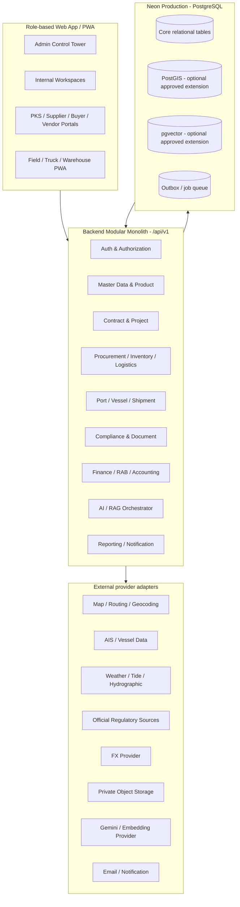
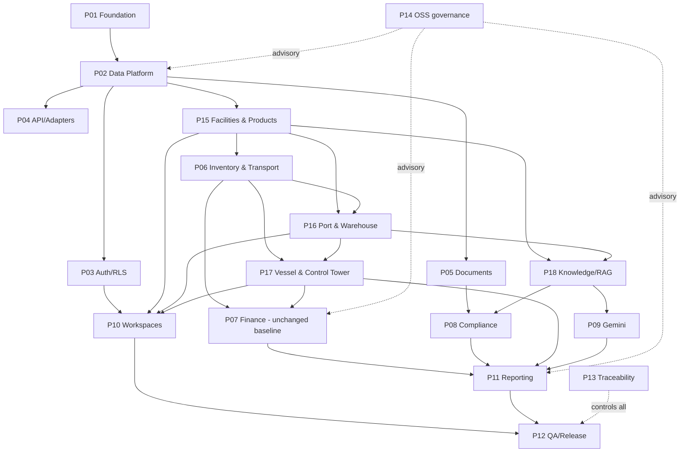

# PKE Export Intelligence & Project Control Platform

# Master Implementation Plan Rev2.12 — Single-Source Execution Edition


**Status:** Satu-satunya dokumen referensi dan catatan eksekusi aktif PKE — living document  

**Revision:** 2.12 (18 November 2026 — F0 live revalidation after Migration 036 closure)  

**Tanggal dokumen:** 11 November 2026  

**Repository:** `D:\PKE`  

**Target database (runtime, Rev4 permanent):** Neon project `purple-base-63944903` / branch `production` (`br-damp-shape-b3xlh4nr`) / database `neondb`. **Legacy migration source only:** `lucky-glitter-99553107` / `br-calm-glade-b3nrleet` / `neondb` (do not use for app/runtime/test).  

**Bahasa:** Indonesia  

**Dokumen tunggal untuk:** seluruh spesifikasi, keputusan, status implementasi, backlog, bukti validasi, blocker, dan instruksi Cline PKE


> **Tujuan dokumen:** menjadi SATU-SATUNYA acuan kerja aktif untuk menyelesaikan PKE. Semua revisi status, keputusan, backlog, mapping API/database/frontend, dan catatan eksekusi Cline wajib diperbarui di file ini. Jangan membuat atau meminta owner menyimpan dokumen status/laporan/plan lain. Isi dokumen tetap merupakan rencana dan catatan bukti; bukan bukti otomatis bahwa fitur selesai atau izin otomatis mengubah Production.


---


## 0. Pengendalian dokumen, sumber, dan cara membaca


### 0.1 Asal-usul baseline dan kebijakan dokumen tunggal


Rev1.6 melanjutkan substansi bisnis/arsitektur Rev1.3 dan melanjutkan kebijakan dokumen tunggal Rev1.4 yang sebelumnya menggabungkan keputusan dari Master Architecture v4.2.3 Rev03, Implementation Plans Rev1.2, P07 Finance v1.2, P14 OSS/BI, serta audit keuangan. Referensi tersebut dicatat sebagai provenance historis, bukan daftar dokumen aktif yang wajib dipelihara.


**Mulai 11 November 2026, file Master Implementation Plan ini adalah satu-satunya dokumen referensi dan kontrol revisi aktif.** Seluruh hal berikut ditulis/di-update di sini: spesifikasi, owner decisions, phase status, requirement-to-code traceability, schema/API mapping, execution log, test evidence summary, risk, blocker, serta next action.


Aturan dokumen:

1. Cline dan pelaksana revisi harus membaca file Master ini terlebih dahulu dan menjadikannya satu-satunya dokumen acuan proyek.

2. Jangan membuat, meminta, atau mengharuskan owner menyimpan `PKE_P03_PLAN.md`, `IMPLEMENTATION_STATUS.md`, `TRACEABILITY_MATRIX.md`, `DECISION_LOG.md`, `CHANGELOG_EXECUTION.md`, sprint reports, audit reports, README tambahan, atau paket ZIP sebagai dokumen status paralel.

3. File kode, SQL migration, automated tests, konfigurasi build, dan file aplikasi yang memang diperlukan untuk menjalankan produk tetap boleh dibuat/diubah sebagai source artifacts. Yang dilarang adalah memecah catatan referensi/kemajuan menjadi dokumen-dokumen Markdown/CSV/laporan terpisah.

4. Setiap akhir sesi, ringkas perubahan dan bukti yang relevan langsung di Section 32 `Living Execution Ledger` dan checklist/section domain yang sesuai pada file ini.

5. Jika dokumen lama ditemukan di repository, perlakukan sebagai arsip/historical input. Jangan mengubahnya sebagai kewajiban dan jangan menjadikannya sumber status yang mengalahkan file ini.

6. **Investigasi tidak boleh berhenti sebagai laporan.** Jika pemeriksaan menemukan bug, route ganda, schema mismatch, auth gap, UI contract mismatch, atau test gap, pelaksana wajib langsung melakukan revisi kode/test/frontend pada sesi kerja yang sama selama aman dan berada dalam kewenangan. Jika perubahan memerlukan keputusan owner, kredensial, domain produksi, atau izin migrasi, tutup bagian yang aman, buat sistem fail-closed/disabled yang jujur bila memungkinkan, lalu catat blocker spesifik di Section 32. Jangan membuat laporan investigasi terpisah dan jangan meminta owner mengulang instruksi.


### 0.2 Hierarki otoritas


Jika ditemukan konflik, gunakan urutan berikut:


1. Instruksi/keputusan owner paling baru yang dinyatakan secara langsung.

2. Catatan keputusan dan execution ledger terbaru dalam dokumen ini.

3. Spesifikasi target dan aturan Rev1.6 dalam dokumen ini.

4. Baseline khusus P07 Finance v1.2 yang telah dipertahankan di bagian finance dokumen ini; tidak boleh didesain ulang tanpa Change Request owner.

5. Source code, migration, konfigurasi dan database aktual sebagai kondisi implementasi yang harus diperiksa — bukan otomatis bukti requirement terpenuhi.

6. Laporan/dokumen terdahulu hanya sebagai bukti historis, bukan status terkini tanpa pemeriksaan ulang.


### 0.3 Kategori informasi


Setiap informasi dalam dokumen/implementation wajib dibedakan sebagai:


- **FACT — VERIFIED:** didukung pemeriksaan langsung, sumber resmi, atau artefak test yang dapat diulang.

- **REPORTED — NOT INDEPENDENTLY VERIFIED:** hasil yang disampaikan Cline/owner tetapi source tree, log, atau artefak aktual belum diperiksa ulang dalam sesi ini. Jangan menyatakannya sebagai FACT — VERIFIED sebelum bukti diperiksa.

- **DECISION — OWNER APPROVED:** keputusan bisnis/teknis yang telah ditetapkan owner.

- **DESIGN — PROPOSED:** rekomendasi rancangan target yang belum tentu sudah ada di source/database.

- **ASSUMPTION — TO VERIFY:** dugaan kerja yang tidak boleh diperlakukan sebagai fakta.

- **BLOCKED_EXTERNAL:** implementasi kode dapat selesai, tetapi aktivasi memerlukan akun, lisensi, API key, akses, atau persetujuan provider.

- **LEGAL_REVIEW_REQUIRED:** penafsiran atau persetujuan hukum/kepabeanan/pajak/standardisasi belum disahkan oleh ahli berwenang.


### 0.4 Makna “running 100%”


Target “100%” pada dokumen ini berarti seluruh ruang lingkup aplikasi yang telah disepakati selesai dibangun dan lulus acceptance gate yang relevan. Target ini **tidak** berarti semua data eksternal selalu tersedia, semua otoritas pemerintah menyediakan API, kapal memiliki AIS di setiap wilayah, atau semua transaksi bisnis sudah pernah terjadi.


Status hasil akhir dipisahkan menjadi:


**APPLICATION COMPLETE** — seluruh fitur aplikasi dalam scope rilis selesai, UI/API/database terintegrasi, automated tests yang diizinkan owner lulus, hak akses terbukti, workflow end-to-end memiliki bukti yang sah, build/deployment/monitoring siap, dan blocker kode S1/S2 tidak ada. Static/mock tests tidak menggantikan bukti integrasi SQL/RLS/provider nyata; gate yang belum dapat dibuktikan tetap BLOCKED dan tidak boleh disamarkan sebagai COMPLETE.


**BUSINESS PRODUCTION READY** — selain Application Complete, data mitra nyata telah diverifikasi, legal/accounting sign-off diterima, provider eksternal yang wajib telah aktif, user acceptance oleh pihak terkait selesai, prosedur operasi dan backup/restore telah diuji, serta owner memberi keputusan go-live.


Aplikasi dapat dinyatakan Application Complete sebelum transaksi bisnis riil pertama. Namun, sesuai instruksi owner saat ini, jangan menggunakan database PostgreSQL lokal, Docker database, Neon branch lain, atau data bisnis dummy Production untuk menguji workflow. Gunakan static/type checks, unit tests, API contract tests, mock adapters, serta pemeriksaan Production yang read-only. Pengujian E2E yang membutuhkan penulisan data bisnis sintetis harus berstatus `BLOCKED_OWNER` sampai owner menentukan metode/target pengujian yang diizinkan. Mock bukan bukti integrasi database nyata. Business Production Ready tetap menunggu verifikasi lapangan dan persetujuan yang memerlukan data/aktor riil.


---


# 1. Ringkasan eksekutif dan tujuan produk


PKE adalah **Export Intelligence & Project Control Platform** untuk mengelola rantai pasok Palm Kernel Expeller/Palm Kernel Meal (PKE/PKM) dari pemasok/fasilitas produksi sampai buyer dan pelaporan ekspor. PKE mengintegrasikan master data mitra dan fasilitas, spesifikasi produk, stock lot, procurement, truck checkpoint, gudang, port, loading, kapal/voyage, dokumen ekspor, finance/accounting, compliance, AI/RAG, dashboard, serta stakeholder portal.


PKE bukan hanya aplikasi pencatat transaksi. Sistem harus membantu menjawab pertanyaan operasional berikut secara cepat dan dapat ditelusuri:


1. Fasilitas/PKS/KCP mana yang benar-benar mampu memasok produk dan volume tertentu?

2. Produk mana yang mempunyai spesifikasi paling sesuai dengan permintaan buyer?

3. Berapa stok tersedia, di lokasi mana, berasal dari lot mana, sudah di-reserve berapa, dan sedang berada di tahap logistik mana?

4. Pelabuhan, terminal, gudang, moda transportasi, dan metode loading mana yang layak dipertimbangkan?

5. Apakah karakteristik kapal dan batasan pelabuhan/terminal kompatibel berdasarkan data yang masih berlaku?

6. Apakah data kapal, voyage, cargo, shipping instruction, dan dokumen ekspor konsisten?

7. Buyer dapat melihat progres dan kuantitas sesuai kontraknya tanpa memperoleh akses ke stok/kontrak buyer lain.

8. Admin dan setiap pihak terkait melihat serta mengubah hanya informasi dalam scope otorisasinya.

9. AI dapat mencari regulasi dan dokumen resmi, menjelaskan persyaratan, menemukan gap, membandingkan pemasok/produk, dan menyusun draft laporan dengan kutipan sumber.

10. Finance/RAB/GL tetap menjadi system of record keuangan, dengan pemisahan budget, commitment, accrual, expense, cash paid, dan journal.


## 1.1 Prinsip produk utama


- **Single company / single exporter** pada tahap awal. Buyer, supplier/PKS, transporter, warehouse, port operator, shipping agent, surveyor, dan pihak eksternal lain direpresentasikan sebagai partner dengan hubungan dan scope tersendiri.

- **PKE-first:** PKE/PKM merupakan komoditas awal. Multi-commodity tidak menjadi alasan memperumit rilis pertama; product taxonomy harus extensible untuk fase berikutnya.

- **Neon PostgreSQL Production is the cloud system of record.** Semua business records, authorization, inventory, shipment dan finance berada dalam satu database Production.

- **Modular monolith first:** satu backend modular dengan domain/service boundary jelas. Jangan memecah menjadi microservices sebelum kebutuhan, skala, dan alasan operasional terbukti.

- **Existing-schema-first:** gunakan dan perluas tabel Production yang sudah ada. Dilarang membuat tabel duplikat hanya karena nama entitas di kode berbeda.

- **Event and audit trail:** perubahan status dan inventory/quantity wajib terlacak melalui event, actor, timestamp, source, dan referensi transaksi.

- **Human approval for critical actions:** legal interpretation, posting jurnal, approval pembayaran, perubahan dokumen final, vessel/loading exception, dan publikasi regulasi tidak dilakukan AI secara otonom.

- **Provider-neutral adapters:** AIS, map routing, geocoding, FX, weather, email, object storage, dan LLM terisolasi di adapter agar provider dapat diganti.

- **Frontend workflow completeness:** setiap fitur backend yang dapat digunakan harus memiliki halaman, form, validation, empty/loading/error state, permission-aware action, dan user feedback yang sesuai.


## 1.2 Batas fase implementasi


Termasuk dalam target:


- P01–P13 baseline yang sudah ada.

- P14 OSS/BI governance sebagai evaluasi dan referensi, bukan kewajiban memasang ERPNext.

- P15 Supplier, Facility & Product Master Intelligence.

- P16 Port, Port Warehouse & Multimodal Logistics Intelligence.

- P17 Maritime, Vessel Intelligence & Export Control Tower.

- P18 Regulatory Knowledge Graph, RAG & AI Intelligence.


Tidak otomatis termasuk tanpa Change Request:


- Menjadi marketplace terbuka lintas eksportir/perusahaan.

- Mengoperasikan terminal/pelabuhan atau memberikan izin navigasi.

- Menggantikan sistem resmi Bea Cukai, karantina, otoritas pelabuhan, bank, atau shipping line.

- Melakukan transfer bank otomatis pada fase awal.

- Memberikan legal opinion otomatis atau menerbitkan sertifikat resmi.

- Menjamin cakupan AIS global penuh atau memperkirakan posisi kapal ketika data provider tidak tersedia.

- Mengganti kebijakan akuntansi, perpajakan, atau standar kualitas tanpa persetujuan ahli.


---


# 2. Baseline teknis dan kebijakan Production-only


## 2.1 Target Neon yang telah diperiksa


Snapshot pemeriksaan read-only pada 9 November 2026:


| Item | Kondisi |

|---|---|

| Neon project | `PKE-export-platform` |

| Project ID | `lucky-glitter-99553107` |

| Branch | `production` |

| Branch ID | `br-calm-glade-b3nrleet` |

| Database | `neondb` |

| PostgreSQL | 18.6 |

| Runtime role | `app_runtime_secure` |

| Runtime `BYPASSRLS` | `false` pada query yang diperiksa |

| Public tables | 81 pada saat audit |

| RLS enabled | 81/81 pada saat audit |

| `FORCE ROW LEVEL SECURITY` | 0/81 pada snapshot tersebut; perlu evaluasi per tabel, jangan ubah massal |

| Migration history | Row 001–028 terlihat melalui owner connection saat pemeriksaan; 001–016 berstatus baselined, 017–028 applied |

| Extensions | `postgis` 3.6.4 dan `vector` 0.8.6 tersedia di daftar extension Neon tetapi belum ter-install pada snapshot pemeriksaan |


Angka di atas adalah snapshot historis dan wajib diverifikasi ulang oleh Cline sebelum pekerjaan yang memerlukan perubahan Production. Keberadaan RLS pada tabel tidak membuktikan seluruh policy benar atau cross-tenant isolation telah lulus.


## 2.2 Target backend cloud — PERMANENT SINGLE PROJECT & SINGLE BRANCH (Revision 4, owner-mandated 14 Nov 2026)

> **ABSOLUTE / PERMANEN / MENGIKAT (Cline, AI agent, PowerShell, CI/CD, manual):** PKE memakai **satu proyek Neon, satu branch, satu database, satu `DATABASE_URL`**. **DILARANG MEMBUAT BRANCH NEON TAMBAHAN DALAM KONDISI APA PUN** — termasuk development, staging, testing, validation, preview, feature, backup, migration testing, eksperimen/troubleshooting, atau branch sementara (otomatis/manual). **Tidak ada pengecualian otomatis.** Hanya instruksi tertulis baru dari owner yang dapat mengubah keputusan ini. Setiap proses harus **fail-closed/berhenti** bila target tidak sesuai. Jangan pernah menampilkan connection string/secret.

- **Target tunggal (system of record & satu-satunya koneksi aplikasi):** project `purple-base-63944903` (`PKE-export-platform`), branch `br-damp-shape-b3xlh4nr` (`production`), database `neondb`, region `aws-ap-southeast-1`, PostgreSQL 18, host `ep-odd-resonance-b3zb42fw.c-4.ap-southeast-1.aws.neon.tech`, runtime role `app_runtime_secure` (least privilege, TLS). Backend memakai satu `DATABASE_URL` ke target ini; frontend hanya memakai API backend PKE. **Tidak ada** `NEON_TEST_DATABASE_URL`, fallback ke proyek lama, koneksi alternatif tersembunyi, atau pemilihan branch berdasarkan environment. Script/runner wajib memvalidasi Project ID dan Branch ID eksplisit.
- **Proyek lama — sumber migrasi sementara saja (SUPERSEDED sebagai target aktif):** `lucky-glitter-99553107` (`PKE-export-platform-legacy-migration-source`) dan seluruh branch/host lamanya (`br-calm-glade-b3nrleet`, `br-billowing-math-b31f4wos`, endpoint terkait) **DILARANG** digunakan oleh backend, frontend, integration test, CI/CD, Cline, atau script. Branch lama tidak menerima perubahan aplikasi/data bisnis baru; compute lama tetap suspended/idle saat tidak diperlukan migrasi. **Jangan hapus proyek lama sebelum migrasi dan seluruh acceptance gate tervalidasi serta persetujuan final owner.** Jangan membuat branch pengganti di proyek lama.
- **Local database:** Dilarang PostgreSQL lokal, Docker database, atau database alternatif.
- **Pengujian tanpa branch tambahan:** unit test boleh mock. Integration test menggunakan **satu branch `production` yang sama** dengan transaksi, rollback, dan fixture QA bernamespace unik; fixture dibersihkan dan diverifikasi, tidak mengubah data di luar namespace test, tidak memakai data bisnis palsu. Migration diperiksa dan mendapat persetujuan owner sebelum diterapkan. Test tidak aman harus **fail-closed** (bukan membuat branch baru).
- Production tidak boleh menerima synthetic/dummy business data; write hanya operasi bisnis nyata yang dikendalikan/diotorisasi owner. Perubahan Production yang membutuhkan persetujuan (termasuk migration terkontrol) wajib preflight, backup/review SQL, dan persetujuan owner spesifik.

## 2.3 Aturan migration Production (single-branch, Revision 4)

1. Migration `001–035` adalah sejarah **immutable** (jangan diubah/dijalankan ulang). Riwayat sumber yang diverifikasi: 001–016 baselined, 017–035 applied. Pertahankan migration history 001–035 tanpa mengubah isi saat migrasi ke proyek baru.
2. Perubahan schema baru berikutnya memakai nomor mulai `036+` hanya bila benar-benar diperlukan, setelah schema reconciliation terhadap object Production aktual (proyek/branch baru). Jangan menebak nomor migration tanpa memeriksa migration history.
3. Sebelum migration baru dibuat, cocokkan entity/tabel/kolom/index/FK/RLS/policy/grant/fungsi `SECURITY DEFINER` dengan Production. Utamakan memperbaiki mapping aplikasi terhadap tabel yang sudah ada; jangan membuat tabel duplikat untuk nama salah di kode.
4. Setiap migration baru harus mempunyai tujuan, exact SQL, SHA-256, preflight/read-only impact check, lock/data-risk review, RLS/grant review, rollback/recovery plan, dan post-apply read-only verification.
5. **Migration replay/testing:** dilarang pada PostgreSQL lokal/Docker dan **dilarang membuat branch tambahan** (termasuk validation/staging/testing). (SUPERSEDED: izin replay pada `br-billowing-math-b31f4wos`, Revision 3C.) Validasi migration dilakukan melalui review exact SQL/hash/preflight dan bukti backup/restore; verifikasi terkontrol pada single production branch hanya dengan persetujuan owner spesifik. Klaim tanpa eksekusi/bukti = `BLOCKED`/tidak terverifikasi.
6. Migration Production hanya boleh diterapkan setelah owner memberikan persetujuan eksplisit atas SQL/rencana migration spesifik tersebut. Instruksi umum bukan persetujuan otomatis.
7. Setelah migration yang disetujui diterapkan, catat ID/checksum/waktu/status di Section 32 dan verifikasi read-only terhadap migration history serta schema aktual.
8. Untuk perubahan destructive/irreversible, jangan lanjut tanpa backup/restore procedure yang terbukti dan persetujuan khusus.
9. Dilarang menjalankan `DROP`, `TRUNCATE`, bulk `DELETE`, reset, atau mengganti data Production untuk menguji fitur. Fixture QA (jika diizinkan pada single production) harus bernamespace unik, transaksional/rollback, dibersihkan dan diverifikasi; cleanup gagal = FAIL (no bulk delete data non-test).


## 2.4 Extension PostGIS dan pgvector


- `postgis` dan `vector` tersedia sebagai extension pada Neon menurut pemeriksaan `pg_available_extensions`, tetapi belum ter-install pada snapshot 9 November 2026.

- PostGIS direkomendasikan untuk spatial query (jarak, radius, point-in-polygon, spatial index) setelah compatibility, cost, security, dan lisensinya ditinjau.

- pgvector direkomendasikan untuk embedding search/RAG setelah strategi embedding dan ACL filtering disepakati.

- Aktivasi extension adalah perubahan schema Production. Jangan `CREATE EXTENSION` langsung tanpa migration, preflight, review license, dan persetujuan owner.

- Jika PostGIS belum diaktifkan, MVP dapat menyimpan `latitude`/`longitude` dan menghitung jarak geodesik di service secara terbatas; jangan mengklaim routing/nautical compatibility yang belum ada.


## 2.5 Existing schema inventory — prioritas reuse


Tabel berikut telah ditemukan pada Production snapshot. Ini bukan persetujuan bahwa semua kolom sudah cukup. Cline wajib memeriksa detail saat coding:


| Domain | Tabel existing | Fungsi/keputusan target |

|---|---|---|

| Identity | `users`, `project_members`, `project_roles`, `project_role_permissions`, `permissions`, `role_catalog` | Reuse; audit tenant/facility/partner scope dan provider claim mapping |

| Partner/customer | `buyers`, `buyer_parties`, `vendors`, `service_vendors` | Reuse sebagai role-specific profile; identitas perusahaan bersama perlu direkonsiliasi |

| Facilities | `pks_sites` | Reuse sebagai facility/site awal; perlu tipe fasilitas, owner organization, kapasitas, fasilitas proses, status verifikasi |

| Product | `product_catalog`, `product_specifications`, `project_product_specifications` | Reuse; lengkapi taxonomy, attributes, quality result dan buyer requirement |

| Route/Port | `ports`, `pks_port_routes` | Reuse; tambah terminal/berth/channel/depth observations/loading services dan route provenance |

| Warehouse | `warehouses`, `warehouse_receipts` | Reuse; lengkapi mode storage, zones/bins/capacity/equipment/stock reconciliation |

| Inventory | `inventory_lots`, `inventory_movements`, `packing_batches` | Reuse dan perluas; satu lot hanya dihitung pada satu posisi/status stok per waktu |

| Transport | `transport_legs`, `truck_trips`, `tracking_events` | Reuse; checkpoint device bukan klaim live truck GPS |

| Shipment/maritime | `shipments`, `shipment_allocations`, `vessels`, `voyages`, `loading_operations` | Reuse; lengkapi IMO/MMSI/dimensions/AIS snapshots/vessel-port assessment/loading event |

| Export compliance | `regulatory_sources`, `country_export_document_requirements`, `project_export_document_requirements`, `project_export_documents`, `export_document_types` | Reuse; perlu rule versions, source citation, jurisdiction, product/HS conditions |

| Finance | `rab`, `cost_obligations`, `payment_obligations`, `ap_invoices`, `ar_invoices`, `cash_advances`, `cash_schedules`, `journal_entries`, `journal_lines`, `chart_of_accounts`, FX tables | P07 tetap baseline; audit gap dan link ke operational events, tanpa ledger ganda |

| Project | `contracts`, `contract_programs`, `projects`, `project_operating_profiles`, `project_versions`, `project_workflows` | Reuse; jangan mengubah settlement-unit Project Instance model |

| Notifications | `user_notifications`, `notification_deliveries` | Reuse sebelum mempertimbangkan tabel `notifications` baru |

| Reporting | `report_runs`, `report_schedules`, `report_export_audit` | Reuse untuk reporting dan scheduled reports |


**Peringatan:** laporan Sprint Completion pernah menyebut `rab_items`, `payments`, `compliance_rules`, `compliance_documents`, dan `notifications` yang tidak ditemukan di Production saat pemeriksaan. Jangan langsung membuat tabel tersebut. Rekonsiliasi dahulu dengan `rab`, `payment_obligations`, `ap_invoices`/`ar_invoices`, `regulatory_sources`, `project_export_documents`, `user_notifications`, dan desain logical model. Tabel baru hanya dibuat bila kebutuhan entitas dan relasinya memang berbeda.


## 2.6 Fakta Neon Production terverifikasi — 11 November 2026


> Status berikut berasal dari pemeriksaan langsung branch `production` pada sesi 11 November 2026. Angka ini adalah snapshot; pemeriksaan ulang tetap diperlukan sebelum perubahan berikutnya. Tidak ada branch Neon lain dibuat/digunakan.


| Area | Fakta terverifikasi | Implikasi |

|---|---|---|

| Target | Project `lucky-glitter-99553107`, branch `production` / `br-calm-glade-b3nrleet`, database `neondb`, region `aws-ap-southeast-1`, PostgreSQL 18.6 | Tetap menjadi satu-satunya system of record cloud |

| Migration history | 32 baris; ID 1–32 lengkap; 001–016 `baselined`; 017–032 `applied`; status lain 0 | 001–028 tidak berubah; 029–032 adalah revisi aktif terbaru |

| Public schema | 81 base tables; RLS enabled 81/81; semua tabel memiliki policy; tabel tanpa RLS/policy 0 | Jangan menambah policy/tabel tanpa kebutuhan dan review |

| Referential integrity | 153 foreign keys tervalidasi; unvalidated FK 0 | FK validation selesai pada snapshot ini |

| Index | Invalid/not-ready indexes 0 | Tidak ada indeks rusak yang terdeteksi pada snapshot |

| SECURITY DEFINER | 17 fungsi; seluruhnya memakai fixed `search_path`; tidak satu pun dapat dieksekusi role `PUBLIC` | Tetap review setiap fungsi baru/ubah |

| Runtime role | `app_runtime_secure`: non-superuser, `NOBYPASSRLS`, tanpa CREATEDB/CREATEROLE, tidak dapat CREATE pada schema `public` | Runtime role least-privilege pada pemeriksaan |

| RLS context | `set_rls_context(uuid)` adalah `SECURITY INVOKER`; `PUBLIC EXECUTE=false`; `app_runtime_secure EXECUTE=true`; null user ditolak | Smoke test transaksi berhasil menetapkan identitas admin; konteks lokal transaksi dibersihkan saat transaksi berakhir |

| User admin | Satu user aplikasi aktif ber-role admin; `mfa_enabled=false` | Admin MFA belum aktif dan ditunda untuk rilis awal sesuai D-107; jangan mengubah flag menjadi true atau membiarkan false memblokir akses Admin |

| Neon Auth | Better Auth aktif; email/password aktif; sign-up dinonaktifkan; email OTP verification diwajibkan; nama aplikasi `PKE Export Platform` | Jangan mengubah metode login tanpa keputusan/tes |

| Auth origins | Trusted origin hanya `http://localhost:3001`; `allow_localhost=true` | BLOCKER sebelum deployment publik; jangan menebak domain frontend atau mengunci akses admin |

| Email | Shared provider `auth@mail.myneon.app` | Custom SMTP masih belum dikonfigurasi |

| MFA plugin/factor | Neon Auth config yang diperiksa tidak memuat MFA plugin/factor; tidak ada provider-backed MFA assurance yang terbukti | Sesuai D-107, MFA tidak diwajibkan pada rilis awal. Jangan pasang `requireAdminMfa` sekarang; simpan sebagai backlog pascarilis dan jangan mengklaim MFA aktif |

| Object storage | Bucket `pke-private-documents` tersedia dengan access `private`; listing object tidak menunjukkan file | Infrastruktur bucket tersedia; signed upload/download, metadata/ACL dan adapter aplikasi belum dibuktikan |

| Neon Functions | `list_functions` menghasilkan array kosong; tidak ada function ter-deploy | Jangan mengklaim API serverless Neon tersedia; API harus diselaraskan pada aplikasi yang ada atau implementasi baru yang dipilih owner |

| Business data | `projects=0`, `project_members=0`, `buyers=0`, `pks_sites=0`, `ports=0`, `warehouses=0`, `vendors=0` | Database schema tidak kosong; business records belum dimasukkan |

| Reference data | `countries=3`, `currencies=4` (IDR satu-satunya functional currency), `export_document_types=8`, active permissions `88`, product catalog memiliki satu item PKC | Referensi dasar tersedia; tidak berarti country-pack legal rules sudah diverifikasi |

| Finance setup | `payment_methods=0`, `cost_categories=0`, `chart_of_accounts=0` | Finance master-data/setup belum lengkap; jangan mengarang COA atau metode pembayaran tanpa baseline/approval |


**Pemeriksaan read-only lanjutan (11 November 2026):**

- Struktur `migration_history` adalah `id`, `filename`, `sha256`, `applied_at`, `status`. Query dengan kolom `name` gagal karena kolom tersebut tidak ada; query berikutnya wajib memakai nama kolom aktual.

- Branch inventory mengembalikan beberapa branch historis (antara lain `staging`, `rehearsal`, `p03-backend-hardening-test` dan snapshot lain). Branch `production` tetap primary/default dan ready, tetapi tidak protected. Jangan menggunakan, membuat, menghapus atau mempromosikan branch historis tersebut.

- Auth config aktual: trusted origins hanya `http://localhost:3001`, `allow_localhost=true`; email/password aktif; sign-up nonaktif; OTP email wajib; OAuth providers kosong; MFA plugin/factor tidak terlihat.

- Bucket `pke-private-documents` terdaftar sebagai `private`; hal itu belum membuktikan signed upload/download aplikasi.

- `to_regclass` memastikan `rab_items`, `payments`, `compliance_rules`, `compliance_documents`, `document_registry`, dan `notifications` tidak ada di schema `public`.

- `fx_exposures` (jamak) dan `fx_exposure` (tunggal) sama-sama ada dengan struktur berbeda. Finance v1.2 memakai `fx_exposures`; tabel tunggal adalah legacy dan tidak boleh dihapus/diubah tanpa owner approval.

- Tidak ditemukan tabel transaksi `payments`; `payment_obligations` adalah kewajiban bayar, bukan transaksi pembayaran aktual.

- `report_runs.file_reference` tersedia; endpoint tidak boleh mengklaim `completed` sebelum file laporan nyata disimpan dan referensinya divalidasi.

| Branch protection | `production.protected=false`; permintaan protect ditolak oleh limit protected branch paket Neon | Jangan meng-unprotect branch lain; catat sebagai keterbatasan paket dan mitigasi operational control |


Catatan penting: `users` tidak memiliki direct table grants ke `app_runtime_secure`; akses identitas menggunakan fungsi `SECURITY DEFINER` yang sudah dibatasi. Ini bukan alasan untuk memberi grant CRUD langsung pada tabel `users`.


## 2.7 Prioritas revisi aktif — investigasi dan perbaikan dalam satu sesi


Temuan berikut berasal dari pemeriksaan read-only Neon Production dan pemeriksaan source snapshot yang tersedia pada 11 November 2026. Ini adalah baseline yang perlu diverifikasi terhadap working tree aktif `D:\PKE`; snapshot tidak boleh diperlakukan sebagai pengganti repo aktif.


| Domain | Fakta schema Production yang diperiksa | Revisi wajib pada API/frontend | Urutan |

|---|---|---|---|

| Operations/truck | `truck_trips` memakai `transport_leg_id` dan `license_plate`; tidak memakai `plate_number`. `transport_leg_id` NOT NULL. | Selaraskan DTO, validator, SQL, UI, dan test. Wajib resolve transport leg yang valid sebelum insert/update; jangan membentuk ID palsu. | Tinggi |

| Tracking | `tracking_events` memiliki `gps_accuracy` NOT NULL, `notes` nullable, dan field capture/server timestamps. `event_type` serta status dibatasi nilai valid melalui constraint. | Validasi nilai event/status dan akurasi GPS di server; UI harus mengirim semua field wajib. Tolak payload tidak lengkap, bukan mengisi nilai fiktif. | Tinggi |

| RAB dan commitment P07 | `rab` adalah tabel aktual dengan `project_id`, `description`, `amount`, `category` (enum), `is_active`, timestamps. `cost_obligations` menyimpan estimasi/commitment; `payment_obligations` menyimpan kewajiban pembayaran yang direncanakan. `rab_items` dan `payments` tidak ada. | Petakan setiap operasi sesuai arti bisnis: RAB ke `rab`; commitment ke `cost_obligations`; kewajiban bayar ke `payment_obligations`. Jangan menyamakan kewajiban bayar dengan transaksi pembayaran yang sudah dieksekusi. Pertahankan Finance v1.2. | Tinggi |

| AP/AR dan pembayaran | `ap_invoices`, `ar_invoices`, `cash_advances`, `cash_schedules`, `payment_methods` ada; tidak ditemukan tabel transaksi `payments`. `payment_obligations` bukan payment execution ledger. | Gunakan AP/AR/advance/obligation hanya untuk use case yang tepat. Endpoint pembayaran aktual harus ditahan/disabled dengan status jelas sampai model payment execution yang sah tersedia; jangan insert ke `payment_obligations` lalu menyebut pembayaran selesai. | Tinggi |

| FX P07 v1.2 | `fx_rates` memakai `from_currency_id`, `to_currency_id`, `rate`, `rate_type`, `rate_date`, `rate_source`, `is_active`. Tabel `fx_exposures` (jamak) memakai `original_currency_id`, `original_amount`, `functional_amount`, `fx_rate`, `fx_date`, `exposure_type`, `project_id`. Tabel `fx_exposure` (tunggal) legacy masih ada dengan bentuk kolom berbeda. | Revisi route FX Rates agar menggunakan kolom aktual. P07 Finance v1.2 memakai `fx_exposures`; jangan gunakan tabel singular untuk endpoint v1.2, jangan drop/ubah tabel legacy tanpa izin owner. | Tinggi |

| General ledger | `journal_entries` memakai `entry_type`, `reference_id`, `reference_type`, `description`, `entry_date`, `posted_at`, `status`, `posted_by`; `journal_lines` memakai `journal_entry_id`, `account_id`, `debit`, `credit`, `description`, `line_order`. | Hapus asumsi kolom `entry_number`, `posting_date`, `total_debit`, `total_credit` jika tidak ada. Bentuk jurnal melalui header + lines, validasi balance debit=credit dan akun valid. Jika belum ada lines/approval, hanya boleh simpan draft; jangan posting jurnal tidak seimbang. | Tinggi |

| Compliance/document P08 | Ada `regulatory_sources`, `export_document_types`, `country_export_document_requirements`, `project_export_document_requirements`, `project_export_documents`; tidak ada `compliance_rules`, `compliance_documents`, atau `document_registry`. `project_export_documents` mensyaratkan project, requirement, file reference, version, status, uploader; status dibatasi enum/check yang tercatat. | Mapping regulasi dan requirement ke tabel aktual. Dokumen project wajib tertaut pada requirement sah, metadata/file reference valid, uploader, version dan status yang diizinkan. Terapkan private bucket; jangan membuat metadata dokumen tanpa file atau tabel registry duplikat. | Tinggi |

| Notifications P11 | Ada `user_notifications` dan `notification_deliveries`; tidak ada tabel `notifications`. `user_notifications` memiliki `recipient_user_id`, `event_id`, `project_id`, `created_by`, title/message/priority/category/read_at. | GET/list/read harus dibatasi `recipient_user_id = current authenticated user`; mark-read menggunakan row ownership check. `notification_deliveries` hanya untuk status pengiriman channel, bukan mengganti notifikasi pengguna. | Tinggi |

| Reports P11 | `report_runs` memiliki `template_id`, `template_version`, `cutoff_at`, `generated_at`, `requested_by`, `audience`, `project_id`, `status`, `idempotency_key`, `file_reference`, `data_freshness`. | Jangan membuat record `completed` sebelum renderer benar-benar menghasilkan file dan file tersimpan di private bucket serta `file_reference` tervalidasi. Bila renderer/storage belum tersedia, gunakan status truthful (`queued`/`failed` sesuai constraint) atau kembalikan 501/503 yang jelas; selaraskan UI agar tidak menunjukkan laporan siap. | Tinggi |

| Auth/RBAC (MFA ditunda) | Global `/api/v1` auth middleware ada pada source snapshot; `requireAdminMfa` tersedia di `auth.ts` tetapi belum terpasang di `index.ts` snapshot. Neon Auth Better Auth aktif; trusted origin yang diperiksa hanya `http://localhost:3001`. | Untuk rilis awal, nonaktifkan kewajiban MFA saja: jangan jadikan `mfaVerified`/factor claim sebagai syarat route Admin. Tetap wajibkan `requireAuth`, verifikasi JWT/session, `requireAdmin`/permission, resource scope, RLS context, rate limit, session revocation, dan audit log. Jangan set `mfaVerified=true` atau `mfa_enabled=true` palsu. MFA masuk backlog pascarilis. | Tinggi |

| Storage P05 | Bucket `pke-private-documents` tersedia dengan access `private`; belum ada bukti integrasi signed upload/download dari aplikasi. | Implementasikan adapter yang memakai kredensial server-side, authorization sebelum signed URL, key namespace, checksum, version dan metadata. Jangan pernah membuat bucket publik. | Tinggi |

| Route registration | Snapshot `index.ts` mencatat 8 kelompok method+path dengan registration ganda: `GET /roles`, `POST /contract-programs`, `POST /projects`, `GET/POST /fx-rates`, `GET/POST /fx-exposure`, `GET /notifications`. | Inventarisasi ulang pada working tree; pertahankan handler yang benar setelah men-trace middleware, DTO, caller frontend dan tests; satu handler per method+path. Tambah tests agar duplikasi tidak kembali. | Tinggi |


**Aturan wajib:** investigasi dan revisi adalah satu pekerjaan. Untuk setiap temuan, Cline harus (a) memperbaiki source/test/frontend langsung pada sesi itu, atau (b) membuat path tersebut fail-closed/disabled secara jujur dan mencatat blocker beserta owner input yang benar-benar diperlukan. Tidak boleh mengakhiri pekerjaan hanya dengan menulis daftar temuan.


**Execution update 11 November 2026 — dilaporkan Cline, belum diverifikasi ulang pada working tree dalam sesi ini:** delapan kelompok route method+path ganda telah diselesaikan di `src/index.ts`; route yang menargetkan tabel Production yang tidak ada sudah dihapus/ditahan; mapping `fx_rates` dan header/lines jurnal diperbaiki; `report_runs` tidak lagi dibuat `completed` tanpa file; regression test route registry ditambahkan. Lihat Section 32.3 dan 32.5. Route collision tidak lagi menjadi pekerjaan implementasi utama; sesi berikutnya cukup memeriksa hasil di repo aktif, menjalankan test terkait, dan tidak mengulang patch yang sudah benar.


Batas bukti pada update tersebut: laporan menyebut GET/POST `/fx-exposure` tetap ada tetapi tidak menyatakan secara eksplisit apakah query sudah dipindahkan ke `fx_exposures` plural; mapping exposure tetap OPEN sampai diperiksa. Koreksi `journal_entries`/`journal_lines` membuktikan penyesuaian nama kolom menurut laporan, bukan otomatis membuktikan validasi balance, akun, periode, approval, atau posting. Penghapusan route dokumen lama bukan bukti bahwa P08 sudah tersambung ke `project_export_documents` dan private storage.


Urutan kerja:

1. Route registry + API SQL/DTO/query terhadap Production schema; hapus route ganda dan cocokkan middleware/permissions.

2. Revisi P06, P07, P08 dan P11 berdasarkan tabel/kolom/constraint nyata; jangan membuat tabel duplikat.

3. Perbaiki authorization, project/partner/user scope, RLS transaction context, auth guard dan audit coverage. MFA enforcement ditunda sesuai keputusan owner D-107; jangan jadikan ketiadaan MFA gate rilis awal.

4. Revisi frontend API client/types/forms/tables/details agar kontraknya sama dengan API; matikan action yang belum didukung.

5. Implementasikan private storage dan report generation yang benar; jangan membuat status palsu.

6. Jalankan static/type/unit/contract/mock/component checks yang diizinkan; tulis hasil/exit code di Section 32.

7. Database-write E2E, live storage round-trip dan Production mutations yang belum diizinkan tetap BLOCKED_OWNER/BLOCKED_EXTERNAL; jangan disamarkan. MFA bukan gate rilis awal setelah keputusan owner D-107 dan tetap menjadi backlog pascarilis.


---


# 3. Arsitektur target dan prinsip implementasi


## 3.1 Arsitektur logis





## 3.2 Batas modul backend


Backend tetap modular monolith dengan pemisahan domain folder/service/controller/repository/schema/validation/test. Jangan menaruh seluruh business logic di `src/index.ts` atau satu route file.


Target struktur konseptual:


```text

src/

  app/                 # bootstrap, middleware, route registration

  auth/                # authentication provider, session, MFA, token claims

  authorization/       # permission resolver, scope, RLS context

  domains/

    foundation/

    partners/

    facilities/

    products/

    buyer-demand/

    procurement/

    inventory/

    transport/

    warehouses/

    ports/

    vessels/

    shipments/

    documents/

    compliance/

    finance/            # preserve P07 implementation

    ai-knowledge/

    reporting/

    notifications/

  integrations/

    maps/

    routing/

    ais/

    hydrography/

    fx/

    storage/

    llm/

    email/

  jobs/                 # outbox dispatcher, scheduled ingestion, retries

  shared/               # errors, validation, pagination, idempotency, audit

  tests/

```


Ini logical target, bukan instruksi memindahkan semua file sekaligus. Refactor dilakukan incremental dan tidak boleh merusak route/API existing.


## 3.3 Frontend application areas


Frontend memiliki satu shell, route guard, design system, navigation registry dan reusable data layer. Page dibagi per workspace:


- Admin Control Tower.

- Project Management.

- Procurement & Supplier.

- Facility/PKS/KCP Portal.

- Product & Quality Lab.

- Inventory & Warehouse.

- Transport / Field PWA.

- Port & Loading Operations.

- Shipping Agent / Vessel Operations.

- Buyer Portal.

- Compliance & Document Center.

- Finance & Accounting (P07).

- AI Knowledge Assistant.

- Reporting & Analytics.

- Notifications / Task Inbox.


Jangan membuat aplikasi frontend terpisah untuk setiap role. Role menentukan navigation, data projection, permitted actions, dan route guard; backend/RLS tetap menjadi enforcement utama.


## 3.4 Data ownership, provenance, dan confidence


Setiap data eksternal/master penting minimal mencatat:


- `source_type` (official_registry, partner_submission, contract, field_observation, provider_api, manual_admin, imported_dataset, AI_extracted).

- `source_reference` (URL, file key, registry ID, provider response ID, document ID).

- `source_checksum` bila sumber berupa file/dokumen.

- `observed_at` / `effective_from` / `effective_to` bila relevan.

- `retrieved_at` / `recorded_at`.

- `verified_status` dan `verified_by`.

- `verification_notes`.

- `confidence_level` bila nilai diekstrak/diperkirakan.

- `is_current` atau version relation; jangan menimpa histori tanpa versi.


AI-extracted, partner-submitted, public-directory, estimated, and verified values must be distinguishable in UI and database.


---


# 4. Daftar plan P01–P18 dan hubungan dependensi


| ID | Plan | Outcome wajib | Status strategi |

|---|---|---|---|

| P01 | Business Foundation & Admin Project Configurator | Contract Program, delivery cycle, call-off, Project Instance, configuration snapshot, change request | Pertahankan dan tuntaskan |

| P02 | Backend, Database & Neon Platform | Domain model, PostgreSQL, migrations, event/outbox, jobs, indexing, backup | Production-only cloud; local test DB |

| P03 | Identity, Authorization, Role & RLS | Auth identity/session validation, RBAC + resource scope, partner access, RLS and audit; MFA deferred post-release under D-107 | Prioritas kritis

| P04 | API Architecture & External Integrations | REST API standards, provider adapters, retries, webhooks, health checks | Tuntaskan bertahap |

| P05 | Object Storage & Document Services | Private upload/download, metadata, checksum, version, retention, backup | Prioritas kritis |

| P06 | Operational Workflow, Inventory & Truck Checkpoint | Procurement to delivery, lots, weight, checkpoints, warehouse, packing, loading, reconciliation | Perluas |

| P07 | Finance, RAB, Manual Payment & Accounting | RAB, budget control, obligation, payment, AP/AR, GL, FX, settlement | **Pertahankan P07 v1.2; jangan redesign** |

| P08 | Export Compliance & Regulatory Document Engine | Rule engine, document readiness, legal source provenance, country packs | Perluas |

| P09 | Gemini AI, RAG & Intelligence Orchestrator | Grounded RAG, AI matching/reports, governance, audit | Build after data foundation; credentials block only activation |

| P10 | Frontend, UX, Routing & Stakeholder Portals | Complete role workspaces and buyer visibility | Build in parallel per slice |

| P11 | Reporting, Notifications & BI | KPI, reports, alerts, schedules, exports | Integrate all domains |

| P12 | QA, UAT, DevOps & Production Readiness | Automated tests, deployment, monitoring, DR, go/no-go | Local DB testing, Production-only cloud |

| P13 | Change Control & Traceability | Decision log, plan status, requirement-to-code-to-test traceability | Always-on |

| P14 | Open-source Finance & BI Adoption | OSS governance; ERPNext reference, no duplicate ledger | Preserve as advisory |

| P15 | Supplier, Facility & Product Master Intelligence | Organization/PKS/KCP, facility capability, product taxonomy, COA/lab result, capacity, stock availability, buyer matching | New scope |

| P16 | Port, Port Warehouse & Multimodal Logistics Intelligence | Port/terminal/berth/channel/depth, port services, port warehouse, route, modality, facility compatibility | New scope |

| P17 | Maritime, Vessel Intelligence & Export Control Tower | Vessel master, AIS, vessel-port checks, loading, buyer shipment visibility, partner workspace | New scope |

| P18 | Regulatory Knowledge Graph, RAG & AI Intelligence | Official source registry, rules, document knowledge, grounded RAG, AI reports | New scope |


### 4.1 Dependency map





Dependency tidak berarti harus waterfall. UI discovery, API schema, test design dan service scaffolding boleh berjalan paralel; Production migration atau klaim COMPLETE tetap membutuhkan dependency dan evidence yang sesuai.


---


# 5. P15 — Supplier, Facility & Product Master Intelligence


## 5.1 Tujuan


Membangun master data yang dapat dipercaya untuk perusahaan pemasok, fasilitas fisik, PKS/Palm Oil Mill, Kernel Crushing Plant (KCP), produk PKE/PKM, kualitas, kapasitas produksi, ketersediaan stok, sertifikasi, lokasi, dan kebutuhan buyer. Sistem harus dapat memetakan produk yang mirip tanpa mencampur produk yang secara teknis/hukum berbeda.


P15 menjadi sumber kebenaran (master data) bagi procurement, inventory, logistics, buyer matching, compliance dan AI.


## 5.2 Entitas perusahaan dan fasilitas


**Jangan menganggap satu perusahaan sama dengan satu PKS.** Satu grup/perusahaan dapat mempunyai beberapa badan hukum, beberapa mill/KCP, gudang, dan lokasi penerimaan/pengiriman. Satu lokasi dapat berisi fasilitas dengan fungsi berbeda.


Model konseptual:


- `partner_organizations`: identitas badan usaha/partner kanonis (nama legal, negara, alamat legal, identitas registrasi, status aktif).

- `buyers`, `vendors`, `service_vendors`: role profile yang sudah ada; bila tabel tersebut dipertahankan, harus ada relasi yang jelas ke organisasi kanonis. Jangan duplikasi satu entitas perusahaan ke record buyer dan supplier yang tidak saling terhubung.

- `pks_sites`: tabel fasilitas existing yang digunakan sebagai site/facility registry awal. Tambahkan atribut dan relasi dengan migration baru sesuai schema reconciliation. Jangan rename atau drop tabel existing.

- `facility_contacts`: PIC komersial, operasional, QA, dispatch dan administrasi.

- `facility_capacity_records`: kapasitas nominal dan aktual per proses, unit, periode, dan sumber verifikasi.

- `facility_certifications`: sertifikasi, lingkup, site, nomor, tanggal berlaku/kedaluwarsa, penerbit dan bukti.

- `facility_products`: produk/variant yang dapat diproduksi atau dipasok oleh fasilitas.

- `facility_operating_periods`: hari/jam operasi, maintenance, planned shutdown, seasonal constraints.


Tipe fasilitas minimum:


- `palm_oil_mill` — pengolahan TBS dan pemisahan kernel; bukan otomatis produsen PKE.

- `kernel_crushing_plant` — pengolahan palm kernel menjadi produk turunan seperti CPKO dan PKE/PKM.

- `integrated_mill_kcp` — lokasi dengan fasilitas proses berbeda pada satu site; kapasitas tiap proses tetap dipisahkan.

- `warehouse` — penyimpanan; dapat menjadi bagian fasilitas atau lokasi independen.

- `port_terminal` — lokasi handling/loading.

- `collection_point` — titik konsolidasi/serah terima yang bukan pabrik.

- `other` — tipe lain dengan catatan dan approval Admin.


Jangan menetapkan semua PKS sebagai penghasil PKE. PKE/PKM berasal dari proses pengolahan palm kernel di KCP. Sistem harus memisahkan mill, KCP, warehouse dan trading supplier.


## 5.3 Data dictionary — organization and facility


Status tabel: **EXISTING** berarti ditemukan di Production snapshot; **PROPOSED** berarti logical entity target, bukan klaim sudah ada. Nama fisik akhir wajib diputuskan setelah inspeksi schema/FK/policy.


| Logical entity | Table mapping awal | Field | Type logical | Required | Arti/aturan |

|---|---|---|---|---|---|

| Partner Organization | `organizations` (PROPOSED) / reconcile `buyers`, `vendors`, `service_vendors` | `id` | UUID | Yes | Primary key |
| | | `legal_name` | text | Yes | Nama legal sesuai dokumen |

| | | `trading_name` | text | No | Nama dagang |

| | | `organization_type` | enum/text | Yes | buyer, supplier, processor, transporter, warehouse_operator, port_operator, shipping_agent, surveyor, other; multi-role via relationship |

| | | `country_code` | char(2) | Yes | ISO 3166-1 alpha-2 |

| | | `registration_no` | text | No | NIB/registration number, jenisnya disimpan terpisah |

| | | `tax_id` | encrypted/protected text | No | NPWP/TIN; high-sensitivity, mask UI |

| | | `registered_address` | structured address | No | Alamat legal, bukan alamat fasilitas |

| | | `website`, `email`, `phone` | text | No | Contact yang boleh ditampilkan sesuai scope |

| | | `verification_status` | enum | Yes | unverified, submitted, under_review, verified, rejected, expired |

| | | `verified_by`, `verified_at` | UUID/timestamp | No | Reviewer dan waktu |

| | | `source_type`, `source_reference` | text | Yes | Provenance |

| Facility Site | `pks_sites` (EXISTING) | `id`, `name`, `code` | UUID/text | Yes | ID, nama dan kode site yang unik sesuai kebijakan |

| | | `organization_id` | UUID FK | Yes (target) | Perusahaan pemilik/operator; relasi jelas, jangan hanya string company name |

| | | `facility_type` | enum/text | Yes | Jenis fasilitas pada 5.2 |

| | | `address`, `city`, `province`, `country_code` | text/char(2) | Yes/conditional | Alamat lokasi aktual |

| | | `latitude`, `longitude` | decimal | No until verified | WGS84; validasi latitude [-90,90], longitude [-180,180] |

| | | `location_accuracy_m` | decimal | No | Akurasi koordinat |

| | | `site_boundary` | geometry | Optional | PostGIS only after approved enablement |

| | | `access_constraints` | JSONB | No | Kondisi jalan/sungai/jembatan; harus mempunyai sumber dan tanggal verifikasi |

| | | `operating_status` | enum | Yes | planned, operational, maintenance, suspended, closed |

| | | `verification_status` | enum | Yes | Same verification lifecycle |

| Facility Contact | `facility_contacts` (PROPOSED) | `facility_id`, `name`, `role`, `email`, `phone`, `is_primary` | FK/text/bool | Yes | Contact scoped to facility; personal information protected |

| Capacity Record | `facility_capacity_records` (PROPOSED) | `facility_id`, `process_type`, `capacity_value`, `unit`, `period_type` | FK/decimal/text | Yes | Capacity record for a specific processing stage |

| | | `effective_from`, `effective_to` | date | Yes/No | Validity interval |

| | | `capacity_kind` | enum | Yes | nominal, rated, practical, verified_actual |

| | | `source_reference`, `verified_by`, `verified_at` | text/UUID/time | Conditional | Evidence and verifier |

| Certification | `facility_certifications` (PROPOSED) | `facility_id`, `certification_type`, `certificate_no`, `issuer` | FK/text | Yes | Certificate belongs to a facility/scope |

| | | `scope`, `valid_from`, `valid_to`, `status` | text/date/enum | Yes | Include product/process scope |

| | | `document_id` | FK | No | Private document reference |


### 5.3.1 Kapasitas tidak sama dengan stok


Simpan secara terpisah:


1. `nominal_capacity`: kemampuan desain pabrik.

2. `rated_capacity`: kemampuan pada rating/performance test tertentu.

3. `practical_capacity`: batas operasi yang dilaporkan fasilitas.

4. `actual_production`: hasil aktual per hari/minggu/bulan dan period.

5. `available_to_sell`: tonase yang dapat dialokasikan setelah reserved/quality/contract restrictions.

6. `on_hand_stock`: jumlah fisik terhitung di lokasi.

7. `in_transit_stock`: barang yang sedang berpindah lokasi; tidak dihitung sebagai on-hand di lokasi asal dan tujuan sekaligus.


Unit harus eksplisit: `TBS_MT_PER_DAY`, `KERNEL_MT_PER_DAY`, `PKE_MT_PER_DAY`, `WAREHOUSE_MT`, `BAG_COUNT`, atau unit lain yang didefinisikan. Jangan menjumlahkan tonase kapasitas input TBS dengan tonase produk PKE.


## 5.4 Product taxonomy dan klasifikasi


Buat product master canonical dengan hirarki:


`Product Family → Canonical Product → Process/Variant → Commercial Grade → Product Specification Version → Production Lot`.


Contoh kategori konseptual:


- Product family: `palm_kernel_byproducts`.

- Canonical product: `palm_kernel_expeller` / `palm_kernel_meal` sesuai terminologi dan klasifikasi yang telah diverifikasi.

- Process route: `mechanical_screw_press`, `solvent_extraction`, `other_verified`.

- Physical form: meal, cake, pellet, ground, other.

- Commercial grade: internal/contract grade, bukan menggantikan standar legal atau SNI.

- HS classification: country-specific nomenclature, tariff edition, validity date, classification rationale, reviewer, and source.


**Penting:** Nama dagang PKE/PKM tidak cukup untuk menetapkan HS code. Klasifikasi harus mengikuti uraian barang aktual, bentuk fisik, proses, komposisi, BTKI/nomenklatur negara tujuan, dan keputusan klasifikasi resmi bila tersedia. Ex-code tidak boleh diperlakukan sebagai kode final universal.


### 5.4.1 Data dictionary — product and quality


| Logical entity | Table mapping awal | Field | Type logical | Required | Rule |

|---|---|---|---|---|---|

| Product | `product_catalog` (EXISTING) | `id`, `product_code`, `product_name`, `category`, `base_unit` | UUID/text | Yes | Canonical product identity |

| | | `canonical_name`, `synonyms` | text/array | Proposed | Search terms and localized aliases |

| | | `product_family`, `process_route`, `physical_form` | enum/text | Proposed | Distinguish unlike products |

| Product Variant | `product_variants` (PROPOSED) | `product_id`, `variant_code`, `process_route`, `physical_form` | FK/text | Yes | Variant of canonical product |

| | | `description`, `active` | text/bool | No | Variant notes |

| Product Specification | `product_specifications` (EXISTING) | `product_id`, `specification_code`, `version_no`, `specification_name` | FK/text/int | Yes | Versioned spec |

| | | `specification_data` | JSONB | Yes | Thresholds, comparator, value, unit, measurement basis |

| | | `test_methods` | JSONB | Yes | Method identifiers/references |

| | | `status`, `effective_from`, `effective_to` | enum/date | Yes | draft, reviewed, approved, superseded |

| Specification Attribute | `product_attributes` (PROPOSED) | `attribute_code`, `name`, `data_type`, `unit`, `dimension` | text | Yes | Standard machine-readable attribute catalog |

| | | `comparison_basis` | enum | Conditional | as_fed, dry_matter, wet_basis, as_received, other |

| Quality Sample | `product_quality_samples` (PROPOSED) | `lot_id`, `sample_no`, `sampling_method`, `sampled_at`, `sampled_by` | FK/text/time | Yes | Sample provenance |

| | | `sample_location`, `seal_no`, `sample_condition` | text | No | Chain of custody |

| | | `laboratory_id`, `lab_report_document_id` | FK | No | Independent lab and private report |

| Quality Result | `product_quality_results` (PROPOSED) | `sample_id`, `attribute_code`, `result_value`, `unit` | FK/decimal/text | Yes | Numeric/qualitative result |

| | | `basis`, `method_code`, `detection_limit`, `uncertainty` | text/decimal | Conditional | Measurement interpretation |

| | | `review_status`, `reviewed_by`, `reviewed_at` | enum/UUID/time | Yes | Unreviewed results must be visibly marked |

| Product HS Classification | `product_hs_classifications` (PROPOSED) | `product_id`, `country_code`, `hs_code`, `nomenclature_version` | FK/text | Yes | One versioned classification per jurisdiction |

| | | `valid_from`, `valid_to`, `source_document`, `review_status` | date/text/enum | Yes | Legal review required |


### 5.4.2 Atribut kualitas awal PKE/PKM


Attribute catalog awal (bukan klaim batas legal atau buyer specification):


| Attribute code | Parameter | Typical data type | Unit | Catatan |

|---|---|---|---|---|

| `moisture` | Moisture | numeric | % | basis wajib dinyatakan |

| `crude_protein` | Crude protein | numeric | % | basis + method wajib |

| `crude_fibre` | Crude fibre | numeric | % | basis + method wajib |

| `ether_extract` | Crude fat / ether extract | numeric | % | method wajib |

| `ash` | Ash | numeric | % | method wajib |

| `shell_content` | Shell content | numeric | % | definisi/metode disepakati |

| `dry_matter` | Dry matter | numeric | % | periksa hubungan terhadap moisture |

| `bulk_density` | Bulk density | numeric | kg/m3 | relevan untuk storage/stowage estimate |

| `particle_size` | Particle size | numeric/range | mm | distribusi ukuran dapat memerlukan sieve profile |

| `foreign_matter` | Foreign matter | numeric | % | definisi dan metode sampling |

| `aflatoxin` / other contaminant | Contaminant | numeric | ug/kg or agreed unit | hanya jika relevant requirement/test available |

| `colour`, `odour`, `appearance` | Organoleptic | text/enum | N/A | controlled observation values |


Setiap numeric result mempunyai `value`, `unit`, `basis`, `method_code`, `lab`, `sample`, `sampled_at`, dan review status. Nilai `16% protein as-fed` tidak boleh dianggap sebanding dengan `16% dry matter basis`.


### 5.4.3 Sampling, COA dan chain of custody


- Satu production lot dapat memiliki beberapa sample (composite, retained, pre-shipment, discharge/claim sample).

- Sampling procedure, sample size, number of increments, sampling location, seal number, handling, storage, dan witness dicatat.

- COA harus mengikat `lot_id`/sample, laboratory, method, issue date, checksum, dan reviewer.

- Re-test tidak menimpa hasil awal; buat result baru dan tandai relasi supersedes/confirm/disputes.

- ISO 6497:2002 merupakan referensi sampling feed dan dikonfirmasi tetap current pada 14 Agustus 2026 menurut katalog ISO; penerapannya dan standar spesifik parameter harus diverifikasi ahli QA/laboratorium.

- SNI 7856:2017 “Bungkil inti kelapa sawit” tercatat berstatus berlaku pada katalog BSN yang diperiksa; teks standar penuh wajib diperoleh secara sah sebelum mengkodekan threshold normatif.


## 5.5 Buyer demand profile dan kebutuhan produk


Buyer dapat mempunyai beberapa legal entity/facility/destination/end-user. Jangan mencampur:


- Buyer legal (pihak kontrak).

- Importer of Record.

- Consignee.

- End user/mill/feed manufacturer.

- Destination port/warehouse.

- Buyer product requirement per destination facility.


Data dictionary awal:


| Logical entity | Mapping | Field utama | Aturan |

|---|---|---|---|

| Buyer Profile | `buyers` (EXISTING) + organization relation | legal identity, country, buyer code, status, credit flags | Preserve existing buyer key |

| Buyer Party | `buyer_parties` (EXISTING) | `buyer_id`, `name`, `role`, active | Role buyer party must be controlled |

| Buyer Facility | `buyer_facilities` (PROPOSED) | buyer/org, address, coordinates, role, destination port | Multiple receiving plants per buyer |

| Buyer Requirement | `buyer_product_requirements` (PROPOSED) | buyer, facility, product/variant, specification version, required attributes | Versioned and effective-dated |

| Requirement Line | `buyer_requirement_attributes` (PROPOSED) | attribute, operator, target, min/max, unit, basis, mandatory | Hard constraint if mandatory |

| Demand Forecast | `buyer_demand_forecasts` (PROPOSED) | product, monthly period, quantity, currency, confidence, source | Forecast is not committed order |

| Contract Snapshot | `project_product_specifications` (EXISTING) | snapshot and tonnage | Contracted criteria immutable per project version |


`Buyer Requirement` lifecycle: `draft → submitted → reviewed → approved → superseded/expired`. Buyer partner cannot self-approve its own internal contract master unless policy explicitly allows.


## 5.6 Inventory availability and stock truth


P15 integrates with existing `inventory_lots` and `inventory_movements`; it must not create an unrelated stock counter.


A lot must be traceable to:


- Product and product variant.

- Owner/partner organization and source facility.

- Production batch and date (if available).

- Quality sample/COA and approval status.

- Current custody/location.

- Gross/net quantity, unit, packaging, weight basis.

- Contract/project allocation and reservations.

- Expiry/age/condition/hold flag if applicable.

- Movement and reconciliation history.


Availability formula (conceptual):


`available_to_promise = eligible_on_hand - active_reservations - quality_hold - legal_hold - committed_not_shipped - safety_buffer`.


Formula details and reservation accounting must prevent double counting. The same quantity may not be simultaneously available at source PKS, in transit, warehouse, and loaded vessel. Use atomic movements/allocations and controlled reversal, not manual edits to derived totals.


### 5.6.1 Proposed supporting entities


| Entity | Purpose | Relationship |

|---|---|---|

| `production_batches` | Batch/date/shift/process/line/quantity | facility → batches → inventory lots |

| `inventory_reservations` | Reserve quantity for buyer/project | buyer demand/project ↔ lot |

| `inventory_holds` | QC/legal/claim hold | lot ↔ reason/approver |

| `inventory_reconciliations` | Physical count vs ledger | lot/location ↔ count session |

| `inventory_location_balances` (optional derived table/view) | Fast balances | derived from immutable movement ledger; never alternate source of truth |


## 5.7 Product similarity and buyer matching engine


### 5.7.1 Two-stage decision


**Stage 1 — hard eligibility filter:** exclude products that violate required conditions. Mandatory conditions include product identity/process where required, classification, quality limits, test basis, country-of-origin restriction, destination import admissibility, certificates, volume, availability window, packaging, and shipment term constraints.


**Stage 2 — ranking among eligible candidates:** rank by weighted suitability of non-mandatory specifications, quality consistency, supplier reliability, availability timing, distance/route cost, storage/loading capability, buyer history and landed cost estimate.


AI/vector similarity may assist synonym/product-description matching, but it must never override a numeric mandatory threshold, laboratory evidence, legal admissibility, or stock reservation.


### 5.7.2 Result fields


`match_run_id`, `buyer_requirement_id`, `candidate_facility_id`, `product_variant_id`, `lot_ids`, `hard_filter_pass`, `hard_filter_failures[]`, `similarity_score`, `quality_score`, `availability_score`, `logistics_score`, `supplier_reliability_score`, `estimated_fulfillable_quantity`, `score_explanation`, `data_freshness`, `source_evidence[]`, `generated_at`, `review_status`.


Score must be explainable and configurable by Admin with version history. Do not show `96% match` without explaining whether the value is a similarity rank or probability. Prefer label “Fit score 96/100 (ranking score, not probability)” with component breakdown.


### 5.7.3 Matching API contract


| Method | Endpoint | Permission | Purpose |

|---|---|---|---|

| GET | `/api/v1/facilities` | `facility.view` | Search/filter verified facilities |

| POST | `/api/v1/facilities` | `facility.create` | Create facility profile |

| GET/PATCH | `/api/v1/facilities/{facilityId}` | scoped `facility.view/update` | Facility detail/update |

| GET/POST | `/api/v1/facilities/{facilityId}/capacity-records` | `facility.capacity.view/manage` | Capacity history |

| GET/POST | `/api/v1/facilities/{facilityId}/products` | scoped `facility.product.view/manage` | Product capability |

| GET/POST | `/api/v1/products` | `product.view/create` | Product taxonomy/catalog |

| GET/POST | `/api/v1/products/{productId}/specifications` | `product.spec.view/manage` | Versioned specifications |

| POST | `/api/v1/lots/{lotId}/samples` | `quality.sample.create` | Record sample collection |

| POST | `/api/v1/quality-samples/{sampleId}/results` | `quality.result.create` | Record lab results |

| POST | `/api/v1/buyers/{buyerId}/requirements` | `buyer.requirement.manage` or buyer scoped permission | Capture buyer criteria |

| POST | `/api/v1/matching/buyer-requirements/{requirementId}/runs` | `matching.run` | Run matching and store evidence |

| GET | `/api/v1/matching/runs/{runId}` | `matching.view` | Explain candidate results |

| POST | `/api/v1/matching/runs/{runId}/reservations` | `inventory.reserve` | Reserve approved quantities |


### 5.7.4 Acceptance criteria P15


- Company identity and multiple facilities can be represented without duplicate organization records.

- Facility type distinguishes Palm Oil Mill, KCP, integrated site, warehouse and collection point.

- Nominal/rated/practical/actual capacity cannot be accidentally summed across different process stages or units.

- A facility cannot be marked `verified` without required evidence and reviewer.

- Product variant and specification version are distinguishable and historically retained.

- Quality result always records unit, basis, method, sample, lab/source and review state.

- Stock availability is lot-based, reservation-aware and reconciles to movement ledger.

- Buyer product requirements support min/max/exact/operator/basis and mandatory flag.

- Matching excludes candidates failing mandatory filters and explains every exclusion.

- Matching ranking does not claim legal approval or probability without a calibrated model.

- Buyer can see only approved facilities/stock/requirements explicitly shared with that buyer.

- API unit and integration tests cover authorization and negative cases.


---


# 6. P16 — Port, Port Warehouse & Multimodal Logistics Intelligence


## 6.1 Tujuan


Membangun master pelabuhan dan terminal yang cukup rinci untuk merekomendasikan lokasi konsolidasi/loading, memperkirakan rute darat/air, menilai fasilitas loading, menyimpan warehouse port, dan menyaring kesesuaian awal kapal terhadap batas pelabuhan.


PKE harus membedakan **port authority/port area, terminal, berth/jetty, channel, anchorage, warehouse, loading equipment, dan route**. “Port depth” bukan satu angka tunggal.


## 6.2 Entitas pelabuhan dan terminal


| Entity | Table mapping | Key data dictionary |

|---|---|---|

| Port | `ports` (EXISTING) | id, official name, UN/LOCODE (if assigned), national code, country, address, city, province, lat/lon, operator/authority, status, source, verified_at |

| Port terminal | `port_terminals` (PROPOSED) | port_id, terminal_code, name, operator_org_id, cargo_types, status, operating restrictions |

| Berth/Jetty | `port_berths` (PROPOSED) | terminal_id, berth_code, length_m, max_beam_m, declared_depth_m, depth_datum, max_operational_draft_m, max_LOA_m, notes |

| Channel | `port_channels` (PROPOSED) | port_id, channel_name, length, width, declared_depth, datum, one_way/two_way, restrictions |

| Anchorage | `port_anchorages` (PROPOSED) | port_id, position, declared_depth, anchorage type/capacity, restrictions |

| Depth observation | `port_depth_observations` (PROPOSED) | feature type/id, observed depth, unit, datum, survey date, source, validity, reviewer |

| Tide observation/forecast | `port_tide_observations` or provider cache (PROPOSED) | port/berth, timestamp, height, datum, provider, forecast/observed flag |

| Port services | `port_loading_services` (PROPOSED) | terminal/berth, service type, cargo type, rate, unit, operating window, source, verified date |

| Port equipment | `port_equipment` (PROPOSED) | terminal, equipment type, rated capacity, condition, availability, last verified |

| Port operating limits | `port_operating_limits` (PROPOSED) | cargo, vessel type, draft/LOA/beam limit, weather/tide restrictions, validity and authority |

| PKS-port route | `pks_port_routes` (EXISTING) | pks_site_id, port_id, route_mode, distance_km, estimated_travel_minutes, notes, source_reference, verified_at |


## 6.3 Depth, datum, tide and vessel screening


Every depth value must carry:


- `depth_value` and `depth_unit` (store canonical SI metres; preserve original unit/source if supplied in feet/fathoms).

- `depth_feature_type` (channel, berth, jetty, anchorage, fairway, river segment).

- `vertical_datum` (for example chart datum/lowest astronomical tide/other documented reference; do not assume).

- `observed_at` / `survey_date`.

- `source_authority`, `survey_method`, `quality_status`, `valid_to` or review due date.

- `tidal_height` with matching datum and timestamp where the operational assessment uses tide.

- `operational_limit` approved by port authority/master/agent if available; it must not be inferred solely from chart depth.


**Vessel screening guardrail:** The PKE engine may calculate a preliminary compatibility flag using authoritative limits and freshness. It must not issue navigation clearance, safe-under-keel-clearance approval, pilotage instruction, berth permission, or loading approval. Final determination belongs to master, pilot, port authority/terminal and relevant nautical professionals.


Depth in feet is a display conversion only: `feet = metres × 3.280839895`; store original value, unit, datum and source. Do not convert a depth value without converting its datum/context semantics.


A port compatibility assessment should compare:


- channel/approach depth and restrictions;

- anchorage depth where relevant;

- berth/jetty declared and operational depth;

- tide height at expected arrival/departure time;

- vessel draft at arrival and departure;

- under-keel clearance policy supplied/approved by responsible authority;

- vessel LOA, beam, air draft if relevant, type, flag and terminal restrictions;

- river level/seasonal/silt restrictions if applicable;

- bridge width/clearance and turning basin if relevant;

- weather/sea state limits and pilotage requirements.


Do not derive cargo load from port depth alone. Cargo planning also depends on DWT remaining, lightship, fuel, stores, ballast, load line, stability, trim, hold volume, stowage factor, draft survey, port limits and surveyor/master approval.


## 6.4 Route intelligence and multimodal movement


Modes: `road`, `river_barge`, `coastal_feeder`, `sea`, `rail` (future), `transshipment`, `manual_route`.


Existing `pks_port_routes` is a useful starting point. Extend route model to support route alternatives, source geometry/reference, route mode, distance, expected duration, seasonal validity, cost estimate, road restrictions, ferry/bridge/toll, truck class, permitted gross vehicle weight, height/width restrictions and verification date.


For road route engine:


- OpenStreetMap data may be used under ODbL with required attribution and share-alike obligations where applicable.

- OSRM may provide path/duration/distance/map-matching, but standard profiles are not automatically compliant with Indonesian heavy truck restrictions.

- `route_estimate` must be labeled as model-derived, with data timestamp and provider.

- Final dispatch route must be confirmed by local operations when road restrictions/permits are uncertain.


For river/barge/coastal route, road routing engines are not applicable. Use a separate maritime/river route provider/data source and mark coverage limitations. Do not join arbitrary straight-line distance as a navigable route.


## 6.5 Port warehouse and cargo-handling model


Reuse existing `warehouses`; do not create a separate `port_warehouses` table if warehouses can be typed and linked to a port/terminal. Add related entities only if a distinct operational need is proven.


Warehouse capability dimensions:


- `storage_mode`: `bagged`, `loose_bulk`, `containerized`, `bulk_container_stuffing`, `mixed`.

- `storage_capacity_mt`, `floor_area_m2`, `usable_volume_m3`, `stacking_limit`, `max_load_per_area`, `warehouse_height_m`.

- `product_compatibility`, segregation rules, moisture/weather exposure, ventilation, pest control, fire/safety facilities.

- `zones/bins`: physical stock position, bin ID, zone, bay, level, capacity and current occupancy.

- `equipment`: weighbridge, forklift, bagging machine, conveyor, hopper, grab, crane, ship loader, belt scale, sampling station, container stuffing station.

- `loading_rate_mt_per_hour`, rate basis, equipment downtime and operating window.

- `operator`, responsible checker and verified date.


### 6.5.1 Handling methods


**Bagged cargo:** bag size, tare, gross/net weight, count, palletization, label/marking, lot, bag damage, rebagging, container number and seal where used.


**Loose bulk warehouse:** inbound weighbridge, stockpile/bin, moisture/quality hold, reclaim/conveyor, belt scale, dust control, loading tally, outturn and loss/variance.


**Bulk container/container liner:** container ID/type/CSC status where relevant, liner type, tare/max gross payload, stuffing method, net cargo weight, seal, photos, weighbridge/VGM obligation where applicable, shipping line requirements. Do not treat a bulk liner as a bulk carrier loading operation.


## 6.6 Warehouse data dictionary additions


| Entity | Mapping | Fields | Rule |

|---|---|---|---|

| Warehouse | `warehouses` (EXISTING) | id, code, name, operator_org_id, port_id, terminal_id, coordinates, storage_mode, capacity, active, verification | Extend current basic table |

| Warehouse Zone | `warehouse_zones` (PROPOSED) | warehouse_id, zone_code, zone_type, capacity, status | Physical storage location |

| Warehouse Bin | `warehouse_bins` (PROPOSED) | zone_id, bin_code, capacity, UOM, allowed product | Optional where bin-level control needed |

| Warehouse Equipment | `warehouse_equipment` (PROPOSED) | warehouse_id, equipment_type, rated_capacity, rate_unit, status, verified_at | Equipment capability |

| Warehouse Reservation | `warehouse_reservations` (PROPOSED) | warehouse_id, zone/bin, project, lot, quantity, window | Prevent double booking |

| Receiving | `warehouse_receipts` (EXISTING) | project, trip, lot, received_quantity, checker, GPS, weighbridge key, condition, status | Must reconcile to source dispatch quantity |

| Packing | `packing_batches` (EXISTING) | lot, process, output, packaging and quality linkage to be audited | Do not create alternate packing truth |

| Stock movement | `inventory_movements` (EXISTING) | lot, source, destination, movement type, quantity, actor, status | Immutable posted movement; corrections reverse |

| Loading operation | `loading_operations` (EXISTING) | project, vessel, port, quantity, status/times | Extend terminal/berth, method, tickets and events |


## 6.7 Port and warehouse API contract


| Method | Endpoint | Permission | Purpose |

|---|---|---|---|

| GET/POST | `/api/v1/ports` | `port.view/create` | Port master search/create |

| GET/PATCH | `/api/v1/ports/{portId}` | `port.view/update` | Port profile |

| GET/POST | `/api/v1/ports/{portId}/terminals` | `port.terminal.view/manage` | Terminals |

| GET/POST | `/api/v1/terminals/{terminalId}/berths` | `port.berth.view/manage` | Berths |

| GET/POST | `/api/v1/ports/{portId}/depth-observations` | `port.depth.view/submit` | Depth source observations |

| POST | `/api/v1/vessel-port-assessments` | `vessel.port.assess` | Preliminary compatibility screen |

| GET/POST | `/api/v1/ports/{portId}/loading-services` | `port.service.view/manage` | Services/equipment |

| GET/POST | `/api/v1/warehouses` | `warehouse.view/create` | Warehouse master |

| GET/PATCH | `/api/v1/warehouses/{warehouseId}` | scoped `warehouse.view/update` | Warehouse detail |

| GET/POST | `/api/v1/warehouses/{warehouseId}/zones` | `warehouse.zone.view/manage` | Zone/bin setup |

| POST | `/api/v1/routes/estimate` | `route.estimate` | Road/multimodal route estimate via adapter |

| GET | `/api/v1/facilities/{facilityId}/nearby-ports` | `port.view` | Nearby ports by spatial/routed candidate distance |

| POST | `/api/v1/warehouses/{warehouseId}/receipts` | `warehouse.receipt.create` | Receive goods |

| POST | `/api/v1/loading-operations/{operationId}/events` | `loading.event.create` | Loading progress |


## 6.8 Acceptance criteria P16


- Port, terminal, berth, channel and anchorage are separately represented.

- Port master has official/national/UNLOCODE identifiers only when verified.

- Every operational depth figure has datum, measurement/source, date and feature type.

- Expired/stale depth data cannot silently produce `eligible` status.

- Preliminary vessel assessment identifies all missing/uncertain inputs and states it is not navigation clearance.

- Port loading services have cargo type, handling mode, capacity/rate, operating status and verification date.

- Warehouse supports bagged, loose bulk and container stuffing as separately configurable capabilities.

- Warehouse inventory and loading movement are linked to lot IDs and weighbridge/receiving evidence.

- Truck/road routes are not mislabeled as navigable river/sea routes.

- OSM and tile-provider attribution/terms are implemented before production use.

- Portal access is limited to port/warehouse assignments and related projects.

- Tests cover out-of-date depth observations, unit conversion, route provider timeout, missing equipment, capacity overrun and unauthorized access.


---


# 7. P17 — Maritime, Vessel Intelligence & Export Control Tower


## 7.1 Tujuan


P17 menyatukan identitas kapal, voyage, port call, AIS position, vessel nomination, loading, shipping document consistency, shipment event timeline, dan buyer-facing visibility. Modul ini memberi operational picture yang dapat dipercaya tanpa mengklaim data live ketika provider hanya memberi posisi terakhir.


## 7.2 Vessel Master — identitas permanen dan karakteristik


IMO Number digunakan sebagai identifier kapal utama ketika tersedia. Nama kapal bukan kunci unik karena nama dapat berubah atau dapat digunakan lebih dari satu kapal. MMSI adalah identifier komunikasi/AIS yang dapat berubah dan harus disimpan berversi.


### 7.2.1 Data dictionary — vessel


| Entity | Mapping | Field | Type | Required | Rule |

|---|---|---|---|---|---|

| Vessel | `vessels` (EXISTING) | `id` | UUID | Yes | Internal PK |

| | | `imo_number` | text | Conditional | Validate format/check digit where applicable; unique when verified |

| | | `name` | text | Yes | Current known name; retain previous names separately |

| | | `mmsi` | text | No | Time-bounded identity; never rely on MMSI alone |

| | | `flag_code` | char(2)/text | No | ISO/flag registry code plus source |

| | | `vessel_type` | enum/text | No | bulk_carrier, general_cargo, container, tanker, barge, other |

| | | `owner_org_id`, `operator_org_id`, `manager_org_id` | FK | No | Legal/operational party references |

| | | `classification_society` | text | No | Source and date required |

| | | `year_built` | integer | No | Valid range |

| | | `loa_m`, `beam_m`, `depth_m`, `air_draft_m` | decimal | No | SI dimensions |

| | | `summer_draft_m`, `max_draft_m` | decimal | No | Distinguish reference, loaded and operational draft |

| | | `dwt_mt`, `gt`, `nt`, `hold_capacity_m3` | decimal | No | DWT is not cargo payload available for a voyage |

| | | `cargo_capabilities` | JSONB | No | Cargo type, hold/liner constraints, contamination/segregation constraints |

| | | `certificate_status` | JSONB or child table | No | Do not rely on a free-form JSON without verification/audit |

| | | `source_reference`, `verified_at`, `verification_status` | text/time/enum | Yes/conditional | Provenance |

| Vessel Name History | `vessel_name_history` (PROPOSED) | vessel_id, name, valid_from/to, source | FK/text/date | Yes | Preserve historical name |

| Vessel Identifier | `vessel_identifiers` (PROPOSED) | vessel_id, identifier_type (IMO/MMSI/call_sign), value, valid dates, source | FK/text | Yes | Prevent incorrect current identifier assumptions |

| Vessel Certificate | `vessel_certificates` (PROPOSED) | vessel_id, certificate_type, number, issuer, issue/expiry, document_id, verified status | FK/text | Conditional | Scope and expiry |

| AIS Position | `vessel_tracking_positions` (PROPOSED) | vessel_id, provider, position, course, speed, heading, nav status, draft, destination, ETA | FK/decimal | Conditional | Store raw provider timestamp + ingestion timestamp |

| Port Call | `vessel_port_calls` (PROPOSED) | vessel_id, port_id/UNLOCODE, event, ETA/ATA/ETD/ATD, provider/source | FK/time | Conditional | Actual vs predicted must be distinguished |


Existing `vessels` table is basic. Cline must extend it safely, not create a second vessel table. `voyages` (existing) remains the voyage identity linked to one vessel and planned/actual ports/dates; additional port calls or legs may be required for multi-port voyage.


## 7.3 AIS provider adapter and freshness semantics


AIS data must be modeled as provider observations, not as permanent vessel attributes.


Each AIS observation stores:


- `provider_code` and provider response/reference ID;

- `imo_number`/`mmsi` as provider identified;

- `latitude`, `longitude` (WGS84), `position_accuracy` if supplied;

- `position_timestamp` (time represented by AIS position);

- `received_at` (time PKE received provider response);

- `sog_knots`, `cog_degrees`, `heading_degrees`;

- `navigation_status`, `reported_draught_m`, `destination_text`, `eta_provider`;

- `source_quality`, `raw_payload_hash`, and API version.


Freshness bands are configurable, not hardcoded assumptions:


- `fresh`: position age within configured threshold for the data subscription/service area.

- `delayed`: older than fresh threshold but still within a defined operational window.

- `stale`: older than allowed operational window.

- `unknown`: no position or timestamp.

- `provider_unavailable`: latest request failed; last position may still be displayed with timestamp.


Always display “Last reported position at [timestamp]” and provider/freshness indicator. Do not display “Live” for cached or stale positions. A missing AIS report is not proof the vessel has stopped or deviated.


Provider abstraction:


```ts

interface VesselTrackingProvider {

  getVesselSnapshot(identifiers: { imo?: string; mmsi?: string }): Promise<VesselSnapshot | ProviderUnavailable>;

  getPositions(query: VesselPositionQuery): Promise<VesselPositionPage>;

  getPortCalls(query: VesselPortCallQuery): Promise<VesselPortCallPage>;

  healthCheck(): Promise<ProviderHealth>;

}

```


Adapters are expected for one selected commercial AIS provider and optional fallback. Provider price, API quotas, geographical coverage, response SLA, data retention, caching, redistribution/display rights, and customer disclosure must be checked before contracting. Do not copy provider data into an unrestricted public endpoint if license terms restrict redistribution.


## 7.4 Vessel nomination and vessel-port compatibility


Each voyage/shipment should have a nomination lifecycle:


`draft → submitted → vessel_identity_verified → port_screened → documents_checked → approved_for_internal_planning → changed/rejected/withdrawn`.


Internal planning status is not statutory port clearance. Final operational approvals remain with port authority, terminal, pilot, vessel master, shipping line and relevant surveyors.


Assessment inputs:


- nominated vessel/IMO and current identifiers;

- vessel type/LOA/beam/draft/DWT/hold capacity where verified;

- load and discharge port/terminal/berth;

- channel/berth/anchorage depth, datum, source and freshness;

- tide/window and approved under-keel clearance parameters;

- terminal cargo acceptance, equipment and operational limits;

- cargo form (bagged/bulk/bulk container), stowage factor and contamination requirements;

- draft/survey/loading plan supplied by responsible operator.


Assessment result: `eligible_for_review`, `not_eligible`, `insufficient_data`, or `manual_review_required`; never `navigation_cleared`.


## 7.5 Voyage, shipment, allocation and cargo chain


Preserve existing relations:


- Project Instance can contain multiple shipments.

- Project may allocate quantity from multiple PKS/KCPs.

- A shipment can draw from multiple lots, trucks and warehouses.

- A voyage can carry one or more project shipments subject to contract/operational constraints.

- A single shipment may be loaded partially over time or in more than one lot/operation if the contract/logistics allow.

- Financial settlement unit follows Contract Program, not an individual truck trip or each bank transfer.


Recommended child entities when proven absent:


| Entity | Purpose / fields |

|---|---|

| `shipment_events` | Shipment status timeline, actor, quantity delta, source, event time, recorded time, evidence |

| `shipment_lot_allocations` | Shipment ↔ inventory lot, reserved/allocated/loaded/short quantities |

| `vessel_nominations` | Shipment/project/voyage, nominated vessel, nomination status, approved by, evidence |

| `vessel_port_assessments` | Input snapshot, source freshness, assessment outputs, reviewer/override |

| `loading_tickets` | Loading event, lot/hold/container, scale reading, quantity, timestamp, evidence |

| `loading_segments` | Per hold/berth/shift/loading equipment with quantity and timestamps |

| `shipment_document_links` | Documents linked by document type/version/status |

| `buyer_visibility_grants` | Buyer or buyer facility, project/shipment, scopes, expiry, granted/revoked by |


Use existing `shipment_allocations`, `shipments`, `voyages`, `loading_operations`, `tracking_evidence` (if existing) and document tables if their schema supports required invariants. No duplicate entity solely to follow proposed names.


## 7.6 Quantity reconciliation


PKE must reconcile quantities across each handoff:


1. Source lot quantity before dispatch.

2. Truck declared quantity and dispatch weighbridge ticket.

3. Receiving gross/tare/net and accepted quantity at warehouse.

4. Warehouse repacking, drying/handling loss, damage/claim and stock adjustment (with evidence).

5. Port gate-in/terminal received quantity.

6. Loading scale/tally per operation/hold/container.

7. On-board quantity and final survey/weight document.

8. Bill of Lading quantity and contract accepted quantity.


Every variance has a unit, calculation basis, threshold, evidence, reason code, responsible reviewer and disposition. Thresholds are Admin-configurable by contract/product/handling mode; never silently auto-write off differences. Corrections use a reversal/adjustment event, not deletion.


## 7.7 Buyer Export Visibility Portal


Buyer-facing view is a curated read-only projection of its own contracts/projects/shipments, not a query against all stock or other buyers' data.


Page: **My Export Shipments**. Required sections:


- Contract/project and target quantity.

- Quantity summary by state: reserved at origin, dispatched, in transit, received at port warehouse, packed/stuffed, gate-in, loaded on board, departed, arrived, discharged, delivered/accepted.

- Lot and source facility provenance if contract allows disclosure.

- Shipment milestone timeline with timestamps and evidence availability.

- Current/last-known vessel position, provider source, timestamp, freshness and ETA confidence when available.

- Vessel identity (IMO/name/voyage) and internal consistency check status.

- Port, terminal, berth and loading progress, if permitted.

- Document readiness list: required, received, draft, under review, verified, expired, superseded, not applicable, withheld.

- Contract milestones and financial visibility permitted by contract (e.g. invoice due/paid summary); no unrelated cost or margin data.

- Claims/exception notices and authorized communication.

- Tracking access remains active after invoice is paid if contract/shipment visibility permission remains active. Financial completion must not automatically revoke shipment tracking.


Buyer may receive public/project-scoped data only. Sensitive documents can be withheld, redacted or represented by verified status. Download permission is a separate permission from view permission.


## 7.8 Stakeholder Control Tower


Admin Control Tower offers cross-project oversight (subject to the single Admin authority decision, authentication, authorization and audit controls) for:


- active contract programs and project instances;

- supply availability and facility capacity;

- quality holds and COA readiness;

- truck checkpoint and route exceptions;

- warehouse occupancy and receiving variance;

- port/terminal readiness, loading queue and berth window;

- nominated vessel, AIS freshness and compatibility exceptions;

- document readiness/compliance blockers;

- shipment and quantity reconciliation;

- Finance status links (not duplicate ledger); and

- approval queue, overdue task and audit alert.


Project Manager sees assigned projects. Partner operators see own or assigned facility/port/shipment tasks. Every dashboard card is permission-filtered at API and SQL/RLS level.


## 7.9 P17 API contract


| Method | Endpoint | Permission | Purpose |

|---|---|---|---|

| GET/POST | `/api/v1/vessels` | `vessel.view/create` | Vessel master |

| GET/PATCH | `/api/v1/vessels/{vesselId}` | `vessel.view/update` | Vessel profile |

| POST | `/api/v1/vessels/lookup` | `vessel.lookup` | Lookup IMO/MMSI through provider with safe rate limit |

| GET | `/api/v1/vessels/{vesselId}/positions` | `vessel.position.view` | Historical/last known position |

| POST | `/api/v1/vessels/{vesselId}/refresh-position` | `vessel.position.refresh` | Refresh provider data |

| GET/POST | `/api/v1/voyages` | `voyage.view/create` | Voyage operations |

| POST | `/api/v1/shipments/{shipmentId}/vessel-nominations` | `vessel.nominate` | Nominate vessel |

| POST | `/api/v1/vessel-port-assessments` | `vessel.port.assess` | Preliminary eligibility screen |

| POST | `/api/v1/shipments/{shipmentId}/events` | `shipment.event.create` | Record milestone event |

| GET | `/api/v1/shipments/{shipmentId}/timeline` | `shipment.view` | Reconciled timeline |

| POST | `/api/v1/loading-operations/{operationId}/tickets` | `loading.ticket.create` | Loading evidence/scale ticket |

| GET | `/api/v1/buyer/shipments` | buyer scoped `buyer.shipment.view` | Buyer portal only |

| GET | `/api/v1/buyer/shipments/{shipmentId}` | buyer scoped | Shipment projection |

| GET | `/api/v1/buyer/shipments/{shipmentId}/documents` | buyer scoped `document.view` | Approved visible docs/status |

| POST | `/api/v1/admin/buyer-visibility-grants` | `buyer.visibility.manage` | Grant/revoke project shipment visibility |


## 7.10 Acceptance criteria P17


- IMO is preferred vessel identifier; name alone cannot pass identity verification.

- Vessel dimensions, DWT and draft remain independently nullable/verified; no invented defaults.

- AIS position retains provider position timestamp and server ingestion timestamp.

- UI correctly labels fresh/delayed/stale/unknown/provider unavailable.

- Buyer sees only its own authorized shipment projection.

- Buyer tracking access persists after payment where permission/contract permits.

- Quantity milestones reconcile to lot movement and loading evidence; no double count.

- Vessel-port screen is explicitly preliminary and refuses eligible result if required critical data is stale/missing.

- Vessel-document consistency compares IMO, name, voyage, port, cargo, quantity and parties with source records; discrepancies create exception.

- The system never auto-issues port clearance, navigation approval, customs release, BL or regulatory certificate.

- Tests cover provider timeout/stale AIS, wrong IMO, buyer IDOR, cross-project leakage, partial loading, partial payment, document mismatch and quantity variance.


---


# 8. P18 — Regulatory Knowledge Graph, RAG & AI Intelligence


## 8.1 Tujuan


Membangun knowledge layer yang menghubungkan sumber regulasi resmi, pasal/ketentuan, product/HS classification, asal dan tujuan ekspor, facility, importer, shipment mode, dokumen yang diwajibkan, masa berlaku, dan bukti pemenuhan. RAG harus menjawab berdasarkan dokumen dan aturan yang berversi, bukan ingatan model.


## 8.2 Pisahkan tiga kelas data


1. **Authoritative business state:** data transaksi/fasilitas/produk/stok/shipment/keuangan terstruktur dalam database domain.

2. **Regulatory rules and structured obligations:** requirement yang diparsing/dikurasi manusia, memiliki tanggal berlaku, scope, conditions, source section dan approval.

3. **Knowledge documents and chunks:** PDF/HTML/peraturan/pedoman/SOP yang diindeks agar dapat dicari; retrieval bukan sumber otomatis status compliance.


RAG tidak menjadi system of record untuk stock, invoice, shipment, authorization atau legal approval. RAG memberikan sumber/kutipan, dan rule engine mengevaluasi field terstruktur.


## 8.3 Regulatory Source Registry


Reuse `regulatory_sources` existing. Extend only after schema reconciliation.


| Field | Type | Required | Description |

|---|---|---|---|

| `source_id` | text | Yes | Stable source reference |

| `title` | text | Yes | Official title |

| `issuing_authority` | text | Yes | Government/agency/standard body |

| `jurisdiction` | text | Yes | ID, CN, PK, international, port/local |

| `document_type` | enum/text | Yes | law, regulation, circular, standard, official_guide, tariff, permit_rule |

| `regulation_number` | text | Conditional | Number/year |

| `publication_date` | date/time | No | Publish date |

| `effective_date` | date/time | Yes | Effective from |

| `expiry_repeal_date` | date/time | No | End/repeal date if known |

| `status` | enum | Yes | draft, active, amended, repealed, superseded, under_review |

| `official_url` | URL | Yes where public | Canonical primary source URL |

| `source_file_reference` | object key | No | Private stored snapshot where allowed |

| `source_checksum` | SHA-256 | No | File checksum |

| `date_retrieved` | timestamp | Yes | Retrieval date |

| `last_reviewed` | timestamp | No | Last human verification |

| `reviewer_id` | UUID | No | Reviewer |

| `verification_status` | enum | Yes | pending, reviewed, verified, rejected |

| `language`, `version_label` | text | No | Language/version |

| `access_rights` | text | Yes | public, licensed, restricted, internal, unknown |


## 8.4 Regulatory rules and versioning


Proposed logical entities:


- `regulatory_rules`: stable rule identity/code, jurisdiction, subject, scope, active pointer.

- `regulatory_rule_versions`: effective dates, rule text summary, condition schema, outcome, risk category, source reference, status and review.

- `regulatory_rule_conditions`: structured condition rows (product, HS code/version, origin, destination, importer, facility, intended use, packaging, mode, date).

- `regulatory_rule_documents`: document type, mandatory/conditional, issuer, holder, condition, validity window, presentation point and source citations.

- `regulatory_rule_exceptions`: approved exception/waiver with authority, reason, expiry and evidence; never AI-generated waiver.

- `regulatory_assessments`: input snapshot, ruleset version, result, failed/pending rules, documents, evidence, reviewer and timestamp.


Rules are `draft → under_review → approved → effective → superseded/repealed`. A rule change must not rewrite an assessment performed under an older version. Historical assessment points to the exact source/rule versions used.


## 8.5 Knowledge document pipeline


1. Register source URL/file and rights/usage class.

2. Retrieve only through allowed channels; store source URL, publisher, retrieved time, checksum, terms and access rights.

3. Extract text/tables with parser/OCR where permitted; preserve page/heading/table locators.

4. Human check extraction for critical legal text, tables, HS, date and obligation.

5. Normalize metadata and version; detect duplicate and superseded document.

6. Split chunks with source locators (article/section/page/table row); do not chunk away a qualifier or exception.

7. Generate embeddings via approved provider; store model/version/embedding dimension.

8. Index in pgvector only after extension approval; otherwise keyword/full-text index initially.

9. Retrieve by role scope, jurisdiction, effective date, product/HS, facility, importer and doc type.

10. Compose answer with exact citations, date, confidence, known unknowns and requested human action.

11. Log query, retrieved source IDs, prompt/model version, output hash, user, approval and downstream actions.


Proposed entities: `knowledge_documents`, `knowledge_document_versions`, `knowledge_chunks`, `knowledge_embeddings` (or pgvector column), `knowledge_ingestion_runs`, `ai_runs`, `ai_source_citations`, `ai_feedback`, `ai_action_requests`.


## 8.6 Initial regulatory country packs


### Indonesia — export from origin


The country pack must cover at least:


- Product/HS/BTKI classification, export policy, prohibitions/restrictions, exporter/permit/license requirements where applicable.

- PEB and customs process, NPE, inspection, loading, manifest and export declaration evidence.

- Export duty (Bea Keluar) if product is listed by effective tariff rule.

- Palm oil plantation fund levy/other export-related charges as separately classified obligations.

- Tax/VAT/withholding/reporting only as applicable and approved by tax/accounting advisor.

- Ministry of Trade regulations and changes, DG Customs rules, Ministry of Finance rules, BPDP/BLU tariffs, quarantine/plant protection requirements, standards and certificate rules.

- Supplier/facility/product legality and required origin/sustainability certificates as determined by product and buyer.


**Research snapshot (9 Nov 2026):** JDIH Kemenkeu lists PMK 9/2026, effective 1 March 2026, amending PMK 69/2025. Its summary lists Palm Kernel Expeller/Meal at `ex 2306.60.10` and `ex 2306.60.90` with a fixed BPDP service tariff of US$30/MT in the relevant schedule. This is a plantation fund levy/service tariff, not automatically the same as export duty. Store it separately and confirm exact product scope/HS against full annex and official customs classification before use.


**Research snapshot (9 Nov 2026):** PMK 68/2025 amends PMK 38/2024 on export goods subject to Bea Keluar and tariff. Do not infer that PKE is subject to a given export duty simply because it has a BPDP levy; check exact annex/HS/current effective instruments.


**Research snapshot (9 Nov 2026):** Permendag 16/2026 concerning export policy/regulation for strategic natural-resource palm-oil commodities is listed as in force by JDIH Kemendag. Rule engine must assess exact HS/commodity coverage and any amendments rather than assuming every palm by-product is included.


### China — destination country pack


- Check GACC rules for imported feed/feed ingredients, producer/facility registration, allowed country/product scope, quarantine/inspection and importer obligations.

- Check relevant Ministry of Agriculture and Rural Affairs (MARA) feed material/catalog and safety rules where applicable.

- Capture importer/consignee identity, import permit/registration and Chinese-language supporting documents as required.

- Distinguish feed ingredient/product classification from food rules; do not apply all food registration obligations automatically to feed commodity.

- Verify country-of-origin and overseas facility registration eligibility for the exact product, process and exporter.


**Research snapshot (9 Nov 2026):** GACC Order No. 283 of 2026 was issued 27 April 2026 and took effect 1 November 2026. It updates inspection and quarantine regulatory provisions, including the regime relevant to import/export feed and feed additives. The PKE country pack must review this order and applicable underlying rules. It does not mean all Indonesian PKE/facilities are automatically admissible; product/origin/facility-specific eligibility must be verified from official lists and authorities.


### Pakistan — destination country pack


- Verify the current Pakistan Import Policy Order and national tariff classification for palm kernel cake/expeller.

- Check DPP import permit, country-of-origin NPPO phytosanitary certificate, any re-export phytosanitary document, food safety requirements and Plant Protection Release Order when applicable.

- Check importer and Pakistan Single Window submission requirements, port/inspection route, lab/test obligations and any current restrictions for origin/product.


**Research snapshot (9 Nov 2026):** Pakistan Trade Information Portal’s Import Policy Order 2022 entry for HS 2306.6000, Palm Kernel Cake, lists a valid DPP import permit, phytosanitary certificate from NPPO of country of origin (and re-export certificate when applicable), food-safety compliance and DPP Plant Protection Release Order. DPP's official import procedure repeats that import permit is commodity- and country-specific and lists invoice, packing list, bill of lading/entry and other clearance requirements. These provisions must be rechecked for amendment/current country-product acceptance before actual shipment.


### International and other country packs


Use WTO, UNECE, UN/LOCODE, IMO, international standards and buyer terms only for their appropriate role. A standard or industry guidance is not automatically a law. Additional destinations require a dedicated verified country pack and approval before live compliance decision.


## 8.7 AI use cases and safety boundaries


Allowed after authorization and with provenance:


- Summarize legal documents with exact citations and effective date.

- Compare two rule versions and identify impacted projects/shipments.

- Draft export document checklist and compliance gap report.

- Explain why a source/lot does or does not pass buyer product requirements.

- Extract fields from invoice, COA, packing list and regulatory PDF into draft/staging for human verification.

- Prepare draft report for management, customs broker or buyer using authorized data projection.

- Suggest supplier/product/port options with explainable factors.

- Forecast quantity/cash/ETA risk using clearly labeled model confidence and freshness.


Forbidden without human approval:


- Declare a shipment legally compliant based only on LLM response.

- Invent regulation, tariff, HS, duty, levy, permit, or tax value.

- Auto-approve product quality, legal exception, supplier, vessel, payment, journal, or shipment departure.

- Submit PEB, permit, certificate, or government report without approved official integration and authorized user action.

- Retrieve cross-buyer or cross-project private data regardless of user prompt injection.

- Expose secrets, credentials, internal system prompts or data outside authorized scope.


Prompt injection in PDF/web pages must be treated as untrusted source text. RAG ingestion does not execute instructions in retrieved documents.


## 8.8 P18 API contract


| Method | Endpoint | Permission | Purpose |

|---|---|---|---|

| GET/POST | `/api/v1/regulatory/sources` | `regulatory.source.view/manage` | Source registry |

| POST | `/api/v1/regulatory/sources/{sourceId}/ingestions` | `knowledge.ingest` | Ingest allowed source |

| GET/PATCH | `/api/v1/regulatory/rules` | `regulatory.rule.view/manage` | Rules and versions |

| POST | `/api/v1/regulatory/rules/{ruleId}/versions` | `regulatory.rule.version.create` | New rule version |

| POST | `/api/v1/regulatory/assessments` | `compliance.assess` | Run deterministic rules |

| GET | `/api/v1/regulatory/assessments/{assessmentId}` | scoped `compliance.view` | Assessment and evidence |

| POST | `/api/v1/knowledge/search` | `knowledge.search` | Authorized RAG search |

| POST | `/api/v1/ai/runs` | `ai.run` | AI analysis/draft |

| GET | `/api/v1/ai/runs/{runId}` | `ai.run.view` | Result, citations, audit |

| POST | `/api/v1/ai/runs/{runId}/feedback` | `ai.feedback.create` | Quality feedback |

| POST | `/api/v1/ai/action-requests` | `ai.action.request` | Propose change for human approval |


## 8.9 Acceptance criteria P18


- Every active rule has a source authority, official URL/document, source version/checksum, effective interval, product/jurisdiction scope and human reviewer.

- Superseded/repealed source cannot be silently used for a shipment date after its validity interval.

- Assessments store input snapshot and exact rule version IDs.

- RAG retrieval filters by user/tenant/project/buyer scope before context is sent to LLM.

- Every material regulatory answer includes source title, provision/page locator, effective date, retrieved date and uncertainty.

- If no official source supports an answer, system responds “not verified / source not found” rather than inventing a rule.

- AI extraction produces draft data; a human must validate before any master/transaction update.

- Regulatory rules and AI outputs are separately versioned/audited.

- Prompt injection test documents cannot override system authorization or cause tool execution.

- Test cover amended law, repealed law, uncertain HS, missing importer permit, source retrieval failure, wrong jurisdiction, cross-buyer retrieval and hallucination guardrail.


---


# 9. P01–P14 — Baseline yang dipertahankan dan target penyelesaiannya


## 9.1 P01 — Business Foundation & Admin Project Configurator


- Satu Admin Aplikasi menjadi otoritas konfigurasi lintas aplikasi sesuai keputusan baseline. Admin bukan pengganti maker-checker akuntansi atau otoritas hukum.

- Buyer Contract/Framework Contract → Contract Program → Delivery Schedule/Call-off → Project Instance per settlement unit.

- Project Instance adalah unit pemenuhan/settlement komersial. Satu instance dapat memiliki beberapa PKS/KCP, truck, warehouse, shipment, voyage, invoice, dan pembayaran parsial.

- Konfigurasi Admin di-snapshot pada Project Instance. Perubahan konfigurasi/kontrak yang berpengaruh ke transaksi aktif harus melalui change request dengan pilihan revise-current-project, successor project, atau apply-next-cycle.

- Contract amendment tidak boleh menimpa evidence/journal/transaksi historis.

- Project close tidak otomatis saat `loaded_on_board`; perlu quantity acceptance, documents, AR/AP, advances, funding, claims, FX dan GL checklist.


**Acceptance:** Admin membuat program berulang dan menghasilkan Project Instance; settlement unit konsisten; snapshot immutable; amendment/versioning/audit lulus; project tidak dapat ditutup bila checklist wajib belum selesai atau exception belum disetujui.


## 9.2 P02 — Backend, Database & Neon Platform


- PostgreSQL Production sebagai system of record.

- Modular monolith, repository/service/controller, typed DTO, schema validation, transaction boundary, idempotency, outbox, job worker, health checks, migration manifest, query performance dan backup.

- Setiap operation mutating multi-table harus berada dalam transaction yang jelas.

- Gunakan UUID, UTC timestamptz, decimal/numeric untuk uang/kuantitas/koordinat jika sesuai, enum/reference tables dengan versioning.

- Jangan membuat table atau enum tanpa audit schema existing.


**Acceptance:** schema contract terpetakan; migration baru reproducible local; transaction rollback/commit teruji; outbox retry tidak menduplikasi aksi; migration hash dan DB history konsisten.


## 9.3 P03 — Identity, Authorization, Role & RLS


- Provider authentication wajib memverifikasi identity/session secara cryptographic (signature, issuer, audience, expiry, revocation, expected claims). MFA tidak diwajibkan untuk rilis awal sesuai keputusan owner D-107; faktor MFA nyata menjadi pengembangan pascarilis.

- Jangan mengganti identity provider atau menambahkan konfigurasi MFA pada rilis awal. Setelah sistem stabil, evaluasi faktor MFA nyata dan strategi implementasinya sebagai milestone pascarilis.

- Backend verify signature, issuer, audience, expiry, nonce/session, revoked session, trusted origins dan claims. Link user provider ID ke PKE user secara controlled.

- Permission meliputi action + resource scope. RLS menjadi enforcement terakhir di database, bukan pengganti route authorization.

- Platform Admin global, tetapi setiap action tetap audited. Partner users scoped by organization/facility/project/shipment/warehouse/port assignment.

- Service role must be `NOBYPASSRLS`; runtime credentials not owner/admin credentials.


**Acceptance rilis awal:** positive/negative auth; Admin login dan sesi dapat digunakan tanpa MFA; seluruh Admin routes dilindungi auth + role/permission + resource scope; RLS context dan isolasi cross-project, cross-buyer, cross-facility teruji; pool reuse context test; audit setiap privileged action. MFA bukan acceptance gate rilis awal dan dicatat sebagai post-release enhancement.


## 9.4 P04 — API Architecture & External Integrations


- REST `/api/v1`, OpenAPI specification, idempotency keys, rate limits, timeouts, circuit breaker, bounded retries, provider health, webhook signature/replay protection.

- Adapter catalogue includes AIS, map/routing/geocoding, BMKG weather, port registry, regulatory sources, FX, email, private object storage, Gemini/embedding.

- Provider errors must not turn into false `verified` states.

- Store external provider raw response only if terms allow; otherwise store normalized necessary fields and hash/reference.


**Acceptance:** contract tests for each adapter; provider outage produces safe state; retry is idempotent; secrets never leak; API docs and examples are current.


## 9.5 P05 — Object Storage & Document Services


- Private bucket for contracts, COA, certificates, invoices, packing lists, PEB/NPE evidence, Bills of Lading and checkpoint photos.

- Object metadata: owner/scope, project/shipment, document type, version, filename, MIME, size, SHA-256, uploader, upload/receipt timestamps, expiry, review, retention and deletion state.

- Use short-lived presigned URL and authorization checks before issuing URL; bucket private by default.

- `file_reference` cannot be an unrestricted public URL. No secret/public bucket for sensitive records.

- Support versioned documents, superseded files, legal hold, retention, backup and recoverability.


**Acceptance:** unauthorized download denied; checksum validated; MIME/size/type validated; malware scanning hook defined; presigned URL expiry; evidence cannot be silently replaced; backup/restore test.


## 9.6 P06 — Operational Workflow, Inventory & Truck Checkpoint


- End-to-end facility → truck → warehouse → port → vessel logistics.

- Checkpoint-Based Truck Tracking uses checker device GPS/photo/QR at event. It is not vehicle telematics/live GPS unless a separate provider/device is integrated.

- Store `capture_timestamp` and server `received_at`; offline queue sync must preserve capture time and show delayed evidence.

- Dispatch, arrival, rejection, receiving quantity, packaging, loading and loss all become events/movements.

- One inventory lot has a current custodian/location and movement ledger. Use reservation and allocation states to avoid double count.

- Warehouse receipt requires checker and evidence; weighbridge ticket/reference and variance resolution.


**Acceptance:** offline PWA sync, duplicate event idempotency, GPS quality labeling, QR anti-reuse where designed, dispatch vs receiving reconciliation, lot movement reconciliation, role-based task visibility.


## 9.7 P07 — Finance, RAB, Manual Payment, Accounting & FX (PRESERVE v1.2)


P07 Finance v1.2 is the approved design baseline. Do not redesign the accounting engine or introduce ERPNext as a second ledger. Only implement missing items, reconcile with existing Production tables, and integrate operational evidence.


### 9.7.1 Required financial concepts


- RAB/budget line: approved estimate by project, category, work package, quantity basis, unit rate, currency, tax/charge, source, confidence, payment method and trigger.

- Budget versions: `draft → reviewed → approved → superseded`; approved versions immutable. Amendment creates a new version/change request.

- **Budget ≠ Commitment ≠ Accrual ≠ Actual Expense ≠ Cash Paid ≠ EAC.** Do not sum the same cost repeatedly across these categories.

- Cost commitment: signed PO/vendor contract/approved purchase obligation.

- Accrual: goods/services received or work performed but invoice/payment not yet settled.

- Actual expense: recognized under approved accounting policy.

- Payment instruction: direction to pay; not evidence payment occurred.

- Payment evidence: proof supplied by executor; not automatically a reconciled bank statement.

- Finance verification/reconciliation precedes journal posting.


### 9.7.2 Excel/CSV RAB import


1. Download template/version.

2. Upload file into private document staging.

3. Parse header, worksheet, rows, merged cells/formulas and units.

4. Map columns to cost category/vendor/project/work package/quantity basis/currency/rate/tax/payment trigger.

5. Preview with row-level errors/warnings.

6. Check duplicates and source references.

7. Human confirms mapping and import.

8. Create draft RAB version, never approved budget directly.

9. Review and approve using delegated authority/segregation.

10. Save import batch, checksum, creator, mapping version and rejected rows.


### 9.7.3 Payment, AP/AR and cash


- Cash obligation engine has amount basis, trigger, due date, payment method, evidence requirement, beneficiary and accountable parties.

- Cash readiness gate shows projected cash shortfall; it never issues automatic bank transfer.

- Manual payment path: request → validation → approval → payment instruction → executor acknowledgement → manual bank/cash execution outside PKE → evidence upload → Finance verification → reconciliation → accounting journal.

- Cash advance and petty cash require custodian, expense submission, return of unused funds and reconciliation.

- AP and AR support partial payments, due dates, dispute, debit/credit note, remittance and bank reconciliation.

- Buyer payment milestone can be percentage/fixed/quantity/event based; Incoterms do not determine payment terms.


### 9.7.4 Double-entry, FX, settlement


- PKE native GL with chart of accounts, journal entries/lines, project subledger, AP/AR, cash/bank, advance, inventory cost, funding and FX.

- Posted journals cannot be edited/deleted; corrections use reverse/replacement entry with reference.

- FX baseline, market reference and actual execution rate remain separate.

- Company functional currency IDR; project reporting currency can be configured; original transaction currency always preserved.

- FX exposure aggregates receivables, payables, commitments and forecast by currency and maturity.

- Project settlement follows Project Instance settlement unit; partial payment does not create a new project or close it prematurely.

- Accountant approval required for COA, statutory accounting treatment, inventory valuation, revenue recognition, tax, export levy/duty, FX revaluation and fiscal period policy before actual transactions.


### 9.7.5 Existing Production schema mapping


Known tables include `rab`, `cost_obligations`, `payment_obligations`, `payment_methods`, `ap_invoices`, `ar_invoices`, `cash_advances`, `cash_schedules`, `journal_entries`, `journal_lines`, `chart_of_accounts`, `fx_rates`, `fx_exposure`/`fx_exposures`, `project_profitability`, and related finance entities. The exact canonical choices (including possible singular/plural duplicates such as `fx_exposure` vs `fx_exposures`) must be audited before implementation.


Do not blindly create `rab_items` or `payments` because a prior frontend/backend report referenced those names; reconcile them against current RAB, obligation, payment evidence and invoice model first.


**Acceptance:** RAB import creates draft only; approved RAB immutable; no duplicate budget/commitment/actual; every posted journal balances; payment instruction cannot equal paid; partial AP/AR and advance settlement reconcile; FX rates remain semantically separate; project close enforces settlement checklist.


## 9.8 P08 — Export Compliance & Document Engine


- Deterministic compliance rule engine with product/HS/origin/destination/importer/intended use/facility/mode/date conditions.

- Document registry, requirements, project-level applicability, document version, validation, expiry, review and exception.

- Compliance assessment returns `pass`, `fail`, `pending`, `not_applicable`, or `manual_review` per rule; overall status cannot hide pending critical requirements.

- Admin/Compliance can verify source and rules; only approved user may issue/override exception with legal evidence.


**Acceptance:** country pack effective dates, exact source links, rule versioning, missing-document explanation, expiry alerts, override audit, no false pass where classification/data unknown.


## 9.9 P09 — Gemini AI, RAG & Intelligence Orchestrator


- Gemini paid service for production business data only after approved security/DPA/retention configuration.

- AI gateway abstraction handles model key, quotas, safety and audit; credentials in secret manager, not source/.env committed.

- Tools read scoped data by the authenticated user, not service-wide unrestricted query.

- AI default read-only; write action becomes proposal/draft requiring human approval.

- Use cases: document extraction, RAB mapping, shipment exception summary, supplier-product matching explanation, compliance gap summary, forecasting narrative, draft report.

- AI response citations link to internal record/source document version and/or official source.


**Acceptance:** no cross-scope retrieval; prompt injection defense; output citations; no unapproved financial writes; provider quota/error; model version/latency/cost audit; eval set and human review.


## 9.10 P10 — Frontend, UX, Routing & Stakeholder Portals


- One consistent shell, RBAC aware nav, route guard, responsive desktop/tablet/mobile/PWA, shared form/table/filter/map/timeline components.

- Every list/detail/form has loading/empty/error/unauthorized states, query filters, pagination, optimistic updates only where safe, and audit context.

- Buyer portal tracks its shipment after payment as long as contract grant remains valid.

- Partner users cannot inspect or enumerate other partner resources.


**Acceptance:** every required route/page reachable; route guard consistent with server; frontend does not rely on hidden controls for security; keyboard/screen responsive and accessibility checks; UI tests.


## 9.11 P11 — Reporting, Notification & BI


- Native PKE dashboard/reporting is first priority; `report_runs`, `report_schedules`, `report_export_audit`, `user_notifications`, `notification_deliveries` existing tables are to be reused after schema audit.

- KPIs include stock by lot/location/status, supply availability, truck cycle time, warehouse occupancy, port loading productivity, quantity variance, shipment on-time, document readiness, buyer demand vs fulfillment, budget/commitment/actual/cash, AP/AR ageing, project margin/FX exposure.

- Role-based report templates and delivery channels. Scheduled job must be retry-safe and audited.

- Frappe Insights remains optional POC; if considered, it must not directly read unrestricted Production or bypass RLS. Prefer curated RLS-safe materialized views/API projections.


**Acceptance:** report totals reconcile to source of truth; access scope honored; schedule failures visible; export audit recorded; chart filters don't leak hidden data.


## 9.12 P12 — QA, UAT, DevOps & Production Readiness


- Static/type checks, unit tests, API contract/mock tests, browser-based frontend component/E2E tests yang tidak memerlukan database lain; security, performance, accessibility, provider-failure and deploy rollback checks.

- Tidak menggunakan PostgreSQL lokal dan tidak membuat/menggunakan Neon branch lain; database smoke check pada Production bersifat read-only.

- Write-path integration yang memerlukan data fixture ditandai `BLOCKED_OWNER` sampai owner mengizinkan metode pengujian khusus.

- Real-world UAT and legal/accounting/provider approval remain business readiness gates after Application Complete.


**Acceptance:** evidence bundle, release checklist, runbook, monitoring, backup/recovery and owner sign-off.


## 9.13 P13 — Change Control & Traceability


- Requirement → design → entity → endpoint → UI route → permission/RLS → test → evidence summary in this Master Plan → owner decision mapping.

- Record status accurately; `PARTIAL` or `NOT STARTED` until evidence exists.

- Every Cline work session updates only this Master Implementation Plan: phase status, traceability ledger, owner decisions, change summary, evidence and next action. No parallel Markdown status/report files.


**Acceptance:** no untraceable critical requirement; all blockers/assumptions/decisions named; no unchecked task marked complete.


## 9.14 P14 — Open-source Finance & BI Adoption


- ERPNext is a reference for budget control/process patterns; not a second ledger or replacement for PKE native finance.

- Frappe Insights is optional research/POC, not a Production requirement; evaluate AGPL-3.0 obligations, maturity, RLS integration, data model and operational overhead before adoption.

- Odoo/OCA, Dolibarr and Akaunting remain comparison references only; no installation into PKE environment unless separate approved ADR.

- Keep license inventory/SBOM and source notices for each dependency/data set.


**Acceptance:** keputusan adopt/avoid/defer, license, exact version, architecture, data flows, security and maintenance owner dicatat pada bagian OSS dalam Master Plan ini.


---


# 10. Entity relationship — target logical model


The ERD below is a logical target, not a claim that all shown tables currently exist. Existing names are preserved as starting points; proposed tables are added only after reconciliation. Cline must keep FK, index, check constraints, RLS policies and audit semantics aligned.

```mermaid

erDiagram

  ORGANIZATION ||--o{ PKS_SITE : owns_or_operates

  ORGANIZATION ||--o{ BUYER_PROFILE : acts_as

  ORGANIZATION ||--o{ VENDOR_PROFILE : acts_as

  PKS_SITE ||--o{ FACILITY_CAPACITY_RECORD : has

  PKS_SITE ||--o{ FACILITY_CERTIFICATION : holds

  PKS_SITE ||--o{ FACILITY_PRODUCT : produces

  PRODUCT_CATALOG ||--o{ PRODUCT_VARIANT : has

  PRODUCT_CATALOG ||--o{ PRODUCT_SPECIFICATION : defined_by

  PRODUCT_VARIANT ||--o{ PRODUCT_SPECIFICATION : constrained_by

  PKS_SITE ||--o{ PRODUCTION_BATCH : runs

  PRODUCTION_BATCH ||--o{ INVENTORY_LOT : yields

  PRODUCT_VARIANT ||--o{ INVENTORY_LOT : classified_as

  INVENTORY_LOT ||--o{ PRODUCT_QUALITY_SAMPLE : sampled

  PRODUCT_QUALITY_SAMPLE ||--o{ PRODUCT_QUALITY_RESULT : reports

  BUYER_PROFILE ||--o{ BUYER_FACILITY : receives_at

  BUYER_FACILITY ||--o{ BUYER_PRODUCT_REQUIREMENT : requests

  PRODUCT_CATALOG ||--o{ BUYER_PRODUCT_REQUIREMENT : requested_product

  CONTRACT ||--o{ CONTRACT_PROGRAM : governs

  CONTRACT_PROGRAM ||--o{ PROJECT : creates

  PROJECT ||--o{ PROJECT_SUPPLIER_PARTICIPATION : sources

  PROJECT ||--o{ INVENTORY_RESERVATION : reserves

  INVENTORY_LOT ||--o{ INVENTORY_RESERVATION : allocated

  PKS_SITE ||--o{ PKS_PORT_ROUTE : connects

  PORT ||--o{ PKS_PORT_ROUTE : destination

  PORT ||--o{ PORT_TERMINAL : contains

  PORT_TERMINAL ||--o{ PORT_BERTH : contains

  PORT ||--o{ PORT_DEPTH_OBSERVATION : measured

  PORT_TERMINAL ||--o{ WAREHOUSE : operates

  WAREHOUSE ||--o{ WAREHOUSE_ZONE : divided_into

  WAREHOUSE ||--o{ WAREHOUSE_RECEIPT : receives

  INVENTORY_LOT ||--o{ INVENTORY_MOVEMENT : moves

  TRANSPORT_LEG ||--o{ TRUCK_TRIP : executes

  TRUCK_TRIP ||--o{ TRACKING_EVENT : records

  WAREHOUSE_RECEIPT ||--o{ INVENTORY_MOVEMENT : posts

  PROJECT ||--o{ SHIPMENT : contains

  SHIPMENT ||--o{ SHIPMENT_LOT_ALLOCATION : allocates

  INVENTORY_LOT ||--o{ SHIPMENT_LOT_ALLOCATION : contributes

  VESSEL ||--o{ VOYAGE : sails

  VOYAGE ||--o{ SHIPMENT : carries

  VOYAGE ||--o{ VESSEL_TRACKING_POSITION : observes

  SHIPMENT ||--o{ LOADING_OPERATION : loaded_by

  LOADING_OPERATION ||--o{ LOADING_TICKET : evidenced_by

  REGULATORY_SOURCE ||--o{ REGULATORY_RULE_VERSION : supports

  REGULATORY_RULE_VERSION ||--o{ COUNTRY_EXPORT_DOCUMENT_REQUIREMENT : requires

  PROJECT ||--o{ PROJECT_EXPORT_DOCUMENT_REQUIREMENT : applies

  PROJECT_EXPORT_DOCUMENT_REQUIREMENT ||--o{ PROJECT_EXPORT_DOCUMENT : fulfilled_by

  PROJECT ||--o{ REGULATORY_ASSESSMENT : assessed

  KNOWLEDGE_DOCUMENT ||--o{ KNOWLEDGE_CHUNK : split_into

  AI_RUN ||--o{ AI_SOURCE_CITATION : cites

  PROJECT ||--o{ RAB : budgeted_by

  PROJECT ||--o{ PAYMENT_OBLIGATION : funds

  PROJECT ||--o{ JOURNAL_ENTRY : accounted_by

```





## 10.1 Important relationship rules


- `organizations` is the logical canonical company. Existing buyers/vendors/service vendors may remain profile tables with one organization relationship; avoid identity duplication.

- A `pks_site` belongs to or is operated by one organization but the ownership and operator may differ. If this matters legally/operationally, model separate `owner_org_id` and `operator_org_id`.

- A facility may produce multiple products; a product may be produced by multiple facilities.

- Product specification and buyer requirement are versioned snapshots. A change in catalog should not silently alter a signed contract’s requirements.

- Inventory lot may have a single current physical custody/location at any instant; movement ledger stores history.

- `inventory_reservations` references both lot and buyer/project so availability is explicit.

- One Project Instance can have multiple shipment, voyage and source facilities; do not put one `pks_site_id` on project and assume only one origin.

- One voyage can carry multiple project shipments only with explicit allocations, cargo segregation and documents.

- Document is linked by immutable version and requirement. Superseding a document does not delete prior version.

- Regulatory assessment records source/rule versions used and input snapshot.

- Finance tables remain in P07 domain; operational event links to finance through references, not duplicate amount postings.


## 10.2 State machine invariants


- State transition must validate current state and actor permission.

- Terminal states (cancelled/rejected/closed) require reason and cannot be silently reopened.

- Reopen action requires privileged permission and audit event.

- Quantity/status changes must create immutable event or movement reference.

- Multi-entity operations must be atomic or use an explicit saga/outbox with compensating action.

- Idempotency key prevents duplicate POST/retry from creating duplicate movement/payment/documents.


---


# 11. Cross-domain data dictionary and database conventions


## 11.1 Common fields


| Field | Standard | Notes |

|---|---|---|

| `id` | UUID | Generate server-side; never trust arbitrary client IDs without validation |

| `created_at`, `updated_at` | `timestamptz` UTC | `updated_at` updated by controlled service/trigger |

| `created_by`, `updated_by` | UUID FK | Actor identity |

| `project_id` | UUID FK nullable only if genuinely global | Project scope; partner master may be organization scoped |

| `organization_id` | UUID FK | Partner organization scope |

| `facility_id` / `pks_site_id` | UUID FK | Physical origin/site scope |

| `source_type`, `source_reference` | text | Provenance |

| `version_no` | integer | Positive and monotonic within parent |

| `status` | controlled enum/reference | No arbitrary UI strings for state transitions |

| `currency_code` | ISO 4217 char(3) | Preserve original currency |

| `quantity` | numeric(20,6) default target precision | No float for commercial quantity |

| `unit_code` | controlled text/reference | MT, kg, bag, container, trip, hour, etc. |

| `latitude`, `longitude` | numeric or geography | WGS84 validated; geometry only after PostGIS approved |

| `sha256_checksum` | char(64) | Document integrity |

| `effective_from`, `effective_to` | date/timestamptz | Interval semantics documented |

| `verified_status` | controlled enum | Unknown must not default to verified |


## 11.2 Numeric and measurement conventions


- Money: PostgreSQL `numeric`, never binary floating-point.

- Quantity/weight: `numeric`, unit always stored.

- Rate: unit and denominator explicit (e.g., USD/MT, MT/hour, IDR/trip).

- Temperature/length/depth: SI canonical storage; preserve original source unit if conversion is needed.

- Percentage stored as decimal convention documented (0–100 or 0–1); choose one consistently, API named fields include `_percent` if 0–100.

- Coordinates: decimal degrees, WGS84; include accuracy and source timestamp where operational evidence.

- Draft/depth/stowage factors must include data type and unit; never treat `capacity` without unit/context.

- Date-only contract/effective date uses `date`; exact event timestamps use `timestamptz`.


## 11.3 Status vocabularies


Use enums/reference values where lifecycle is stable; include explicit transition service. Suggested values:


- Verification: `unverified`, `submitted`, `under_review`, `verified`, `rejected`, `expired`, `superseded`.

- Document: `required`, `not_received`, `uploaded`, `under_review`, `verified`, `rejected`, `expired`, `superseded`, `not_applicable`, `withheld`.

- Inventory lot: `planned`, `produced`, `quality_hold`, `available`, `reserved`, `partially_dispatched`, `in_transit`, `received`, `partially_loaded`, `loaded`, `delivered`, `closed`, `quarantined` (actual current status may be derived from movements; do not create contradictory state).

- Route/trip: `planned`, `assigned`, `departed`, `checkpointed`, `arrived`, `exception`, `cancelled`, `completed`.

- Vessel position: `fresh`, `delayed`, `stale`, `unknown`, `provider_unavailable` (derived from timestamp/configuration).

- Compliance: `pass`, `fail`, `pending`, `manual_review`, `not_applicable`, `expired`.


## 11.4 Existing vs new table mapping (mandatory migration preflight)


| Requirement | Existing starting point | Proposed extension/entity | Migration decision |

|---|---|---|---|

| Partner company common identity | `buyers`, `vendors`, `service_vendors` | `organizations` + partner profile FK | Decide after duplicate identity audit |

| PKS/KCP/facility | `pks_sites` | Add facility_type, owner/operator, verification, facility capacity/certification/contact | Extend if missing |

| Product master | `product_catalog` | `product_variants`, `product_attributes`, product HS classifications | Add only absent concepts |

| Product spec | `product_specifications`, `project_product_specifications` | Attribute catalog, samples/results, buyer requirements | Extend/reuse |

| Facility product capability | `product_catalog`, `pks_sites` | `facility_products` | Add mapping relation if absent |

| Production lot | `inventory_lots` | production batch link and lot attributes | Extend existing table |

| Inventory movements | `inventory_movements` | location/holder/location balance; reservations/holds | Extend and add only missing controls |

| Routes | `pks_port_routes`, `transport_legs` | route alternatives, modal profile, route source/history | Extend after inspect |

| Port | `ports` | port terminal/berth/channel/anchorage/depth/service | Add child tables |

| Warehouse | `warehouses` | warehouse zones/bins/capabilities/equipment | Extend/add children |

| Vessel | `vessels` | identifiers/name history/certificates | Extend/add child tables |

| Voyage | `voyages` | port calls/legs/actual timestamps | Extend or add child table |

| Shipment | `shipments`, `shipment_allocations` | shipment events/lot allocations/visibility grants | Extend/reuse |

| Loading | `loading_operations` | loading tickets/segments/equipment | Extend/add children |

| Compliance source | `regulatory_sources` | rule/version/condition/source mapping | Reuse + child rules tables |

| Export document | `project_export_documents`, requirements, document types | document version relation/access rights/validation log | Extend/reuse |

| RAB | `rab` | RAB line/version/import staging only if absent | Do not create blindly `rab_items` |

| Payment | `payment_obligations`, AP/AR and cash tables | payment evidence/reconciliation if absent | Avoid duplicate `payments` table without model review |

| Notifications | `user_notifications`, `notification_deliveries` | outbox/event preferences if absent | Avoid duplicate `notifications` table |


## 11.5 Migration design rules


- Additive-first: add nullable columns or new child tables; populate/verify; then add constraints; only later enforce NOT NULL if safely proven.

- Foreign keys indexed for common joins and deletes; use appropriate delete policy (`RESTRICT` for financial/regulated history; cascade only for disposable child state).

- Use unique constraints for business keys where verified (IMO, partner registration, port code, product code) with country/source-aware uniqueness.

- Avoid global uniqueness for identifiers that are not globally unique.

- RLS enabled for every tenant/partner data table. RLS policies test both `USING` and `WITH CHECK`; inspect views/functions SECURITY DEFINER grants/search_path.

- Runtime grants least privilege; avoid blanket DELETE/UPDATE grants where service workflows can use narrower rights.

- Avoid applying `FORCE ROW LEVEL SECURITY` blindly; evaluate owner jobs, migrations and SECURITY DEFINER functions first.

- Tables storing event history, journal history, tracking evidence and regulatory versions are append-only or correction-via-reversal where appropriate.


---


# 12. API Contract — standar wajib PKE


## 12.1 API conventions


- Base path: `/api/v1`.

- Transport: HTTPS only in deployed environment.

- Auth: `Authorization: Bearer <access_token>` from approved provider; no query-string token.

- Content type: `application/json`; upload bytes go through short-lived private-storage upload URL after backend authorization.

- Header: `X-Request-Id` for request correlation; client-generated UUID if absent.

- Header: `Idempotency-Key` mandatory for retryable state-changing operations such as create shipment event, inventory movement, receipt, payment evidence and upload completion.

- Header: `If-Match` / version token for optimistic concurrency on versioned records.

- All mutating requests validate role permission and resource scope on backend before DB operation.

- RLS context is set transaction-scoped and reset before connection returns to pool.

- API returns safe error messages; SQL, stack traces, secret values, raw provider credentials and internal file paths are not returned.

- Dates are ISO-8601 UTC; API clearly labels local display timezone.

- Currency follows ISO-4217; quantity includes explicit unit.

- Coordinates use WGS84 decimal degrees.


## 12.2 Response envelope


Success response:


```json

{

  "data": {

    "id": "uuid",

    "type": "facility",

    "attributes": {}

  },

  "meta": {

    "requestId": "uuid",

    "version": 1,

    "generatedAt": "2026-11-09T10:00:00Z"

  }

}

```


List response:


```json

{

  "data": [],

  "meta": {

    "requestId": "uuid",

    "page": { "limit": 50, "nextCursor": null, "hasMore": false },

    "filters": {}

  }

}

```


Error response:


```json

{

  "error": {

    "code": "RESOURCE_SCOPE_NOT_FOUND",

    "message": "Data tidak ditemukan atau tidak dapat diakses.",

    "fieldErrors": [],

    "retryable": false

  },

  "meta": { "requestId": "uuid" }

}

```


For cross-scope objects, prefer a generic 404 or non-revealing response rather than confirm that another buyer's resource exists. Use 403 only when existence disclosure is acceptable and does not leak sensitive resource metadata.


## 12.3 HTTP semantics and status codes


| Code | Meaning | PKE usage |

|---|---|---|

| 200 | OK | Read/update successful |

| 201 | Created | Resource created; return canonical ID |

| 202 | Accepted | Async ingestion/provider/job queued; return job ID |

| 204 | No Content | Idempotent delete/operation with no response body where appropriate |

| 400 | Bad Request | Malformed request, invalid transition syntax |

| 401 | Unauthorized | Missing/invalid/expired authentication |

| 403 | Forbidden | Authenticated but action denied (when safe to disclose) |

| 404 | Not Found / hidden by scope | Resource not found or not visible |

| 409 | Conflict | Duplicate/idempotency/version/state conflict |

| 422 | Unprocessable Entity | Valid JSON but business validation failure |

| 429 | Too Many Requests | Rate/usage limit |

| 502/503 | Provider unavailable | External provider failure, safe retry guidance |

| 500 | Internal Error | Safe message only; requestId for support |


## 12.4 Pagination, filters and sorting


- Default page limit: 50; max: 200 unless endpoint specifically optimized and owner-approved.

- Prefer opaque cursor pagination for event timelines/large datasets.

- `sort` accepts allowlisted columns only; never interpolate arbitrary client string into SQL `ORDER BY`.

- Filters are typed and validated (date ranges, enums, numeric ranges, location radius).

- Filter counts and dashboards must apply the same permission scope as row lists.

- Export jobs must write audit entry with actor, filter, data scope, format and file reference.


Versioned resources return `version`/`updatedAt` or ETag. Update requires matching `If-Match` or expected version. Return 409 on stale update and show latest server version in UI. A client may request a transition, but backend transition service must check:


1. Current state.

2. Desired target state.

3. Actor and permission.

4. Preconditions (evidence, quantity, approval, dates, source docs).

5. Related records / invariants.

6. Whether transaction must be atomic.

7. Event/audit/outbox creation.


Do not accept arbitrary `status` value in generic PATCH for controlled lifecycle entities.


## 12.6 Example typed DTO — inventory movement


```json

{

  "projectId": "uuid",

  "lotId": "uuid",

  "movementType": "dispatch_to_transporter",

  "quantity": "25.500",

  "unit": "MT",

  "sourceLocation": { "type": "facility", "id": "uuid" },

  "destinationLocation": { "type": "transporter_custody", "id": "uuid" },

  "reference": { "type": "truck_trip", "id": "uuid" },

  "evidenceIds": ["uuid"],

  "idempotencyKey": "uuid"

}

```


`quantity` is a decimal string in JSON DTO to avoid binary floating-point errors in JavaScript. Server validates positive amount, availability, product/lot, actor scope, unit conversion, current custody and transition; creates immutable movement and emits outbox event within the same transaction.


## 12.7 Common API areas


| Domain | Main API prefixes |

|---|---|

| Auth/session | `/api/v1/auth`, `/api/v1/sessions`, `/api/v1/admin/users`, `/api/v1/admin/access` |

| Organizations/partners | `/api/v1/organizations`, `/api/v1/buyers`, `/api/v1/vendors`, `/api/v1/partners` |

| Facilities | `/api/v1/facilities`, `/api/v1/facilities/{id}/capacity-records`, `/certifications`, `/products` |

| Products/quality | `/api/v1/products`, `/specifications`, `/quality-samples`, `/quality-results`, `/lots/{id}/coa` |

| Buyer demand/matching | `/api/v1/buyers/{id}/requirements`, `/api/v1/matching/runs` |

| Contract/projects | `/api/v1/contracts`, `/contract-programs`, `/delivery-schedules`, `/projects`, `/change-requests` |

| Procurement | `/api/v1/procurement`, `/purchase-orders`, `/supplier-quotes`, `/supplier-participation` |

| Inventory | `/api/v1/lots`, `/inventory/movements`, `/reservations`, `/holds`, `/reconciliations` |

| Transport | `/api/v1/transport-legs`, `/truck-trips`, `/tracking-events`, `/checkpoints` |

| Warehouse | `/api/v1/warehouses`, `/receipts`, `/zones`, `/bins`, `/packing-batches` |

| Port | `/api/v1/ports`, `/terminals`, `/berths`, `/depth-observations`, `/loading-services`, `/routes` |

| Maritime | `/api/v1/vessels`, `/voyages`, `/vessel-port-assessments`, `/port-calls`, `/ais` |

| Shipment | `/api/v1/shipments`, `/shipment-events`, `/allocations`, `/loading-operations`, `/loading-tickets` |

| Documents | `/api/v1/documents`, `/document-requirements`, `/uploads`, `/downloads` |

| Compliance | `/api/v1/regulatory/sources`, `/rules`, `/assessments`, `/country-packs` |

| Finance | preserve P07 endpoint contract; `/api/v1/finance/...` or existing compatible route namespaces after audit |

| AI/RAG | `/api/v1/knowledge/search`, `/ai/runs`, `/ai/feedback`, `/ai/action-requests` |

| Reporting | `/api/v1/reports`, `/report-runs`, `/report-schedules`, `/dashboard` |

| Notifications | `/api/v1/notifications`, `/notification-preferences`, `/notification-deliveries` |

| Buyer portal | `/api/v1/buyer/shipments`, `/buyer/documents`, `/buyer/milestones` |


Do not change an existing public endpoint breaking contract without backward-compatible version/adapter or coordinated frontend update. `src/index.ts` route implementation must be inspected and migrated incrementally; do not delete routes just to fit this target namespace.


## 12.8 Provider adapter contracts


External systems must be behind domain adapter interfaces with:


- Provider-neutral input/output DTOs.

- Explicit timeout, retry, idempotency and rate limit.

- Normalized error taxonomy.

- Health/availability/freshness metadata.

- `provider_code`, `provider_version`, `source_timestamp`, `received_at`.

- Secrets from runtime secret manager only.

- Contract tests with stub provider responses.

- License/terms/caching/retention disclosure.


Adapter catalog:


| Interface | Purpose | Provider examples/decision |

|---|---|---|

| `GeocodingProvider` | Address to coordinate | Must evaluate terms, accuracy and local coverage |

| `RoadRoutingProvider` | Truck road route estimate | OSRM self-hosted profile or commercial provider; truck restriction coverage required |

| `PortRegistryProvider` | Port master sync | Kemenhub MaritimHub catalog after rights/API check |

| `HydrographicDataProvider` | Nautical depth/chart references | Pushidrosal/IHDC or authorized chart provider; restricted data terms to verify |

| `WeatherMarineProvider` | Marine forecast/warnings | BMKG Maritime API |

| `VesselTrackingProvider` | AIS/port calls/vessel master | Commercial AIS provider selected by owner after SLA/cost/license review |

| `FXRateProvider` | Reference FX | Provider selected; keep baseline/execution rates distinct |

| `RegulatorySourceProvider` | Official rule retrieval | Official JDIH/GACC/DPP/Bea Cukai sources; no scraping if prohibited |

| `ObjectStorageProvider` | Private documents/evidence | Neon Object Storage/Buckets initially; adapter allows future migration |

| `LLMProvider` | Text/vision generation | Gemini paid; model and data controls approved |

| `EmbeddingProvider` | Embeddings | Chosen embedding service; model/version/region recorded |

| `NotificationProvider` | Email or future channel | Email first; other channels require vendor/consent review |


## 12.9 Events and outbox taxonomy


Recommended domain events (event naming is stable, payload versioned):


- `organization.created`, `organization.verification_changed`.

- `facility.created`, `facility.capacity_verified`, `facility.certification_expiring`.

- `product.specification_approved`, `quality.sample_result_recorded`, `quality.hold_placed`, `quality.hold_released`.

- `buyer.requirement_approved`, `matching.run_completed`, `inventory.reserved`, `inventory.reservation_released`.

- `inventory.movement_posted`, `warehouse.receipt_completed`, `packing.batch_completed`.

- `transport.trip_departed`, `transport.checkpoint_received`, `transport.arrival_confirmed`.

- `port.depth_observation_expired`, `port.berth_window_changed`, `vessel.nomination_submitted`, `vessel.assessment_completed`.

- `shipment.loading_started`, `shipment.quantity_loaded`, `shipment.departed`, `shipment.delivered`.

- `document.uploaded`, `document.verified`, `document.expired`, `compliance.assessment_changed`.

- `finance.payment_instruction_issued`, `finance.payment_evidence_submitted`, `finance.payment_reconciled`, `finance.journal_posted`, `finance.project_settlement_ready`.

- `regulatory.source_changed`, `regulatory.rule_version_approved`, `ai.run_completed`, `report.run_completed`.


Outbox event row contains event ID, aggregate ID/type, event type/version, payload, occurred_at, recorded_at, actor, correlation ID, idempotency key, delivery status, attempts and next retry. Do not put secrets or unnecessary personal data in event payload.


---


# 13. Permission matrix — role, action and resource scope


## 13.1 Role catalogue


Minimum business roles (can be composed by Admin into custom roles with permission sets):


- `platform_admin` — one active Admin authority principal per baseline; full platform oversight/configuration with verified authentication, granular authorization and audit. MFA is deferred post-release under D-107.

- `project_manager` — assigned project coordination.

- `procurement_officer` — assigned supplier sourcing/quotes/PO workflow.

- `finance_officer` — RAB draft, import, invoice/payment workflow and financial reports within assigned project; cannot self-approve outside authority.

- `finance_approver` — explicit approval limits/segregation; does not automatically inherit platform admin.

- `compliance_officer` — regulatory source/rule/document review.

- `quality_officer` — specification, sampling, COA and quality disposition.

- `pks_facility_admin` — own organization/facility master and assigned operational submissions.

- `pks_operator` — own facility production/stock/dispatch records only.

- `field_checker` — assigned trip/checkpoint/receiving evidence.

- `transporter_admin` / `driver` — own trip/vehicle assignment and permitted trip status; driver cannot edit buyer/stock master.

- `warehouse_operator` — assigned warehouse receipts/zones/stock movement/packing.

- `port_operator` — assigned terminal/berth/loading events; cannot change legal source or finance.

- `shipping_agent` — nominated vessel/voyage/document shipment scopes.

- `buyer_admin` — own buyer organization, own requirement and own authorized project/shipment view.

- `buyer_viewer` — read-only approved buyer projection.

- `supplier_admin` — own supplier profile/quotation and assigned fulfilment visibility.

- `auditor_readonly` — time-bounded read-only authorized scope; export audited.


## 13.2 Permission matrix


Legend: `R` read; `C` create; `U` update; `A` approve/review; `X` export/download; `—` no access by default. “Own/Assigned” means backend must prove organization/facility/project/shipment/warehouse/terminal relationship.


| Domain/resource | Platform Admin | Project Manager | Procurement | Finance | Compliance/QA | PKS partner | Driver/Field | Warehouse | Port/Agent | Buyer | Auditor |

|---|---|---|---|---|---|---|---|---|---|---|---|

| Global configuration | R/C/U/A/X | — | — | — | — | — | — | — | — | — | R limited |

| Organization master | R/C/U/A/X | R assigned | R/C/U assigned | R assigned | R assigned | R/U own profile | — | — | R assigned | R/U own profile | R limited |

| Facility/PKS master | R/C/U/A/X | R assigned | R | R limited | R/A certification | R/U own facility | R assigned trip | R assigned | — | R only shared | R limited |

| Facility capacity | R/C/U/A/X | R assigned | R | R limited | R/A verified | C/U own submission | — | — | — | R aggregate if shared | R limited |

| Product catalog/spec | R/C/U/A/X | R | R | R | R/C/U/A | R own capability | — | R product assigned | R cargo assigned | R contracted requirement | R limited |

| Quality sample/result | R/C/U/A/X | R assigned | R | R limited | R/C/U/A | C own sample | C assigned evidence only | R receiving check | R cargo-specific | R approved COA only | R limited |

| Buyer demand/requirement | R/C/U/A/X | R assigned | R/C/U | R pricing scope | R compliance scope | — | — | — | — | R/C/U own | R limited |

| Contract/program/project | R/C/U/A/X | R/C/U assigned | R operational | R financial | R compliance | R own signed scope | R assigned trip context | R assigned project | R assigned shipment | R own contract only | R limited |

| Procurement/PO/quotation | R/C/U/A/X | R/C/U assigned | R/C/U/A per limit | R financial | R review | C own quote | — | — | — | R only if contract permits | R limited |

| Inventory lots/reservations | R/C/U/A/X | R assigned | R assigned | R valuation view | R hold scope | C/U own stock until custody handoff | R assigned trip quantity | R/U assigned custody | R assigned loading lot | R reserved quantity only | R limited |

| Truck trip/checkpoint | R/C/U/A/X | R assigned | R assigned | R cost summary | R evidence | R own dispatch | C/U assigned trip, no arbitrary close | R inbound assigned | — | R linked shipment summary | R limited |

| Warehouse operations | R/C/U/A/X | R assigned | R | R stock cost | R quality hold | R delivered quantity only | R arrival checkpoint | R/C/U own task | R port-linked view | R shipment summary | R limited |

| Port/depth/terminal data | R/C/U/A/X | R project | R route view | R cost view | R compliance scope | R public/shared | — | R assigned terminal | R/C/U own terminal scope | R shared port summary | R limited |

| Vessel/shipments/AIS | R/C/U/A/X | R assigned | R nomination | R cost/status | R docs scope | R source shipment only | — | R loading scope | R/C/U assigned vessel/port | R own shipment visibility | R limited |

| Export documents | R/C/U/A/X | R assigned | R assigned docs | R finance docs | R/C/U/A legal docs | C own required docs | C own checkpoint evidence | C receiving/loading docs | C shipping documents | R/X approved buyer docs | R limited |

| Regulatory sources/rules | R/C/U/A/X | R assessment | R | R tax/fee view | R/C/U/A | — | — | — | — | R applicable public requirement summary | R limited |

| Finance/RAB/GL | R full authorized / approve per policy | R assigned summary | R cost/PO | R/C/U and A per SoD | R compliance fee if allowed | — | — | R service/receipt cost only if allowed | R loading fee scope | R own payment milestone only | R approved audit scope |

| AI/RAG | R/C/U/A/X with audit | R scoped | R supplier scoped | R finance scoped | R legal scoped | R own profile help only | R assigned task help | R assigned warehouse help | R assigned shipment help | R own shipment/rule public summary | R limited |

| Reports/export | R/C/U/A/X | R assigned | R procurement | R finance | R compliance | R own profile/contract | R own tasks | R own warehouse | R own terminal/shipment | R own shipment | R explicitly granted |

| User/role/permission | R/C/U/A/X | — | — | — | — | own users only via admin-approved flow | — | — | — | own users only via buyer admin | — |


## 13.3 Permission naming convention


Use action-oriented permission strings, domain-prefixed:


```text

organization.view

organization.manage

facility.view

facility.create

facility.update

facility.capacity.submit

facility.capacity.verify

facility.certification.manage

product.view

product.manage

product.specification.approve

quality.sample.create

quality.result.review

buyer.requirement.manage

matching.run

inventory.view

inventory.reserve

inventory.movement.create

inventory.adjustment.approve

transport.trip.view

transport.trip.manage

tracking.event.create

warehouse.receipt.create

warehouse.receipt.verify

warehouse.stock.manage

port.depth.view

port.depth.manage

vessel.nominate

vessel.port.assess

shipment.view

shipment.event.create

shipment.departure.approve

compliance.source.manage

compliance.rule.approve

compliance.assess

document.upload

document.view

document.download

document.verify

finance.rab.view

finance.rab.manage

finance.rab.approve

finance.payment.request

finance.payment.approve

finance.payment.verify

finance.journal.post

finance.period.close

report.view

report.export

ai.run

ai.action.approve

user.manage

permission.manage

audit.view

```


High-risk actions must have separate granular permission, audit trail, maker-checker or explicit workflow approval as applicable. Step-up MFA is deferred post-release under D-107.


## 13.4 Resource scopes


At minimum, enforce:


- `company_id` / organization membership;

- `facility_id` / site relation;

- `project_id` / project membership and role;

- `contract_id` / buyer contract relation;

- `shipment_id` / buyer visibility grant or internal assignment;

- `trip_id` / trip assignment;

- `warehouse_id` / warehouse operator membership;

- `terminal_id` / terminal assignment;

- `voyage_id` / shipping assignment;

- `document_scope` / project, contract, shipment, organization or restricted legal scope.


A user may have multiple scopes, but access is the intersection of permission and resource relationship. A client-supplied `project_id`, `facility_id`, `buyer_id` or `organization_id` is not proof of access.


## 13.5 RLS and backend authorization requirements


- RLS is enabled for tenant/partner business tables. Test `USING` and `WITH CHECK` separately for SELECT/INSERT/UPDATE/DELETE.

- The server resolves authenticated identity to PKE user and scope; transaction-local context is set using parameterized `SET LOCAL`/`set_config(..., true)` under transaction.

- Always begin/end request-scoped transaction and clear/rollback on all error paths; verify pool reuse does not leak identity.

- SECURITY DEFINER functions require fixed safe `search_path`, minimal executable grants, audit and test; no untrusted dynamic SQL.

- Views/materialized views/report APIs must preserve tenant/partner filtering. A security-invoker vs definer choice must be explicit and reviewed.

- Runtime role cannot bypass RLS and must not be schema owner/superuser. Runtime grants should not blanket-grant DELETE/UPDATE if action-specific service permissions can be narrower.

- FORCE RLS is evaluated table by table, with migration/admin job implications. Do not enable globally by shortcut.

- Partner users must not enumerate UUIDs to access other resources; scope checks and generic 404 behavior.

- Document download path rechecks DB access before generating presigned URL; object-key obscurity is not access control.

- Every Admin cross-tenant operation logs subject, actor, permission, target, reason, request ID, before/after redacted fields and timestamp.


## 13.6 Segregation of duties


- The one Admin authority configures system and access; this does not automatically authorize finance journal posting or payment verification.

- Payment requester, approver, executor and reconciler should be distinct where policy/amount threshold requires.

- Journal creator and poster may be restricted per finance policy.

- Compliance rule author and approver should be distinct for production-effective legal rules.

- Partner user cannot approve internal verification of its own data unless an explicit external declaration flow is used; internal reviewer remains responsible.

- Exception/override must capture reason, evidence, approver and expiry.


## 13.7 Security acceptance tests


Minimum matrix:


1. Buyer A cannot GET/POST/PATCH Buyer B contract, lot, shipment, document, invoice or report.

2. PKS A cannot see or modify PKS B facility, stock or COA.

3. Driver A cannot write checkpoint to unrelated truck trip.

4. Warehouse A cannot receipt stock into warehouse B.

5. Port Operator A cannot edit depth/terminal data outside assigned terminal.

6. Shipping agent cannot access buyer payment or finance margin unless explicit grant.

7. Finance cannot change regulatory rule/source without compliance permission.

8. Compliance cannot post/edit journal without finance permission.

9. Project Manager cannot export private documents beyond project scope.

10. Expired/revoked session, invalid identity or failed authorization block privileged action. MFA is not required in the initial release under D-107.

11. RLS context reset after request failure and pooled connection reuse.

12. AI/RAG prompts cannot retrieve documents outside the caller's permission.

13. Presigned URL access expires and never exposes public bucket.

14. Audit log is immutable or protected against runtime modification.


---


# 14. End-to-end workflows — business state and acceptance


All workflows are event-based and permission-controlled. Status labels below are logical target values; Cline must map them to existing enums/status columns after inspecting migrations. Do not introduce conflicting status fields for the same business object.


## 14.1 Workflow A — Partner, PKS/KCP and facility onboarding


1. Internal user creates partner organization candidate or imports reference prospect with provenance.

2. Check duplicate legal name/registration number/country and alias.

3. Record legal identity, registered address and contact.

4. Create one or more facilities: PKS/Palm Oil Mill, KCP, integrated facility, warehouse or collection point.

5. Facility submits location, process, capacity, products, certifications and supporting documents.

6. System marks fields unverified; source type and timestamps shown.

7. Admin/Procurement/QA reviewer verifies evidence and may request correction.

8. Verified attributes receive reviewer, timestamp and source; facility status changes only through allowed transition.

9. Periodic review/expiry queue updates capacity/certification freshness.

10. Supplier portal displays only its own profile and submissions.


Exception handling: duplicate, inconsistent coordinates, company does not own/operate facility, expired certification, capacity implausible, missing legal document. No automatic public data scraping may mark a facility verified.


**Acceptance:** facility can be found by product/process/region; every unverified field clearly labeled; supplier cannot approve own internal verified status; history retained after ownership/operator changes.


## 14.2 Workflow B — Product master, quality and buyer requirement


1. Admin/Product Owner creates canonical product/variant and terminology aliases.

2. Compliance reviewer checks HS classification proposal by jurisdiction and effective nomenclature.

3. QA defines specification version, attribute catalog, units, basis and methods.

4. Facility links product capability and production process.

5. Production lot is created and tied to product variant/process/facility/batch.

6. Sampler creates sample and chain-of-custody record.


---

# 47. REVISION 2.12 — F0 LIVE REVALIDATION AFTER MIGRATION 036 CLOSURE
**Session date:** 18 November 2026 (UTC+08:00)  
**Execution mode:** GitHub, Vercel and Neon connected accounts; read-only Production inspection.  
**Authority:** The owner-uploaded Master Implementation Plan Rev2.11 and Migration Case Closed Final Report remain the source basis. This section supersedes only the older F0 status/evidence where newer live evidence is recorded. All permanent restrictions remain binding.

## 47.1 Safety boundary and actions
- Target Neon is exactly project `purple-base-63944903`, branch `production` / `br-damp-shape-b3xlh4nr`, database `neondb`.
- Exactly one branch was returned by the active project inventory; state `ready`, primary/default. No branch, project, database, clone or restore was created.
- No local PostgreSQL, Docker database, legacy Neon project, alternate connection, or synthetic business data was used.
- No SQL write, migration, restore, Auth mutation, storage write, role/password reset, Vercel environment mutation, Production deployment, Git merge, force-push or secret decryption was performed.
- The only GitHub source-control branch inspected for recovery remains `phase0/reconcile-source-20261117`; it is not a Neon branch and is not Production.
- No source code was changed in this session. This update is confined to this existing Master Plan file on the existing recovery Git branch.

## 47.2 Live evidence — GitHub, Vercel and Neon
**GitHub**
- Repository: `koenbroto25/PKE-Export-Platform`; default branch `main`.
- Main HEAD: `625109a2531ada0ff190d9ef91e7e8428e9ceebe`.
- Main migration directory contains 001–028, plus candidate files 033 and 034; it does not contain authentic source files for 029–032, 035 or 036.
- Recovery branch `phase0/reconcile-source-20261117` contains `migrations/036_validate_production_schema_invariants.sql`; it does not restore byte-identical original SQL 029–035.
- The latest observed Preview deployment for that recovery branch is `dpl_5rFNxHGfQUdrwGLXUNzyRLTAvkGH`, READY, commit `b068c1a6860272b77a1af72f45214eec1a510283`. It is not a Production deployment and was not promoted.

**Vercel**
- Project: `pke-export-platform`; verified Production domain: `pke-export-platform.vercel.app`.
- Current observed Production deployment: `dpl_AzF9eP7HS6Yec82nEwEUSKDFdcDg`, READY, target `production`, branch `main`, commit `625109a2531ada0ff190d9ef91e7e8428e9ceebe`.
- Neon Auth trusted origin is `https://pke-export-platform.vercel.app`; localhost is not allowed.
- Environment-variable metadata shows `DATABASE_URL` scoped to Production, not Preview. No environment values were decrypted or displayed.
- Vercel metadata still flags several sensitive variables with `readable-secret` security issues. Values were not read. No visibility/configuration change was attempted; remediation requires a supported sensitive-variable operation and must not expose or re-enter values in chat.
- Runtime log query for the latest 30-minute window returned no records. This is not proof of successful HTTP smoke tests or absence of 5xx.
- The 24-hour error aggregation included historical `app_runtime_secure` password-authentication failures (27 occurrences; last observed 17 November 2026 01:54 UTC, associated with an older deployment) and SSL-mode compatibility warnings (25 occurrences; last observed 17 November 2026 11:21 UTC). The error aggregation does not supply HTTP response status. Do not infer that current HTTP smoke tests passed.

**Neon Production**
- Branch inventory: exactly one branch, `production`, ID `br-damp-shape-b3xlh4nr`, state `ready`, primary/default.
- Database reports PostgreSQL 18.7; connected inspection identity was `neondb_owner` for catalog/history queries.
- `migration_history`: 36 rows, IDs 1–36; 16 `baselined`, 20 `applied`. Tail record 036 has filename `036_validate_production_schema_invariants.sql`, status `applied`, timestamp `2026-11-17T21:31:15.111Z`, SHA-256 `4a70d8b343c44e26c9592402c4c8dceb3b6a0d11c5f4e619847baff774034a52`.
- Runtime role `app_runtime_secure` successfully executed `SELECT 1`. Catalog flags: can login=true; superuser=false; BYPASSRLS=false; CREATEDB=false; CREATEROLE=false.
- Public base/partitioned tables: 152; RLS enabled: 152/152; FORCE RLS: 71/152.
- Migration 036 report/postflight: 429 foreign keys, zero unvalidated; zero public SECURITY DEFINER functions without fixed search_path; zero disabled non-internal triggers; zero RLS tables without policies. This validates catalog invariants, not policy semantics or cross-project isolation.
- Neon Auth current config: email/password enabled; public sign-up=false; email OTP verification required; password-reset session revocation enabled; trusted origin is Production domain only; localhost=false; shared Neon email provider. No invitation, email delivery, reset, OTP or session-revocation workflow was exercised in this session.
- Object bucket `pke-private-documents` exists and is private; object listing is empty.
- Snapshot inventory contains one manual snapshot, `PKE-target-pre-migration-20261115`, dated 15 November 2026. Automatic snapshot schedule is empty. No restore drill was run.

## 47.3 F0 checklist — current status
| Item | Status | Current evidence / remaining acceptance |
|---|---|---|
| F0.01 | PASS | GitHub repository, main branch and HEAD independently fetched. |
| F0.02 | PASS | Production deployment READY and SHA matches main HEAD; Preview is kept distinct. |
| F0.03 | PASS | Correct single Neon Production target and branch identity verified. |
| F0.04 | PASS | Production database reachable; runtime role `app_runtime_secure` passed read-only SELECT and least-privilege catalog checks. |
| F0.05 | PARTIAL | 152/152 RLS, 71 FORCE RLS, policies present, FK/function/trigger invariants verified. Policy-by-policy semantic review and cross-scope behavioral tests remain unproven. |
| F0.06 | BLOCKED | Production history through 036 is verified, but authentic historical source/checksum parity for 029–035 is not established. |
| F0.07 | BLOCKED | Original SQL 029–035 has not been recovered byte-for-byte. Reconstructed candidates are not substitutes. |
| F0.08 | BLOCKED | Manifest/source/history consistency for 001–035 cannot be proven while original 029–035 files remain absent or non-authentic. Never rewrite historical hashes. |
| F0.09 | PASS | Temporary public-signup override and its owner-controlled debugging purpose are understood; current live setting is false. |
| F0.10 | PASS | Owner-directed closure of public sign-up is reflected live: `allow_sign_up=false`; localhost is also disallowed. |
| F0.11 | NOT VERIFIED | Negative public-signup test and positive Admin-managed invitation/provisioning test have not been performed. |
| F0.12 | PARTIAL | Trusted origin, localhost policy, OTP requirement and reset session-revocation setting are verified. Email delivery, invitation, OTP/reset and session lifecycle remain untested. |
| F0.13 | BLOCKED | Bucket is private, but no application upload/download round-trip or cross-project denial is proven. `src/storage.ts` still fails closed for object metadata and deletion round-trips. |
| F0.14 | NOT VERIFIED | Actual HTTP status smoke tests for health, me, projects, truck trips, tracking and report portfolio have not been captured. |
| F0.15 | NOT VERIFIED | No current HTTP status evidence; runtime error aggregation contains historical auth failures and SSL warnings. Empty recent logs do not prove no 5xx. |
| F0.16 | BLOCKED | Only one manual snapshot is present, automatic schedule is empty, and no permitted restore drill/recovery proof exists. |

**F0 decision: NOT CLOSED.** F0 exit criteria are not met. Migration 036 is CLOSED & FINAL, but that does not waive the remaining F0 requirements.

## 47.4 Required next actions and blockers
1. Obtain an authentic repository archive, release artifact or commit containing original migrations 029–035. Verify each exact file SHA-256 against Production history; do not reconstruct or replay them.
2. Complete policy semantics and scope review without changing Production policy/schema.
3. Perform approved Auth lifecycle checks without leaving public sign-up enabled and without sending test invitations to real people.
4. Complete private storage protocol implementation and provider round-trip only through an owner-approved, non-business-data test method. Keep metadata/delete actions disabled until truly implemented.
5. Obtain real HTTP status evidence for the specified read-only endpoints and correlate it with current Production deployment logs. Do not mark no-5xx based on empty logs.
6. Define an owner-approved backup/restore validation method compatible with the permanent single-branch/no-alternate-database rule. Do not create a branch or restore Production to test.
7. Review Vercel `readable-secret` metadata through supported controls without decrypting or disclosing values.
8. Keep Production deployment on `main`; do not promote the recovery Preview without a separate explicit deployment decision.

## 47.5 Session completion record
- Files changed: this Master Plan file only; no application source or SQL file changed.
- GitHub target: existing branch `phase0/reconcile-source-20261117`; no merge to `main`.
- Neon: read-only only; no DDL/DML, migration, restore, branch creation or business data.
- Vercel: read-only inspection only; no environment, domain, deployment or protection changes.
- Tests: no build/test suite or live HTTP smoke test was run in this session. Do not reuse earlier test exit codes as current-session evidence.
- Final status: F0 remains IN PROGRESS / NOT CLOSED. Application and Business Production Readiness are not certified by this session.
