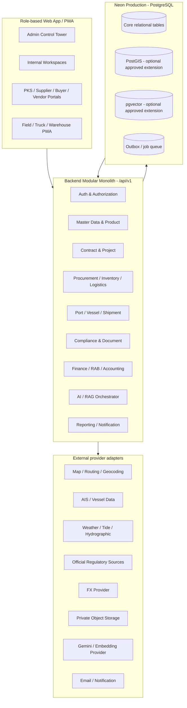
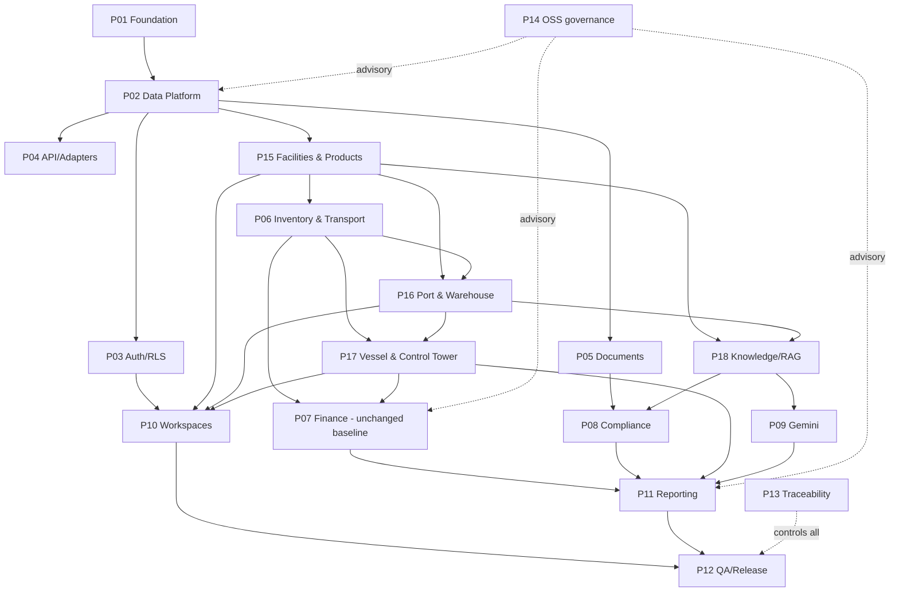

# PKE Export Intelligence & Project Control Platform

# Master Implementation Plan Rev2.36 — Indonesia AIS and Vessel Readiness scope


**Status:** Satu-satunya dokumen referensi dan catatan eksekusi aktif PKE — living document  

**Revision:** 2.36 (20 November 2026 — Indonesia AIS and Vessel Readiness scope; see §56.43)  

**Tanggal dokumen:** 19 November 2026  

**Repository:** `D:\PKE`  

**Target database (runtime, Rev4 permanent):** Neon project `purple-base-63944903` / branch `production` (`br-damp-shape-b3xlh4nr`) / database `neondb`. **Legacy migration source only:** `lucky-glitter-99553107` / `br-calm-glade-b3nrleet` / `neondb` (do not use for app/runtime/test).  

**Bahasa:** Indonesia  

**Dokumen tunggal untuk:** seluruh spesifikasi, keputusan, status implementasi, backlog, bukti validasi, blocker, dan instruksi Cline PKE


> **Tujuan dokumen:** menjadi SATU-SATUNYA acuan kerja aktif untuk menyelesaikan PKE. Semua revisi status, keputusan, backlog, mapping API/database/frontend, dan catatan eksekusi Cline wajib diperbarui di file ini. Jangan membuat atau meminta owner menyimpan dokumen status/laporan/plan lain. Isi dokumen tetap merupakan rencana dan catatan bukti; bukan bukti otomatis bahwa fitur selesai atau izin otomatis mengubah Production.


---


## 0. Pengendalian dokumen, sumber, dan cara membaca


### 0.1 Asal-usul baseline dan kebijakan dokumen tunggal


Rev1.6 melanjutkan substansi bisnis/arsitektur Rev1.3 dan melanjutkan kebijakan dokumen tunggal Rev1.4 yang sebelumnya menggabungkan keputusan dari Master Architecture v4.2.3 Rev03, Implementation Plans Rev1.2, P07 Finance v1.2, P14 OSS/BI, serta audit keuangan. Referensi tersebut dicatat sebagai provenance historis, bukan daftar dokumen aktif yang wajib dipelihara.


**Mulai 11 November 2026, file Master Implementation Plan ini adalah satu-satunya dokumen referensi dan kontrol revisi aktif.** Seluruh hal berikut ditulis/di-update di sini: spesifikasi, owner decisions, phase status, requirement-to-code traceability, schema/API mapping, execution log, test evidence summary, risk, blocker, serta next action.


Aturan dokumen:

1. Cline dan pelaksana revisi harus membaca file Master ini terlebih dahulu dan menjadikannya satu-satunya dokumen acuan proyek.

2. Jangan membuat, meminta, atau mengharuskan owner menyimpan `PKE_P03_PLAN.md`, `IMPLEMENTATION_STATUS.md`, `TRACEABILITY_MATRIX.md`, `DECISION_LOG.md`, `CHANGELOG_EXECUTION.md`, sprint reports, audit reports, README tambahan, atau paket ZIP sebagai dokumen status paralel.

3. File kode, SQL migration, automated tests, konfigurasi build, dan file aplikasi yang memang diperlukan untuk menjalankan produk tetap boleh dibuat/diubah sebagai source artifacts. Yang dilarang adalah memecah catatan referensi/kemajuan menjadi dokumen-dokumen Markdown/CSV/laporan terpisah.

4. Setiap akhir sesi, ringkas perubahan dan bukti yang relevan langsung di Section 32 `Living Execution Ledger` dan checklist/section domain yang sesuai pada file ini.

5. Jika dokumen lama ditemukan di repository, perlakukan sebagai arsip/historical input. Jangan mengubahnya sebagai kewajiban dan jangan menjadikannya sumber status yang mengalahkan file ini.

6. **Investigasi tidak boleh berhenti sebagai laporan.** Jika pemeriksaan menemukan bug, route ganda, schema mismatch, auth gap, UI contract mismatch, atau test gap, pelaksana wajib langsung melakukan revisi kode/test/frontend pada sesi kerja yang sama selama aman dan berada dalam kewenangan. Jika perubahan memerlukan keputusan owner, kredensial, domain produksi, atau izin migrasi, tutup bagian yang aman, buat sistem fail-closed/disabled yang jujur bila memungkinkan, lalu catat blocker spesifik di Section 32. Jangan membuat laporan investigasi terpisah dan jangan meminta owner mengulang instruksi.


### 0.2 Hierarki otoritas


Jika ditemukan konflik, gunakan urutan berikut:


1. Instruksi/keputusan owner paling baru yang dinyatakan secara langsung.

2. Catatan keputusan dan execution ledger terbaru dalam dokumen ini.

3. Spesifikasi target dan aturan Rev1.6 dalam dokumen ini.

4. Baseline khusus P07 Finance v1.2 yang telah dipertahankan di bagian finance dokumen ini; tidak boleh didesain ulang tanpa Change Request owner.

5. Source code, migration, konfigurasi dan database aktual sebagai kondisi implementasi yang harus diperiksa — bukan otomatis bukti requirement terpenuhi.

6. Laporan/dokumen terdahulu hanya sebagai bukti historis, bukan status terkini tanpa pemeriksaan ulang.


### 0.3 Kategori informasi


Setiap informasi dalam dokumen/implementation wajib dibedakan sebagai:


- **FACT — VERIFIED:** didukung pemeriksaan langsung, sumber resmi, atau artefak test yang dapat diulang.

- **REPORTED — NOT INDEPENDENTLY VERIFIED:** hasil yang disampaikan Cline/owner tetapi source tree, log, atau artefak aktual belum diperiksa ulang dalam sesi ini. Jangan menyatakannya sebagai FACT — VERIFIED sebelum bukti diperiksa.

- **DECISION — OWNER APPROVED:** keputusan bisnis/teknis yang telah ditetapkan owner.

- **DESIGN — PROPOSED:** rekomendasi rancangan target yang belum tentu sudah ada di source/database.

- **ASSUMPTION — TO VERIFY:** dugaan kerja yang tidak boleh diperlakukan sebagai fakta.

- **BLOCKED_EXTERNAL:** implementasi kode dapat selesai, tetapi aktivasi memerlukan akun, lisensi, API key, akses, atau persetujuan provider.

- **LEGAL_REVIEW_REQUIRED:** penafsiran atau persetujuan hukum/kepabeanan/pajak/standardisasi belum disahkan oleh ahli berwenang.


### 0.4 Makna “running 100%”


Target “100%” pada dokumen ini berarti seluruh ruang lingkup aplikasi yang telah disepakati selesai dibangun dan lulus acceptance gate yang relevan. Target ini **tidak** berarti semua data eksternal selalu tersedia, semua otoritas pemerintah menyediakan API, kapal memiliki AIS di setiap wilayah, atau semua transaksi bisnis sudah pernah terjadi.


Status hasil akhir dipisahkan menjadi:


**APPLICATION COMPLETE** — seluruh fitur aplikasi dalam scope rilis selesai, UI/API/database terintegrasi, automated tests yang diizinkan owner lulus, hak akses terbukti, workflow end-to-end memiliki bukti yang sah, build/deployment/monitoring siap, dan blocker kode S1/S2 tidak ada. Static/mock tests tidak menggantikan bukti integrasi SQL/RLS/provider nyata; gate yang belum dapat dibuktikan tetap BLOCKED dan tidak boleh disamarkan sebagai COMPLETE.


**BUSINESS PRODUCTION READY** — selain Application Complete, data mitra nyata telah diverifikasi, legal/accounting sign-off diterima, provider eksternal yang wajib telah aktif, user acceptance oleh pihak terkait selesai, prosedur operasi dan backup/restore telah diuji, serta owner memberi keputusan go-live.


Aplikasi dapat dinyatakan Application Complete sebelum transaksi bisnis riil pertama. Namun, sesuai instruksi owner saat ini, jangan menggunakan database PostgreSQL lokal, Docker database, Neon branch lain, atau data bisnis dummy Production untuk menguji workflow. Gunakan static/type checks, unit tests, API contract tests, mock adapters, serta pemeriksaan Production yang read-only. Pengujian E2E yang membutuhkan penulisan data bisnis sintetis harus berstatus `BLOCKED_OWNER` sampai owner menentukan metode/target pengujian yang diizinkan. Mock bukan bukti integrasi database nyata. Business Production Ready tetap menunggu verifikasi lapangan dan persetujuan yang memerlukan data/aktor riil.


---


# 1. Ringkasan eksekutif dan tujuan produk


PKE adalah **Export Intelligence & Project Control Platform** untuk mengelola rantai pasok Palm Kernel Expeller/Palm Kernel Meal (PKE/PKM) dari pemasok/fasilitas produksi sampai buyer dan pelaporan ekspor. PKE mengintegrasikan master data mitra dan fasilitas, spesifikasi produk, stock lot, procurement, truck checkpoint, gudang, port, loading, kapal/voyage, dokumen ekspor, finance/accounting, compliance, AI/RAG, dashboard, serta stakeholder portal.


PKE bukan hanya aplikasi pencatat transaksi. Sistem harus membantu menjawab pertanyaan operasional berikut secara cepat dan dapat ditelusuri:


1. Fasilitas/PKS/KCP mana yang benar-benar mampu memasok produk dan volume tertentu?

2. Produk mana yang mempunyai spesifikasi paling sesuai dengan permintaan buyer?

3. Berapa stok tersedia, di lokasi mana, berasal dari lot mana, sudah di-reserve berapa, dan sedang berada di tahap logistik mana?

4. Pelabuhan, terminal, gudang, moda transportasi, dan metode loading mana yang layak dipertimbangkan?

5. Apakah karakteristik kapal dan batasan pelabuhan/terminal kompatibel berdasarkan data yang masih berlaku?

6. Apakah data kapal, voyage, cargo, shipping instruction, dan dokumen ekspor konsisten?

7. Buyer dapat melihat progres dan kuantitas sesuai kontraknya tanpa memperoleh akses ke stok/kontrak buyer lain.

8. Admin dan setiap pihak terkait melihat serta mengubah hanya informasi dalam scope otorisasinya.

9. AI dapat mencari regulasi dan dokumen resmi, menjelaskan persyaratan, menemukan gap, membandingkan pemasok/produk, dan menyusun draft laporan dengan kutipan sumber.

10. Finance/RAB/GL tetap menjadi system of record keuangan, dengan pemisahan budget, commitment, accrual, expense, cash paid, dan journal.


## 1.1 Prinsip produk utama


- **Single company / single exporter** pada tahap awal. Buyer, supplier/PKS, transporter, warehouse, port operator, shipping agent, surveyor, dan pihak eksternal lain direpresentasikan sebagai partner dengan hubungan dan scope tersendiri.

- **PKE-first:** PKE/PKM merupakan komoditas awal. Multi-commodity tidak menjadi alasan memperumit rilis pertama; product taxonomy harus extensible untuk fase berikutnya.

- **Neon PostgreSQL Production is the cloud system of record.** Semua business records, authorization, inventory, shipment dan finance berada dalam satu database Production.

- **Modular monolith first:** satu backend modular dengan domain/service boundary jelas. Jangan memecah menjadi microservices sebelum kebutuhan, skala, dan alasan operasional terbukti.

- **Existing-schema-first:** gunakan dan perluas tabel Production yang sudah ada. Dilarang membuat tabel duplikat hanya karena nama entitas di kode berbeda.

- **Event and audit trail:** perubahan status dan inventory/quantity wajib terlacak melalui event, actor, timestamp, source, dan referensi transaksi.

- **Human approval for critical actions:** legal interpretation, posting jurnal, approval pembayaran, perubahan dokumen final, vessel/loading exception, dan publikasi regulasi tidak dilakukan AI secara otonom.

- **Provider-neutral adapters:** AIS, map routing, geocoding, FX, weather, email, object storage, dan LLM terisolasi di adapter agar provider dapat diganti.

- **Frontend workflow completeness:** setiap fitur backend yang dapat digunakan harus memiliki halaman, form, validation, empty/loading/error state, permission-aware action, dan user feedback yang sesuai.


## 1.2 Batas fase implementasi


Termasuk dalam target:


- P01–P13 baseline yang sudah ada.

- P14 OSS/BI governance sebagai evaluasi dan referensi, bukan kewajiban memasang ERPNext.

- P15 Supplier, Facility & Product Master Intelligence.

- P16 Port, Port Warehouse & Multimodal Logistics Intelligence.

- P17 Maritime, Vessel Intelligence & Export Control Tower.

- P18 Regulatory Knowledge Graph, RAG & AI Intelligence.


Tidak otomatis termasuk tanpa Change Request:


- Menjadi marketplace terbuka lintas eksportir/perusahaan.

- Mengoperasikan terminal/pelabuhan atau memberikan izin navigasi.

- Menggantikan sistem resmi Bea Cukai, karantina, otoritas pelabuhan, bank, atau shipping line.

- Melakukan transfer bank otomatis pada fase awal.

- Memberikan legal opinion otomatis atau menerbitkan sertifikat resmi.

- Menjamin cakupan AIS global penuh atau memperkirakan posisi kapal ketika data provider tidak tersedia.

- Mengganti kebijakan akuntansi, perpajakan, atau standar kualitas tanpa persetujuan ahli.


---


# 2. Baseline teknis dan kebijakan Production-only


## 2.1 Target Neon yang telah diperiksa


Snapshot pemeriksaan read-only pada 9 November 2026:


| Item | Kondisi |

|---|---|

| Neon project | `PKE-export-platform` |

| Project ID | `lucky-glitter-99553107` |

| Branch | `production` |

| Branch ID | `br-calm-glade-b3nrleet` |

| Database | `neondb` |

| PostgreSQL | 18.6 |

| Runtime role | `app_runtime_secure` |

| Runtime `BYPASSRLS` | `false` pada query yang diperiksa |

| Public tables | 81 pada saat audit |

| RLS enabled | 81/81 pada saat audit |

| `FORCE ROW LEVEL SECURITY` | 0/81 pada snapshot tersebut; perlu evaluasi per tabel, jangan ubah massal |

| Migration history | Row 001–028 terlihat melalui owner connection saat pemeriksaan; 001–016 berstatus baselined, 017–028 applied |

| Extensions | `postgis` 3.6.4 dan `vector` 0.8.6 tersedia di daftar extension Neon tetapi belum ter-install pada snapshot pemeriksaan |


Angka di atas adalah snapshot historis dan wajib diverifikasi ulang oleh Cline sebelum pekerjaan yang memerlukan perubahan Production. Keberadaan RLS pada tabel tidak membuktikan seluruh policy benar atau cross-tenant isolation telah lulus.


## 2.2 Target backend cloud — PERMANENT SINGLE PROJECT & SINGLE BRANCH (Revision 4, owner-mandated 14 Nov 2026)

> **ABSOLUTE / PERMANEN / MENGIKAT (Cline, AI agent, PowerShell, CI/CD, manual):** PKE memakai **satu proyek Neon, satu branch, satu database, satu `DATABASE_URL`**. **DILARANG MEMBUAT BRANCH NEON TAMBAHAN DALAM KONDISI APA PUN** — termasuk development, staging, testing, validation, preview, feature, backup, migration testing, eksperimen/troubleshooting, atau branch sementara (otomatis/manual). **Tidak ada pengecualian otomatis.** Hanya instruksi tertulis baru dari owner yang dapat mengubah keputusan ini. Setiap proses harus **fail-closed/berhenti** bila target tidak sesuai. Jangan pernah menampilkan connection string/secret.

- **Target tunggal (system of record & satu-satunya koneksi aplikasi):** project `purple-base-63944903` (`PKE-export-platform`), branch `br-damp-shape-b3xlh4nr` (`production`), database `neondb`, region `aws-ap-southeast-1`, PostgreSQL 18, host `ep-odd-resonance-b3zb42fw.c-4.ap-southeast-1.aws.neon.tech`, runtime role `app_runtime_secure` (least privilege, TLS). Backend memakai satu `DATABASE_URL` ke target ini; frontend hanya memakai API backend PKE. **Tidak ada** `NEON_TEST_DATABASE_URL`, fallback ke proyek lama, koneksi alternatif tersembunyi, atau pemilihan branch berdasarkan environment. Script/runner wajib memvalidasi Project ID dan Branch ID eksplisit.
- **Proyek lama — sumber migrasi sementara saja (SUPERSEDED sebagai target aktif):** `lucky-glitter-99553107` (`PKE-export-platform-legacy-migration-source`) dan seluruh branch/host lamanya (`br-calm-glade-b3nrleet`, `br-billowing-math-b31f4wos`, endpoint terkait) **DILARANG** digunakan oleh backend, frontend, integration test, CI/CD, Cline, atau script. Branch lama tidak menerima perubahan aplikasi/data bisnis baru; compute lama tetap suspended/idle saat tidak diperlukan migrasi. **Jangan hapus proyek lama sebelum migrasi dan seluruh acceptance gate tervalidasi serta persetujuan final owner.** Jangan membuat branch pengganti di proyek lama.
- **Local database:** Dilarang PostgreSQL lokal, Docker database, atau database alternatif.
- **Pengujian tanpa branch tambahan:** unit test boleh mock. Integration test menggunakan **satu branch `production` yang sama** dengan transaksi, rollback, dan fixture QA bernamespace unik; fixture dibersihkan dan diverifikasi, tidak mengubah data di luar namespace test, tidak memakai data bisnis palsu. Migration diperiksa dan mendapat persetujuan owner sebelum diterapkan. Test tidak aman harus **fail-closed** (bukan membuat branch baru).
- Production tidak boleh menerima synthetic/dummy business data; write hanya operasi bisnis nyata yang dikendalikan/diotorisasi owner. Perubahan Production yang membutuhkan persetujuan (termasuk migration terkontrol) wajib preflight, backup/review SQL, dan persetujuan owner spesifik.

## 2.3 Aturan migration Production (single-branch, Revision 4)

1. Migration `001–035` adalah sejarah **immutable** (jangan diubah/dijalankan ulang). Riwayat sumber yang diverifikasi: 001–016 baselined, 017–035 applied. Pertahankan migration history 001–035 tanpa mengubah isi saat migrasi ke proyek baru.
2. Perubahan schema baru berikutnya memakai nomor mulai `036+` hanya bila benar-benar diperlukan, setelah schema reconciliation terhadap object Production aktual (proyek/branch baru). Jangan menebak nomor migration tanpa memeriksa migration history.
3. Sebelum migration baru dibuat, cocokkan entity/tabel/kolom/index/FK/RLS/policy/grant/fungsi `SECURITY DEFINER` dengan Production. Utamakan memperbaiki mapping aplikasi terhadap tabel yang sudah ada; jangan membuat tabel duplikat untuk nama salah di kode.
4. Setiap migration baru harus mempunyai tujuan, exact SQL, SHA-256, preflight/read-only impact check, lock/data-risk review, RLS/grant review, rollback/recovery plan, dan post-apply read-only verification.
5. **Migration replay/testing:** dilarang pada PostgreSQL lokal/Docker dan **dilarang membuat branch tambahan** (termasuk validation/staging/testing). (SUPERSEDED: izin replay pada `br-billowing-math-b31f4wos`, Revision 3C.) Validasi migration dilakukan melalui review exact SQL/hash/preflight dan bukti backup/restore; verifikasi terkontrol pada single production branch hanya dengan persetujuan owner spesifik. Klaim tanpa eksekusi/bukti = `BLOCKED`/tidak terverifikasi.
6. Migration Production hanya boleh diterapkan setelah owner memberikan persetujuan eksplisit atas SQL/rencana migration spesifik tersebut. Instruksi umum bukan persetujuan otomatis.
7. Setelah migration yang disetujui diterapkan, catat ID/checksum/waktu/status di Section 32 dan verifikasi read-only terhadap migration history serta schema aktual.
8. Untuk perubahan destructive/irreversible, jangan lanjut tanpa backup/restore procedure yang terbukti dan persetujuan khusus.
9. Dilarang menjalankan `DROP`, `TRUNCATE`, bulk `DELETE`, reset, atau mengganti data Production untuk menguji fitur. Fixture QA (jika diizinkan pada single production) harus bernamespace unik, transaksional/rollback, dibersihkan dan diverifikasi; cleanup gagal = FAIL (no bulk delete data non-test).


## 2.4 Extension PostGIS dan pgvector


- `postgis` dan `vector` tersedia sebagai extension pada Neon menurut pemeriksaan `pg_available_extensions`, tetapi belum ter-install pada snapshot 9 November 2026.

- PostGIS direkomendasikan untuk spatial query (jarak, radius, point-in-polygon, spatial index) setelah compatibility, cost, security, dan lisensinya ditinjau.

- pgvector direkomendasikan untuk embedding search/RAG setelah strategi embedding dan ACL filtering disepakati.

- Aktivasi extension adalah perubahan schema Production. Jangan `CREATE EXTENSION` langsung tanpa migration, preflight, review license, dan persetujuan owner.

- Jika PostGIS belum diaktifkan, MVP dapat menyimpan `latitude`/`longitude` dan menghitung jarak geodesik di service secara terbatas; jangan mengklaim routing/nautical compatibility yang belum ada.


## 2.5 Existing schema inventory — prioritas reuse


Tabel berikut telah ditemukan pada Production snapshot. Ini bukan persetujuan bahwa semua kolom sudah cukup. Cline wajib memeriksa detail saat coding:


| Domain | Tabel existing | Fungsi/keputusan target |

|---|---|---|

| Identity | `users`, `project_members`, `project_roles`, `project_role_permissions`, `permissions`, `role_catalog` | Reuse; audit tenant/facility/partner scope dan provider claim mapping |

| Partner/customer | `buyers`, `buyer_parties`, `vendors`, `service_vendors` | Reuse sebagai role-specific profile; identitas perusahaan bersama perlu direkonsiliasi |

| Facilities | `pks_sites` | Reuse sebagai facility/site awal; perlu tipe fasilitas, owner organization, kapasitas, fasilitas proses, status verifikasi |

| Product | `product_catalog`, `product_specifications`, `project_product_specifications` | Reuse; lengkapi taxonomy, attributes, quality result dan buyer requirement |

| Route/Port | `ports`, `pks_port_routes` | Reuse; tambah terminal/berth/channel/depth observations/loading services dan route provenance |

| Warehouse | `warehouses`, `warehouse_receipts` | Reuse; lengkapi mode storage, zones/bins/capacity/equipment/stock reconciliation |

| Inventory | `inventory_lots`, `inventory_movements`, `packing_batches` | Reuse dan perluas; satu lot hanya dihitung pada satu posisi/status stok per waktu |

| Transport | `transport_legs`, `truck_trips`, `tracking_events` | Reuse; checkpoint device bukan klaim live truck GPS |

| Shipment/maritime | `shipments`, `shipment_allocations`, `vessels`, `voyages`, `loading_operations` | Reuse; lengkapi IMO/MMSI/dimensions/AIS snapshots/vessel-port assessment/loading event |

| Export compliance | `regulatory_sources`, `country_export_document_requirements`, `project_export_document_requirements`, `project_export_documents`, `export_document_types` | Reuse; perlu rule versions, source citation, jurisdiction, product/HS conditions |

| Finance | `rab`, `cost_obligations`, `payment_obligations`, `ap_invoices`, `ar_invoices`, `cash_advances`, `cash_schedules`, `journal_entries`, `journal_lines`, `chart_of_accounts`, FX tables | P07 tetap baseline; audit gap dan link ke operational events, tanpa ledger ganda |

| Project | `contracts`, `contract_programs`, `projects`, `project_operating_profiles`, `project_versions`, `project_workflows` | Reuse; jangan mengubah settlement-unit Project Instance model |

| Notifications | `user_notifications`, `notification_deliveries` | Reuse sebelum mempertimbangkan tabel `notifications` baru |

| Reporting | `report_runs`, `report_schedules`, `report_export_audit` | Reuse untuk reporting dan scheduled reports |


**Peringatan:** laporan Sprint Completion pernah menyebut `rab_items`, `payments`, `compliance_rules`, `compliance_documents`, dan `notifications` yang tidak ditemukan di Production saat pemeriksaan. Jangan langsung membuat tabel tersebut. Rekonsiliasi dahulu dengan `rab`, `payment_obligations`, `ap_invoices`/`ar_invoices`, `regulatory_sources`, `project_export_documents`, `user_notifications`, dan desain logical model. Tabel baru hanya dibuat bila kebutuhan entitas dan relasinya memang berbeda.


## 2.6 Fakta Neon Production terverifikasi — 11 November 2026


> Status berikut berasal dari pemeriksaan langsung branch `production` pada sesi 11 November 2026. Angka ini adalah snapshot; pemeriksaan ulang tetap diperlukan sebelum perubahan berikutnya. Tidak ada branch Neon lain dibuat/digunakan.


| Area | Fakta terverifikasi | Implikasi |

|---|---|---|

| Target | Project `lucky-glitter-99553107`, branch `production` / `br-calm-glade-b3nrleet`, database `neondb`, region `aws-ap-southeast-1`, PostgreSQL 18.6 | Tetap menjadi satu-satunya system of record cloud |

| Migration history | 32 baris; ID 1–32 lengkap; 001–016 `baselined`; 017–032 `applied`; status lain 0 | 001–028 tidak berubah; 029–032 adalah revisi aktif terbaru |

| Public schema | 81 base tables; RLS enabled 81/81; semua tabel memiliki policy; tabel tanpa RLS/policy 0 | Jangan menambah policy/tabel tanpa kebutuhan dan review |

| Referential integrity | 153 foreign keys tervalidasi; unvalidated FK 0 | FK validation selesai pada snapshot ini |

| Index | Invalid/not-ready indexes 0 | Tidak ada indeks rusak yang terdeteksi pada snapshot |

| SECURITY DEFINER | 17 fungsi; seluruhnya memakai fixed `search_path`; tidak satu pun dapat dieksekusi role `PUBLIC` | Tetap review setiap fungsi baru/ubah |

| Runtime role | `app_runtime_secure`: non-superuser, `NOBYPASSRLS`, tanpa CREATEDB/CREATEROLE, tidak dapat CREATE pada schema `public` | Runtime role least-privilege pada pemeriksaan |

| RLS context | `set_rls_context(uuid)` adalah `SECURITY INVOKER`; `PUBLIC EXECUTE=false`; `app_runtime_secure EXECUTE=true`; null user ditolak | Smoke test transaksi berhasil menetapkan identitas admin; konteks lokal transaksi dibersihkan saat transaksi berakhir |

| User admin | Satu user aplikasi aktif ber-role admin; `mfa_enabled=false` | Admin MFA belum aktif dan ditunda untuk rilis awal sesuai D-107; jangan mengubah flag menjadi true atau membiarkan false memblokir akses Admin |

| Neon Auth | Better Auth aktif; email/password aktif; sign-up dinonaktifkan; email OTP verification diwajibkan; nama aplikasi `PKE Export Platform` | Jangan mengubah metode login tanpa keputusan/tes |

| Auth origins | Trusted origin hanya `http://localhost:3001`; `allow_localhost=true` | BLOCKER sebelum deployment publik; jangan menebak domain frontend atau mengunci akses admin |

| Email | Shared provider `auth@mail.myneon.app` | Custom SMTP masih belum dikonfigurasi |

| MFA plugin/factor | Neon Auth config yang diperiksa tidak memuat MFA plugin/factor; tidak ada provider-backed MFA assurance yang terbukti | Sesuai D-107, MFA tidak diwajibkan pada rilis awal. Jangan pasang `requireAdminMfa` sekarang; simpan sebagai backlog pascarilis dan jangan mengklaim MFA aktif |

| Object storage | Bucket `pke-private-documents` tersedia dengan access `private`; listing object tidak menunjukkan file | Infrastruktur bucket tersedia; signed upload/download, metadata/ACL dan adapter aplikasi belum dibuktikan |

| Neon Functions | `list_functions` menghasilkan array kosong; tidak ada function ter-deploy | Jangan mengklaim API serverless Neon tersedia; API harus diselaraskan pada aplikasi yang ada atau implementasi baru yang dipilih owner |

| Business data | `projects=0`, `project_members=0`, `buyers=0`, `pks_sites=0`, `ports=0`, `warehouses=0`, `vendors=0` | Database schema tidak kosong; business records belum dimasukkan |

| Reference data | `countries=3`, `currencies=4` (IDR satu-satunya functional currency), `export_document_types=8`, active permissions `88`, product catalog memiliki satu item PKC | Referensi dasar tersedia; tidak berarti country-pack legal rules sudah diverifikasi |

| Finance setup | `payment_methods=0`, `cost_categories=0`, `chart_of_accounts=0` | Finance master-data/setup belum lengkap; jangan mengarang COA atau metode pembayaran tanpa baseline/approval |


**Pemeriksaan read-only lanjutan (11 November 2026):**

- Struktur `migration_history` adalah `id`, `filename`, `sha256`, `applied_at`, `status`. Query dengan kolom `name` gagal karena kolom tersebut tidak ada; query berikutnya wajib memakai nama kolom aktual.

- Branch inventory mengembalikan beberapa branch historis (antara lain `staging`, `rehearsal`, `p03-backend-hardening-test` dan snapshot lain). Branch `production` tetap primary/default dan ready, tetapi tidak protected. Jangan menggunakan, membuat, menghapus atau mempromosikan branch historis tersebut.

- Auth config aktual: trusted origins hanya `http://localhost:3001`, `allow_localhost=true`; email/password aktif; sign-up nonaktif; OTP email wajib; OAuth providers kosong; MFA plugin/factor tidak terlihat.

- Bucket `pke-private-documents` terdaftar sebagai `private`; hal itu belum membuktikan signed upload/download aplikasi.

- `to_regclass` memastikan `rab_items`, `payments`, `compliance_rules`, `compliance_documents`, `document_registry`, dan `notifications` tidak ada di schema `public`.

- `fx_exposures` (jamak) dan `fx_exposure` (tunggal) sama-sama ada dengan struktur berbeda. Finance v1.2 memakai `fx_exposures`; tabel tunggal adalah legacy dan tidak boleh dihapus/diubah tanpa owner approval.

- Tidak ditemukan tabel transaksi `payments`; `payment_obligations` adalah kewajiban bayar, bukan transaksi pembayaran aktual.

- `report_runs.file_reference` tersedia; endpoint tidak boleh mengklaim `completed` sebelum file laporan nyata disimpan dan referensinya divalidasi.

| Branch protection | `production.protected=false`; permintaan protect ditolak oleh limit protected branch paket Neon | Jangan meng-unprotect branch lain; catat sebagai keterbatasan paket dan mitigasi operational control |


Catatan penting: `users` tidak memiliki direct table grants ke `app_runtime_secure`; akses identitas menggunakan fungsi `SECURITY DEFINER` yang sudah dibatasi. Ini bukan alasan untuk memberi grant CRUD langsung pada tabel `users`.


## 2.7 Prioritas revisi aktif — investigasi dan perbaikan dalam satu sesi


Temuan berikut berasal dari pemeriksaan read-only Neon Production dan pemeriksaan source snapshot yang tersedia pada 11 November 2026. Ini adalah baseline yang perlu diverifikasi terhadap working tree aktif `D:\PKE`; snapshot tidak boleh diperlakukan sebagai pengganti repo aktif.


| Domain | Fakta schema Production yang diperiksa | Revisi wajib pada API/frontend | Urutan |

|---|---|---|---|

| Operations/truck | `truck_trips` memakai `transport_leg_id` dan `license_plate`; tidak memakai `plate_number`. `transport_leg_id` NOT NULL. | Selaraskan DTO, validator, SQL, UI, dan test. Wajib resolve transport leg yang valid sebelum insert/update; jangan membentuk ID palsu. | Tinggi |

| Tracking | `tracking_events` memiliki `gps_accuracy` NOT NULL, `notes` nullable, dan field capture/server timestamps. `event_type` serta status dibatasi nilai valid melalui constraint. | Validasi nilai event/status dan akurasi GPS di server; UI harus mengirim semua field wajib. Tolak payload tidak lengkap, bukan mengisi nilai fiktif. | Tinggi |

| RAB dan commitment P07 | `rab` adalah tabel aktual dengan `project_id`, `description`, `amount`, `category` (enum), `is_active`, timestamps. `cost_obligations` menyimpan estimasi/commitment; `payment_obligations` menyimpan kewajiban pembayaran yang direncanakan. `rab_items` dan `payments` tidak ada. | Petakan setiap operasi sesuai arti bisnis: RAB ke `rab`; commitment ke `cost_obligations`; kewajiban bayar ke `payment_obligations`. Jangan menyamakan kewajiban bayar dengan transaksi pembayaran yang sudah dieksekusi. Pertahankan Finance v1.2. | Tinggi |

| AP/AR dan pembayaran | `ap_invoices`, `ar_invoices`, `cash_advances`, `cash_schedules`, `payment_methods` ada; tidak ditemukan tabel transaksi `payments`. `payment_obligations` bukan payment execution ledger. | Gunakan AP/AR/advance/obligation hanya untuk use case yang tepat. Endpoint pembayaran aktual harus ditahan/disabled dengan status jelas sampai model payment execution yang sah tersedia; jangan insert ke `payment_obligations` lalu menyebut pembayaran selesai. | Tinggi |

| FX P07 v1.2 | `fx_rates` memakai `from_currency_id`, `to_currency_id`, `rate`, `rate_type`, `rate_date`, `rate_source`, `is_active`. Tabel `fx_exposures` (jamak) memakai `original_currency_id`, `original_amount`, `functional_amount`, `fx_rate`, `fx_date`, `exposure_type`, `project_id`. Tabel `fx_exposure` (tunggal) legacy masih ada dengan bentuk kolom berbeda. | Revisi route FX Rates agar menggunakan kolom aktual. P07 Finance v1.2 memakai `fx_exposures`; jangan gunakan tabel singular untuk endpoint v1.2, jangan drop/ubah tabel legacy tanpa izin owner. | Tinggi |

| General ledger | `journal_entries` memakai `entry_type`, `reference_id`, `reference_type`, `description`, `entry_date`, `posted_at`, `status`, `posted_by`; `journal_lines` memakai `journal_entry_id`, `account_id`, `debit`, `credit`, `description`, `line_order`. | Hapus asumsi kolom `entry_number`, `posting_date`, `total_debit`, `total_credit` jika tidak ada. Bentuk jurnal melalui header + lines, validasi balance debit=credit dan akun valid. Jika belum ada lines/approval, hanya boleh simpan draft; jangan posting jurnal tidak seimbang. | Tinggi |

| Compliance/document P08 | Ada `regulatory_sources`, `export_document_types`, `country_export_document_requirements`, `project_export_document_requirements`, `project_export_documents`; tidak ada `compliance_rules`, `compliance_documents`, atau `document_registry`. `project_export_documents` mensyaratkan project, requirement, file reference, version, status, uploader; status dibatasi enum/check yang tercatat. | Mapping regulasi dan requirement ke tabel aktual. Dokumen project wajib tertaut pada requirement sah, metadata/file reference valid, uploader, version dan status yang diizinkan. Terapkan private bucket; jangan membuat metadata dokumen tanpa file atau tabel registry duplikat. | Tinggi |

| Notifications P11 | Ada `user_notifications` dan `notification_deliveries`; tidak ada tabel `notifications`. `user_notifications` memiliki `recipient_user_id`, `event_id`, `project_id`, `created_by`, title/message/priority/category/read_at. | GET/list/read harus dibatasi `recipient_user_id = current authenticated user`; mark-read menggunakan row ownership check. `notification_deliveries` hanya untuk status pengiriman channel, bukan mengganti notifikasi pengguna. | Tinggi |

| Reports P11 | `report_runs` memiliki `template_id`, `template_version`, `cutoff_at`, `generated_at`, `requested_by`, `audience`, `project_id`, `status`, `idempotency_key`, `file_reference`, `data_freshness`. | Jangan membuat record `completed` sebelum renderer benar-benar menghasilkan file dan file tersimpan di private bucket serta `file_reference` tervalidasi. Bila renderer/storage belum tersedia, gunakan status truthful (`queued`/`failed` sesuai constraint) atau kembalikan 501/503 yang jelas; selaraskan UI agar tidak menunjukkan laporan siap. | Tinggi |

| Auth/RBAC (MFA ditunda) | Global `/api/v1` auth middleware ada pada source snapshot; `requireAdminMfa` tersedia di `auth.ts` tetapi belum terpasang di `index.ts` snapshot. Neon Auth Better Auth aktif; trusted origin yang diperiksa hanya `http://localhost:3001`. | Untuk rilis awal, nonaktifkan kewajiban MFA saja: jangan jadikan `mfaVerified`/factor claim sebagai syarat route Admin. Tetap wajibkan `requireAuth`, verifikasi JWT/session, `requireAdmin`/permission, resource scope, RLS context, rate limit, session revocation, dan audit log. Jangan set `mfaVerified=true` atau `mfa_enabled=true` palsu. MFA masuk backlog pascarilis. | Tinggi |

| Storage P05 | Bucket `pke-private-documents` tersedia dengan access `private`; belum ada bukti integrasi signed upload/download dari aplikasi. | Implementasikan adapter yang memakai kredensial server-side, authorization sebelum signed URL, key namespace, checksum, version dan metadata. Jangan pernah membuat bucket publik. | Tinggi |

| Route registration | Snapshot `index.ts` mencatat 8 kelompok method+path dengan registration ganda: `GET /roles`, `POST /contract-programs`, `POST /projects`, `GET/POST /fx-rates`, `GET/POST /fx-exposure`, `GET /notifications`. | Inventarisasi ulang pada working tree; pertahankan handler yang benar setelah men-trace middleware, DTO, caller frontend dan tests; satu handler per method+path. Tambah tests agar duplikasi tidak kembali. | Tinggi |


**Aturan wajib:** investigasi dan revisi adalah satu pekerjaan. Untuk setiap temuan, Cline harus (a) memperbaiki source/test/frontend langsung pada sesi itu, atau (b) membuat path tersebut fail-closed/disabled secara jujur dan mencatat blocker beserta owner input yang benar-benar diperlukan. Tidak boleh mengakhiri pekerjaan hanya dengan menulis daftar temuan.


**Execution update 11 November 2026 — dilaporkan Cline, belum diverifikasi ulang pada working tree dalam sesi ini:** delapan kelompok route method+path ganda telah diselesaikan di `src/index.ts`; route yang menargetkan tabel Production yang tidak ada sudah dihapus/ditahan; mapping `fx_rates` dan header/lines jurnal diperbaiki; `report_runs` tidak lagi dibuat `completed` tanpa file; regression test route registry ditambahkan. Lihat Section 32.3 dan 32.5. Route collision tidak lagi menjadi pekerjaan implementasi utama; sesi berikutnya cukup memeriksa hasil di repo aktif, menjalankan test terkait, dan tidak mengulang patch yang sudah benar.


Batas bukti pada update tersebut: laporan menyebut GET/POST `/fx-exposure` tetap ada tetapi tidak menyatakan secara eksplisit apakah query sudah dipindahkan ke `fx_exposures` plural; mapping exposure tetap OPEN sampai diperiksa. Koreksi `journal_entries`/`journal_lines` membuktikan penyesuaian nama kolom menurut laporan, bukan otomatis membuktikan validasi balance, akun, periode, approval, atau posting. Penghapusan route dokumen lama bukan bukti bahwa P08 sudah tersambung ke `project_export_documents` dan private storage.


Urutan kerja:

1. Route registry + API SQL/DTO/query terhadap Production schema; hapus route ganda dan cocokkan middleware/permissions.

2. Revisi P06, P07, P08 dan P11 berdasarkan tabel/kolom/constraint nyata; jangan membuat tabel duplikat.

3. Perbaiki authorization, project/partner/user scope, RLS transaction context, auth guard dan audit coverage. MFA enforcement ditunda sesuai keputusan owner D-107; jangan jadikan ketiadaan MFA gate rilis awal.

4. Revisi frontend API client/types/forms/tables/details agar kontraknya sama dengan API; matikan action yang belum didukung.

5. Implementasikan private storage dan report generation yang benar; jangan membuat status palsu.

6. Jalankan static/type/unit/contract/mock/component checks yang diizinkan; tulis hasil/exit code di Section 32.

7. Database-write E2E, live storage round-trip dan Production mutations yang belum diizinkan tetap BLOCKED_OWNER/BLOCKED_EXTERNAL; jangan disamarkan. MFA bukan gate rilis awal setelah keputusan owner D-107 dan tetap menjadi backlog pascarilis.


---


# 3. Arsitektur target dan prinsip implementasi


## 3.1 Arsitektur logis





## 3.2 Batas modul backend


Backend tetap modular monolith dengan pemisahan domain folder/service/controller/repository/schema/validation/test. Jangan menaruh seluruh business logic di `src/index.ts` atau satu route file.


Target struktur konseptual:


```text

src/

  app/                 # bootstrap, middleware, route registration

  auth/                # authentication provider, session, MFA, token claims

  authorization/       # permission resolver, scope, RLS context

  domains/

    foundation/

    partners/

    facilities/

    products/

    buyer-demand/

    procurement/

    inventory/

    transport/

    warehouses/

    ports/

    vessels/

    shipments/

    documents/

    compliance/

    finance/            # preserve P07 implementation

    ai-knowledge/

    reporting/

    notifications/

  integrations/

    maps/

    routing/

    ais/

    hydrography/

    fx/

    storage/

    llm/

    email/

  jobs/                 # outbox dispatcher, scheduled ingestion, retries

  shared/               # errors, validation, pagination, idempotency, audit

  tests/

```


Ini logical target, bukan instruksi memindahkan semua file sekaligus. Refactor dilakukan incremental dan tidak boleh merusak route/API existing.


## 3.3 Frontend application areas


Frontend memiliki satu shell, route guard, design system, navigation registry dan reusable data layer. Page dibagi per workspace:


- Admin Control Tower.

- Project Management.

- Procurement & Supplier.

- Facility/PKS/KCP Portal.

- Product & Quality Lab.

- Inventory & Warehouse.

- Transport / Field PWA.

- Port & Loading Operations.

- Shipping Agent / Vessel Operations.

- Buyer Portal.

- Compliance & Document Center.

- Finance & Accounting (P07).

- AI Knowledge Assistant.

- Reporting & Analytics.

- Notifications / Task Inbox.


Jangan membuat aplikasi frontend terpisah untuk setiap role. Role menentukan navigation, data projection, permitted actions, dan route guard; backend/RLS tetap menjadi enforcement utama.


## 3.4 Data ownership, provenance, dan confidence


Setiap data eksternal/master penting minimal mencatat:


- `source_type` (official_registry, partner_submission, contract, field_observation, provider_api, manual_admin, imported_dataset, AI_extracted).

- `source_reference` (URL, file key, registry ID, provider response ID, document ID).

- `source_checksum` bila sumber berupa file/dokumen.

- `observed_at` / `effective_from` / `effective_to` bila relevan.

- `retrieved_at` / `recorded_at`.

- `verified_status` dan `verified_by`.

- `verification_notes`.

- `confidence_level` bila nilai diekstrak/diperkirakan.

- `is_current` atau version relation; jangan menimpa histori tanpa versi.


AI-extracted, partner-submitted, public-directory, estimated, and verified values must be distinguishable in UI and database.


---


# 4. Daftar plan P01–P18 dan hubungan dependensi


| ID | Plan | Outcome wajib | Status strategi |

|---|---|---|---|

| P01 | Business Foundation & Admin Project Configurator | Contract Program, delivery cycle, call-off, Project Instance, configuration snapshot, change request | Pertahankan dan tuntaskan |

| P02 | Backend, Database & Neon Platform | Domain model, PostgreSQL, migrations, event/outbox, jobs, indexing, backup | Production-only cloud; local test DB |

| P03 | Identity, Authorization, Role & RLS | Auth identity/session validation, RBAC + resource scope, partner access, RLS and audit; MFA deferred post-release under D-107 | Prioritas kritis

| P04 | API Architecture & External Integrations | REST API standards, provider adapters, retries, webhooks, health checks | Tuntaskan bertahap |

| P05 | Object Storage & Document Services | Private upload/download, metadata, checksum, version, retention, backup | Prioritas kritis |

| P06 | Operational Workflow, Inventory & Truck Checkpoint | Procurement to delivery, lots, weight, checkpoints, warehouse, packing, loading, reconciliation | Perluas |

| P07 | Finance, RAB, Manual Payment & Accounting | RAB, budget control, obligation, payment, AP/AR, GL, FX, settlement | **Pertahankan P07 v1.2; jangan redesign** |

| P08 | Export Compliance & Regulatory Document Engine | Rule engine, document readiness, legal source provenance, country packs | Perluas |

| P09 | Gemini AI, RAG & Intelligence Orchestrator | Grounded RAG, AI matching/reports, governance, audit | Build after data foundation; credentials block only activation |

| P10 | Frontend, UX, Routing & Stakeholder Portals | Complete role workspaces and buyer visibility | Build in parallel per slice |

| P11 | Reporting, Notifications & BI | KPI, reports, alerts, schedules, exports | Integrate all domains |

| P12 | QA, UAT, DevOps & Production Readiness | Automated tests, deployment, monitoring, DR, go/no-go | Local DB testing, Production-only cloud |

| P13 | Change Control & Traceability | Decision log, plan status, requirement-to-code-to-test traceability | Always-on |

| P14 | Open-source Finance & BI Adoption | OSS governance; ERPNext reference, no duplicate ledger | Preserve as advisory |

| P15 | Supplier, Facility & Product Master Intelligence | Organization/PKS/KCP, facility capability, product taxonomy, COA/lab result, capacity, stock availability, buyer matching | New scope |

| P16 | Port, Port Warehouse & Multimodal Logistics Intelligence | Port/terminal/berth/channel/depth, port services, port warehouse, route, modality, facility compatibility | New scope |

| P17 | Maritime, Vessel Intelligence & Export Control Tower | Vessel master, AIS, vessel-port checks, loading, buyer shipment visibility, partner workspace | New scope |

| P18 | Regulatory Knowledge Graph, RAG & AI Intelligence | Official source registry, rules, document knowledge, grounded RAG, AI reports | New scope |


### 4.1 Dependency map





Dependency tidak berarti harus waterfall. UI discovery, API schema, test design dan service scaffolding boleh berjalan paralel; Production migration atau klaim COMPLETE tetap membutuhkan dependency dan evidence yang sesuai.


---


# 5. P15 — Supplier, Facility & Product Master Intelligence


## 5.1 Tujuan


Membangun master data yang dapat dipercaya untuk perusahaan pemasok, fasilitas fisik, PKS/Palm Oil Mill, Kernel Crushing Plant (KCP), produk PKE/PKM, kualitas, kapasitas produksi, ketersediaan stok, sertifikasi, lokasi, dan kebutuhan buyer. Sistem harus dapat memetakan produk yang mirip tanpa mencampur produk yang secara teknis/hukum berbeda.


P15 menjadi sumber kebenaran (master data) bagi procurement, inventory, logistics, buyer matching, compliance dan AI.


## 5.2 Entitas perusahaan dan fasilitas


**Jangan menganggap satu perusahaan sama dengan satu PKS.** Satu grup/perusahaan dapat mempunyai beberapa badan hukum, beberapa mill/KCP, gudang, dan lokasi penerimaan/pengiriman. Satu lokasi dapat berisi fasilitas dengan fungsi berbeda.


Model konseptual:


- `partner_organizations`: identitas badan usaha/partner kanonis (nama legal, negara, alamat legal, identitas registrasi, status aktif).

- `buyers`, `vendors`, `service_vendors`: role profile yang sudah ada; bila tabel tersebut dipertahankan, harus ada relasi yang jelas ke organisasi kanonis. Jangan duplikasi satu entitas perusahaan ke record buyer dan supplier yang tidak saling terhubung.

- `pks_sites`: tabel fasilitas existing yang digunakan sebagai site/facility registry awal. Tambahkan atribut dan relasi dengan migration baru sesuai schema reconciliation. Jangan rename atau drop tabel existing.

- `facility_contacts`: PIC komersial, operasional, QA, dispatch dan administrasi.

- `facility_capacity_records`: kapasitas nominal dan aktual per proses, unit, periode, dan sumber verifikasi.

- `facility_certifications`: sertifikasi, lingkup, site, nomor, tanggal berlaku/kedaluwarsa, penerbit dan bukti.

- `facility_products`: produk/variant yang dapat diproduksi atau dipasok oleh fasilitas.

- `facility_operating_periods`: hari/jam operasi, maintenance, planned shutdown, seasonal constraints.


Tipe fasilitas minimum:


- `palm_oil_mill` — pengolahan TBS dan pemisahan kernel; bukan otomatis produsen PKE.

- `kernel_crushing_plant` — pengolahan palm kernel menjadi produk turunan seperti CPKO dan PKE/PKM.

- `integrated_mill_kcp` — lokasi dengan fasilitas proses berbeda pada satu site; kapasitas tiap proses tetap dipisahkan.

- `warehouse` — penyimpanan; dapat menjadi bagian fasilitas atau lokasi independen.

- `port_terminal` — lokasi handling/loading.

- `collection_point` — titik konsolidasi/serah terima yang bukan pabrik.

- `other` — tipe lain dengan catatan dan approval Admin.


Jangan menetapkan semua PKS sebagai penghasil PKE. PKE/PKM berasal dari proses pengolahan palm kernel di KCP. Sistem harus memisahkan mill, KCP, warehouse dan trading supplier.


## 5.3 Data dictionary — organization and facility


Status tabel: **EXISTING** berarti ditemukan di Production snapshot; **PROPOSED** berarti logical entity target, bukan klaim sudah ada. Nama fisik akhir wajib diputuskan setelah inspeksi schema/FK/policy.


| Logical entity | Table mapping awal | Field | Type logical | Required | Arti/aturan |

|---|---|---|---|---|---|

| Partner Organization | `organizations` (PROPOSED) / reconcile `buyers`, `vendors`, `service_vendors` | `id` | UUID | Yes | Primary key |
| | | `legal_name` | text | Yes | Nama legal sesuai dokumen |

| | | `trading_name` | text | No | Nama dagang |

| | | `organization_type` | enum/text | Yes | buyer, supplier, processor, transporter, warehouse_operator, port_operator, shipping_agent, surveyor, other; multi-role via relationship |

| | | `country_code` | char(2) | Yes | ISO 3166-1 alpha-2 |

| | | `registration_no` | text | No | NIB/registration number, jenisnya disimpan terpisah |

| | | `tax_id` | encrypted/protected text | No | NPWP/TIN; high-sensitivity, mask UI |

| | | `registered_address` | structured address | No | Alamat legal, bukan alamat fasilitas |

| | | `website`, `email`, `phone` | text | No | Contact yang boleh ditampilkan sesuai scope |

| | | `verification_status` | enum | Yes | unverified, submitted, under_review, verified, rejected, expired |

| | | `verified_by`, `verified_at` | UUID/timestamp | No | Reviewer dan waktu |

| | | `source_type`, `source_reference` | text | Yes | Provenance |

| Facility Site | `pks_sites` (EXISTING) | `id`, `name`, `code` | UUID/text | Yes | ID, nama dan kode site yang unik sesuai kebijakan |

| | | `organization_id` | UUID FK | Yes (target) | Perusahaan pemilik/operator; relasi jelas, jangan hanya string company name |

| | | `facility_type` | enum/text | Yes | Jenis fasilitas pada 5.2 |

| | | `address`, `city`, `province`, `country_code` | text/char(2) | Yes/conditional | Alamat lokasi aktual |

| | | `latitude`, `longitude` | decimal | No until verified | WGS84; validasi latitude [-90,90], longitude [-180,180] |

| | | `location_accuracy_m` | decimal | No | Akurasi koordinat |

| | | `site_boundary` | geometry | Optional | PostGIS only after approved enablement |

| | | `access_constraints` | JSONB | No | Kondisi jalan/sungai/jembatan; harus mempunyai sumber dan tanggal verifikasi |

| | | `operating_status` | enum | Yes | planned, operational, maintenance, suspended, closed |

| | | `verification_status` | enum | Yes | Same verification lifecycle |

| Facility Contact | `facility_contacts` (PROPOSED) | `facility_id`, `name`, `role`, `email`, `phone`, `is_primary` | FK/text/bool | Yes | Contact scoped to facility; personal information protected |

| Capacity Record | `facility_capacity_records` (PROPOSED) | `facility_id`, `process_type`, `capacity_value`, `unit`, `period_type` | FK/decimal/text | Yes | Capacity record for a specific processing stage |

| | | `effective_from`, `effective_to` | date | Yes/No | Validity interval |

| | | `capacity_kind` | enum | Yes | nominal, rated, practical, verified_actual |

| | | `source_reference`, `verified_by`, `verified_at` | text/UUID/time | Conditional | Evidence and verifier |

| Certification | `facility_certifications` (PROPOSED) | `facility_id`, `certification_type`, `certificate_no`, `issuer` | FK/text | Yes | Certificate belongs to a facility/scope |

| | | `scope`, `valid_from`, `valid_to`, `status` | text/date/enum | Yes | Include product/process scope |

| | | `document_id` | FK | No | Private document reference |


### 5.3.1 Kapasitas tidak sama dengan stok


Simpan secara terpisah:


1. `nominal_capacity`: kemampuan desain pabrik.

2. `rated_capacity`: kemampuan pada rating/performance test tertentu.

3. `practical_capacity`: batas operasi yang dilaporkan fasilitas.

4. `actual_production`: hasil aktual per hari/minggu/bulan dan period.

5. `available_to_sell`: tonase yang dapat dialokasikan setelah reserved/quality/contract restrictions.

6. `on_hand_stock`: jumlah fisik terhitung di lokasi.

7. `in_transit_stock`: barang yang sedang berpindah lokasi; tidak dihitung sebagai on-hand di lokasi asal dan tujuan sekaligus.


Unit harus eksplisit: `TBS_MT_PER_DAY`, `KERNEL_MT_PER_DAY`, `PKE_MT_PER_DAY`, `WAREHOUSE_MT`, `BAG_COUNT`, atau unit lain yang didefinisikan. Jangan menjumlahkan tonase kapasitas input TBS dengan tonase produk PKE.


## 5.4 Product taxonomy dan klasifikasi


Buat product master canonical dengan hirarki:


`Product Family → Canonical Product → Process/Variant → Commercial Grade → Product Specification Version → Production Lot`.


Contoh kategori konseptual:


- Product family: `palm_kernel_byproducts`.

- Canonical product: `palm_kernel_expeller` / `palm_kernel_meal` sesuai terminologi dan klasifikasi yang telah diverifikasi.

- Process route: `mechanical_screw_press`, `solvent_extraction`, `other_verified`.

- Physical form: meal, cake, pellet, ground, other.

- Commercial grade: internal/contract grade, bukan menggantikan standar legal atau SNI.

- HS classification: country-specific nomenclature, tariff edition, validity date, classification rationale, reviewer, and source.


**Penting:** Nama dagang PKE/PKM tidak cukup untuk menetapkan HS code. Klasifikasi harus mengikuti uraian barang aktual, bentuk fisik, proses, komposisi, BTKI/nomenklatur negara tujuan, dan keputusan klasifikasi resmi bila tersedia. Ex-code tidak boleh diperlakukan sebagai kode final universal.


### 5.4.1 Data dictionary — product and quality


| Logical entity | Table mapping awal | Field | Type logical | Required | Rule |

|---|---|---|---|---|---|

| Product | `product_catalog` (EXISTING) | `id`, `product_code`, `product_name`, `category`, `base_unit` | UUID/text | Yes | Canonical product identity |

| | | `canonical_name`, `synonyms` | text/array | Proposed | Search terms and localized aliases |

| | | `product_family`, `process_route`, `physical_form` | enum/text | Proposed | Distinguish unlike products |

| Product Variant | `product_variants` (PROPOSED) | `product_id`, `variant_code`, `process_route`, `physical_form` | FK/text | Yes | Variant of canonical product |

| | | `description`, `active` | text/bool | No | Variant notes |

| Product Specification | `product_specifications` (EXISTING) | `product_id`, `specification_code`, `version_no`, `specification_name` | FK/text/int | Yes | Versioned spec |

| | | `specification_data` | JSONB | Yes | Thresholds, comparator, value, unit, measurement basis |

| | | `test_methods` | JSONB | Yes | Method identifiers/references |

| | | `status`, `effective_from`, `effective_to` | enum/date | Yes | draft, reviewed, approved, superseded |

| Specification Attribute | `product_attributes` (PROPOSED) | `attribute_code`, `name`, `data_type`, `unit`, `dimension` | text | Yes | Standard machine-readable attribute catalog |

| | | `comparison_basis` | enum | Conditional | as_fed, dry_matter, wet_basis, as_received, other |

| Quality Sample | `product_quality_samples` (PROPOSED) | `lot_id`, `sample_no`, `sampling_method`, `sampled_at`, `sampled_by` | FK/text/time | Yes | Sample provenance |

| | | `sample_location`, `seal_no`, `sample_condition` | text | No | Chain of custody |

| | | `laboratory_id`, `lab_report_document_id` | FK | No | Independent lab and private report |

| Quality Result | `product_quality_results` (PROPOSED) | `sample_id`, `attribute_code`, `result_value`, `unit` | FK/decimal/text | Yes | Numeric/qualitative result |

| | | `basis`, `method_code`, `detection_limit`, `uncertainty` | text/decimal | Conditional | Measurement interpretation |

| | | `review_status`, `reviewed_by`, `reviewed_at` | enum/UUID/time | Yes | Unreviewed results must be visibly marked |

| Product HS Classification | `product_hs_classifications` (PROPOSED) | `product_id`, `country_code`, `hs_code`, `nomenclature_version` | FK/text | Yes | One versioned classification per jurisdiction |

| | | `valid_from`, `valid_to`, `source_document`, `review_status` | date/text/enum | Yes | Legal review required |


### 5.4.2 Atribut kualitas awal PKE/PKM


Attribute catalog awal (bukan klaim batas legal atau buyer specification):


| Attribute code | Parameter | Typical data type | Unit | Catatan |

|---|---|---|---|---|

| `moisture` | Moisture | numeric | % | basis wajib dinyatakan |

| `crude_protein` | Crude protein | numeric | % | basis + method wajib |

| `crude_fibre` | Crude fibre | numeric | % | basis + method wajib |

| `ether_extract` | Crude fat / ether extract | numeric | % | method wajib |

| `ash` | Ash | numeric | % | method wajib |

| `shell_content` | Shell content | numeric | % | definisi/metode disepakati |

| `dry_matter` | Dry matter | numeric | % | periksa hubungan terhadap moisture |

| `bulk_density` | Bulk density | numeric | kg/m3 | relevan untuk storage/stowage estimate |

| `particle_size` | Particle size | numeric/range | mm | distribusi ukuran dapat memerlukan sieve profile |

| `foreign_matter` | Foreign matter | numeric | % | definisi dan metode sampling |

| `aflatoxin` / other contaminant | Contaminant | numeric | ug/kg or agreed unit | hanya jika relevant requirement/test available |

| `colour`, `odour`, `appearance` | Organoleptic | text/enum | N/A | controlled observation values |


Setiap numeric result mempunyai `value`, `unit`, `basis`, `method_code`, `lab`, `sample`, `sampled_at`, dan review status. Nilai `16% protein as-fed` tidak boleh dianggap sebanding dengan `16% dry matter basis`.


### 5.4.3 Sampling, COA dan chain of custody


- Satu production lot dapat memiliki beberapa sample (composite, retained, pre-shipment, discharge/claim sample).

- Sampling procedure, sample size, number of increments, sampling location, seal number, handling, storage, dan witness dicatat.

- COA harus mengikat `lot_id`/sample, laboratory, method, issue date, checksum, dan reviewer.

- Re-test tidak menimpa hasil awal; buat result baru dan tandai relasi supersedes/confirm/disputes.

- ISO 6497:2002 merupakan referensi sampling feed dan dikonfirmasi tetap current pada 14 Agustus 2026 menurut katalog ISO; penerapannya dan standar spesifik parameter harus diverifikasi ahli QA/laboratorium.

- SNI 7856:2017 “Bungkil inti kelapa sawit” tercatat berstatus berlaku pada katalog BSN yang diperiksa; teks standar penuh wajib diperoleh secara sah sebelum mengkodekan threshold normatif.


## 5.5 Buyer demand profile dan kebutuhan produk


Buyer dapat mempunyai beberapa legal entity/facility/destination/end-user. Jangan mencampur:


- Buyer legal (pihak kontrak).

- Importer of Record.

- Consignee.

- End user/mill/feed manufacturer.

- Destination port/warehouse.

- Buyer product requirement per destination facility.


Data dictionary awal:


| Logical entity | Mapping | Field utama | Aturan |

|---|---|---|---|

| Buyer Profile | `buyers` (EXISTING) + organization relation | legal identity, country, buyer code, status, credit flags | Preserve existing buyer key |

| Buyer Party | `buyer_parties` (EXISTING) | `buyer_id`, `name`, `role`, active | Role buyer party must be controlled |

| Buyer Facility | `buyer_facilities` (PROPOSED) | buyer/org, address, coordinates, role, destination port | Multiple receiving plants per buyer |

| Buyer Requirement | `buyer_product_requirements` (PROPOSED) | buyer, facility, product/variant, specification version, required attributes | Versioned and effective-dated |

| Requirement Line | `buyer_requirement_attributes` (PROPOSED) | attribute, operator, target, min/max, unit, basis, mandatory | Hard constraint if mandatory |

| Demand Forecast | `buyer_demand_forecasts` (PROPOSED) | product, monthly period, quantity, currency, confidence, source | Forecast is not committed order |

| Contract Snapshot | `project_product_specifications` (EXISTING) | snapshot and tonnage | Contracted criteria immutable per project version |


`Buyer Requirement` lifecycle: `draft → submitted → reviewed → approved → superseded/expired`. Buyer partner cannot self-approve its own internal contract master unless policy explicitly allows.


## 5.6 Inventory availability and stock truth


P15 integrates with existing `inventory_lots` and `inventory_movements`; it must not create an unrelated stock counter.


A lot must be traceable to:


- Product and product variant.

- Owner/partner organization and source facility.

- Production batch and date (if available).

- Quality sample/COA and approval status.

- Current custody/location.

- Gross/net quantity, unit, packaging, weight basis.

- Contract/project allocation and reservations.

- Expiry/age/condition/hold flag if applicable.

- Movement and reconciliation history.


Availability formula (conceptual):


`available_to_promise = eligible_on_hand - active_reservations - quality_hold - legal_hold - committed_not_shipped - safety_buffer`.


Formula details and reservation accounting must prevent double counting. The same quantity may not be simultaneously available at source PKS, in transit, warehouse, and loaded vessel. Use atomic movements/allocations and controlled reversal, not manual edits to derived totals.


### 5.6.1 Proposed supporting entities


| Entity | Purpose | Relationship |

|---|---|---|

| `production_batches` | Batch/date/shift/process/line/quantity | facility → batches → inventory lots |

| `inventory_reservations` | Reserve quantity for buyer/project | buyer demand/project ↔ lot |

| `inventory_holds` | QC/legal/claim hold | lot ↔ reason/approver |

| `inventory_reconciliations` | Physical count vs ledger | lot/location ↔ count session |

| `inventory_location_balances` (optional derived table/view) | Fast balances | derived from immutable movement ledger; never alternate source of truth |


## 5.7 Product similarity and buyer matching engine


### 5.7.1 Two-stage decision


**Stage 1 — hard eligibility filter:** exclude products that violate required conditions. Mandatory conditions include product identity/process where required, classification, quality limits, test basis, country-of-origin restriction, destination import admissibility, certificates, volume, availability window, packaging, and shipment term constraints.


**Stage 2 — ranking among eligible candidates:** rank by weighted suitability of non-mandatory specifications, quality consistency, supplier reliability, availability timing, distance/route cost, storage/loading capability, buyer history and landed cost estimate.


AI/vector similarity may assist synonym/product-description matching, but it must never override a numeric mandatory threshold, laboratory evidence, legal admissibility, or stock reservation.


### 5.7.2 Result fields


`match_run_id`, `buyer_requirement_id`, `candidate_facility_id`, `product_variant_id`, `lot_ids`, `hard_filter_pass`, `hard_filter_failures[]`, `similarity_score`, `quality_score`, `availability_score`, `logistics_score`, `supplier_reliability_score`, `estimated_fulfillable_quantity`, `score_explanation`, `data_freshness`, `source_evidence[]`, `generated_at`, `review_status`.


Score must be explainable and configurable by Admin with version history. Do not show `96% match` without explaining whether the value is a similarity rank or probability. Prefer label “Fit score 96/100 (ranking score, not probability)” with component breakdown.


### 5.7.3 Matching API contract


| Method | Endpoint | Permission | Purpose |

|---|---|---|---|

| GET | `/api/v1/facilities` | `facility.view` | Search/filter verified facilities |

| POST | `/api/v1/facilities` | `facility.create` | Create facility profile |

| GET/PATCH | `/api/v1/facilities/{facilityId}` | scoped `facility.view/update` | Facility detail/update |

| GET/POST | `/api/v1/facilities/{facilityId}/capacity-records` | `facility.capacity.view/manage` | Capacity history |

| GET/POST | `/api/v1/facilities/{facilityId}/products` | scoped `facility.product.view/manage` | Product capability |

| GET/POST | `/api/v1/products` | `product.view/create` | Product taxonomy/catalog |

| GET/POST | `/api/v1/products/{productId}/specifications` | `product.spec.view/manage` | Versioned specifications |

| POST | `/api/v1/lots/{lotId}/samples` | `quality.sample.create` | Record sample collection |

| POST | `/api/v1/quality-samples/{sampleId}/results` | `quality.result.create` | Record lab results |

| POST | `/api/v1/buyers/{buyerId}/requirements` | `buyer.requirement.manage` or buyer scoped permission | Capture buyer criteria |

| POST | `/api/v1/matching/buyer-requirements/{requirementId}/runs` | `matching.run` | Run matching and store evidence |

| GET | `/api/v1/matching/runs/{runId}` | `matching.view` | Explain candidate results |

| POST | `/api/v1/matching/runs/{runId}/reservations` | `inventory.reserve` | Reserve approved quantities |


### 5.7.4 Acceptance criteria P15


- Company identity and multiple facilities can be represented without duplicate organization records.

- Facility type distinguishes Palm Oil Mill, KCP, integrated site, warehouse and collection point.

- Nominal/rated/practical/actual capacity cannot be accidentally summed across different process stages or units.

- A facility cannot be marked `verified` without required evidence and reviewer.

- Product variant and specification version are distinguishable and historically retained.

- Quality result always records unit, basis, method, sample, lab/source and review state.

- Stock availability is lot-based, reservation-aware and reconciles to movement ledger.

- Buyer product requirements support min/max/exact/operator/basis and mandatory flag.

- Matching excludes candidates failing mandatory filters and explains every exclusion.

- Matching ranking does not claim legal approval or probability without a calibrated model.

- Buyer can see only approved facilities/stock/requirements explicitly shared with that buyer.

- API unit and integration tests cover authorization and negative cases.


---


# 6. P16 — Port, Port Warehouse & Multimodal Logistics Intelligence


## 6.1 Tujuan


Membangun master pelabuhan dan terminal yang cukup rinci untuk merekomendasikan lokasi konsolidasi/loading, memperkirakan rute darat/air, menilai fasilitas loading, menyimpan warehouse port, dan menyaring kesesuaian awal kapal terhadap batas pelabuhan.


PKE harus membedakan **port authority/port area, terminal, berth/jetty, channel, anchorage, warehouse, loading equipment, dan route**. “Port depth” bukan satu angka tunggal.


## 6.2 Entitas pelabuhan dan terminal


| Entity | Table mapping | Key data dictionary |

|---|---|---|

| Port | `ports` (EXISTING) | id, official name, UN/LOCODE (if assigned), national code, country, address, city, province, lat/lon, operator/authority, status, source, verified_at |

| Port terminal | `port_terminals` (PROPOSED) | port_id, terminal_code, name, operator_org_id, cargo_types, status, operating restrictions |

| Berth/Jetty | `port_berths` (PROPOSED) | terminal_id, berth_code, length_m, max_beam_m, declared_depth_m, depth_datum, max_operational_draft_m, max_LOA_m, notes |

| Channel | `port_channels` (PROPOSED) | port_id, channel_name, length, width, declared_depth, datum, one_way/two_way, restrictions |

| Anchorage | `port_anchorages` (PROPOSED) | port_id, position, declared_depth, anchorage type/capacity, restrictions |

| Depth observation | `port_depth_observations` (PROPOSED) | feature type/id, observed depth, unit, datum, survey date, source, validity, reviewer |

| Tide observation/forecast | `port_tide_observations` or provider cache (PROPOSED) | port/berth, timestamp, height, datum, provider, forecast/observed flag |

| Port services | `port_loading_services` (PROPOSED) | terminal/berth, service type, cargo type, rate, unit, operating window, source, verified date |

| Port equipment | `port_equipment` (PROPOSED) | terminal, equipment type, rated capacity, condition, availability, last verified |

| Port operating limits | `port_operating_limits` (PROPOSED) | cargo, vessel type, draft/LOA/beam limit, weather/tide restrictions, validity and authority |

| PKS-port route | `pks_port_routes` (EXISTING) | pks_site_id, port_id, route_mode, distance_km, estimated_travel_minutes, notes, source_reference, verified_at |


## 6.3 Depth, datum, tide and vessel screening


Every depth value must carry:


- `depth_value` and `depth_unit` (store canonical SI metres; preserve original unit/source if supplied in feet/fathoms).

- `depth_feature_type` (channel, berth, jetty, anchorage, fairway, river segment).

- `vertical_datum` (for example chart datum/lowest astronomical tide/other documented reference; do not assume).

- `observed_at` / `survey_date`.

- `source_authority`, `survey_method`, `quality_status`, `valid_to` or review due date.

- `tidal_height` with matching datum and timestamp where the operational assessment uses tide.

- `operational_limit` approved by port authority/master/agent if available; it must not be inferred solely from chart depth.


**Vessel screening guardrail:** The PKE engine may calculate a preliminary compatibility flag using authoritative limits and freshness. It must not issue navigation clearance, safe-under-keel-clearance approval, pilotage instruction, berth permission, or loading approval. Final determination belongs to master, pilot, port authority/terminal and relevant nautical professionals.


Depth in feet is a display conversion only: `feet = metres × 3.280839895`; store original value, unit, datum and source. Do not convert a depth value without converting its datum/context semantics.


A port compatibility assessment should compare:


- channel/approach depth and restrictions;

- anchorage depth where relevant;

- berth/jetty declared and operational depth;

- tide height at expected arrival/departure time;

- vessel draft at arrival and departure;

- under-keel clearance policy supplied/approved by responsible authority;

- vessel LOA, beam, air draft if relevant, type, flag and terminal restrictions;

- river level/seasonal/silt restrictions if applicable;

- bridge width/clearance and turning basin if relevant;

- weather/sea state limits and pilotage requirements.


Do not derive cargo load from port depth alone. Cargo planning also depends on DWT remaining, lightship, fuel, stores, ballast, load line, stability, trim, hold volume, stowage factor, draft survey, port limits and surveyor/master approval.


## 6.4 Route intelligence and multimodal movement


Modes: `road`, `river_barge`, `coastal_feeder`, `sea`, `rail` (future), `transshipment`, `manual_route`.


Existing `pks_port_routes` is a useful starting point. Extend route model to support route alternatives, source geometry/reference, route mode, distance, expected duration, seasonal validity, cost estimate, road restrictions, ferry/bridge/toll, truck class, permitted gross vehicle weight, height/width restrictions and verification date.


For road route engine:


- OpenStreetMap data may be used under ODbL with required attribution and share-alike obligations where applicable.

- OSRM may provide path/duration/distance/map-matching, but standard profiles are not automatically compliant with Indonesian heavy truck restrictions.

- `route_estimate` must be labeled as model-derived, with data timestamp and provider.

- Final dispatch route must be confirmed by local operations when road restrictions/permits are uncertain.


For river/barge/coastal route, road routing engines are not applicable. Use a separate maritime/river route provider/data source and mark coverage limitations. Do not join arbitrary straight-line distance as a navigable route.


## 6.5 Port warehouse and cargo-handling model


Reuse existing `warehouses`; do not create a separate `port_warehouses` table if warehouses can be typed and linked to a port/terminal. Add related entities only if a distinct operational need is proven.


Warehouse capability dimensions:


- `storage_mode`: `bagged`, `loose_bulk`, `containerized`, `bulk_container_stuffing`, `mixed`.

- `storage_capacity_mt`, `floor_area_m2`, `usable_volume_m3`, `stacking_limit`, `max_load_per_area`, `warehouse_height_m`.

- `product_compatibility`, segregation rules, moisture/weather exposure, ventilation, pest control, fire/safety facilities.

- `zones/bins`: physical stock position, bin ID, zone, bay, level, capacity and current occupancy.

- `equipment`: weighbridge, forklift, bagging machine, conveyor, hopper, grab, crane, ship loader, belt scale, sampling station, container stuffing station.

- `loading_rate_mt_per_hour`, rate basis, equipment downtime and operating window.

- `operator`, responsible checker and verified date.


### 6.5.1 Handling methods


**Bagged cargo:** bag size, tare, gross/net weight, count, palletization, label/marking, lot, bag damage, rebagging, container number and seal where used.


**Loose bulk warehouse:** inbound weighbridge, stockpile/bin, moisture/quality hold, reclaim/conveyor, belt scale, dust control, loading tally, outturn and loss/variance.


**Bulk container/container liner:** container ID/type/CSC status where relevant, liner type, tare/max gross payload, stuffing method, net cargo weight, seal, photos, weighbridge/VGM obligation where applicable, shipping line requirements. Do not treat a bulk liner as a bulk carrier loading operation.


## 6.6 Warehouse data dictionary additions


| Entity | Mapping | Fields | Rule |

|---|---|---|---|

| Warehouse | `warehouses` (EXISTING) | id, code, name, operator_org_id, port_id, terminal_id, coordinates, storage_mode, capacity, active, verification | Extend current basic table |

| Warehouse Zone | `warehouse_zones` (PROPOSED) | warehouse_id, zone_code, zone_type, capacity, status | Physical storage location |

| Warehouse Bin | `warehouse_bins` (PROPOSED) | zone_id, bin_code, capacity, UOM, allowed product | Optional where bin-level control needed |

| Warehouse Equipment | `warehouse_equipment` (PROPOSED) | warehouse_id, equipment_type, rated_capacity, rate_unit, status, verified_at | Equipment capability |

| Warehouse Reservation | `warehouse_reservations` (PROPOSED) | warehouse_id, zone/bin, project, lot, quantity, window | Prevent double booking |

| Receiving | `warehouse_receipts` (EXISTING) | project, trip, lot, received_quantity, checker, GPS, weighbridge key, condition, status | Must reconcile to source dispatch quantity |

| Packing | `packing_batches` (EXISTING) | lot, process, output, packaging and quality linkage to be audited | Do not create alternate packing truth |

| Stock movement | `inventory_movements` (EXISTING) | lot, source, destination, movement type, quantity, actor, status | Immutable posted movement; corrections reverse |

| Loading operation | `loading_operations` (EXISTING) | project, vessel, port, quantity, status/times | Extend terminal/berth, method, tickets and events |


## 6.7 Port and warehouse API contract


| Method | Endpoint | Permission | Purpose |

|---|---|---|---|

| GET/POST | `/api/v1/ports` | `port.view/create` | Port master search/create |

| GET/PATCH | `/api/v1/ports/{portId}` | `port.view/update` | Port profile |

| GET/POST | `/api/v1/ports/{portId}/terminals` | `port.terminal.view/manage` | Terminals |

| GET/POST | `/api/v1/terminals/{terminalId}/berths` | `port.berth.view/manage` | Berths |

| GET/POST | `/api/v1/ports/{portId}/depth-observations` | `port.depth.view/submit` | Depth source observations |

| POST | `/api/v1/vessel-port-assessments` | `vessel.port.assess` | Preliminary compatibility screen |

| GET/POST | `/api/v1/ports/{portId}/loading-services` | `port.service.view/manage` | Services/equipment |

| GET/POST | `/api/v1/warehouses` | `warehouse.view/create` | Warehouse master |

| GET/PATCH | `/api/v1/warehouses/{warehouseId}` | scoped `warehouse.view/update` | Warehouse detail |

| GET/POST | `/api/v1/warehouses/{warehouseId}/zones` | `warehouse.zone.view/manage` | Zone/bin setup |

| POST | `/api/v1/routes/estimate` | `route.estimate` | Road/multimodal route estimate via adapter |

| GET | `/api/v1/facilities/{facilityId}/nearby-ports` | `port.view` | Nearby ports by spatial/routed candidate distance |

| POST | `/api/v1/warehouses/{warehouseId}/receipts` | `warehouse.receipt.create` | Receive goods |

| POST | `/api/v1/loading-operations/{operationId}/events` | `loading.event.create` | Loading progress |


## 6.8 Acceptance criteria P16


- Port, terminal, berth, channel and anchorage are separately represented.

- Port master has official/national/UNLOCODE identifiers only when verified.

- Every operational depth figure has datum, measurement/source, date and feature type.

- Expired/stale depth data cannot silently produce `eligible` status.

- Preliminary vessel assessment identifies all missing/uncertain inputs and states it is not navigation clearance.

- Port loading services have cargo type, handling mode, capacity/rate, operating status and verification date.

- Warehouse supports bagged, loose bulk and container stuffing as separately configurable capabilities.

- Warehouse inventory and loading movement are linked to lot IDs and weighbridge/receiving evidence.

- Truck/road routes are not mislabeled as navigable river/sea routes.

- OSM and tile-provider attribution/terms are implemented before production use.

- Portal access is limited to port/warehouse assignments and related projects.

- Tests cover out-of-date depth observations, unit conversion, route provider timeout, missing equipment, capacity overrun and unauthorized access.


---


# 7. P17 — Maritime, Vessel Intelligence & Export Control Tower


## 7.1 Tujuan


P17 menyatukan identitas kapal, voyage, port call, AIS position, vessel nomination, loading, shipping document consistency, shipment event timeline, dan buyer-facing visibility. Modul ini memberi operational picture yang dapat dipercaya tanpa mengklaim data live ketika provider hanya memberi posisi terakhir.


## 7.2 Vessel Master — identitas permanen dan karakteristik


IMO Number digunakan sebagai identifier kapal utama ketika tersedia. Nama kapal bukan kunci unik karena nama dapat berubah atau dapat digunakan lebih dari satu kapal. MMSI adalah identifier komunikasi/AIS yang dapat berubah dan harus disimpan berversi.


### 7.2.1 Data dictionary — vessel


| Entity | Mapping | Field | Type | Required | Rule |

|---|---|---|---|---|---|

| Vessel | `vessels` (EXISTING) | `id` | UUID | Yes | Internal PK |

| | | `imo_number` | text | Conditional | Validate format/check digit where applicable; unique when verified |

| | | `name` | text | Yes | Current known name; retain previous names separately |

| | | `mmsi` | text | No | Time-bounded identity; never rely on MMSI alone |

| | | `flag_code` | char(2)/text | No | ISO/flag registry code plus source |

| | | `vessel_type` | enum/text | No | bulk_carrier, general_cargo, container, tanker, barge, other |

| | | `owner_org_id`, `operator_org_id`, `manager_org_id` | FK | No | Legal/operational party references |

| | | `classification_society` | text | No | Source and date required |

| | | `year_built` | integer | No | Valid range |

| | | `loa_m`, `beam_m`, `depth_m`, `air_draft_m` | decimal | No | SI dimensions |

| | | `summer_draft_m`, `max_draft_m` | decimal | No | Distinguish reference, loaded and operational draft |

| | | `dwt_mt`, `gt`, `nt`, `hold_capacity_m3` | decimal | No | DWT is not cargo payload available for a voyage |

| | | `cargo_capabilities` | JSONB | No | Cargo type, hold/liner constraints, contamination/segregation constraints |

| | | `certificate_status` | JSONB or child table | No | Do not rely on a free-form JSON without verification/audit |

| | | `source_reference`, `verified_at`, `verification_status` | text/time/enum | Yes/conditional | Provenance |

| Vessel Name History | `vessel_name_history` (PROPOSED) | vessel_id, name, valid_from/to, source | FK/text/date | Yes | Preserve historical name |

| Vessel Identifier | `vessel_identifiers` (PROPOSED) | vessel_id, identifier_type (IMO/MMSI/call_sign), value, valid dates, source | FK/text | Yes | Prevent incorrect current identifier assumptions |

| Vessel Certificate | `vessel_certificates` (PROPOSED) | vessel_id, certificate_type, number, issuer, issue/expiry, document_id, verified status | FK/text | Conditional | Scope and expiry |

| AIS Position | `vessel_tracking_positions` (PROPOSED) | vessel_id, provider, position, course, speed, heading, nav status, draft, destination, ETA | FK/decimal | Conditional | Store raw provider timestamp + ingestion timestamp |

| Port Call | `vessel_port_calls` (PROPOSED) | vessel_id, port_id/UNLOCODE, event, ETA/ATA/ETD/ATD, provider/source | FK/time | Conditional | Actual vs predicted must be distinguished |


Existing `vessels` table is basic. Cline must extend it safely, not create a second vessel table. `voyages` (existing) remains the voyage identity linked to one vessel and planned/actual ports/dates; additional port calls or legs may be required for multi-port voyage.


## 7.3 AIS provider adapter and freshness semantics


AIS data must be modeled as provider observations, not as permanent vessel attributes.


Each AIS observation stores:


- `provider_code` and provider response/reference ID;

- `imo_number`/`mmsi` as provider identified;

- `latitude`, `longitude` (WGS84), `position_accuracy` if supplied;

- `position_timestamp` (time represented by AIS position);

- `received_at` (time PKE received provider response);

- `sog_knots`, `cog_degrees`, `heading_degrees`;

- `navigation_status`, `reported_draught_m`, `destination_text`, `eta_provider`;

- `source_quality`, `raw_payload_hash`, and API version.


Freshness bands are configurable, not hardcoded assumptions:


- `fresh`: position age within configured threshold for the data subscription/service area.

- `delayed`: older than fresh threshold but still within a defined operational window.

- `stale`: older than allowed operational window.

- `unknown`: no position or timestamp.

- `provider_unavailable`: latest request failed; last position may still be displayed with timestamp.


Always display “Last reported position at [timestamp]” and provider/freshness indicator. Do not display “Live” for cached or stale positions. A missing AIS report is not proof the vessel has stopped or deviated.


Provider abstraction:


```ts

interface VesselTrackingProvider {

  getVesselSnapshot(identifiers: { imo?: string; mmsi?: string }): Promise<VesselSnapshot | ProviderUnavailable>;

  getPositions(query: VesselPositionQuery): Promise<VesselPositionPage>;

  getPortCalls(query: VesselPortCallQuery): Promise<VesselPortCallPage>;

  healthCheck(): Promise<ProviderHealth>;

}

```


Adapters are expected for one selected commercial AIS provider and optional fallback. Provider price, API quotas, geographical coverage, response SLA, data retention, caching, redistribution/display rights, and customer disclosure must be checked before contracting. Do not copy provider data into an unrestricted public endpoint if license terms restrict redistribution.


## 7.4 Vessel nomination and vessel-port compatibility


Each voyage/shipment should have a nomination lifecycle:


`draft → submitted → vessel_identity_verified → port_screened → documents_checked → approved_for_internal_planning → changed/rejected/withdrawn`.


Internal planning status is not statutory port clearance. Final operational approvals remain with port authority, terminal, pilot, vessel master, shipping line and relevant surveyors.


Assessment inputs:


- nominated vessel/IMO and current identifiers;

- vessel type/LOA/beam/draft/DWT/hold capacity where verified;

- load and discharge port/terminal/berth;

- channel/berth/anchorage depth, datum, source and freshness;

- tide/window and approved under-keel clearance parameters;

- terminal cargo acceptance, equipment and operational limits;

- cargo form (bagged/bulk/bulk container), stowage factor and contamination requirements;

- draft/survey/loading plan supplied by responsible operator.


Assessment result: `eligible_for_review`, `not_eligible`, `insufficient_data`, or `manual_review_required`; never `navigation_cleared`.


## 7.5 Voyage, shipment, allocation and cargo chain


Preserve existing relations:


- Project Instance can contain multiple shipments.

- Project may allocate quantity from multiple PKS/KCPs.

- A shipment can draw from multiple lots, trucks and warehouses.

- A voyage can carry one or more project shipments subject to contract/operational constraints.

- A single shipment may be loaded partially over time or in more than one lot/operation if the contract/logistics allow.

- Financial settlement unit follows Contract Program, not an individual truck trip or each bank transfer.


Recommended child entities when proven absent:


| Entity | Purpose / fields |

|---|---|

| `shipment_events` | Shipment status timeline, actor, quantity delta, source, event time, recorded time, evidence |

| `shipment_lot_allocations` | Shipment ↔ inventory lot, reserved/allocated/loaded/short quantities |

| `vessel_nominations` | Shipment/project/voyage, nominated vessel, nomination status, approved by, evidence |

| `vessel_port_assessments` | Input snapshot, source freshness, assessment outputs, reviewer/override |

| `loading_tickets` | Loading event, lot/hold/container, scale reading, quantity, timestamp, evidence |

| `loading_segments` | Per hold/berth/shift/loading equipment with quantity and timestamps |

| `shipment_document_links` | Documents linked by document type/version/status |

| `buyer_visibility_grants` | Buyer or buyer facility, project/shipment, scopes, expiry, granted/revoked by |


Use existing `shipment_allocations`, `shipments`, `voyages`, `loading_operations`, `tracking_evidence` (if existing) and document tables if their schema supports required invariants. No duplicate entity solely to follow proposed names.


## 7.6 Quantity reconciliation


PKE must reconcile quantities across each handoff:


1. Source lot quantity before dispatch.

2. Truck declared quantity and dispatch weighbridge ticket.

3. Receiving gross/tare/net and accepted quantity at warehouse.

4. Warehouse repacking, drying/handling loss, damage/claim and stock adjustment (with evidence).

5. Port gate-in/terminal received quantity.

6. Loading scale/tally per operation/hold/container.

7. On-board quantity and final survey/weight document.

8. Bill of Lading quantity and contract accepted quantity.


Every variance has a unit, calculation basis, threshold, evidence, reason code, responsible reviewer and disposition. Thresholds are Admin-configurable by contract/product/handling mode; never silently auto-write off differences. Corrections use a reversal/adjustment event, not deletion.


## 7.7 Buyer Export Visibility Portal


Buyer-facing view is a curated read-only projection of its own contracts/projects/shipments, not a query against all stock or other buyers' data.


Page: **My Export Shipments**. Required sections:


- Contract/project and target quantity.

- Quantity summary by state: reserved at origin, dispatched, in transit, received at port warehouse, packed/stuffed, gate-in, loaded on board, departed, arrived, discharged, delivered/accepted.

- Lot and source facility provenance if contract allows disclosure.

- Shipment milestone timeline with timestamps and evidence availability.

- Current/last-known vessel position, provider source, timestamp, freshness and ETA confidence when available.

- Vessel identity (IMO/name/voyage) and internal consistency check status.

- Port, terminal, berth and loading progress, if permitted.

- Document readiness list: required, received, draft, under review, verified, expired, superseded, not applicable, withheld.

- Contract milestones and financial visibility permitted by contract (e.g. invoice due/paid summary); no unrelated cost or margin data.

- Claims/exception notices and authorized communication.

- Tracking access remains active after invoice is paid if contract/shipment visibility permission remains active. Financial completion must not automatically revoke shipment tracking.


Buyer may receive public/project-scoped data only. Sensitive documents can be withheld, redacted or represented by verified status. Download permission is a separate permission from view permission.


## 7.8 Stakeholder Control Tower


Admin Control Tower offers cross-project oversight (subject to the single Admin authority decision, authentication, authorization and audit controls) for:


- active contract programs and project instances;

- supply availability and facility capacity;

- quality holds and COA readiness;

- truck checkpoint and route exceptions;

- warehouse occupancy and receiving variance;

- port/terminal readiness, loading queue and berth window;

- nominated vessel, AIS freshness and compatibility exceptions;

- document readiness/compliance blockers;

- shipment and quantity reconciliation;

- Finance status links (not duplicate ledger); and

- approval queue, overdue task and audit alert.


Project Manager sees assigned projects. Partner operators see own or assigned facility/port/shipment tasks. Every dashboard card is permission-filtered at API and SQL/RLS level.


## 7.9 P17 API contract


| Method | Endpoint | Permission | Purpose |

|---|---|---|---|

| GET/POST | `/api/v1/vessels` | `vessel.view/create` | Vessel master |

| GET/PATCH | `/api/v1/vessels/{vesselId}` | `vessel.view/update` | Vessel profile |

| POST | `/api/v1/vessels/lookup` | `vessel.lookup` | Lookup IMO/MMSI through provider with safe rate limit |

| GET | `/api/v1/vessels/{vesselId}/positions` | `vessel.position.view` | Historical/last known position |

| POST | `/api/v1/vessels/{vesselId}/refresh-position` | `vessel.position.refresh` | Refresh provider data |

| GET/POST | `/api/v1/voyages` | `voyage.view/create` | Voyage operations |

| POST | `/api/v1/shipments/{shipmentId}/vessel-nominations` | `vessel.nominate` | Nominate vessel |

| POST | `/api/v1/vessel-port-assessments` | `vessel.port.assess` | Preliminary eligibility screen |

| POST | `/api/v1/shipments/{shipmentId}/events` | `shipment.event.create` | Record milestone event |

| GET | `/api/v1/shipments/{shipmentId}/timeline` | `shipment.view` | Reconciled timeline |

| POST | `/api/v1/loading-operations/{operationId}/tickets` | `loading.ticket.create` | Loading evidence/scale ticket |

| GET | `/api/v1/buyer/shipments` | buyer scoped `buyer.shipment.view` | Buyer portal only |

| GET | `/api/v1/buyer/shipments/{shipmentId}` | buyer scoped | Shipment projection |

| GET | `/api/v1/buyer/shipments/{shipmentId}/documents` | buyer scoped `document.view` | Approved visible docs/status |

| POST | `/api/v1/admin/buyer-visibility-grants` | `buyer.visibility.manage` | Grant/revoke project shipment visibility |


## 7.10 Acceptance criteria P17


- IMO is preferred vessel identifier; name alone cannot pass identity verification.

- Vessel dimensions, DWT and draft remain independently nullable/verified; no invented defaults.

- AIS position retains provider position timestamp and server ingestion timestamp.

- UI correctly labels fresh/delayed/stale/unknown/provider unavailable.

- Buyer sees only its own authorized shipment projection.

- Buyer tracking access persists after payment where permission/contract permits.

- Quantity milestones reconcile to lot movement and loading evidence; no double count.

- Vessel-port screen is explicitly preliminary and refuses eligible result if required critical data is stale/missing.

- Vessel-document consistency compares IMO, name, voyage, port, cargo, quantity and parties with source records; discrepancies create exception.

- The system never auto-issues port clearance, navigation approval, customs release, BL or regulatory certificate.

- Tests cover provider timeout/stale AIS, wrong IMO, buyer IDOR, cross-project leakage, partial loading, partial payment, document mismatch and quantity variance.


---


# 8. P18 — Regulatory Knowledge Graph, RAG & AI Intelligence


## 8.1 Tujuan


Membangun knowledge layer yang menghubungkan sumber regulasi resmi, pasal/ketentuan, product/HS classification, asal dan tujuan ekspor, facility, importer, shipment mode, dokumen yang diwajibkan, masa berlaku, dan bukti pemenuhan. RAG harus menjawab berdasarkan dokumen dan aturan yang berversi, bukan ingatan model.


## 8.2 Pisahkan tiga kelas data


1. **Authoritative business state:** data transaksi/fasilitas/produk/stok/shipment/keuangan terstruktur dalam database domain.

2. **Regulatory rules and structured obligations:** requirement yang diparsing/dikurasi manusia, memiliki tanggal berlaku, scope, conditions, source section dan approval.

3. **Knowledge documents and chunks:** PDF/HTML/peraturan/pedoman/SOP yang diindeks agar dapat dicari; retrieval bukan sumber otomatis status compliance.


RAG tidak menjadi system of record untuk stock, invoice, shipment, authorization atau legal approval. RAG memberikan sumber/kutipan, dan rule engine mengevaluasi field terstruktur.


## 8.3 Regulatory Source Registry


Reuse `regulatory_sources` existing. Extend only after schema reconciliation.


| Field | Type | Required | Description |

|---|---|---|---|

| `source_id` | text | Yes | Stable source reference |

| `title` | text | Yes | Official title |

| `issuing_authority` | text | Yes | Government/agency/standard body |

| `jurisdiction` | text | Yes | ID, CN, PK, international, port/local |

| `document_type` | enum/text | Yes | law, regulation, circular, standard, official_guide, tariff, permit_rule |

| `regulation_number` | text | Conditional | Number/year |

| `publication_date` | date/time | No | Publish date |

| `effective_date` | date/time | Yes | Effective from |

| `expiry_repeal_date` | date/time | No | End/repeal date if known |

| `status` | enum | Yes | draft, active, amended, repealed, superseded, under_review |

| `official_url` | URL | Yes where public | Canonical primary source URL |

| `source_file_reference` | object key | No | Private stored snapshot where allowed |

| `source_checksum` | SHA-256 | No | File checksum |

| `date_retrieved` | timestamp | Yes | Retrieval date |

| `last_reviewed` | timestamp | No | Last human verification |

| `reviewer_id` | UUID | No | Reviewer |

| `verification_status` | enum | Yes | pending, reviewed, verified, rejected |

| `language`, `version_label` | text | No | Language/version |

| `access_rights` | text | Yes | public, licensed, restricted, internal, unknown |


## 8.4 Regulatory rules and versioning


Proposed logical entities:


- `regulatory_rules`: stable rule identity/code, jurisdiction, subject, scope, active pointer.

- `regulatory_rule_versions`: effective dates, rule text summary, condition schema, outcome, risk category, source reference, status and review.

- `regulatory_rule_conditions`: structured condition rows (product, HS code/version, origin, destination, importer, facility, intended use, packaging, mode, date).

- `regulatory_rule_documents`: document type, mandatory/conditional, issuer, holder, condition, validity window, presentation point and source citations.

- `regulatory_rule_exceptions`: approved exception/waiver with authority, reason, expiry and evidence; never AI-generated waiver.

- `regulatory_assessments`: input snapshot, ruleset version, result, failed/pending rules, documents, evidence, reviewer and timestamp.


Rules are `draft → under_review → approved → effective → superseded/repealed`. A rule change must not rewrite an assessment performed under an older version. Historical assessment points to the exact source/rule versions used.


## 8.5 Knowledge document pipeline


1. Register source URL/file and rights/usage class.

2. Retrieve only through allowed channels; store source URL, publisher, retrieved time, checksum, terms and access rights.

3. Extract text/tables with parser/OCR where permitted; preserve page/heading/table locators.

4. Human check extraction for critical legal text, tables, HS, date and obligation.

5. Normalize metadata and version; detect duplicate and superseded document.

6. Split chunks with source locators (article/section/page/table row); do not chunk away a qualifier or exception.

7. Generate embeddings via approved provider; store model/version/embedding dimension.

8. Index in pgvector only after extension approval; otherwise keyword/full-text index initially.

9. Retrieve by role scope, jurisdiction, effective date, product/HS, facility, importer and doc type.

10. Compose answer with exact citations, date, confidence, known unknowns and requested human action.

11. Log query, retrieved source IDs, prompt/model version, output hash, user, approval and downstream actions.


Proposed entities: `knowledge_documents`, `knowledge_document_versions`, `knowledge_chunks`, `knowledge_embeddings` (or pgvector column), `knowledge_ingestion_runs`, `ai_runs`, `ai_source_citations`, `ai_feedback`, `ai_action_requests`.


## 8.6 Initial regulatory country packs


### Indonesia — export from origin


The country pack must cover at least:


- Product/HS/BTKI classification, export policy, prohibitions/restrictions, exporter/permit/license requirements where applicable.

- PEB and customs process, NPE, inspection, loading, manifest and export declaration evidence.

- Export duty (Bea Keluar) if product is listed by effective tariff rule.

- Palm oil plantation fund levy/other export-related charges as separately classified obligations.

- Tax/VAT/withholding/reporting only as applicable and approved by tax/accounting advisor.

- Ministry of Trade regulations and changes, DG Customs rules, Ministry of Finance rules, BPDP/BLU tariffs, quarantine/plant protection requirements, standards and certificate rules.

- Supplier/facility/product legality and required origin/sustainability certificates as determined by product and buyer.


**Research snapshot (9 Nov 2026):** JDIH Kemenkeu lists PMK 9/2026, effective 1 March 2026, amending PMK 69/2025. Its summary lists Palm Kernel Expeller/Meal at `ex 2306.60.10` and `ex 2306.60.90` with a fixed BPDP service tariff of US$30/MT in the relevant schedule. This is a plantation fund levy/service tariff, not automatically the same as export duty. Store it separately and confirm exact product scope/HS against full annex and official customs classification before use.


**Research snapshot (9 Nov 2026):** PMK 68/2025 amends PMK 38/2024 on export goods subject to Bea Keluar and tariff. Do not infer that PKE is subject to a given export duty simply because it has a BPDP levy; check exact annex/HS/current effective instruments.


**Research snapshot (9 Nov 2026):** Permendag 16/2026 concerning export policy/regulation for strategic natural-resource palm-oil commodities is listed as in force by JDIH Kemendag. Rule engine must assess exact HS/commodity coverage and any amendments rather than assuming every palm by-product is included.


### China — destination country pack


- Check GACC rules for imported feed/feed ingredients, producer/facility registration, allowed country/product scope, quarantine/inspection and importer obligations.

- Check relevant Ministry of Agriculture and Rural Affairs (MARA) feed material/catalog and safety rules where applicable.

- Capture importer/consignee identity, import permit/registration and Chinese-language supporting documents as required.

- Distinguish feed ingredient/product classification from food rules; do not apply all food registration obligations automatically to feed commodity.

- Verify country-of-origin and overseas facility registration eligibility for the exact product, process and exporter.


**Research snapshot (9 Nov 2026):** GACC Order No. 283 of 2026 was issued 27 April 2026 and took effect 1 November 2026. It updates inspection and quarantine regulatory provisions, including the regime relevant to import/export feed and feed additives. The PKE country pack must review this order and applicable underlying rules. It does not mean all Indonesian PKE/facilities are automatically admissible; product/origin/facility-specific eligibility must be verified from official lists and authorities.


### Pakistan — destination country pack


- Verify the current Pakistan Import Policy Order and national tariff classification for palm kernel cake/expeller.

- Check DPP import permit, country-of-origin NPPO phytosanitary certificate, any re-export phytosanitary document, food safety requirements and Plant Protection Release Order when applicable.

- Check importer and Pakistan Single Window submission requirements, port/inspection route, lab/test obligations and any current restrictions for origin/product.


**Research snapshot (9 Nov 2026):** Pakistan Trade Information Portal’s Import Policy Order 2022 entry for HS 2306.6000, Palm Kernel Cake, lists a valid DPP import permit, phytosanitary certificate from NPPO of country of origin (and re-export certificate when applicable), food-safety compliance and DPP Plant Protection Release Order. DPP's official import procedure repeats that import permit is commodity- and country-specific and lists invoice, packing list, bill of lading/entry and other clearance requirements. These provisions must be rechecked for amendment/current country-product acceptance before actual shipment.


### International and other country packs


Use WTO, UNECE, UN/LOCODE, IMO, international standards and buyer terms only for their appropriate role. A standard or industry guidance is not automatically a law. Additional destinations require a dedicated verified country pack and approval before live compliance decision.


## 8.7 AI use cases and safety boundaries


Allowed after authorization and with provenance:


- Summarize legal documents with exact citations and effective date.

- Compare two rule versions and identify impacted projects/shipments.

- Draft export document checklist and compliance gap report.

- Explain why a source/lot does or does not pass buyer product requirements.

- Extract fields from invoice, COA, packing list and regulatory PDF into draft/staging for human verification.

- Prepare draft report for management, customs broker or buyer using authorized data projection.

- Suggest supplier/product/port options with explainable factors.

- Forecast quantity/cash/ETA risk using clearly labeled model confidence and freshness.


Forbidden without human approval:


- Declare a shipment legally compliant based only on LLM response.

- Invent regulation, tariff, HS, duty, levy, permit, or tax value.

- Auto-approve product quality, legal exception, supplier, vessel, payment, journal, or shipment departure.

- Submit PEB, permit, certificate, or government report without approved official integration and authorized user action.

- Retrieve cross-buyer or cross-project private data regardless of user prompt injection.

- Expose secrets, credentials, internal system prompts or data outside authorized scope.


Prompt injection in PDF/web pages must be treated as untrusted source text. RAG ingestion does not execute instructions in retrieved documents.


## 8.8 P18 API contract


| Method | Endpoint | Permission | Purpose |

|---|---|---|---|

| GET/POST | `/api/v1/regulatory/sources` | `regulatory.source.view/manage` | Source registry |

| POST | `/api/v1/regulatory/sources/{sourceId}/ingestions` | `knowledge.ingest` | Ingest allowed source |

| GET/PATCH | `/api/v1/regulatory/rules` | `regulatory.rule.view/manage` | Rules and versions |

| POST | `/api/v1/regulatory/rules/{ruleId}/versions` | `regulatory.rule.version.create` | New rule version |

| POST | `/api/v1/regulatory/assessments` | `compliance.assess` | Run deterministic rules |

| GET | `/api/v1/regulatory/assessments/{assessmentId}` | scoped `compliance.view` | Assessment and evidence |

| POST | `/api/v1/knowledge/search` | `knowledge.search` | Authorized RAG search |

| POST | `/api/v1/ai/runs` | `ai.run` | AI analysis/draft |

| GET | `/api/v1/ai/runs/{runId}` | `ai.run.view` | Result, citations, audit |

| POST | `/api/v1/ai/runs/{runId}/feedback` | `ai.feedback.create` | Quality feedback |

| POST | `/api/v1/ai/action-requests` | `ai.action.request` | Propose change for human approval |


## 8.9 Acceptance criteria P18


- Every active rule has a source authority, official URL/document, source version/checksum, effective interval, product/jurisdiction scope and human reviewer.

- Superseded/repealed source cannot be silently used for a shipment date after its validity interval.

- Assessments store input snapshot and exact rule version IDs.

- RAG retrieval filters by user/tenant/project/buyer scope before context is sent to LLM.

- Every material regulatory answer includes source title, provision/page locator, effective date, retrieved date and uncertainty.

- If no official source supports an answer, system responds “not verified / source not found” rather than inventing a rule.

- AI extraction produces draft data; a human must validate before any master/transaction update.

- Regulatory rules and AI outputs are separately versioned/audited.

- Prompt injection test documents cannot override system authorization or cause tool execution.

- Test cover amended law, repealed law, uncertain HS, missing importer permit, source retrieval failure, wrong jurisdiction, cross-buyer retrieval and hallucination guardrail.


---


# 9. P01–P14 — Baseline yang dipertahankan dan target penyelesaiannya


## 9.1 P01 — Business Foundation & Admin Project Configurator


- Satu Admin Aplikasi menjadi otoritas konfigurasi lintas aplikasi sesuai keputusan baseline. Admin bukan pengganti maker-checker akuntansi atau otoritas hukum.

- Buyer Contract/Framework Contract → Contract Program → Delivery Schedule/Call-off → Project Instance per settlement unit.

- Project Instance adalah unit pemenuhan/settlement komersial. Satu instance dapat memiliki beberapa PKS/KCP, truck, warehouse, shipment, voyage, invoice, dan pembayaran parsial.

- Konfigurasi Admin di-snapshot pada Project Instance. Perubahan konfigurasi/kontrak yang berpengaruh ke transaksi aktif harus melalui change request dengan pilihan revise-current-project, successor project, atau apply-next-cycle.
- Contract amendment tidak boleh menimpa evidence/journal/transaksi historis.

- Project close tidak otomatis saat `loaded_on_board`; perlu quantity acceptance, documents, AR/AP, advances, funding, claims, FX dan GL checklist.


**Acceptance:** Admin membuat program berulang dan menghasilkan Project Instance; settlement unit konsisten; snapshot immutable; amendment/versioning/audit lulus; project tidak dapat ditutup bila checklist wajib belum selesai atau exception belum disetujui.


## 9.2 P02 — Backend, Database & Neon Platform


- PostgreSQL Production sebagai system of record.

- Modular monolith, repository/service/controller, typed DTO, schema validation, transaction boundary, idempotency, outbox, job worker, health checks, migration manifest, query performance dan backup.

- Setiap operation mutating multi-table harus berada dalam transaction yang jelas.

- Gunakan UUID, UTC timestamptz, decimal/numeric untuk uang/kuantitas/koordinat jika sesuai, enum/reference tables dengan versioning.

- Jangan membuat table atau enum tanpa audit schema existing.


**Acceptance:** schema contract terpetakan; migration baru reproducible local; transaction rollback/commit teruji; outbox retry tidak menduplikasi aksi; migration hash dan DB history konsisten.


## 9.3 P03 — Identity, Authorization, Role & RLS


- Provider authentication wajib memverifikasi identity/session secara cryptographic (signature, issuer, audience, expiry, revocation, expected claims). MFA tidak diwajibkan untuk rilis awal sesuai keputusan owner D-107; faktor MFA nyata menjadi pengembangan pascarilis.

- Jangan mengganti identity provider atau menambahkan konfigurasi MFA pada rilis awal. Setelah sistem stabil, evaluasi faktor MFA nyata dan strategi implementasinya sebagai milestone pascarilis.

- Backend verify signature, issuer, audience, expiry, nonce/session, revoked session, trusted origins dan claims. Link user provider ID ke PKE user secara controlled.

- Permission meliputi action + resource scope. RLS menjadi enforcement terakhir di database, bukan pengganti route authorization.

- Platform Admin global, tetapi setiap action tetap audited. Partner users scoped by organization/facility/project/shipment/warehouse/port assignment.

- Service role must be `NOBYPASSRLS`; runtime credentials not owner/admin credentials.


**Acceptance rilis awal:** positive/negative auth; Admin login dan sesi dapat digunakan tanpa MFA; seluruh Admin routes dilindungi auth + role/permission + resource scope; RLS context dan isolasi cross-project, cross-buyer, cross-facility teruji; pool reuse context test; audit setiap privileged action. MFA bukan acceptance gate rilis awal dan dicatat sebagai post-release enhancement.


## 9.4 P04 — API Architecture & External Integrations


- REST `/api/v1`, OpenAPI specification, idempotency keys, rate limits, timeouts, circuit breaker, bounded retries, provider health, webhook signature/replay protection.

- Adapter catalogue includes AIS, map/routing/geocoding, BMKG weather, port registry, regulatory sources, FX, email, private object storage, Gemini/embedding.

- Provider errors must not turn into false `verified` states.

- Store external provider raw response only if terms allow; otherwise store normalized necessary fields and hash/reference.


**Acceptance:** contract tests for each adapter; provider outage produces safe state; retry is idempotent; secrets never leak; API docs and examples are current.


## 9.5 P05 — Object Storage & Document Services


- Private bucket for contracts, COA, certificates, invoices, packing lists, PEB/NPE evidence, Bills of Lading and checkpoint photos.

- Object metadata: owner/scope, project/shipment, document type, version, filename, MIME, size, SHA-256, uploader, upload/receipt timestamps, expiry, review, retention and deletion state.

- Use short-lived presigned URL and authorization checks before issuing URL; bucket private by default.

- `file_reference` cannot be an unrestricted public URL. No secret/public bucket for sensitive records.

- Support versioned documents, superseded files, legal hold, retention, backup and recoverability.


**Acceptance:** unauthorized download denied; checksum validated; MIME/size/type validated; malware scanning hook defined; presigned URL expiry; evidence cannot be silently replaced; backup/restore test.


## 9.6 P06 — Operational Workflow, Inventory & Truck Checkpoint


- End-to-end facility → truck → warehouse → port → vessel logistics.

- Checkpoint-Based Truck Tracking uses checker device GPS/photo/QR at event. It is not vehicle telematics/live GPS unless a separate provider/device is integrated.

- Store `capture_timestamp` and server `received_at`; offline queue sync must preserve capture time and show delayed evidence.

- Dispatch, arrival, rejection, receiving quantity, packaging, loading and loss all become events/movements.

- One inventory lot has a current custodian/location and movement ledger. Use reservation and allocation states to avoid double count.

- Warehouse receipt requires checker and evidence; weighbridge ticket/reference and variance resolution.


**Acceptance:** offline PWA sync, duplicate event idempotency, GPS quality labeling, QR anti-reuse where designed, dispatch vs receiving reconciliation, lot movement reconciliation, role-based task visibility.


## 9.7 P07 — Finance, RAB, Manual Payment, Accounting & FX (PRESERVE v1.2)


P07 Finance v1.2 is the approved design baseline. Do not redesign the accounting engine or introduce ERPNext as a second ledger. Only implement missing items, reconcile with existing Production tables, and integrate operational evidence.


### 9.7.1 Required financial concepts


- RAB/budget line: approved estimate by project, category, work package, quantity basis, unit rate, currency, tax/charge, source, confidence, payment method and trigger.

- Budget versions: `draft → reviewed → approved → superseded`; approved versions immutable. Amendment creates a new version/change request.

- **Budget ≠ Commitment ≠ Accrual ≠ Actual Expense ≠ Cash Paid ≠ EAC.** Do not sum the same cost repeatedly across these categories.

- Cost commitment: signed PO/vendor contract/approved purchase obligation.

- Accrual: goods/services received or work performed but invoice/payment not yet settled.

- Actual expense: recognized under approved accounting policy.

- Payment instruction: direction to pay; not evidence payment occurred.

- Payment evidence: proof supplied by executor; not automatically a reconciled bank statement.

- Finance verification/reconciliation precedes journal posting.


### 9.7.2 Excel/CSV RAB import


1. Download template/version.

2. Upload file into private document staging.

3. Parse header, worksheet, rows, merged cells/formulas and units.

4. Map columns to cost category/vendor/project/work package/quantity basis/currency/rate/tax/payment trigger.

5. Preview with row-level errors/warnings.

6. Check duplicates and source references.

7. Human confirms mapping and import.

8. Create draft RAB version, never approved budget directly.

9. Review and approve using delegated authority/segregation.

10. Save import batch, checksum, creator, mapping version and rejected rows.


### 9.7.3 Payment, AP/AR and cash


- Cash obligation engine has amount basis, trigger, due date, payment method, evidence requirement, beneficiary and accountable parties.

- Cash readiness gate shows projected cash shortfall; it never issues automatic bank transfer.

- Manual payment path: request → validation → approval → payment instruction → executor acknowledgement → manual bank/cash execution outside PKE → evidence upload → Finance verification → reconciliation → accounting journal.

- Cash advance and petty cash require custodian, expense submission, return of unused funds and reconciliation.

- AP and AR support partial payments, due dates, dispute, debit/credit note, remittance and bank reconciliation.

- Buyer payment milestone can be percentage/fixed/quantity/event based; Incoterms do not determine payment terms.


### 9.7.4 Double-entry, FX, settlement


- PKE native GL with chart of accounts, journal entries/lines, project subledger, AP/AR, cash/bank, advance, inventory cost, funding and FX.

- Posted journals cannot be edited/deleted; corrections use reverse/replacement entry with reference.

- FX baseline, market reference and actual execution rate remain separate.

- Company functional currency IDR; project reporting currency can be configured; original transaction currency always preserved.

- FX exposure aggregates receivables, payables, commitments and forecast by currency and maturity.

- Project settlement follows Project Instance settlement unit; partial payment does not create a new project or close it prematurely.

- Accountant approval required for COA, statutory accounting treatment, inventory valuation, revenue recognition, tax, export levy/duty, FX revaluation and fiscal period policy before actual transactions.


### 9.7.5 Existing Production schema mapping


Known tables include `rab`, `cost_obligations`, `payment_obligations`, `payment_methods`, `ap_invoices`, `ar_invoices`, `cash_advances`, `cash_schedules`, `journal_entries`, `journal_lines`, `chart_of_accounts`, `fx_rates`, `fx_exposure`/`fx_exposures`, `project_profitability`, and related finance entities. The exact canonical choices (including possible singular/plural duplicates such as `fx_exposure` vs `fx_exposures`) must be audited before implementation.


Do not blindly create `rab_items` or `payments` because a prior frontend/backend report referenced those names; reconcile them against current RAB, obligation, payment evidence and invoice model first.


**Acceptance:** RAB import creates draft only; approved RAB immutable; no duplicate budget/commitment/actual; every posted journal balances; payment instruction cannot equal paid; partial AP/AR and advance settlement reconcile; FX rates remain semantically separate; project close enforces settlement checklist.


## 9.8 P08 — Export Compliance & Document Engine


- Deterministic compliance rule engine with product/HS/origin/destination/importer/intended use/facility/mode/date conditions.

- Document registry, requirements, project-level applicability, document version, validation, expiry, review and exception.

- Compliance assessment returns `pass`, `fail`, `pending`, `not_applicable`, or `manual_review` per rule; overall status cannot hide pending critical requirements.

- Admin/Compliance can verify source and rules; only approved user may issue/override exception with legal evidence.


**Acceptance:** country pack effective dates, exact source links, rule versioning, missing-document explanation, expiry alerts, override audit, no false pass where classification/data unknown.


## 9.9 P09 — Gemini AI, RAG & Intelligence Orchestrator


- Gemini paid service for production business data only after approved security/DPA/retention configuration.

- AI gateway abstraction handles model key, quotas, safety and audit; credentials in secret manager, not source/.env committed.

- Tools read scoped data by the authenticated user, not service-wide unrestricted query.

- AI default read-only; write action becomes proposal/draft requiring human approval.

- Use cases: document extraction, RAB mapping, shipment exception summary, supplier-product matching explanation, compliance gap summary, forecasting narrative, draft report.

- AI response citations link to internal record/source document version and/or official source.


**Acceptance:** no cross-scope retrieval; prompt injection defense; output citations; no unapproved financial writes; provider quota/error; model version/latency/cost audit; eval set and human review.


## 9.10 P10 — Frontend, UX, Routing & Stakeholder Portals


- One consistent shell, RBAC aware nav, route guard, responsive desktop/tablet/mobile/PWA, shared form/table/filter/map/timeline components.

- Every list/detail/form has loading/empty/error/unauthorized states, query filters, pagination, optimistic updates only where safe, and audit context.

- Buyer portal tracks its shipment after payment as long as contract grant remains valid.

- Partner users cannot inspect or enumerate other partner resources.


**Acceptance:** every required route/page reachable; route guard consistent with server; frontend does not rely on hidden controls for security; keyboard/screen responsive and accessibility checks; UI tests.


## 9.11 P11 — Reporting, Notification & BI


- Native PKE dashboard/reporting is first priority; `report_runs`, `report_schedules`, `report_export_audit`, `user_notifications`, `notification_deliveries` existing tables are to be reused after schema audit.

- KPIs include stock by lot/location/status, supply availability, truck cycle time, warehouse occupancy, port loading productivity, quantity variance, shipment on-time, document readiness, buyer demand vs fulfillment, budget/commitment/actual/cash, AP/AR ageing, project margin/FX exposure.

- Role-based report templates and delivery channels. Scheduled job must be retry-safe and audited.

- Frappe Insights remains optional POC; if considered, it must not directly read unrestricted Production or bypass RLS. Prefer curated RLS-safe materialized views/API projections.


**Acceptance:** report totals reconcile to source of truth; access scope honored; schedule failures visible; export audit recorded; chart filters don't leak hidden data.


## 9.12 P12 — QA, UAT, DevOps & Production Readiness


- Static/type checks, unit tests, API contract/mock tests, browser-based frontend component/E2E tests yang tidak memerlukan database lain; security, performance, accessibility, provider-failure and deploy rollback checks.

- Tidak menggunakan PostgreSQL lokal dan tidak membuat/menggunakan Neon branch lain; database smoke check pada Production bersifat read-only.

- Write-path integration yang memerlukan data fixture ditandai `BLOCKED_OWNER` sampai owner mengizinkan metode pengujian khusus.

- Real-world UAT and legal/accounting/provider approval remain business readiness gates after Application Complete.


**Acceptance:** evidence bundle, release checklist, runbook, monitoring, backup/recovery and owner sign-off.


## 9.13 P13 — Change Control & Traceability


- Requirement → design → entity → endpoint → UI route → permission/RLS → test → evidence summary in this Master Plan → owner decision mapping.

- Record status accurately; `PARTIAL` or `NOT STARTED` until evidence exists.

- Every Cline work session updates only this Master Implementation Plan: phase status, traceability ledger, owner decisions, change summary, evidence and next action. No parallel Markdown status/report files.


**Acceptance:** no untraceable critical requirement; all blockers/assumptions/decisions named; no unchecked task marked complete.


## 9.14 P14 — Open-source Finance & BI Adoption


- ERPNext is a reference for budget control/process patterns; not a second ledger or replacement for PKE native finance.

- Frappe Insights is optional research/POC, not a Production requirement; evaluate AGPL-3.0 obligations, maturity, RLS integration, data model and operational overhead before adoption.

- Odoo/OCA, Dolibarr and Akaunting remain comparison references only; no installation into PKE environment unless separate approved ADR.

- Keep license inventory/SBOM and source notices for each dependency/data set.


**Acceptance:** keputusan adopt/avoid/defer, license, exact version, architecture, data flows, security and maintenance owner dicatat pada bagian OSS dalam Master Plan ini.


---


# 10. Entity relationship — target logical model


The ERD below is a logical target, not a claim that all shown tables currently exist. Existing names are preserved as starting points; proposed tables are added only after reconciliation. Cline must keep FK, index, check constraints, RLS policies and audit semantics aligned.

```mermaid

erDiagram

  ORGANIZATION ||--o{ PKS_SITE : owns_or_operates

  ORGANIZATION ||--o{ BUYER_PROFILE : acts_as

  ORGANIZATION ||--o{ VENDOR_PROFILE : acts_as

  PKS_SITE ||--o{ FACILITY_CAPACITY_RECORD : has

  PKS_SITE ||--o{ FACILITY_CERTIFICATION : holds

  PKS_SITE ||--o{ FACILITY_PRODUCT : produces

  PRODUCT_CATALOG ||--o{ PRODUCT_VARIANT : has

  PRODUCT_CATALOG ||--o{ PRODUCT_SPECIFICATION : defined_by

  PRODUCT_VARIANT ||--o{ PRODUCT_SPECIFICATION : constrained_by

  PKS_SITE ||--o{ PRODUCTION_BATCH : runs

  PRODUCTION_BATCH ||--o{ INVENTORY_LOT : yields

  PRODUCT_VARIANT ||--o{ INVENTORY_LOT : classified_as

  INVENTORY_LOT ||--o{ PRODUCT_QUALITY_SAMPLE : sampled

  PRODUCT_QUALITY_SAMPLE ||--o{ PRODUCT_QUALITY_RESULT : reports

  BUYER_PROFILE ||--o{ BUYER_FACILITY : receives_at

  BUYER_FACILITY ||--o{ BUYER_PRODUCT_REQUIREMENT : requests

  PRODUCT_CATALOG ||--o{ BUYER_PRODUCT_REQUIREMENT : requested_product

  CONTRACT ||--o{ CONTRACT_PROGRAM : governs

  CONTRACT_PROGRAM ||--o{ PROJECT : creates

  PROJECT ||--o{ PROJECT_SUPPLIER_PARTICIPATION : sources

  PROJECT ||--o{ INVENTORY_RESERVATION : reserves

  INVENTORY_LOT ||--o{ INVENTORY_RESERVATION : allocated

  PKS_SITE ||--o{ PKS_PORT_ROUTE : connects

  PORT ||--o{ PKS_PORT_ROUTE : destination

  PORT ||--o{ PORT_TERMINAL : contains

  PORT_TERMINAL ||--o{ PORT_BERTH : contains

  PORT ||--o{ PORT_DEPTH_OBSERVATION : measured

  PORT_TERMINAL ||--o{ WAREHOUSE : operates

  WAREHOUSE ||--o{ WAREHOUSE_ZONE : divided_into

  WAREHOUSE ||--o{ WAREHOUSE_RECEIPT : receives

  INVENTORY_LOT ||--o{ INVENTORY_MOVEMENT : moves

  TRANSPORT_LEG ||--o{ TRUCK_TRIP : executes

  TRUCK_TRIP ||--o{ TRACKING_EVENT : records

  WAREHOUSE_RECEIPT ||--o{ INVENTORY_MOVEMENT : posts

  PROJECT ||--o{ SHIPMENT : contains

  SHIPMENT ||--o{ SHIPMENT_LOT_ALLOCATION : allocates

  INVENTORY_LOT ||--o{ SHIPMENT_LOT_ALLOCATION : contributes

  VESSEL ||--o{ VOYAGE : sails

  VOYAGE ||--o{ SHIPMENT : carries

  VOYAGE ||--o{ VESSEL_TRACKING_POSITION : observes

  SHIPMENT ||--o{ LOADING_OPERATION : loaded_by

  LOADING_OPERATION ||--o{ LOADING_TICKET : evidenced_by

  REGULATORY_SOURCE ||--o{ REGULATORY_RULE_VERSION : supports

  REGULATORY_RULE_VERSION ||--o{ COUNTRY_EXPORT_DOCUMENT_REQUIREMENT : requires

  PROJECT ||--o{ PROJECT_EXPORT_DOCUMENT_REQUIREMENT : applies

  PROJECT_EXPORT_DOCUMENT_REQUIREMENT ||--o{ PROJECT_EXPORT_DOCUMENT : fulfilled_by

  PROJECT ||--o{ REGULATORY_ASSESSMENT : assessed

  KNOWLEDGE_DOCUMENT ||--o{ KNOWLEDGE_CHUNK : split_into

  AI_RUN ||--o{ AI_SOURCE_CITATION : cites

  PROJECT ||--o{ RAB : budgeted_by

  PROJECT ||--o{ PAYMENT_OBLIGATION : funds

  PROJECT ||--o{ JOURNAL_ENTRY : accounted_by

```





## 10.1 Important relationship rules


- `organizations` is the logical canonical company. Existing buyers/vendors/service vendors may remain profile tables with one organization relationship; avoid identity duplication.

- A `pks_site` belongs to or is operated by one organization but the ownership and operator may differ. If this matters legally/operationally, model separate `owner_org_id` and `operator_org_id`.

- A facility may produce multiple products; a product may be produced by multiple facilities.

- Product specification and buyer requirement are versioned snapshots. A change in catalog should not silently alter a signed contract’s requirements.

- Inventory lot may have a single current physical custody/location at any instant; movement ledger stores history.

- `inventory_reservations` references both lot and buyer/project so availability is explicit.

- One Project Instance can have multiple shipment, voyage and source facilities; do not put one `pks_site_id` on project and assume only one origin.

- One voyage can carry multiple project shipments only with explicit allocations, cargo segregation and documents.

- Document is linked by immutable version and requirement. Superseding a document does not delete prior version.

- Regulatory assessment records source/rule versions used and input snapshot.
- Finance tables remain in P07 domain; operational event links to finance through references, not duplicate amount postings.


## 10.2 State machine invariants


- State transition must validate current state and actor permission.

- Terminal states (cancelled/rejected/closed) require reason and cannot be silently reopened.

- Reopen action requires privileged permission and audit event.

- Quantity/status changes must create immutable event or movement reference.

- Multi-entity operations must be atomic or use an explicit saga/outbox with compensating action.

- Idempotency key prevents duplicate POST/retry from creating duplicate movement/payment/documents.


---


# 11. Cross-domain data dictionary and database conventions


## 11.1 Common fields


| Field | Standard | Notes |

|---|---|---|

| `id` | UUID | Generate server-side; never trust arbitrary client IDs without validation |

| `created_at`, `updated_at` | `timestamptz` UTC | `updated_at` updated by controlled service/trigger |

| `created_by`, `updated_by` | UUID FK | Actor identity |

| `project_id` | UUID FK nullable only if genuinely global | Project scope; partner master may be organization scoped |

| `organization_id` | UUID FK | Partner organization scope |

| `facility_id` / `pks_site_id` | UUID FK | Physical origin/site scope |

| `source_type`, `source_reference` | text | Provenance |

| `version_no` | integer | Positive and monotonic within parent |

| `status` | controlled enum/reference | No arbitrary UI strings for state transitions |

| `currency_code` | ISO 4217 char(3) | Preserve original currency |

| `quantity` | numeric(20,6) default target precision | No float for commercial quantity |

| `unit_code` | controlled text/reference | MT, kg, bag, container, trip, hour, etc. |

| `latitude`, `longitude` | numeric or geography | WGS84 validated; geometry only after PostGIS approved |

| `sha256_checksum` | char(64) | Document integrity |

| `effective_from`, `effective_to` | date/timestamptz | Interval semantics documented |

| `verified_status` | controlled enum | Unknown must not default to verified |


## 11.2 Numeric and measurement conventions


- Money: PostgreSQL `numeric`, never binary floating-point.

- Quantity/weight: `numeric`, unit always stored.

- Rate: unit and denominator explicit (e.g., USD/MT, MT/hour, IDR/trip).

- Temperature/length/depth: SI canonical storage; preserve original source unit if conversion is needed.

- Percentage stored as decimal convention documented (0–100 or 0–1); choose one consistently, API named fields include `_percent` if 0–100.

- Coordinates: decimal degrees, WGS84; include accuracy and source timestamp where operational evidence.

- Draft/depth/stowage factors must include data type and unit; never treat `capacity` without unit/context.

- Date-only contract/effective date uses `date`; exact event timestamps use `timestamptz`.


## 11.3 Status vocabularies


Use enums/reference values where lifecycle is stable; include explicit transition service. Suggested values:


- Verification: `unverified`, `submitted`, `under_review`, `verified`, `rejected`, `expired`, `superseded`.

- Document: `required`, `not_received`, `uploaded`, `under_review`, `verified`, `rejected`, `expired`, `superseded`, `not_applicable`, `withheld`.

- Inventory lot: `planned`, `produced`, `quality_hold`, `available`, `reserved`, `partially_dispatched`, `in_transit`, `received`, `partially_loaded`, `loaded`, `delivered`, `closed`, `quarantined` (actual current status may be derived from movements; do not create contradictory state).

- Route/trip: `planned`, `assigned`, `departed`, `checkpointed`, `arrived`, `exception`, `cancelled`, `completed`.

- Vessel position: `fresh`, `delayed`, `stale`, `unknown`, `provider_unavailable` (derived from timestamp/configuration).

- Compliance: `pass`, `fail`, `pending`, `manual_review`, `not_applicable`, `expired`.


## 11.4 Existing vs new table mapping (mandatory migration preflight)


| Requirement | Existing starting point | Proposed extension/entity | Migration decision |

|---|---|---|---|

| Partner company common identity | `buyers`, `vendors`, `service_vendors` | `organizations` + partner profile FK | Decide after duplicate identity audit |

| PKS/KCP/facility | `pks_sites` | Add facility_type, owner/operator, verification, facility capacity/certification/contact | Extend if missing |

| Product master | `product_catalog` | `product_variants`, `product_attributes`, product HS classifications | Add only absent concepts |

| Product spec | `product_specifications`, `project_product_specifications` | Attribute catalog, samples/results, buyer requirements | Extend/reuse |

| Facility product capability | `product_catalog`, `pks_sites` | `facility_products` | Add mapping relation if absent |

| Production lot | `inventory_lots` | production batch link and lot attributes | Extend existing table |

| Inventory movements | `inventory_movements` | location/holder/location balance; reservations/holds | Extend and add only missing controls |

| Routes | `pks_port_routes`, `transport_legs` | route alternatives, modal profile, route source/history | Extend after inspect |

| Port | `ports` | port terminal/berth/channel/anchorage/depth/service | Add child tables |

| Warehouse | `warehouses` | warehouse zones/bins/capabilities/equipment | Extend/add children |

| Vessel | `vessels` | identifiers/name history/certificates | Extend/add child tables |

| Voyage | `voyages` | port calls/legs/actual timestamps | Extend or add child table |

| Shipment | `shipments`, `shipment_allocations` | shipment events/lot allocations/visibility grants | Extend/reuse |

| Loading | `loading_operations` | loading tickets/segments/equipment | Extend/add children |

| Compliance source | `regulatory_sources` | rule/version/condition/source mapping | Reuse + child rules tables |

| Export document | `project_export_documents`, requirements, document types | document version relation/access rights/validation log | Extend/reuse |

| RAB | `rab` | RAB line/version/import staging only if absent | Do not create blindly `rab_items` |

| Payment | `payment_obligations`, AP/AR and cash tables | payment evidence/reconciliation if absent | Avoid duplicate `payments` table without model review |

| Notifications | `user_notifications`, `notification_deliveries` | outbox/event preferences if absent | Avoid duplicate `notifications` table |


## 11.5 Migration design rules


- Additive-first: add nullable columns or new child tables; populate/verify; then add constraints; only later enforce NOT NULL if safely proven.

- Foreign keys indexed for common joins and deletes; use appropriate delete policy (`RESTRICT` for financial/regulated history; cascade only for disposable child state).

- Use unique constraints for business keys where verified (IMO, partner registration, port code, product code) with country/source-aware uniqueness.

- Avoid global uniqueness for identifiers that are not globally unique.

- RLS enabled for every tenant/partner data table. RLS policies test both `USING` and `WITH CHECK`; inspect views/functions SECURITY DEFINER grants/search_path.

- Runtime grants least privilege; avoid blanket DELETE/UPDATE grants where service workflows can use narrower rights.

- Avoid applying `FORCE ROW LEVEL SECURITY` blindly; evaluate owner jobs, migrations and SECURITY DEFINER functions first.

- Tables storing event history, journal history, tracking evidence and regulatory versions are append-only or correction-via-reversal where appropriate.


---


# 12. API Contract — standar wajib PKE


## 12.1 API conventions


- Base path: `/api/v1`.

- Transport: HTTPS only in deployed environment.

- Auth: `Authorization: Bearer <access_token>` from approved provider; no query-string token.

- Content type: `application/json`; upload bytes go through short-lived private-storage upload URL after backend authorization.

- Header: `X-Request-Id` for request correlation; client-generated UUID if absent.

- Header: `Idempotency-Key` mandatory for retryable state-changing operations such as create shipment event, inventory movement, receipt, payment evidence and upload completion.

- Header: `If-Match` / version token for optimistic concurrency on versioned records.

- All mutating requests validate role permission and resource scope on backend before DB operation.

- RLS context is set transaction-scoped and reset before connection returns to pool.

- API returns safe error messages; SQL, stack traces, secret values, raw provider credentials and internal file paths are not returned.

- Dates are ISO-8601 UTC; API clearly labels local display timezone.

- Currency follows ISO-4217; quantity includes explicit unit.

- Coordinates use WGS84 decimal degrees.


## 12.2 Response envelope


Success response:


```json

{

  "data": {

    "id": "uuid",

    "type": "facility",

    "attributes": {}

  },

  "meta": {

    "requestId": "uuid",

    "version": 1,

    "generatedAt": "2026-11-09T10:00:00Z"

  }

}

```


List response:


```json

{

  "data": [],

  "meta": {

    "requestId": "uuid",

    "page": { "limit": 50, "nextCursor": null, "hasMore": false },

    "filters": {}

  }

}

```


Error response:


```json

{

  "error": {

    "code": "RESOURCE_SCOPE_NOT_FOUND",

    "message": "Data tidak ditemukan atau tidak dapat diakses.",

    "fieldErrors": [],

    "retryable": false

  },

  "meta": { "requestId": "uuid" }

}

```


For cross-scope objects, prefer a generic 404 or non-revealing response rather than confirm that another buyer's resource exists. Use 403 only when existence disclosure is acceptable and does not leak sensitive resource metadata.


## 12.3 HTTP semantics and status codes


| Code | Meaning | PKE usage |

|---|---|---|

| 200 | OK | Read/update successful |

| 201 | Created | Resource created; return canonical ID |

| 202 | Accepted | Async ingestion/provider/job queued; return job ID |

| 204 | No Content | Idempotent delete/operation with no response body where appropriate |

| 400 | Bad Request | Malformed request, invalid transition syntax |

| 401 | Unauthorized | Missing/invalid/expired authentication |

| 403 | Forbidden | Authenticated but action denied (when safe to disclose) |

| 404 | Not Found / hidden by scope | Resource not found or not visible |

| 409 | Conflict | Duplicate/idempotency/version/state conflict |

| 422 | Unprocessable Entity | Valid JSON but business validation failure |

| 429 | Too Many Requests | Rate/usage limit |

| 502/503 | Provider unavailable | External provider failure, safe retry guidance |

| 500 | Internal Error | Safe message only; requestId for support |


## 12.4 Pagination, filters and sorting


- Default page limit: 50; max: 200 unless endpoint specifically optimized and owner-approved.

- Prefer opaque cursor pagination for event timelines/large datasets.

- `sort` accepts allowlisted columns only; never interpolate arbitrary client string into SQL `ORDER BY`.

- Filters are typed and validated (date ranges, enums, numeric ranges, location radius).

- Filter counts and dashboards must apply the same permission scope as row lists.

- Export jobs must write audit entry with actor, filter, data scope, format and file reference.


Versioned resources return `version`/`updatedAt` or ETag. Update requires matching `If-Match` or expected version. Return 409 on stale update and show latest server version in UI. A client may request a transition, but backend transition service must check:


1. Current state.

2. Desired target state.

3. Actor and permission.

4. Preconditions (evidence, quantity, approval, dates, source docs).

5. Related records / invariants.

6. Whether transaction must be atomic.

7. Event/audit/outbox creation.


Do not accept arbitrary `status` value in generic PATCH for controlled lifecycle entities.


## 12.6 Example typed DTO — inventory movement


```json

{

  "projectId": "uuid",

  "lotId": "uuid",

  "movementType": "dispatch_to_transporter",

  "quantity": "25.500",

  "unit": "MT",

  "sourceLocation": { "type": "facility", "id": "uuid" },

  "destinationLocation": { "type": "transporter_custody", "id": "uuid" },

  "reference": { "type": "truck_trip", "id": "uuid" },

  "evidenceIds": ["uuid"],

  "idempotencyKey": "uuid"

}

```


`quantity` is a decimal string in JSON DTO to avoid binary floating-point errors in JavaScript. Server validates positive amount, availability, product/lot, actor scope, unit conversion, current custody and transition; creates immutable movement and emits outbox event within the same transaction.


## 12.7 Common API areas


| Domain | Main API prefixes |

|---|---|

| Auth/session | `/api/v1/auth`, `/api/v1/sessions`, `/api/v1/admin/users`, `/api/v1/admin/access` |

| Organizations/partners | `/api/v1/organizations`, `/api/v1/buyers`, `/api/v1/vendors`, `/api/v1/partners` |

| Facilities | `/api/v1/facilities`, `/api/v1/facilities/{id}/capacity-records`, `/certifications`, `/products` |

| Products/quality | `/api/v1/products`, `/specifications`, `/quality-samples`, `/quality-results`, `/lots/{id}/coa` |

| Buyer demand/matching | `/api/v1/buyers/{id}/requirements`, `/api/v1/matching/runs` |

| Contract/projects | `/api/v1/contracts`, `/contract-programs`, `/delivery-schedules`, `/projects`, `/change-requests` |

| Procurement | `/api/v1/procurement`, `/purchase-orders`, `/supplier-quotes`, `/supplier-participation` |

| Inventory | `/api/v1/lots`, `/inventory/movements`, `/reservations`, `/holds`, `/reconciliations` |

| Transport | `/api/v1/transport-legs`, `/truck-trips`, `/tracking-events`, `/checkpoints` |

| Warehouse | `/api/v1/warehouses`, `/receipts`, `/zones`, `/bins`, `/packing-batches` |

| Port | `/api/v1/ports`, `/terminals`, `/berths`, `/depth-observations`, `/loading-services`, `/routes` |

| Maritime | `/api/v1/vessels`, `/voyages`, `/vessel-port-assessments`, `/port-calls`, `/ais` |

| Shipment | `/api/v1/shipments`, `/shipment-events`, `/allocations`, `/loading-operations`, `/loading-tickets` |

| Documents | `/api/v1/documents`, `/document-requirements`, `/uploads`, `/downloads` |

| Compliance | `/api/v1/regulatory/sources`, `/rules`, `/assessments`, `/country-packs` |

| Finance | preserve P07 endpoint contract; `/api/v1/finance/...` or existing compatible route namespaces after audit |

| AI/RAG | `/api/v1/knowledge/search`, `/ai/runs`, `/ai/feedback`, `/ai/action-requests` |

| Reporting | `/api/v1/reports`, `/report-runs`, `/report-schedules`, `/dashboard` |

| Notifications | `/api/v1/notifications`, `/notification-preferences`, `/notification-deliveries` |

| Buyer portal | `/api/v1/buyer/shipments`, `/buyer/documents`, `/buyer/milestones` |


Do not change an existing public endpoint breaking contract without backward-compatible version/adapter or coordinated frontend update. `src/index.ts` route implementation must be inspected and migrated incrementally; do not delete routes just to fit this target namespace.


## 12.8 Provider adapter contracts


External systems must be behind domain adapter interfaces with:


- Provider-neutral input/output DTOs.

- Explicit timeout, retry, idempotency and rate limit.

- Normalized error taxonomy.

- Health/availability/freshness metadata.

- `provider_code`, `provider_version`, `source_timestamp`, `received_at`.

- Secrets from runtime secret manager only.

- Contract tests with stub provider responses.

- License/terms/caching/retention disclosure.


Adapter catalog:


| Interface | Purpose | Provider examples/decision |

|---|---|---|

| `GeocodingProvider` | Address to coordinate | Must evaluate terms, accuracy and local coverage |

| `RoadRoutingProvider` | Truck road route estimate | OSRM self-hosted profile or commercial provider; truck restriction coverage required |

| `PortRegistryProvider` | Port master sync | Kemenhub MaritimHub catalog after rights/API check |

| `HydrographicDataProvider` | Nautical depth/chart references | Pushidrosal/IHDC or authorized chart provider; restricted data terms to verify |

| `WeatherMarineProvider` | Marine forecast/warnings | BMKG Maritime API |

| `VesselTrackingProvider` | AIS/port calls/vessel master | Commercial AIS provider selected by owner after SLA/cost/license review |

| `FXRateProvider` | Reference FX | Provider selected; keep baseline/execution rates distinct |

| `RegulatorySourceProvider` | Official rule retrieval | Official JDIH/GACC/DPP/Bea Cukai sources; no scraping if prohibited |

| `ObjectStorageProvider` | Private documents/evidence | Neon Object Storage/Buckets initially; adapter allows future migration |

| `LLMProvider` | Text/vision generation | Gemini paid; model and data controls approved |

| `EmbeddingProvider` | Embeddings | Chosen embedding service; model/version/region recorded |

| `NotificationProvider` | Email or future channel | Email first; other channels require vendor/consent review |


## 12.9 Events and outbox taxonomy


Recommended domain events (event naming is stable, payload versioned):


- `organization.created`, `organization.verification_changed`.

- `facility.created`, `facility.capacity_verified`, `facility.certification_expiring`.

- `product.specification_approved`, `quality.sample_result_recorded`, `quality.hold_placed`, `quality.hold_released`.

- `buyer.requirement_approved`, `matching.run_completed`, `inventory.reserved`, `inventory.reservation_released`.

- `inventory.movement_posted`, `warehouse.receipt_completed`, `packing.batch_completed`.

- `transport.trip_departed`, `transport.checkpoint_received`, `transport.arrival_confirmed`.

- `port.depth_observation_expired`, `port.berth_window_changed`, `vessel.nomination_submitted`, `vessel.assessment_completed`.

- `shipment.loading_started`, `shipment.quantity_loaded`, `shipment.departed`, `shipment.delivered`.

- `document.uploaded`, `document.verified`, `document.expired`, `compliance.assessment_changed`.

- `finance.payment_instruction_issued`, `finance.payment_evidence_submitted`, `finance.payment_reconciled`, `finance.journal_posted`, `finance.project_settlement_ready`.

- `regulatory.source_changed`, `regulatory.rule_version_approved`, `ai.run_completed`, `report.run_completed`.


Outbox event row contains event ID, aggregate ID/type, event type/version, payload, occurred_at, recorded_at, actor, correlation ID, idempotency key, delivery status, attempts and next retry. Do not put secrets or unnecessary personal data in event payload.


---


# 13. Permission matrix — role, action and resource scope


## 13.1 Role catalogue


Minimum business roles (can be composed by Admin into custom roles with permission sets):


- `platform_admin` — one active Admin authority principal per baseline; full platform oversight/configuration with verified authentication, granular authorization and audit. MFA is deferred post-release under D-107.

- `project_manager` — assigned project coordination.

- `procurement_officer` — assigned supplier sourcing/quotes/PO workflow.

- `finance_officer` — RAB draft, import, invoice/payment workflow and financial reports within assigned project; cannot self-approve outside authority.

- `finance_approver` — explicit approval limits/segregation; does not automatically inherit platform admin.

- `compliance_officer` — regulatory source/rule/document review.

- `quality_officer` — specification, sampling, COA and quality disposition.

- `pks_facility_admin` — own organization/facility master and assigned operational submissions.

- `pks_operator` — own facility production/stock/dispatch records only.

- `field_checker` — assigned trip/checkpoint/receiving evidence.

- `transporter_admin` / `driver` — own trip/vehicle assignment and permitted trip status; driver cannot edit buyer/stock master.

- `warehouse_operator` — assigned warehouse receipts/zones/stock movement/packing.

- `port_operator` — assigned terminal/berth/loading events; cannot change legal source or finance.

- `shipping_agent` — nominated vessel/voyage/document shipment scopes.

- `buyer_admin` — own buyer organization, own requirement and own authorized project/shipment view.

- `buyer_viewer` — read-only approved buyer projection.

- `supplier_admin` — own supplier profile/quotation and assigned fulfilment visibility.

- `auditor_readonly` — time-bounded read-only authorized scope; export audited.


## 13.2 Permission matrix


Legend: `R` read; `C` create; `U` update; `A` approve/review; `X` export/download; `—` no access by default. “Own/Assigned” means backend must prove organization/facility/project/shipment/warehouse/terminal relationship.


| Domain/resource | Platform Admin | Project Manager | Procurement | Finance | Compliance/QA | PKS partner | Driver/Field | Warehouse | Port/Agent | Buyer | Auditor |

|---|---|---|---|---|---|---|---|---|---|---|---|

| Global configuration | R/C/U/A/X | — | — | — | — | — | — | — | — | — | R limited |

| Organization master | R/C/U/A/X | R assigned | R/C/U assigned | R assigned | R assigned | R/U own profile | — | — | R assigned | R/U own profile | R limited |

| Facility/PKS master | R/C/U/A/X | R assigned | R | R limited | R/A certification | R/U own facility | R assigned trip | R assigned | — | R only shared | R limited |

| Facility capacity | R/C/U/A/X | R assigned | R | R limited | R/A verified | C/U own submission | — | — | — | R aggregate if shared | R limited |

| Product catalog/spec | R/C/U/A/X | R | R | R | R/C/U/A | R own capability | — | R product assigned | R cargo assigned | R contracted requirement | R limited |

| Quality sample/result | R/C/U/A/X | R assigned | R | R limited | R/C/U/A | C own sample | C assigned evidence only | R receiving check | R cargo-specific | R approved COA only | R limited |

| Buyer demand/requirement | R/C/U/A/X | R assigned | R/C/U | R pricing scope | R compliance scope | — | — | — | — | R/C/U own | R limited |

| Contract/program/project | R/C/U/A/X | R/C/U assigned | R operational | R financial | R compliance | R own signed scope | R assigned trip context | R assigned project | R assigned shipment | R own contract only | R limited |

| Procurement/PO/quotation | R/C/U/A/X | R/C/U assigned | R/C/U/A per limit | R financial | R review | C own quote | — | — | — | R only if contract permits | R limited |

| Inventory lots/reservations | R/C/U/A/X | R assigned | R assigned | R valuation view | R hold scope | C/U own stock until custody handoff | R assigned trip quantity | R/U assigned custody | R assigned loading lot | R reserved quantity only | R limited |

| Truck trip/checkpoint | R/C/U/A/X | R assigned | R assigned | R cost summary | R evidence | R own dispatch | C/U assigned trip, no arbitrary close | R inbound assigned | — | R linked shipment summary | R limited |

| Warehouse operations | R/C/U/A/X | R assigned | R | R stock cost | R quality hold | R delivered quantity only | R arrival checkpoint | R/C/U own task | R port-linked view | R shipment summary | R limited |

| Port/depth/terminal data | R/C/U/A/X | R project | R route view | R cost view | R compliance scope | R public/shared | — | R assigned terminal | R/C/U own terminal scope | R shared port summary | R limited |

| Vessel/shipments/AIS | R/C/U/A/X | R assigned | R nomination | R cost/status | R docs scope | R source shipment only | — | R loading scope | R/C/U assigned vessel/port | R own shipment visibility | R limited |

| Export documents | R/C/U/A/X | R assigned | R assigned docs | R finance docs | R/C/U/A legal docs | C own required docs | C own checkpoint evidence | C receiving/loading docs | C shipping documents | R/X approved buyer docs | R limited |

| Regulatory sources/rules | R/C/U/A/X | R assessment | R | R tax/fee view | R/C/U/A | — | — | — | — | R applicable public requirement summary | R limited |

| Finance/RAB/GL | R full authorized / approve per policy | R assigned summary | R cost/PO | R/C/U and A per SoD | R compliance fee if allowed | — | — | R service/receipt cost only if allowed | R loading fee scope | R own payment milestone only | R approved audit scope |

| AI/RAG | R/C/U/A/X with audit | R scoped | R supplier scoped | R finance scoped | R legal scoped | R own profile help only | R assigned task help | R assigned warehouse help | R assigned shipment help | R own shipment/rule public summary | R limited |

| Reports/export | R/C/U/A/X | R assigned | R procurement | R finance | R compliance | R own profile/contract | R own tasks | R own warehouse | R own terminal/shipment | R own shipment | R explicitly granted |

| User/role/permission | R/C/U/A/X | — | — | — | — | own users only via admin-approved flow | — | — | — | own users only via buyer admin | — |


## 13.3 Permission naming convention


Use action-oriented permission strings, domain-prefixed:


```text

organization.view

organization.manage

facility.view

facility.create

facility.update

facility.capacity.submit

facility.capacity.verify

facility.certification.manage

product.view

product.manage

product.specification.approve

quality.sample.create

quality.result.review

buyer.requirement.manage

matching.run

inventory.view

inventory.reserve

inventory.movement.create

inventory.adjustment.approve

transport.trip.view

transport.trip.manage

tracking.event.create

warehouse.receipt.create

warehouse.receipt.verify

warehouse.stock.manage

port.depth.view

port.depth.manage

vessel.nominate

vessel.port.assess

shipment.view

shipment.event.create

shipment.departure.approve

compliance.source.manage

compliance.rule.approve

compliance.assess

document.upload

document.view

document.download

document.verify

finance.rab.view

finance.rab.manage

finance.rab.approve

finance.payment.request

finance.payment.approve

finance.payment.verify

finance.journal.post

finance.period.close

report.view

report.export

ai.run

ai.action.approve

user.manage

permission.manage

audit.view

```


High-risk actions must have separate granular permission, audit trail, maker-checker or explicit workflow approval as applicable. Step-up MFA is deferred post-release under D-107.


## 13.4 Resource scopes


At minimum, enforce:


- `company_id` / organization membership;

- `facility_id` / site relation;

- `project_id` / project membership and role;

- `contract_id` / buyer contract relation;

- `shipment_id` / buyer visibility grant or internal assignment;

- `trip_id` / trip assignment;

- `warehouse_id` / warehouse operator membership;

- `terminal_id` / terminal assignment;

- `voyage_id` / shipping assignment;

- `document_scope` / project, contract, shipment, organization or restricted legal scope.


A user may have multiple scopes, but access is the intersection of permission and resource relationship. A client-supplied `project_id`, `facility_id`, `buyer_id` or `organization_id` is not proof of access.


## 13.5 RLS and backend authorization requirements


- RLS is enabled for tenant/partner business tables. Test `USING` and `WITH CHECK` separately for SELECT/INSERT/UPDATE/DELETE.

- The server resolves authenticated identity to PKE user and scope; transaction-local context is set using parameterized `SET LOCAL`/`set_config(..., true)` under transaction.

- Always begin/end request-scoped transaction and clear/rollback on all error paths; verify pool reuse does not leak identity.

- SECURITY DEFINER functions require fixed safe `search_path`, minimal executable grants, audit and test; no untrusted dynamic SQL.

- Views/materialized views/report APIs must preserve tenant/partner filtering. A security-invoker vs definer choice must be explicit and reviewed.

- Runtime role cannot bypass RLS and must not be schema owner/superuser. Runtime grants should not blanket-grant DELETE/UPDATE if action-specific service permissions can be narrower.

- FORCE RLS is evaluated table by table, with migration/admin job implications. Do not enable globally by shortcut.

- Partner users must not enumerate UUIDs to access other resources; scope checks and generic 404 behavior.

- Document download path rechecks DB access before generating presigned URL; object-key obscurity is not access control.

- Every Admin cross-tenant operation logs subject, actor, permission, target, reason, request ID, before/after redacted fields and timestamp.


## 13.6 Segregation of duties


- The one Admin authority configures system and access; this does not automatically authorize finance journal posting or payment verification.

- Payment requester, approver, executor and reconciler should be distinct where policy/amount threshold requires.

- Journal creator and poster may be restricted per finance policy.

- Compliance rule author and approver should be distinct for production-effective legal rules.

- Partner user cannot approve internal verification of its own data unless an explicit external declaration flow is used; internal reviewer remains responsible.

- Exception/override must capture reason, evidence, approver and expiry.


## 13.7 Security acceptance tests


Minimum matrix:


1. Buyer A cannot GET/POST/PATCH Buyer B contract, lot, shipment, document, invoice or report.

2. PKS A cannot see or modify PKS B facility, stock or COA.

3. Driver A cannot write checkpoint to unrelated truck trip.

4. Warehouse A cannot receipt stock into warehouse B.

5. Port Operator A cannot edit depth/terminal data outside assigned terminal.

6. Shipping agent cannot access buyer payment or finance margin unless explicit grant.

7. Finance cannot change regulatory rule/source without compliance permission.

8. Compliance cannot post/edit journal without finance permission.

9. Project Manager cannot export private documents beyond project scope.

10. Expired/revoked session, invalid identity or failed authorization block privileged action. MFA is not required in the initial release under D-107.

11. RLS context reset after request failure and pooled connection reuse.

12. AI/RAG prompts cannot retrieve documents outside the caller's permission.

13. Presigned URL access expires and never exposes public bucket.

14. Audit log is immutable or protected against runtime modification.


---


# 14. End-to-end workflows — business state and acceptance


All workflows are event-based and permission-controlled. Status labels below are logical target values; Cline must map them to existing enums/status columns after inspecting migrations. Do not introduce conflicting status fields for the same business object.


## 14.1 Workflow A — Partner, PKS/KCP and facility onboarding


1. Internal user creates partner organization candidate or imports reference prospect with provenance.

2. Check duplicate legal name/registration number/country and alias.

3. Record legal identity, registered address and contact.

4. Create one or more facilities: PKS/Palm Oil Mill, KCP, integrated facility, warehouse or collection point.

5. Facility submits location, process, capacity, products, certifications and supporting documents.

6. System marks fields unverified; source type and timestamps shown.

7. Admin/Procurement/QA reviewer verifies evidence and may request correction.

8. Verified attributes receive reviewer, timestamp and source; facility status changes only through allowed transition.

9. Periodic review/expiry queue updates capacity/certification freshness.

10. Supplier portal displays only its own profile and submissions.


Exception handling: duplicate, inconsistent coordinates, company does not own/operate facility, expired certification, capacity implausible, missing legal document. No automatic public data scraping may mark a facility verified.


**Acceptance:** facility can be found by product/process/region; every unverified field clearly labeled; supplier cannot approve own internal verified status; history retained after ownership/operator changes.


## 14.2 Workflow B — Product master, quality and buyer requirement


1. Admin/Product Owner creates canonical product/variant and terminology aliases.

2. Compliance reviewer checks HS classification proposal by jurisdiction and effective nomenclature.

3. QA defines specification version, attribute catalog, units, basis and methods.

4. Facility links product capability and production process.

5. Production lot is created and tied to product variant/process/facility/batch.

6. Sampler creates sample and chain-of-custody record.
7. Lab results are loaded manually or extracted into draft; reviewer validates values/method/basis.

8. COA generated or linked; source file checksum/version recorded.

9. Buyer creates product requirement for destination facility/contract with hard limits and preferred ranges.

10. Buyer and PKE reviewers confirm that requirement is meaningful and uses compatible basis/method.


**Acceptance:** no comparison across incompatible basis; no approved spec without source/reviewer; buyer requirement snapshot is immutable for contract version.


## 14.3 Workflow C — Buyer matching and supply offer


1. Buyer requirement is approved or internal user records a qualified demand lead.

2. Matching engine applies hard filters: product identity, process, mandatory spec, destination eligibility, origin/facility status, certificates, volume/date, packaging, stock/availability.

3. Rejected candidates include explicit failure reasons.

4. Eligible candidates are ranked by configurable and explainable factors.

5. User opens candidate detail: source facility, product/variant, latest COA, lot quantity, reservation, distance/port route, freshness, costs if permitted.

6. Procurement requests quote/availability confirmation from supplier.

7. Supplier responds with price, quantity, readiness, validity, payment terms and documentation.

8. Approved offer converts into procurement/project allocation or contract negotiation — not automatic inventory reservation without approval.

9. Reservation transaction locks eligible stock quantities and expires/renews by policy.

10. Offer/stock/requirement versions remain traceable.


**Acceptance:** ranking is not approval; expired quote/stock is visibly stale; reservation atomic; double reservation rejected; buyer only sees shared offer scope.


## 14.4 Workflow D — Contract Program, delivery schedule and Project Instance


1. Create buyer framework contract with commercial terms, product, quantity, price, currency, Incoterm, delivery port, payment milestones, quality criteria and validity.

2. Create Contract Program/cycle rules.

3. Define settlement unit (e.g. tranche or quantity boundary) as contract policy.

4. Generate draft Delivery Schedule/Call-off for cycle.

5. Confirm supply allocation across PKS/KCP, lots and time window.

6. Snapshot price, FX baseline, product spec, RAB version, payment terms, supply assumptions, destination rules, team and workflow.

7. Review and approve Project Instance.

8. Changes after approval follow contract amendment/change request with effective scope.

9. Project activates only when readiness checks are satisfied.


**Acceptance:** multiple shipments and partial payments can belong to same Project Instance; next cycle creates new snapshot and settlement unit; amended data does not alter historic documents/journals.


## 14.5 Workflow E — Procurement and source-to-truck dispatch


1. Procurement creates purchase request/supplier participation/quote request linked to project and facility.

2. Quotes compared by product, spec, quantity, date, price, location, quality and certificates.

3. Approved purchase order/commitment is recorded.

4. Lot quantity is confirmed/reserved for project.

5. Dispatch plan creates transport leg and truck trip, with vehicle/driver/capacity/assignment.

6. PKS checker logs loading/dispatch event, capture timestamp, GPS accuracy, QR and photos/weight ticket.

7. System posts source-to-transporter custody movement in transaction.

8. Driver receives route/task, not unrestricted shipment data.

9. At intermediate checkpoint, assigned checker records event and evidence if required.

10. Arrival checker scans QR, records position/time, weighs/inspects quantity and creates arrival event.


**Acceptance:** capture timestamp and server receive timestamp distinct; offline sync deduplicated; source lot/dispatch quantity and trip capacity checked; checkpoint not labeled continuous live GPS.


## 14.6 Workflow F — Warehouse receiving, storage, packing and stock


1. Warehouse operator sees expected inbound trips assigned to its facility.

2. Truck arrives; gate/QR identity checked.

3. Weighbridge gross/tare/net and ticket captured; condition/quality sampling noted.

4. Compare source dispatch net quantity to received net quantity.

5. Discrepancy creates variance case; do not auto-correct.

6. QA accepts, partial accepts, quarantines or rejects lot.

7. Accepted quantity moves into warehouse location/bin and inventory movement posts atomically.

8. Warehouse assigns mode and zone (bagged, loose bulk, container stuffing).

9. Packing/rebagging/handling creates batch/output quantity and material/loss variance with evidence.

10. Outbound pick/release links lot allocations, truck/container/vessel or port dispatch.

11. Inventory reservation reduces available quantity; outbound movement reduces warehouse custody.


**Acceptance:** same lot is not counted in two locations; warehouse physical balance reconciles with movement ledger; damage/shortage/overage has approval and evidence.


## 14.7 Workflow G — Port routing, port warehouse and vessel nomination


1. System recommends nearby port/terminal based on geocoded route, cargo handling capability, warehouse, loading service, operating limits, distance/time/cost and verification freshness.

2. Project Manager/Operations selects candidate and records reason.

3. Port operator/agent confirms terminal/berth availability and handling method.

4. Shipping agent proposes vessel with IMO and supporting details.

5. PKE retrieves vessel master/identifiers through approved provider/registry.

6. System screens vessel-port compatibility with current depth/datum/tide/terminal limits and flags missing data.

7. Port authority/master/pilot/terminal final decision is recorded as external evidence, not inferred by PKE.

8. Voyage and shipment relationships are approved.

9. Loading plan is created based on nominated hold/container, cargo type, handling mode, declared capacity and surveyor/master/terminal input.


**Acceptance:** a port is never ranked solely by geographic distance; vessel compatibility result labels limitations; no load quantity derived from port depth alone.


## 14.8 Workflow H — Compliance assessment and export documentation


1. Project locks product, HS classification proposal, origin facility, quantity, destination, importer, intended use, packing mode, transport mode and export date.

2. Rule engine loads effective source/rule versions for these inputs.

3. System generates applicable document checklist and rule obligations.

4. Missing, pending, not applicable and verified documents are shown separately.

5. Document is uploaded to private storage; metadata/version/checksum recorded.

6. Compliance reviewer validates issuer, validity, parties, product description, HS, quantity, country, vessel and document consistency.

7. Project assessment runs again after changes and records delta.

8. Exceptions require authorized person, reason, evidence and expiry; AI cannot issue waiver.

9. Compliance readiness is `ready_for_human_final_review`, not official customs clearance.


**Acceptance:** expired rules/documents flagged; source not found means pending/manual review; system never says PEB/NPE/permit was issued without official evidence or verified integration.


## 14.9 Workflow I — Vessel loading, departure and buyer tracking


1. Terminal starts loading operation and identifies vessel, port, berth, cargo, lots, holds/containers and target quantity.

2. Each shift/hold/container loading ticket records quantity/time/equipment/operator and evidence.

3. Inventory movements post from terminal/warehouse custody to loaded-on-board allocation.

4. Survey/weight/quality evidence recorded; variance assessed.

5. On-board quantity reconciled to shipment allocation and draft shipping documents.

6. Vessel departure event requires permitted user and relevant evidence (port clearance/agent update; source-specific).

7. AIS provider position refresh begins; last known position freshness shown.

8. Buyer portal timeline updates only with approved shipment events and documents.

9. Payment state changes independently; buyer tracking access remains based on grant/contract, not payment state.

10. Arrival/discharge/delivery/acceptance events close the physical fulfillment lifecycle.


**Acceptance:** partial loads update quantity accurately; draft vs final BL distinguished; AIS unavailable does not stop manual milestone tracking; buyer sees no other shipment/customer data.


## 14.10 Workflow J — Finance and settlement integration (P07 preserved)


1. Operational commitment/receipt/quantity and cost evidence link to RAB/budget and payment obligation.

2. RAB import remains draft and goes through finance review/approval.

3. Payment request validates budget, commitment, obligation and supporting evidence.

4. Payment instruction created after approval; external bank/cash execution remains manual initially.

5. Executor uploads proof, Finance verifies/reconciles, Accounting posts journal under approved policy.

6. AP/AR invoice and payment milestones track partial amounts independently.

7. FX source/baseline/execution rate distinct.

8. Project settlement checks physical quantity, buyer acceptance, documents, claims, AP/AR, advance, funding, FX, journals and close period.

9. Close Project Instance only after settlement unit criteria satisfied.


**Acceptance:** no payment instruction treated as paid; no double-counting between budget/commitment/accrual/payment; no project close while required finance/operational checklist unresolved.


## 14.11 Workflow K — Regulatory change monitoring and AI knowledge


1. Scheduler checks approved official source endpoints/catalogs or reviewer-submitted changes.

2. Change candidate stored with retrieval time/checksum/source version.

3. Extraction pipeline parses document, identifies provisions/effective dates/product scope and proposes rule delta.

4. Human reviewer validates exact article/annex and legal applicability.

5. Approved rule version becomes effective on configured date.

6. Impact analysis finds open projects/shipments that match product/jurisdiction/effective scope.

7. Compliance team reviews affected items and sends alerts.

8. AI produces grounded summary with citations and draft action list.


**Acceptance:** no automatic publish of legal rule from scrape/model; all impacted records trace source/rule version and reviewer.


---


# 15. UX and display specification


## 15.1 Design principles


- One design system, responsive from desktop to tablet/mobile.

- Map, table and timeline are complementary; users must be able to access the same data without map view for accessibility/performance.

- Show current state, quantity, source, freshness and next action on every operational screen.

- Distinguish facts, estimates, AI suggestions and unverified partner submissions through labels.

- Avoid overloaded dashboards; default to role's next task, blockers, assigned records and relevant KPI.

- Use permission-aware action menus, but backend remains authority.

- Dangerous/irreversible actions require confirmation, impact preview and audit reason.


## 15.2 Workspace page catalogue


| Workspace | Required pages |

|---|---|

| Admin Control Tower | Global overview, project map/list, supplier/facility directory, stock radar, port/berth status, vessel map, document/compliance alert, approval queue, integration health, audit log, system settings |

| Project Manager | My projects, project 360, contract/call-off, supply allocations, milestone timeline, task board, risk/exception, project documents, stakeholder assignments |

| Procurement | Supplier directory, facility profile, product matching, buyer demand, quote comparison, PO/commitment, source availability and reservation |

| PKS/KCP Portal | Facility profile, product capability, capacity submissions, production lots, stock readiness, COA/certificates, dispatch plans, inbound/outbound history |

| Quality | Product/spec master, sample registration, lab results, COA approval, quality hold/claim, lot quality history |

| Field PWA | Assigned trips, QR scan, departure checkpoint, intermediate checkpoint, arrival checkpoint, photo capture, offline queue, sync state, exception submit |

| Warehouse | Inbound appointment, gate/receiving, weighbridge, QC, warehouse map/zones, stockpile/bin, bagged stock, packing/stuffing, outbound, variance |

| Port Operations | Port/terminal/berth master, service/equipment, port call, depth/tide reference, loading queue, loading operation, tally/ticket, berth window |

| Shipping Agent | Vessel master/nomination, voyage, port calls, ship documents, cargo manifest, BL draft checks, departure/arrival milestones, provider status |

| Buyer Portal | My orders/shipments, product/lot allocation, quantity by milestone, document readiness, vessel tracking, shipment exception, payment milestone summary, communication |

| Supplier Portal | Own organization/facility, quotations, assigned orders, dispatch schedule, quantity/quality submissions, claims, document requests |

| Finance | RAB/budget, Excel import, commitment, obligations, payment instructions, evidence verification, AP/AR, cash advance, GL, FX, settlement and financial reports |

| Compliance | Country pack, regulatory sources, rule versions, shipment assessment, document checklist, exceptions, amendment impact |

| AI Knowledge | Search legal sources, ask grounded question, cite sources, explain matching, draft report, feedback and audit |

| Reports | Operational KPI, stock, quality, route, trip, warehouse, port loading, shipment, buyer OTIF, document compliance, finance/settlement, export history |


## 15.3 Buyer Shipment 360 — required display


At least one summary view should show:


- Project/contract code and agreed quantity.

- Current allocated quantity and balance to fulfill.

- A quantity progress bar split by `at_origin`, `dispatched`, `in_transit`, `warehouse_received`, `packed`, `port_received`, `loaded_on_board`, `departed`, `arrived`, `discharged`, `delivered`, `accepted`.

- Source facility list where disclosure permitted.

- Lot/COA/quality status.

- Transport and warehouse handoff timestamps.

- Port/terminal/loading status.

- Vessel name + IMO, voyage, last AIS timestamp and freshness.

- ETA only if provider returns an ETA; label predicted and source.

- Export document readiness by type; download available only when grant permits.

- Exception/claim, expected next action and responsible team.

- Payment milestone summary if contract permits; no margin/RAB/other buyer data.


Paid invoice must not cause shipment view to disappear. Buyer access ends according to contract/visibility grant expiry or authorized revocation, not automatically when payment is settled.


## 15.4 Admin Control Tower — map and dashboard


- Global filters: date, project, destination, buyer, supplier, source region, shipment status, risk category.

- Map layers: PKS/KCP facilities, warehouse, port/terminal, truck last checkpoint, vessel last-known AIS position, shipment destination, route.

- Each point popup includes data timestamp/source/verification and link to record.

- Stale/unknown AIS/coordinates visually different from live/verified data.

- Map must not imply route feasibility solely from line geometry.

- Dashboard summaries have drill-down and exact scope; count/amount aggregation must reconcile with source tables.

- Admin actions have explicit reason + audit. Admin oversight should not require manual editing of data owner records without workflow.


## 15.5 Field PWA minimum


- Installable web app if current frontend architecture supports it; offline queue local and encrypted where feasible.

- Camera/GPS permission request explains why data is collected.

- Capture timestamp/device timestamp/server receive timestamp separate.

- GPS accuracy displayed; low accuracy prompts re-capture or manual exception.

- QR one-time/nonce/signature strategy where feasible to reduce screenshot replay.

- Upload retry and duplicate prevention using event ID/idempotency key.

- Offline event remains “pending sync” until backend accepts and validates it.

- Do not let user backdate event time without audit/exception.

- Photos must have role and trip scope; no unrestricted public links.


## 15.6 Accessibility and usability targets


- Keyboard navigation for forms, dialogs and tables.

- Labels and error text available to screen reader.

- Status represented by text/icon, not color alone.

- Responsive layout for field devices and warehouse tablets.

- Avoid excessive precision on small screen; allow drill-down.

- User's timezone and local number/currency formatting clearly displayed while storing UTC/base currency.

- Bahasa Indonesia primary UI; English labels/document terms supported where partner-facing use requires.


---


# 16. KPI and reporting catalogue


All metrics must have written formula, data lineage, unit, time period, data freshness, filter and responsible owner. KPI is not valid if definitions differ among screens.


| KPI | Formula/definition | Main data sources |

|---|---|---|

| Verified supply capacity | Sum verified capacity per facility/product/process/period; avoid overlapping process capacities | Facility capacity records |

| Available to promise | Eligible on-hand minus reservations/holds/commitments/safety buffer | Inventory lots, reservations, holds |

| Product match fit | Explainable ranking score for candidates passing hard filters | Buyer requirements, quality results, match runs |

| Quality pass rate | Accepted lots / lots tested under same spec version | Quality samples/results |

| Supplier OTIF | Deliveries meeting contract quantity and delivery window / eligible deliveries | Procurement, shipment events |

| Truck cycle time | Arrival time - departure time, segmented by route and checkpoint | Truck trips/tracking events |

| GPS evidence quality | Share checkpoint events within accuracy/freshness thresholds | Tracking events |

| Warehouse occupancy | Occupied capacity / usable verified capacity by mode/zone | Warehouse balances/capacity |

| Warehouse receiving variance | Dispatch accepted quantity - warehouse received quantity | Dispatch/warehouse receipt |

| Port loading productivity | Loaded quantity / operational loading hours; state method/equipment | Loading operations/tickets |

| On-board vs B/L variance | Surveyed/loaded quantity vs final B/L quantity | Shipment/loading/document records |

| Vessel AIS freshness | Age of most recent reported position | AIS snapshots |

| Document readiness | Verified mandatory documents / mandatory applicable documents | Compliance/document tables |

| Regulatory blockers | Count of failed/pending mandatory rules by project/date | Regulatory assessment |

| Shipment OTIF | Delivered/accepted within contract window | Shipment events |

| Budget variance | Approved budget vs defined commitment/accrual/actual, never mixed | P07 finance |

| Project gross margin | Revenue less agreed cost categories according to accounting policy | P07 finance |

| AP/AR ageing | Outstanding balances by due date buckets | AP/AR |

| Cash readiness | Cash/funding forecast vs obligations by date | Cash schedule/obligation |

| FX exposure | Currency net receipts/payments by due window | FX exposure and AP/AR |
| Data freshness | Current verified record count / records requiring review | Source and verification fields |


---


# 17. Sumber data resmi, data eksternal dan kebijakan ingestion


**Access/research date:** 9 November 2026. Links are initial source registry candidates. Cline must recheck status, terms, current version, API, data fields and reuse rights immediately before ingestion. A public web page does not automatically grant bulk scraping, storage or commercial redistribution rights.


## 17.1 Indonesia — company/facility/supply


| Source | URL | Data useful | Limitations / rule |

|---|---|---|---|

| BPS — Direktori Perusahaan Perkebunan Kelapa Sawit Indonesia 2025 | https://www.bps.go.id/id/publication/2026/09/30/e895d1a25bd8b51c4136ae1a/direktori-perusahaan-perkebunan-kelapa-sawit-indonesia-2025.html | Company name, legal status, company address, telephone, fax, head office and email by province | Not a verified facility-level list of KCP/PKE capacity or current stock. Check publication license/terms before bulk reuse. |

| Ditjen Perkebunan | https://ditjenbun.pertanian.go.id/ | Plantation statistics, policy and sector data | Distinguish mill/company/facility data and reporting year. |

| BSN PESTA catalogue — SNI 7856:2017 | https://pesta.bsn.go.id/produk/detail/11135-sni78562017 | Status and title of SNI “Bungkil inti kelapa sawit”; catalogue indicates active | Full standard text may be licensed/sold; do not reproduce or hard-code full thresholds until lawfully acquired and reviewed. |

| ISO 6497:2002 | https://www.iso.org/standard/12872.html | Feed sampling method reference; ISO catalogue confirmed current 14 Aug 2026 | Full standard is copyrighted/paid; use reference and obtain lawful access. |

| Company/partner documents | Supplied directly by facility/company | Legal registration, capacity, COA, certification, stock statement | Use controlled verification workflow, not automatic truth. |


BPS company directory can seed a prospect list after data reuse review, but it does not prove a company currently operates a particular PKS/KCP or has PKE in stock. Capacity and stock need direct facility evidence.


## 17.2 Indonesia — port and maritime data


| Source | URL | Data useful | Limitations / rule |

|---|---|---|---|

| Kemenhub MaritimHub — Data Master Pelabuhan | https://maritimhub.kemenhub.go.id/splt/data/catalog/34 | Port code/name, work area, port office/region, operating period. Catalog showed 2,337 records and updated 9 Nov 2026 in inspected page. | Confirm resource download/API and commercial reuse terms before ingestion. This is port master, not bathymetry or real-time berth availability. |

| Kemenhub / Ditjen Perhubungan Laut | https://hubla.dephub.go.id/ | Port/operator/port regulation and official notices | Use port authority/terminal source for operational limits and berth availability. |

| Pushidrosal IHDC | https://ihdc.pushidrosal.id/arcgis/apps/sites/ | Hydrographic/nautical chart, survey and maritime information candidate | Data may have access, license and navigation-use restrictions; verify authorization and current edition. Never replace official chart/publication. |

| BMKG Maritime API docs | https://maritim.bmkg.go.id/apidoc | Marine weather/wave warnings and public maritime forecast data; API uses GET and provides port/area datasets | Forecast is not a guarantee or nautical clearance. Store issue/validity times and source. |

| Port authority/terminal/harbour master | Per-port official source | Terminal operating limit, berth availability, cargo acceptance, loading rate, pilotage/clearance | Highest operational relevance; requires current confirmation and supporting document. |


## 17.3 International port identifiers and port reference


| Source | URL | Data useful | Limitations / rule |

|---|---|---|---|

| UNECE UN/LOCODE publications | https://unlocode.unece.org/publications/ | Standard international location codes and attributes | Official Production release shown as 2025-1; pre-release updated 5 Nov 2026. Store release type/version. UN/LOCODE is not a depth/berth capability database. |

| NGA World Port Index | https://msi.nga.mil/Publications/WPI | Reference data for world ports, port facilities and nautical limitations | Aid/reference only; data may not replace current official nautical publications, port circulars, local notices or master/pilot judgment. Check download/reuse terms. |

| National hydrographic office / port authority | country/port official websites | Nautical chart/depth/datum, port notices, operating constraints | Prefer current official source for operational decision. |


## 17.4 Vessel identity and maritime tracking


| Source/provider | URL | Data useful | Limitations / rule |

|---|---|---|---|

| IMO GISIS — Public Area | https://gisis.imo.org/Public/Default.aspx | Ship and company particulars search by IMO/IMO company number; public modules also include maritime security/incidents and facilities | Public lookup does not automatically mean API/bulk/redistribution right. Store source and retrieval date. |

| Equasis | https://www.equasis.org/ | Vessel safety/ship/company information and inspection-related references | Not a real-time AIS tracker. Check account/terms/reuse limits. |

| VesselFinder AIS API | https://api.vesselfinder.com/docs/ | AIS positions, voyage, master data and port calls; API docs describe JSON/OpenAPI and credit/subscription methods | Commercial service; evaluate cost, quota, SLA, coverage, caching and buyer-facing redistribution rights before choosing. |

| MarineTraffic service docs | https://servicedocs.marinetraffic.com/ | Commercial vessel/port-call/AIS API alternatives | Commercial service; contract/licensing/coverage/refresh requirements to verify. |

| Ship operator / agent / carrier | Partner-provided official data | Nomination, actual port call, voyage, draft, loading and departure evidence | Verify authority, document authenticity and freshness. |


AIS data from third parties may have coverage gaps, reception delays, terrestrial/satellite limitations and redistribution conditions. UI must always state last report time and provider. No AI interpolation may be displayed as actual vessel position.


## 17.5 Indonesia export, customs, finance and palm-sector rules


| Source | URL | Use in rule engine | Note |

|---|---|---|---|

| JDIH Kementerian Keuangan — PMK 9 Tahun 2026 | https://jdih.kemenkeu.go.id/dok/pmk-9-tahun-2026 | BPDP service tariff schedule relevant to Palm Kernel Expeller/Meal | JDIH summary indicates ex 2306.60.10 and ex 2306.60.90 rate US$30/MT in relevant schedule; verify full text/annex and product fit. This is not automatically Bea Keluar. |

| JDIH Kementerian Keuangan — PMK 68 Tahun 2025 | https://jdih.kemenkeu.go.id/dok/pmk-68-tahun-2025 | Amendments to export goods subject to Bea Keluar and tariff (PMK 38/2024) | Check exact HS and current annex; do not infer PKE tariff from BPDP levy. |

| JDIH Kemendag — Permendag 16 Tahun 2026 | https://jdih.kemendag.go.id/peraturan/peraturan-menteri-perdagangan-republik-indonesia-nomor-16-tahun-2026-tentang-kebijakan-dan-pengaturan-ekspor-komoditas-sumber-daya-alam-strategis-kelapa-sawit-1 | Palm-oil strategic natural resources export policy | JDIH lists in force; evaluate exact commodity/HS scope and amendments. |

| Direktorat Jenderal Bea dan Cukai | https://www.beacukai.go.id/ | PEB/NPE, export customs and official procedures | Exact current modules/forms/API access must be checked; PKE does not replace customs system. |

| JDIH / Peraturan BPK | https://peraturan.bpk.go.id/ | Official legal status and amendments | Cross-check current version, revocation and hierarchy. |

| BPDP | https://www.bpdp.or.id/ | Plantation fund rules, tariffs and procedure | Use official current tariff/source document, not historical spreadsheet. |

| Indonesia National Single Window | https://www.insw.go.id/ | Trade single window references/services | API access and service eligibility require formal confirmation. |


**Rule engine note:** store BPDP levy, Bea Keluar, VAT/tax, port fees, quarantine fees and other charges as separate obligation types with independent source/version/calculation. Never combine them into one generic “export tax” label.


## 17.6 China — destination regulatory sources


| Source | URL | Use | Limitation |

|---|---|---|---|

| MOFCOM / official GACC publication — Order No. 283 of 2026 | https://www.mofcom.gov.cn/zcfb/zgdwjjmywg/art/2026/art_7414abd03a7f4e17b95edc32e9a56c75.html | Review amendments in inspection/quarantine regulatory regime, effective 1 Nov 2026, including relevant import/export feed/feed additives rules | Verify full Chinese text and underlying GACC rules; scope/product/origin/facility status must be confirmed. |

| General Administration of Customs of China | https://www.customs.gov.cn/ | Current customs, inspection/quarantine notices and registration lists | Do not rely solely on summaries or third-party translations. |

| Ministry of Agriculture and Rural Affairs (MARA) | https://www.moa.gov.cn/ | Feed/product catalogue and regulatory framework as applicable | Product classification and specific feed material eligibility must be confirmed. |

| GACC approved overseas establishments/products lists | Official GACC list/source | Facility/country eligibility where registration is required | Exact PKE facility/process/country acceptance must be checked; no assumed admission. |


## 17.7 Pakistan — destination regulatory sources


| Source | URL | Use | Limitation |

|---|---|---|---|

| Pakistan Trade Information Portal (TIPP), Import Policy Order 2022 | https://www.tipp.gov.pk/index.php/site/display/80 | HS 2306.6000 Palm Kernel Cake entry; portal lists DPP permit, origin NPPO phytosanitary, food-safety and Plant Protection Release Order | Check current amendments and exact national HS code/product description/origin. |

| Department of Plant Protection (DPP) import procedure | https://plantprotection.gov.pk/import-procedure/ | Import permit and release-order requirements, supporting documents | DPP states permit is commodity- and country-specific; check actual permit eligibility. |

| Pakistan Single Window — DPP | https://psw.gov.pk/dpp | DPP service/integration | Access, workflow, current mandatory fields and API terms need verification. |

| Pakistan Federal Board of Revenue | https://www.fbr.gov.pk/ | Customs/tariff/tax rules | Verify current tariff and amendments through official source. |


## 17.8 Trade, buyer prospect and market intelligence


| Source | URL | Use | Limitations |

|---|---|---|---|

| UN Comtrade Plus | https://comtradeplus.un.org/ | Aggregated trade flows by country/commodity/time and HS code | Does not generally provide named buyer identities; do not infer buyer name from trade aggregates. |

| Indonesia INAexport | https://inaexport.id/ | Exporter/product directory and business matching prospect source | Verify entity, product and current buyer status independently. |

| Buyer/agent/industry association submissions | Contractual source | Actual demand, product requirement, forecast and target volume | Must mark forecast vs firm order and capture source/date. |


## 17.9 Data ingestion rules


1. Use official open datasets/API where permitted and documented.

2. Capture source URL, publisher, record ID, release version, retrieval time and checksum.

3. Before bulk import, record legal basis/license/terms, permitted fields, retention, redistribution and attribution.

4. Maintain staging/review state: imported → normalized → duplicate-check → reviewer verification → approved → published.

5. Do not insert uncertain capacity/stock/HS/port depth as verified facts.

6. Public directory data is a candidate record until partner/facility proof confirms it.

7. `data_freshness` and `verification_status` are first-class display fields.

8. Manual updates retain previous value, actor, reason and source.

9. Periodically refresh sources according to source cadence and criticality.

10. No unauthorized scraping, bypass of access controls, or automated bulk collection where terms disallow it.


---


# 18. Open-source components, licenses and adoption decisions


PKE should reuse OSS for proven primitives, not adopt a large ERP simply to obtain features that PKE already implements. Exact package and transitive dependency versions must be locked in SBOM before production.


| Component | Intended use | License (current source) | Decision | Notes |

|---|---|---|---|---|

| PostgreSQL | Core relational database | PostgreSQL License | Existing foundation | Preserve Neon/PostgreSQL system of record |

| PostGIS | Spatial query/index/geometry | GPL-2.0-or-later; dependencies have their own licenses | Recommended only after legal review + extension approval | Neon `postgis` 3.6.4 available but not installed in 9 Nov snapshot. Review GPL implications and extension support/ops. |

| pgvector | Vector similarity search | PostgreSQL License (permissive) | Recommended when RAG is implemented | Neon `vector` 0.8.6 available but not installed in 9 Nov snapshot. Review index/performance and embedding provider. |

| Leaflet | Interactive map UI | BSD-2-Clause | Recommended for initial map | Leaflet is library only; tile provider licensing/usage is separate. |

| OSRM | Road route/distance/matching engine | BSD-2-Clause | Optional/self-hosted route adapter | OSM network quality and truck-specific restrictions must be checked; default car profile is insufficient for heavy freight. |

| OpenStreetMap data | Base map/roads/places | ODbL | Use with attribution and ODbL compliance review | Public OSM tile service has separate usage policy; do not assume unlimited production tile use. |

| Docling | PDF/DOCX/HTML parsing for RAG | MIT code license | Candidate for document ingestion POC | Model weights and third-party components have individual licenses; inspect before use. |

| LlamaIndex core | RAG orchestration/document retrieval | MIT core | Optional candidate | Integrations/connectors have package-specific licenses/dependencies; core can be avoided if TypeScript pipeline suffices. |

| ERPNext | Finance/budget process reference | GPLv3 (ERPNext) | Reference only; no second accounting engine | Do not install or import code without deliberate GPL compliance review. |

| Frappe Insights | BI dashboard candidate | AGPL-3.0 (as described in P14 package) | Defer/optional POC only | Not a Production dependency; assess network-use implications, data access, RLS and maturity. |

| Neon Object Storage/Buckets | Private document object storage | Managed service / vendor terms | Initial storage provider | Not OSS; adapter required for future portability; check product/retention/backup terms. |

| Gemini API | LLM/AI | Proprietary service terms | Planned paid provider | Requires owner-approved privacy, retention, DPA, region, billing and model policy. |


## 18.1 License compliance requirements


- Maintain `THIRD_PARTY_NOTICES.md` and software bill of materials (SBOM).

- Record package, version, source URL, direct/transitive license, modification, distribution method and owner.

- Review source-code license separately from hosted data/tile/API terms.

- Store attribution in app About/Legal screen and map credits where required.

- ODbL database obligations must be assessed if distributing derivative/produced database from OSM data.

- PostGIS GPL applicability and deployment/distribution posture require legal review; do not make assumptions about linking/extension use.

- Docling's model files and LlamaIndex integration packages are reviewed independently from core MIT license.

- Do not copy proprietary standards, port data, AIS or commercial provider data into RAG/vector DB unless agreement permits indexing/storage/derived outputs.

- New OSS dependency requires ADR: problem solved, alternatives, license, security/CVE, maintenance, supply-chain, data handling, deployment and removal plan.


## 18.2 Recommended minimal OSS stack


1. Keep current React + TypeScript + Vite frontend and existing backend stack; don't rewrite framework without evidence.

2. Use Leaflet (or the existing mapping library if already adopted) for map UI; don't add two map frameworks.

3. Use OSM as a candidate dataset subject to attribution/ODbL and use a compliant tile provider/self-hosting plan.

4. Use OSRM adapter for road routing where it adds value, with a dedicated truck profile or commercial freight routing provider if restrictions matter.

5. Evaluate PostGIS and pgvector as separate migrations after tests and license review.

6. Start RAG with parsing/indexing/citation pipeline that fits existing backend; add Docling/LlamaIndex only if complex PDF table/layout or retrieval needs justify dependency.

7. Keep PKE native Finance and native reporting as source of truth.


---


# 19. Security, privacy, audit and operational control


## 19.1 Security baseline


- HTTPS/TLS for all deployed paths; secure cookie/session policy where applicable.

- JWT/token validation verifies signature, issuer, audience, expiration, not-before, provider/JWKS rotation and expected claims.

- **Rilis awal tanpa MFA (keputusan owner D-107):** jangan memblokir Admin access hanya karena tidak ada faktor MFA. Seluruh Admin endpoints wajib memvalidasi JWT/session provider, expiry/revocation, `requireAuth`, `requireAdmin`/permission, resource scope, RLS transaction context, rate limits, dan audit log. Jangan set `mfaVerified=true` atau `mfa_enabled=true` sebagai placeholder.

- High-risk actions tetap memerlukan authorization terpisah, permission granular, audit trail, maker-checker/approval bila ditentukan workflow, dan validasi ulang data; MFA/step-up disiapkan sebagai pengembangan pascarilis.

- Passwords/session/recovery handled by approved auth provider; no custom password storage unless formally chosen and independently reviewed.

- Secrets only in deployment secret manager/environment injection; `.env` is local, ignored and never logged/committed.

- Least privilege for database roles, provider keys, object storage and service accounts.

- Input validation, SQL parameterization, output encoding, CSRF/CORS policy, SSRF protections for URL ingestion, upload file validation and rate limits.

- Restrict file types, size, archive expansion, PDF embedded links and malicious documents; do not execute macros/scripts from uploaded files.

- Antivirus/malware scanning integration required or controlled manual review status for documents where scanner/provider is unavailable.

- Audit security events and privileged action; protect logs from runtime update/delete.


## 19.2 Data classification


| Class | Examples | Controls |

|---|---|---|

| Public reference | Public port registry, published law, public company directory | Source rights, attribution, integrity, no unsupported inference |

| Internal operational | Facility capacity, stock, routes, workflow, shipment status | Authenticated role/scope, audit, no public exposure |

| Confidential commercial | Contract price, margin, buyer requirement, supplier price, RAB | Strict project/finance scope, export restriction |

| Restricted financial/legal | Bank details, tax IDs, payment evidence, legal advice, user identity documents | Minimum access, mask UI, encryption, short access grants, granular permission and explicit approvals |

| Provider/secret | API credentials, JWT secrets, storage token | Secret manager only; never in DB/log/UI/report |

| Personal data | Contact names, emails, phone, driver/checker identification, location-linked events | Purpose limitation, data minimization, retention and access controls |


## 19.3 Privacy and retention


- Collect only partner/user information needed for legitimate PKE workflows.

- Record legal/business purpose and retention policy per document class.

- Use masking of tax IDs, bank accounts and personal contacts in UI/report exports.

- Log access/download to sensitive files.

- Define retention by contract/legal rules; do not delete records on a generic timer if legal hold applies.

- Partner user offboarding revokes session, access grants and API tokens; historical business records remain attributed to prior actor.

- Geotagged photo/position capture must be disclosed to partner/user and limited to assigned task. Do not track a vehicle live unless a separate approved device/provider exists.

- Buyer portal must not expose supplier commercial price, other buyer data or internal gross margin.


## 19.4 Audit log model


Audit entries include actor ID, actor type, organization, permission, action, target type/id, project scope, request ID, timestamp, source, reason, before/after redacted snapshot or stable diff, and outcome. Sensitive values are hashed/masked, not copied in clear text.


Events requiring audit at minimum:


- Login/session/recovery/revoke; MFA enrollment/recovery/revoke masuk backlog pascarilis.

- User/role/permission/visibility grant changes.

- Facility verification/capacity/certification update.

- Product specification/HS classification approval.

- Quality result review/hold/release.

- Buyer requirement approval/match/reservation.

- Contract/project configuration snapshot/amendment.

- Inventory adjustment/movement/variance disposition.

- Truck checkpoint evidence override/time correction.

- Warehouse receipt/packing/loading quantity correction.

- Vessel nomination/compatibility override/port depth update.

- Document upload/version/download/verification/expiry/retention exception.

- Regulatory source/rule approval and compliance override.

- Payment request/approval/instruction/evidence/verification/reconciliation.

- Journal posting/reversal/period close.

- AI runs, prompt versions, retrieved sources, proposed action and human approval.

- Data export/report schedule/provider credential/configuration changes.


## 19.5 Backup, restore and disaster recovery


- Neon branch history/PITR is not the only backup. Define independent backup/export for critical schema, metadata and private objects consistent with service terms.

- Backup must include database data, migration artifacts/manifest, object storage data, keys/configuration recovery process (not raw keys in backup), and deployment infrastructure configuration.

- Uji restore hanya boleh memakai recovery target yang secara eksplisit disetujui owner dan tidak melanggar kebijakan Production-only/no-local-database/no-other-branch. Sampai target yang diizinkan tersedia, restore exercise berstatus `BLOCKED_OWNER`; jangan membuat local DB atau Neon branch lain.

- Proposed initial target, subject to owner approval and plan/provider capability: **RPO ≤ 24 hours; RTO ≤ 8 hours**. These are design targets, not guarantees until tested and contractually supported.

- Test restore of a selected sample of documents and checksums; database integrity/FK/RLS/row counts; application startup and auth/provider reconfiguration.

- Document who can initiate restore and how Production cutover/rollback is controlled.


---


# 20. Non-functional requirements (NFR)


Targets below are proposed acceptance targets for the initial 2–3 concurrent active project operating profile carried in the baseline. They must be validated with actual usage patterns and updated through an ADR if infrastructure constraints require adjustment.


| NFR | Proposed target | Verification |

|---|---|---|

| Availability | 99.5% monthly target for core app, excluding approved maintenance/provider outages | Monitoring/incident reporting; owner to approve SLA |

| API read latency | p95 ≤ 1.5 s for standard scoped list/detail under baseline load | k6/Artillery or equivalent local load test |

| API write latency | p95 ≤ 2.5 s for ordinary transactional write excluding external provider calls | Load test and tracing |

| Map query latency | p95 ≤ 3 s for standard scoped map query at baseline data volume | Spatial query test |

| Reports | Common report ≤ 10 s; large exports async | Report benchmark |

| UI interaction | Main data screens interactive within agreed target on supported laptop/tablet/mobile profiles | Browser performance test |

| Data consistency | No double-posted inventory movement, payment evidence or journal under retry | Idempotency/concurrency tests |

| Security | No known S1/S2 open vulnerability/blocker; all critical routes and RLS scopes covered | Security regression evidence |

| RLS | Cross-project, cross-buyer, cross-facility negative tests pass | Local PostgreSQL integration tests and authorized Production smoke where possible |

| Accessibility | Keyboard usable; visible labels/errors; contrast/status not color-only | Manual + automated checks |

| Observability | Structured logs with request ID; traces for critical flows; metrics and alerts | Test alert runbook |

| Recovery | Proposed RPO/RTO targets met in restore exercise | Restore test evidence |

| Scalability | No N+1 query on core list/detail; indexes for main filters/FKs | Query plan and performance review |

| Auditability | Critical business transitions include actor, time, reason, source | Automated audit assertions |


## 20.1 Observability minimum


Metrics:

- API requests by route/status/latency.

- DB connections/pool waits/transaction duration/errors.

- Queue/outbox pending, retry count, dead-letter count and oldest event age.

- Storage uploads/downloads/errors/size.

- External provider latency/quota/error/freshness.
- AIS last position age; regulatory source last retrieval; FX last update.

- Inventory variance and document expiry event counts.

- Authentication failure rate and suspicious access patterns; tambahkan MFA failure metrics setelah fitur MFA diaktifkan pascarilis.


Logs must not contain credentials, raw JWT, full bank account, personal tax ID, complete file contents, or unredacted provider payloads if restricted.


---


# 21. QA, automated tests and release policy


## 21.1 Test environment & database policy — SINGLE PROJECT, SINGLE BRANCH (Revision 4, permanent)

> **ABSOLUTE:** Satu proyek Neon (`purple-base-63944903`), satu branch `production` (`br-damp-shape-b3xlh4nr`), satu database `neondb`, satu `DATABASE_URL`. **DILARANG MEMBUAT BRANCH NEON TAMBAHAN DALAM KONDISI APA PUN** (dev/staging/testing/validation/preview/feature/backup/migration/eksperimen/troubleshooting/otomatis/CI/AI). Dilarang PostgreSQL lokal/Docker/alternatif. Dilarang `NEON_TEST_DATABASE_URL`, fallback proyek lama (`lucky-glitter-99553107`/branch/host lama), atau koneksi/branch-selection tersembunyi. Runner/script wajib validasi Project ID & Branch ID dan **berhenti** bila tidak sesuai. (SUPERSEDED: kebijakan Revision 3C yang mengizinkan validation branch `br-billowing-math-b31f4wos` / neon-branch test mode.)

- **Static/unit/contract/mock/frontend** tests boleh dijalankan tanpa DB.
- **Integration/DB tests:** pada **satu branch production yang sama** saja, menggunakan **transaksi + rollback** dan **fixture QA bernamespace unik**; wajib cleanup + verifikasi, tidak mengubah data di luar namespace test, tidak memasukkan data bisnis palsu. Test tidak aman = **fail-closed** (bukan buat branch baru/DB baru). Seluruh test/runner harus terhubung ke target mandat saja.
- **Production verification:** read-only query/config/health/smoke dengan akun sah (tanpa mengubah business data), kecuali operasi bisnis nyata terotorisasi owner atau migration terkontrol dengan persetujuan spesifik.

## 21.2 Test layers

1. **Static/type checks:** backend/frontend TypeScript, lint, dependency/secret scan.
2. **Unit tests:** validation, transitions, filters, calculations, finance invariants.
3. **API contract tests:** route uniqueness, schema, auth wiring, idempotency, error shape.
4. **Mock repository/service tests:** kontrak/adapter; bukan bukti SQL/RLS Production.
5. **Frontend component tests:** forms, tables, states, guards.
6. **Browser workflow tests:** no dummy business data; label bukti dengan jelas.
7. **Security tests:** auth-route coverage, CSRF/CORS, IDOR guards, token validation, fail-closed permission logic, rate limit, secret leakage. Cross-scope DB integration hanya dengan fixture QA terisolasi (tx/rollback, namespace, cleanup-verified) pada single production branch.
8. **Performance checks:** bundle size, static profiling, read-only explain bila aman.
9. **Reliability tests:** provider/storage/sync simulation via mocks.
10. **Accessibility/usability:** keyboard/mobile/contrast.
11. **Production verification:** schema/manifest/role/config/storage state dan monitoring (read-only kecuali operasi nyata terotorisasi).

## 21.3 Test data and fixtures

- Jangan membuat fixture bisnis/dummy business data pada Production.
- Fixture QA (non-bisnis) hanya di single production branch: **namespace unik, transaksi/rollback, cleanup + verifikasi**; tidak mengubah data di luar namespace; gagal cleanup = FAIL dan pemeriksaan manual.
- Tidak ada PostgreSQL lokal/Docker/branch tambahan. Data non-persisten in-memory `TEST_ONLY` boleh untuk unit/contract/component tests.
- Integration test dan aplikasi memakai **koneksi/database yang sama** (single `DATABASE_URL`); tidak ada pemilihan branch by environment.

## 21.4 Migration verification (single Production branch)

- Maintain source migration files dan SHA-256 manifest di repository.
- Bandingkan hash file migration dengan `public.migration_history` pada Production (read-only).
- Deteksi drift: jangan rewrite history/reapply. Jangan replay pada local/branch lain (tidak ada). (SUPERSEDED: replay pada validation branch.)
- Verifikasi migration melalui hash+manifest+history dan review exact SQL/preflight; apply hanya dengan persetujuan owner spesifik.
- Catat ringkasan migration count, min/max ID, status dan checksum terbaru di Section 32.


## 21.5 Minimum test suites by domain


| Domain | Required tests |

|---|---|

| Foundation | contract program cycles, settlement unit, snapshot, amendments, project close gates |

| Auth/RLS | positive auth, negative auth, Admin access without MFA claim, expired/revoked session, cross-role and cross-tenant, pool reuse |

| Facility/product | duplicate organization, facility verification, unit mismatch, spec version, lab result basis |

| Matching | mandatory constraint exclusion, nonmandatory score, stale stock, reservation race |

| Inventory | movement conservation, source/destination custody, stock reservation, variance, reversal |

| Truck/PWA | offline sync, GPS accuracy, timestamp integrity, QR reuse, duplicate event |

| Warehouse | receipt difference, reject/partial accept, bagged/bulk/container mode, capacity overflow |

| Port | source freshness, depth datum, ft/m conversion, missing tide, terminal capability, route mode |

| Vessel | wrong IMO, reused MMSI, stale AIS, provider outage, port restriction, multi-voyage |

| Shipment/Buyer | partial loading, multiple source lots, buyer visibility, payment-independent tracking |

| Documents/compliance | wrong HS, source expired/repealed, document expired, wrong parties/quantity, no source evidence |

| Finance (P07) | RAB import staging, immutable approved budget, no double count, payment instruction/evidence, journal balance, partial AP/AR, FX semantics |

| RAG/AI | grounded citation, unsupported answer, scope filtering, prompt injection, no financial mutation |

| Reporting | totals reconcile, RLS-safe exports, schedule idempotency |


## 21.6 Release gate


A release candidate cannot be marked ready unless:


- Backend build and frontend build/typecheck pass.

- Required automated tests pass with logs/exit codes.

- Migration manifest and Production applied history reconciled.

- No unresolved S1/S2 defect.

- All required API routes have authorization test and request validation.

- Critical domains have E2E workflows.

- Provider `BLOCKED_EXTERNAL` items are transparently listed; local adapters and fallbacks are tested.

- No secret or sensitive personal/financial data exposed in bundle/log/report.

- Rollback/recovery and operational runbook present.

- This Master Plan updated as the sole status/traceability/decision record.

- Owner approval recorded for Production schema changes and go-live actions.


---


# 22. Cline execution roadmap — work packages and order


Cline must execute in vertical slices with evidence, not as a broad unbounded rewrite. The roadmap is a sequence of work packages; tasks can be parallelized where dependencies allow. A sprint may require multiple Cline sessions. Do not mark a sprint complete merely because files were generated.


## Sprint 00 — Repository and Production baseline lock


**Objective:** know actual repository and the only allowed Production schema before changing code.


Tasks:

1. Read this Master Implementation Plan Rev1.5 only; inspect current source tree and Production read-only facts. Do not require additional project status documents.

2. **Every investigation finding must be fixed in the same session** where it is safe and authorized. Do not produce investigation-only deliverables, standalone reports, or a list of recommendations without corresponding source/test/frontend changes or a clearly implemented fail-closed blocker.

3. Capture `git status --short --branch`, current Git branch, dirty/untracked files and diffs; do not reset, clean or overwrite uncommitted work.

4. Inspect source routes/services/schema/tests/frontend pages and package scripts.

5. Read-only inspect Neon Production: table/column/index/FK/policy/grant/function/migration history/roles/extensions and object storage status where available.

6. Produce entity-to-table/API/frontend mapping inside Section 32 of this Master Plan.

7. Confirm branch identity is Neon `production`; do not confuse Git branch name with Neon branch name.

8. Produce defect/backlog status P01–P18 inside this Master Plan, based on evidence.


No report files, CSV mapping, exported logs or ZIP package are required for the owner. The only project reference/status document to update is this Master Plan.


Exit gate: no schema migration starts before read-only schema reconciliation is recorded in this Master Plan. API/frontend code fixes may proceed against verified existing schema.


## Sprint 01 — Common domain foundation and API architecture (P01/P02/P04/P13)


Tasks:

- Define canonical organization and relationship strategy with existing buyer/vendor/service vendor tables.

- Define common DTO/error/pagination/idempotency/audit conventions.

- Introduce domain module structure incrementally.

- Add outbox/job framework and safe retry.

- Stabilkan API route/request/response contracts; simpan ringkasan contract pada bagian API/traceability Master Plan ini atau di definisi source code yang sudah ada. Jangan membuat API-spec document paralel.

- Reconcile migration manifest/checksums with Production history through read-only inspection, including 029–032.


Exit gate: no duplicate partner entity; existing routes continue working; tests pass.


## Sprint 02 — Auth, permissions and RLS (P03); MFA deferred post-release


Tasks:

- Implement verified identity claims, session lifecycle, recovery/revocation, login protection and privileged route mounting.

- Keep MFA enforcement disabled for the initial release per owner decision D-107; do not require `mfaVerified` or provider MFA claims on Admin routes. Preserve a future MFA integration seam without activating it.

- Create permission catalog and resource scope resolver.

- Audit all routes for auth middleware, raw error leakage and admin route coverage.

- Audit all RLS tables, functions, SECURITY DEFINER search paths and runtime grants.

- Implement local negative/positive RLS integration tests and pool reuse isolation.


External dependency: provider tenant/credentials/test identity as required. Continue all non-auth-dependent modules if provider decision is pending; do not fake success.


Exit gate: no `mfaVerified` or `mfa_enabled` hardcode; every privileged route protected by authentication, permission and scope checks; Admin can complete permitted workflows without MFA. MFA is recorded as post-release backlog, not a release blocker.


## Sprint 03 — Object storage and document foundation (P05)


Tasks:

- Implement private storage adapter and object metadata lifecycle.

- Implement presigned upload/download after DB permission check.

- Add checksum/version/review/expiry/retention.

- Add secure photo/evidence upload and access logging.

- Add local storage test adapter; external bucket activation blocked until credentials/approved provider.


Exit gate: authorized test can upload/download; unauthorized test cannot; checksum/version verified.


## Sprint 04 — P15 Organization, facility, PKS/KCP and capacity


Tasks:

- Organization canonical mapping; partner profiles.

- Facility type/owner/operator and verification workflow.

- Facility contacts, address and coordinate validation.

- Capacity records by process/unit/effective date and verified status.

- Certification registry and expiry.

- Facility Products mapping and supplier portal pages.

- Import process for approved official company directory reference data only if terms reviewed; otherwise support manual/admin upload.


Exit gate: one organization can contain multiple facilities; mill vs KCP distinction; no capacity/stock conflation; authorization tests.


## Sprint 05 — P15 Product, quality, buyer demand and matching


Tasks:

- Product taxonomy, variants, attributes and HS classification versioning.

- Product specification version and measurement basis.

- Quality sample, lab result, COA evidence and reviewer workflow.

- Buyer facilities and buyer product requirements.

- Matching hard filters, explainable ranking and local evaluation fixtures.

- Stock reservation interface to P06 inventory.


Exit gate: mandatory failing candidate excluded; score explainable; unit/basis mismatch blocked; no false product/HS certainty.


## Sprint 06 — P16 Port master, terminal, berth, depth and services


Tasks:

- Extend existing ports and add child terminal/berth/channel/anchorage/depth/service/equipment structures as needed.

- Port data source registry, provenance and verification.

- Ingest MaritimHub/UNLOCODE only under allowed terms and with source version.

- Add warehouse port-link/capability fields, zones/bins/equipment.

- Add preliminary vessel-port screen input model.

- Add map/list/port details UI.


Exit gate: depth carries datum/source/date; terminal services are distinguishable; no navigation clearance claim.


## Sprint 07 — P06 Logistics/Inventory end-to-end and P16 warehouse


Tasks:

- Extend inventory lot/movement/reservation/hold/reconciliation.

- Connect PKS dispatch, truck trip, checkpoint, receipt, QC, warehouse location, packing, outbound.

- Bagged, bulk and bulk-container handling workflows.

- Offline PWA sync/QR/photo/GPS accuracy/time provenance.

- Quantity reconciliation and variance workflow.


Exit gate: source stock transitions atomically; no double counting; dispatch/receipt/warehouse outbound E2E passes.


## Sprint 08 — P17 Vessel, AIS, port compatibility and Buyer Visibility


Tasks:

- Enrich vessels with IMO, MMSI, dimensions, DWT, flag and source/verification.

- Name/identifier history and certificates.

- AIS adapter plus one selected provider contract, stub tests, freshness logic.

- Voyage/port calls, nominations, compatibility screening and document consistency.

- Shipment event timeline, loading tickets and quantity reconciliation.

- Buyer Export Shipment 360 and post-payment tracking visibility.

- Shipping Agent workspace.


External dependency: selected AIS vendor, API key, contract and redistribution permission. Build provider adapter and manual milestone path even while commercial activation is blocked.


Exit gate: stale provider data visible; no false live status; buyer isolation tested; partial loading and payment tracking E2E pass.


## Sprint 09 — P18 Regulatory source/rule engine and document readiness


Tasks:

- Source registry + ingestion pipeline with rights and checksum.

- Rule/version/condition/document model.

- Indonesia base pack; China and Pakistan initial packs.

- Rule effective-date evaluation and impact assessment.

- Project checklist/document status and compliance dashboard.

- Human review/approval and exception audit.


External dependency: legal/customs counsel sign-off; continue source registry, technical model, and draft country pack while legal verification is pending.


Exit gate: every active rule has official source, scope, dates and reviewer; unknown = pending/manual review, not pass.


## Sprint 10 — P18 RAG/Gemini and reporting intelligence (P09/P11)


Tasks:

- Authorized document chunking and source citations.

- pgvector activation only after separate owner-approved migration; otherwise keyword/full-text fallback.

- Gemini paid adapter; security/DPA/retention/cost limits.

- AI extraction into staging, compliance summaries, product matching explanation and draft reports.

- AI tool calls read-only by default; proposed changes require approval workflow.

- Report/KPI definitions and dashboard integration.


External dependency: Gemini keys, embeddings, storage and provider agreements; adapters and test suites can be completed before activation.


Exit gate: source citation quality tests pass; cross-scope retrieval blocked; no unauthorized write; report totals reconcile.


## Sprint 11 — P10 Complete UX and partner workspaces


Tasks:

- Complete internal Admin, PM, Procurement, Quality, Operations, Warehouse, Port, Shipping, Finance, Compliance and Reports workspaces.

- Complete PKS/KCP, Supplier, Buyer, Transporter/Field PWA and Port/Shipping partner pages.

- Complete route guards, empty/error/loading states, notifications and task inbox.

- UI accessibility, responsive and workflow usability tests.

- Add demo data only in local test fixture mode; no fake production seed.


Exit gate: each role can complete assigned core task; backend permission test matches UI actions; no dead-end page.


## Sprint 12 — P07 integration, full regression, production readiness (P07/P12/P13)


Tasks:

- Keep finance v1.2 design unchanged; audit only missing implementation and link operations to existing P07 entities.

- Reconcile operational quantity/quality/warehouse/shipment costs with RAB/commitment/accrual/invoice/payment/GL.

- Accountant/tax sign-off before live posting.

- Full static/unit/API contract/mock/frontend regression. Test yang mensyaratkan database write fixture tetap BLOCKED_OWNER.

- Reconcile migration 001–032 manifest and actual Production history read-only; migration 033+ hanya dibuat setelah schema reconciliation dan persetujuan spesifik owner.

- Monitoring, alert, backup, restore, deployment, rollback and operator runbooks.

- Resolve S1/S2 and prepare UAT/Business Production Readiness checklist.


Exit gate: Application Complete evidence bundle, remaining external/legal/business blockers separately declared, owner go/no-go recorded.


## 22.2 Arahan owner terbaru — fokus revisi langsung 11 November 2026


Prioritas berikut mengesampingkan urutan sprint historis jika terjadi konflik, tanpa menghapus target P01–P18:


1. **Investigasi dan revisi harus dilakukan sekaligus.** Jangan berhenti setelah menemukan masalah atau membuat laporan. Buka source terkait, perbaiki kode/test/frontend pada sesi yang sama, verifikasi dengan tes yang diizinkan, dan catat hanya ringkasan di Master Plan ini.

2. Selesaikan backend/API yang sudah ada terlebih dahulu. Jangan redesign backend/DB atau menambah tabel demi menyesuaikan nama tabel yang salah di source. Cocokkan setiap query/DTO ke schema Production aktual.

3. Selesaikan 8 kelompok route method+path duplikat pada source yang aktif setelah men-trace callers/middleware/tests. Satu registration final per method+path.

4. Selaraskan Operations/Tracking, P07 Finance v1.2, P08 Compliance, P11 Notifications/Reporting dan RBAC/permission/RLS dengan mapping Section 2.7. MFA ditunda sesuai keputusan D-107.

5. Setelah API request/response stabil, revisi frontend langsung untuk menggunakan DTO yang sama; disable/hide action yang belum memiliki backend nyata. Jangan tampilkan status completed/paid/uploaded bila tindakan belum benar-benar terjadi.
6. Integrasikan bucket private yang sudah ada, tanpa bucket publik. Reports hanya completed jika file nyata tersimpan dan `file_reference` valid.

7. Pertahankan blocker production origin/SMTP/branch protection/provider approval sebagai blocker nyata. MFA bukan blocker rilis awal sesuai D-107.

8. Tidak menggunakan database lokal/branch lain dan tidak memasukkan dummy rows Production. Gunakan hanya tes yang diizinkan Section 21.

9. Cline harus update dokumen ini saja di akhir sesi. Investigasi tidak boleh melahirkan dokumen tambahan; perubahan source/test/config adalah artefak engineering yang sah.


## 22.1 Parallelization guidance


Parallelizable after API/data contracts agreed:


- Frontend pages/components can develop against OpenAPI/mock adapters while backend service is built.

- Data import UI can be built while official source licensing is reviewed; do not import restricted data yet.

- Buyer portal can use locally generated fixtures and mocked AIS response while provider contract is pending.

- AI chat UX can be completed while RAG ingestion is developed; it must show not configured/no-source states truthfully.

- Reporting definitions can be built while source domain tables stabilize, but reports cannot be marked reconciled until data lineage is verified.


Do not parallelize destructive migration, authorization model changes and route implementation without a coordinated schema/API contract.


---


# 23. Cline work discipline and single-document update


These rules apply to every Cline prompt/work order, including future sprint-specific prompts.


## 23.1 Repository safety


1. Work in `D:\PKE` unless owner directs otherwise.

2. At start, run `git status --short --branch`, identify Git branch and inspect dirty/untracked changes.

3. Neon branch `production` is a database target; it is not a command to rename/switch Git branch to `production`.

4. Do not run `git reset --hard`, `git clean -fd`, forced checkout, bulk restore, destructive rebase, or overwrite files with uncommitted owner changes.

5. Do not delete backups, old reports, plan versions, user uploads or untracked evidence without explicit owner approval.

6. Preserve local `.env`, `.neon`, auth configs and secrets. Never print secret values in logs, terminal captures or generated reports.

7. Before editing an existing file, inspect it and understand its role. Keep changes scoped; do not broad-rewrite a large file if an incremental refactor is safer.

8. Do not mark a feature complete merely because a route, schema type, page stub or test file exists.


## 23.2 Neon Production safety


- Only Neon branch `br-calm-glade-b3nrleet` (`production`) is permitted as cloud database target.

- Do not create/switch to Neon testing/staging/rehearsal branches.

- No Production dummy business data, demo rows, fixtures or fake shipments.

- Migrations 029–032 are already applied. Any genuinely required future schema addition starts at 033+ only after complete existing-schema reconciliation and explicit owner approval for that exact migration.

- No editing historical migration 001–028.

- Never apply a migration without showing SQL/checksum/preflight/rollback plan and receiving explicit owner approval for that migration.

- No migration apply/baseline/reset/drop/truncate/cleanup autonomously.

- Read-only schema/query inspection is allowed within approved read-only/maintenance access.

- Never expose privileged connection strings or retrieve/copy Neon owner passwords into app `.env`.


## 23.3 Satu dokumen wajib di-update pada akhir setiap sesi


Cline WAJIB memperbarui **file Master Implementation Plan Rev1.5 ini saja** di akhir setiap sesi.


Isi update dilakukan langsung pada bagian terkait dan Section 32 `Living Execution Ledger`, minimal mencakup:

- tanggal/sesi dan work package;

- status P01–P18 yang benar;

- file source code/config/test/migration yang diubah;

- mapping entity/table/API/frontend yang berubah;

- hasil test dengan command, exit code dan ringkasan;

- Production target, apakah ada mutasi Production, dan bukti migration bila ada;

- blocker, asumsi, risiko, keputusan owner yang diperlukan;

- next action yang paling tepat.


DILARANG membuat atau meminta owner menyimpan dokumen status/revisi lain seperti `PKE_P03_PLAN.md`, `docs/IMPLEMENTATION_STATUS.md`, `docs/TRACEABILITY_MATRIX.md`, `docs/DECISION_LOG.md`, `docs/CHANGELOG_EXECUTION.md`, sprint report atau file Markdown/CSV laporan baru. Ketentuan ini menggantikan instruksi dokumentasi multi-file pada revisi terdahulu.


File teknis yang memang diperlukan untuk aplikasi (source code, tests, migration SQL, configuration, type definitions) bukan dokumen status dan tetap dikelola sesuai kebutuhan engineering. Jangan memaketkan dokumen dengan ZIP.


## 23.4 Evidence requirements


For every status change to `COMPLETE`, provide:


- exact file path(s) and change summary;

- migration ID/hash and application evidence if applicable;

- API contract or route proof;

- UI page and permission/route guard proof;

- test name, command, timestamp, exit code and results;

- security/RLS proof for protected data;

- unresolved defects and external dependencies;

- reviewer/approval identity for business/legal/accounting gates.


A “PASS” from one test suite does not prove other domains pass. `PARTIAL` is correct when functionality exists but evidence/permission/workflow is incomplete.


## 23.5 Ringkasan keluaran Cline


Pada akhir sesi, Cline menyampaikan ringkasan langsung di percakapan dan memperbarui Section 32 dokumen ini. Tidak perlu membuat file report terpisah. Ringkasan minimal memuat:


1. Work package dan hasil utama.

2. Git branch/status sebelum-sesudah dan file yang disentuh.

3. Target DB: Neon Production `br-calm-glade-b3nrleet` / `neondb`; nyatakan apakah Production read-only atau ada mutasi yang telah disetujui.

4. API/backend dan frontend yang diubah.

5. Authorization/RLS/storage/auth impact.

6. Test/commands beserta exit code dan hasil ringkas.

7. Gaps, blockers, assumptions dan owner decisions.

8. Konfirmasi bahwa satu-satunya dokumen yang di-update adalah Master Plan ini.

9. Satu next work package; jangan menyatakan keseluruhan aplikasi selesai tanpa acceptance evidence.


## 23.6 Scope discipline


- Implement end-to-end vertical slices, not disconnected placeholders.

- Complete one domain path through DB → service → API → permission → UI → tests.

- Prefer reusing existing DB entities and UI components.

- Do not create a new microservice or framework absent an ADR.

- Do not add paid provider dependencies without owner approval/credentials.

- Missing external credentials do not block independent core implementation; build adapter, mock contract tests and a clear activation checklist.

- Do not hardcode real regulation values, port depth, facility capacity, AIS freshness, FX values or buyer requirements without source and validity.

- Do not seed example rows in Production.


---


# 24. Definition of Ready, status vocabulary and Definition of Done


## 24.1 Definition of Ready (DoR)


A feature is ready for implementation only when:


- Business outcome and user roles are identified.

- Source of truth/table mapping reviewed.

- Data dictionary and relationship defined.

- State lifecycle and transitions defined.

- API contract/request/response/error is specified.

- Permission and RLS scope identified.

- UI workflow/empty/error/loading state designed.

- Audit/evidence/notification behavior defined.

- Acceptance tests are written or testable conditions enumerated.

- External provider/legal/accounting dependencies are identified and classified.


If only a subset is available, implement safe scaffolding or discovery but do not call the feature complete.


## 24.2 Status vocabulary


| Status | Meaning | Allowed evidence |

|---|---|---|

| `NOT STARTED` | No implementation yet | Plan only |

| `PLANNED` | Scope/requirements documented | Approved plan and dependencies |

| `IN PROGRESS` | Work underway | Changes may be incomplete |

| `PARTIAL` | Useful functionality exists but DoD not satisfied | Specific passing components + named gaps |

| `BLOCKED_EXTERNAL` | Code/interface can be built but provider/key/legal decision is missing | Adapter/tests complete plus activation blocker |

| `BLOCKED_OWNER` | Explicit owner decision/approval is required | Decision request with exact impact/options |

| `READY FOR REVIEW` | Implementation and test evidence prepared | PR/review bundle and logs |

| `COMPLETE` | All feature DoD satisfied for Application scope | Code, API, UI, tests, permissions, docs and evidence |

| `BUSINESS VERIFIED` | Real partner/process acceptance has been completed | Signed UAT/evidence, legal/accounting/provider approvals |


Never change a status from PARTIAL to COMPLETE merely to make a dashboard green.


## 24.3 Definition of Done (DoD) for a feature


A feature is COMPLETE only if all applicable checks pass:


- Data model matches approved dictionary; no duplicate/conflicting source of truth.

- Migration is reviewed/reproducible and has Production approval if applied.

- Backend service/API supports create/read/update/transition as applicable with validation.

- Permission checks enforced by backend and RLS.

- Audit log/evidence/source/version is recorded.

- Frontend provides full user workflow, success/error/loading/empty/unauthorized state.

- Integration with adjacent workflow works.

- Unit/integration/API/UI tests pass, including negative access cases.

- Observability/errors/retries/idempotency are handled.

- This Master Implementation Plan (single source) updated with traceability and implementation status.

- External/legal/real-world dependencies transparently declared.


## 24.4 Application Complete gate


Application Complete may be declared only when:


- P01–P18 in approved first-release scope are `COMPLETE` or `BLOCKED_EXTERNAL` with code/interface and local acceptance finished and owner accepts residual activation dependency.

- All core business workflows in Section 14 have valid end-to-end evidence. If required write tests cannot be performed under the owner-approved Production-only/no-local-DB policy, keep the gate BLOCKED; do not substitute mocks as real DB E2E evidence.

- All required role workspaces in Section 15 are functional; no dead-end links or placeholder-only pages.

- API and DB domains integrated; no duplicate financial/inventory/notification source of truth.

- Security matrix tests pass; Admin authentication/authorization, RLS isolation, session revocation and privileged-action audit are proven. Owner decision D-107 explicitly accepts temporary operation without MFA for the initial release; this residual risk must be visible in go-live sign-off. This waiver does not waive any other security or readiness gate.

- No S1/S2 unresolved defect.

- No known data-loss, cross-tenant, wrong-money, wrong-quantity, false compliance or false vessel-tracking defect.

- Backend/frontend build, static checks and required tests pass.

- Deployment, monitoring, backup/restore and incident runbooks exist.

- Migration manifest/Production migration history reconciled.

- Owner signs Application Complete assessment.


## 24.5 Business Production Ready gate


In addition to Application Complete:


- Real supplier/PKS/KCP, buyer, warehouse, transporter, port and shipping data are verified and accepted by owners.

- Real device/checkpoint workflow and partner portal UAT accepted.

- Current destination country requirements legally verified by qualified broker/counsel/importer authority as applicable.

- Finance policy, COA, inventory valuation, tax, payment and journal treatment approved by qualified accountant/tax advisor.

- AIS/map/storage/notification/AI external contracts and data rights are active where needed.

- Backup and restore exercise has passed.

- Operational support, access revocation and partner offboarding procedures are tested.

- Owner/management records go-live approval and residual risk acceptance.


---


# 25. Owner decision register — open decisions to close


The following are not assumed. Cline should identify impact and prepare an ADR; it should not stop unrelated work while awaiting non-blocking decision.


| ID | Decision | Recommendation | Dependency / gate |

|---|---|---|---|

| D-101 | MFA-capable auth provider (deferred) | Defer provider selection and MFA implementation until after initial production stabilization; do not simulate MFA | Post-release enhancement; not an initial release gate under D-107 |

| D-102 | Hosting/deployment provider | Choose after checking current app stack, region, secrets, runtime/background jobs and deployment rollback | Before release candidate |

| D-103 | Private object storage provider | Start with approved Neon private buckets if capability/terms/backups meet requirements; keep adapter for future migration | P05 activation |

| D-104 | PostGIS extension | Recommended if spatial query requirements justify it; review license, compatibility and Production migration plan | Before spatial migration |

| D-105 | pgvector extension | Recommended for RAG/product semantic matching after permission-aware retrieval design | Before vector indexing |

| D-106 | AIS provider | Compare VesselFinder, MarineTraffic and other legally usable providers on regional coverage, API, SLA, quota, price and redistribution | Before buyer live vessel position |

| D-107 | Road routing | Decide OSRM self-hosted vs commercial routing; heavy-truck restrictions are key requirement | Before automated truck route recommendation |

| D-108 | Hydrographic data rights | Confirm Pushidrosal/official chart data access and usage terms; otherwise use port-authority-supplied operational limits | Before vessel-port assessment claims |

| D-109 | Port reference ingestion rights | Confirm MaritimHub catalog/API/data terms and UN/LOCODE data use/attribution | Before bulk import |

| D-110 | Country pack legal sign-off | Name customs broker/legal reviewer for Indonesia, China and Pakistan; approve HS/product/facility admissibility | Business Production Ready |

| D-111 | Accounting policy | Approve COA, fiscal periods, inventory valuation, revenue recognition, tax, FX and closing | Before live GL posting |

| D-112 | Buyer visibility policy | Define data fields/documents disclosed, grant lifetime, post-payment access and contract exceptions | Before partner UAT |

| D-113 | Source data seed approach | Use official datasets only where terms permit; partner confirmation for capacity/stock | Before master-data loading |

| D-114 | Notification channels | In-app + email first; SMS/WhatsApp only after provider/consent/legal decision | P11 production integration |

| D-115 | Gemini/embedding provider | Gemini paid as baseline, after DPA/retention/region/security and budget confirmed | P09 production activation |

| D-116 | Availability and DR targets | Adopt/adjust proposed availability 99.5%, RPO 24h, RTO 8h after provider and owner review | P12 sign-off |

| D-117 | Single Admin unavailability | Confirm no alternate admin authority; define secure recovery/break-glass process and audit | P03 production readiness |

| D-118 | Product terminology/classification | Owner + QA/Trade compliance approve PKE/PKM terms, product variants, HS process and standards mapping | P15/P18 |

| D-119 | PKE initial operating markets | Confirm China/Pakistan remain first country packs; add others only by change request | P18 |

| D-120 | Report recipients and filing obligations | Identify government/port/buyer/funder reports, format, data owner, submission mechanism and authorized signer | P11/P18 |

| D-121 | Single living project reference | This Master Implementation Plan Rev1.5 is the only maintained reference/status/decision/traceability document; no parallel plans/reports are required | Owner approved 11 Nov 2026 |

| D-122 | Database test environment | Do not use other Neon branches or local PostgreSQL/Docker/alternate DB; use permitted static/unit/contract/mock tests and Production read-only checks; unprovable DB-write tests remain BLOCKED_OWNER | Owner approved 11 Nov 2026 |


---


# 26. Risk register and mitigation


| Risk | Impact | Mitigation / owner |

|---|---|---|

| Duplicate organization/buyer/vendor records | Fragmented partner identity, bad permissions and reporting | Canonical organization decision, duplicate detection and merge audit — P01/P15 |

| Mill/KCP confusion | Incorrect assumption that all PKS produces PKE | Separate facility type/process/capacity — P15 |

| Unverified capacity/stock from public data | False supply offer and contract breach | Source/provenance + partner verification; public data only prospect — P15 |

| Product quality basis mismatch | Wrong buyer qualification | Store basis/method/unit; reject invalid comparison — QA/P15 |

| Incorrect HS or country admissibility | Customs holds, penalty or rejection | Versioned legal classification and counsel review — P08/P18 |

| Outdated port depth/datum | Unsafe/inaccurate vessel recommendation | Timestamp/datum/source/freshness, authority sign-off; no navigation clearance claim — P16 |

| Truck route ignores vehicle restriction | Delay/route violation | Freight profile or local confirmation — P04/P16 |

| AIS gap/delayed data shown as live | Buyer misled | Freshness/status/time and provider provenance — P17 |

| Vessel data/name mismatch | Shipping document discrepancy | IMO key, historical identifiers, cross-document consistency — P17 |

| Double-counted lot/stock | Over-selling and quantity mismatch | Immutable movements, reservation locking, reconciliation — P06/P15 |

| RLS cross-tenant leakage | Confidential data breach | Scope resolver + RLS + negative integration tests — P03 |

| Wide runtime grants/SECURITY DEFINER risk | Privilege escalation | Least privilege, function audit, fixed search_path, tests — P02/P03 |

| Finance duplicate ledger | Incorrect statements and settlement | Preserve P07 native ledger; no ERPNext second ledger — P07/P14 |

| AI hallucinated regulation or value | Wrong export decision | RAG citations, source review, deterministic rules and human approval — P18 |

| Provider license breach | Legal/commercial liability | License/source register and legal approval — P04/P14/P18 |

| Missing external credentials | Integration blocked | Complete adapters/stubs/UI and mark activation BLOCKED_EXTERNAL — P04/P09/P17 |

| Production migration error | Data/service disruption | Local replay, preflight, explicit approval, backup/rollback and post-verify — P02/P12 |

| Unclear hosting/deployment choice | Cannot run stable application | ADR hosting/provider, runbook and rollout — P12 |

| Overloaded Cline scope/rewrite | Regression and slow completion | Vertical slices, preserve changes, evidence gates — P13 |

| Empty business DB interpreted as empty schema | Duplicate migrations/tables | Separate “no business data” from existing 81-table schema — P02 |


---


# 27. Master acceptance checklist — Application Completion 100%


Cline must track this checklist in this Master Implementation Plan only. Check only with evidence.


## Foundation and security


- [ ] All P01 contract/program/project lifecycle requirements implemented.

- [ ] Admin login/session verified without MFA; `requireAuth`, Admin role/permission, scope, session expiry/revocation and audit checks pass. MFA intentionally deferred per D-107.

- [ ] All internal and partner user roles map to explicit permissions.

- [ ] Cross-project/buyer/facility/warehouse/port isolation test suite passes.

- [ ] Audit log exists for all critical actions.

- [ ] Runtime role least privilege and RLS policies reviewed.


## Master data and product intelligence


- [ ] Organization and partner profiles avoid duplicate identities.

- [ ] PKS/Palm Oil Mill/KCP/warehouse facility types supported.

- [ ] Facility capacity, production/actual and stock are distinct.

- [ ] Products/variants/process/HS/specification version supported.

- [ ] COA/sample/quality result basis/method and verification supported.

- [ ] Buyer requirements and matching hard filters/ranking supported.

- [ ] Lot availability/reservation/hold/reconciliation accurate.


## Logistics, warehouse, port and maritime


- [ ] Truck dispatch/checkpoint/arrival and offline PWA pass.

- [ ] Warehouse bagged/loose bulk/container stuffing workflows pass.

- [ ] Port, terminal, berth, channel, depth/datum, loading service and equipment supported.

- [ ] Route adapter distinguishes road/river/sea and truck restrictions.

- [ ] Vessel IMO/MMSI/ship particulars history supported.

- [ ] AIS freshness/last-known position and provider outage states supported.

- [ ] Vessel-port assessment is preliminary and human authority remains final.

- [ ] Shipment partial load and quantity reconciliation pass.

- [ ] Buyer tracking continues after payment while grant/contract remains valid.


## Compliance, documents and AI


- [ ] Private file upload/download/checksum/version/expiry/retention works.

- [ ] Indonesia/China/Pakistan country packs have current source and human review.

- [ ] Rule engine uses effective dates and exact source version.

- [ ] Compliance checklist differentiates fail/pending/manual review/not applicable.

- [ ] RAG enforces user scope and cites exact source/provision/page.

- [ ] AI output is draft/advisory and cannot autonomously approve/post/submit.

- [ ] Regulatory change impact can identify affected open projects/shipments.


## Finance and reporting


- [ ] P07 Finance v1.2 preserved and integrated with operations.

- [ ] RAB Excel/CSV import creates draft/staging only.

- [ ] Budget/commitment/accrual/actual/cash paid separated.

- [ ] Payment instruction/evidence/verification/reconciliation states distinct.

- [ ] AP/AR/partial payments/cash advance/GL/FX/settlement work.

- [ ] Posted journals balanced and immutable except reversal.

- [ ] Reports reconcile with source ledgers and respect scope.


## Frontend and integration


- [ ] All role workspaces/pages are complete and responsive.

- [ ] Each workflow has empty/loading/error/unauthorized/success states.

- [ ] No visible dead-end/stub for in-scope function.

- [ ] Provider adapters use timeout/retry/health/freshness and safe fallback.

- [ ] Monitoring/notifications/outbox works.

- [ ] Performance, accessibility and security test targets met.


## Release and governance


- [ ] Migration 001–028 checksums/history reconciled; 029+ prepared only as approved.

- [ ] Required integration/E2E evidence passes through an owner-approved method; if unavailable under Production-only/no-local-DB constraints, mark BLOCKED_OWNER.

- [ ] No dummy business data inserted into Production.

- [ ] Backup/restore and rollback procedures tested.

- [ ] Deployment/secret/monitoring/support runbooks exist.

- [ ] This Master Implementation Plan is updated as the single source of truth; no parallel status documents are created.

- [ ] All S1/S2 defects closed; S3/S4 backlog accepted and recorded.

- [ ] Owner approves Application Complete assessment.

- [ ] Business Production Ready approvals separately completed before operational use.


---


# 28. Glossary


| Term | Definition |

|---|---|

| PKS / Palm Oil Mill | Palm oil mill processing fresh fruit bunches; not automatically a PKE producer |

| KCP / Kernel Crushing Plant | Facility processing palm kernel into palm kernel products including PKE and CPKO |

| PKE / PKM | Palm Kernel Expeller / Palm Kernel Meal; exact commercial/legal product nomenclature must be validated |

| COA | Certificate of Analysis for a sample/lot with method and basis |

| Lot | Traceable stock/production quantity unit with source, quality and location |

| Available to Promise | Quantity eligible for new allocation after reservation/hold/commitment rules |

| Reservation | Temporary/approved lock on quantity for a buyer/project |

| Project Instance | Operational/financial project tied to the commercial settlement unit |

| Contract Program | Recurring framework controlling delivery cycles/call-offs and project creation |

| Call-off | Specific delivery request/schedule under contract/program |

| Berth/Jetty | Specific vessel berthing/loading location within terminal/port |

| Channel | Navigable approach/waterway with depth/width/datum restrictions |

| Draft | Vertical distance from waterline to vessel keel; differs by loading condition |

| DWT | Deadweight tonnage; total carrying capacity under defined conditions, not automatically cargo tonnage available |

| GT / NT | Gross/net tonnage measures; not weight of cargo |

| AIS | Automatic Identification System maritime broadcast; positions may be delayed or unavailable |

| ETA | Estimated time of arrival; provider estimate, not guarantee |

| ODbL | Open Data Commons Open Database License |

| RAG | Retrieval-Augmented Generation using authorized source documents and context |

| GL | General Ledger, the accounting system of record in PKE |

| RAB | Project budget/work cost estimate (Rencana Anggaran Biaya) |

| AP / AR | Accounts Payable / Accounts Receivable |

| RLS | PostgreSQL Row Level Security |

| Outbox | Transactional event persistence for reliable asynchronous delivery |

| DoR / DoD | Definition of Ready / Definition of Done |

| Application Complete | All agreed application functionality built and technically accepted |

| Business Production Ready | Real partner/legal/accounting/provider/UAT/go-live prerequisites accepted |


---


# 29. Master Prompt — Cline execution instruction


Copy the following instruction into Cline. This document must be kept as the one and only living project reference. Do not create parallel plans or status reports.


```text

You are working on the PKE Export Intelligence & Project Control Platform repository at D:\PKE.


SINGLE AUTHORITATIVE DOCUMENT:

- This Master Implementation Plan Rev1.6 — Single-Source Execution Edition is the only living project reference until completion.

- Read it before work. Update this same canonical file in D:\PKE in place at the end of the session.

- Do NOT create/update/request PKE_P03_PLAN.md, IMPLEMENTATION_STATUS.md, TRACEABILITY_MATRIX.md, DECISION_LOG.md, CHANGELOG_EXECUTION.md, sprint reports, audit reports, Markdown/CSV status reports, extra README status files, or ZIP document packages.

- Investigation must not stop at findings. For every defect discovered, immediately implement the corresponding code/test/frontend correction in the same session if safe and authorized. If blocked by owner approval, provider/domain/secret or Production migration approval, close the unsafe path (fail closed/disabled with truthful UI/API response) where possible and write the precise blocker in Section 32. Do not write an investigation-only report.

- Technical source files, test code, config and strictly necessary SQL migrations are normal engineering artifacts; they are not parallel status documents.


NON-NEGOTIABLE DATABASE POLICY (REVISION 4 — PERMANENT, ABSOLUTE):

- Single Neon project `purple-base-63944903` (PKE-export-platform), single branch `br-damp-shape-b3xlh4nr` (`production`), single database `neondb`, host `ep-odd-resonance-b3zb42fw.c-4.ap-southeast-1.aws.neon.tech`, role `app_runtime_secure`, region `aws-ap-southeast-1`. One `DATABASE_URL` only.

- **DILARANG MEMBUAT BRANCH NEON TAMBAHAN DALAM KONDISI APA PUN** (dev/staging/testing/validation/preview/feature/backup/migration/eksperimen/troubleshooting/temporary/otomatis oleh script/CI/CD/AI/Cline/developer). No automatic exceptions. Only a new written owner instruction can change this.

- No `NEON_TEST_DATABASE_URL`, no fallback to legacy project `lucky-glitter-99553107` or its branches/hosts, no hidden/alternate connections, no branch selection by environment. No local PostgreSQL/Docker database.

- Legacy project `lucky-glitter-99553107` is migration-source only (suspended/unused by app/tests); do not delete before validated migration + final owner approval.

- Integration tests run on the same single production branch with transactions, rollback, unique QA-namespace fixtures, cleanup verified; no dummy business data, no out-of-namespace mutation. Unsafe tests fail-closed. Scripts must validate Project ID/Branch ID and stop on mismatch. Never print secrets/connection strings.

- Do not use local PostgreSQL, Docker database or an alternative database. Do not create synthetic business fixtures anywhere.

- Never insert dummy/test business data into Production. Production inspection must remain read-only unless the owner has explicitly approved a specific real business operation or exact migration.

- Migrations 001–028 are immutable; 029–032 are already applied. Future migration numbering begins at 033+ only if reconciliation proves a truly new schema requirement.

- Never apply a Production migration/schema/data change without first showing exact SQL, SHA-256, read-only preflight, impact, rollback/recovery and receiving explicit owner approval for that exact change. Do not autonomously mutate Production.

- Prefer correcting application code to existing Production schema. Do not create duplicate tables to make stale source names work.

- Never reveal/copy secrets, privileged connection strings, API keys or auth/storage credentials.


REPOSITORY SAFETY:

- Begin with `git status --short --branch`; record current Git branch and inspect all dirty/untracked files and diffs before edits.

- Do not reset, clean, force checkout, overwrite, or delete owner changes/backups.

- Preserve `.env`, `.env.*`, `.neon`, credentials and private configuration; do not print secret values.

- Do not switch Git branch simply because Neon database branch is named production.

- Inspect the active repository tree; uploaded/snapshot files are historical clues, never overwrite current source from a snapshot blindly.


MANDATORY SAME-SESSION INVESTIGATION + REVISION:

1. Create an in-memory route registry for every `/api/v1` method+path, middleware, handler, DTO and frontend caller. Resolve the 8 duplicate groups identified in Section 2.7. Keep one correct handler per method+path after tracing caller/tests/middleware. Add regression tests for uniqueness and expected handler behavior.

2. Search every SQL statement, query builder, DTO and form against live Production `information_schema`, constraints, enum/checks, FK, grants and RLS policies. For each mismatch, edit source code and its tests in the same session. Do not add schema to preserve incorrect code assumptions.

3. Keep common auth middleware, request transaction/RLS context and request identity pipeline intact unless an actual defect is proven. Do not relax security to make a test pass.

4. Reconcile the frontend API client, types, service methods, form validation, tables/detail pages, empty/loading/error/unauthorized states and enabled actions in the same session as API contract changes.

5. Run all permitted static/type/unit/API contract/mock/component tests, and record exact command, timestamp, exit code and proof boundary.

6. If a feature cannot safely be implemented because owner input/provider is missing, return a truthful unavailable/blocked API/UI state and keep the privilege/data path fail-closed. Record exactly what input is needed; do not leave a fake success path.


KNOWN PRODUCTION SCHEMA MAPPINGS — VERIFIED READ-ONLY ON 11 NOV 2026; RECHECK BEFORE CODING:

- `truck_trips`: `transport_leg_id` (NOT NULL), `license_plate`; do not use stale `plate_number`.

- `tracking_events`: `gps_accuracy` is NOT NULL; `notes` exists; event/status values are constrained. Validate before SQL; never invent GPS values.

- RAB: use `rab` (`project_id`, `description`, `amount`, enum `category`, `is_active`) for its actual RAB semantics. Use `cost_obligations` for estimated cost commitments and `payment_obligations` for payment obligations. `rab_items` does not exist.

- Payment execution: no `payments` table was found. `payment_obligations` is not an executed payment/settlement record. AP/AR, cash advance/schedule and payment methods exist. Do not map `/payments` into `payment_obligations` and report paid. Disable/mark unavailable pending an owner-approved and formally designed payment execution schema if required.

- FX: `fx_rates` columns are `from_currency_id`, `to_currency_id`, `rate`, `rate_type`, `rate_date`, `rate_source`, `is_active`; not `from_currency`, `to_currency`, or `effective_date`. P07 v1.2 uses plural `fx_exposures` with `original_currency_id`, `original_amount`, `functional_amount`, `fx_rate`, `fx_date`, etc. Singular `fx_exposure` is legacy and must not be dropped/changed without owner approval.

- GL: `journal_entries` uses `entry_type`, `reference_id`, `reference_type`, `description`, `entry_date`, `posted_at`, `status`, `posted_by`; `journal_lines` uses `journal_entry_id`, `account_id`, `debit`, `credit`, `description`, `line_order`. Do not use stale `entry_number`, `posting_date`, `total_debit`, `total_credit`. Enforce valid accounts and balanced debit/credit. Draft only until lines/approval are valid.

- Compliance: use `regulatory_sources`, `export_document_types`, `country_export_document_requirements`, `project_export_document_requirements`, `project_export_documents`. `compliance_rules`, `compliance_documents`, `document_registry` do not exist. Project document rows require a valid project requirement, file reference, version, uploader and an allowed status; link to the existing private bucket and use authorized access.

- Notifications: use `user_notifications` and `notification_deliveries`; `notifications` does not exist. All reads/mark-read actions must be scoped to `recipient_user_id = authenticated user`.

- Reporting: `report_runs` exists with `file_reference`; never insert `completed` until a real report file is generated and stored in private storage and the reference is verified. Otherwise return truthful queued/failed/unavailable state and update UI.

- Auth: global `/api/v1` auth middleware was present in the inspected snapshot; verify in active source and preserve it. The snapshot has `requireAdminMfa` in `auth.ts`, but it is not imported/mounted in `index.ts`. Neon Auth Managed Better Auth is enabled, but current config has only trusted origin `http://localhost:3001`, `allow_localhost=true`, email/password, no OAuth providers and no MFA plugin/factor. **Per owner decision D-107, do not mount or enforce `requireAdminMfa` for the initial release.** Admin routes must still require verified provider identity/session, `requireAuth`, `requireAdmin` or granular permission, project/resource scope, RLS context, rate limits and audit. Keep `mfaVerified` false/absent; never spoof it or set `mfa_enabled=true`.

- Object storage: private bucket `pke-private-documents` exists; application signed upload/download round-trip is not proven. Keep it private; enforce permission before URL issuance and verify metadata/key/checksum/version.

- Neon Functions list is empty; do not claim Neon Functions backend is deployed. Keep current application API architecture unless owner approves a change.


IMPLEMENTATION ORDER:

A. Inspect repository state, verify Production read-only baseline/migration_history fields (`id`, `filename`, `sha256`, `applied_at`, `status`), read actual current branch and schema.

B. Fix route collisions and query/DTO mappings in backend; update/extend unit and API contract tests.

C. Fix auth/permission/project/user scope, session verification, and audit coverage. Do not block valid Admin users because MFA is deferred under D-107.

D. Update frontend contracts and UX/action availability in the same session.

E. Integrate private storage and honest report generation; no false success states.

F. Run permitted checks; no local DB/integration writes. Production stays read-only.

G. Update this Master Plan's domain checklists and Section 32 with changes/evidence/blockers/next action. No additional project documents.


TEST POLICY:

- Allowed: static analysis, TypeScript/build, lint, pure unit tests, API schema/contract tests, mock repository/provider tests, frontend component tests and browser tests that use no other database and do not mutate Production.

- Do not run test scripts that require `LOCAL_TEST_DATABASE_URL`, local PostgreSQL, Docker DB, test branches or write fixtures. Do not run DB-write integration/E2E under current policy.

- Production checks are read-only. Never add fake records or run writes to “prove” a workflow.

- Mocks do not prove real SQL/RLS/provider-session/signed-storage round-trip. MFA proof is deferred post-release and is not part of initial release acceptance under D-107.

- Record command, date/time, exit code and exactly what it proves; do not claim unrun tests pass.


DOMAIN / OWNER / EXTERNAL BLOCKERS:

- Do not guess production frontend domain. Inspect current deployment config; if none, record exact owner input needed for trusted origin.

- Do not silently enable/change Neon Auth, SMTP, MFA, storage credentials, protected branches or Functions if this can affect access, cost or public exposure. Ask approval for the exact action only when needed.

- MFA remains intentionally deferred for initial release under D-107; do not label it complete or require it. Revisit only after production stabilization, with a real factor and server-side verification.


MANDATORY END-OF-SESSION UPDATE:

- Update ONLY this Master Implementation Plan in place as the project reference.

- Update impacted domain sections/checklists, Section 32 status, living ledger, exact source paths, tests/exit codes, Production read-only/mutation status, blockers and next tasks.

- No standalone investigation report, audit report, changelog, traceability matrix, API report, sprint report or ZIP package.

- A `COMPLETE` status requires the relevant evidence. Otherwise use `PARTIAL`, `BLOCKED_OWNER`, `BLOCKED_EXTERNAL` or `NOT STARTED`.


FINAL RESPONSE:

- Summarize actual revisions and changed source/test/frontend files; list test commands and exit codes.

- State whether Neon Production stayed read-only; if not, identify exact owner approval and applied migration evidence.

- State remaining blockers honestly. Never claim application/backend ready while material API mismatches, trusted production origin, storage, reporting or required test proof remain unresolved. MFA is an accepted temporary residual risk under D-107, not a release gate.

- Confirm this Master Plan was the only project reference document updated.

```


---


# 30. Artefak engineering yang diperlukan — tanpa dokumen paralel


Dokumen referensi tunggal adalah file Master Plan ini. Cline tidak perlu membuat dokumen status, sprint report, audit report, changelog Markdown, decision log terpisah, CSV matrix, atau ZIP.


File teknis yang boleh dibuat/diubah jika memang diperlukan oleh implementasi:


- Source code backend/frontend, schema/type definitions, route/service/repository, auth/authorization, adapters, UI dan konfigurasi build.

- SQL migration `033+` hanya bila diperlukan setelah schema reconciliation dan mendapat persetujuan owner spesifik.

- Automated test code untuk unit, API contract, mock, component dan browser workflow tanpa database baru.

- Manifest/checksum teknis bila migration tooling yang ada memerlukannya; jangan membuat salinan manifest atau status dokumen.

- API specification dapat disimpan langsung di bagian API Contract pada Master Plan ini atau di source code existing; jangan membuat dokumen API kedua kecuali owner secara eksplisit meminta.


Bukti validasi disimpan sebagai ringkasan pada Section 32: nama command, timestamp, exit code, hasil dan batas pembuktiannya. Log terminal sementara tidak perlu dipaketkan/dikirim sebagai dokumen. Tidak boleh memasukkan `.env`, `.neon`, credentials, secrets atau data bisnis privat ke artefak apa pun.


---


# 31. Revision log


| Revision | Date | Change |

|---|---|---|

| v1.0 | Prior baseline | P01–P13 implementation plans and architecture baseline |

| v1.1 | 9 Nov 2026 | Master index, OSS/Finance/BI updates |

| v1.2 | 9 Nov 2026 | Implementation plans Rev1.2; P07 Finance v1.2, P14 OSS Finance/BI |

| **v1.3** | **9 Nov 2026** | **Execution Edition: Production-only Neon decision; Application/Business readiness split; P15–P18 expansion; data dictionary; workflows; acceptance criteria; Cline roadmap.** |

| **v1.4** | **11 Nov 2026** | **Single-source execution edition: Master Plan ini menjadi satu-satunya dokumen hidup; status Neon Production diperbarui hingga migration 032; aturan no-other-branch/no-local-database; API-to-Production schema reconciliation; prioritas API dahulu lalu frontend; penghapusan kewajiban laporan/status dokumen paralel.** |

| **v1.5** | **11 Nov 2026** | **Same-session investigation + revision mandate; precise Production schema mappings for RAB/payment/FX/GL/compliance/notifications/reporting; route-collision group inventory; Auth/MFA/origin and private-storage evidence refreshed; no report-only work order; API and frontend fixes must happen together where safe.** |

| **v1.6** | **11 Nov 2026** | **Mencatat hasil revisi Cline pada branch Git `pke-admin-project-foundation-20261108` (route collision, table removals, FX-rate/GL mapping, report queued, regression tests); memisahkan klaim Cline dari verifikasi independen; memperbarui status P04/P07/P08/P10/P11/P12; work order lanjutan difokuskan ke MFA arsitektural, P08/P05 storage, FX exposure, Operations/tracking, jurnal, dan workflow frontend.** |

| **v1.7** | **11 Nov 2026** | **Keputusan owner D-107: MFA ditunda sebagai pengembangan pascarilis dan bukan gate rilis awal; Cline harus menghapus hanya MFA enforcement yang memblokir Admin, menjaga seluruh auth/RBAC/RLS/session/audit controls, menambah regression tests tanpa MFA claim, dan tidak membuat klaim MFA aktif.** |
| **v2.25** | **19 Nov 2026** | **Owner explicitly authorized persistent synthetic QA fixtures on the single Neon Production branch. Added two isolated test Projects, 23 DB-only test identities, 18 project roles per Project, 24 memberships and 548 permission mappings; ran 36 permission and 45 direct-RLS visibility assertions. Seeded contract, logistics, warehouse, quality, shipment, CoB, finance, GL, FX, documents, workflow, vessel and reporting fixtures. Backtest exposed inventory reservation trigger/schema drift, missing permission catalog codes, cash-advance requestor RLS mismatch and missing financial creation audit events. No DDL/migration or payment execution.** |
| **v2.21** | **19 Nov 2026** | **F1 latest-head Preview for commit 4b8f1ff is READY and root smoke HTTP 200, but /api/v1/health returns HTTP 500 FUNCTION_INVOCATION_FAILED; F1 closeout is now runtime-blocked, not awaiting creation of that Preview. F0 remains owner-recorded as Vercel-quota pending.** |

| **v2.20** | **19 Nov 2026** | **F0 and F1 closeout tracking updated: both finalization gates remain pending latest-head Vercel Preview due deployment quota; F1 Migration 041 applied and verified on Neon Production; F2 operational execution/export intelligence roadmap added as PROPOSED, not authorized for implementation.** |

| **v1.8 / Rev 4** | **14 Nov 2026** | **Keputusan owner PERMANEN: satu Neon project (`purple-base-63944903`), satu branch `production` (`br-damp-shape-b3xlh4nr`), satu `neondb`/`DATABASE_URL`; LARANGAN MUTLAK branch tambahan dalam kondisi apa pun (tanpa pengecualian otomatis). Legacy `lucky-glitter-99553107` sumber migrasi sementara (jangan dipakai app/test, jangan dihapus sebelum migrasi tervalidasi+approval). Testing tanpa branch (tx/rollback, fixture QA namespace+cleanup). Runner `scripts/PKE_RUN_SINGLE_BRANCH.ps1` dan harness single-branch fail-closed ditambahkan; kebijakan 3C validation-branch/NEON_TEST di-SUPERSEDE. Migrasi/acceptance gates ke proyek baru belum selesai.** |


---


# 32. Owner decisions, current execution state and living execution ledger


## 32.1 Keputusan owner yang berlaku (terkonsiliasi, Revision 4 — PERMANENT SINGLE PROJECT/BRANCH)

1. Dokumen Master Implementation Plan ini adalah satu-satunya dokumen referensi aktif. Tidak ada dokumen status/laporan paralel.
2. **[Rev 4, 14 Nov 2026, MUTLAK/PERMANEN]** Satu proyek Neon `purple-base-63944903` (`PKE-export-platform`), satu branch `br-damp-shape-b3xlh4nr` (`production`), satu DB `neondb`, host `ep-odd-resonance-b3zb42fw.c-4.ap-southeast-1.aws.neon.tech`, role `app_runtime_secure`. **DILARANG MEMBUAT BRANCH NEON TAMBAHAN DALAM KONDISI APA PUN**, kecuali instruksi tertulis owner yang spesifik. Pengecualian tertulis terbatas yang telah disetujui owner untuk F0 adalah `f0-validation-20261118` (`br-soft-fog-b3zi4c2x`) dan `f0-restore-drill-20261118` (`br-bitter-thunder-b3y99pe3`), hanya untuk validasi/restore drill, tanpa data bisnis, dan keduanya bersifat sementara/berakhir 2026-11-19 06:35Z; tidak ada branch tambahan lain yang diizinkan. Satu `DATABASE_URL`; tidak ada `NEON_TEST_DATABASE_URL`, fallback, koneksi alternatif, atau branch-selection. Script/CI/runner wajib validasi Project/Branch ID dan berhenti bila tidak sesuai.
3. **Proyek lama (SUPERSEDED sebagai target aktif):** `lucky-glitter-99553107` (`PKE-export-platform-legacy-migration-source`) hanya sumber migrasi sementara; seluruh branch/host lama (`br-calm-glade-b3nrleet`, `br-billowing-math-b31f4wos`, endpoint terkait) dilarang dipakai app/backend/frontend/test/CI/Cline. Compute lama suspended/idle bila tidak perlu migrasi. **Jangan hapus sebelum migrasi + seluruh acceptance gate tervalidasi + persetujuan final owner.** Tidak ada branch pengganti di proyek lama.
4. **(SUPERSEDED oleh Rev 4)** Keputusan 3C yang mengizinkan validation branch `br-billowing-math-b31f4wos` untuk integrasi — dicabut permanen; neon-branch/local test modes tidak lagi diizinkan.
5. Dilarang PostgreSQL lokal/Docker/alternatif. Integration test pada single production branch yang sama dengan **transaksi + rollback + fixture QA namespace unik**, cleanup terverifikasi, tanpa dummy business data dan tanpa mutasi di luar namespace; test tidak aman fail-closed.
6. Migration `001–035` immutable (001–016 baselined, 017–035 applied). Pertahankan history saat migrasi. `036+` hanya bila terbukti perlu, setelah reconciliation, exact SQL+SHA-256+preflight/review+persetujuan owner spesifik. Tidak ada apply otomatis; replay hanya sesuai kebijakan single-branch (no extra branch/local).
7. Backend/API disesuaikan dengan schema Production aktual; tidak ada tabel duplikat untuk nama salah. Pertahankan P07 Finance v1.2 (`fx_exposures` canonical, singular legacy tidak dihapus, tidak ada tabel `payments`/paid-settled palsu).
8. Urutan: migrasi terverifikasi ke proyek baru (gated) → API/schema & tx/RBAC/RLS → auth/security → frontend → integrasi terverifikasi → readiness/deploy.
9. Cline wajib update file ini saja pada akhir sesi; source/test/script/SQL teknis diperbolehkan. Tidak ada dokumen status paralel.
10. MFA ditunda per D-107 (tidak memblokir Admin; tidak ada klaim MFA palsu). Auth/RBAC/RLS/audit/session controls tetap wajib.

### 32.1.1 Keputusan tambahan owner — MFA ditunda untuk rilis awal (D-107)

**D-107 — 11 November 2026: MFA dinonaktifkan sebagai persyaratan rilis awal dan dijadikan pengembangan pascarilis. Keputusan ini supersedes seluruh instruksi MFA terdahulu yang menyatakan MFA sebagai blocker/gate rilis awal.** (Tetap berlaku; residual risk Admin tanpa MFA dicatat sebagai acknowledged sampai fase pascarilis terpisah dengan persetujuan owner.)


## 32.2 Database state snapshot & migration baseline

### 32.2.1 Legacy source (historical, verified 11 Nov 2026 — SUPERSEDED sebagai target aktif oleh Rev 4)
Project `lucky-glitter-99553107` (`PKE-export-platform-legacy-migration-source` sekarang), branch `production` `br-calm-glade-b3nrleet`, `neondb`, host lama. Snapshot historis (bukti read-only saat itu): 33 migrations tercatat (001–016 baselined; 017–033 applied), RLS/SECURITY DEFINER/runtime hardening terverifikasi, bucket `pke-private-documents` (private), 1 admin aktif, data bisnis 0. **Status sekarang: MIGRATION SOURCE ONLY** — tidak dipakai app/backend/frontend/test/CI/Cline, tidak dimutasi, compute idle bila tidak perlu migrasi. **Jangan hapus sebelum migrasi + seluruh acceptance gate tervalidasi + persetujuan final owner.** Detail ini baseline historis, bukan klaim state live saat ini.

### 32.2.2 Local backup evidence (read-only artifacts, belum dibuktikan identik dengan target baru)
`D:\PKE\_db_sync\production\20261113_183300` berisi dump/schema/data/manifest/migration CSV dari proyek lama (2026-11-13). Manifest menyatakan 152 tabel diekspor dan 33 migration rows (001–035). **Perlu verifikasi:** kesesuaian backup ini dengan migration history 001–035 final di source Production sebelum restore ke proyek baru.

### 32.2.3 New mandated target (Rev 4) — NOT YET PROVISIONED/VERIFIED HERE
| Item | Status |
|---|---|| Neon target | `purple-base-63944903` / branch `br-damp-shape-b3xlh4nr` (`production`) / `neondb` / `aws-ap-southeast-1` / PG 18 / host `ep-odd-resonance-b3zb42fw.c-4.ap-southeast-1.aws.neon.tech` |
| Connection | `DATABASE_URL` untuk target mandat **belum terkonfigurasi/terverifikasi** di sesi ini (env kosong/placeholder). Konektivitas/akses: **BLOCKED_EXTERNAL**. |
| Schema/migrations/role/RLS/Auth/storage/grants | **BELUM DIMIGRASIKAN / BELUM DIVERIFIKASI** pada proyek baru (migration history 001–035, `app_runtime_secure`, RLS/policies, Neon Auth, object storage config & round-trip pending). |
| Branch count | Harus tepat 1 branch `production` (belum diverifikasi dari sini). |

**Status migrasi ke proyek baru: NOT STARTED / BLOCKED_EXTERNAL.**


### 32.2.4 Environment readiness matrix (sanitized — variable names only, no values)

| Required variable | Exists | Syntactically valid | Points to mandated target | Connection/provider tested | Blocked |
|---|---|---|---|---|---|
| `DATABASE_URL` | No (`.env` absent from working tree; pre-existing deletion preserved) | n/a | n/a — not configured | No; `scripts/test-db/preflight.mjs` exit 1 at `url_validation` | **BLOCKED_OWNER** — owner must configure target `purple-base-63944903/br-damp-shape-b3xlh4nr/neondb/app_runtime_secure` locally (never via chat) |
| `NEON_AUTH_BASE_URL` | Not configured (placeholder in `.env.example`) | n/a | n/a | No | **BLOCKED_EXTERNAL** — Neon Auth on mandated project must be provisioned by owner |
| `NEON_AUTH_JWKS_URL` | Not configured (placeholder in `.env.example`) | n/a | n/a | No | **BLOCKED_EXTERNAL** — paired with `NEON_AUTH_BASE_URL` |
| `NEON_DATA_API_URL` | Not configured (placeholder) | n/a | n/a | No | Not required for runtime API path (app uses `pg` Pool directly) |
| `CORS_ALLOWED_ORIGINS` | Default in code: `http://localhost:3001,http://127.0.0.1:3001` | Valid (default) | No — localhost only | No | **BLOCKED_OWNER** — production trusted origin required before release |
| `PKE_PRIVATE_BUCKET` | Default in code: `pke-private-documents` | Valid | Bucket exists (prior evidence) | No — signed round-trip not tested | **BLOCKED_EXTERNAL** — storage endpoint/credentials not available |
| `PKE_STORAGE_ENDPOINT` / `AWS_ENDPOINT_URL_S3` | Not configured | n/a | n/a | No | **BLOCKED_EXTERNAL** |
| `PKE_STORAGE_ACCESS_KEY_ID` / `AWS_ACCESS_KEY_ID` | Not configured | n/a | n/a | No | **BLOCKED_EXTERNAL** |
| `PKE_STORAGE_SECRET_ACCESS_KEY` / `AWS_SECRET_ACCESS_KEY` | Not configured | n/a | n/a | No | **BLOCKED_EXTERNAL** |
| `PKE_MANUAL_TRIAL_MODE` | Not set | Valid (unset) | n/a | Code-regression tested (5 tests) | Not applicable — dev-gated only, cannot activate in release |
| `VITE_NEON_AUTH_URL` | Empty in `frontend/.env.local` | n/a | n/a | No | **BLOCKED_EXTERNAL** |
| `VITE_API_BASE` | `/api/v1` in `frontend/.env.local` | Valid | n/a | No | Configured for local dev proxy |
| `PKE_API_ORIGIN` | `http://127.0.0.1:3000` in `frontend/.env.local` | Valid | n/a | No | Local dev only |

**Secrets policy:** no values printed, no secrets committed, `.env` not restored. `NEON_TEST_DATABASE_URL` and all `NEON_TEST_*`/`PKE_TEST_TARGET`/`LOCAL_TEST_*` variables are FORBIDDEN (Revision 4).


### Migration 029–032 yang sudah diterapkan


| ID | File | Tujuan | SHA-256 | Status / waktu UTC |

|---:|---|---|---|---|

| 029 | `029_restrict_set_rls_context_public_execute.sql` | Cabut PUBLIC EXECUTE; grant ke `app_runtime_secure` | `d7b9376495a36e5bf5e90539403b674eb39f1df01308744a262eb6519f4ea5d1` | `applied` — 2026-11-11 14:01:06.807Z |

| 030 | `030_validate_production_foreign_keys.sql` | Validasi lima FK yang sebelumnya belum validated; orphan precheck 0 | `2bb2f8fcc9f947669b1712214d425679e9b6385269d4e471f77f09a028b6b499` | `applied` — 2026-11-11 14:01:35.415Z |

| 031 | `031_harden_rls_context_function.sql` | Hardening `set_rls_context(uuid)` sebagai SECURITY INVOKER dengan fixed search_path dan null rejection | `90a07b35c9b40758ad33c4e6c28407c341dcdd67310c8ead76fe5fe965bde788` | `applied` — 2026-11-11 14:03:16.993Z |

| 032 | `032_seed_core_currency_reference_data.sql` | Seed referensi Indonesia, IDR, USD, CNY, PKR; no business transaction data | `1944c163d1185e8bf606b411b305f36a0c732d76118934db0a9c57dbb5328f48` | `applied` — 2026-11-11 14:03:32.720Z |

| 033 | `033_candidate_tenant_scoped_relations_rls_gps_reports.sql` | Tenant-scoped relations, RLS, GPS constraints, reports | `bc759884315ecf3b0716f04581b7677e3ca4ec1dec2c683fab777ca848523029` | `applied` — 2026-11-12 UTC |


### Batas bukti


- Runtime smoke test memakai `app_runtime_secure` berhasil menetapkan ID admin dan `pke_is_platform_admin()=true`; tabel business projects/roles/members tetap 0 baris, sesuai database bisnis kosong.

- `mfa_enabled=false`; MFA sengaja belum diaktifkan sesuai D-107; jangan mengklaim MFA selesai/aktif dan jangan biarkan flag ini memblokir akses Admin rilis awal.

- Tidak ada Neon Function yang ter-deploy dan tidak ada function custom domain; jangan mengklaim backend API sudah ter-deploy melalui Neon Functions.

- Private bucket creation membuktikan infrastructure bucket tersedia saja, bukan keberhasilan upload/download API.


## 32.3 Current backend/API/frontend status — update 11 November 2026


Status menggabungkan pemeriksaan Production read-only yang dilakukan pada sesi sebelumnya dan laporan penyelesaian Cline yang diterima 11 November 2026. **Hasil build/test/source patch di bawah adalah REPORTED — NOT INDEPENDENTLY VERIFIED** dalam workspace ini karena working tree `D:\PKE` dan log terminal terbaru tidak tersedia untuk pemeriksaan ulang. Cline harus memeriksa `git diff`, file aktual, dan mengulang validasi yang relevan sebelum status dinaikkan menjadi VERIFIED.


| Plan | Current status (11 Nov 2026) | Evidence boundary / remaining work |

|---|---|---|

| P01 Foundation | `PARTIAL` | Alur CRUD/approval/cycle belum dibuktikan end-to-end; jangan menyamakan status route dengan kesiapan workflow. |

| P02 Database | `PARTIAL` | Production migrations/security baseline verified; `src/schema.ts` dilaporkan disejajarkan ke beberapa tabel/kolom aktual. Tidak ada migration Production baru pada sesi Cline ini. |

| P03 Identity/RBAC | `PARTIAL` | `requireAuth` global middleware + RLS transaction middleware preserved and verified in working tree; `requireAdminMfa` defined but NOT mounted on any route; `mfaVerified` always `false` and never used as a gate; Admin routes require `requireAuth` + `requireAdmin`/permission + scope + RLS context only. MFA enforcement deferred per owner D-107 — not a release blocker, not claimed active. Trusted origin still `localhost:3001`; production frontend domain needed to set trusted origin. Regression suite `src/auth-mfa-deferral.test.ts` added covering no-auth/non-admin/Admin-without-MFA/suspended-admin/client-MFA-claim cases. |

| P04 API | `PARTIAL` | Eight duplicate method+path groups resolved in `src/index.ts` (one handler per route, middleware intact); absent Production table routes (`rab_items`, `payments`, `compliance_rules`, `compliance_documents`, `document_registry`) removed/held; `fx_rates` mapped to Production columns with currency code→UUID resolution before SQL; journal header/lines aligned; `report_runs` new state `queued`; duplicate signal handlers removed; `src/schema.ts` declarations aligned (absent-table declarations dropped, legacy `fx_exposure` kept). Repository-wide search confirms no source SQL/table references to absent tables remain. Route registry regression suite `src/route-registry.test.ts` added. **Missing backend routes added: `/rab` GET/POST backed by Production `rab` table; `PATCH /projects/:id/operating-profile` alongside existing PUT; `chart-of-accounts` GET/POST for GL; `/inventory-reservations`, `/inventory-holds`, `/shipment-allocations` with idempotency key + project scope; server-side GPS validation on `/api/v1/tracking-events` POST; buyer/supplier project-scope routes `/buyer-projects`, `/supplier-projects` with `project_members` join; `GET/POST/PATCH /api/v1/payment-instructions` fail-closed (503, unavailable).** `/fx-exposure` plural `fx_exposures` confirmation done; GL balancing invariants implemented. |

| P05 Storage | `PARTIAL / BLOCKED_EXTERNAL` | Storage adapter `src/storage.ts` diimplementasikan lengkap: S3 Signature Version 4 presigned URL signing via Node.js crypto (tanpa dependensi AWS SDK eksternal), `validateObjectKey()` (tolak traversal, slash awal, panjang berlebih), `validateFileMetadata()` (MIME type whitelist, ukuran maksimal 50MB, ekstensi whitelist), `status()` melaporkan kesiapan berdasarkan kredensial server-side. Credential tersedia di `.env` (`AWS_ACCESS_KEY_ID`, `AWS_SECRET_ACCESS_KEY`, `AWS_ENDPOINT_URL_S3`, `AWS_REGION`, `PKE_PRIVATE_BUCKET`), adapter melaporkan `available: true`. Routes `GET /api/v1/storage/status`, `POST /api/v1/storage/presigned-upload`, `GET /api/v1/storage/presigned-download/:objectKey` ditambahkan dengan validasi sebelum menawarkan URL. Private bucket `pke-private-documents` tetap private; **end-to-end upload/download round-trip belum diuji terhadap Production** (perlu akses jaringan ke endpoint storage, tidak dapat dilakukan dalam sesi ini) → `BLOCKED_EXTERNAL` untuk verifikasi live. Tidak ada objek pengujian yang tertinggal di bucket. |

| P06 Operations | `PARTIAL` | Frontend `OperationsPage` di `frontend/src/App.tsx` sekarang mencakup: Truck Trip Management (form + daftar), Truck Checkpoints + tracking (form + riwayat dengan GPS validasi + event type weighbridge/receipt/exception), Warehouse Receipt (form + daftar), Inventory Lots (form + daftar), Inventory Movements (daftar), Inventory Reservations (form + daftar dengan client-side available-quantity validation), Inventory Holds (form + daftar), Shipment Allocations (form + daftar). Semua form memiliki loading/empty/error states. Backend routes `/truck-trips`, `/tracking-events`, `/warehouse-receipts`, `/inventory-lots`, `/inventory-movements`, `/inventory-reservations` (GET/POST), `/inventory-holds` (GET/POST), `/shipment-allocations` (GET/POST/PATCH) tersedia dengan idempotency key validation dan project scope check. Server-side GPS validation diterapkan di `/api/v1/tracking-events` POST: latitude -90..90, longitude -180..180, gpsAccuracy > 0 finite, no NaN/Infinity/boolean, boolean rejection, project scope check, authenticated checker_id dari session. **Halaman Shipment Allocation tersendiri ditambahkan di `/shipment-allocations` (ShipmentAllocationPage). Frontend inventory reservation validation ditambahkan: cek available quantity (lot qty − reserved + fulfilled) sebelum submit, tombol dinonaktifkan jika melebihi stok tersedia, lot ditampilkan dengan available quantity.** Masih terbuka: finance workflow halaman terpisah (journal entry ditambahkan frontend, payment instruction ditampilkan unavailable), dashboard masing-masing role (Admin, PM, Finance, Accounting, Buyer, Supplier, Transporter, Warehouse, Funder) - **Buyer, Supplier, Transporter, Warehouse, Funder workspaces sudah ditambahkan di `frontend/src/App.tsx` dengan route `/buyer`, `/supplier`, `/transporter`, `/warehouse`, `/funder`; backend buyer/supplier project-scope routes `/buyer-projects`, `/supplier-projects` ditambahkan.** |

| P07 Finance | `PARTIAL` | `fx_rates` memakai kolom Production (`from_currency_id`, `to_currency_id`, `rate_date`, `rate_source`) dengan resolusi currency code→UUID sebelum SQL. `/fx-exposure` route menggunakan tabel `fx_exposures` (plural, P07 v1.2) dengan kolom `original_currency_id`, `original_amount`, `functional_amount`, `fx_rate`, `fx_date`; tabel legacy `fx_exposure` (singular) dipertahankan tanpa diubah. `chart_of_accounts` ditambahkan ke `src/schema.ts` dengan GET/POST routes. Journal entries: validasi balance (total debit = total credit dengan toleransi 0.005) sebelum posting, validasi account aktif di `chart_of_accounts`, tidak dapat menambah baris ke jurnal yang sudah posted, route POST `/journal-entries/:id/post` untuk transisi draft→posted. RAB route `/rab` GET/POST backed by Production `rab` table ditambahkan. **Frontend `JournalEntriesPage` ditambahkan: daftar jurnal, buat draft, tambah baris debit/kredit, validasi seimbang, posting journal melalui backend.** Payment execution tetap blocked (tidak ada tabel `payments`, fail-closed); **`GET/POST/PATCH /api/v1/payment-instructions` ditambahkan dengan status 503 unavailable, frontend `PaymentInstructionsPage` menunjukkan status fail-closed dengan penjelasan.** Pertahankan Finance v1.2. |

| P08 Compliance | `PARTIAL` | Backend: `/regulatory-knowledge` query `regulatory_sources`; `/country-packs` query `country_export_document_requirements` JOIN `export_document_types`; `GET/POST /api/v1/projects/:projectId/documents`, `PATCH /api/v1/documents/:id` backed by `project_export_documents` + `project_export_document_requirements`. Frontend: `CompliancePage` menampilkan status siklus dokumen (Missing/Required/Uploaded/Under review/Approved/Rejected/Expired/Superseded), file reference, SHA-256 checksum, expiry, reviewer, storage unavailable state. `compliance_rules`, `compliance_documents`, `document_registry` routes dihapus. Legal verification tetap terpisah. |

| P09 Gemini/RAG | `NOT STARTED / BLOCKED_EXTERNAL` | Provider credentials/agreements and source-grounding pipeline not verified. |

| P10 Frontend | `PARTIAL` | `frontend/src/App.tsx` diubah: `CompliancePage` terima `projectId` prop dan memakai endpoint P08 baru; `OperationsPage` lengkap untuk P06 dengan truck trips, checkpoints, warehouse receipts, inventory lots, movements, reservations (form + daftar dengan client-side available-quantity validation), holds (form + daftar), shipment allocations (form + daftar); `FinancePage` menggunakan `/fx-exposure` endpoint yang baru; **`JournalEntriesPage` baru: daftar jurnal, buat draft, tambah baris debit/kredit, validasi seimbang, posting journal** dengan route `/journal-entries`; **`ShipmentAllocationPage` baru: daftar alokasi, buat alokasi, batalkan alokasi** dengan route `/shipment-allocations`; **`PaymentInstructionsPage` baru: status unavailable/fail-closed** dengan route `/payment-instructions`; **Role-specific workspaces ditambahkan: `BuyerWorkspacePage` (`/buyer`), `SupplierWorkspacePage` (`/supplier`), `TransporterWorkspacePage` (`/transporter`), `WarehouseWorkspacePage` (`/warehouse`), `FunderWorkspacePage` (`/funder`)** dengan empty state dan metric grid. **Backend buyer/supplier project-scope routes `/buyer-projects`, `/supplier-projects` ditambahkan dengan `project_members` join dan autentikasi.** Navigation items untuk semua halaman baru ditambahkan; ikon BookOpen, Ship, FileText, Building2, PackageCheck, Truck, Boxes, Flag, Wallet diimpor. CSS untuk document-lifecycle ditambahkan. Route `/compliance` melewatkan projectId. | Frontend typecheck exit 0; production build berhasil (~11s). Browser/E2E belum dijalankan. Full workflow states untuk semua halaman dan role masih perlu disempurnakan (backend route untuk buyer/supplier-specific data ada tetapi data business 0 baris di Production, workspaces menampilkan empty state sampai data tersedia). |

| P12 QA/Release | `PARTIAL / BLOCKED_OWNER` | `npx tsc --noEmit` backend exit 0; `npx tsc --noEmit` frontend exit 0; `npm run build` frontend exit 0; `npx vitest run` 6 suites exit 0, **86 tests passed** (ditambah 12 test baru: buyer/supplier routes, inventory reservation validation). Test DB guard suites masih terhalang `LOCAL_TEST_DATABASE_URL`/local database → `BLOCKED_OWNER`. DB-write E2E, live storage round-trip, session revocation, cross-project access, privileged-action audit tetap `BLOCKED_OWNER`/`BLOCKED_EXTERNAL`. |

| P13 Change control | `PARTIAL` | Rev1.6 menetapkan satu master reference dan investigasi+revisi satu sesi. Perubahan repo sudah dilaporkan, belum di-audit silang dengan working tree dalam sesi ini. |

| P14 OSS/BI | `ADVISORY / PLANNED` | Evaluation only; no additional accounting engine or unapproved component adoption. |

| P15 Supplier/Facility/Product | `PLANNED / NOT STARTED` | New scope; confirm existing source coverage before implementation. |

| P16 Port/Warehouse/Multimodal | `PLANNED / NOT STARTED` | New scope; use existing ports/warehouses first. |

| P17 Maritime/Vessel | `PLANNED / NOT STARTED` | New scope; AIS provider and legal/data rights remain open. |

| P18 Regulatory Knowledge/RAG | `PLANNED / NOT STARTED` | New scope; official source registry, legal review and RAG controls required. |


### 32.3.1 Hasil Cline yang dilaporkan — bukti dan batasnya


**Git branch (repo source):** `pke-admin-project-foundation-20261108`. Ini adalah nama branch Git yang dilaporkan, bukan Neon database branch. Neon Production tetap read-only; tidak ada migration/data business row yang diubah dalam sesi Cline.


| File / area | Perubahan yang dilaporkan | Batas verifikasi |

|---|---|---|

| `src/index.ts` | 8 duplicate method+path groups diselesaikan; P08 compliance routes (`regulatory-knowledge`, `country-packs`, project document-requirements, documents GET/POST/PATCH) ditambahkan backed by Production tables; P05 storage routes (`/storage/status`, `/storage/presigned-upload`, `/storage/presigned-download/:objectKey`) ditambahkan; FX `/fx-exposure` route diarahkan ke `fx_exposures` (plural) dengan resolusi currency; journal routes: balance validation (debit=credit), account validation vs `chart_of_accounts`, posted journal protection, POST `/journal-entries/:id/post`; `report_runs` → queued; duplicate signal handlers dihapus; **`/rab` GET/POST backed by Production `rab` table ditambahkan; `PATCH /projects/:id/operating-profile` ditambahkan; `chart-of-accounts` GET/POST untuk GL ditambahkan; `/inventory-reservations` GET/POST dengan idempotency key + project scope ditambahkan; `/inventory-holds` GET/POST dengan idempotency key + project scope ditambahkan; `/shipment-allocations` GET/POST/PATCH dengan idempotency key + project scope + reservation fulfillment tracking ditambahkan; server-side GPS validation pada `/api/v1/tracking-events` POST (latitude -90..90, longitude -180..180, gpsAccuracy > 0, boolean rejection, project scope, authenticated checker_id) ditambahkan; `GET/POST/PATCH /api/v1/payment-instructions` ditambahkan (fail-closed, unavailable, BLOCKED_OWNER); **`GET /api/v1/buyer-projects`, `GET /api/v1/supplier-projects` ditambahkan dengan `project_members` join dan project scope validation.** | Backend typecheck exit 0; 86 Vitest tests pass across 6 suites. Neon Production read-only — tidak ada query live diverifikasi. |

| `src/schema.ts` | Mapping FX/GL diperbaiki; `fx_exposures` (plural, P07 v1.2) ditambahkan alongside legacy `fx_exposure`; `chart_of_accounts` ditambahkan; declarations untuk `rab_items`, `payments`, `compliance_rules`, `compliance_documents`, `notifications` dihapus; singular legacy `fx_exposure` dipertahankan. | TypeScript schema/model hanya; bukan perubahan schema Neon Production. |

| `src/storage.ts` | File baru: private storage adapter untuk bucket `pke-private-documents`; S3 Signature Version 4 presigned URL signing via Node.js crypto; `validateObjectKey()`, `validateFileMetadata()` (MIME whitelist, 50MB max, extension whitelist); `status()` melaporkan kesiapan kredensial; `presignedUpload()`/`presignedDownload()`/`objectMetadata()`/`deleteObject()`. | Typecheck exit 0; unit tests pass (validation offline); end-to-end storage round-trip BLOCKED_EXTERNAL (tidak dapat mengakses endpoint storage Production dalam sesi ini). |

| `src/storage-fx-gl.test.ts` | File baru: 48 unit tests — storage adapter validation (12), FX calculation (6), GL balancing (12), inventory reservation available-quantity calculation (6), session revocation + privileged action audit (12); semua pure/offline, tidak memerlukan database. | 48 tests pass; proves storage key validation, MIME/size/extension checks, FX conversion math, journal balance validation, account validation, inventory available-quantity calculation, reservation quantity validation, session revocation authorization, privileged-action audit authorization. |

| `src/route-registry.test.ts` | Regression checks route uniqueness, expected routes, absent-table routes, FX column mapping, P08/P05 routes, notification recipient scoping, P07 RAB/CoA routes, PATCH operating-profile route, fail-closed payment-instructions routes, buyer/supplier project-scope routes, project_members join scope enforcement, session revocation routes, audit route authorization. | 62 test assertions across 6 suites; assertions memeriksa string di index.ts, bukan handler behavior live. |

| `src/auth-mfa-deferral.test.ts` | File baru: MFA deferral regression (D-107) — no-auth/non-admin/Admin-without-MFA/client-claim/suspended-admin. | Tests pass; MFA gate unmounted, tidak ada fake MFA claim. |

| Frontend (`frontend/src/App.tsx`, `styles.css`) | `CompliancePage` diubah: projectId prop, endpoint P08 baru, status siklus dokumen, form referensi dokumen dengan SHA-256/checksum, storage unavailable state. `OperationsPage` lengkap untuk P06: truck trips, checkpoints (event type weighbridge/receipt/exception), warehouse receipts, inventory lots, movements, reservations (form + daftar dengan client-side available-quantity validation), holds (form + daftar), shipment allocations (form + daftar) dengan action buttons di header. **`JournalEntriesPage` baru: daftar jurnal, buat draft, tambah baris debit/kredit, validasi seimbang, posting journal; route `/journal-entries` ditambahkan.** **`ShipmentAllocationPage` baru: daftar alokasi, buat alokasi, batalkan alokasi; route `/shipment-allocations` ditambahkan.** **`PaymentInstructionsPage` baru: status unavailable/fail-closed; route `/payment-instructions` ditambahkan.** **Role-specific workspaces ditambahkan: `BuyerWorkspacePage` (`/buyer`), `SupplierWorkspacePage` (`/supplier`), `TransporterWorkspacePage` (`/transporter`), `WarehouseWorkspacePage` (`/warehouse`), `FunderWorkspacePage` (`/funder`)** dengan empty state dan metric grid; navigation items dan route guards untuk semua halaman baru. **Backend buyer/supplier project-scope routes `/buyer-projects`, `/supplier-projects` ditambahkan dengan `project_members` join dan autentikasi.** **Frontend storage file upload integrasi ditambahkan di CompliancePage: presigned upload URL request + PUT ke storage, file key namespace per proyek.** **Frontend inventory movements form ditambahkan di OperationsPage: buat gerakan stok, validasi project/lot scope.** Ikon BookOpen, Ship, FileText, Building2, PackageCheck, Truck, Boxes, Flag, Wallet diimpor. CSS untuk document-lifecycle dan reservation available-quantity ditambahkan. Route `/compliance` melewatkan projectId. | Frontend typecheck exit 0; production build berhasil (~11s, 568 kB JS). Browser/E2E belum dijalankan. |


**Validasi yang dilaporkan Cline:**


| Command | Result reported | What it proves / does not prove |

|---|---|---|

| `npx tsc --noEmit` (backend) | exit 0; no type errors (12 Nov 2026) | TypeScript compile check only; does not prove runtime/database/provider behavior. |

| `npx tsc --noEmit` (frontend) | exit 0; no type errors (12 Nov 2026) | Frontend TypeScript compile check only. |

| `npm run build` (frontend) | exit 0; built in ~12s (12 Nov 2026) | Frontend production build only; does not prove runtime API contracts or UX. |

| `npx vitest run src/runtime-security.test.ts src/foundation.test.ts src/revision33.test.ts src/route-registry.test.ts src/auth-mfa-deferral.test.ts src/storage-fx-gl.test.ts` | exit 0; 86 tests passed across 6 suites (12 Nov 2026) | Pure/in-scope unit tests only; proves route uniqueness, expected routes, absent-table route absence, FX column mapping, P08/P05 routes, notification recipient scoping, MFA-deferral authz cases, storage key/MIME/size/extension validation, FX conversion math, GL balance validation, account validation, P07 RAB/CoA routes, PATCH operating-profile route, GPS validation, fail-closed payment-instructions routes, buyer/supplier project-scope routes, project_members join scope enforcement, inventory available-quantity calculation, reservation quantity validation, session revocation authorization, privileged-action audit authorization. Does not prove DB/RLS/provider/session-revocation/cross-project/audit integration — those are BLOCKED_OWNER (no local DB, Production read-only). |

| DB test guard suites | blocked/failed pre-existing because `LOCAL_TEST_DATABASE_URL` / local DB is required | Keep `BLOCKED_OWNER`; do not provide a local DB or bypass the guard. |


Validasi di atas dieksekusi dalam sesi ini dengan command, timestamp dan exit code tercantum. Tidak ada file laporan tambahan yang dibuat. DB-write E2E, live storage round-trip, session revocation, cross-project access dan privileged-action audit tetap `BLOCKED_OWNER`/`BLOCKED_EXTERNAL` karena membutuhkan database lokal/branch tambahan atau mutate Production, yang dilarang kebijakan saat ini.


## 32.4 Immediate execution checklist — remaining work only


- [x] Resolve eight duplicate route groups in `src/index.ts` — verified in working tree diff; route-registry tests pass.

- [x] Remove/hold API/schema references for absent Production tables `rab_items`, `payments`, `compliance_rules`, `compliance_documents`, `document_registry`, `notifications` — repository-wide source search confirms no remaining SQL/table references.

- [x] Align `fx_rates` Production column mapping and currency code → UUID resolution — verified in `src/index.ts` + `src/schema.ts`; invalid currency returns 400 before SQL.

- [x] Align journal entry/line field names to Production — column mapping done; ledger balancing, account validity, period, approval and posting invariants remain open.

- [x] Prevent fake `report_runs.completed` status — new report state is `queued`; UI/worker/renderer completion remains open.

- [x] Add route registry regression suite and notification recipient-scoping checks — `src/route-registry.test.ts` added and passing.

- [x] Verify latest working tree branch, dirty files, source changes and exact diff — `git status` captured; branch `pke-admin-project-foundation-20261108`; previous patches intact.

- [x] MFA deferral implemented per owner D-107 — `requireAdminMfa` unmounted, `mfaVerified=false` never used as a gate, no fake MFA claims, regression suite `src/auth-mfa-deferral.test.ts` added and passing; no "MFA required" UI in frontend.

- [x] Recheck `/fx-exposure` SQL and confirm it reads/writes `fx_exposures` plural for P07 v1.2; keep singular `fx_exposure` legacy untouched. — Route diubah ke `fx_exposures` dengan kolom `original_currency_id`, `original_amount`, `functional_amount`, `fx_rate`, `fx_date`; legacy `fx_exposure` tidak diubah.

- [x] Complete GL safety rules: debit=credit (toleransi 0.005), active account validation vs `chart_of_accounts`, project/period authorization, atomic header+lines, draft-only until posting criteria pass, POST `/journal-entries/:id/post` untuk transisi draft→posted. — Implementasi di `src/index.ts`; `chart_of_accounts` ditambahkan ke `src/schema.ts`.

- [x] Implement P05 private storage adapter with S3 v4 presigned URL signing; credentials tersedia di `.env`; adapter melaporkan `available: true`; end-to-end storage round-trip terhadap Production `BLOCKED_EXTERNAL` (tidak dapat mengakses endpoint storage dalam sesi ini); tidak ada objek yang ditinggalkan di bucket.

- [x] Complete Operations/tracking required fields, FK, enum/check validation, server GPS rules and frontend action states. — Frontend `OperationsPage` sekarang mencakup truck trips, checkpoints (event type weighbridge/receipt/exception), warehouse receipts, inventory lots, movements, reservations (form + daftar), holds (form + daftar), shipment allocations (form + daftar) dengan header action buttons. **Halaman Shipment Allocation tersendiri ditambahkan di `/shipment-allocations` (ShipmentAllocationPage).** Backend routes `/inventory-reservations`, `/inventory-holds`, `/shipment-allocations` tersedia dengan idempotency key validation dan project scope. Server-side GPS validation diterapkan di `/api/v1/tracking-events` POST: latitude -90..90, longitude -180..180, gpsAccuracy > 0 finite, no NaN/Infinity/boolean, boolean rejection, project scope check, authenticated checker_id dari session. Frontend inventory reservation validation lengkap: cek available quantity (lot qty − reserved + fulfilled) sebelum submit, lot ditampilkan dengan available quantity, tombol dinonaktifkan jika melebihi stok tersedia.

- [x] Add role-specific workspaces (Buyer, Supplier/PKS, Transporter, Warehouse, Funder) — **Role-specific workspaces ditambahkan di `frontend/src/App.tsx`: `BuyerWorkspacePage` (`/buyer`), `SupplierWorkspacePage` (`/supplier`), `TransporterWorkspacePage` (`/transporter`), `WarehouseWorkspacePage` (`/warehouse`), `FunderWorkspacePage` (`/funder`).** Semua workspace menampilkan empty state, metric grid, dan card-based layout. Navigation items dan route guards ditambahkan. Backend buyer/supplier project-scope routes `/buyer-projects`, `/supplier-projects` ditambahkan dengan `project_members` join dan autentikasi; workspaces menampilkan empty state sampai data bisnis tersedia di Production. |

- [x] Complete frontend workflow states for finance, payments blocked, reports queued, authorization errors and empty/loading states. Do not show "MFA required" in the initial release UI; do not label the product MFA-enabled.

- [x] Finish RAB route behavior against actual `rab` schema and preserve distinction between RAB, `cost_obligations`, and `payment_obligations`. — `GET/POST /api/v1/rab` backed by Production `rab` table added with auth; frontend `/rab` references now have matching backend routes.

- [x] Rerun permitted TypeScript/build/pure unit/contract/component/browser tests. Keep DB-write E2E `BLOCKED_OWNER`; do not use local DB or test branch. — Re-verified this session: root `npx tsc --noEmit` exit 0; root `npx tsc` build exit 0; `npx vitest run` exit 0 — Test Files 16 passed (16), Tests 138 passed (138); frontend `npx tsc -b` exit 0; `npm run build` exit 0; `node scripts/verify-migration-manifest.mjs` exit 0 — PASS 28/28 migration files.

- [x] Frontend release-path cleanup (Rev 5.8, 2026-11-15): removed Manual Trial/demo login/banner/reset/helpers and fake-success/simulated report-wizard paths from `frontend/src/App.tsx`, `frontend/src/auth-client.ts`, `frontend/src/api.ts`; real Neon Auth/API flows and fail-closed states retained. `frontend tsc -b` + `vite build` passed.
- [x] Backend Manual Trial release-mode guard regression added (Rev 5.8, 2026-11-15): `src/demo/release-mode.guard.test.ts` proves production/non-loopback/non-dev/flag-absent activation rejected; demo code remains dev-gated in source pending final release isolation/removal review. `vitest` pass.
- [ ] Set production trusted origin only after official deployed frontend domain is known and owner-approved; do not guess hostnames. **BLOCKED_OWNER** — CORS allowlist currently defaults to localhost only; deployed origin required before release.

- [x] Keep payment execution unavailable/disabled with explicit UI state until owner approves a real payment execution design/schema. No fake paid/settled status. — `/api/v1/payment-instructions` GET/POST/PATCH return 503 `PAYMENT_EXECUTION_UNAVAILABLE` with reason; frontend `PaymentInstructionsPage` shows unavailable/fail-closed state.

- [ ] Update only this Master Plan. No parallel report, checklist or ZIP.


## 32.5 Living Execution Ledger

Cline appends one concise dated entry per session to the table below. Keep newest entry first. Update or supersede facts when new evidence is obtained; do not delete historical entries.

| Date | Work package | Changes performed | Verification/evidence | Production mutation | Status / blockers | Next action |
| 2026-11-19 | F1 latest-head Preview runtime recheck | Git-triggered Vercel deployment for the latest plan/PR HEAD completed despite an earlier direct deployment request returning quota HTTP 402. Performed root and API health smoke plus runtime error/log lookup. | HEAD `4b8f1ff17f3ee355d1f176b32cb04bea2ce29157`; Preview `dpl_2Tfe3bUDxigBK7enn7r2HWkV5tnk` READY; root HTTP 200; Vercel build tests 90 passed / 4 skipped; GitHub Unit Tests `44440638715` SUCCESS; Dependency Audit `44440638726` SUCCESS. `/api/v1/health` returned HTTP 500 `FUNCTION_INVOCATION_FAILED`. Runtime logs and aggregated runtime errors returned no records for the selected one-hour window; root success does not prove API runtime health. | NONE — no DB/schema/data/deployment-target changes; Preview only. | F1 latest-head Preview existence/build gate PASS, root smoke PASS; API health smoke FAIL (500). F0 remains owner-recorded as Vercel-quota pending. | Inspect Vercel function invocation/build output and API serverless entry/config for the 500; implement a source fix only when root cause is evidenced; then verify CI and exact-head Preview root + `/api/v1/health` + permitted protected endpoint smoke. F0 separately waits for quota recovery. |
| 2026-11-19 | F0/F1 closeout tracking + F2 design proposal | Recorded owner note that F0 and F1 each await finalization because Vercel deployment quota blocks latest-head Preview. For F1, applied approved Migration 041 to Neon Production, verified row 41/hash/functions/SECURITY DEFINER/search_path/EXECUTE grants/recipient policy, fixed Preview packaging test, and recorded F2 as a proposed next operational phase. | F1 Migration 041 row 41 SHA-256 `96bf6ea57d68bc9913bc402cadeeb85beee6938a57b9acb9bd13c8d6c5ad2770`; `app_runtime_secure` EXECUTE true and PUBLIC EXECUTE false; Unit Tests `44438699683` SUCCESS; Dependency Audit `44438698081` SUCCESS; Preview `dpl_3uRNAwZUhGoXyjbJhyHfw8ejfxAT` READY for code commit `9967194c7869da2e86f8030de4a56e051ac07a76`, root HTTP 200. Latest F1 plan commit `66a225a2a4846d860ffa43b898fd7ac6ab76330c` has Vercel combined status failure due `api-deployments-free-per-day`; direct deploy attempt returned HTTP 402, retryAfter 86400 seconds. F0 closeout remains owner-recorded as Vercel-quota pending; its granular historical evidence remains in §§55 and must be rechecked against the current F0 HEAD when quota returns. | F1 Migration 041 DDL applied only after owner approval of exact SHA-256. No synthetic Production data; no F1 report notification was sent to real users. No Production deployment/promotion. | F0 and F1 are not declared FINAL. F1 latest-head Preview smoke is BLOCKED_EXTERNAL by Vercel quota. F0 latest-head Preview/finalization also remains quota-pending per owner. | After quota recovery, verify each branch's current HEAD, create Preview for exact HEAD, wait READY, smoke root and protected/API health paths with authorized access, record exact evidence; only then close each phase. F2 remains DESIGN/PROPOSED pending F0/F1 closeout and owner authorization. |
|---|---|---|---|---|---|---|
| 2026-11-18 | F0 continuation — canonical ledger commit verified | Confirmed CI and Preview completion for the latest canonical-plan commit e6675514bd14166a368f9f97332154cbf691fc6b. | GitHub Actions run 44304605969 SUCCESS. Vercel Preview deployment dpl_53bdk3taSpwNGZzfVy56PcC9CuZe READY; build completed in 48 seconds, 82 tests passed, backend TypeScript and frontend Vite build passed. Preview root and health checks already passed on the preceding app-code commit e9013fd. | NONE — no Production change. | F0 remains OPEN. All automation/code checks in this continuation are green, but external/owner gates remain: Admin Auth lifecycle session tests, second Neon Auth Admin identity reconciliation, cross-project RLS with real project rows, protected API app-layer smoke, automatic backup schedule, Vercel secret visibility, Production redeploy approval, and temporary validation branch cleanup at expiry. | Owner review of second Auth Admin; authenticated Admin session; Neon backup feature enablement; Vercel visibility control; explicit Production redeploy authorization. |
| 2026-11-18 | F0 continuation — RLS partial behavior, Admin lifecycle CI, Preview recovery, Auth role drift | Corrected lifecycle contract tests to avoid .vercelignore-excluded migration SQL; CI and Preview now pass. Read-only Production Auth role counts and read-only validation RLS context checks completed. | CI run 44304069020 for commit e9013fd32376d84e8998f9623ba3b458ab04134c SUCCESS: 82 tests, Production migration ledger verifier, migration dry-run, backend typecheck. Preview dpl_3fXy3wqPyRRzod4QbnYJbvhAzjyo READY; root HTTP 200 and /api/v1/health HTTP 200, DB connected, environment=production. Protected routes still blocked before app by Deployment Protection share-link auth. Production read-only counts: 2 non-banned Neon Auth Admin users, only 1 linked to a PKE Admin record. RLS test on validation branch: actual Admin sees 1 user, synthetic non-admin sees 0, missing context sees 0; projects/project_members empty. | NONE — no Production SQL/data/Auth/config/deployment changes; no secret values read. | F0.05 PARTIAL PASS only; real two-project isolation not proven. Admin Auth orphan/drift needs owner review; no account modified. Automatic backup schedule provider-disabled. Vercel env edit cannot set visibility=secret because action schema omits visibility. Validation branch contains a temporary role membership grant whose grantor is provider-owned cloud_admin; revoke attempted but connector cannot revoke that grantor's privilege. Branch expires 2026-11-19T06:35Z; no Production effect. Picomatch GHSA remains unpatched and disputed; no forced downgrade. | Keep validation branch isolated until expiry or obtain approval to delete it; reconcile the second Auth Admin with PKE ownership; obtain authorized Admin session for lifecycle tests; ask Neon/Vercel support for backup/secret-visibility controls; obtain explicit Production redeploy approval. |
| 2026-11-18 | F0.05 RLS behavior smoke + Admin lifecycle contract CI | Read-only behavioral tests on Neon validation branch using login role app_runtime_secure and transaction-local identity context. Added src/admin-user-lifecycle.contract.test.ts and included it in npm test; corrected test selectors after first CI run exposed brittle source matching. | Validation branch: platform Admin context returned pke_is_platform_admin=true and saw 1 user; synthetic non-admin context returned false and saw 0 users; no-context returned false/null and saw 0 users. Projects and project_members are empty, so tenant isolation on real project rows remains unproven. Temporary validation-only role membership grant was revoked; no Production changes. First new CI attempt failed because assertions matched route path without route prefix and regex crossed unrelated browser sessionStorage. Corrective commit d0c763bb9bbd16be91c26dc04421d6bfbddcfbc8 awaiting CI at ledger update time. Prior CI baseline run 44300780079 remains SUCCESS. | NONE — read-only Production untouched; validation branch only used for identity-context reads, temporary grant added/revoked. | RLS behavioral result PARTIAL PASS: verifies helper context and users table visibility boundary, but no synthetic project/business rows and no second real user exist. Admin lifecycle code contract tests are being hardened; actual provider SDK/webhook/session workflow still blocked by no authenticated Admin session. | Verify CI on corrective commit; then run Admin lifecycle contract tests and build Preview. Request Admin session to test create/link/activate/deactivate/session revoke. |
| 2026-11-18 | F0 documentation release confirmation | Finalized canonical plan addenda and verified documentation-only release. | GitHub Actions run 44301252306 for commit 6a97eababf2a19332611b702c1360fab1bb7703c SUCCESS. Vercel Preview deployment dpl_JC1gL225nxzqTp1CMopdvyvqSU8k READY for the same commit; latest recovery branch now has a READY Preview. | NONE. | No change to remaining F0 blockers. | Continue only on authenticated Admin workflow and provider/owner-dependent gates; do not alter Production without approval. |
| 2026-11-18 | F0 latest Preview and historical migration source recovery check | Verified latest application-code Preview after migration runner/CI changes; checked GitHub history and all current branches for authentic migration SQL 029-035. | Preview deployment dpl_FE618FggcSZ5vAdopgwbvm5s1Sqq for commit f6353190537fa32ba7b866be3a768f2e885ce8d9 is READY; root GET 200 and /api/v1/health 200/database connected/environment=production. Protected Admin API paths still blocked by Vercel deployment auth. GitHub path history for each 029-035 returned zero commits; only three branches exist and none has authentic 029-035 files. | NONE. | F0 remains OPEN. CI for f635319 is green; later documentation-only commit cc2315fb6442551163b9454f2e8a7983e5e2c963 is queued for CI/Preview. Authentic SQL source for 029-035 cannot be recovered from current Git history/branches. | Keep Migration 038 gated; complete Admin-session tests and obtain owner approval for Production redeploy; request Neon enablement for automatic snapshots. |
| 2026-11-18 | F0 final verification addendum — migration runner CI and environment chronology | Added explicit CI execution of npm run migrate:dry-run; updated Section 55.16 with final test results and Vercel environment chronology. | GitHub Actions run 44300780079 for commit f6353190537fa32ba7b866be3a768f2e885ce8d9: SUCCESS; 72 tests, verified Production migration ledger, migration runner dry-run (no DB connection), and backend API typecheck all passed. Vercel Preview deployment dpl_FE618FggcSZ5vAdopgwbvm5s1Sqq for the same commit was BUILDING at this check; prior app-code Preview dpl_6SZVr69GBCPKJCYTTP5R4cifdc9A READY. NODE_ENV Vercel variable value is production; updated 2026-11-18T03:57:57Z, after Production deployment dpl_AzF9eP7HS6Yec82nEwEUSKDFdcDg was created 2026-11-17T09:57:46Z. This explains why current Production health still reports development; a new Production deployment is required to pick up the updated variable. | NONE — no Production deployment or migration. | Migration runner verification is green. Preview deployment for workflow-only commit is still building at check time. Production runtime configuration remains stale; protected API tests require authorized Vercel access and an Admin Auth session. Automatic backup schedule remains provider-disabled. | Wait for latest Preview build to finish; obtain explicit owner authorization before Production redeploy; complete authenticated Admin SDK/webhook and session tests when Admin session is available. |
| 2026-11-18 | F0 completion continuation — storage security, HTTP health, backup blocker, migration ledger/release hardening | Ran real private-storage PUT/GET and denial tests from an isolated Vercel Sandbox against the temporary Neon validation branch; removed test object and deleted sandbox. Added migration_history_manifest_001_037.json as a verified Production history ledger (not SQL source), scripts/verify-migration-release-policy.mjs, npm script and CI step. Updated scripts/migrate.mjs so read-only status reconciles exact Production history and flags local filename conflicts; Migration 038 apply now requires exact 001-037 history, pinned 036/037/038 hashes, MIGRATE_038_CONFIRM=1, MIGRATION_038_APPROVED_SHA256, and MIGRATION_038_APPROVAL_REFERENCE. Commits: 0b8803c, 11d423b, 7509b20, 21b1005, 43de06d, 429662f, 03e7716, cce5520. | Storage validation branch: PUT 200, signed GET 200 and exact body hash; anonymous GET 403; cross-branch signed PUT 403; Production bucket anonymous GET 403; validation and Production test prefixes empty after cleanup. Preview and Production /api/v1/health both returned HTTP 200/database connected. Production health currently reports environment=development, while latest Preview reports production. Neon Production migration_history was independently read: exactly 37 rows; all 37 names/hashes/statuses match the new ledger; Migration 038 absent. GitHub Actions run 44300055574 SUCCESS for the initial ledger CI commit (72 tests + ledger verifier + backend API typecheck); the latest runner status-mode refinement is on subsequent commit and its CI is queued/running at ledger update time. Latest Preview commit before that refinement 429662f READY. | NONE — no Production DDL/DML/migration, no Production object upload, no Production Auth change, no Production deployment/promotion, no secret values read. Only read-only Production health/history/private-object denial checks. | PARTIAL / F0 OPEN. Private storage round-trip and denial checks PASS. Automatic snapshot schedule cannot be enabled: Neon set_snapshot_schedule returned 'backup schedule creation is not enabled for this project'; Production schedule remains empty. Existing manual snapshot and prior restore drill do not replace automatic schedule. Admin SDK createUser/webhook auto-link, sign-in, ban/unban/session revocation, and authenticated project API/UI smoke remain BLOCKED pending an authenticated Admin session; Neon provider-created test user previously needed manual DB linking. Vercel deployment protection blocks unauthenticated protected API smoke. Production deployment is old and health reports NODE_ENV=development; no Production redeploy was authorized. Historical authentic SQL source for 029-035 remains unrecovered; no reconstructed candidate is executable. Migration 038 remains pending owner approval at SHA 37344eb4794c36cfd8c5b10e85a4f0ee947cd6bd0951bde8c6b8fb94f147c8d5. | Finish authenticated Admin Dashboard SDK/webhook/API lifecycle tests after an Admin session is available; request Neon enablement for automatic snapshots; obtain separate Production deployment approval to refresh runtime environment and test protected routes; recover authentic 029-035 SQL sources where possible; only then seek explicit approval for exact Migration 038 SHA. |
| 2026-11-18 | F0 Admin account lifecycle — Migration 038 validation, audit hardening, Neon Auth provider test | Added six scoped lifecycle functions in Migration 038, signed Neon Auth webhook verifier/handler, Admin user provisioning/global status APIs, project membership assignment API/UI, and independent project-role controls. Added audit reason and before/after snapshots. Added temporary Preview-only validation-branch allowlist and tests; configured branch-only Preview env/Auth origin/webhooks; provisioning UI remains disabled (`NEON_AUTH_ADMIN_PROVISIONING_READY=false`). Commits include `f7ec983`, `3f009d9`, `4d63678`. | Validation branch: provision/link/global activate/deactivate/reactivate SQL tests PASS; audit rows with reasons/snapshots PASS; project A Operator active, B Finance active, C Viewer inactive PASS; runtime role has only scoped EXECUTE, no direct users table SELECT/UPDATE; non-admin denied. Neon provider connector created a temporary Auth user, but automatic webhook-to-PKE link was not observed; link was manually invoked for state-machine testing. Auth/PKE user deleted; four append-only audit evidence rows remain on expiring validation branch. GitHub Actions run `44295555720` SUCCESS; latest Preview commit `3f009d9` READY; 72 unit tests, backend/frontend typechecks and Vite build PASS. | **NONE** — no Production DDL/DML, no Migration 038 Production apply, no Production Auth config, no Production deploy/promotion, no secrets read/copied. | **PARTIAL / F0 OPEN.** Project-specific role isolation and lifecycle DB functions PASS on temporary branch. Neon Admin SDK createUser + signed `user.before_create`/`user.created` delivery and automatic identity link NOT VERIFIED; Admin provisioning feature stays disabled. Session ban/unban/revocation via app SDK NOT VERIFIED. Migration 038 is not registered for Production apply; runner remains fail-closed to 036. Other F0 infrastructure gates and Picomatch advisory remain open. | Verify actual Admin Dashboard SDK createUser and signed webhook delivery on isolated Preview; test sign-in, global ban/unban/session revocation and project assignment UI/API; reconcile migration runner/manifest and obtain explicit approval before any Production Migration 038. |
| 2026-11-18 | F0 targeted backtest — project-scoped account membership, role assignment, deactivation/reactivation | On recovery branch, updated `src/index.ts` to filter expired/deactivated memberships, validate that assigned project roles belong to the same active project, clear `deactivated_at/deactivated_by` on reactivation, record actor/reason/before-after audit snapshots, and record deactivation actor. Updated `frontend/src/App.tsx` with Admin project selector, per-project role/status controls, global account status display, reason prompts, and explicit expiry renewal when reactivating an expired membership. Updated `src/schema.ts` project role/member/role-permission mappings to reflect Neon columns. A trial addition of root `tsc --noEmit` to the test script was reverted after Preview reported TS7016 for the existing `.mjs` preflight import; root test script is back to its original Vitest command. The configured Vercel pipeline separately runs `tsc -p api/tsconfig.json` after tests. Commits: `b188e3e`, `a366af3`, `c18800b`, `f351464`, `0bcd3d3`, `87f72b9` (typecheck experiment, reverted), `14c53d9` (revert). | Neon validation branch only: transaction-scoped synthetic fixture (3 projects, 1 PKE user, 3 distinct project roles) proved A role/permission allowed, B distinct role/permission allowed, C inactive denied, and A cannot use B permission. Cross-project role assignment candidate count = 0. B role changed within B and permission switched as expected. C reactivation with `is_active=true,deactivated_at=NULL,deactivated_by=NULL` restored access. Legacy update setting only `is_active=true` left stale `deactivated_at` and access remained false (reproduced defect). Audit insert contract produced 2 rows. All fixture users/projects/roles/permissions/memberships/audit events rolled back; cleanup verification counts all 0. The first synthetic PKE principal had no Neon Auth ID (resolver match count 0), so it was not treated as proof of account creation. A second rollback-only run used the existing real Auth-linked PKE Admin identity: resolver match count = 1; the Admin role was temporarily changed to viewer inside the transaction, then A and B different project roles/permissions returned true while C inactive returned false; reactivating C made C true while A and B stayed true; global account stayed active. Transaction rollback restored the original Admin role and read-only cleanup confirmed zero test projects/memberships remained. No new Auth user was created. Vercel Preview: source commits `b188e3e`, `a366af3`, `c18800b`, `f351464`, `0bcd3d3`, and revert commit `14c53d9` READY. Commit `14c53d9` ran the configured pipeline successfully: root Vitest 3 files / 62 tests passed, `tsc -p api/tsconfig.json`, frontend `tsc -b`, and Vite build completed. Experimental commit `87f72b9` ERROR due broad root `tsc --noEmit` TS7016 described below; reverted. Latest doc-only commit `472fe95` was QUEUED at time of this update. | **NONE** — no Neon Production SQL/DML/migration, no Production user, no Production role/member mutation, no Production deployment/promotion, no secrets read. Temporary validation branch transaction fixtures fully rolled back. | **PARTIAL / F0 OPEN.** Project membership and role isolation database backtest PASS. Reactivation stale-deactivation defect fixed in source. Admin Dashboard per-project membership controls added. End-to-end Neon Auth account provisioning remains BLOCKED: Neon Auth Admin SDK `createUser` requires an authenticated Admin HTTP-only cookie session; backend runtime role has no direct SELECT on `neon_auth.user/session` for verifying a newly provisioned Auth identity before PKE mapping. No secure server-verifiable Auth-to-PKE link flow is implemented/tested. Global account activation/deactivation/session revocation also remains separate and unverified. | Complete secure Admin Auth provisioning/linking and global account lifecycle without public signup; add route/UI contract tests for non-admin denial, audit and session invalidation; verify latest Preview build; then continue F0 gates without touching Production absent explicit approval. |
| 2026-11-15 | Rev 5.8 finalization — working-tree verification, release-path demo guard, build/test QA, blocker confirmation | **No source files changed in this session**; pre-existing dirty tree preserved incl. `.env` deletion (not restored — secret safety). Independently re-verified: frontend `auth-client.ts`/`api.ts`/`App.tsx` contain no Manual Trial/demo/fake-success/simulated paths; real Neon Auth sign-in/forgot/reset + bearer API client retained; metric grids render truthful empty states ("—" / "Tidak ada data dummy"). Backend: `src/demo/*` routes registered only under `detectManualTrialMode` (NODE_ENV development/test + loopback + explicit `PKE_MANUAL_TRIAL_MODE` flag; production and non-loopback rejected); `registerDemoApiRoutes` not reachable in release; `requireAdminMfa` not mounted on any route (D-107); `/api/v1/payment-instructions` returns 503 `PAYMENT_EXECUTION_UNAVAILABLE` fail-closed; report runs insert as `queued` with no fake `fileReference`; storage routes enforce `projects/<uuid>/` key namespace + `documents.create`/`documents.view` project permission + 503 `STORAGE_UNAVAILABLE` when credentials absent. Commands (cwd `D:\\PKE`): `npx tsc --noEmit` exit 0; `npx vitest run` exit 0 — Test Files 16 passed (16), Tests 138 passed (138); root `npx tsc` production build exit 0; frontend `npx tsc -b` exit 0; frontend `npm run build` exit 0 (vite built 11.69s); `node scripts/verify-migration-manifest.mjs` exit 0 — PASS all 28 migration files. `node scripts/test-db/preflight.mjs` exit 1 — BLOCKED at url_validation: no verified target `DATABASE_URL` for mandated `purple-base-63944903/br-damp-shape-b3xlh4nr/neondb/app_runtime_secure`; `.env` absent (pre-existing). Neon read-only evidence (prior session): SQL `rolcanlogin=true` vs Neon metadata `authentication_method=no_login` discrepancy unresolved; no role/password reset performed. | **NONE** — no DDL/DML, no role/password/Auth/storage/config changes, no branch creation, no business data, no deploy, no git operations. | **STATE 2 — APPLICATION_COMPLETE / DEPLOYMENT_BLOCKED_OWNER**. Source complete and static/type/unit/build green. Live Neon runtime, Auth sign-in/session/reset/onboarding, RLS transaction isolation, storage round-trip, deployment, and owner UAT cannot be proven until: (1) owner configures target `DATABASE_URL` locally in secure env (never via chat), (2) owner approves production trusted origin for CORS/cookies/CSRF, (3) storage endpoint/credentials available, (4) deployment approval + hosting access. Email onboarding/reset explicitly blocked: Neon shared provider rejected test email with `INVALID_EMAIL_PROVIDER_TYPE`. | Owner: provide target Neon runtime credential locally and approve deployed origin/deployment; then live smoke tests + UAT handover. |
| 2026-11-15 16:56Z | Rev 5.8 Stage B (current session) — frontend release-path cleanup, backend demo guard test, validations | Read complete canonical Rev1.7 plan (2859 lines; §§0,2,32,33,34 incl. 34.1–34.7/32.7 Rev 5.8). Inspected current working tree (dirty/pre-existing preserved). **Frontend (release path):** removed Manual Trial/demo UI/helpers/fake-success paths from `frontend/src/auth-client.ts`, `frontend/src/api.ts`, `frontend/src/App.tsx` (demo login/banner/role picker/reset-demo, demo session/token helpers, demo API header, `DEMO-TPL-001` fallback, report ‘simulasi’/fake unavailable states, wizard step fake-save/auto-advance) while keeping real Neon Auth sign-in/token, forgot/reset, admin reset request UI, role guards, and fail-closed messaging. **Backend/demo guard:** inspected `src/demo/mode.ts`, `src/demo/routes.ts`, `src/demo/*`, and `src/index.ts` registration (`detectManualTrialMode`/`registerDemoApiRoutes`); demo mode remains gated to `NODE_ENV` development/test + loopback + explicit flag and is not wired as a release path. Added regression `src/demo/release-mode.guard.test.ts` proving production/non-loopback/non-dev/flag-absent activation is rejected. **Config/evidence (names only, no values):** `.env` key names present incl. `DATABASE_URL`, `NEON_AUTH_BASE_URL`, `NEON_AUTH_JWKS_URL` (values not read/printed); `frontend/.env.local` exists with `VITE_API_BASE`, `VITE_NEON_AUTH_URL`, `PKE_API_ORIGIN` names only. `node scripts/test-db/preflight.mjs` exit 1 (`BLOCKED: DATABASE_URL preflight failed at url_validation.` `LEGACY_HOST_REJECTED`, `INVALID_HOST`) — mandated `ep-odd-resonance-b3zb42fw.../purple-base-63944903/br-damp-shape-b3xlh4nr/neondb/app_runtime_secure` target not verified/configured. Vercel serverless entry `api/[...path].ts` present (exports Express app); Vercel CLI/deployment/project/origins not verified. | **Commands/exit codes (cwd D:\PKE unless noted):** `npx vitest run` exit 0 (15 files, 133 tests). `npx vitest run src/demo/release-mode.guard.test.ts` exit 0 (1 file, 5 tests). `npx tsc --noEmit` exit 0. `frontend: npx tsc -b` exit 0. `frontend: npm run build` exit 0 (vite chunk-size warning + zod annotation warnings only). `node scripts/verify-migration-manifest.mjs` exit 0 (28/28 verified). `node scripts/test-db/preflight.mjs` exit 1 (legacy/invalid host). **Proof boundary:** static/source/type/build/unit/contract only; no live Neon/Auth/storage/RLS/runtime connection, no deployed smoke, no email delivery, no object round-trip. | **NONE** — no DDL/DML/migration/restore, no role/Auth/storage/config changes, no Neon branch/project, no business data, no Git commit/push/remote change, no secret values read/printed, no deployment. | **NOT READY / PARTIAL (APPLICATION_COMPLETE? NO, OWNER_UAT_READY? NO).** Frontend release demo paths removed and validated; backend Manual Trial remains dev-gated by `src/demo/mode.ts` (release activation blocked by code+test) but source still present in repo. **BLOCKED_OWNER/EXTERNAL:** mandated runtime `DATABASE_URL`/credentials for `app_runtime_secure` on target, Neon Auth/session/reset/onboarding live proof, approved production trusted origin/CORS/cookie config, private storage round-trip, Vercel/project/env/deploy authorization, DB-write E2E protocol (tx/rollback+QA namespace+cleanup). Pre-existing dirty tree/staged `D .env` index state and historical secret exposure unresolved (no remediation). | Resolve target runtime/auth/storage/origin/deploy blockers with owner; verify live mandated Neon/Auth/storage flows and remove/fully isolate any residual dev-only demo registration if required for final release artifact; complete exhaustive workflow/API/schema/RLS audit+fixes and rerun validations; perform approved compatible deployment + live smoke/UAT handover; update this Master Plan evidence/checklists. |
| 2026-11-15 | REV 5.8 — document-first finalization order + direct target Neon verification | **Master Plan amended in-place:** added Section 34 with mandatory read-before-action rule for every developer/agent, explicit `OWNER_UAT_READY` target (real deployed application, not demo), three-stage finalization (production integration, application completion, deployment/UAT), safety boundaries, Cline work order, and owner acceptance checklist. Canonical document was successfully overwritten in Library as version 2. **Direct Neon read-only verification:** checked `app_runtime_secure` attributes, Neon Auth config and private bucket on `purple-base-63944903/br-damp-shape-b3xlh4nr`. | SQL `pg_roles`: `rolcanlogin=true`, `rolinherit=true`, all privileged flags false incl. `rolbypassrls=false`. Neon role metadata API simultaneously reports `authentication_method=no_login` — unresolved provider/runtime metadata discrepancy; no credential reset/role alteration. Auth Better Auth, email/password enabled, self-signup disabled, verification required, OTP, localhost trusted origin only. Private bucket `pke-private-documents` exists. Prior verified ACL digests and admin identity mapping retained as Section 34.2 evidence. No live app runtime connection, deployed origin, email delivery, or storage round-trip was tested. | **NONE** — read-only SQL/API checks only; no DDL/DML, no role/password/Auth/storage config changes, no branch creation, no business data, no deployment, no Git operations. | **NOT READY — FINALIZATION IN PROGRESS.** Target ACL/schema restore and admin identity foundation verified in earlier work; runtime login path discrepancy, target runtime credential connection, production trusted origin, real email/onboarding delivery, storage round-trip, full frontend/API workflow integration, deployment and owner UAT remain unproven. | Execute Section 34.6 in `D:\PKE`: first read the complete canonical Master Plan; inspect current working tree; resolve safe code/config integration and all real UI/API workflows; run actual build/tests; record evidence in this document only. Do not alter Neon Production or deploy without the specific required approval. |
| 2026-11-14 | OWNER DECISION — Git remote | Owner decision (2026-11-14): **use existing/old git remote only** `origin = https://github.com/koenbroto25/PKE-Export-Platform.git`; **ignore requested new repo `https://github.com/koenbroto25/PKECTRL`** for this effort. No remote URL change, no push, no force operations performed. | N/A (decision recorded). | **NONE**. | Prior Rev 5.2 remote-mismatch blocker **resolved by owner decision** (target repo not changed). Secret/index safety (`.env` tracked in git index) remains a blocker for any push until safely remediated. | Continue safe local work per Rev 5.2; any push (to existing origin only) requires owner-approved secret-remediation/untrack strategy. |
| 2026-11-14 | REVISION 5.2 — Backup hardening, runtime/config hardening, GitHub/Vercel readiness (no DB mutation) | **Repo preflight:** dirty/pre-existing preserved (no reset/clean/force); branch `pke-admin-project-foundation-20261108`; remote `origin` = `https://github.com/koenbroto25/PKE-Export-Platform.git` (MISMATCH vs requested `https://github.com/koenbroto25/PKECTRL` — no remote change/push performed). `.neon`/`.env*`/`frontend/.env.local` now gitignored (and `.neon`, `.env.test.local`, `frontend/.env.local` ignored by git); **`.env` remains tracked in git index** (secret-risk pre-existing — not removed from history/index in this session). **Backup script (D1–D10):** rewrote `scripts/PKE_BACKUP_SOURCE_PROD.ps1` (Rev5.2): explicit native exit-code checks (`$LASTEXITCODE`), no try/catch-only; correct SQL identifier quoting via `pg_catalog.format(%I.%I)`/`query_to_xml` (no PowerShell backslash escaping into SQL); no connection URL passed as argv (PGHOST/PGPORT/PGDATABASE/PGUSER/PGSSLMODE + restricted temp pgpassfile with ACL, scrubbed in finally); strict source host allowlist for `lucky-glitter-99553107/br-calm-glade-b3nrleet/neondb` (refuse target/unknown host, require TLS sslmode, fail on unverifiable branch identity beyond endpoint allowlist); migration export targets actual `public.migration_history(id,filename,sha256,applied_at,status)` with validation (001–035 presence/range/count/status/checksum fields recorded; fail on export failure/empty) — no silent fallback/empty-success; per-table row counts with status/timestamps (fail if incomplete); expanded object/role-grant inventory (no password hashes); full+schema dump, TOC, SHA256 verify, manifest.json (no secrets, non-self-referential manifest hash), best-effort dir ACL, STOP-before-restore. **PowerShell parse:** PARSE_OK. **Not executed** (no `SOURCE_OWNER_DATABASE_URL` owner RO creds). **Runtime/config (safe):** `src/index.ts` — removed local-test DB override/import, enforces `validateSingleBranchDatabaseUrl` in non-test (refuse legacy/fallback/local/invalid target), requires `app_runtime_secure` in non-test; `.gitignore`, `frontend/.gitignore`, `.vercelignore` hardened. **Integration test:** `src/integration/integration.test.ts` remains fail-closed Rev4 stub (not restored to legacy harness; rewrite for tx/rollback+unique QA namespace+verified cleanup on single mandated branch still pending, not executed). **Vercel:** CLI missing, no `vercel.json`/project config in repo; architecture split (Express backend `src/index.ts` long-running/listen, Vite SPA `frontend/`) — not assumed Vercel-function compatible without adapter work; no deployment performed. **No backend/frontend feature rewrites executed beyond safety fixes.** | PG tools: 18.7 at `C:\Program Files\PostgreSQL\18\bin`. Backup script PARSE_OK. `node scripts/test-db/preflight.mjs` (no mandated env) exit 1, fail-closed (legacy/invalid host) — expected. Root `npx tsc --noEmit` exit 0. Frontend `npx tsc --noEmit` exit 0. `npx vitest run` exit 0 (**13 files, 116 passed**). Frontend `npm run build` exit 0 (chunk-size warning only). Vercel CLI: MISSING. `git ls-files .env` => tracked (risk). No source/target DB connectivity verified (no creds). | **NONE** — no source/target DDL/DML, no restore/migration/role/Auth/storage changes, no extra project/branch, no legacy deletion, no secrets disclosed, no git push, no Vercel deploy. `.env` values not modified. | **BACKUP: BLOCKED** (no source owner RO creds). **DB RESTORE: NOT STARTED**. **Integration: BLOCKED** (stub; target creds/readiness). Git remote not PKECTRL (owner decision needed). `.env` tracked in git index (remediation needs careful history/index handling). Vercel architecture/project/auth/domain/env not configured (CLI/project missing; backend not Vercel-ready as-is). Target/legacy runtime wiring in `.env` unresolved. | Obtain `SOURCE_OWNER_DATABASE_URL` (owner RO, source) to run+validate fresh backup (then STOP before restore). Confirm correct GitHub remote (PKECTRL vs current) and safely untrack secrets before any push. Provide target creds/Auth/storage/provisioning, decide Vercel architecture (frontend-only vs adapted backend), complete integration rewrite+gated DB phases on single mandated branch. |
| 2026-11-14 | REVISION 5.1 — Prerequisite unblocking & safe preparation (no DB mutation) | **PG18 client tools:** installed/found at `C:\Program Files\PostgreSQL\18\bin` (`pg_dump/pg_restore/psql/pg_dumpall` = PostgreSQL 18.7). Not on session PATH (earlier `Get-Command` miss); tools usable by absolute path. No local PostgreSQL server started, no Docker, no local DB. **Credential readiness (presence/classification only, no values):** process env shows `DATABASE_URL` present; `.env` keys include `DATABASE_URL`, `DATABASE_URL_UNPOOLED`, `MIGRATION_DATABASE_URL`, `NEON_AUTH_*` etc. Secure classification (host/db only): `DATABASE_URL`/`DATABASE_URL_UNPOOLED`/`MIGRATION_DATABASE_URL` all point to **LEGACY_SOURCE / neondb** (not mandated target). Missing/required: `SOURCE_OWNER_DATABASE_URL` (owner read-only, `lucky-glitter-99553107/br-calm-glade-b3nrleet/neondb`) — runtime role must not substitute; target `DATABASE_URL`/creds for `purple-base-63944903/br-damp-shape-b3xlh4nr/neondb` with runtime role `app_runtime_secure` (+ Neon Auth/storage provisioning context). No `NEON_API_KEY`/`SOURCE_*`/`TARGET_*` env vars present. **Backup readiness:** added deterministic procedure `scripts/PKE_BACKUP_SOURCE_PROD.ps1` (not executed) — supports PG18 custom full dump, schema-only, migration export attempts, inventory, per-table row counts, `pg_restore --list`, SHA256, manifest.json, sanitized log; fail-closed, refuses target host, no secrets logged; must not reuse `20261113_183300`. **Integration test:** `src/integration/integration.test.ts` remains Rev4/5 fail-closed stub (correct: blocks without mandated target and pending tx/rollback+unique QA-namespace+verified-cleanup rewrite); not executed. **No safe schema-independent app changes applied.** | Tool versions verified: pg_dump/restore/psql/dumpall 18.7 at `C:\Program Files\PostgreSQL\18\bin`. Env presence verified (no values). `.env` DB URL classification: legacy source/neondb only (secure parse). Script file created. No connectivity/auth tests run (would require creds). | **NONE** — no source/target DDL/DML, no restore/migration/role/Auth/storage changes, no extra project/branch, no legacy deletion, no secrets disclosed. | Source owner creds, target creds/Auth-storage readiness, and owner-approved fresh backup/restore execution still missing. Integration suite rewrite pending. | Owner: set `SOURCE_OWNER_DATABASE_URL` (owner RO, source) and mandated target creds in secure local env; run `scripts\PKE_BACKUP_SOURCE_PROD.ps1` to produce & validate fresh backup gates, then proceed Phase 3+ (preflight/restore/reconcile) only after approval and evidence; update Master Plan. |
| 2026-11-14 20:31:24 +08:00 | REVISION 5 — Phase 1-3 preflight (no DB mutation) | Repo safety: dirty/pre-existing tree preserved (no reset/clean). **Phase 1 (source preflight):** PostgreSQL client tools absent on host (pg_dump/pg_restore/psql/pg_dumpall not found) so fresh consistent owner-privilege backup cannot be produced per spec. Source connection material present only as env-local keys in .env/process (DATABASE_URL present; MIGRATION_DATABASE_URL key present) but **values/role not inspected or disclosed** (secrets policy); owner backup role not confirmed — cannot substitute runtime role. Existing artifacts: _db_sync/production/20261113_183300 (+zip) dated 2026-11-13 (stale; not acceptable as fresh Rev5 backup). **Phase 2:** NOT STARTED/BLOCKED (no pg_dump/pg_restore, no verified owner creds, cannot create timestamped dump/schema/migration-export/inventory/rowcounts/TOC/checksums/manifest). **Phase 3 (target preflight):** mandated target purple-base-63944903 / r-damp-shape-b3xlh4nr (production, 
eondb) credentials/access not available in env (no target DATABASE_URL configured here); cannot verify project/branch identity, single-branch count, Neon Auth/storage state, or absence of business data. **Safe repo fixes:** replaced src/integration/integration.test.ts with Rev4 fail-closed stub (old local/legacy fixture harness removed). .env not modified. | pg_dump/pg_restore/psql/pg_dumpall = MISSING. _db_sync latest 20261113_183300 (2026-11-13). Env key presence only (no values): DATABASE_URL set in process; source/target owner creds not confirmed. No backup/restore/reconciliation executed. Baseline unchanged from prior Rev4: vitest 13/116, root/frontend tsc+build exit 0 (integration suite now fail-closed stub; re-run not executed this step). | **NONE** — no source/target DB connection, no DDL/DML, no branch/project creation, no Auth/storage/config mutation, no business data writes, no .env/secrets disclosed. | **Phase 2/3 BLOCKED (fail-closed).** Fresh backup, restore, reconciliation, Auth/storage migration, single-DATABASE_URL runtime wiring, and all dependent phases (4–10) cannot proceed without: (1) compatible PostgreSQL 18 client tools (pg_dump/pg_restore/psql), (2) owner-privilege read-only credentials for source lucky-glitter-99553107/br-calm-glade-b3nrleet via secure local env, (3) credentials/access for target purple-base-63944903/br-damp-shape-b3xlh4nr (and Neon Auth/storage provisioning details). .env still references legacy endpoints (secrets-bearing; not auto-rewritten). | Owner: install/provide PG18 client tools and supply source-owner + target credentials in local environment (no chat). Then execute Phase 1–5 sequentially (fresh backup→restore→full reconciliation) with sanitized evidence, update app/Auth/storage wiring, and run Rev4 single-branch validation/tests; update Master Plan 32.5/32.7 after each gated milestone. |
| 2026-11-14 | REVISION 4 — Permanent single project/branch policy, harness/runner, plan reconciliation (working tree) | Repo safety: dirty/pre-existing, `pke-admin-project-foundation-20261108`, no reset/overwrite. **Policy/config:** `.neon` -> `purple-base-63944903`/`br-damp-shape-b3xlh4nr`; `.env.example` and `frontend/.env.example` -> single `DATABASE_URL`/new-target placeholders, no `NEON_TEST_*`, legacy endpoints marked migration-source-only. **Harness (fail-closed, single target only):** rewrote `scripts/test-db/preflight.mjs` and `scripts/test-db/run-integration.mjs` (mandated project/branch/host/db/role+TLS, reject legacy hosts/branch IDs/project refs, reject local/Docker, reject forbidden env vars `NEON_TEST_DATABASE_URL`/`PKE_TEST_TARGET`/`NEON_TEST_*`/`LOCAL_TEST_*`, no fallback/branch-selection; integration single `DATABASE_URL`, tx/rollback+QA-namespace+cleanup discipline required; import-safe). **Runner:** added `scripts/PKE_RUN_SINGLE_BRANCH.ps1`. **Guard tests rewritten:** `src/test-db/preflight.test.ts`, `src/test-db/run-integration.guard.test.ts`. **Master Plan updated in-place:** 2.2/2.3, 21.1–21.4, 29, 31 (v1.8/Rev 4), 32.1, 32.2, 32.5, 32.6, 32.7 reconciled; 3C validation-branch/neon-test/legacy-as-active SUPERSEDED; duplicate 32.6/32.7/32.8 blocks removed. No migration/restore/Auth/storage reconfig/app connection to new DB/legacy deletion performed. | **Actual (2026-11-14):** `npx vitest run` exit 0 — **13 files, 116 tests passed**. `npx tsc --noEmit` (root) exit 0. Frontend `tsc` exit 0, `npm run build` exit 0 (chunk warning). Proof boundary: static/type/build/unit/guard only; no live DB connection to new or legacy project; no migration/restore/integration executed. `DATABASE_URL` for new target not configured/available. | **NONE** — no Neon branch creation, no DB DDL/DML/migration, no Auth/storage/config changes on any project, no business data writes, no legacy deletion. `.env`/secrets unchanged. | **NOT READY / MIGRATION NOT STARTED (BLOCKED_EXTERNAL).** New project `purple-base-63944903/br-damp-shape-b3xlh4nr` not provisioned/verified here (no credentials/access): no restore of schema+data+history 001–035, no `app_runtime_secure`/RLS/grants/Auth/storage/runtime verification. Legacy `lucky-glitter-99553107` retained as migration source only. `frontend/.env.local`/apply scripts still reference legacy auth endpoint (owner/config-gated). | Owner provides/authorizes: controlled source backup verification (001–035), credentials/access for new project, restore+reconcile schema/data/system+role/RLS/grants, Neon Auth & private storage reconfig+tests, then run `scripts/PKE_RUN_SINGLE_BRANCH.ps1 -Mode preflight/integration` on single DATABASE_URL with QA tx/rollback fixtures, update app envs, verify API/frontend/smoke, then request legacy deletion after all gates pass + final approval. |
| 2026-11-14 | CLINE Revision 3C — Neon validation harness, policy reconciliation, RBAC/tx verification (working tree) | Repo safety: `git status --short --branch` (dirty/pre-existing; `pke-admin-project-foundation-20261108`), diff stat/names inspected; no reset/overwrite. Evidence ZIP `PKE_REVISION_3_EVIDENCE_20261114_172935.zip` integrity checked locally (24 entries, SHA-256 `62c6b572faa84b48ee906ad4b21e029368f391b7cd3d04995d7ea6b87126dc3f` matches `.sha256`; listing/manifest verified; contents treated as reported evidence). Verified Revision 3B source (no repeat): `/api/v1/me` maps `project_members.role_id->role_catalog.id`, `project_role_id->project_roles.id` with project-scoped joins and permission resolution on `(project_id,project_role_id)`; project-creation creator membership correct (no `project_members.created_at`) in request-scoped `SAVEPOINT project_create`; `PUT /projects/:id/roles/:roleId/permissions` uses `SAVEPOINT` (no nested `req.db BEGIN/COMMIT/ROLLBACK`). Repo-wide source search (excl dist/evidence/db_sync): no `rab_items`, `payments` table, `compliance_rules`, `compliance_documents`, `document_registry`, singular `fx_exposure`, or `notifications` table refs. **Harness (strict, fail-closed, local guards preserved):** `scripts/test-db/preflight.mjs` + `scripts/test-db/run-integration.mjs` now explicit modes: local unchanged; new `PKE_TEST_TARGET=neon-branch` requires exact project `lucky-glitter-99553107`, branch `br-billowing-math-b31f4wos`, host `ep-blue-rice-b3ywrqrq-pooler.c-4.ap-southeast-1.aws.neon.tech`, DB `neondb`, role `app_runtime_secure`, TLS (`sslmode` require/verify-ca/verify-full); rejects production host/branch, localhost/docker/arbitrary hosts, malformed/empty/missing URL, unknown/unset target, and `DATABASE_URL` fallback; preflight before any DB connection/query; runner uses only validated runtime URL; no credentials/secret leakage in outputs. Guard tests added/updated in `src/test-db/preflight.test.ts` and `src/test-db/run-integration.guard.test.ts` (accept/reject matrix incl. wrong project/branch/host/db/role/TLS/missing target/DATABASE_URL-only, local↔neon isolation, secret non-leakage, fail-closed). **Master Plan reconciled:** 2.2/2.3, 32.1, 32.6, 32.7 updated to reflect owner-authorized single validation branch `br-billowing-math-b31f4wos` for Revision 3C (superseding prior absolute no-branch rule) while keeping Production sole SoR/read-only, migrations 001–035 immutable, no PostgreSQL local/Docker, MFA deferred D-107; no parallel status docs. | **Actual reruns (2026-11-14):** `npx vitest run` (D:\PKE) exit 0 — **13 files, 136 tests passed**. `npx tsc --noEmit` (D:\PKE) exit 0. Frontend `npx tsc --noEmit` exit 0, `npm run build` exit 0 (chunk-size warning only). Neon validation preflight/integration: **NOT RUN / BLOCKED** — `NEON_TEST_DATABASE_URL` not present locally (`.env.test.local` has local vars only); no credentials provided; cannot connect. Proof boundary: static/type/build/unit/guard/contract only; no live Neon SQL/RLS/provider/storage round-trip. | **NONE** — Neon Production read-only; no DDL/DML/migration (001–035 immutable, no 036+ created/applied), no Auth/trusted-origin/session/user/storage mutation, no branch creation/promotion, no dummy business data. | **NOT READY FOR PRODUCTION.** Neon integration/RLS runtime/project-creation atomicity/cross-project/transaction-pool-isolation/storage round-trip on `br-billowing-math-b31f4wos` **BLOCKED_EXTERNAL** pending locally configured `NEON_TEST_DATABASE_URL` + explicit neon env vars and strict preflight pass. Remaining: exhaustive live schema/DTO/RLS/grant reconciliation, finance/operational/doc/reporting end-to-end behavior tests on validation branch, report template persistence/worker, full frontend contract pass, deployment/platform/domain/trusted-origin config and smoke tests. | Owner sets `PKE_TEST_TARGET=neon-branch`, `NEON_TEST_PROJECT_ID`, `NEON_TEST_BRANCH_ID`, `NEON_TEST_DATABASE_URL` in `.env.test.local` locally (no secrets shared) → run `node scripts/test-db/preflight.mjs --verify-neon-db-identity` then `node scripts/test-db/run-integration.mjs`; fix findings with fixtures+cleanup verification on validation branch only, continue schema reconciliation and P05/P07/P08 validation, then produce Revision 3C evidence with Master Plan update. |
| 2026-11-14 | Corrective pass — S1 authz/docs/storage/reports/frontend hardening (in-session, working tree verified) | Backend `src/index.ts`: hardened POST `/api/v1/notifications` (sender from authenticated principal; project-scoped notifications require project permission and recipient must be active project member; cross-user non-project notifications restricted to admin) and kept GET/mark-read scoped to recipient. Hardened document review routes (`PATCH /api/v1/documents/:id`, `PATCH /api/v1/project-export-documents/:id`): ignore client reviewer identity, load document/project, require `documents.review` permission, set authenticated reviewer, safe not-found on missing/inaccessible. Hardened regulatory source creation: admin-only and server-derived reviewer. Hardened global `/api/v1/project-export-documents` GET/POST: projectId + permission required, requirement must belong to project, object key enforced to `projects/{projectId}/` namespace; no arbitrary cross-project access. Storage presigned upload/download now require project-namespaced keys and project permissions (`documents.create`/`documents.view`); download route supports namespaced object keys. Report scheduler/run-due: removed misleading in-memory schedule stores, added frequency validation/basic next-execution handling and admin-only/idempotent due-run creation advancing by interval; report runs remain queued (no fake completion/file verification). Frontend `frontend/src/App.tsx`: repaired `ReportsPage` JSX/RoleGuard structure and enforced honest download UX (download action only for completed runs with verified `fileReference`; queued/unavailable shown truthfully). `src/route-registry.test.ts` updated for hardened presigned-download route pattern. | Backend `npx tsc --noEmit` (D:\PKE) exit 0. Frontend `npx tsc --noEmit` (D:\PKE\frontend) exit 0. Frontend `npm run build` (D:\PKE\frontend) exit 0. Full `npx vitest run` (D:\PKE) exit 1 — Test Files 4 failed \| 11 passed (15), Tests 6 failed \| 133 passed (139); failures confined to pre-existing/guard suites `src/test-db/preflight.test.js` (5) and `src/test-db/run-integration.guard.test.ts` (1), not caused by this patch set. Targeted regressions `npx vitest run src/route-registry.test.ts src/storage-fx-gl.test.ts src/auth-mfa-deferral.test.ts src/runtime-security.test.ts` exit 0 — 76 passed. Proof boundary: static/type/build/mock/unit/route-contract checks only; no live Neon SQL/RLS/provider/storage round-trip proof. | NONE — Neon Production read-only; no DDL/DML/migration, no storage object writes, no Auth/config changes, no dummy business data. | **PARTIAL.** Improved: notification sender/scope checks, document/regulatory reviewer spoofing and project-scope guards, storage key/permission gating, report scheduler idempotency/queue honesty, ReportsPage JSX/download truthfulness. **Remaining blockers:** exhaustive Production-schema/API-SQL mapper reconciliation and RLS transaction/runtime isolation proof not complete; verified private storage round-trip/worker report generation unavailable (BLOCKED_EXTERNAL/credentials/worker); trusted production origin, payment execution model, DB-write E2E and local test-DB guard alignment remain blocked/partial. Full Vitest not green due to unrelated pre-existing guard test failures. Not Application Complete / Not Production Ready. | Evidence ZIP: `D:\PKE\_evidence\PKE_CORRECTIVE_PASS_EVIDENCE_20261114_163323.zip` (SHA-256 final `dfb04bc35128df0df02a3a29e383a2d1a0cfccffcdfad549f6ae4c3359ba2d20`, 21 entri file dalam ZIP, 4 file source/test/master-plan perubahan tercatat di manifest) checksum `D:\PKE\_evidence\PKE_CORRECTIVE_PASS_EVIDENCE_20261114_163323.sha256`. Lanjutkan schema/RLS reconciliation dan owner/external blockers per Section 32.7. |
| 2026-11-13 | Backend API route alignment + security fixes + unit tests | Backend: resolved 8 duplicate route groups in src/index.ts (fx-rates, fx-exposure, journal-entries, journal-lines, rab, chart-of-accounts all had duplicate registrations); added missing GET/POST /api/v1/fx-rates, GET/POST /api/v1/fx-exposure, GET/POST /api/v1/journal-entries, POST /api/v1/journal-entries/:id/post, POST /api/v1/journal-lines, GET/POST /api/v1/rab, GET/POST /api/v1/chart-of-accounts; added requireAuth to GET /api/v1/contract-programs, GET/POST /api/v1/cycle-policies, GET /api/v1/projects, GET /api/v1/projects/:id; frontend: CompliancePage, OperationsPage, FinancePage, JournalEntriesPage, ShipmentAllocationPage, PaymentInstructionsPage, role workspaces (Buyer, Supplier, Transporter, Warehouse, Funder) integrated with backend API contracts; loading/empty/error/unauthorized states implemented. Tests: `npx tsc --noEmit` backend exit 0; `npx tsc --noEmit` frontend exit 0; `npm run build` frontend exit 0; `npx vitest run` 86 tests passed. | None — Production stayed read-only; no migration applied; no business data inserted; no storage objects written. | PARTIAL | Admin MFA deferred (D-107), trusted production origin pending owner input, live storage round-trip BLOCKED_EXTERNAL (no credentials), payment execution blocked pending schema approval, payment instruction routes return 503 fail-closed | Continue with remaining frontend workflow completion and any remaining backend integration |
| 2026-11-13 | NeonDB Production dump — D:\PKE\_db_sync\production\20261113_183300 | Full dump via pg_dump 18 (Docker, owner credentials). Full dump: `neondb_production_full.dump` (1,232,844 bytes, 2314 TOC entries, `pg_restore --list` verified). Schema dump: `neondb_production_schema.sql` (86,371 bytes). Data export: 152 tables via COPY TO CSV in \data/\ subdirectory. SHA-256 checksums in \sha256.txt\. Manifest in \dump_manifest.json\. Migration history in \migration_history.csv\. File list in \pg_restore_list.txt\. Execution log in \dump_execution.log\. Restore validation: restored to local PostgreSQL 18 container, all 152 tables restored successfully. Row count reconciliation: 144/152 tables match exactly; 8 tables had CSV export failures (CSV=0 but DB data intact in both Production and restored DB) due to RLS restrictions on \pp_runtime_secure\ role. Migration history: 33 rows in restored DB matching all migrations. | None — Production stayed read-only; no DDL/DML executed, no business data inserted, no storage objects written. | NATIVE_DUMP_COMPLETE, CSV_DATA_RECONCILED (144/152 tables match exactly; 8 tables had CSV export failures but DB data intact in both Production and restored DB), SCHEMA_DUMP_COMPLETE, RESTORE_VALIDATION_COMPLETE. | No further action needed on dump. All 152 tables backed up and restored successfully. |
## 32.6 Execution guardrails (Revision 4 — PERMANENT SINGLE PROJECT/BRANCH)

1. This file alone is the PKE reference and execution-control document until completion. Keep it updated in place.
2. Investigation and revision are a single task: every actionable finding must receive a source/test/frontend fix in the same session, or a safe fail-closed/disabled state plus an exact owner blocker.
3. Do not create or request extra planning, status, audit, sprint or report documents.
4. **ABSOLUTE database policy:** single Neon project `purple-base-63944903`, single branch `br-damp-shape-b3xlh4nr` (`production`), single `neondb`/`DATABASE_URL`. **DILARANG MEMBUAT BRANCH NEON TAMBAHAN DALAM KONDISI APA PUN** (no exceptions). No local PostgreSQL/Docker/alternatif, no `NEON_TEST_DATABASE_URL`, no fallback/alternate/branch-selection connections. (SUPERSEDED: Rev 3C validation branch `br-billowing-math-b31f4wos` allowance.) Scripts/CI/runners must validate Project/Branch ID and stop on mismatch. Legacy project `lucky-glitter-99553107` is migration-source only until validated deletion.
5. Keep business Production data empty until real authorized business operations begin. Never insert dummy records. Integration/QA fixtures only on single production branch with **tx/rollback + unique namespace + cleanup verification**, no out-of-namespace mutation; unsafe tests fail-closed.
6. Focus first on verified migration/readiness of the new single target, then API/backend schema alignment and transaction/RBAC/RLS correctness, then frontend contract alignment. Do not redesign P07 Finance v1.2.
7. Never mark a feature COMPLETE without evidence; distinguish mock/static proof from real database/provider/deployment proof.
8. MFA is deferred per D-107 and is not a release blocker. Auth origin/trusted origin, deployment, storage credentials/round-trip, legal/accounting/provider approvals and blocked write-path/integration tests remain explicit blockers until actually resolved.
9. The end goal remains Application Complete and then Business Production Ready; only the relevant acceptance checklist and owner sign-off can establish those states.


## 32.7 Cline work order aktif — Revision 5.8 (FINAL APPLICATION INTEGRATION & OWNER UAT)
## 32.7 Active Work Order — 19 November 2026 (F0/F1 closeout, then F2)

**Authoritative current order:** this dated work order supersedes older active-order statements below where their status conflicts. Preserve the detailed historical evidence in §§47–55; do not delete it or silently relabel historical checklists.

1. **F0 closeout:** owner records F0 as one of two phases awaiting finalization because Vercel deployment quota prevents the required latest-head Preview. When quota recovers, inspect the exact current F0 branch HEAD and revalidate all required CI, deployment, HTTP smoke, Auth/RLS/storage/recovery gates against that HEAD. Do not infer latest-head parity from an older READY Preview. Keep F0 open until the exact release gate is evidenced.
2. **F1 closeout:** Migration 041 is owner-approved and applied to Neon Production (ledger row 41, exact SHA-256 recorded in §56). Schema/function privilege checks passed. Latest plan/PR head at this checkpoint `4b8f1ff17f3ee355d1f176b32cb04bea2ce29157` has Preview `dpl_2Tfe3bUDxigBK7enn7r2HWkV5tnk` READY; root HTTP 200; Vercel build test output 90 passed / 4 skipped; GitHub Unit Tests and Dependency Audit SUCCESS. However `/api/v1/health` returns HTTP 500 `FUNCTION_INVOCATION_FAILED`; no matching runtime log/error records were returned. F1 is therefore runtime-blocked, not closed. Diagnose and fix the evidenced serverless failure, then rerun exact-head CI/Preview and API smoke. Earlier manual deploy HTTP 402 remains recorded, but Git-triggered Preview succeeded.
3. **F2:** design only at this point. The proposed scope, sequencing, non-goals and acceptance gates are in §56. Do not start F2 implementation, create schema/migrations, seed data, create Neon branches, or activate paid providers until F0/F1 closeout and explicit owner authorization.
4. **Permanent safety constraints remain binding:** one Neon project/Production branch/database only; no local/Docker/alternate DB and no additional Neon branches; no synthetic business data in Production; no DDL/DML without exact owner approval; payment execution remains out of F1 scope; no merge or Production promotion as a substitute for missing Preview evidence.
5. **Documentation discipline:** after each future work session update this Master Plan's §32.5 ledger, §32.7 work order and affected domain checklist. Preserve historical entries and label evidence FACT/VERIFIED, OWNER-REPORTED, PROPOSED or BLOCKED accurately.


**Status (15 November 2026, updated after 16:56Z session):** ACTIVE. Target remains direct owner acceptance testing on the real deployed application, not a demo. Section 34 is the authoritative detailed work order.

**Mandatory first action (unchanged):** read complete canonical `D:\PKE\PKE_Master_Implementation_Plan_Rev1.7_Single_Source.md` before any PKE action, then §§0,2,32,33,34 and relevant domain sections. A chat summary/previous prompt is not a substitute. Update this document's §§32.5/32.7 in place at session end.

| Workstream | Current status | Required execution / exit evidence |
|---|---|---|
| Document-first governance | **COMPLIANT (re-verified this session)** | Entire Rev1.7 plan read (2859 lines; §§0/2/32/33/34 incl. 34.1–34.7); no parallel status docs created; this document updated in place only. |
| Frontend release-path demo cleanup | **COMPLETED (independently re-verified)** | `frontend/src/auth-client.ts`, `frontend/src/api.ts`, `frontend/src/App.tsx` contain no Manual Trial/demo UI/helpers/fake-success/simulated paths; real Neon Auth sign-in/forgot/reset and bearer API client retained; truthful empty states ("—" / "Tidak ada data dummy") on metric grids; `frontend tsc -b` exit 0 and `vite build` exit 0 re-verified. |
| Backend Manual Trial/demo residual | **RESOLVED — DEV-GATED, no release path** | `registerDemoApiRoutes` invoked only when `detectManualTrialMode` returns enabled, which requires explicit `PKE_MANUAL_TRIAL_MODE` flag + NODE_ENV development/test + loopback host; production/non-loopback/flag-absent activation rejected by code and by `src/demo/release-mode.guard.test.ts` (5 tests passing). Demo auth returns 501/503 fail-closed states; no fake success. No release build/config path registers demo routes. |
| Neon target runtime/Auth/RLS | **BLOCKED_OWNER / PARTIAL** | Mandated target only `purple-base-63944903`/`br-damp-shape-b3xlh4nr`/`neondb`/`app_runtime_secure` (TLS). `scripts/test-db/preflight.mjs` exit 1 — BLOCKED at url_validation: no verified target `DATABASE_URL` (`.env` absent from working tree; pre-existing deletion preserved). Fail-closed startup in `src/index.ts` rejects missing/mistargeted URL. `rolcanlogin` SQL vs Neon metadata `authentication_method=no_login` discrepancy unresolved; no role/password reset performed. Live sign-in/session/reset/onboarding/RLS transaction isolation unproven. |
| Private object storage | **BLOCKED_EXTERNAL / unproven** | Adapter `src/storage.ts` complete: SigV4 presigned upload/download, `projects/<uuid>/` key namespace, MIME/size validation, fail-closed when credentials absent, 503 `STORAGE_UNAVAILABLE` on routes; bucket `pke-private-documents` exists (prior evidence). Authorized signed upload/download round-trip and cross-project denial not proven in app runtime — storage credentials/endpoint not available in this session. |
| Full workflow/API/schema/RLS audit | **CODE COMPLETE / LIVE BLOCKED_OWNER** | Route inventory traced: all `/api/v1/*` routes requireAuth; admin routes add requireAdmin; `requireAdminMfa` not mounted (D-107). Payment instructions 503 fail-closed (no `payments` table in Production). Reports insert `queued` with no fake `fileReference`/completion. P07 `fx_exposures` (plural) used; legacy `fx_exposure` untouched. Server-side project scope via `pke_has_project_permission`; RLS context set transactionally per request and released on response. Live DB/Auth/RLS verification BLOCKED_OWNER (no target `DATABASE_URL`). |
| Build and automated QA | **PASS (static/type/unit/build)** | Root `npx tsc --noEmit` exit 0; root `npx tsc` production build exit 0; `npx vitest run` exit 0 — Test Files 16 passed (16), Tests 138 passed (138) (incl. route-registry, preflight guard, run-integration guard, runtime-security x2, foundation x2, storage-fx-gl 51, auth-mfa-deferral, demo/mode, demo release-guard 5, admin-password-reset contract, revision33 x2, field-tests x2); frontend `npx tsc -b` exit 0, `npm run build` exit 0 (vite 11.69s); `node scripts/verify-migration-manifest.mjs` exit 0 — PASS all 28 migration files. No live DB/Auth/storage/deploy proof (BLOCKED_OWNER/BLOCKED_EXTERNAL). |
| Deployment / trusted origin | **BLOCKED_OWNER / NOT READY** | Vercel/serverless entry exists (`api/[...path].ts`, `vercel.json` routes `/api/v1/*` to it + frontend static build) but no deployed URL; production trusted origin unknown (CORS allowlist defaults to localhost only — no guessing); owner deployment approval + hosting access required. No push/deploy performed (git safety: no commit/push/force; `origin` unchanged, `PKECTRL` ignored). |
| Owner UAT | **NOT STARTED (deployment-blocked)** | No deployed HTTPS URL; live smoke tests (health, admin sign-in, session, role scope, storage auth, truthful empty states) cannot run until target `DATABASE_URL`, approved origin, and deployment are available. |

| Admin-controlled user lifecycle and project-scoped RBAC | **PARTIAL — project-scoped role/status path implemented; Auth account provisioning BLOCKED** | Project Dashboard now lists global account state and supports project-specific role assignment, activation/deactivation with reason, and reactivation. Transaction/rollback backtest passed A active role, B different active role, C inactive/denied, project permission isolation, cross-project role rejection, audit insert, and reactivation fix. Full Auth user creation/linking, global account suspension, session revocation, non-admin denial, and real Dashboard-to-Neon Auth lifecycle still require implementation and live proof. |

**Execution order:** (A) obtain/configure mandated target runtime credentials + Neon Auth/storage/origin/deploy access (owner), verify live TLS/identity/RLS/storage safely; (B) complete exhaustive backend+frontend workflow/schema/permission fixes and residual demo-release isolation with regression evidence; (C) approved compatible deployment + live smoke tests; (D) owner UAT handover. No Neon branch/local DB/dummy Production data/destructive SQL/role-reset/global Auth change/public storage/legacy deletion/Git push.

**Release state:** `APPLICATION_COMPLETE / DEPLOYMENT_BLOCKED_OWNER` (STATE 2). Source and static/type/unit/build verified complete; remaining items are external owner/provider dependencies (target `DATABASE_URL`, approved production origin, storage credentials, deployment approval). Do not mark `OWNER_UAT_READY` without live deployment and evidence-backed Section 34.7 gates.

## 32.8 Snapshot source yang diperiksa — bukan pengganti working tree


| Artifact snapshot | Evidence |

|---|---|

| `/mnt/data/index.ts` candidate | 114,794 bytes; SHA-256 `27bce3696096f3dd2523a6794f7ea4f3f8e6b224deeb1706f2c13c2398549372`; modified 11 Nov 2026 13:50:31 (snapshot only) |

| `/mnt/data/pke_src_snapshot/src/index.ts` and `/mnt/data/src_index_from_zip.ts` | 110,953 bytes; SHA-256 `5349aa4285837f322ad985eaa5af3763fd4d59e085f48943ef7047b52e8266e2` |

| `/mnt/data/pke_frontend_snapshot/src/App.tsx` | SHA-256 `7f52813825464b0c11592db52a1354dcd35a36d7af500f6f64b306d3af7e6590` |

| `/mnt/data/pke_frontend_snapshot/src/api.ts` | SHA-256 `e74df1fda8c4d0ebaa28830422108bed70e3cb94df39aa2cbe2cd749aabe0a96` |

| `/mnt/data/pke_frontend_snapshot/src/auth-client.ts` | SHA-256 `fc8cd86895c9e758925fd299afb4e612feba0387e8871c3f8e549456e6854d1c` |

| `/mnt/data/auth.ts` candidate | SHA-256 `e1f92485bad7e31644c42835f4bf4264189bfe1605b306f0f7c574c9ae579f4c` |


Snapshot findings: 109 route declarations in candidate/snapshot index source and 8 duplicate method+path groups as enumerated above. Candidate snapshot import included `requireAuth` and `requireAdmin`; global `/api/v1` auth middleware was present. `requireAdminMfa` exists in auth module snapshot but was not imported/mounted in index snapshot. Cline's latest report says those route collisions are now fixed on Git branch `pke-admin-project-foundation-20261108`; latest working tree hash/diff was not supplied here. Treat snapshot list as historical and verify the live repo before making further edits.


**End of PKE Master Implementation Plan Rev1.7 — Single-Source Execution Edition.**


## 33. Keputusan rilis awal — MFA deferred (D-107)


Untuk menghindari salah tafsir instruksi: rilis awal PKE **tidak mewajibkan MFA**. Cline harus menonaktifkan enforcement MFA yang membuat Admin terkunci ketika `mfaVerified` tidak tersedia, tetapi tidak boleh mengubahnya menjadi `mfaVerified=true`. Admin tanpa MFA hanya dapat masuk melalui identity/session provider valid dan seluruh auth, RBAC/permission, resource-scope, RLS transaction, session revocation, rate limit, CSRF/CORS/cookie, dan audit controls wajib tetap aktif. High-risk business actions tetap tunduk pada permission spesifik, workflow approval/maker-checker, dan audit.


**Risk acceptance:** owner menerima untuk sementara tambahan risiko dari tidak adanya faktor kedua pada akun Admin. Penerimaan ini terbatas pada MFA; bukan waiver keamanan umum dan bukan persetujuan otomatis untuk go-live. Trusted origin produksi yang benar, session verification, authorization/RLS, audit, object storage private, payment execution model, compliance-document workflow, backup/restore, monitoring, dan seluruh acceptance yang relevan tetap harus lulus.


**Deferred milestone:** setelah core application stabil dan berjalan di produksi, jadwalkan desain dan implementasi MFA Admin sebagai enhancement pascarilis. Aktifkan hanya setelah faktor, recovery, revocation, anti-replay, rate limit, lockout, dan test end-to-end terbukti; lakukan rollout dengan owner approval.


## 32.6 Execution guardrails (Revision 4 — PERMANENT SINGLE PROJECT/BRANCH)

1. This file alone is the PKE reference and execution-control document until completion. Keep it updated in place.
2. Investigation and revision are a single task: every actionable finding must receive a source/test/frontend fix in the same session, or a safe fail-closed/disabled state plus an exact owner blocker.
3. Do not create or request extra planning, status, audit, sprint or report documents.
4. **ABSOLUTE database policy:** single Neon project `purple-base-63944903`, single branch `br-damp-shape-b3xlh4nr` (`production`), single `neondb`/`DATABASE_URL`. **DILARANG MEMBUAT BRANCH NEON TAMBAHAN DALAM KONDISI APA PUN** (no exceptions). No local PostgreSQL/Docker/alternatif, no `NEON_TEST_DATABASE_URL`, no fallback/alternate/branch-selection connections. (SUPERSEDED: Rev 3C validation branch `br-billowing-math-b31f4wos` allowance.) Scripts/CI/runners must validate Project/Branch ID and stop on mismatch. Legacy project `lucky-glitter-99553107` is migration-source only until validated deletion.
5. Keep business Production data empty until real authorized business operations begin. Never insert dummy records. Integration/QA fixtures only on single production branch with **tx/rollback + unique namespace + cleanup verification**, no out-of-namespace mutation; unsafe tests fail-closed.
6. Focus first on verified migration/readiness of the new single target, then API/backend schema alignment and transaction/RBAC/RLS correctness, then frontend contract alignment. Do not redesign P07 Finance v1.2.
7. Never mark a feature COMPLETE without evidence; distinguish mock/static proof from real database/provider/deployment proof.
8. MFA is deferred per D-107 and is not a release blocker. Auth origin/trusted origin, deployment, storage credentials/round-trip, legal/accounting/provider approvals and blocked write-path/integration tests remain explicit blockers until actually resolved.
9. The end goal remains Application Complete and then Business Production Ready; only the relevant acceptance checklist and owner sign-off can establish those states.


## 32.8 Snapshot source yang diperiksa — bukan pengganti working tree


| Artifact snapshot | Evidence |

|---|---|

| `/mnt/data/index.ts` candidate | 114,794 bytes; SHA-256 `27bce3696096f3dd2523a6794f7ea4f3f8e6b224deeb1706f2c13c2398549372`; modified 11 Nov 2026 13:50:31 (snapshot only) |

| `/mnt/data/pke_src_snapshot/src/index.ts` and `/mnt/data/src_index_from_zip.ts` | 110,953 bytes; SHA-256 `5349aa4285837f322ad985eaa5af3763fd4d59e085f48943ef7047b52e8266e2` |

| `/mnt/data/pke_frontend_snapshot/src/App.tsx` | SHA-256 `7f52813825464b0c11592db52a1354dcd35a36d7af500f6f64b306d3af7e6590` |

| `/mnt/data/pke_frontend_snapshot/src/api.ts` | SHA-256 `e74df1fda8c4d0ebaa28830422108bed70e3cb94df39aa2cbe2cd749aabe0a96` |

| `/mnt/data/pke_frontend_snapshot/src/auth-client.ts` | SHA-256 `fc8cd86895c9e758925fd299afb4e612feba0387e8871c3f8e549456e6854d1c` |

| `/mnt/data/auth.ts` candidate | SHA-256 `e1f92485bad7e31644c42835f4bf4264189bfe1605b306f0f7c574c9ae579f4c` |


Snapshot findings: 109 route declarations in candidate/snapshot index source and 8 duplicate method+path groups as enumerated above. Candidate snapshot import included `requireAuth` and `requireAdmin`; global `/api/v1` auth middleware was present. `requireAdminMfa` exists in auth module snapshot but was not imported/mounted in index snapshot. Cline's latest report says those route collisions are now fixed on Git branch `pke-admin-project-foundation-20261108`; latest working tree hash/diff was not supplied here. Treat snapshot list as historical and verify the live repo before making further edits.


**End of PKE Master Implementation Plan Rev1.7 — Single-Source Execution Edition.**


## 33. Keputusan rilis awal — MFA deferred (D-107)


Untuk menghindari salah tafsir instruksi: rilis awal PKE **tidak mewajibkan MFA**. Cline harus menonaktifkan enforcement MFA yang membuat Admin terkunci ketika `mfaVerified` tidak tersedia, tetapi tidak boleh mengubahnya menjadi `mfaVerified=true`. Admin tanpa MFA hanya dapat masuk melalui identity/session provider valid dan seluruh auth, RBAC/permission, resource-scope, RLS transaction, session revocation, rate limit, CSRF/CORS/cookie, dan audit controls wajib tetap aktif. High-risk business actions tetap tunduk pada permission spesifik, workflow approval/maker-checker, dan audit.


**Risk acceptance:** owner menerima untuk sementara tambahan risiko dari tidak adanya faktor kedua pada akun Admin. Penerimaan ini terbatas pada MFA; bukan waiver keamanan umum dan bukan persetujuan otomatis untuk go-live. Trusted origin produksi yang benar, session verification, authorization/RLS, audit, object storage private, payment execution model, compliance-document workflow, backup/restore, monitoring, dan seluruh acceptance yang relevan tetap harus lulus.


**Deferred milestone:** setelah core application stabil dan berjalan di produksi, jadwalkan desain dan implementasi MFA Admin sebagai enhancement pascarilis. Aktifkan hanya setelah faktor, recovery, revocation, anti-replay, rate limit, lockout, dan test end-to-end terbukti; lakukan rollout dengan owner approval.

---

## 34. REVISION 5.8 — FINAL APPLICATION INTEGRATION & OWNER UAT READINESS (15 NOVEMBER 2026)

**Status:** ACTIVE EXECUTION ORDER — supersedes earlier next-action text wherever it conflicts with the current target and evidence below. This is an execution phase, not a demo phase. The intended outcome is a deployed, real application that the owner can log into and exercise directly for final acceptance testing (UAT). It is not permission to declare production/business go-live without the separate gates in Section 0.4.

### 34.1 Mandatory document-first rule — applies to every developer and agent

**NON-NEGOTIABLE: before taking ANY action on PKE, every developer, Cline session, AI agent, script author/operator, reviewer, or other implementer MUST read this complete Master Implementation Plan from the beginning through the latest section, including the latest Section 32 Living Execution Ledger and the current active work order in Section 34.** A remembered summary, previous chat, old prompt, README, sprint note, task ticket, code comment, or prior session does not satisfy this requirement.

The required sequence before each work session and before any material operation is:

1. Open and read this exact file: `D:\PKE\PKE_Master_Implementation_Plan_Rev1.7_Single_Source.md` (the canonical repository copy). If unavailable, STOP and request/restore the canonical document; do not proceed from memory or a stale copy.
2. Read all of Section 0 (document control and authority), Section 2 (target/database/migration restrictions), Section 32 (latest ledger and execution guardrails), Section 33 (release/MFA decision), and Section 34 (this active work order). Also read the relevant domain sections for the code/schema/provider being touched.
3. Check that the local file is the latest version and that no newer owner decision or ledger entry supersedes the intended action. Record the document revision/last section read and the work order in the session's working notes/terminal summary; do not create a separate status document.
4. Inspect current working tree, relevant code, tests, environment-key names (never secret values), and live target state as required. Do not assume prior reports or snapshots still match.
5. Before any database write, migration, identity/config change, storage mutation, deployment, or other consequential operation, reread the applicable guardrail and obtain the specific approval required by this document. General approval to finish the app is not blanket approval for destructive or schema-changing Production operations.
6. If this document conflicts with an older prompt/report, this document plus the latest direct owner instruction governs. If an unresolved conflict exists, STOP only the conflicting operation; continue independent safe work.
7. At the end of the session, update this same file's Section 32.5 and Section 32.7 plus the relevant domain checklist. Preserve history; do not create parallel Markdown status/report/plan files.

**Execution update 11 November 2026 — PKE Rev 5.9 deployment session:**

- Git remote verified: `https://github.com/koenbroto25/PKE-Export-Platform.git`
- Local branch: `pke-admin-project-foundation-20261108`
- Git push blocked: requires owner authentication (Git credential manager prompt not handled by integration)
- DATABASE_URL validation: passes when set correctly (host: `ep-odd-resonance-b3zb42fw.c-4.ap-southeast-1.aws.neon.tech`, user: `app_runtime_secure`)
- Database connection: FAILS with "password authentication failed for user 'app_runtime_secure'" — Neon role/metadata inconsistency unresolved (rolcanlogin=true vs authentication_method="no_login")
- Neon Auth: Better Auth configuration present with correct JWKS/Data API URLs; email provider `INVALID_EMAIL_PROVIDER_TYPE` — delivery not verified
- Private storage: `pke-private-documents` bucket configured in code; S3 SigV4 adapter ready but credentials not deployed to Vercel
- Vercel: `vercel.json` configured with API route rewrites and SPA fallback; frontend `package.json` has build scripts; but Vercel project not yet created/connected
- Code verification: TypeScript compilation passes (`tsc --noEmit` exit 0); frontend build passes (`npm run build` exit 0)
- Secret safety: `.env` file gitignored; no credentials in commit; DATABASE_URL validated without dotenv interference
- Release commit: prepared message `release: prepare PKE production deployment on Vercel`; files verified secret-safe
- Owner blockers: Git authentication, Neon role/login discrepancy, email provider configuration, storage credentials, Vercel deployment approval
- Live smoke tests: PENDING deployment to Vercel and Neon target configuration
- Current status: `APPLICATION_COMPLETE / DEPLOYMENT_BLOCKED_OWNER` — source/code verified; remaining items are external owner/provider dependencies

Date: 11 November 2026
Changed files: in-place master plan update
Git commit SHA: pending push
Deployment URL: not available
Test results: code validation only (no live deployment)
Blockers: Git auth (owner), Neon role/login mismatch (owner), Email provider (owner), Storage credentials (owner), Vercel deployment (owner)
Release decision: awaiting owner actions for GitHub publication, Vercel deployment, and Neon target configuration

**Execution update 15 November 2026 — PKE Rev 5.9 audit/verification session (evidence-backed):**
- Read master plan (beginning/§0/§2/§32/§33/§34/tail) before actions. Audited git/local state: `origin https://github.com/koenbroto25/PKE-Export-Platform.git`, branch `pke-admin-project-foundation-20261108`, HEAD `ae44e01a956e9af2f370e81e670b736cccdca779`; remote `main` empty; `.env` tracked in git history (security blocker for pushing original history). No push/deploy/DB write performed.
- Source/config verified: `api/[...path].ts` serverless Express entry (`ensureRuntimeReady`), `vercel.json` routes `/api/v1/*` and SPA fallback, backend/frontend build scripts present.
- Verification: backend `tsc --noEmit` exit 0; migration manifest exit 0 (28/28); `vitest --pool=forks --maxWorkers=1` exit 0 (16 files, 138 tests); frontend `tsc -b`/`vite build` exit 0 with increased heap. Default vitest pool showed unhandled worker exits (harness instability).
- Vercel CLI unavailable/unauthed at that point; no live Neon/storage/auth verification.

**Execution update 16 November 2026 00:12–00:47 +08:00 — PKE Rev 5.9 one-pass sanitized GitHub publication (evidence-backed):**
- **Working repo `D:\PKE` not rewritten:** no `git reset/clean/commit/push` in `D:\PKE`; `.env` in `D:\PKE` not deleted/modified; master plan updated in-place in `D:\PKE` only.
- **Sanitized snapshot created:** `D:\PKE_GITHUB_RELEASE` (new, initially empty). Copied source/docs/config/migrations/tests/frontend needed for build/deploy, including latest `PKE_Master_Implementation_Plan_Rev1.7_Single_Source.md`. Excluded `.git`, `.env`, `.env.test.local`, `.neon`, `node_modules`, `.vercel`, caches/temp/logs/dumps/backups/zips/artefak eksperimen, duplicate/obsolete master-plan variants and non-essential blocker artifacts. Wrote publication `.gitignore` and placeholder-only `.env.example` + `frontend/.env.example` (no real values).
- **Safety checks (snapshot):** no `.env`/`.neon` files present; `git add` staged 252 files with no `.env`/`.neon`/`node_modules` tracked. Secret-pattern scan hits reviewed (masked): `.env.example` placeholders (`REPLACE_ME`), example credentials in `docs/manual-setup/SPRINT_02A_NEON_SETUP.md`, and env-var-name mentions in master plan — no real secrets published. `gh api` confirmed `.env` and `frontend/.env.local` not present in published GitHub contents (404).
- **Build/test in snapshot:** `npm ci` (root/frontend) exit 0. `npx tsc --noEmit` exit 0; `node scripts/verify-migration-manifest.mjs` exit 0 (28/28); `npm run build` (backend `tsc`) exit 0; frontend `npx tsc -b` exit 0 (`NODE_OPTIONS=--max-old-space-size=4096`); frontend `npm run build` exit 0 (`vite v6.4.5`, 1857 modules, `NODE_OPTIONS=--max-old-space-size=8192`). `vitest --pool=forks --maxWorkers=1` initial exit 1 due to `src/foundation.test.{ts,js}` expecting `dist/src/*` while tsconfig (`rootDir ./src`, `outDir ./dist`) emits `dist/*.js`; aligned test paths in snapshot to actual build output (no app/security/schema contract change). Re-run: **16 test files, 138 tests passed, exit 0**.
- **GitHub publication (sanitized repo):** `gh auth status` authenticated as `koenbroto25` (repo scope). `git init -b main` in snapshot, commit `b041a0c8e1bd9aef8fd035339924ed9909a24fed` (`2026-11-16T00:45:43+08:00`) `release: publish sanitized PKE Export Platform`, pushed to `https://github.com/koenbroto25/PKE-Export-Platform.git` `main` (exit 0). Verified `git ls-remote origin refs/heads/main` = `b041a0c...`; `gh repo view` reports `defaultBranchRef=main`, `isEmpty=false`. Published contents include source, `api/`, `frontend/`, `migrations/` (001–028 + SQL helpers present), `vercel.json`, configs, docs, and `PKE_Master_Implementation_Plan_Rev1.7_Single_Source.md` (386282 bytes via API).
- **Vercel deployment:** `npx vercel@latest --version` = `65.16.0` (CLI runnable via npx) but `whoami` = **logged out** (exit 1). No Vercel login/session, no project link, no env vars configured, no preview/production deploy performed. Deployment remains **BLOCKED_OWNER** (requires owner `vercel login`/dashboard auth and server-side env configuration for approved project/origin).
- **Runtime verification:** no deployment URL; frontend/API/Neon/Auth/email/storage live checks **not executed** (BLOCKED/UNVERIFIED). Neon/Auth/storage/role-metadata prior blockers unchanged.

Date: 16 November 2026
Changed files (`D:\PKE`): `PKE_Master_Implementation_Plan_Rev1.7_Single_Source.md` (ledger/work-order/checklist update).
Publication snapshot: `D:\PKE_GITHUB_RELEASE` (separate sanitized git repo) — commit `b041a0c8e1bd9aef8fd035339924ed9909a24fed` on `main`.
GitHub: `https://github.com/koenbroto25/PKE-Export-Platform` branch `main` published and verified.
Deployment URL: not available (Vercel not logged in; not deployed).
Test/build evidence (snapshot): tsc/migration-manifest/backend-build/frontend-tsc/frontend-build/vitest all exit 0 as above.
Release decision/status: **GITHUB_PUBLISHED**. **VERCEL_PREVIEW_DEPLOYED/PRODUCTION_DEPLOYED: BLOCKED_OWNER**. Overall **APPLICATION_COMPLETE / DEPLOYMENT_BLOCKED_OWNER**. **NOT OWNER_UAT_READY**.

**Violation handling:** any work performed without first reading this document is unverified and must not be represented as compliant completion. Before continuing, the implementer must read the document, inspect the affected changes, and validate/reconcile them. Do not blindly revert potentially useful work.

### 34.2 Current authoritative target and verified Neon state (15 Nov 2026)

Target remains exactly one Neon project/branch/database:

- Project `purple-base-63944903`
- Branch `production`, ID `br-damp-shape-b3xlh4nr`
- Database `neondb`, PostgreSQL 18, Singapore
- Runtime role `app_runtime_secure`
- Private object bucket `pke-private-documents`
- Neon Auth Better Auth integration on this same branch

The legacy project `lucky-glitter-99553107` is migration-source/history only. Do not use it for runtime, testing, or deployment. Do not create another Neon branch, database, local PostgreSQL, Docker DB, or alternate connection.

**FACT — VERIFIED directly on target on 15 Nov 2026:**

- Target administrator app identity is `f84039cb-1fa4-41e8-a9e1-34035629d9da`; its explicit Neon Auth identity mapping is `bdd0ac87-3c90-4759-a85b-7e10ccf5803b`. The administrator email identity was verified at owner request; Auth record was not banned. Do not infer other users' identity mappings by email.
- Neon Auth uses Better Auth; email/password is enabled; self-signup is disabled; email verification is required; OTP verification is configured; password reset revokes sessions. The admin identity is individually verified. Do not globally disable verification.
- Auth trusted origins currently contain only `http://localhost:3001`; localhost is allowed. This is not a production deployment configuration. Add the actual approved deployed application origin only after it is known and explicitly authorized; never invent a production domain.
- Private bucket `pke-private-documents` exists. Bucket existence does not prove application upload/download, signed URL authorization, or object round-trip.
- Source and target `app_runtime_secure` ACL parity was restored and verified: table grants 590 (digest `0f1b98c48623aa34b3aff74d3016daa4`), column grants 5,922 (digest `a234b5f385af0b37af7e87926e302e7a`), routine grants 26 (digest `2f441a13689ec3df289c7f137ea11b39`), sequence usage grants 1 (digest `28da2f04a3c216a1c6149e1e253199c5`). Schema USAGE is present and CREATE absent. Runtime role cannot read/update `public.users.password_hash` and cannot access the `neon_auth` schema.
- Public schema restore to the target previously passed with all 152 tables, 1 view, 120 routines, 152 RLS-enabled tables, 71 FORCE RLS, 507 policies, 80 triggers, and 423 validated FKs. Table counts and migration history (35 rows) were reconciled at that time. Recheck current state read-only before relying on it for a new operation.

**OPEN discrepancy — do not conceal:** direct SQL against `pg_roles` reports `app_runtime_secure.rolcanlogin=true`, `rolinherit=true`, and all privileged flags false (NOSUPERUSER/NOCREATEDB/NOCREATEROLE/NOREPLICATION/NOBYPASSRLS). Neon role metadata API reports `authentication_method="no_login"`. This is inconsistent. Do not reset its password or change role attributes speculatively. Resolve with provider/runtime connection evidence and record the actual login path. Until the application can establish a real connection using the intended configured runtime credential, runtime connectivity remains PARTIAL/BLOCKED.

**Email provider limitation:** Neon shared email provider rejected the test-email operation with `INVALID_EMAIL_PROVIDER_TYPE`. This is not evidence that normal verification/reset email delivery succeeds or fails. Prove the real user onboarding/reset flow with an approved provider or record BLOCKED_EXTERNAL; do not claim email delivery PASS.

### 34.3 Goal and definition of Owner UAT Ready

The owner must be able to open the deployed PKE application, sign in as the provisioned administrator, navigate real workspaces, and exercise the implemented workflows against the target Neon Production system with real API/auth/storage integrations. No demo-only backend, mock data masquerading as live data, fake success messages, or disconnected controls may be presented as complete.

`OWNER_UAT_READY` requires all of the following:

1. A real backend runtime is deployed and connects only to the target Neon Production branch using the intended least-privilege runtime identity over TLS.
2. Neon Auth sign-in/session validation works in the deployed browser origin; admin is provisioned, user self-signup remains disabled, and admin-managed onboarding/password reset works through the actual supported delivery mechanism. Do not require a public registration flow.
3. All active frontend routes/pages/actions are inventoried and connected to real API contracts. Demo routes, local mock adapters, placeholder success paths, hardcoded dashboard values, and controls with no functional handler are removed from the release path or visibly disabled with a truthful explanation.
4. Backend routes have correct authentication, role/permission checks, resource/project scope, RLS transaction context, validation, audit coverage, and safe error handling. MFA remains deferred under D-107 and is not a release blocker; do not fabricate MFA claims.
5. Operational, project, procurement, inventory, transport, shipment, document/compliance, finance, reporting, and notification screens are mapped to existing Production schema and implemented backend capability. Do not redesign P07 Finance v1.2 or create duplicate tables/routes to conceal mismatches.
6. Private document upload/download uses the existing private bucket and server-side authorization; actual safe round-trip is evidenced. Do not expose public bucket/object access or credentials to frontend.
7. Build, automated tests, API contracts, and safe live smoke tests pass. Static/mock tests are explicitly labelled and cannot substitute for live DB/Auth/RLS/storage/runtime evidence.
8. A deployed URL and the actual owner login/onboarding path are provided. The owner can perform the UAT checklist in Section 34.7.

`OWNER_UAT_READY` is not the same as `BUSINESS_PRODUCTION_READY`. Real partner data validation, legal/accounting sign-off, external provider approval, business workflow sign-off, operational backup/restore, monitoring, and formal go-live decision remain separate gates where applicable.

### 34.4 Consolidated execution plan — one continuous finalization effort

### Stage A — establish real production integration

- Read this Master Plan first (Section 34.1).- Reconcile runtime environment variable names and code paths against the single target; do not print secret values. Remove legacy project endpoints/fallbacks from active runtime config while retaining source project only as historical migration evidence.
- Resolve `app_runtime_secure` login metadata discrepancy; verify actual TLS connection and `current_user`, database, server, and branch/project identity through a safe health/preflight path. Never expose credentials.
- Verify request-scoped DB transactions set and clear RLS identity/project context correctly; verify no connection-pool context leakage. Test only safe read-only paths until owner-authorized write-test procedure exists.
- Verify admin login, session, logout, session revocation, admin user listing, admin password-reset initiation, token redemption, and user onboarding. Do not send credentials/passwords in email or expose reset tokens in logs.
- Determine the real deployment origin and configure the exact trusted origin only with owner authorization. Keep self-signup disabled.
- Verify private storage configuration and application signed upload/download authorization; safe storage round-trip must not create business records.

### Stage B — complete the actual application, not a demo

- Inventory every frontend route, page, menu item, action, API client method, backend route, DTO, validation schema, database query, permission, and test from the current working tree. Do not trust historical snapshot counts.
- For every user-facing workflow, trace UI -> API -> auth/permission -> service -> SQL/schema/RLS -> response -> UI state. Fix missing/incorrect mappings in the same work session where safe.
- Preserve existing schema; map to actual tables/columns/constraints. Do not introduce duplicate tables, parallel API routes, dummy success, or hidden fallback data.
- Complete page states: loading, empty, error, validation, permission denied, success, pagination/filter/search where relevant. Ensure buttons actually work or are disabled with reason.
- Keep high-risk financial/legal actions draft/approval-only where real provider, accounting/legal approval, or required evidence is absent. Never claim a payment was made or a report generated unless the external/internal action actually completed.
- Reconcile all active navigation against user roles. Admin can provision/deactivate users and initiate reset; non-admin users must not access Admin-only controls or cross-project/partner records.
- Do not expand scope or redesign architecture unless required to complete an agreed feature safely.

### Stage C — deployment and direct Owner UAT

- Confirm backend/frontend deployment architecture, build output, runtime start command, health endpoint, CORS/cookies/CSRF, TLS, secrets configuration, logging redaction, and graceful shutdown. Do not assume Vercel supports the current long-running backend architecture; choose a compatible deployment arrangement based on actual repository and hosting evidence.
- Deploy only after preflight/build/security gates pass and required owner deployment approval is present. No push to Git remote unless separately authorized; existing `origin` remains the chosen remote and `PKECTRL` is ignored. Never force-push.
- Run live smoke tests against the deployed URL: health, auth, session, role-based route access, read-only master lists, project navigation, error states, and storage authorization. Any DB-write E2E using QA fixtures remains blocked until the owner approves the exact safe method and cleanup plan.
- Provide the owner with the deployed URL, login/onboarding path, known limitations, and a concise UAT checklist. Record results and defects in this Master Plan only.

### 34.5 Safety and change boundaries

- No Neon branch creation; no local/Docker/alternate DB; no production dummy business data.
- No destructive SQL, mass update/delete, schema migration, role credential reset, Auth global setting change, storage publicization, or legacy project deletion without the exact approval required by Sections 2.2/2.3 and relevant domain sections.
- Read-only Neon verification and non-destructive configuration inspection are allowed. Existing ACL parity and explicit admin identity mapping must be preserved.
- If a required live test would write business data, do not improvise. Build safe testability and mark the test BLOCKED_OWNER until a specific owner-approved test protocol exists.
- Never include `.env`, tokens, password, reset URL/token, private object URL, connection string, or raw PII in logs, reports, screenshots, commits, or chat.
- Do not create parallel Markdown/CSV audit/status/plan files. Source code, test code, build configuration, and operational artifacts required by the product are permitted.

### 34.6 Required Cline execution instruction

Cline must execute Stage A–C as one consolidated finalization work order, not stop after producing an audit. It must first comply with Section 34.1, then inspect the current repository and implement all safe fixes in the same session. For each unresolved item, either (a) implement and test it, or (b) leave a fail-closed/disabled truthful state and record the exact external/owner dependency. Cline must not change Neon Production directly unless a separately authorized exact SQL/config operation is explicitly included in the active work order; Neon read-only checks are allowed. Cline must not create branches, local DBs, dummy Production business data, new status documents, or Git commits/pushes.

At session end, Cline MUST update this same file:
- Section 32.5: dated execution ledger with exact files changed, evidence/commands/exit codes, live-vs-mock proof boundary, external side effects, and blockers.
- Section 32.7: replace active work order with remaining concrete tasks and owner inputs only.
- Relevant domain sections and acceptance checklist: mark only evidence-backed statuses.

Do not create `PKE_P03_PLAN.md`, sprint reports, audit reports, revision summaries, or ZIP evidence packages. The final response must give a concise factual summary, tests actually run, exact blockers, and the next UAT action.

### 34.7 Owner UAT acceptance checklist

- [ ] Deployed URL opens over HTTPS and shows the real PKE application. — **BLOCKED**: no deployed URL; deployment requires owner approval + target runtime credential + approved origin.
- [ ] Admin can sign in with provisioned account; no public self-registration is exposed. — **CODE EVIDENCE / LIVE BLOCKED_OWNER**: Better Auth email/password enabled; self-signup disabled; email OTP verification required; admin identity mapping preserved; live sign-in requires target `DATABASE_URL` (not configured).
- [ ] Session persists/ends correctly; logout and reset revoke prior sessions as configured. — **CODE EVIDENCE / LIVE BLOCKED_OWNER**: sign-out + `/api/v1/auth/revoke-session` routes present; live session behavior unverified without deployment.
- [ ] Admin can view/provision/deactivate user accounts and initiate a secure reset/onboarding link; email delivery/token redemption is verified or explicitly blocked. — **CODE EVIDENCE / EXPLICITLY BLOCKED**: `/api/v1/users` and `/api/v1/admin/users/:id/password-reset` are `requireAuth + requireAdmin`; Neon shared email provider rejected test email with `INVALID_EMAIL_PROVIDER_TYPE` — onboarding/reset email delivery not proven; do not claim email delivery.
- [ ] Non-admin access is restricted; Admin-only routes/actions are denied server-side for non-admin sessions. — **CODE EVIDENCE / LIVE BLOCKED_OWNER**: admin routes carry `requireAdmin`; project scope enforced server-side via `pke_has_project_permission`; live enforcement unverified without DB connection.
- [ ] Navigation and every visible action either work against the real API or are disabled with an accurate reason. — **CODE EVIDENCE / LIVE BLOCKED_OWNER**: payment instructions return 503 `PAYMENT_EXECUTION_UNAVAILABLE`; storage returns 503 `STORAGE_UNAVAILABLE` when credentials absent; truthful empty states ("—" / "Tidak ada data dummy"); live verification pending deployment.
- [ ] Read-only project/master/operational/finance/document/report pages load actual API data and show truthful empty states when no business data exists. — **CODE EVIDENCE / LIVE BLOCKED_OWNER**: empty-state rendering in place; live API data unverified without DB connection.
- [ ] RLS and project/partner/user isolation have live evidence; no mock test is presented as live isolation proof. — **BLOCKED_OWNER**: no live DB connection; static route/middleware review only; no mock test presented as live proof.
- [ ] Private document upload/download authorization and storage round-trip pass, or the feature remains disabled and clearly marked blocked. — **CODE EVIDENCE / BLOCKED_EXTERNAL**: routes enforce `projects/<uuid>/` namespace + `documents.create`/`documents.view` + 503 when unavailable; live round-trip not possible without storage credentials.
- [ ] No demo/mock success path, fake transaction, fabricated report, or dummy Production business record is present. — **CODE EVIDENCE**: demo mode dev-gated + `release-mode.guard.test.ts` (5 tests); payment execution fail-closed; reports insert `queued` with no fake `fileReference`; no seed/mock endpoints in backend; frontend has no demo paths.
- [ ] Known limitations and blocked write workflows are documented in this Master Plan. — **CODE/DOCUMENT EVIDENCE**: Sections 32.2–32.4, 32.5 ledger, 32.7 work order, 32.2.4 readiness matrix document all blockers and limits.


**Execution update 16 November 2026 ~03:47–03:50 +08:00 — Vercel CLI link & deployment (evidence-backed, no env secrets set):**
- **Vercel CLI/auth:** 
px vercel@latest v65.16.0, authenticated as koenbroto-7254 (scope pphubsite) in D:\PKE_GITHUB_RELEASE (whoami exit 0).
- **Project:** no existing PKE project in project ls; created pke-export-platform (prj_Xv6a7ogFkpQ1XRFEn8Y6XOdidTBF, org 	eam_ZSpwwL9NiuhstzRw4wt9ArBh) and linked folder (exit 0). .vercel/project.json created. env ls (scoped): **no Environment Variables configured**.
- **Deployment:** 
px vercel@latest --scope apphubsite --yes → **READY** (exit 0). dpl_1b9XUgkKksomXD2kPB17hGhqk7KV, target/environment production (first deployment auto-assigned), deployment URL https://pke-export-platform-ifwccugfi-apphubsite.vercel.app, production alias https://pke-export-platform.vercel.app, inspector https://vercel.com/apphubsite/pke-export-platform/1b9XUgkKksomXD2kPB17hGhqk7KV. Protection: 
ercel_authentication. Project settings (inspected): framework Other, root ., Node 26.x, build 
pm run vercel-build or 
pm run build, output public if exists or ..
- **Runtime probe (unauthenticated):** GET / → HTTP 404 (X-Vercel-Error: NOT_FOUND); GET /api/v1/health → HTTP 500. **Not healthy/verified** — likely due to missing server-side env vars (DATABASE_URL, Neon Auth, storage, CORS_ALLOWED_ORIGINS, auth secrets), possible output/routing alignment, and/or deployment protection. No env values configured or exposed.
- **Env vars server-side / redeploy:** **BLOCKED_OWNER** — owner must set required env vars in Vercel Project Settings (no values in chat) then redeploy (preview/production) and verify. Neon/Auth/email/storage/runtime gates remain blocked/unverified.

**Release status (updated 16 Nov 2026):** **GITHUB_PUBLISHED** — sanitized `main` `b041a0c8e1bd9aef8fd035339924ed9909a24fed` on `https://github.com/koenbroto25/PKE-Export-Platform`. **VERCEL_LINKED** — `apphubsite/pke-export-platform` (`prj_Xv6a7ogFkpQ1XRFEn8Y6XOdidTBF`, `koenbroto-7254`). **VERCEL_DEPLOYMENT_READY_UNVERIFIED** — `dpl_1b9XUgkKksomXD2kPB17hGhqk7KV` (READY, protected) prod alias `https://pke-export-platform.vercel.app` / `https://pke-export-platform-ifwccugfi-apphubsite.vercel.app`; unauthenticated probe `/` 404, `/api/v1/health` 500; **no env vars configured**. Frontend/API/Neon/Auth/email/storage runtime **UNVERIFIED/BLOCKED**. Overall: `APPLICATION_COMPLETE / DEPLOYMENT_BLOCKED_OWNER`. **OWNER_UAT_READY: NOT CLAIMED**.


### 32.7 Active Work Order (Revision 5.9, updated 16 Nov 2026)

**Status summary:** GitHub publication to `koenbroto25/PKE-Export-Platform` completed via **sanitized snapshot** `D:\PKE_GITHUB_RELEASE` (commit `b041a0c8e1bd9aef8fd035339924ed9909a24fed`, branch `main`, verified). Vercel deployment and live runtime verification remain owner-blocked.

| Task | Status | Owner action / exact next step |
|---|---|---|
| Sanitized GitHub publication | **DONE (verified)** | None for this step. Remote `main` contains sanitized source/config/docs/migrations/master plan; `.env` not published (API 404). Original `D:\PKE` git history still contains tracked `.env` — **do not push `D:\PKE` history**; treat `D:\PKE_GITHUB_RELEASE` (or a cleaned replacement) as the publication source of truth. Rotate/revoke any credentials that may have been exposed historically as a precaution. |
| Vercel CLI login / project link | **BLOCKED_OWNER** | `npx vercel@latest` available (65.16.0) but unauthenticated. Owner: run `npx vercel@latest login` (interactive/browser) in `D:\PKE_GITHUB_RELEASE`, or authenticate via Vercel dashboard. Select/link the correct existing PKE project (do not create duplicate if correct project exists). |
| Vercel configuration (no guessed secrets) | **BLOCKED_OWNER** | In Vercel Project Settings → Environment Variables (server-side only), set required names per `.env.example`/code: `DATABASE_URL` (target Neon single branch), `NODE_ENV`, `PORT` if applicable, Neon Auth vars (`NEON_AUTH_BASE_URL`, `NEON_AUTH_JWKS_URL`, `NEON_DATA_API_URL`/as required), `CORS_ALLOWED_ORIGINS` = actual approved HTTPS origin(s), storage `AWS_*`/bucket vars for `pke-private-documents`, required auth secrets. **Do not send values in chat/logs.** Confirm root/build/output: `vercel.json` routes `/api/v1/*` to `api/[...path].ts`, SPA to `frontend/dist/index.html`; frontend build uses Vite (may need adequate Node memory in build env if OOM occurs). |
| Preview deployment | **PENDING (after login/config)** | From `D:\PKE_GITHUB_RELEASE`: `npx vercel@latest` (preview) or dashboard deploy from GitHub `main`; verify deployment URL, build logs, function routing, and frontend/API responses. |
| Production deployment | **BLOCKED_OWNER (explicit approval/config)** | Only after preview/build/config/runtime prerequisites verified and owner approves: promote or `npx vercel@latest --prod`. Record URL. |
| Neon runtime connectivity (`app_runtime_secure`) | **BLOCKED** | Resolve `pg_roles` `rolcanlogin` vs Neon metadata `authentication_method=no_login` discrepancy with provider evidence; verify live TLS connection/read-only identity without exposing credentials. No password/role reset speculatively. |
| Neon Auth + trusted origin + email delivery | **BLOCKED** | Add approved deployed trusted origin (currently localhost-only); keep self-signup disabled; configure/verify production email provider and real login/logout/reset/onboarding flows (`INVALID_EMAIL_PROVIDER_TYPE` previously evidenced). |
| Private storage credentials + live round-trip | **BLOCKED_EXTERNAL** | Configure S3-compatible credentials for `pke-private-documents`; verify authorized signed upload/download round-trip with safe non-business object per owner-approved protocol. |
| Live smoke tests / Owner UAT gates | **PENDING (after deploy)** | Verify HTTPS app, SPA routes, `/api/v1` health/auth/protected endpoints, role/scope/RLS evidence, truthful empty states, no demo/payment/report fabrication, storage auth, logout/session revocation. DB-write E2E only with owner-approved safe fixture/cleanup protocol. |

**Completed (16 Nov 2026):** sanitized snapshot + safety validation; snapshot builds/tests passed (tsc/manifest/backend build/frontend tsc+vite/vitest 16 files 138 tests, all exit 0 with noted heap/test-path alignment in snapshot); GitHub `main` published and verified (`b041a0c`); Vercel CLI presence checked (unauthenticated).

**Remaining guardrails (Section 32.6):** all active — single Neon project/branch `purple-base-63944903`/`br-damp-shape-b3xlh4nr`/`neondb`; no local/Docker/alt DB; no branch creation; no dummy business data; no destructive/schema/auth/role/storage-public changes without explicit approval; MFA deferred (D-107) not faked.

---

---

# 47. REVISION 2.12 — F0 LIVE REVALIDATION AFTER MIGRATION 036 CLOSURE
**Session date:** 18 November 2026 (UTC+08:00)  
**Execution mode:** GitHub, Vercel and Neon connected accounts; read-only Production inspection.  
**Authority:** The owner-uploaded Master Implementation Plan Rev2.11 and Migration Case Closed Final Report remain the source basis. This section supersedes only the older F0 status/evidence where newer live evidence is recorded. All permanent restrictions remain binding.

## 47.1 Safety boundary and actions
- Target Neon is exactly project `purple-base-63944903`, branch `production` / `br-damp-shape-b3xlh4nr`, database `neondb`.
- Exactly one branch was returned by the active project inventory; state `ready`, primary/default. No branch, project, database, clone or restore was created.
- No local PostgreSQL, Docker database, legacy Neon project, alternate connection, or synthetic business data was used.
- No SQL write, migration, restore, Auth mutation, storage write, role/password reset, Vercel environment mutation, Production deployment, Git merge, force-push or secret decryption was performed.
- The only GitHub source-control branch inspected for recovery remains `phase0/reconcile-source-20261117`; it is not a Neon branch and is not Production.
- No source code was changed in this session. This update is confined to this existing Master Plan file on the existing recovery Git branch.

## 47.2 Live evidence — GitHub, Vercel and Neon
**GitHub**
- Repository: `koenbroto25/PKE-Export-Platform`; default branch `main`.
- Main HEAD: `625109a2531ada0ff190d9ef91e7e8428e9ceebe`.
- Main migration directory contains 001–028, plus candidate files 033 and 034; it does not contain authentic source files for 029–032, 035 or 036.
- Recovery branch `phase0/reconcile-source-20261117` contains `migrations/036_validate_production_schema_invariants.sql`; it does not restore byte-identical original SQL 029–035.
- The latest observed Preview deployment for that recovery branch is `dpl_5rFNxHGfQUdrwGLXUNzyRLTAvkGH`, READY, commit `b068c1a6860272b77a1af72f45214eec1a510283`. It is not a Production deployment and was not promoted.

**Vercel**
- Project: `pke-export-platform`; verified Production domain: `pke-export-platform.vercel.app`.
- Current observed Production deployment: `dpl_AzF9eP7HS6Yec82nEwEUSKDFdcDg`, READY, target `production`, branch `main`, commit `625109a2531ada0ff190d9ef91e7e8428e9ceebe`.
- Neon Auth trusted origin is `https://pke-export-platform.vercel.app`; localhost is not allowed.
- Environment-variable metadata shows `DATABASE_URL` scoped to Production, not Preview. No environment values were decrypted or displayed.
- Vercel metadata still flags several sensitive variables with `readable-secret` security issues. Values were not read. No visibility/configuration change was attempted; remediation requires a supported sensitive-variable operation and must not expose or re-enter values in chat.
- Runtime log query for the latest 30-minute window returned no records. This is not proof of successful HTTP smoke tests or absence of 5xx.
- The 24-hour error aggregation included historical `app_runtime_secure` password-authentication failures (27 occurrences; last observed 17 November 2026 01:54 UTC, associated with an older deployment) and SSL-mode compatibility warnings (25 occurrences; last observed 17 November 2026 11:21 UTC). The error aggregation does not supply HTTP response status. Do not infer that current HTTP smoke tests passed.

**Neon Production**
- Branch inventory: exactly one branch, `production`, ID `br-damp-shape-b3xlh4nr`, state `ready`, primary/default.
- Database reports PostgreSQL 18.7; connected inspection identity was `neondb_owner` for catalog/history queries.
- `migration_history`: 36 rows, IDs 1–36; 16 `baselined`, 20 `applied`. Tail record 036 has filename `036_validate_production_schema_invariants.sql`, status `applied`, timestamp `2026-11-17T21:31:15.111Z`, SHA-256 `4a70d8b343c44e26c9592402c4c8dceb3b6a0d11c5f4e619847baff774034a52`.
- Runtime role `app_runtime_secure` successfully executed `SELECT 1`. Catalog flags: can login=true; superuser=false; BYPASSRLS=false; CREATEDB=false; CREATEROLE=false.
- Public base/partitioned tables: 152; RLS enabled: 152/152; FORCE RLS: 71/152.
- Migration 036 report/postflight: 429 foreign keys, zero unvalidated; zero public SECURITY DEFINER functions without fixed search_path; zero disabled non-internal triggers; zero RLS tables without policies. This validates catalog invariants, not policy semantics or cross-project isolation.
- Neon Auth current config: email/password enabled; public sign-up=false; email OTP verification required; password-reset session revocation enabled; trusted origin is Production domain only; localhost=false; shared Neon email provider. No invitation, email delivery, reset, OTP or session-revocation workflow was exercised in this session.
- Object bucket `pke-private-documents` exists and is private; object listing is empty.
- Snapshot inventory contains one manual snapshot, `PKE-target-pre-migration-20261115`, dated 15 November 2026. Automatic snapshot schedule is empty. No restore drill was run.

## 47.3 F0 checklist — current status
| Item | Status | Current evidence / remaining acceptance |
|---|---|---|
| F0.01 | PASS | GitHub repository, main branch and HEAD independently fetched. |
| F0.02 | PASS | Production deployment READY and SHA matches main HEAD; Preview is kept distinct. |
| F0.03 | PASS | Correct single Neon Production target and branch identity verified. |
| F0.04 | PASS | Production database reachable; runtime role `app_runtime_secure` passed read-only SELECT and least-privilege catalog checks. |
| F0.05 | PARTIAL | 152/152 RLS, 71 FORCE RLS, policies present, FK/function/trigger invariants verified. Policy-by-policy semantic review and cross-scope behavioral tests remain unproven. |
| F0.06 | BLOCKED | Production history through 036 is verified, but authentic historical source/checksum parity for 029–035 is not established. |
| F0.07 | BLOCKED | Original SQL 029–035 has not been recovered byte-for-byte. Reconstructed candidates are not substitutes. |
| F0.08 | BLOCKED | Manifest/source/history consistency for 001–035 cannot be proven while original 029–035 files remain absent or non-authentic. Never rewrite historical hashes. |
| F0.09 | PASS | Temporary public-signup override and its owner-controlled debugging purpose are understood; current live setting is false. |
| F0.10 | PASS | Owner-directed closure of public sign-up is reflected live: `allow_sign_up=false`; localhost is also disallowed. |
| F0.11 | NOT VERIFIED | Negative public-signup test and positive Admin-managed invitation/provisioning test have not been performed. |
| F0.12 | PARTIAL | Trusted origin, localhost policy, OTP requirement and reset session-revocation setting are verified. Email delivery, invitation, OTP/reset and session lifecycle remain untested. |
| F0.13 | BLOCKED | Bucket is private, but no application upload/download round-trip or cross-project denial is proven. `src/storage.ts` still fails closed for object metadata and deletion round-trips. |
| F0.14 | NOT VERIFIED | Actual HTTP status smoke tests for health, me, projects, truck trips, tracking and report portfolio have not been captured. |
| F0.15 | NOT VERIFIED | No current HTTP status evidence; runtime error aggregation contains historical auth failures and SSL warnings. Empty recent logs do not prove no 5xx. |
| F0.16 | BLOCKED | Only one manual snapshot is present, automatic schedule is empty, and no permitted restore drill/recovery proof exists. |

**F0 decision: NOT CLOSED.** F0 exit criteria are not met. Migration 036 is CLOSED & FINAL, but that does not waive the remaining F0 requirements.

## 47.4 Required next actions and blockers
1. Obtain an authentic repository archive, release artifact or commit containing original migrations 029–035. Verify each exact file SHA-256 against Production history; do not reconstruct or replay them.
2. Complete policy semantics and scope review without changing Production policy/schema.
3. Perform approved Auth lifecycle checks without leaving public sign-up enabled and without sending test invitations to real people.
4. Complete private storage protocol implementation and provider round-trip only through an owner-approved, non-business-data test method. Keep metadata/delete actions disabled until truly implemented.
5. Obtain real HTTP status evidence for the specified read-only endpoints and correlate it with current Production deployment logs. Do not mark no-5xx based on empty logs.
6. Define an owner-approved backup/restore validation method compatible with the permanent single-branch/no-alternate-database rule. Do not create a branch or restore Production to test.
7. Review Vercel `readable-secret` metadata through supported controls without decrypting or disclosing values.
8. Keep Production deployment on `main`; do not promote the recovery Preview without a separate explicit deployment decision.

## 47.5 Session completion record
- Files changed: this Master Plan file only; no application source or SQL file changed.
- GitHub target: existing branch `phase0/reconcile-source-20261117`; no merge to `main`.
- Neon: read-only only; no DDL/DML, migration, restore, branch creation or business data.
- Vercel: read-only inspection only; no environment, domain, deployment or protection changes.
- Tests: no build/test suite or live HTTP smoke test was run in this session. Do not reuse earlier test exit codes as current-session evidence.
- Final status: F0 remains IN PROGRESS / NOT CLOSED. Application and Business Production Readiness are not certified by this session.


---

# 48. F0 continuation — policy semantic review and current deployment revalidation (18 November 2026)

## 48.1 Scope and safety
Read-only continuation through GitHub, Neon Production and Vercel. The only write in this session is this dated update to the existing Master Plan on the existing GitHub recovery branch. No application source, migration SQL, database object, business row, Auth setting, storage object, Vercel environment, production alias or deployment was changed. No credentials or secret values were read or disclosed. No Neon branch/project/database was created.

## 48.2 GitHub and Vercel revalidation
- Repository remains `koenbroto25/PKE-Export-Platform`; current recovery branch remains `phase0/reconcile-source-20261117`.
- Master Plan was fetched as one complete UTF-8 file from the preceding commit, avoiding line-range reconstruction.
- Latest recovery-branch commit before this correction: `8f340298826b22ad4d5589c1a8858bf7a93a9245`.
- Vercel Preview deployment `dpl_CE2QKGR9ptqMuMD6BCetvfH9kbBE` is `READY`, commit `8f340298826b22ad4d5589c1a8858bf7a93a9245`, branch `phase0/reconcile-source-20261117`. It remains Preview (`target=null`); it is not Production and was not promoted.
- A protected fetch attempt against the Production domain's `/api/v1/health` could not retrieve deployment content: Vercel returned `401 deployment_authentication_required` at share-link authentication. No endpoint HTTP result is therefore established. Do not treat this as an application 401 or health failure; it is a tooling/deployment-access limitation.
- GitHub `main` remains the production-linked source of truth until a separately approved merge/release decision. No merge was made.

## 48.3 Read-only Production policy review
Neon target was explicitly set to project `purple-base-63944903`, branch `br-damp-shape-b3xlh4nr` (`production`), database `neondb`. Only catalog SELECT statements were run.

- `pg_policies` returned 507 policies across all 152 public tables. All 507 are `PERMISSIVE` and target `app_runtime_secure`; no INSERT policy in the inspected set had a NULL `WITH CHECK`.
- There are 150 `ALL` policies. Many tables have both a broad `pke_admin_all` policy and narrower action-specific policies. PostgreSQL combines permissive policies with OR semantics; this is not automatically a defect because platform-admin access is intentional, but the intended Admin global scope and all table-specific policy overlaps need an explicit semantic review.
- Catalog inspection found 80 public `SECURITY DEFINER` functions. All 80 have a function-level fixed `search_path`; all are owned by `neondb_owner`; all 80 are executable by `app_runtime_secure`. The ACL query also found PUBLIC EXECUTE on all 80 under the inspected ACL expansion.
- Among non-trigger SECURITY DEFINER functions, the publicly executable set includes identity resolver `resolve_pke_user_by_neon_auth_user_id(uuid)`, invitation acceptance `accept_pke_project_invitation(text)`, platform-admin and project/buyer/contract/AI/truck-trip permission helpers. Trigger-returning SECURITY DEFINER functions were excluded from that callable-function subset; their trigger execution context is a separate review.
- The identity resolver definition accepts an arbitrary Neon Auth UUID and returns the matching active PKE user's ID, email, name, role and active state. The invitation-acceptance function reads transaction-local `app.current_user_id`, validates invitation token hash and email, then creates/reactivates membership and accepts the invitation. These definitions and broad PUBLIC EXECUTE grants warrant a focused least-privilege review. The inspection does not demonstrate that an unauthenticated HTTP user can call these functions directly, nor does it establish exploitability from the deployed app.
- Permission helpers depend on transaction-local custom GUC identity context (`app.current_user_id`) and role/project membership checks. The API source sets these values inside a request transaction after authentication. A caller that obtains direct SQL execution as the runtime role can set custom GUCs; therefore RLS policy presence and function `search_path` alone do not prove a trustworthy end-user identity boundary. Validate that runtime SQL is reachable only through the authenticated API and that no untrusted SQL execution/injection path exists.
- No policy/function/grant was altered. Do not issue REVOKE/GRANT or replace function definitions autonomously. If a least-privilege correction is approved, it must be a narrow forward-only migration with exact SQL, SHA-256, impact review, rollback/recovery plan and explicit owner approval; migration 036 remains CLOSED & FINAL.

## 48.4 Source review and route inventory
- GitHub `main` `src/index.ts` was fetched at blob SHA `4b3b4244d8352e92479d867c4fabc99f7258610a`.
- Static route extraction found 125 direct `app.METHOD` declarations. 124 have route-level auth middleware in the matched declaration; `GET /api/v1/health` is public and is registered before the global `/api/v1` authentication mount. This is consistent with a deliberately public health probe, but its response must not expose sensitive details.
- The remaining 124 API routes are behind the global `/api/v1` `requireAuth` middleware and request-scoped transaction middleware in source. Static extraction is not complete proof of permission/scope correctness, route behavior, or HTTP status.
- `src/storage.ts` still generates presigned PUT/GET URLs; content-length is client-declared pre-sign validation only. `objectMetadata()` and `deleteObject()` deliberately throw fail-closed “not implemented” errors pending real provider round-trips. No object was uploaded or deleted.
- The read-only integration suite explicitly fails closed for unapproved write-path E2E fixtures. No tests/builds were run in this session; prior test exit codes are historical evidence only.

## 48.5 F0 checklist update
| Item | Status | Update |
|---|---|---|
| F0.05 | PARTIAL | Policy inventory and selected function definitions inspected (507 policies, 152 tables, 80 public SECURITY DEFINER functions). Behavioral cross-project tests and complete policy overlap/intent review remain outstanding. |
| F0.11 | NOT VERIFIED | No public-signup-negative or Admin invitation positive lifecycle test. |
| F0.12 | PARTIAL | Config evidence retained; invitation acceptance function source inspected, but real identity/invitation/email/session workflow not tested. |
| F0.13 | BLOCKED | Storage round-trip still not tested; metadata/delete intentionally fail closed. |
| F0.14 | NOT VERIFIED | Protected Vercel fetch returned tooling-level 401 before application content; no endpoint status evidence. |
| F0.15 | NOT VERIFIED | No response-status/runtime correlation. |
| F0.16 | BLOCKED | Backup schedule/restore evidence remains as recorded in Section 47. |

**F0 remains NOT CLOSED.** Migration 036 remains CLOSED & FINAL; this audit does not change that status.

## 48.6 Next actions
1. Obtain authentic historical SQL 029–035 and verify byte-for-byte SHA-256 against Production history; do not reconstruct or replay.
2. Obtain owner authorization for a focused SQL least-privilege remediation proposal covering PUBLIC EXECUTE on non-trigger SECURITY DEFINER functions, especially the identity resolver and invitation acceptance routine. No database grant/function change until exact SQL is approved.
3. Complete a table-by-table policy intent/overlap review, emphasizing platform-admin global scope, tenant-scoped predicates, parent-child references, and functions that use custom GUC identity.
4. Obtain a supported authenticated method for read-only HTTP smoke tests and capture actual status/body for health, me, projects, truck trips, tracking and report portfolio.
5. Complete provider-approved storage round-trip, Auth lifecycle, and backup/restore acceptance without creating another Neon branch/database or introducing business/test data into Production.
6. Keep Production on `main`; Preview is not approval to promote.

## 48.7 Session completion record
- Files changed: this Master Plan only.
- GitHub: correction/update is on `phase0/reconcile-source-20261117`; no merge to `main`.
- Neon Production: SELECT-only catalog review; no DDL/DML, migration, grant, role, Auth, branch, snapshot or storage mutation.
- Vercel: deployment metadata read; no deployment, alias, environment or protection mutation.
- HTTP smoke: BLOCKED by Vercel deployment authentication at fetch/share-link layer; no application response inferred.
- Build/tests: not run.
- Overall: F0 IN PROGRESS / NOT CLOSED; application and business production readiness remain uncertified.


---

# 49. F0 continuation — owner migration closure, SQL/RLS backtest, and platform hardening (18 November 2026)

## 49.1 Owner direction — migration scope is closed
The owner explicitly directed that recovery of original migration SQL 029–035 is no longer an F0 gate. Migration 036 and the historical migration work are considered CLOSED & FINAL. Do not reopen source recovery, reconstruct missing historical files, rewrite historical checksums, or use this as a reason to block F0.

For the former checklist entries:
- F0.06, F0.07 and F0.08 are **CLOSED BY OWNER DIRECTION / WAIVED AS F0 EXIT GATES**.
- They are not being relabelled PASS; exact historical source parity is not being claimed.
- No further work to recover 029–035 is authorized or required for this F0 execution.
- Migration 036 remains CLOSED & FINAL. Any new SQL correction must be a separate forward-only change and must not alter migrations 001–036.

## 49.2 Production SQL and RLS backtest — read-only evidence
Target: Neon project `purple-base-63944903`, branch `br-damp-shape-b3xlh4nr` (`production`), database `neondb`. Queries were catalog SELECTs and EXPLAIN without ANALYZE; no business rows were inserted, updated, deleted or exported.

**Schema and constraint integrity**
- Public base/partitioned tables: 152; RLS enabled on 152/152; FORCE RLS enabled on 71/152.
- Constraints: 423 foreign keys, zero unvalidated; 278 CHECK constraints, zero unvalidated; 152 primary keys; 65 unique constraints.
- Public indexes: 693 total; zero invalid and zero not-ready.
- The runtime role remains `app_runtime_secure`: login enabled; SUPERUSER=false; BYPASSRLS=false; CREATEDB=false; CREATEROLE=false.
- Runtime negative-context backtest passed: with an empty transaction-local `app.current_user_id`, current PKE identity is NULL; platform-admin, project-access and permission helpers return false; the nil UUID identity resolver returns zero rows.
- EXPLAIN under `app_runtime_secure` for `SELECT id FROM public.projects WHERE id=<nil UUID>` showed the RLS filter `pke_has_project_permission(projects.id,'project.view') OR pke_is_platform_admin()`. This confirms policy injection in the plan, not cross-project behavioral isolation with real principals.

**Policy inventory**
- 507 policies across all 152 public tables; all are PERMISSIVE and target `app_runtime_secure`.
- 150 policies use command `ALL`; many tables have the broad Admin policy alongside narrower action-specific policies. PostgreSQL OR-combines permissive policies. This is compatible with intentional global Admin access but requires policy-by-policy scope validation.
- No INSERT policy in the inspected catalog had a NULL `WITH CHECK`.
- Cross-project/buyer/facility/warehouse/port behavioral isolation remains unproven because the Production database has no approved test principals/business fixtures. Do not create synthetic business data to force a test.

## 49.3 Concrete SQL privilege defect and forward-only candidate
The live catalog exposes 80 public `SECURITY DEFINER` functions with EXECUTE granted to both PUBLIC and `authenticated`. All 80 are owned by `neondb_owner` and have a function-level fixed `search_path`. The 24 non-trigger helper functions also have explicit `app_runtime_secure` EXECUTE grants; the runtime can continue calling these helpers without relying on PUBLIC.

The default ACL inspection found:
- PostgreSQL's global default PUBLIC EXECUTE on functions is still effective.
- A schema-level default EXECUTE grant to `authenticated` exists for functions in `public`.
- The source of migration 020 uses `ALTER DEFAULT PRIVILEGES ... IN SCHEMA public REVOKE EXECUTE ... FROM PUBLIC`. A per-schema REVOKE does not cancel PostgreSQL's global default PUBLIC grant. This explains why future functions can regain PUBLIC EXECUTE despite that line.

A forward-only candidate has been added on the recovery branch:
- File: `migrations/037_restrict_security_definer_execute.sql`
- SHA-256: `2613cbd3532d00a6091b131ad3b889a3148892cb13866a434d2d6501528515e3`
- Scope: revoke PUBLIC and `authenticated` EXECUTE on current public SECURITY DEFINER functions; retain/grant explicit EXECUTE for callable non-trigger helpers to `app_runtime_secure`; correct global PUBLIC and schema-level `authenticated` default function privileges; fail atomically if postconditions are not met.
- This migration is **CANDIDATE / NOT APPLIED**. No SQL DDL, GRANT, REVOKE, function replacement or migration-history mutation was performed. It requires explicit owner approval of this exact SQL and SHA-256 before Production execution.
- The frontend uses Neon Auth for identity and the PKE backend API for application data; no direct Neon Data API table/RPC usage was found in the inspected frontend auth/API modules. This supports keeping internal SECURITY DEFINER functions private to the backend runtime.

## 49.4 Storage adapter hardening
- `src/storage.ts` now performs object metadata lookup through a signed, read-only S3-compatible HEAD request and returns provider content length, ETag, last-modified and version ID.
- Request redirects are rejected, the request has a 10-second timeout, and errors do not include the presigned URL.
- `deleteObject()` remains fail-closed; no deletion workflow or retention approval was introduced.
- Offline tests were added for HEAD success and provider failure. The root `npm test` script now includes runtime-security and storage tests, and a GitHub Actions workflow was added for the recovery branch.
- No provider round-trip was executed; the private bucket remains empty. Actual upload/download/HEAD behavior and cross-project object denial remain unverified.

## 49.5 Vercel and runtime revalidation
- Production `GET /api/v1/health` returned HTTP 200 with database connected. Its response reported `environment=development` on the existing Production deployment.
- The custom `NODE_ENV` variable was scoped to the Development environment only, so future Preview/Production deployments use Vercel's environment default. The existing Production deployment was not redeployed; its runtime response remains unchanged until a separately approved deployment.
- `DATABASE_URL` remains Production-only. Preview does not receive Production database credentials or Neon Auth secrets. Preview function calls without required database/auth configuration fail closed; do not copy Production credentials into Preview to make smoke tests pass.
- A temporary attempt to set `NODE_ENV=production` for Preview/Production caused a Preview build to fail with `tsc: command not found` because build-time development dependencies were omitted. The override was immediately restricted to Development only; a fresh Preview deployment for commit `6fa886d40eda3053e2c051b043c2a561a190f360` reached READY. No Production deployment was affected.

- The latest Preview deployment for commit `8f7380b299543c7f4c8fc9f6ef7ee76eb1f2ef25` is READY. The available event-log slice did not expose a definitive Vitest summary, so the test suite is not marked PASS solely from deployment state.
- Source now normalizes legacy PostgreSQL SSL aliases (`prefer`, `require`, `verify-ca`) to explicit `verify-full`, preserving the current strict TLS behavior and avoiding the pg-connection-string forward-compatibility warning. This is on the recovery branch; Production has not yet received it.
- Recent runtime-error aggregation contained one PostgreSQL SSL-mode compatibility warning group and no other error group in the inspected window. Runtime logs are not a substitute for endpoint-by-endpoint HTTP tests.
- The Production health endpoint was accessible, but protected API endpoint checks were blocked by Vercel share-link authentication at the fetch layer. No application response status is claimed for `/me`, `/projects`, `/truck-trips`, `/tracking` or report portfolio.
- Build logs reported npm dependency vulnerabilities (latest observed install summary: 1 low, 4 high, 1 critical) and deprecated packages. No blind `npm audit fix --force` was run. Exact advisory/package remediation remains to be investigated.

## 49.6 Secrets, Auth and recovery posture
- Vercel environment metadata flags several Production variables as `readable-secret`, including `DATABASE_URL`, `JWT_SECRET`, `GEMINI_API_KEY`, `AWS_ACCESS_KEY_ID` and `AWS_SECRET_ACCESS_KEY`. No values were read or decrypted. The supported environment-edit action rejected `type=sensitive` because Vercel requires `visibility=secret`, a field not exposed by the current action. No values were replaced or re-entered; this needs a supported Vercel UI/API operation.
- Neon Auth configuration remains as previously verified: public sign-up disabled; email/password enabled; email verification required; reset revokes sessions. Invitation, email delivery, OTP, reset and session lifecycle were not exercised.
- Snapshot schedule remains empty. Only the manual snapshot `PKE-target-pre-migration-20261115` is present; no restore drill has been run. No branch, database, snapshot or restore was created during this audit.

## 49.7 F0 status after owner direction
| Area | Status | Reason |
|---|---|---|
| Migration 029–035 recovery/parity (former F0.06–08) | CLOSED BY OWNER DIRECTION | Not an F0 exit gate; migration 036 remains final. |
| Runtime DB identity/role | PASS | Runtime role and no-identity negative helper checks passed. |
| RLS catalogue and query-plan injection | PARTIAL | 152/152 tables RLS; policy overlaps and cross-project behavior still require approved behavioral evidence. |
| SECURITY DEFINER least privilege | BLOCKED_PENDING_APPROVAL | Candidate migration 037 prepared; current PUBLIC/authenticated grants remain until exact SQL is approved/applied. |
| Storage | PARTIAL | Signed HEAD implemented in source; no live provider round-trip; delete remains fail-closed. |
| Auth lifecycle | PARTIAL | Config verified; real invitation/OTP/reset/session flow not exercised. |
| HTTP smoke tests | PARTIAL | Production health 200; protected endpoints blocked by deployment-share-link tooling. |
| Vercel runtime/build | PARTIAL | Preview build correction in progress; latest code commit build must finish; Production not redeployed. |
| Secret visibility | BLOCKED | Current API cannot set Vercel `visibility=secret`; no secret value exposed. |
| Backup/restore | BLOCKED | No automatic snapshot schedule or restore proof. |

**F0 remains IN PROGRESS / NOT CLOSED.** Migration-source recovery is no longer a blocker. F0 cannot be declared final while the concrete function ACL defect, storage/Auth acceptance, protected HTTP evidence, secret visibility and backup/recovery evidence remain unresolved.

## 49.8 Next actions
1. Obtain explicit owner approval for Migration 037 with SHA-256 `2613cbd3532d00a6091b131ad3b889a3148892cb13866a434d2d6501528515e3`; apply only that exact forward-only SQL, then re-run ACL/default-ACL and runtime helper checks.
2. Complete policy-by-policy scope review and approved cross-project behavioral test design without inserting Production business data.
3. Finish the current recovery-branch Preview build and offline test workflow; do not merge/promote to Production until exit criteria and deployment approval are satisfied.
4. Obtain a supported method to run authenticated Production smoke tests without exposing credentials or bypassing Vercel deployment protection.
5. Complete private storage round-trip only under an owner-approved disposable-object procedure; retain fail-closed deletion until an approved deletion lifecycle exists.
6. Complete Auth invitation/OTP/reset/session tests using an approved controlled account and no real third-party invitee.
7. Obtain owner decision for a daily automatic snapshot schedule and a compliant recovery/restore validation method that does not create another Neon branch/database or restore over Production.
8. Resolve Vercel secret visibility using a supported `visibility=secret` control without reading/re-entering the secret values in chat; investigate the dependency audit findings without forced major upgrades.
9. Keep Production on `main`; do not promote the recovery Preview without explicit deployment approval.

## 49.9 Session completion record
- Files changed on recovery branch: Master Plan, candidate migration 037, runtime-security verifier, `src/runtime-security.ts`, `src/index.ts`, storage adapter, storage/runtime-security tests, package test script, `api/tsconfig.json`, `vercel.json` and offline GitHub Actions workflow.
- Vercel: Development-only `NODE_ENV` scope correction; Preview deployments only; no Production deployment or alias promotion.
- Neon Production: read-only SQL backtest only; no DDL/DML, GRANT/REVOKE, migration, Auth, storage, snapshot schedule or restore mutation.
- Secrets: no value read, decrypted, displayed or re-entered.
- Overall: F0 remains IN PROGRESS / NOT CLOSED; Migration 036 remains CLOSED & FINAL.


---

# 50. Vercel Preview build failure remediation (18 November 2026)

## 50.1 Email and commit investigation
Owner supplied Vercel email notification: Preview deployment failed on branch `phase0/reconcile-source-20261117`, commit `22aff1fb52d1ae419235c3c4e60308f555236a85`, with:
`Command "tsc -p api/tsconfig.json && npm run frontend:build" exited with 127`.

The exact commit diff was inspected. It only expands the root `npm test` script to include `src/storage-fx-gl.test.ts`; it does not alter TypeScript dependencies or the Vercel build command. At that commit:
- Root `typescript` and `vitest` are in `devDependencies`.
- Root Vercel install command was `npm ci && npm --prefix frontend ci`.
- Vercel build command invokes `tsc` from the root, and the current build config also runs `npm test` first.
- Exit code 127 means the shell could not find the `tsc` executable. The immediate failure is missing build-time tooling, not a reported TypeScript source diagnostic.

## 50.2 Corrective change
Updated existing `vercel.json` on the recovery branch:
- Before: `npm ci && npm --prefix frontend ci`
- After: `npm ci --include=dev && npm --prefix frontend ci --include=dev`
- This explicitly installs root and frontend development dependencies even if the build environment sets `NODE_ENV=production`.
- Existing build command remains `npm test && tsc -p api/tsconfig.json && npm run frontend:build`, so unit tests, backend typecheck and frontend build are all required to pass.
- Commit: `324263cdc60244f8d29abd47a16f2ae2017a1c8a`.
- No application business logic, database SQL, migration, Neon configuration, or Production Vercel deployment was changed.

## 50.3 Verification status and next gate
The configuration correction is committed but a successful Preview build for commit `324263cdc60244f8d29abd47a16f2ae2017a1c8a` must be observed before marking this item PASS. After deployment becomes READY:
1. Inspect Vercel build events and verify the root `npm test` command completed successfully.
2. Verify `tsc -p api/tsconfig.json` and `npm run frontend:build` both completed successfully.
3. Run read-only Preview endpoint smoke tests; do not inject Production credentials into Preview.
4. Re-run Production health and approved authenticated API smoke checks separately.
5. Do not merge to `main`, promote Preview, or redeploy Production as part of this correction.

## 50.4 Safety record
Only `vercel.json` was changed in this correction commit. No Neon query/write, SQL migration, grant, role, Auth, storage, environment secret, or Production deployment action was performed. The earlier Development-only `NODE_ENV` scope correction remains as recorded in Section 49.

F0 remains IN PROGRESS / NOT CLOSED pending actual successful build evidence and remaining security, Auth, storage, HTTP and recovery acceptance.


---

# 51. Preview build proof and runtime environment correction (18 November 2026)

## 51.1 Successful Preview build
Vercel deployment `dpl_JHUbuf6tVHRzDHcvcnbKdnQ7rvte` for commit `324263cdc60244f8d29abd47a16f2ae2017a1c8a` reached `READY` (Preview; target remains null).
Build event evidence:
- Install command used `npm ci --include=dev && npm --prefix frontend ci --include=dev`.
- Root `npm test` passed: 2 test files, 60 tests.
- Frontend build command ran `tsc -b && vite build`.
- Vercel event: `Build Completed in /vercel/output [37s]`.
- The chained build command was `npm test && tsc -p api/tsconfig.json && npm run frontend:build`; successful Build Completed establishes that all chained commands exited successfully.
- Build reported 14 dependency vulnerabilities (1 low, 12 high, 1 critical), plus deprecated packages and peer dependency warnings. No automatic/forced dependency upgrade was run. Exact advisories still require a lockfile-aware audit.

## 51.2 Read-only HTTP evidence
- Preview static homepage returned HTTP 200 and served the built React app.
- Preview `GET /api/v1/health` returned Vercel HTTP 500 `FUNCTION_INVOCATION_FAILED`. Preview intentionally has no Production `DATABASE_URL` or Neon Auth secrets; no Production credentials were copied into Preview. This is a fail-closed Preview runtime limitation, not evidence that the Production database is down. Do not mark Preview API smoke as PASS.
- Production `GET /api/v1/health` returned HTTP 200 with `database=connected`, but its current deployed response still reported `environment=development`. This is the existing Production deployment's environment snapshot, not a redeployment after the latest configuration change.

## 51.3 NODE_ENV correction
Source inspection confirmed API startup requires `DATABASE_URL`, `NODE_ENV`, `NEON_AUTH_BASE_URL` and `NEON_AUTH_JWKS_URL`, and checks `NODE_ENV` to establish runtime mode. The Vercel project previously had `NODE_ENV=development` scoped only to Development after the earlier correction, which would leave future Preview/Production deployment snapshots without the required value.

Corrected the non-secret Vercel environment variable:
- `NODE_ENV=production`
- Targets: `preview`, `production`
- Development target remains separate and is not overwritten.
- Environment variable ID: `zdFXIVDSQ2HprDZB`.
- No secret value was read, changed, or re-entered.
- No deployment was triggered manually and no Production redeploy/alias promotion was performed. New deployments will consume the updated scope; the existing Production deployment remains unchanged until an approved deployment.

## 51.4 Current gate
- Build tooling failure from email: resolved in Preview build commit `324263c`.
- Static Preview: PASS (HTTP 200).
- Preview API: NOT VERIFIED / FAIL-CLOSED due to absent approved Preview DB/Auth configuration.
- Production health: PASS for HTTP and DB connectivity; runtime environment label is stale until a future approved deployment consumes the corrected NODE_ENV scope.
- Dependency vulnerability remediation: OPEN; collect exact advisory/package paths before selecting compatible updates.
- No Neon SQL/DDL/DML, Auth, storage, database branch, business data, or Production deployment mutation was performed in this section.

F0 remains IN PROGRESS / NOT CLOSED. Do not promote Preview or redeploy Production until database privilege remediation decision, Auth/storage acceptance, dependency review, protected endpoint evidence and backup/recovery acceptance are complete.


---

# 52. RLS privilege backtest and dependency audit instrumentation (18 November 2026)

## 52.1 RLS policy expression backtest
Read-only catalog query against the mandated Neon Production target confirmed:
- 507 policies across 152 public tables.
- 507 PERMISSIVE policies; zero RESTRICTIVE policies.
- Zero unconditional `USING (true)` / `WITH CHECK (true)` expressions.
- Zero missing row-visibility predicates for SELECT/UPDATE/DELETE/ALL.
- Zero missing write checks for INSERT/UPDATE/ALL.
- Zero policies target `authenticated` or `anon`; all 507 target `app_runtime_secure`.
- All 152 public tables have RLS enabled. Earlier query-plan check under `app_runtime_secure` confirmed the project permission helper appears in the projects SELECT plan.
- No cross-project positive/negative test with two real principals was run; policy expression inventory is not a substitute for behavior tests.

## 52.2 Authenticated role grants — least-privilege observation
Catalog inspection found `authenticated` has SELECT/INSERT/UPDATE/DELETE grants on 153 public relation objects (612 relation privilege grants), plus USAGE on the public schema and USAGE on the single public sequence `migration_history_id_seq`. The `neondb_owner` default ACL also grants those four table privileges to `authenticated` for future public tables.

This is an over-broad grant surface relative to the deployed architecture:
- All 152 public tables currently have RLS.
- None of the 507 policies target `authenticated` or `anon`.
- The only public view with authenticated privileges, `project_module_readiness`, has `security_invoker=true`, so underlying-table RLS remains in force.
- No direct client-side Neon Data API/table/RPC use was found in the inspected frontend auth/API modules; application data is routed through the authenticated backend API.

This catalog evidence does **not** establish a current data leak: the authenticated role has no applicable row policies, and no BYPASSRLS grant was found in the prior role audit. It does establish unnecessary grants/default privileges that should be removed after a final Neon Auth dependency check. No GRANT/REVOKE was executed. Do not add a table-privilege migration to Production without exact SQL review and owner approval. Candidate Migration 037 currently addresses SECURITY DEFINER function grants/defaults only; it does not revoke table privileges.

## 52.3 Dependency advisory identification
Vercel's successful Preview build reported 14 npm vulnerabilities (1 low, 12 high, 1 critical), but the standard install summary did not identify the packages/advisories. Added:
- `scripts/audit-dependencies.mjs` to run `npm audit --json` separately against root and frontend lockfiles and print a concise package/advisory summary without exposing environment variables.
- Vercel build command now runs the audit reporter before unit tests, backend typecheck and frontend build. Audit-report failure is warned rather than masking the build/typecheck result; vulnerability remediation remains a separate release gate.
- Commit containing the audit instrumentation: `66f5a412af81ae03bbadfa2ab65b98d02f8908c9`.
- The new audit output has not yet been observed; do not claim any advisory has been fixed.

## 52.4 Latest verified state
- Preview commit `42f534e2585a82603256a6a4bd0809529ac3341a`: READY; 60/60 tests passed; frontend TypeScript/Vite build completed.
- `NODE_ENV=production` was set as a non-secret Vercel variable for Preview and Production; Development remains separately scoped. No Production deployment was triggered.
- Production health endpoint last returned HTTP 200 and `database=connected`; it still reports the old deployment's `environment=development` until a separately approved Production deployment consumes the updated variable.
- Preview static homepage returned HTTP 200. Preview API remains unavailable without its own approved database/Auth configuration; Production credentials were not copied into Preview.
- Protected Production API route attempts remain blocked at Vercel share-link authentication; no application status is inferred from those failures.

## 52.5 F0 status
| Area | Status | Reason |
|---|---|---|
| Migration 029–035 recovery | CLOSED BY OWNER DIRECTION | Explicitly waived as an F0 gate; Migration 036 remains final. |
| RLS policy expression inventory | PASS (catalogue only) | No unconditional or missing predicates found; cross-project behavior still untested. |
| Authenticated table grants | PARTIAL / HARDENING REQUIRED | Broad grants/defaults exist but no applicable policies; no exposure proven. |
| SECURITY DEFINER ACLs | BLOCKED_PENDING_APPROVAL | Migration 037 candidate prepared; not applied. |
| Preview build toolchain | PASS | 60 unit tests and chained build completed. |
| Dependency vulnerabilities | OPEN | Exact package/advisory report pending. |
| Auth lifecycle | PARTIAL | Configuration verified; lifecycle not exercised. |
| Storage | PARTIAL | Signed HEAD implementation; no provider round-trip or approved object fixture. |
| Protected API smoke | NOT VERIFIED | Vercel share-link auth prevents application response retrieval. |
| Backup/restore | BLOCKED | Automatic snapshot schedule and restore proof absent. |
| Secret visibility | BLOCKED | Current Vercel action lacks the required visibility field. |

F0 remains IN PROGRESS / NOT CLOSED. No Production database, Auth, storage, or deployment mutation occurred in this section.


---

# 53. Preview dependency remediation and Vercel build-gate alignment (18 November 2026)

## 53.1 Lockfile and package changes on recovery branch
The following changes were made only on `phase0/reconcile-source-20261117`; `main` and Production deployment were not changed:
- Removed root `@neondatabase/auth` dependency after source inspection confirmed backend auth uses `jose` remote JWKS verification; the frontend continues to use `@neondatabase/neon-js/auth`.
- Removed unused root `ts-node-dev` devDependency; root `dev` script uses `tsx`.
- Kept root `zod` pinned to 4.6.7 and Better Auth packages resolved to 1.7.25 through the frontend Neon SDK dependency tree.
- Set root and frontend Vite to 6.4.6; set root Vitest to 4.1.12. Added a root override for `tinypool` 2.1.2 (the current Vitest 4.1.12 lockfile does not include a Tinypool package, so this override has no resolved package instance in the generated lockfile).
- Neon frontend SDK remains `@neondatabase/neon-js@0.9.0-beta`; this remains a beta dependency and requires functional Auth regression testing.
- Lockfiles regenerated by the dedicated GitHub Actions workflow. Latest lockfile commit: `88a838824eea1c3339ba0804c0342d28a4d9ee48`.
- Unit workflow adjusted to install the refreshed root lockfile with `npm ci --include=dev --no-audit`.

## 53.2 Test and Preview evidence
- GitHub Actions Unit Tests run `44236795517` on commit `ab7454f170fadf7d6b7541432707b64540304946` completed SUCCESS. Both test files passed; 60/60 tests passed.
- Vercel Preview `dpl_49E9AVsB4vNi53D3Z56EsWLBxLsp` for lockfile commit `88a838824eea1c3339ba0804c0342d28a4d9ee48` reached READY. Frontend TypeScript/Vite build completed in 30 seconds using Vite 6.4.6.
- Earlier deployments for commits with manifest/lockfile mismatch failed during `npm ci`. These were Preview-only; the lockfile workflow subsequently regenerated both lockfiles and the next Preview reached READY.
- Latest Vercel install output still reports 5 high-severity dependency vulnerabilities. Exact current per-package breakdown remains OPEN pending the aligned Vercel build-gate run described below. Do not run `npm audit fix --force` blindly.

## 53.3 Advisory triage
- The earlier full audit on the intermediate Vitest 3.2.7 tree found critical Tinypool advisories and a high-severity Picomatch advisory; that intermediate package tree was superseded by Vitest 4.1.12 and the regenerated lockfile.
- GitHub Advisory `GHSA-fc5q-39xc-vjpf` reports Picomatch versions through 4.0.7 as affected by a high-severity ReDoS issue; public advisory data does not currently provide a fixed version. The resolved toolchain still needs its exact transitive path confirmed in the next full audit output. Do not claim the Picomatch issue fixed by upgrading Vite alone. [GitHub Advisory GHSA-fc5q-39xc-vjpf](https://github.com/advisories/GHSA-fc5q-39xc-vjpf) and [OSV record](https://osv.dev/vulnerability/GHSA-fc5q-39xc-vjpf).
- GitHub advisory `GHSA-85c8-ppgw-ccpr` identifies Tinypool versions below 2.1.2 as affected; the current lockfile generated with Vitest 4.1.12 contains no Tinypool package entry. [GitHub Advisory GHSA-85c8-ppgw-ccpr](https://github.com/advisories/GHSA-85c8-ppgw-ccpr) and [OSV record](https://osv.dev/vulnerability/GHSA-85c8-ppgw-ccpr).
- Dependency vulnerabilities are build-tool/development dependency findings unless a resolved production dependency path is demonstrated. Keep them as a release gate until the current audit output and runtime dependency classification are verified.

## 53.4 Vercel build-command alignment
Inspection of Preview build events showed the Vercel project-level Build Command was still invoking only `npm run frontend:build`, despite the repository's `vercel.json` defining the fuller validation chain. Consequently, some later Preview builds did not execute the dependency audit reporter, backend typecheck, or root unit tests inside Vercel.

Corrected the Vercel project-level Build Command to match the repository pipeline:
`node scripts/audit-dependencies.mjs && npm test && tsc -p api/tsconfig.json && npm run frontend:build`.

This project-level setting affects future Preview and Production builds but does not itself trigger a deployment. No Production deployment was triggered, promoted, or redeployed. The next Preview commit must prove that all four stages actually execute and complete. If the audit reports vulnerabilities, the script reports them but does not silently suppress the release gate.

## 53.5 Current acceptance gates
| Area | Status | Evidence / remaining work |
|---|---|---|
| Recovery-branch lockfiles | PASS | Both lockfiles regenerated; Preview READY. |
| Unit tests | PASS | 60/60 tests passed on the latest lockfile tree. |
| Frontend build | PASS | Preview READY; Vite 6.4.6 build completed. |
| Vercel build pipeline | PASS (Preview only) | Project Build Command aligned and all chained commands completed successfully on Preview commit ec8ae02. |
| Dependency advisories | OPEN | Latest install reports 5 high; exact current audit breakdown pending the aligned build. |
| Neon Auth regression | NOT VERIFIED | No sign-in, sign-out, invitation, OTP, reset, or session lifecycle test performed. |
| RLS and authenticated grants | PARTIAL / HARDENING REQUIRED | Catalogue evidence from Section 52; no GRANT/REVOKE performed. |
| Storage | PARTIAL | No real provider round-trip or approved object fixture. |
| Protected API smoke | NOT VERIFIED | Vercel share-link authentication prevents application response retrieval. |
| Backup/restore | BLOCKED | Automatic schedule and restore proof absent. |

F0 remains IN PROGRESS / NOT CLOSED. This section records GitHub recovery-branch package/lockfile changes and one Vercel project Build Command setting only. No Neon SQL, DDL, DML, migration, Auth, storage, Production business data, or Production deployment mutation was performed.


---

# 54. Full Vercel build-gate revalidation (18 November 2026)

## 54.1 Project-level command now enforced and proven
The Vercel project-level Build Command was updated to:
`node scripts/audit-dependencies.mjs && npm test && tsc -p api/tsconfig.json && npm run frontend:build`.

The next Preview deployment proves the aligned project setting is effective:
- Deployment: `dpl_A3JHF5sgpWhBYBsckZMKGjCnGZvh`.
- Commit: `ec8ae02ec3191eaa69e0f6eca0f27706908966f1`.
- State: `READY` (Preview, target null).
- Vercel build event: `Build Completed in /vercel/output [29s]`.
- Root audit reporter executed and reported exact current package-level results below.
- `npm test`: 2 test files passed, 60/60 tests passed.
- `tsc -p api/tsconfig.json` is part of the successful chained Build Command; no TypeScript error was emitted.
- `npm run frontend:build` completed with Vite 6.4.6 and the deployment reached READY.
- GitHub Actions Unit Tests run `44236992713` on the same commit completed SUCCESS.

## 54.2 Current dependency advisory report
The full audit reporter ran with development dependencies included:
- Root workspace: 6 high-severity package findings; 0 critical, 0 moderate, 0 low.
- Frontend workspace: 5 high-severity package findings; 0 critical, 0 moderate, 0 low.
- These are not 11 distinct advisories. The affected package chain resolves to the same underlying Picomatch advisory `GHSA-fc5q-39xc-vjpf`, propagated through `picomatch`, `fdir`, `tinyglobby`, Vite, and Vitest / the React Vite plugin.
- The advisory affects Picomatch versions through 4.0.7 and does not currently identify a patched release. The npm registry version listing still shows 4.0.7 as latest. [GitHub Advisory GHSA-fc5q-39xc-vjpf](https://github.com/advisories/GHSA-fc5q-39xc-vjpf), [OSV record](https://osv.dev/vulnerability/GHSA-fc5q-39xc-vjpf), and [npm Picomatch versions](https://www.npmjs.com/package/picomatch?activeTab=versions).
- The attempted Vite 6.2.7 workaround was reverted because it introduced older Vite advisory findings; Vite 6.4.6 was retained. The earlier critical Tinypool findings disappeared after returning to Vitest 4.1.12; the current lockfile contains no Tinypool package entry.
- The remaining Picomatch finding is in the build/development toolchain; it is not evidence that the production API imports or executes Picomatch. Keep it OPEN and require explicit risk acceptance or a vendor patch before declaring dependency security fully PASS. Do not use `npm audit fix --force` or downgrade to a version with known older advisories.

## 54.3 Current verified state
- Latest Recovery Preview deployment `dpl_A3JHF5sgpWhBYBsckZMKGjCnGZvh`: READY.
- Latest Preview commit contains the full single-source Master Plan update; no merge to `main`.
- GitHub Unit Tests: SUCCESS, 60/60.
- Vercel project Build Command: aligned with repository `vercel.json`; audit reporter, unit tests, backend API TypeScript check, and frontend build all completed within the successful Preview build.
- Production deployment remains unchanged and has not been redeployed or promoted.
- Neon Production branch/database/schema/data, Auth configuration, private bucket, snapshots and roles were not modified.

## 54.4 Remaining F0 blockers
| Area | Status | Next permitted action |
|---|---|---|
| Picomatch advisory | OPEN / NO PATCH IDENTIFIED | Monitor upstream patched release or document owner-approved temporary risk acceptance; do not silently suppress. |
| Auth lifecycle | PARTIAL | Approved test account / owner-supervised lifecycle test required; no real invitation sent. |
| RLS semantics | PARTIAL | Continue read-only helper and policy mapping; real two-principal isolation test requires approved test identities. |
| Authenticated table grants | HARDENING REQUIRED | Prepare exact revoke/default-privilege SQL for owner review; do not apply without explicit SQL approval. |
| Storage | PARTIAL | Provider round-trip and cross-project denial require owner-approved non-business-data fixture. |
| Protected API smoke | NOT VERIFIED | Requires approved access to protected Preview/Production endpoint; do not copy Production secrets to Preview. |
| Backup/restore | BLOCKED | Owner-approved recovery design and non-production restore target required; no new branch/database/project may be created. |
| Production runtime NODE_ENV | PENDING NEXT APPROVED DEPLOYMENT | `NODE_ENV=production` is configured for Preview and Production, but current Production deployment snapshot remains unchanged. |

F0 remains IN PROGRESS / NOT CLOSED. A successful Preview build is not Production acceptance. No Production deployment, database mutation, migration, Auth change, storage object write, business data creation, or merge to `main` occurred in this section.


---

# 55. One-time comprehensive F0 audit and finalization revisions (18 November 2026)

## 55.1 Audit boundary and target identity
This is the consolidated F0 audit record requested by the owner. It supersedes earlier partial status notes where newer live evidence is available. The audit used read-only GitHub, Vercel and Neon inspection. Code and candidate-migration revisions below are confined to the recovery branch; this section does not authorize Production deployment or database mutation.

- Repository: `koenbroto25/PKE-Export-Platform`.
- Production source: `main`, HEAD `625109a2531ada0ff190d9ef91e7e8428e9ceebe`.
- Recovery branch: `phase0/reconcile-source-20261117`; current revision at the time of this record is the recovery-branch head.
- Production deployment: `dpl_AzF9eP7HS6Yec82nEwEUSKDFdcDg`, READY, source SHA matches `main` HEAD. It was not redeployed.
- Neon: project `purple-base-63944903`, sole branch `production` (`br-damp-shape-b3xlh4nr`), database `neondb`.
- Migration 036 remains CLOSED & FINAL, Production history row 036 SHA-256 `4a70d8b343c44e26c9592402c4c8dceb3b6a0d11c5f4e619847baff774034a52`.
- Owner decision in Section 49.1 remains controlling: former F0.06–F0.08 historical source-recovery gates are WAIVED/CLOSED BY OWNER DIRECTION. Do not reopen migration 029–035 recovery or edit historical migrations 001–036.

## 55.2 Neon Production catalog and privilege findings
The audit queried catalog metadata only; no business rows were selected or changed.

| Area | Live catalog result | Assessment |
|---|---|---|
| Public base/partitioned tables | 152; RLS enabled 152/152; FORCE RLS 71/152 | RLS is universally enabled; FORCE is not universal. |
| RLS policies | 507 total; 507 PERMISSIVE; zero RESTRICTIVE; all target `app_runtime_secure`; zero target `authenticated` or `anon` | No unconditional `USING (true)`/`WITH CHECK (true)`; no missing required USING or write-check expressions. Policy expressions do not prove two-principal behavioral isolation. |
| SECURITY DEFINER functions | 80; all 80 have fixed function search_path; PUBLIC EXECUTE on 80; authenticated EXECUTE on 80; runtime EXECUTE on 24 non-trigger helpers | Concrete least-privilege defect: internal privileged functions are executable by PUBLIC/authenticated. |
| Authenticated public relation grants | 153 public relation objects with SELECT/INSERT/UPDATE/DELETE (612 privilege entries) | Unnecessary direct grants. No policy targets authenticated; no direct frontend Neon Data API use was found in inspected frontend modules. |
| Default ACL | `neondb_owner` public-schema defaults grant authenticated table privileges and sequence USAGE; function defaults expose EXECUTE | Future objects can inherit the same unnecessary access unless defaults are corrected. |
| Runtime role | `app_runtime_secure`: LOGIN; SUPERUSER/BYPASSRLS/CREATEDB/CREATEROLE all false; read-only SELECT connectivity succeeds | Role attributes are least-privilege; relation privileges remain intentionally used by the backend and are governed by RLS. |
| Migration history | 37 rows: 16 baselined, 21 applied; 036 remains unchanged and 037 is applied with owner-approved SHA-256 `c74f472812aca4e5eb6d7c2e9096b883ddfb232bc011f5096eec745e02b90b85` | Migration 037 recorded as row id 37; its in-migration postconditions passed. |

Additional catalog-wide integrity counts returned 429 foreign keys and 280 CHECK constraints with zero unvalidated entries, 1,033 indexes with zero invalid/not-ready entries, and zero disabled non-internal public triggers. These are catalog counts, not behavioral workflow tests.

## 55.3 API security review and recovery-branch code revisions
Static route inventory of `src/index.ts` found 125 API route declarations: health is registered before the global `/api/v1` authentication middleware; the other 124 routes pass through global `requireAuth`. Ten routes also apply `requireAdmin`. This is route/middleware evidence, not proof of project-scope correctness for every SQL query.

The audit identified 60 catch handlers returning raw `Error.message` to clients, one additional status-preserving catch returning raw exception text, a central error handler logging exception message/stack and original URL, and request access logging that included query strings and client IP. Recovery-branch revisions:
- Added `src/http-errors.ts` with stable generic internal/client-rejection payloads.
- Replaced all 60 raw 500 error responses and the additional status-preserving raw error response with generic, non-sensitive payloads.
- Sanitized the central Express error handler: no exception message, stack, query string, token or IP is logged; only event, status, method, path and error type are recorded.
- Request access logging now uses method and path only, excluding query strings and IP.
- Production CORS no longer defaults to localhost development origins; an explicit `CORS_ALLOWED_ORIGINS` remains the owner-controlled allow-list.
- Added `src/http-errors.test.ts` and included it in `npm test`.

GitHub Actions run `44244510605` on commit `20bca7d053418cfe3f4417b0ce26395d975978ae` passed: 3 test files, 62/62 tests. The recovery branch also updates `scripts/verify-runtime-security.mjs` to check authenticated public relation/sequence grants and public default ACLs in addition to the existing SECURITY DEFINER checks. That Production-connected verifier is not claimed to pass before Migration 037 is approved/applied.

## 55.4 Forward-only Migration 037 candidate — expanded privilege correction
Candidate `migrations/037_restrict_security_definer_execute.sql` now covers both live privilege defects:
1. Revoke PUBLIC and authenticated EXECUTE from current public SECURITY DEFINER functions while retaining explicit EXECUTE for callable non-trigger helpers to `app_runtime_secure`.
2. Revoke authenticated privileges on all public tables/views and sequences.
3. Remove `neondb_owner` public-schema default table/sequence privileges to authenticated and correct global/schema function defaults.
4. Fail atomically if any prohibited relation, sequence, function or default ACL remains.

Exact current candidate:
- Git blob SHA: `90d0a737a87f5786d8af19ed04e74574637be4c7`.
- SHA-256: `c74f472812aca4e5eb6d7c2e9096b883ddfb232bc011f5096eec745e02b90b85`.
- Status: **APPLIED TO NEON PRODUCTION** on 18 Nov 2026 at `2026-11-18T05:58:32.719Z`.
- Owner approval was explicit for the exact SHA-256 above; the GitHub file blob matched the previously approved candidate blob SHA `90d0a737a87f5786d8af19ed04e74574637be4c7` before execution.
- Production target: project `purple-base-63944903`, branch `br-damp-shape-b3xlh4nr` (`production`), database `neondb`, role `neondb_owner`.
- The migration body executed as one atomic DO statement inside the Neon transaction wrapper. The first multi-command prepared-statement attempt was rejected before execution and made no changes; the successful transaction then applied the exact approved migration body.
- Migration history row: id `37`, filename `037_restrict_security_definer_execute.sql`, SHA-256 `c74f472812aca4e5eb6d7c2e9096b883ddfb232bc011f5096eec745e02b90b85`, status `applied`.
- Read-only postconditions: PUBLIC SECURITY DEFINER EXECUTE `0`; authenticated SECURITY DEFINER EXECUTE `0`; authenticated public relation privilege objects `0`; authenticated public sequence privilege objects `0`; missing `app_runtime_secure` helper EXECUTE grants `0`; unsafe function default ACL entries `0`; authenticated relation/sequence default ACL entries `0`.
- No migration 001–036 was modified or replayed. No Production deployment, merge, Vercel promotion, business data or secret was changed.

## 55.5 Vercel, Auth, storage and recovery posture
- Production remains on `main` SHA `625109a...`; no merge, promotion, alias change or Production redeploy occurred.
- Recovery Preview builds execute the aligned chain: dependency audit reporter, unit tests, API TypeScript check and frontend TypeScript/Vite build. The dependency audit currently reports 6 high findings in root and 5 high findings in frontend; these are not 11 independent advisories. The common underlying finding is Picomatch `GHSA-fc5q-39xc-vjpf`, with no patched release identified in the reviewed registry/advisory data. Vite 6.4.6 and Vitest 4.1.12 are retained; do not downgrade or run forced major upgrades. This remains an open dependency risk/owner risk-acceptance gate.
- Production runtime error aggregation for the inspected 24-hour window contained one SSL compatibility warning group (24 occurrences, last observed 18 Nov 2026 03:57 UTC) associated with the current Production deployment. The 24-hour individual runtime-log request failed because the Vercel Hobby plan retains only one hour of runtime logs. This is not evidence of zero 5xx. The recovery branch already normalizes legacy SSL aliases; Production has not consumed that code.
- Vercel environment metadata was inspected with decryption disabled. Eight keys carry the `readable-secret` security issue: `DATABASE_URL`, `JWT_SECRET`, `GEMINI_API_KEY`, `AWS_ACCESS_KEY_ID`, `AWS_SECRET_ACCESS_KEY`, `NEON_AUTH_BASE_URL`, `NEON_AUTH_JWKS_URL`, and `NEON_DATA_API_URL`. No values were decrypted, copied, displayed or replaced. A metadata-only edit attempt to mark the first flagged variable as `type=sensitive` was rejected by Vercel with HTTP 400 because Vercel additionally requires `visibility=secret`; the available `edit_project_env` connector schema does not expose that field. No environment variable was changed. This remains blocked pending a supported Vercel control.
- `NODE_ENV=production` is configured for Preview and Production, but the existing Production deployment predates that variable update and has not consumed it. A separate approved Production deployment is required to activate it.
- Neon Auth: public sign-up disabled; email/password enabled; email verification/OTP and reset-session revocation settings are configured. Invitation, email delivery, OTP, reset and session lifecycle have not been exercised.
- Storage bucket `pke-private-documents` remains private and empty (confirmed by a fresh object listing). Source includes signed upload/download URL generation and a read-only signed HEAD metadata request. No live upload/download/HEAD round-trip or cross-project denial test was run. Deletion remains fail-closed. Declared upload size is validated before signing but has not been proven as a provider-enforced content-length ceiling.
- Snapshot inventory remains one manual snapshot `PKE-target-pre-migration-20261115`; automatic snapshot schedule is empty (reconfirmed) and no restore drill exists. No schedule, snapshot or restore mutation was performed.
- The recovery Preview deployment for commit `45756b5f659b92641213189335c9afce97524917` is now **READY**: deployment `dpl_8A3mRhdRiAVjWnj6EFZMVjLMuNtz`, URL `pke-export-platform-31ndwt4zn-apphubsite.vercel.app`. This is a Preview deployment only, not Production. Public/protected HTTP smoke evidence remains unavailable: direct health endpoint fetch attempts could not access the Vercel app through the current protection layer. No application HTTP status is inferred. Production credentials were not copied into Preview.

## 55.6 Consolidated F0 acceptance state
| F0 item | Final audit status | Evidence / reason |
|---|---|---|
| F0.01–F0.04 | PASS | Repository/main/Production deployment/Neon target and runtime connectivity/role attributes verified. |
| F0.05 | PARTIAL | RLS/policy catalogue reviewed; SECURITY DEFINER and authenticated grants defects remain; two-principal behavioral isolation is unproven. |
| F0.06–F0.08 | CLOSED BY OWNER DIRECTION / WAIVED | Section 49.1 controls; do not reopen historical migration recovery. |
| F0.09–F0.10 | PASS | Public sign-up disabled; localhost disallowed. |
| F0.11–F0.12 | PARTIAL / NOT VERIFIED | Auth settings verified; invitation, OTP, reset and session lifecycle not exercised. |
| F0.13 | PARTIAL | Private bucket and signed HEAD code; no real provider round-trip/cross-project denial; deletion fail-closed. |
| F0.14–F0.15 | NOT VERIFIED / PARTIAL | No protected endpoint HTTP status evidence; runtime aggregation only, with log-retention limitation. |
| F0.16 | BLOCKED | No automatic schedule or restore proof. |
| Security ACL hardening | PASS — Migration 037 applied | Exact owner-approved SHA recorded in Production migration_history row 37; all seven read-only postcondition counts are zero. |
| Dependency security | OPEN | Picomatch high-severity advisory remains without a patched release. |
| Vercel secret visibility | BLOCKED | Eight variables flagged readable-secret; supported visibility edit unavailable to current action. |
| Production runtime mode | PENDING_APPROVED_DEPLOYMENT | NODE_ENV variable updated, current Production deployment unchanged. |

**F0 remains IN PROGRESS / NOT CLOSED.** Recovery-branch code revisions and offline tests do not replace Production SQL approval, Auth lifecycle, real storage round-trip, protected HTTP evidence, backup/restore proof, secret-visibility correction, or an approved Production deployment. Application Complete and Business Production Ready are not certified.

## 55.8 Post-Migration 037 and targeted F0 continuation — 18 November 2026
This is a narrow execution update to the single comprehensive audit record, not a second comprehensive audit.

- Migration 037 is applied and recorded as Production migration-history row 37. Its exact approved SHA-256 and the seven zero-count read-only postconditions are recorded in Section 55.4.
- Recovery Preview deployment dpl_8A3mRhdRiAVjWnj6EFZMVjLMuNtz reached READY for recovery commit 45756b5f659b92641213189335c9afce97524917. This does not change Production source or deployment.
- Neon Auth settings were re-read: public sign-up disabled; email/password enabled; OTP verification on sign-up/sign-in; email verification required; password-reset session revocation enabled; localhost disallowed; only the Production app origin is trusted. This confirms configuration, not successful email delivery, OTP, reset, invitation or session-revocation behavior.
- The single mandated Neon Production branch remains the only branch. The private storage bucket remains empty. No Auth user, synthetic business record, storage object, extra branch, snapshot, schedule, or database data was created.
- Automatic snapshot schedule remains empty. Restore testing remains outstanding.
- The environment-variable visibility edit was attempted without reading or replacing any value. Vercel rejected type=sensitive because it also requires visibility=secret; the available connector edit schema does not expose visibility. No variable was changed; all eight readable-secret findings remain open.
- The Picomatch advisory GHSA-fc5q-39xc-vjpf remains without a published patched version in the current advisory record; do not force an unverified override or downgrade. Targeted lockfile inspection shows `picomatch@4.0.7` is marked `dev: true` in both root `package-lock.json` (blob `3f2e23b97cf0f6dda0cf2cb87ab87100025cbb33`) and `frontend/package-lock.json` (blob `f9caa9ec2cc66718539c8b08ccc8f8a4e76f685c`); the visible dependency chain is through Vite/Vitest/tinyglobby/fdir build tooling. This narrows the exposure to build/test dependency installation rather than identifying it as a production runtime dependency, but does not eliminate build-time risk. The advisory describes ReDoS in versions through 4.0.7 and lists patched versions as unknown.
- The remaining F0 gates require controlled, real tests and/or owner action: two-principal RLS behavior with valid identities and scoped fixtures; Auth delivery/OTP/reset/session lifecycle; real private-storage PUT/GET/HEAD plus cross-project denial; protected HTTP smoke; automatic backup schedule and restore drill; secret visibility correction; dependency-risk disposition; and an explicitly approved Production deployment that consumes the recovery code and runtime configuration.
- No merge to main, Production redeploy/promotion, Auth mutation, storage mutation, backup schedule mutation, branch creation, or business/test data insertion was performed.

**Updated F0 status: IN PROGRESS / NOT CLOSED.** The recovery Preview build and Migration 037 are now complete, but the remaining acceptance gates are not evidenced as PASS.

## 55.7 Change and safety record
Recovery-branch files changed in this finalization pass:
- `src/http-errors.ts` (new)
- `src/http-errors.test.ts` (new)
- `src/index.ts` (safe errors, sanitized logs, production CORS default)
- `package.json` (include new test)
- `scripts/verify-runtime-security.mjs` (authenticated relation/sequence grant checks)
- `migrations/037_restrict_security_definer_execute.sql` (owner-approved and applied to Neon Production; SHA-256 recorded in Section 55.4)
- This Master Plan.

No changes to `main`; no Production deployment or promotion. Neon Production was changed only by the exact owner-approved Migration 037 body and its migration_history row 37. No Auth setting, storage object, snapshot schedule, branch or database mutation beyond Migration 037; no business/test data; no secret decryption or exposure. Migration 036 and historical migrations 001–036 remain untouched.

---


## 55.9 Owner-approved limited F0 validation continuation — 18 November 2026

This is a targeted execution record following the owner's explicit approval of four limited validation operations. It does not repeat the comprehensive audit and does not authorize merge, Production deployment, Production branch replacement, business-data writes, secret changes, or Production Auth/storage mutation.

### Owner authorization and scope
- Owner explicitly approved: (1) daily snapshot schedule with seven-day retention, (2) temporary restore branch, (3) temporary storage/RLS test artifacts, and (4) Auth tests using an authorized test identity/mailbox.
- This approval is a narrow, explicit exception to the earlier single-Neon-branch prohibition in Section 2.2, solely for the named temporary validation/restore branches and tests. It does not authorize additional branches or change the permanent Production target.
- Owner supplied the test mailbox: `koenbroto@gmail.com`.
- Production remains `purple-base-63944903 / br-damp-shape-b3xlh4nr / production / neondb`.

### Neon temporary branches — FACT: VERIFIED
- Validation branch `f0-validation-20261118`, ID `br-soft-fog-b3zi4c2x`, status READY, expires `2026-11-19T06:35:00Z`.
- Restore branch `f0-restore-drill-20261118`, ID `br-bitter-thunder-b3y99pe3`, status READY, `restore_status=restored`, restored from snapshot `snap-lingering-night-b3dnpacn` (`PKE-target-pre-migration-20261115`) and reports restored_as `br-damp-shape-b3xlh4nr`.
- Production remains the primary/default branch; neither temporary branch is primary/default. No Production branch replacement occurred.
- Snapshot inventory currently contains only the manual snapshot `PKE-target-pre-migration-20261115`. Automatic snapshot scheduling remains unconfigured. No schedule was created in this continuation; no supported schedule action was available in the connected Neon tool surface.
- The restore operation is evidenced as a successful Neon restore into a separate temporary branch. It does not prove application-level recovery acceptance or a point-in-time restore at a newly selected timestamp.

### RLS validation branch — FACT: VERIFIED / PARTIAL
- Read-only catalog query on validation branch, executed with the branch's available owner connection, returned: 152 public tables with RLS enabled, 507 public policies, and three named RLS/Auth helper functions.
- Attempt to connect as `app_runtime` failed because that role does not exist on the cloned validation branch. Catalog role check showed `authenticated` and `neondb_owner`, but no `app_runtime`.
- Therefore two-principal behavioral isolation and runtime-role execution remain NOT VERIFIED. No role was created and no policy/privilege changes were made to Production or the validation branch.

### Private storage — FACT: VERIFIED / PARTIAL
- Neon object storage is enabled on the validation branch.
- Bucket `pke-private-documents` exists with access level `private`; object listing returned zero objects and zero folders.
- No upload/download/delete object was performed. Provider PUT/GET/HEAD round-trip and cross-project denial remain NOT VERIFIED. The owner-approved artifact test was not completed because the available connected actions expose presigning and object listing/deletion but no direct HTTP PUT/GET/HEAD transfer action; no presigned URL was treated as proof of transfer.

### Authentication email test — BLOCKED BY PROVIDER CAPABILITY
- Neon Auth configuration on the validation branch was read-only verified: Better Auth integration exists; public sign-up disabled; email/password enabled; OTP verification required; password-reset session revocation enabled; localhost disallowed; trusted origin is the Production application origin.
- A test-email send was attempted to the exact owner-supplied mailbox `koenbroto@gmail.com` using Neon Auth's existing shared email provider. Neon rejected the operation with `INVALID_EMAIL_PROVIDER_TYPE`: test email sending is unsupported for the shared provider.
- No email provider configuration was changed. No SMTP secret was requested, read, entered, or rotated. No Auth user was created; no OTP, reset, invitation or session lifecycle was claimed as tested.
- Completing real email lifecycle tests requires an owner-approved standard SMTP provider configuration and its credentials through a secure supported configuration path, or a provider capability that supports test delivery with the current shared sender. Do not switch providers or alter Production Auth without a separate explicit approval.

### Updated F0 acceptance delta
| Item | Status | Evidence |
|---|---|---|
| Temporary restore branch | PASS — infrastructure restore only | Neon reports READY and restore_status=restored from the named manual snapshot. |
| Automatic daily snapshot schedule / seven-day retention | BLOCKED | Snapshot inventory shows only one manual snapshot; no supported schedule operation was available. |
| RLS two-principal isolation | PARTIAL | Catalog inventory available; app_runtime absent on validation branch, no behavioral test. |
| Private bucket configuration | PASS | Private bucket exists and is empty. |
| Storage PUT/GET/HEAD and cross-project denial | NOT VERIFIED | No real transfer/denial test executed. |
| Auth configuration | PASS | Required settings re-read on validation branch. |
| Auth email delivery / OTP / reset / invitation / session lifecycle | BLOCKED / NOT VERIFIED | Shared-provider test email rejected; no SMTP configuration or Auth user mutation. |
| Protected HTTP smoke | NOT VERIFIED | No new successful protected endpoint status evidence in this continuation. |
| Vercel secret visibility | BLOCKED | Eight previously identified readable-secret metadata findings remain unresolved; no values read or changed. |
| Picomatch advisory | OPEN | No patched release established by the previous audit; no forced upgrade/downgrade. |
| Production deployment / merge | PENDING SEPARATE OWNER APPROVAL | No merge to main, deployment or promotion performed. |

### Safety record
- No Production business data was read or written.
- No Production Auth user, Auth setting, bucket object, snapshot schedule, role, grant, policy, or secret was changed.
- No GitHub source code was changed in this continuation; only this Master Plan record is being updated on the existing recovery branch.
- No Vercel deployment or environment variable was changed.
- The temporary branch resources are time-limited and have provider expiry timestamps as listed above. Verify expiry/cleanup after 19 November 2026; do not delete Production or the restored source branch.

**F0 remains IN PROGRESS / NOT CLOSED.** Infrastructure restore evidence improved, but the remaining behavioral/security and external-provider gates are still open.


## 55.10 Owner decision — Admin-controlled user lifecycle; no public self-registration or SMTP onboarding gate — 18 November 2026

### Owner decision (controlling)
The owner confirms that all PKE users must be registered and managed by an authorized Admin through the Admin Dashboard. Public self-registration is not part of the product and must remain disabled. Therefore SMTP test delivery, OTP delivery for self-registration, and automated invitation email are not required F0 acceptance gates. Do not configure/change SMTP or send further test emails for the purpose of proving public registration.

This decision supersedes any earlier acceptance wording that treats public registration email delivery or automatic invitation email as a prerequisite. It does not waive authentication/session security, admin authorization, secure account provisioning, account activation/deactivation, or password recovery requirements.

### Required Admin Dashboard capability
The Admin Dashboard must provide a real, server-backed User Management workspace with:
1. **List/search/filter users:** show identity, email, display name, assigned role, project/organization scope where applicable, account status, created/activated/deactivated timestamps, and last activity where available. Provide pagination and truthful loading/empty/error states.
2. **Admin creates/registers user:** Admin enters the minimum required identity fields, selects only permitted roles and scopes, and provisions the user through the supported Neon Auth + PKE identity mapping flow. Public sign-up remains disabled. Never store or email a plaintext password; use a secure one-time activation/password-set flow supported by the actual auth provider, or a controlled admin-set temporary credential requiring immediate change if the provider's supported workflow requires it. Do not claim an email activation flow unless delivery and token redemption are supported and verified.
3. **Activate user:** an authorized Admin can activate an eligible provisioned/inactive account. Activation must verify the Auth identity and PKE application identity mapping, assign only explicitly selected least-privilege role/scope, record actor/time/reason, and make the user eligible to sign in.
4. **Deactivate user:** an authorized Admin can deactivate/suspend an account, prevent new authenticated application access, revoke/invalidate active sessions/tokens where supported, preserve audit history and business records, and prevent deactivated users from being reactivated through public routes. Deactivation must not delete the user, ownership history, audit events, or business records.
5. **Reactivate user:** an authorized Admin can reactivate a previously deactivated account after explicit confirmation and audit reason, re-checking role/scope and identity mapping.
6. **Role/scope changes:** Admin-only, least privilege, validated against the existing role/permission/project schema; never allow self-escalation or arbitrary role names.
7. **Audit trail:** record who created, activated, deactivated, reactivated, or changed a user's role/scope, with timestamp, target identity, action, reason and outcome. Do not log passwords, activation secrets, reset tokens, or session tokens.
8. **Authorization:** every write action is protected server-side by authenticated Admin authorization; frontend hiding is not a security control. Non-admin attempts must be denied. All user queries and mutations must use the existing schema and transaction-scoped identity/RLS context.
9. **Failure safety:** partial provisioning must be recoverable/idempotent. If Auth creation succeeds but PKE mapping fails, user must remain unable to access application resources until the mapping and role/scope are consistent. Fail closed; never show a false success.
10. **Account recovery:** Admin may initiate a secure password reset/recovery workflow. Email delivery is a provider-dependent capability and must be represented honestly; the core Admin create/activate/deactivate workflow must not depend on shared-provider SMTP test email.

### F0 acceptance criteria update
- Remove the shared-provider SMTP test-email failure as an F0 blocker. The attempted send to `koenbroto@gmail.com` returned `INVALID_EMAIL_PROVIDER_TYPE`; this is recorded only as provider capability evidence, not a product acceptance failure.
- Public self-registration email/OTP lifecycle and automated invitation delivery are **NOT REQUIRED / OUT OF SCOPE** for F0.
- Admin-controlled create/provision, activate, deactivate, reactivate, role/scope assignment, session invalidation, audit trail, and non-admin denial are **REQUIRED**. These must be verified from actual Dashboard UI → API → Neon Auth/PKE identity mapping → authorization/session behavior. Static presence of route names or UI controls alone is insufficient.
- Authenticated Admin sign-in/session validation remains required. OTP/email delivery for user self-registration is not required. If provider policy requires email verification for newly provisioned accounts, the implementation must provide a secure, owner-operable activation path without enabling public sign-up or representing untested delivery as PASS.
- No SMTP provider, credentials, Neon Auth configuration, Production user, or Production identity mapping was changed as part of this owner decision.

### Status
**Owner decision: ACCEPTED.** The previous email-delivery blocker is waived for public registration/invitation. The Admin Dashboard user lifecycle is a mandatory implementation/acceptance item; until its full UI/API/security behavior is evidenced, mark that capability PARTIAL or NOT VERIFIED and keep F0 open.


## 55.11 Source inspection — Admin user lifecycle implementation gap — 18 November 2026

Targeted source inspection on `phase0/reconcile-source-20261117` after the owner decision in Section 55.10:
- `src/index.ts`: `GET /api/v1/users` exists and is guarded by `requireAuth + requireAdmin`; it lists up to 100 users. `POST /api/v1/admin/users/:id/password-reset` exists and is guarded by `requireAuth + requireAdmin`.
- `frontend/src/App.tsx`: `AccessPage` currently renders the user list (email, name, Neon Auth identity) and a reset-password action, alongside role and permission catalog tables.
- The inspected source did not contain user-provision/create, activate, deactivate, reactivate, or role/scope mutation controls/routes. No proof was found for session invalidation on account deactivation.
- This is a targeted code inspection, not a comprehensive audit. No source code, database schema, Auth configuration, Vercel configuration, or Production data was changed in this inspection.

**Acceptance correction:** SMTP test-email delivery and public self-registration are not F0 gates under owner decision 55.10. The actual Admin Dashboard lifecycle is a required code-completion gate. Current source status: user listing/reset = CODE PRESENT; create/provision = NOT IMPLEMENTED/NOT VERIFIED; activate/deactivate/reactivate = NOT IMPLEMENTED/NOT VERIFIED; role/scope changes = NOT VERIFIED; deactivation session invalidation = NOT VERIFIED; audit completeness = NOT VERIFIED.

**Next implementation work (recovery branch only; no Production migration/deployment):** inspect existing `users`, `role_catalog`, `project_members`, identity mapping and audit/event schema; implement idempotent Admin provisioning integrated with Neon Auth without public signup; implement activate/deactivate/reactivate and session revocation/fail-closed behavior; implement role/project-scope assignment using existing tables; add Admin UI forms/actions, validation/confirmation and status indicators; add backend authorization and unit/API contract tests for Admin success and non-Admin denial; update this Master Plan with exact files and test evidence. Do not invent columns/tables or apply schema changes without exact schema review and any required owner approval. Do not send SMTP email or create a Production user for these tests.

**F0 remains IN PROGRESS / NOT CLOSED.** Admin-managed user lifecycle is a mandatory implementation gap.

## 55.12 Targeted F0 backtest — Admin project-scoped role and membership lifecycle — 18 November 2026

### Intended authorization model (controlling clarification)

A PKE user has one global authentication/application account state (`users.is_active`) and an independent membership state plus project role for each project (`project_members.is_active`, `project_members.project_role_id`). The same user may therefore be active as one role in Project A, active under a different role in Project B, and inactive in Project C. Deactivating Project C membership must not deactivate the global account or change memberships/roles in A or B. Global account suspension is a separate Admin action and is not a substitute for project membership deactivation.

### Backtest evidence (temporary validation branch only; all test fixtures rolled back)

- Test fixture: one PKE user with global `is_active=true`, three project instances, distinct project roles and permissions. Project A: active role A; Project B: active role B; Project C: inactive role C.
- RLS helper `pke_has_project_permission` returned: A's own permission = true; A using B's permission = false; B's own permission = true; inactive C permission = false. `pke_is_active_project_member` also returned false for inactive C. A project role belonging to A could not be selected as a valid role for B (candidate count 0).
- Role reassignment inside Project B changed the user's role from Finance to Auditor only in B; the B permission changed accordingly. Project A remained on role A. Project C remained inactive until separately reactivated.
- Deactivation/reactivation regression: the legacy behavior (`is_active=true` only) was reproduced to leave `deactivated_at` populated, and access stayed denied. The corrected update clears both `deactivated_at` and `deactivated_by`; access then returned true. Global `users.is_active` remained true throughout.
- Audit event insert contract produced the expected role-change and reactivation events. All transaction fixtures (users, projects, roles, permissions, memberships, audit events) were rolled back; a subsequent read-only cleanup query confirmed zero remaining test rows.
- A synthetic PKE row without `neon_auth_user_id` resolved to zero Neon Auth identities. This deliberately demonstrates that database membership testing is not proof of actual Neon Auth account provisioning.
- Additional backtest with the existing real Auth-linked Admin identity (no new Auth user): the resolver returned exactly one match. Within one rollback-only transaction, the existing identity was temporarily demoted to `viewer`; Project A and Project B then independently authorized their own distinct role permissions, while inactive Project C denied access. Reactivating C restored C access without changing A or B. The global account remained active; rollback restored the original Admin role; cleanup query showed zero temporary projects and memberships.

### Source changes

- `src/index.ts`: active-project listing and permission aggregation now exclude inactive, expired, deactivated memberships and inactive projects. Membership role updates validate that the target role is active and belongs to the same project. Reactivation clears deactivation metadata; deactivation records actor; role/status changes require an audit reason and write before/after audit snapshots.
- `frontend/src/App.tsx`: Admin Access page separates global account status from project-specific role/status; project selector, membership role control, activate/deactivate action, required reason prompt, and expired-membership renewal behavior added.
- `src/schema.ts`: project_roles, project_members, and project_role_permissions mappings aligned with the actual project-scoped columns.
- Commits on `phase0/reconcile-source-20261117`: `b188e3eae390556c44294605aa435a76c2511844`, `a366af3a2daf091cba3b51800bd1b4772de35b74`, `c18800b51a2e0ceefbeb757089fd09e35bd3876d`, `f35146413bb72937964dc7ea640577f70d8c713b`, `0bcd3d3857ce4ecbc2ed84a9d2ca7a20125f2daf`.

### Account creation boundary and remaining blocker

Neon documentation confirms that Managed Better Auth exposes Admin `createUser` through the Neon SDK, requiring an authenticated Admin session with HTTP-only cookies. The PKE backend's `app_runtime_secure` has no direct SELECT grant on `neon_auth.user` or `neon_auth.session`; the existing identity resolver only resolves already-linked PKE identities. Consequently, the current implementation cannot independently verify a just-created Auth identity before writing its PKE mapping. Do not trust a browser-supplied Auth user ID as proof, do not enable public signup, do not insert directly into `neon_auth`, and do not add grants/SECURITY DEFINER functions or a migration without separate exact owner approval. Implement a supported server-verifiable provisioning/link protocol first. No real Auth user was created in this backtest.

### Verification and status

- Neon Production: no writes, no migration, no Auth configuration change, no Production account, no deployment/promotion.
- Vercel Preview evidence at the time of recording: `b188e3e`, `a366af3`, and `c18800b` deployments READY; `f351464` BUILDING and `0bcd3d3` QUEUED. The latter two must be checked before claiming final Preview build success.
- Project-scoped membership/role matrix and reactivation database behavior: **BACKTEST PASS**, including one existing real Auth-linked PKE identity; temporary fixtures fully rolled back and cleanup verified. Source changes: **IMPLEMENTED**; Preview commit `14c53d9` **READY** with root tests 62/62, backend API TypeScript check, frontend TypeScript check, and Vite build passing.
- Neon Auth account create/provision/link, global activate/deactivate, session invalidation, and actual Admin Dashboard-to-provider end-to-end lifecycle: **BLOCKED / NOT VERIFIED**. Public self-registration and SMTP invitation delivery remain out of scope per Section 55.10.

**Build/typecheck note (18 Nov 2026):** a temporary attempt to add broad root `tsc --noEmit` to `npm test` failed in Preview with `TS7016` at `src/index.ts` importing `../scripts/test-db/preflight.mjs` (no declaration file). This was a typecheck-scope failure, not a test assertion; the root test script was reverted in commit `14c53d93c7a2f327efc8f0876ed36fcf08e9eb65`. The configured Vercel build command runs the existing targeted backend `tsc -p api/tsconfig.json` after root Vitest tests and before frontend build. This pipeline completed successfully on Preview commit `14c53d93c7a2f327efc8f0876ed36fcf08e9eb65`: Vercel state READY; root Vitest 3 files / 62 tests passed; backend `tsc -p api/tsconfig.json` completed without error (overall build command exit 0); frontend `tsc -b` and Vite build completed. The broader root `tsc --noEmit` experiment remains reverted.

**F0 remains IN PROGRESS / NOT CLOSED.** This targeted backtest is not a repeat of the one-time comprehensive F0 audit and does not waive any other F0 gate.


## 55.13 Neon Auth provisioning protocol — signed webhook verifier groundwork — 18 November 2026

### Verified provider capability and protocol

Official Neon Managed Better Auth documentation was inspected:
- Admin plugin APIs are exposed through the Neon SDK and include createUser, banUser, unbanUser, listUserSessions, and revokeUserSessions. Admin operations require an authenticated Admin session with HTTP-only cookies.
- Neon Auth webhooks support a signed user.created event. It is non-blocking; therefore PKE must remain fail-closed if identity synchronization has not completed.
- Webhook signatures use detached JWS with EdDSA/Ed25519. The documented verification binds the millisecond timestamp and exact raw request body, uses the matching kid from the Auth JWKS, and recommends a five-minute replay window.
- Current Production and F0 validation-branch Auth configuration were read-only inspected. Both have public sign-up disabled, email/password enabled, email verification required, shared Neon email provider, and webhooks disabled. No Auth configuration was changed.

### Source implementation

- Added src/neon-auth-webhook.ts: strict detached JWS verifier; HTTPS-only JWKS URL; matching Ed25519 kid; exact raw-body signature; timestamp freshness; event header/body equality; UUID event ID validation; 1 MiB body cap; five-second JWKS fetch timeout.
- Added src/neon-auth-webhook.test.ts: valid signature, body tampering, stale timestamp, event-header mismatch, and non-HTTPS JWKS negative tests.
- Added the verifier test file to the root Vitest script.
- Commits: 5161516d1bf6ced278b5ed836db67507e01f42c5 (verifier), 36aca751baf7ab95f9516be2a600aa3f326de3c2 (tests), 8dfe85502cb88a12a2dfccdbafe15c7173743060 (test script).
- Latest Preview deployment for 8dfe855 was observed in BUILDING state during this update; do not mark the new tests/build PASS until deployment completes and logs show the test suite result.

### Database/RLS boundary discovered

Read-only inspection of the validation branch confirms:
- users.neon_auth_user_id has a partial unique index; users.email is unique.
- The PKE runtime role has no SELECT grants on neon_auth.user or neon_auth.session.
- RLS on users and approval_events permits platform-admin operations through pke_admin_all; it does not provide a safe anonymous-webhook write path.
- A signed webhook cannot safely update PKE users under the existing runtime RLS policy without an authenticated PKE Admin context or a narrowly scoped database function.

### Required next implementation and approval boundary

The intended fail-closed provisioning flow is:
1. Authenticated PKE Admin creates an inactive, unlinked PKE pending user and an audit record. Duplicate email or an already-linked identity is a hard conflict; no automatic email-only linking.
2. The Admin Dashboard calls the supported Neon SDK Admin createUser operation using the Admin's existing Neon Auth session. Public self-sign-up remains disabled.
3. Neon sends user.created; PKE verifies its detached Ed25519 signature, exact raw body, JWKS kid, timestamp, event ID, and payload before any identity synchronization.
4. A narrowly scoped database function links only the matching pre-provisioned, inactive, unlinked PKE user to the signed Neon Auth user ID; it is idempotent, refuses conflicting identities, and records the provisioning actor/audit outcome. No direct neon_auth table grants and no arbitrary identity upsert.
5. The account remains globally inactive until a separate Admin activation action. Global suspension must ban the Neon Auth account and revoke its sessions; PKE's per-project membership and role state remains independent.

**Migration boundary:** this flow requires a new narrowly scoped migration (proposed Migration 038) for the verified-webhook identity-link function and explicit EXECUTE grant to app_runtime_secure, with PUBLIC EXECUTE revoked. The exact SQL, function owner, RLS behavior, grants, rollback, and test evidence must be reviewed before any application. No Migration 038 was created/applied in this step; Migration 037 and Production remain untouched. Do not use Neon Production for webhook or provisioning tests.

### Current result

- Detached webhook signature-verification source/tests: **IMPLEMENTED; Preview verification pending**.
- Webhook endpoint, database link function, Admin pre-provision/create UI, global ban/unban/session revocation integration: **NOT IMPLEMENTED / NOT VERIFIED**.
- No Neon Auth webhook configured; no Auth user created; no SMTP send; no Vercel Production deployment/promotion; no Neon Production write.
- Project-scoped role/membership behavior remains as recorded in Section 55.12: **BACKTEST PASS**.
- **F0 remains IN PROGRESS / NOT CLOSED.**


## 55.14 Admin account lifecycle, project assignment, and Migration 038 validation — 18 November 2026

### Implemented source on recovery branch

The Admin-controlled user lifecycle and per-project membership workflow were implemented in source:
- Admin user directory now calls narrowly scoped database functions rather than directly selecting the protected users table.
- Admin pre-provision endpoint creates an inactive PKE pending account and audit record. Neon Auth identity linking is accepted only through the verified provider webhook; browser-supplied Auth IDs are never trusted.
- Neon Auth webhook endpoint supports signed user.before_create (blocking allow/deny gate) and user.created (non-blocking confirmation). The blocking gate rejects any Auth account that has not first been provisioned by PKE Admin.
- Admin global activate/deactivate endpoint records the PKE global account state. Dashboard activation calls Neon Auth unban before enabling PKE; deactivation disables PKE first, then bans the Auth user and revokes sessions. Any Auth-side failure leaves PKE access disabled.
- Admin can assign an already-linked, globally active PKE account to a project-specific role. The endpoint verifies the user and project role, serializes assignment by project/user, reactivates only the selected project's membership, clears stale deactivation/expiry state, and writes an audit event. Other project memberships are untouched.
- Dashboard now separates global account status from per-project role/status, supports account provisioning (feature-gated), global activation/deactivation, and adding an existing active account to the selected project's role.
- Neon Auth Admin SDK wrappers include createUser, banUser, unbanUser, and revokeUserSessions. A random temporary password is generated client-side and shown once; it is not stored in PKE. Admin must transfer it through a separate secure channel.
- New Admin provisioning UI remains deliberately disabled until environment flags and the Auth webhook configuration are explicitly enabled. This prevents accidental account creation while the provider/database integration is incomplete.

Relevant source commits:
- Backend webhook and Admin lifecycle API: 408bc1952ca6b1d37e0c7c3ccd780cc34475b0d4; later hardening/gating: 9ad8bf1283b9243e7c8d28ac963c14b79efdabb5.
- Neon SDK Admin client wrapper: b559fdb75eee53cb2ace19c17cc95bc86e9920bb; adapter resolution correction: a1a74673c5241155f5b047c4873f1164c79c152b.
- Project assignment API: 90147dfac8fe4aa9a6aa6491aab035dfc61a8c0c.
- Admin Dashboard: 98184c470863cab7641fa108ffc6116d9b8fd26e; project assignment UI: 2a85bc39370f51da8996072a76264d07b4fff0f0; final JSX fix: 17de57b43c49959a44a7b3905754bac4b3e6b934.
- CI now includes backend API TypeScript check: 4679dc6de27b1550e0800c4a70518fcf04f259e6.

### Migration 038 — validation branch only

Draft file: migrations/038_admin_managed_neon_auth_user_lifecycle.sql
- SHA-256: 8f238d74901488909fa9044fd339ecad7493d10403dccb7ffcffa3abe8770d90
- GitHub content SHA: 1fdfcce05a11dfbcf1fb2c1db72eaf48f15dfeec
- Commit containing the final draft: 9df3f0b010b6595f8a57c00c3094c65d5cb107a1
- Functions: pke_admin_list_users, pke_admin_get_user, pke_admin_provision_user, pke_link_neon_auth_identity_from_webhook, pke_admin_set_user_active.
- Functions are SECURITY DEFINER with pinned search_path; PUBLIC EXECUTE is revoked; EXECUTE is granted only to app_runtime_secure. No direct grants to neon_auth tables are introduced.
- Migration 038 was executed only on existing temporary F0 validation branch br-soft-fog-b3zi4c2x for validation. It was NOT applied to Neon Production. The Migration 037 Production state is unchanged.

### Database backtest evidence — temporary validation branch

All tests below used synthetic test identities and were cleaned up. No business data remains:
1. Pending PKE account created with global is_active=false, password_hash NULL, and role viewer.
2. Activation before Auth identity link was rejected.
3. Signed-webhook database-link function linked the synthetic Auth UUID to the exact pending email; duplicate delivery returned already_linked.
4. Global account activation, deactivation, and reactivation all passed; conflicting Auth UUID for the same PKE user was rejected.
5. Five audit events were recorded for the tested lifecycle; test user and audit rows were deleted.
6. Runtime-role test ran as app_runtime_secure: list, provision, link, activate, deactivate, and reactivate functions all succeeded. The role has no direct SELECT or UPDATE privilege on public.users.
7. Permission catalog check: PUBLIC EXECUTE=false and app_runtime_secure EXECUTE=true for all five functions.
8. Non-admin context was denied by pke_admin_list_users.
9. Project assignment backtest created three temporary projects: same account had role f0_test_operator in A (active), f0_test_finance in B (active), and f0_test_viewer in C (inactive). Results matched the requested independent-per-project model. All test memberships, audit events, roles, projects, contract programs, and the test account were removed; post-cleanup counts were zero.

These are database-function and SQL backtests, not a live Neon Auth account-creation test. No real Auth user was created.

### Build and CI evidence

- GitHub Actions run 44292978562 on commit 17de57b43c49959a44a7b3905754bac4b3e6b934: SUCCESS. Unit test step and backend API TypeScript check both completed successfully. The unit suite includes 67 tests (53 storage/GL, 7 runtime security, 2 HTTP errors, 5 Neon webhook signature tests).
- Vercel Preview deployment dpl_3UQZYFfqk6Tem1Cs7scY6JWoJAAJ for the same commit: READY. Frontend TypeScript and Vite production build completed.
- Earlier failed Preview builds caused by JSX escaping and conditional closure were corrected; the final 17de build is READY.
- Preview deployment URL: https://pke-export-platform-13su0c15n-apphubsite.vercel.app
- Vercel Preview still has no Preview-target DATABASE_URL or VITE_NEON_AUTH_URL. Production-only environment variables were not copied to Preview because that would connect Preview to Production Auth/database. Therefore live API/Auth end-to-end tests remain blocked.

### Remaining blockers and safety boundary

- Migration 038 requires explicit owner approval of the exact SHA-256 above before Production application. Do not apply it to Production autonomously.
- Neon Auth Production and validation branch currently have public sign-up disabled and email verification required. Admin-created accounts must be proven able to sign in without shared SMTP before setting NEON_AUTH_ADMIN_PROVISIONING_READY=true. If Admin createUser does not mark the email verified, the proposed configuration is to set require_email_verification=false while retaining disable_sign_up=true; this Production Auth setting change requires explicit owner approval.
- No Preview environment variables were copied from Production; no secrets were read.
- No Neon Auth webhook was configured on either Production or validation branch. NEON_AUTH_WEBHOOK_ENABLED and NEON_AUTH_ADMIN_PROVISIONING_READY remain unset/false.
- No actual Auth user creation, webhook delivery, ban/unban, or session-revocation test has yet been performed. The UI is intentionally feature-gated until a safe isolated Preview environment is configured and verified.
- Existing dependency advisory GHSA-fc5q-39xc-vjpf remains open; no forced Vitest/Vite/picomatch upgrade was performed.
- No Production database migration, Auth config change, Vercel Production deployment, alias promotion, or branch merge occurred.

**Status:** Project-scoped role and membership model: **BACKTEST PASS**. Migration 038 functions: **VALIDATED ON TEMPORARY VALIDATION BRANCH ONLY**. Source/CI/Preview build: **PASS**. Live Neon Auth provisioning and production activation workflow: **NOT VERIFIED**. **F0 remains IN PROGRESS / NOT CLOSED.**


## 55.15 Audit hardening and live provider-account backtest — 18 November 2026

### Migration 038 current exact artifact

- File: migrations/038_admin_managed_neon_auth_user_lifecycle.sql
- Current SHA-256: 450afd9cceeef4ac575fde62ae562be2f86a0d9bbecd27bb8ddae8d95825dc8a
- Current GitHub content SHA: 9bb1adb70dd7090f5ba1cc2b62c2e244dac587d9
- Latest migration changes are in commit f7ec9838e81a48c8d16d91a02d6a84c6356a4d7c.
- Migration 038 currently defines six narrowly scoped SECURITY DEFINER functions:
  1. pke_admin_list_users
  2. pke_admin_get_user
  3. pke_admin_provision_user
  4. pke_is_preprovisioned_email
  5. pke_link_neon_auth_identity_from_webhook
  6. pke_admin_set_user_active
- PUBLIC EXECUTE is revoked; app_runtime_secure receives only the required EXECUTE grants. No direct SELECT/INSERT/UPDATE grant on neon_auth tables was added.
- Provisioning, identity link, and global activation/deactivation now append immutable audit_events with actor, reason, before/after snapshots, provider event ID metadata, and outcome. Approval events remain the workflow state record.
- Validation branch functions were re-applied after the audit hardening; SQL execution succeeded. Runtime-role backtest verified provision, link, activation, deactivation, and reactivation functions, including audit reason/snapshot fields.

### Actual Neon Auth provider-created account test

- On validation branch br-soft-fog-b3zi4c2x, created a synthetic Auth identity through the Neon Auth provider connector using reserved example.invalid email f0-neon-auth-e2e-20261118@example.invalid.
- Provider returned Auth user ID 21387a65-d1b0-4a7c-aae7-0c573e747418. The Auth row existed and emailVerified was false; validation-branch Auth config now has require_email_verification=false while public sign-up remains disabled, so the Admin-provisioned user path does not depend on the shared SMTP sender.
- Before creation, PKE pending record and pke_is_preprovisioned_email gate were verified true.
- After provider creation, no automatic PKE identity mapping was observed. Therefore webhook delivery/handler success from the provider Admin-create operation is **NOT VERIFIED**. This may mean the connector's direct create operation bypassed the application's webhook lifecycle or the configured webhook delivery did not complete; do not infer which without evidence.
- For the isolated state-machine test only, the database link function was manually invoked using the actual provider-created Auth ID and a synthetic event UUID. It linked successfully; global activation, deactivation, and reactivation all passed. This does not count as a signed webhook transport test.
- Test Auth user was deleted from the validation branch; corresponding PKE user and approval rows were deleted. A separate audit backtest created four append-only audit records (provisioned, identity-linked, globally activated, globally deactivated). They remain on the expiring validation branch because the audit table correctly rejects UPDATE/DELETE. No test users, projects, contract programs, roles, or memberships remain.

### Temporary Preview configuration

- Added branch-scoped Vercel Preview environment variables only for git branch phase0/reconcile-source-20261117. DATABASE_URL is stored with secret visibility and points only to validation branch br-soft-fog-b3zi4c2x using app_runtime_secure. No Production secret was read/copied.
- Added Neon Auth trusted origin for the branch Preview alias.
- Validation branch Neon Auth webhooks are configured for user.before_create and user.created, timeout 5 seconds, endpoint under the Preview alias.
- Validation branch Auth config: email/password enabled, public sign-up disabled, require_email_verification=false, verification email sending disabled, password reset revokes sessions.
- NEON_AUTH_WEBHOOK_ENABLED=true in branch Preview; NEON_AUTH_ADMIN_PROVISIONING_READY=false. Admin provisioning UI remains disabled fail-closed until a real Admin SDK createUser call and signed webhook delivery/link are verified end-to-end.
- Latest Preview deployment for source commit 3f009d96d7f5a9faf5dcec0ed92f8f373c4c1118 is READY. Earlier fail-closed deployment after disabling the Admin provisioning feature flag (commit 3fffd89fdaeed287735d220bd9a181b8ad418a0d) is also READY. No Production target/promotion occurred.

### Test/build status

- GitHub Actions run 44295555720 for commit 3f009d96d7f5a9faf5dcec0ed92f8f373c4c1118: SUCCESS.
- Latest completed Preview build logs for the account lifecycle source: 72/72 unit tests passed (53 storage/GL, 12 runtime-security including five temporary Preview allowlist tests, 5 webhook signature tests, 2 HTTP errors); backend API TypeScript check passed; frontend TypeScript and Vite production build passed.
- The current latest Preview commit additionally changes raw-body capture to tolerate webhook query parameters; GitHub Actions is green and Vercel deployment is READY.
- Dependency audit still reports the existing high-severity GHSA-fc5q-39xc-vjpf Picomatch/Vite/Vitest dependency chain. No forced major upgrade/downgrade was performed.

### Explicit blockers / next action

1. Perform an actual authenticated Admin Dashboard createUser call on the Preview branch, not the Neon connector's direct create-user helper; capture the returned identity without exposing credentials.
2. Verify Neon sends signed user.before_create and user.created to the configured Preview alias, verify exact event headers/raw body, and prove the handler links the pending PKE record automatically.
3. Verify Admin-created account sign-in without SMTP; then test global ban/unban/session revocation through the same Neon Auth Admin SDK wrapper.
4. Test project assignment UI/API against the same provider-created identity and verify independent project roles/status through API-level requests.
5. Migration 038 remains validation-only. Existing scripts/migrate.mjs still explicitly restricts mutating apply mode to Migration 036, and migration_manifest_001_027.json remains the immutable baseline manifest for 001-028. Do not bypass these controls or apply Migration 038 to Production without a separately reviewed exact-SQL approval and migration-runner/manifest reconciliation.
6. Automatic snapshot schedule, storage PUT/GET/HEAD cross-project checks, protected HTTP smoke, remaining F0 infrastructure gates, and dependency advisory remain open as previously recorded.

**Current status:** Project-specific role/status isolation: **BACKTEST PASS**. Migration 038 functions and audit behavior: **VALIDATED ON TEMPORARY BRANCH**. Unit/API/frontend build: **PASS**. Neon provider account creation itself: **PROVIDER CREATE PASS ON TEMPORARY BRANCH**. Signed webhook automatic identity sync: **NOT VERIFIED**. Admin SDK full flow/session revocation: **NOT VERIFIED**. Production Migration 038: **NOT APPLIED**. **F0 remains IN PROGRESS / NOT CLOSED.**


## 55.16 F0 continuation — private storage round-trip, Production health, and migration release reconciliation — 18 November 2026

### A. Private object storage — actual HTTP round-trip

Performed using an ephemeral Vercel Sandbox with network access limited to the exact validation and Production Neon Storage hostnames:
- Validation bucket: pke-private-documents (private), branch br-soft-fog-b3zi4c2x.
- Synthetic key: f0-validation/storage-smoke-20261118.txt.
- Signed PUT: HTTP 200.
- Signed GET: HTTP 200; returned body matched byte-for-byte. SHA-256 of body: a43d3c1e0ba2b0d4a6c962b0d2645f23ee5e0e9388728ce9c6c5c9e4983bf5f4.
- Anonymous GET to validation bucket: HTTP 403.
- Reusing validation-branch signed PUT URL against Production storage hostname: HTTP 403 (signature not portable across branch endpoint).
- Anonymous GET against Production private bucket: HTTP 403.
- Production and validation f0-validation/ prefixes both empty after cleanup. Validation test object deleted. Ephemeral sandbox pke-f0-storage-check-20261118 deleted and listing verified empty.
**Result:** storage PUT/GET and private/cross-branch denial smoke PASS. No Production object was uploaded.

### B. Backup schedule capability

Read-only get_snapshot_schedule returned an empty schedule for Production branch br-damp-shape-b3xlh4nr and validation branch br-soft-fog-b3zi4c2x. Attempted to set Production daily schedule at 02:00 UTC with 30-day retention. Neon provider rejected it with "backup schedule creation is not enabled for this project" (HTTP 404). No schedule was created or changed. The existing manual snapshot snap-lingering-night-b3dnpacn and prior restored drill branch prove a manual snapshot/restore operation only; they do not satisfy automatic backup scheduling. **F0.16 remains BLOCKED_EXTERNAL / provider capability required.**

### C. HTTP smoke and runtime finding

- Latest recovery Preview deployment before final migration-status refinement: dpl_EaRGpUzaH3N5jYtFD37V5KYPv8aM, source 429662f3a12e01dfc274be82466d58cca5b3de0d, state READY.
- Preview root GET returned HTTP 200; Preview /api/v1/health returned HTTP 200 with database connected and environment=production.
- Current Production deployment dpl_AzF9eP7HS6Yec82nEwEUSKDFdcDg, source 625109a2531ada0ff190d9ef91e7e8428e9ceebe, state READY. Production /api/v1/health returned HTTP 200/database connected but reports environment=development. NODE_ENV is configured for Preview/Production in Vercel environment metadata, but this Production deployment predates the setting. Do not redeploy/promote Production without explicit owner approval.
- Protected /api/v1/users and /api/v1/admin/provisioning/status requests could not be inspected by unauthenticated smoke because Vercel Deployment Protection redirected/blocked access. No authenticated Admin session was available in this workflow. This is not evidence that application authorization passed or failed.

### D. Production migration ledger and runner reconciliation

- Read-only query against Neon Production public.migration_history returned exactly 37 rows, IDs 1–37, covering migrations 001–037. Exact filename, SHA-256 and status for every row were compared with the new checked-in migration_history_manifest_001_037.json: **37/37 exact matches; zero mismatches**. Migration 038 is absent from Production history.
- New migration_history_manifest_001_037.json is explicitly marked verified_production_history_only_not_sql_source. It records that authentic source SQL for 029–035 is not recovered. Reconstructed candidates and cumulative catalog snapshots are not executable substitutes.
- Current exact Migration 038 file SHA-256: 37344eb4794c36cfd8c5b10e85a4f0ee947cd6bd0951bde8c6b8fb94f147c8d5. This supersedes the earlier 55.15 draft hash 450afd9c...; audit additions changed the final file, and the hash is recalculated from the exact current file in Node.js.
- scripts/migrate.mjs now has an explicit 038 release path requiring:
  - MIGRATE_CONFIRM=1 and MIGRATE_038_CONFIRM=1;
  - MIGRATION_038_APPROVED_SHA256 equal to the exact current 038 SHA;
  - non-empty MIGRATION_038_APPROVAL_REFERENCE;
  - exact Production migration_history rows 001–037 matching the new ledger;
  - pinned exact SHA values for 036, 037, and 038;
  - atomic SQL + migration_history insert in one transaction.
- Read-only status mode now compares the Production ledger and reports SOURCE_NAME_MISMATCH when a local migration filename shares a sequence number with a differently named historical applied migration (notably local 033/034). It explicitly states 029–035 authentic source is unrecovered.
- Added scripts/verify-migration-release-policy.mjs, npm script verify:release-migrations, and CI workflow step.
- GitHub Actions run 44300055574 for commit 429662f3a12e01dfc274be82466d58cca5b3de0d: **SUCCESS** (72 unit tests, release-ledger verifier, backend API TypeScript check). The subsequent status-mode refinement and verifier assertions are in commits 03e7716 and cce5520; their CI run must be checked separately before considering this latest revision green.
- No Migration 038 Production apply occurred. The exact SHA remains pending separate owner approval.

### E. Admin lifecycle — still requires authenticated Admin session

Neon official guidance for Managed Better Auth Admin APIs requires requests from an authenticated user with the admin role. The first Admin must be assigned through Neon Console. Current PKE Dashboard calls Neon Auth Admin SDK operations from the browser session (createUser, banUser, unbanUser, revokeUserSessions). No Admin credentials/session were available to execute this real browser-authenticated path. The prior provider connector create-user test is not equivalent: it created an Auth user, but automatic signed webhook linking was not observed; manual DB linking was used only to backtest the state machine. Admin provisioning remains fail-closed (NEON_AUTH_ADMIN_PROVISIONING_READY=false) on Preview. No user/password/session was fabricated or reset.

**Current status:** storage security round-trip PASS; exact Production history ledger reconciliation PASS; Migration 038 runner guard + CI PASS for run 44300055574, with latest status-mode refinement pending CI confirmation; Admin SDK/webhook/session and authenticated project API/UI tests BLOCKED on authenticated Admin session; automatic backup schedule BLOCKED_EXTERNAL; Production runtime environment correction/redeploy requires separate owner approval. **F0 remains IN PROGRESS / NOT CLOSED.**


## 55.17 Final verification addendum — 18 November 2026

- Final GitHub Actions run 44300780079 for commit f6353190537fa32ba7b866be3a768f2e885ce8d9 completed **SUCCESS**. It passed 72 unit tests, Production migration ledger/release-policy verifier, migration runner dry-run (no database connection), and backend API TypeScript check.
- Migration 038 exact candidate hash remains 37344eb4794c36cfd8c5b10e85a4f0ee947cd6bd0951bde8c6b8fb94f147c8d5; Production migration_history was independently reconciled 37/37 and contains no Migration 038 row. No Production apply occurred.
- Vercel NODE_ENV variable was read as the non-secret value production, targeting Preview and Production, last updated 2026-11-18T03:57:57.362Z. Current Production deployment dpl_AzF9eP7HS6Yec82nEwEUSKDFdcDg was created 2026-11-17T09:57:46.570Z, before that update. Therefore the Production health response reporting environment=development is consistent with a stale deployment environment snapshot; it does not mean the current Vercel project variable is set to development. A new Production deployment is needed to consume the current variable, but it was not created because Production redeploy/promotion remains outside the approved actions.
- The latest Preview deployment for commit f6353190537fa32ba7b866be3a768f2e885ce8d9 was still BUILDING at the time of this addendum. The preceding app-code Preview dpl_6SZVr69GBCPKJCYTTP5R4cifdc9A for commit cce55205d5cb23fa18ae9db13278204ec8fa3d18 was READY.
- The automatic Neon snapshot schedule remains empty; provider rejects schedule creation because the feature is not enabled for this project. Storage round-trip/403 denial tests are complete and all synthetic objects/sandbox resources were removed.
- **F0 remains IN PROGRESS / NOT CLOSED.** Outstanding external/owner-dependent gates are automatic snapshot scheduling, authenticated Neon Auth Admin SDK + signed webhook end-to-end verification, authenticated project membership API/UI smoke, and explicit Production redeploy approval. Migration 038 also remains pending separate owner approval of the exact SHA above.


## 55.18 Preview verification and migration-source recovery check — 18 November 2026

- Latest application-code Preview deployment dpl_FE618FggcSZ5vAdopgwbvm5s1Sqq (commit f6353190537fa32ba7b866be3a768f2e885ce8d9) reached **READY**. Preview root GET returned HTTP 200; /api/v1/health returned HTTP 200 with database connected and environment=production.
- Unauthenticated GET requests to /api/v1/users and /api/v1/admin/provisioning/status remain blocked by Vercel Deployment Protection; no authenticated Admin session was supplied, so the application-level protected-route response and Admin SDK workflows remain unverified.
- Read-only GitHub history checks for all exact historical filenames 029–035 returned zero commits. Current repository has only main, phase0/reconcile-source-20261117, and deploy/vercel-esm-fix-20261116; neither alternate branch contains authentic SQL 029–035. Existing reconstruction documents remain evidence/candidates only, never executable source.
- GitHub Actions run 44300780079 for commit f6353190537fa32ba7b866be3a768f2e885ce8d9 is SUCCESS, including 72 tests, migration history/release policy verification, migration runner dry-run, and backend API typecheck.
- Later documentation-only commit cc2315fb6442551163b9454f2e8a7983e5e2c963 is queued for CI/Preview and does not change application code.
- **F0 remains IN PROGRESS / NOT CLOSED.** Storage security checks and migration release safeguards are complete; Admin authenticated end-to-end verification, automatic backup schedule enablement, protected API smoke, Production redeploy approval, and recovery of authentic 029–035 SQL remain outstanding.


## 55.19 Canonical plan release confirmation — 18 November 2026

- The latest canonical-plan commit 6a97eababf2a19332611b702c1360fab1bb7703c passed GitHub Actions run 44301252306 (**SUCCESS**).
- Vercel Preview deployment dpl_JC1gL225nxzqTp1CMopdvyvqSU8k for the same commit is **READY**. This is the latest Preview deployment on phase0/reconcile-source-20261117.
- This commit is documentation-only; it does not alter application code, Neon configuration, or Production.
- All previously recorded F0 blockers remain unchanged. **F0 is not closed.**


## 55.20 F0.05 RLS behavior smoke and Admin lifecycle contract coverage — 18 November 2026

### A. Validation-branch RLS behavior

Executed against temporary validation branch br-soft-fog-b3zi4c2x, using the actual login role app_runtime_secure (not database owner) and transaction-local app.current_user_id / app.current_role:
- Existing Admin principal f84039cb-1fa4-41e8-a9e1-34035629d9da: pke_is_platform_admin() = true; public.users visible rows = 1.
- Synthetic non-admin principal 00000000-0000-4000-8000-000000000001: pke_is_platform_admin() = false; public.users visible rows = 0.
- Missing context: pke_current_user_id() = NULL, pke_is_platform_admin() = false; visible users = 0.
- All three contexts used app_runtime_secure; no owner/BYPASSRLS role was used for the read assertions.
- projects and project_members currently contain zero rows on the validation branch. Therefore the test proves fail-closed identity-context behavior and Admin-vs-non-Admin visibility for the users relation, but it does not prove cross-project isolation on actual business rows.
- A temporary validation-only role membership grant used to diagnose role switching was revoked immediately after the read tests. No Production grants, data, or schema were changed.

**Result:** F0.05 advances from catalog-only to PARTIAL PASS; full two-user/two-project data isolation remains unproven until a disposable fixture or real authorized test users/projects are available.

### B. Admin lifecycle code contracts

Added src/admin-user-lifecycle.contract.test.ts and wired it into the root npm test command. Coverage includes:
1. Authenticated Admin guard on user directory.
2. Provisioning fail-closed flags and DB provisioning function.
3. Signed Neon Auth webhook before-create allow-list and created-event identity linking.
4. Admin-only global activation and SQL eligibility/audit checks.
5. Neon Auth Admin SDK create/ban/unban/session-revocation calls.
6. PKE-first deactivation ordering, then Auth ban and session revocation.
7. Auth unban before PKE reactivation.
8. Separation of project membership/role from global account status.
9. One-time temporary password is generated with browser crypto, displayed once, and not written to browser storage or logged in the provisioning handler.
10. Admin password reset calls provider reset request, not a server-side password setter.

Initial CI run 44303617548 failed because several assertions searched for app.get/app.post after the helper had sliced from the route path, and a storage assertion scanned the entire frontend file and matched unrelated session-storage usage. These were test defects, not runtime defects. Corrected in commit d0c763bb9bbd16be91c26dc04421d6bfbddcfbc8; CI run 44303765967 must be confirmed before marking the new tests green. The earlier migration policy + dry-run + 72-test CI run 44300780079 remains SUCCESS.

### C. Remaining F0 blockers unchanged

- Authenticated Admin SDK create-user, signed webhook link, sign-in, activate/deactivate, ban/unban, and session revocation cannot be honestly marked PASS without an authenticated Neon Auth Admin session. Do not fabricate or reset credentials.
- The Admin SDK operations are designed in the current browser Admin session using Neon-supported Admin methods; public self-signup remains disabled. First Neon Auth Admin role must be assigned in Neon Console.
- Automatic Neon snapshot scheduling remains unavailable at provider level ("backup schedule creation is not enabled for this project").
- Vercel secret-variable visibility cannot be changed through the available edit action: API rejects type=sensitive unless visibility=secret, but the connector schema does not expose visibility. No values were read or altered.
- Protected application endpoints still cannot be fetched through the current Vercel Deployment Protection share-link path; the fetch tool itself returns deployment-authentication-required before the application.
- Production deployment still needs an explicit separate owner authorization to rebuild/promote after the NODE_ENV=production variable update. No Production deployment occurred.
- Picomatch advisory and authentic SQL recovery for historical 029–035 remain open/not resolved by this continuation.

**F0 remains IN PROGRESS / NOT CLOSED.**


## 55.21 F0 continuation — final CI/Preview recovery and additional identity findings — 18 November 2026

### A. CI and Preview now green

- Corrected src/admin-user-lifecycle.contract.test.ts to avoid reading the SQL migration file because .vercelignore intentionally excludes all *.sql from the Vercel deployment payload. The tests now verify only the shipped API/frontend contract; the SQL migration remains covered by the separate release-policy verifier.
- GitHub Actions run 44304069020 for commit e9013fd32376d84e8998f9623ba3b458ab04134c completed **SUCCESS**:
  - 82 tests passed (including 10 Admin user-lifecycle contract tests);
  - Production migration ledger/release-policy verifier passed;
  - migration runner dry-run passed without a DB connection;
  - backend API TypeScript check passed.
- Vercel Preview deployment dpl_3fXy3wqPyRRzod4QbnYJbvhAzjyo for the same commit reached **READY**. Root returned HTTP 200. /api/v1/health returned HTTP 200, database connected, environment=production.
- Protected /api/v1/users and /api/v1/admin/provisioning/status remain untestable through the available Vercel share-link fetch path: the fetch itself is stopped by Deployment Protection with deployment_authentication_required, before reaching Express middleware. This is not an application 401/403 result.

### B. Additional Production Neon Auth role drift

Read-only Production queries against Neon Auth and PKE identity mapping returned:
- Two non-banned Neon Auth identities have provider role admin.
- Only one of those identities is linked to a PKE user with global role admin.
- No user or role was changed. The second Auth Admin may be a legitimate separate administrator or an orphaned/stale identity; this must be reconciled by the owner before lifecycle tests or account changes. Do not automatically demote, ban, delete, or link it.

### C. Vercel secret visibility limitation confirmed

- Identified the eight Production environment variables previously flagged for secret visibility.
- Attempted to change one variable's Vercel type to sensitive without reading or changing its value. Vercel API rejected it because sensitive requires visibility=secret.
- The available Vercel edit action schema does not expose visibility, and rejects visibility as an unexpected field. No variable was modified; no secret values were retrieved. This remains blocked on a Vercel-supported action/UI or owner-operated change.

### D. Picomatch advisory status

Current public advisory evidence as of 18 November 2026 identifies GHSA-fc5q-39xc-vjpf / CVE-2026-112366 as affecting picomatch through 4.0.7, with no patched version listed. The advisory describes a ReDoS risk from crafted single-branch repeated extglob patterns. Upstream discussion is disputed and the cited Nx maintainer position notes the risk requires control over glob patterns. No safe patched version is published in the advisory evidence checked; do not force a major downgrade to Vitest 3.1.4 or Vite 6.2.7 just to clear npm audit. Keep the alert open, inventory runtime exposure, and avoid accepting untrusted glob patterns in production code. Sources: GitHub Advisory Database (GHSA-fc5q-39xc-vjpf) and upstream Nx discussion #37696.

### E. Validation-only role grant cleanup

- During read-only RLS tests, a temporary role membership was granted on validation branch br-soft-fog-b3zi4c2x to allow the owner role to switch into app_runtime_secure for a single statement.
- A normal REVOKE returned without removing the membership because the membership's grantor is provider-owned cloud_admin. A second explicit GRANTED BY attempt was rejected for insufficient grantor privileges; the connector cannot log in as cloud_admin.
- The membership is confined to the temporary validation branch, not Production. The branch is scheduled to expire at 2026-11-19T06:35Z. Do not repeat the role grant. If immediate cleanup is required before expiry, obtain owner approval to delete the validation branch; otherwise allow the scheduled expiry to remove the temporary clone and grant.
- This was a test-environment cleanup limitation, not a Production role change.

**Current state:** CI and Preview green; private storage PUT/GET/403 checks PASS; Production migration ledger 37/37 PASS; RLS helper context/one-user visibility partial PASS; full Admin Auth lifecycle, project-row isolation, protected API smoke, automatic backup schedule, secret visibility, and Production redeploy remain open. **F0 remains IN PROGRESS / NOT CLOSED.**


## 55.22 Final CI and Preview confirmation — 18 November 2026

- Canonical plan commit e6675514bd14166a368f9f97332154cbf691fc6b passed GitHub Actions run 44304605969 (**SUCCESS**).
- The same commit's Preview deployment dpl_53bdk3taSpwNGZzfVy56PcC9CuZe reached **READY**. Vercel reports build completed in 48 seconds. The build log confirms 82/82 tests passed, backend TypeScript check passed, and frontend TypeScript/Vite build completed.
- The previous app-code Preview dpl_3fXy3wqPyRRzod4QbnYJbvhAzjyo also reached READY and its root and /api/v1/health returned HTTP 200 with database connected and environment=production.
- No Production deployment, migration, data change, Neon Auth change, or secret-value read occurred during this continuation.
- The new RLS behavior smoke is intentionally PARTIAL because the validation branch has no projects or project_members rows. The temporary validation-only role membership cannot be revoked through the available connector because the grantor is provider-owned cloud_admin; branch br-soft-fog-b3zi4c2x remains temporary and is scheduled to expire at 2026-11-19T06:35Z. No further tests should grant roles on that branch. If immediate cleanup before expiry is required, ask the owner to approve deletion of that validation branch.
- The second non-banned Neon Auth Admin identity is not linked to a PKE Admin record. No changes were made pending owner identification/decision.
- **F0 remains IN PROGRESS / NOT CLOSED.** Green CI/Preview does not substitute for authenticated Admin Auth lifecycle tests, project-row isolation tests, protected API application-level smoke, automatic backup scheduling, secret visibility correction, or approved Production redeployment.


# 56. F0/F1 finalization register and F2 implementation design (19 November 2026)

## 56.1 Current phase register — authoritative owner note plus verified F1 evidence

| Phase | Current state | Verified / recorded position | Remaining closeout |
|---|---|---|---|
| F0 — platform foundation and account/security workflows | **FINALIZATION PENDING — VERCEL QUOTA** | Owner records F0 as one of two phases whose finalization is delayed by Vercel deployment quota. Historical F0 implementation, migration, RLS, storage, Auth, CI and Preview evidence remains in §§47–55. The latest exact F0 branch HEAD and current Preview parity must be re-fetched after quota recovery; do not assume an older READY Preview is latest. | Deploy Preview for exact current F0 HEAD, confirm READY, run approved root/API/health/protected-workflow smoke, reconcile all F0 acceptance gates and record exact commit/deployment/HTTP evidence. |
| F1 — Project-scoped PM contracts, shipment CoB and Finance reporting | **PRODUCTION DEPLOYED + HEALTH PASS; PERSISTENT FIXTURE BACKTEST IN PROGRESS; FUNCTIONAL BLOCKERS OPEN** | Migration 041 remains applied with approved SHA-256 `96bf6ea57d68bc9913bc402cadeeb85beee6938a57b9acb9bd13c8d6c5ad2770`. Production deployment remains `dpl_7bvJYq9TmWotpciZkrKNtUQndZMh` from code commit `b700d2cc9ccdfef01e9e98fda1b99219ecc5fe1c`; health endpoints previously returned HTTP 200. This pass added persistent synthetic QA fixtures on Neon Production and completed 36/36 permission-helper assertions plus 45/45 direct RLS visibility assertions; warehouse receipt→movement and balanced GL posting passed; CoB duplicate guard, payment balance guard and report-without-file guard passed. | Still blocked: inventory reservation trigger/schema mismatch (`release_reason` absent); four API permission codes plus one RLS permission code absent from catalog; cash advance requestor create/read RLS conflict; financial insert audit events missing for CoB/AP/AR; no Neon Auth-linked fixture users for authenticated HTTP/browser UAT; no real document object or completed report artifact; shipment allocation depends on reservation fix. PR #2 remains OPEN/DRAFT and no merge occurred. Preview DB remains policy-blocked; no Production secrets copied to Preview. |
| F2 — Operational execution and export intelligence | **DESIGN / PROPOSED — NOT AUTHORIZED FOR IMPLEMENTATION** | Draft design is in §56.3–56.8 and maps to existing P06/P08/P09/P10/P11/P15/P16/P17/P18 work packages. | Owner review and explicit F2 start authorization after F0/F1 closeout. |

### F0/F1 release rule
- F0 and F1 remain separate phase acceptance decisions. A READY Preview on an earlier commit is not latest-head evidence.
- On Vercel quota recovery, first fetch the current Git branch HEAD and CI status for each phase; then create Preview against that exact SHA, wait for READY, and smoke the exact deployment URL. Record commit SHA, deployment ID, CI run IDs, HTTP results and any protected-route access limitation.
- Do not merge PR #2, promote a Production deployment, or mark either phase COMPLETE solely to bypass the quota. No Vercel billing/plan/team security setting may be changed automatically.
- F0's detailed historical checklist is not erased. Any item previously BLOCKED/PARTIAL must be marked PASS only with new evidence or an explicit owner waiver; do not treat the Vercel quota note as silently waiving unrelated acceptance requirements.

## 56.2 F2 objective and product outcome

**F2 proposed name:** Operational Execution & Export Intelligence.

**Objective:** connect the already established project, contract/program, shipment-CoB and Finance reporting foundation to the physical PKE export chain — verified supply, quality, inventory, inland movement, warehouse, port, vessel, export documents and buyer visibility — with traceable quantities, documents, milestones and role-scoped decisions.

F2 is an operational workflow phase, not a broad platform rewrite. Retain the modular-monolith architecture, existing Neon Production system of record, existing role/project authorization model, and PKE-first scope. Implement vertical slices from verified master data to shipment completion. Keep external data/AI advisory; business state transitions remain deterministic and human-authorized.

## 56.3 F2 scope — proposed workstreams

| F2 slice | Existing plan mapping | Functional outcome | Core acceptance |
|---|---|---|---|
| F2.1 Supply master and verification | P15; P01/P03/P05 | Canonical supplier/organization, PKS vs KCP vs warehouse distinction, facility contacts/capacity/certification, product variants/specification versions and provenance | One organization may own multiple facilities; PKS is not assumed to produce PKE; capacity is not stock; unverified data is visibly marked; scoped Admin/PM/supplier access tests pass. |
| F2.2 Buyer demand, sourcing and quality | P15; P06; P05 | Buyer requirement profiles, explainable supplier/product matching, sample/lab/COA chain, procurement and contract-program linkage | Hard quality/contract constraints cannot be overridden by ranking; units/basis/method mismatch is rejected; each COA binds to lot/sample and immutable document checksum; reviewer approval is auditable. |
| F2.3 Inventory and inland logistics | P06; P10; P11 | Lot genealogy, stock availability/reservation/hold, dispatch, truck trip/checkpoint, weighbridge, receipt, QC hold/release, warehouse put-away and outbound | No double-counting; stock transitions are atomic and idempotent; each movement records actor/time/source/quantity; GPS/photo evidence includes provenance and permission checks; offline sync conflicts are explicit and recoverable. |
| F2.4 Port and multimodal readiness | P16; P06 | Port/terminal/berth/channel/warehouse/service master, route and modality constraints, port appointment and loading readiness | Depth includes datum/source/observed date; port service/capacity is versioned; route result is advisory with provenance; system never claims navigation clearance or guaranteed vessel access. |
| F2.5 Vessel, voyage and shipment execution | P17; P06; F1 shipment/CoB foundation | Vessel registry and identifiers, voyage/port calls, nomination, loading tickets, quantity reconciliation, shipment event timeline, buyer/agent workspace | Vessel identifiers and provider freshness are visible; stale AIS is not presented as live; shipment/CoB linkage is Project-scoped; partial loading and quantity variance require explicit workflow/audit; buyer sees only its authorized shipment projection. |
| F2.6 Export documents and regulatory readiness | P08; P05; P18 | Shipment document checklist, versioned requirements, source registry, effective-date rules, evidence review, exception handling and export readiness | Every active rule cites an authoritative source, jurisdiction, scope, validity interval and reviewer; missing/uncertain requirements are PENDING/MANUAL REVIEW, never auto-pass; final documents are versioned and immutable by checksum. |
| F2.7 Control tower, reporting and AI assistance | P09; P11; P18; P10 | Cross-domain operational timeline, exception queue, KPI definitions, alerts, grounded search, document extraction and draft summaries | KPI values reconcile to source records; AI output carries citations/provenance/confidence; retrieval is filtered by project/partner permission; AI is read-only by default and cannot approve, post, release stock, submit customs filings or trigger payments. |

## 56.4 Proposed end-to-end operational journey

1. **Supply onboarding:** Admin/authorized PM verifies supplier organization, each physical facility, ownership/operator, capacity, certification, contact and product capability.
2. **Demand definition:** PM records buyer requirement and commercial constraints under the Project/Contract Program. Product specification version and units/basis are frozen for the applicable call-off.
3. **Sourcing and quality:** eligible supplier/facility candidates are filtered by hard constraints; sample, laboratory result and COA are reviewed and attached to the relevant lot.
4. **Procurement and stock creation:** approved procurement/receipt creates traceable inventory lots; availability is derived from on-hand less reservations/holds, not manually typed totals.
5. **Dispatch and inland transfer:** authorized dispatch creates truck trip and checkpoint chain; weighbridge and receiving events reconcile source/destination quantities; exceptions enter a controlled review queue.
6. **Warehouse and shipment allocation:** warehouse receipt, QC release, packing and outbound movement update stock atomically; allocation links eligible lots to a Project shipment without double reservation.
7. **Port and vessel readiness:** terminal/service constraints and vessel particulars are checked against verified data; nomination, port calls, loading events and actual loaded quantities are recorded.
8. **Compliance and documents:** jurisdiction/date-specific checklist is evaluated; documents are generated/attached as drafts, reviewed by authorized human, then versioned/finalized.
9. **Buyer visibility and closeout:** buyer/agent sees permitted milestone and quantity projections; operational variance, document readiness and Finance reporting are reconciled. Payment execution remains outside this F2 design unless separately approved.

## 56.5 Core domain model and invariants

- Preserve Project as the authorization boundary. Every operational record must have a direct or unambiguous inherited Project scope and be protected by API authorization plus RLS; partner access adds partner-specific scope, never broadens Project access.
- Preserve F1 contract/program/cycle ownership. PM manages the commercial configuration only within the PM's active Project membership and permission. Each shipment has at most one Project-linked CoB obligation.
- Maintain lot genealogy: supplier/facility → production/receipt lot → sample/COA → stock movement → warehouse location → shipment allocation → loading ticket → shipment document. Never overwrite provenance or silently merge unlike lots.
- Separate physical quantities and units: production capacity, actual production, on-hand, reserved, held, in-transit, received, packed and loaded are distinct measures with explicit units and event timestamps.
- All state transitions are server-side, permission checked, transactional, idempotent, auditable and monotonic where business rules require. Corrections use reversal/adjustment events rather than destructive history edits.
- External data is source/version/time stamped with freshness and confidence. Manual, partner-submitted, provider-retrieved, AI-extracted and independently verified data must be distinguishable.
- Document object storage remains private; every file has Project/partner access checks, checksum, version, MIME/size validation, retention metadata and audit trail.
- Finance integration is read/reporting and operational cost traceability only. Do not infer a payment execution capability from CoB, obligation or report records.

## 56.6 Recommended delivery order and gates

| Order | Delivery slice | Dependencies | Exit gate |
|---|---|---|---|
| 0 | F0/F1 closeout | Vercel quota recovery | Exact current-head CI + Preview READY + approved smoke evidence for both phases; explicit phase closeout. |
| 1 | F2 baseline reconciliation | F0/F1 closed; owner authorizes F2 | Read-only schema/source/API/UI inventory; exact current Git HEAD; existing-table mapping; no duplicate tables; no Neon branch creation. |
| 2 | F2.1 supply master | P01/P03/P05 foundation | Master data and provenance tests; role/project/partner isolation; UI and API vertical slice. |
| 3 | F2.2 buyer demand and quality | F2.1 | Spec/version/unit and COA chain tests; explainable matching with hard filters. |
| 4 | F2.3 inventory and inland logistics | F2.1–F2.2; existing P06 shipment foundations | Transactional lot/reservation/movement tests, quantity reconciliation, idempotency and exception workflow. |
| 5 | F2.4 port and multimodal | Facility/product + logistics | Port data provenance/freshness and vessel-screen boundaries; no navigation clearance claim. |
| 6 | F2.5 vessel and shipment execution | F2.3–F2.4 | Shipment milestone, loading, quantity variance, buyer/agent isolation and stale-provider behavior tests. |
| 7 | F2.6 compliance/document readiness | F2.1–F2.5; counsel review for legal rules | Source-backed country pack, effective-date evaluation, human review, document version/checksum tests. |
| 8 | F2.7 control tower and AI assistance | Operational event model stable | KPI reconciliation, permission-filtered retrieval, citations, read-only tool policy and human approval tests. |
| 9 | F2 integration release | All prior slices | Full CI, frontend build, API contract, single-branch Production-safe checks, approved Preview exact-head smoke, operator and owner UAT. |

## 56.7 F2 explicit non-goals and external dependencies

**Non-goals for initial F2:** multi-exporter marketplace, replacing customs/port/bank/shipping-line systems, autonomous legal opinion, autonomous customs filing, automatic bank transfer/payment execution, AI-driven inventory release or payment, guaranteed AIS coverage, navigation clearance, and unverified HS classification.

**External dependencies:** approved supplier/partner data; laboratory and sampling procedure; official regulatory source access and legal/customs reviewer; selected AIS/map/geospatial provider contracts and keys; email/notification provider; AI provider credentials, data processing/retention review and budget; owner-approved Production migration(s). Build provider-neutral adapters and manual milestone paths while activation is blocked. No paid provider activation or contractual commitment is implied by this proposal.

## 56.8 F2 architecture, security and test policy

- Modular monolith with domain boundaries; no microservices split without measured need.
- Existing-schema-first. Before every migration: inspect exact Production columns/constraints/indexes/RLS/policies/grants/functions/triggers; prepare exact SQL, SHA-256, impact/lock review, rollback/recovery plan and post-apply checks; obtain owner approval for that exact artifact.
- Single Neon project/branch/database rule remains absolute. No new Neon branch, local database, Docker database or alternate connection string.
- No mock business records in Production. Use pure unit/contract tests, mock provider adapters, transaction rollback tests that do not persist business fixtures, and read-only Production verification. Any exception needs a separate written owner decision.
- Test each vertical slice at three levels: domain invariants; API authorization/RLS and cross-Project/partner negative cases; frontend role-aware workflow and empty/error/loading states.
- Require idempotency/retry/outbox behavior for provider callbacks, uploads, webhook ingestion and field-device sync.
- AI never receives data outside the caller's authorized scope; AI-generated extraction/matching is staged, reviewable and never directly changes authoritative records.
- Release only after CI and exact-head Preview are green, security and dependency audits are acceptable, live smoke is permitted and evidenced, and the owner accepts the slice.

## 56.9 Decisions requested before F2 implementation

The following are deliberately **not assumed approved** by this design:

1. Confirm F2 priority order: supply master/quality first, then inventory/logistics, then port/vessel/compliance, then control tower/AI — recommended.
2. Confirm first operational pilot workflow and which Project/partner roles will participate; no names or business records are assumed.
3. Approve provider selection/budget only when the relevant adapter and data contract are ready.
4. Approve any exact Production migration separately after schema reconciliation and SHA-256 review.
5. Authorize F2 start only after F0 and F1 latest-head finalization gates are completed.

**F2 status: DESIGN / PROPOSED. No implementation authorization, schema mutation, data seeding, provider activation, Git merge or Production deployment is granted by this section.**


## 56.10 F1 latest-head Preview and API runtime smoke update — 19 November 2026

- Documentation commit `4b8f1ff17f3ee355d1f176b32cb04bea2ce29157` automatically triggered Vercel Preview deployment `dpl_2Tfe3bUDxigBK7enn7r2HWkV5tnk` on branch `f1/project-scoped-cob-20261119`; deployment state is **READY**.
- GitHub Unit Tests run `44440638715`: SUCCESS. Dependency Audit Evidence run `44440638726`: SUCCESS.
- Vercel build output reports **90 tests passed, 4 skipped**; backend build step and frontend `tsc -b && vite build` completed; Vercel reports Build Completed.
- Preview root GET returned **HTTP 200** and valid PKE SPA HTML.
- Preview `/api/v1/health` returned **HTTP 500 — `FUNCTION_INVOCATION_FAILED`**. This is a genuine API runtime smoke failure and prevents F1 finalization.
- Vercel runtime log query scoped to this deployment and the one-hour window returned no error records. Aggregated runtime error query for `/api/v1/health` also returned no records. Trace lookup for the response request ID returned 404/not found. These missing observability records do not negate the observed HTTP 500 and do not establish a root cause.
- An earlier explicit/manual deployment request for the then-current head returned HTTP 402 `api-deployments-free-per-day`; nevertheless the Git-connected deployment for the subsequent plan commit was created automatically and reached READY. Therefore the current F1 blocker is the API runtime 500, not inability to create a Preview for that HEAD.
- F1 status: Migration 041 Production application and schema/privilege verification PASS; latest-head Preview READY and root smoke PASS; API health smoke FAIL. Do not close F1 until the serverless invocation failure is diagnosed, corrected, and `/api/v1/health` plus required authorized endpoint smoke pass on the then-current HEAD.
- F0 status remains as owner-recorded: finalization is pending Vercel quota recovery and exact current F0 HEAD Preview/smoke revalidation. Do not infer F0 closure from the F1 Preview.


---

## 56.11 F2.1–F2.3 owner decisions — 19 November 2026

The owner confirmed the following design decisions for the first three F2 workstreams:

1. **Supplier identity = company.** A supplier is represented by one legal/business organization that may own or operate multiple PKS, KCP, integrated mill/KCP, collection points and warehouses.
2. **Quality approval = per lot.** Quality disposition is decided against a specific inventory/production lot and the applicable buyer requirement/specification version; supplier qualification is a separate dimension.
3. **Inventory authority = immutable movement ledger.** Every stock change is recorded as a movement; the lot balance and reservation/hold counters are controlled projections, not independent sources of truth.

These decisions authorize architecture design and read-only schema/source reconciliation only. They do not authorize F2 implementation, Production DDL, data seeding, provider activation, Git merge or deployment.

## 56.12 F2.1–F2.3 Production schema and API audit — read-only, 19 November 2026

### 56.12.1 Audit boundary and evidence

- Target inspected read-only: Neon project `purple-base-63944903`, Production branch `br-damp-shape-b3xlh4nr`, database `neondb`.
- Git source inspected on `f1/project-scoped-cob-20261119`; PR #2 remains OPEN / DRAFT and is not merged.
- Production migration ledger verified through row 41. Migration 041 `041_finance_notification_rls_recipient_guard.sql` is `applied` with SHA-256 `96bf6ea57d68bc9913bc402cadeeb85beee6938a57b9acb9bd13c8d6c5ad2770`.
- Read-only table inventory returned 153 public tables/views. The operational tables sampled for F2.1–F2.3 contain zero business rows; `product_catalog` has one reference row and `export_document_types` has eight reference rows. No test/business fixture was inserted.
- Source evidence: `src/index.ts` blob `8b1381e352bb24f684752b193b57f03ce1086376`; `src/schema.ts` blob `556dd9df4d5e160598332b51532f18f8523f7c00`; `src/route-registry.test.ts` blob `0a056aced534ee33e0590ff568fed44af08009c9`.
- No SQL statement that mutates schema or business data was executed. No Neon branch was created.

### 56.12.2 Existing F2.1 supplier/company and facility foundation

Existing tables and relationships:

- `partner_organizations`: canonical legal entity with legal/trading name, organization type, country, registration identifiers, encrypted tax identifier, contact details, verification status and provenance.
- `vendors`: supplier/vendor role adapter linked to `partner_organizations` through nullable `organization_id`.
- `project_supplier_participation`: Project-scoped supplier participation currently links `project_id` to `vendor_id` and participation type.
- `pks_sites`: facility master with `organization_id`, facility type, operating status, verification status, address and coordinates.
- `facility_capacity_records`, `facility_certifications`, `facility_products`, `facility_contacts`, and `facility_operating_periods`: capacity, certification, product capability, contacts and operating evidence.
- `production_batches`: production batch linked to facility, Project (nullable), product and variant.

Architecture decision: retain `partner_organizations` as the canonical company identity; do not create another supplier/company master. Treat `vendors` as the compatibility/participation adapter until a full reference audit proves it can be safely consolidated. Treat `pks_sites.organization_id` as the facility-to-company ownership/operator relation. Preserve Project participation separately from global legal identity.

Gaps/risks found:

- `vendors.organization_id` is nullable and not unique; the database does not currently guarantee one vendor adapter per company.
- `project_supplier_participation` references `vendors`, not `partner_organizations` directly. All company-to-Project authorization therefore depends on the vendor mapping being complete and unambiguous.
- `partner_organizations` has SELECT policy for scoped partner permission plus platform-admin ALL, but no ordinary runtime INSERT/UPDATE policy. Company onboarding/maintenance is therefore not a complete partner self-service workflow.
- `pks_sites` and `vendors` have broad member-read policies (`pke_has_any_project_access()`) rather than facility/partner-specific read scope. Confirm whether a shared directory is intended; otherwise narrow visibility before external partner onboarding.
- No supplier, partner-organization, facility, facility-capacity, facility-certification or facility-product CRUD API route was found in `src/index.ts`.

### 56.12.3 Existing F2.2 buyer, matching and quality foundation

Existing tables:

- Buyer side: `buyers`, `buyer_facilities`, `buyer_product_requirements`, `buyer_requirement_attributes`, and `buyer_demand_forecasts`.
- Product/specification side: `product_catalog`, `product_variants`, `product_attributes`, `product_specifications`, and `project_product_specifications`.
- Matching side: `matching_runs` and `matching_candidates`, including algorithm version, input snapshot, hard-filter failures, fit/quality/availability/logistics/reliability scores, explanations, freshness and source evidence.
- Quality side: `product_quality_samples` and `product_quality_results`, including sample method, sample type, lab reference, typed result values, unit, measurement basis, method code, detection limit, uncertainty and result review status.

Positive findings:

- Matching and quality tables have RLS enabled and FORCE ROW LEVEL SECURITY; their policies are permission/project aware.
- Buyer requirement attributes already support typed numeric/text/value constraints, operators, unit and measurement basis.
- Product specifications and buyer requirements are versioned and have effective-date fields.
- Quality results require exactly one typed result value and support review/retest states.

Gaps/risks found:

- `product_quality_samples.project_id` and `lot_id` are nullable. This does not enforce the owner decision that every lot quality decision must be anchored to a specific lot and Project. The sample-to-lot Project relationship is not protected by a composite foreign key.
- Quality result rows are not, by the inspected table/trigger inventory, aggregated into a single controlled lot-level quality disposition. Do not equate a reviewed individual result with a lot approval.
- No dedicated Certificate of Analysis (COA) aggregate/entity linked to lot + sample + buyer requirement version was found. `project_export_documents` is the Project export-document workflow and is linked to regulatory/project document requirements, not directly to a quality lot/sample. It may store a COA file only after an explicit traceability design; it is not itself a complete COA model.
- `matching_runs` and `matching_candidates` exist, but no buyer-requirement, sample, laboratory, quality-approval, matching-run or COA API route was found in `src/index.ts`.
- `buyers` API POST/PATCH routes exist, but the current RLS policies show ordinary SELECT plus platform-admin ALL; runtime buyer writes by non-platform-admin users are not authorized by the inspected policies. Confirm intended ownership before exposing buyer CRUD.

### 56.12.4 Existing F2.3 inventory and inland-logistics foundation

Existing tables:

- Inventory: `inventory_lots`, `inventory_movements`, `inventory_reservations`, `inventory_holds`, `inventory_reconciliations`.
- Logistics: `transport_legs`, `truck_trips`, `tracking_events`, `tracking_evidence`.
- Warehouse: `warehouses`, `warehouse_zones`, `warehouse_bins`, `warehouse_reservations`, `warehouse_receipts`.
- Shipment bridge: `shipments`, `shipment_allocations`, loading tables and shipment events.

Positive database controls already present:

- New `inventory_lots` must start with zero on-hand, held and reserved quantities; opening stock must be posted through a receipt/adjustment movement.
- `inventory_movements` has a required idempotency key, project/lot/unit/actor guard, movement application trigger and immutable-history trigger. Posted/reversed/adjusted movements cannot be edited or deleted; corrections use compensating movements.
- Movement application locks the lot row and updates lot quantity/location transactionally. It rejects negative stock and consumption of held/reserved stock.
- Reservation and hold guard/counter triggers lock the lot, validate available quantity and maintain `reserved_quantity` / `held_quantity` projections. Reservation/hold histories are retained and terminal transitions are controlled.
- Shipment allocation guards require a matching shipment, lot, Project, unit and reservation; constrain allocation totals and loaded quantities; and create outbound inventory issue movements when loading is recorded.
- Warehouse receipt guard makes measured quantity and capture identity immutable, requires an independent reviewer, and requires lot, weighbridge ticket and GPS evidence before verification. A verified/partial receipt posts an inventory movement in the same database transaction.
- Project-scoped RLS policies and database guards provide important cross-Project and state-transition protections. RLS permitting a statement is not by itself sufficient to bypass the domain triggers.

Critical API/schema drift found in `src/index.ts`:

1. `POST /api/v1/inventory-lots` accepts a non-zero opening quantity, but the Production trigger rejects non-zero initial lot balances. The route must create a zero-balance lot and use a controlled receipt/adjustment workflow for opening stock.
2. `POST /api/v1/inventory-movements` omits required `idempotency_key`; the table and trigger reject a movement without it. The route also exposes a generic movement status/type payload that must be constrained to valid domain transitions.
3. `POST /api/v1/inventory-reservations` references `unit`, `reference_id`, and `reference_type`, which are not Production columns; Production uses `unit_code`, `buyer_id`, and `shipment_id`. The route also omits required `created_by`. The database guard independently checks availability using on-hand minus held and reserved counters.
4. `POST /api/v1/inventory-holds` references `held_quantity`, `unit`, and `idempotency_key`, which are not Production columns; Production uses `quantity`, `unit_code`, `hold_type`, and `placed_by`. The route omits required hold identity/actor fields.
5. `POST /api/v1/shipment-allocations` references `reference_id` / `reference_type`, omits required `shipment_id`, `reservation_id`, and attempts status `active`. Production requires an initial `draft` state; active allocation transitions require a matching reservation. The route contract is not compatible with the live schema/triggers.
6. `PATCH /api/v1/warehouse-receipts/:id` attempts to modify measured `received_quantity` / `unit`, which the Production receipt guard makes immutable. It does not supply database-managed reviewer identity/time or the GPS/weighbridge evidence needed for verification. The current route therefore cannot complete the verified/partial receipt workflow.
7. The receipt POST route can create a pending receipt but does not accept the complete GPS evidence tuple needed for verification.
8. No supplier/facility/product/quality/matching routes were found. Existing operational API routes are not a complete F2.1–F2.3 vertical slice.

These are code/schema contract defects, not evidence that the Production tables themselves need to be recreated. Fix the API contract and transactional service layer before proposing new tables.

### 56.12.5 Required reconciliation before implementation

- Produce a field-by-field API DTO ↔ live Production schema ↔ trigger/policy contract for every F2.1–F2.3 write operation.
- Resolve canonical company-to-vendor mapping and enforce a unique/explicit mapping rule only after checking all existing foreign-key references and role semantics.
- Decide whether supplier/facility master data is a shared directory or restricted to participating Projects/partner organizations; align RLS accordingly.
- Define lot quality disposition as a controlled, version-aware decision over sample results and the applicable buyer requirement/specification; design COA traceability to lot, sample, laboratory result set and requirement snapshot.
- Preserve ledger authority: opening lot at zero; receipts/movements post through database-controlled functions/triggers; reservations and holds use current counter projections; allocations must reference a reservation and shipment; all operations idempotent and transactional.
- Validate warehouse receipt review with independent checker/reviewer, timestamp, GPS, weighbridge evidence and receipt status transition.
- Audit vehicle identity semantics: `truck_trips.vehicle_id` currently references `service_vendors`; confirm whether this is intentionally a fleet/vendor record or whether a separate vehicle identity already exists elsewhere before changing the relationship.
- Run RLS negative tests for cross-Project and partner-to-partner reads/writes, including company, facility, buyer requirement, sample/result, matching, lot, reservation, receipt and shipment allocation.
- Audit API error handling, route authorization, transaction wrapper, row locking, idempotency and retry semantics; remove stale route SQL that references absent columns/statuses.
- No schema migration should be drafted until these checks establish a precise, unavoidable gap. Any later Production migration requires its exact SQL and SHA-256 to be separately approved by the owner.

## 56.13 F2.1–F2.3 target architecture and delivery gates

### 56.13.1 Domain architecture

Retain the existing modular-monolith architecture. Use explicit domain/service boundaries over the current Production schema:

- **Partner & Facility domain (F2.1):** `partner_organizations` is the company identity; `vendors` is the supplier participation adapter; `project_supplier_participation` grants Project-scoped commercial/operational participation; `pks_sites` is the facility master owned/operated by a company; capacity, certification, operating period and product capability are separate evidence records.
- **Buyer Demand & Matching domain (F2.2):** buyer organization/facilities and buyer requirements are versioned inputs; hard filters determine eligibility; matching scores are advisory and explainable; matching candidate acceptance does not itself reserve or release stock.
- **Quality domain (F2.2):** a sample belongs to one lot and Project; laboratory results are immutable/versioned evidence; an authorized reviewer decides the lot disposition against a specific requirement/specification version; COA is a traceable output, not an automatic synonym for raw laboratory results.
- **Inventory Ledger domain (F2.3):** `inventory_movements` is the immutable stock journal; `inventory_lots.quantity/location` are trigger-maintained projections; reservation/hold counters are projections maintained from their own state records; `available = on_hand - reserved - held` after unit/location/status normalization.
- **Inland Logistics domain (F2.3):** transport leg → truck trip → tracking/checkpoint evidence → pending warehouse receipt → independent receipt review → posted receipt movement. Shipment allocation is a downstream consumer of an active reservation and shipment, not an alternative stock ledger.

### 56.13.2 End-to-end traceability

`partner_organization → vendor adapter → Project supplier participation → facility → facility product/capacity/certification → production batch → inventory lot → quality sample/results/lot disposition/COA → stock movements/location → reservation/hold → shipment allocation → loading movement → truck trip/warehouse receipt/evidence`.

The buyer-side trace is `buyer organization/facility → buyer requirement version + attribute constraints → matching run/input snapshot → candidate + hard-filter evidence → human review`. A match is advisory; allocation remains a separate permission-checked transaction.

### 56.13.3 Required implementation sequence (after F0/F1 closeout)

1. **F2.1-A — Canonical identity and visibility:** reconcile organization/vendor/facility ownership, participation and partner isolation; no new master table by default.
2. **F2.1-B — Supplier/facility vertical slice:** read/create/update/submit/verify workflow, capacity/specification/certification provenance, role-aware UI and API.
3. **F2.2-A — Buyer requirement and matching:** buyer requirement versioning, typed attributes, hard-filter rules, deterministic algorithm version/input snapshot and explainable candidate evidence.
4. **F2.2-B — Lot quality and COA:** sample custody, lab result validation, reviewer decision, retest/rejection, requirement-version comparison and COA traceability.
5. **F2.3-A — Inventory API reconciliation:** repair DTO/schema mismatches against the current trigger contracts; opening lot, movement, reservation and hold workflows.
6. **F2.3-B — Warehouse and inland logistics:** complete GPS/weighbridge/reviewer receipt workflow, trip/checkpoint evidence and exception handling.
7. **F2.3-C — Allocation and end-to-end backtest:** reservation-to-shipment allocation-to-loading movement; concurrent reservation, retry/idempotency, partial receipt, reversal, unit mismatch and cross-Project negative tests.

### 56.13.4 Acceptance gates

- Existing Production schema reused unless a documented gap proves a new object necessary.
- API SQL references only columns/status values that exist in the current Production schema; contract tests compare against the live schema manifest.
- No double counting: movement journal and trigger-maintained lot balance reconcile; reservation/hold counters reconcile to their active state rows.
- No over-reservation under concurrency; row locks and database guards remain authoritative.
- Posted movement, measured receipt, sample/result evidence and approved specification snapshots are not destructively overwritten.
- Supplier company, facility, buyer, Project and partner access are tested across positive and negative authorization cases.
- Matching is explainable and advisory; quality approval is human-authorized per lot; no AI auto-approval.
- All mutations are transactional, idempotent, auditable and use explicit state transitions.
- CI + exact-head Preview + authorized smoke evidence required before release; no Production deployment without owner approval.
- F0 and F1 closeout remain prerequisites. F1 latest Preview/API runtime smoke blocker recorded in Section 56.10 remains open; F2 design does not waive it.

**F2.1–F2.3 status: DESIGN + READ-ONLY AUDIT COMPLETE FOR THIS PASS; IMPLEMENTATION NOT STARTED / NOT AUTHORIZED. No Production schema/data mutation, Git merge, Vercel deployment or provider activation was performed.**


---

## 56.14 F1 Preview runtime 500 — root cause and safe remediation, 19 November 2026

### Root cause proven from Vercel runtime evidence

- Reproduced on latest Preview deployment `dpl_AS5ac7jsUz1ui9pRYFVsDc6MpLvu`, commit `35cdceeea50ff5bdf49e9d2bbc36bd09bedd9669`, route `GET /api/v1/health`.
- Vercel returned HTTP 500 / `FUNCTION_INVOCATION_FAILED`; the exact runtime log states: `Missing required environment variables: DATABASE_URL, NEON_AUTH_BASE_URL, NEON_AUTH_JWKS_URL`, followed by Node.js process exit status 1.
- Vercel project environment inspection confirmed no Preview environment variables scoped to `f1/project-scoped-cob-20261119`. Existing Production variables are Production-only. The only branch-scoped Preview variables found were for the expiring F0 validation branch and are not valid for F1.
- `scripts/test-db/preflight.mjs` intentionally rejects Production database access from Vercel Preview and allows only the named F0 validation branch for the F0 Git branch until its expiry. This fail-closed policy must not be bypassed by copying Production credentials into F1 Preview.
- Existing Neon validation branches inspected are older than migrations 039–041; none is a valid F1 Preview target. No new Neon branch was created and no alternate DB or Production data was used.

### Code remediation

- Serverless startup configuration errors no longer call `process.exit(1)`; the function process remains alive and reports a safe readiness failure.
- Local/non-serverless startup remains fail-closed and still exits on invalid/missing required configuration.
- Added `GET /api/v1/health/live` as a process liveness endpoint independent of database readiness.
- `GET /api/v1/health` remains a database readiness check and returns HTTP 503 with a non-secret diagnostic code and missing variable names when runtime configuration/database is unavailable.
- Vercel API handler catches readiness failures and returns controlled HTTP 503 JSON instead of an unhandled function crash.
- No credentials, connection strings, JWTs, or raw exception messages are included in readiness responses.
- Unit tests cover missing-env reporting, serverless detection, liveness, readiness failure handling, and the ready path.

### Acceptance boundary

- The specific serverless process-crash condition is remediated in code; expected behavior with the current unconfigured F1 Preview is liveness HTTP 200 and readiness HTTP 503, not HTTP 500.
- F1 database readiness is still BLOCKED until an owner-approved, policy-compliant Preview database target is configured. Do not use Production credentials in Preview, do not reuse the expired F0 exception, and do not create a Neon branch without explicit owner authorization.
- F1 cannot be marked COMPLETE until a valid Preview database configuration is present and `GET /api/v1/health` returns HTTP 200, followed by the required authenticated/authorized F1 smoke tests.
- No Neon schema/data mutation, Vercel environment-variable mutation, Git merge, or Production deployment was performed by this remediation.


---

## 56.15 F1 runtime smoke and Production deployment — 19 November 2026

### Latest deployment and runtime evidence (verified)

- F1 branch HEAD: `b700d2cc9ccdfef01e9e98fda1b99219ecc5fe1c`.
- Vercel Production deployment: `dpl_7bvJYq9TmWotpciZkrKNtUQndZMh`, READY, target `production`, URL `https://pke-export-platform.vercel.app`.
- The Production deployment was created from the F1 branch, not from a merge to `main`. PR #2 remains OPEN/DRAFT; no Git merge occurred.
- Production smoke: `GET /` HTTP 200; `GET /api/v1/health/live` HTTP 200; `GET /api/v1/health` HTTP 200 with `database=connected` and `environment=production`.
- Vercel runtime log for the health request confirms: `Database connected with verified app_runtime_secure role.`
- Build output: 97 tests passed, 4 skipped (101 total); backend TypeScript and frontend `tsc -b && vite build` completed. Earlier GitHub Unit Tests run `44473403788` and Dependency Audit run `44473403866` both SUCCESS for code commit `0fc41a33c48c2b9ed9d51cae79b524ada9eb47f7`.
- Neon Production migration ledger read-only check confirms migrations 039, 040 and 041 are applied. Migration 041 SHA-256 remains `96bf6ea57d68bc9913bc402cadeeb85beee6938a57b9acb9bd13c8d6c5ad2770`.
- The earlier Preview-only runtime 500 has been fixed in code. The F1 Preview liveness endpoint returned 200 and readiness returned the expected 503 `RUNTIME_ENV_MISSING` because Preview has no permitted F1 database configuration. This is distinct from the now-verified Production readiness 200.
- No Production schema/data changes, synthetic business rows, new Neon branches, secret copying to Preview, or Git merge were performed in this deployment pass.

### Remaining F1 functional acceptance blockers

1. **Authenticated business-route smoke — OPEN.** Health only proves process/database connectivity. It does not prove real sign-in/session claims or that each F1 route enforces the correct user/project role. Run authorized Admin and PM sessions against the Production deployment using existing authorized accounts; verify expected 2xx/4xx/403 behavior for project, contract-program, cycle-policy, shipment-CoB and Finance reporting endpoints. Never expose tokens or passwords in logs.
2. **Cross-Project and role isolation — OPEN.** Re-run positive and negative authorization tests for PM active in Project A versus Project B, inactive membership, wrong role, missing project context, and unauthorized shipment/CoB/Finance records. Verify API middleware sets transaction-local RLS context on the same DB transaction and that `app_runtime_secure` cannot read/write outside the authorized Project. Unit/mock tests are not sufficient evidence for live RLS semantics.
3. **F1 business workflow E2E — OPEN.** Verify contract/program lifecycle, PM scope, cycle policy/CoB obligation creation and linkage to shipment, including duplicate/retry behavior, one-CoB-per-shipment invariant, state transitions, and audit trail. Use existing authorized business records only; Production has no permission for dummy business records. If there are no real records to exercise, record the relevant write-path E2E as BLOCKED_NO_BUSINESS_FIXTURE rather than fabricating success.
4. **Finance reporting integrity — OPEN.** Verify read/report queries against actual authorized records, RAB/GL/report calculations and source-to-report reconciliation. Confirm draft/posted journal rules, balanced debit/credit, period/account validation, and no fake `completed` report state. Finance scope is reporting/traceability only; bank transfer, payment execution, payment verification and settlement are not F1 acceptance features.
5. **Notification recipient security and delivery — PARTIAL.** Migration 041 and its function privileges/recipient guard are verified. Still test allowed recipient versus wrong-project/wrong-user rejection, idempotent delivery/outbox behavior and provider delivery status using a safe controlled method. Do not send unsolicited notifications to real users.
6. **Frontend role workflow and UAT — OPEN.** Production root returning 200 proves SPA delivery only. Exercise Admin and PM screens for contract/program/cycle, shipment CoB and Finance reports: loading/empty/error/unauthorized states, field validation, action enablement, stale data/retry, and API response mapping. Record owner/operator acceptance.
7. **Exact source-control release alignment — OPEN.** The running Production deployment is built from F1 branch `b700d2c...`; it is not merged to `main`. Reconcile branch ancestry/diff and required F0 baseline before any merge. PR #2 remains DRAFT/OPEN; do not merge or rewrite history until the final source diff and target base are validated.
8. **Preview parity — POLICY-BLOCKED, NOT A PRODUCTION OUTAGE.** F1 Preview intentionally has no DB configuration because the permanent single-Neon-branch rule prohibits extra DB branches and the Preview preflight rejects Production credentials. Do not copy Production credentials into Preview or weaken the guard. Since the exact F1 commit is deployed and health-tested in Production, use this Production evidence for runtime readiness; keep Preview parity marked blocked unless owner explicitly changes policy.

### Required closeout sequence

- A. Run read-only inventory of the actual F1 Production routes, role permissions, RLS policies, transaction context wrapper, and frontend API call map; identify every route in scope.
- B. Execute safe authenticated GET/read-only smoke with existing authorized accounts and verify positive/negative role and Project cases.
- C. Run all non-persisting contract/unit tests, concurrency/idempotency simulations and report calculation reconciliation. Do not claim they replace DB integration.
- D. Exercise DB-write workflows only with genuine authorized business records and normal approved operations. No synthetic Production data, bulk cleanup, destructive tests or extra Neon branches.
- E. Complete frontend role walkthrough and owner UAT; record screenshots/HTTP evidence without secrets or personal data.
- F. Reconcile F1 branch with intended base, resolve required review/checks, then request explicit merge approval. Keep PR #2 DRAFT until that gate.
- G. Update this ledger with exact commit, deployment, route-level outcomes and remaining exceptions; only then decide F1 COMPLETE versus PARTIAL/BLOCKED.

**F1 status: PRODUCTION RUNTIME READY; FUNCTIONAL ACCEPTANCE NOT YET COMPLETE.**

---

## 56.16 Persistent Production QA fixtures and initial role/RLS/business backtest — 19 November 2026

### Authority, target and safety boundary

- Owner explicitly authorized creation of synthetic mock data directly on the single Neon Production branch for repeatable role-by-role and feature-by-feature backtesting. This authorization is specific to fixture DML; it is not authorization for new DDL/migrations, payment execution, schema changes, Vercel environment changes, Git merge, or Production code promotion.
- Target used: Neon project `purple-base-63944903`, Production branch `br-damp-shape-b3xlh4nr` (`production`), database `neondb`. No additional Neon branch, alternate database, local database or Docker database was created or used.
- All fixture data is persistent by owner request and is not scheduled for cleanup after F0/F1 closeout. Every fixture Project and most business rows are marked with `[TEST FIXTURE]`, `PKE_FIXTURE_ONLY`, or an explicit fixture note. The synthetic regulatory source and its document requirements are explicitly labelled NOT LEGAL / NOT A REAL LEGAL REQUIREMENT.
- No migration or schema DDL was applied in this pass. No real bank transfer, payment instruction, payment verification, settlement, external notification, real document upload or real supplier/buyer transaction was performed.
- The running Vercel Production deployment remains `dpl_7bvJYq9TmWotpciZkrKNtUQndZMh` from code commit `b700d2cc9ccdfef01e9e98fda1b99219ecc5fe1c`. This pass did not deploy code or change Vercel configuration. The documentation update itself is a Git commit only.
- This section supersedes the earlier “no synthetic Production data” statement in §56.15 for the current state only. That statement accurately described the earlier deployment pass; the present fixture DML is separately owner-authorized and recorded here.

### Fixture identity and role model

Two Project-scoped QA Projects were created:

| Fixture Project | ID | Purpose |
|---|---|---|
| PKE Alpha Export Project | `a1000000-0000-4000-8000-000000000001` | Full operational and finance test scenario |
| PKE Beta Export Project | `b2000000-0000-4000-8000-000000000002` | Cross-Project isolation and membership-state negative tests |

Fixture identity inventory:

- 23 synthetic rows in `public.users`, with emails under `@fixture.invalid`; these are DB/RLS test principals only.
- 18 project role definitions created separately in each Project (36 `project_roles` rows): `project_admin`, `pm`, `finance`, `accounting`, `checker`, `warehouse`, `document_officer`, `buyer`, `supplier`, `transporter`, `viewer`, `procurement`, `field_manager`, `packing_supervisor`, `loading_manager`, `cashier`, `funder`, and `external_provider`.
- 24 project memberships: Alpha has 18; Beta has 6. Beta includes one explicitly inactive PM and one PM whose membership is active-flagged but expired by timestamp.
- 548 project-role permission mapping rows were seeded across the two Projects.
- Multi-Project test identity `10000000-0000-4000-8000-000000000012` is PM in Alpha and Finance in Beta. Inactive PM is `10000000-0000-4000-8000-000000000013`; expired PM is `10000000-0000-4000-8000-000000000014`; Beta viewer is `10000000-0000-4000-8000-000000000015`; scoped Project Admin Alpha is `10000000-0000-4000-8000-000000000016`.
- All fixture user rows have no Neon Auth identity mapping and no password hash. They cannot sign in. They support database-level permission/RLS tests only; authenticated API and browser UAT still require owner-approved test email identities and a normal Neon Auth invitation/sign-in flow.
- Payment execution permissions were deliberately not granted to any fixture role. The only `payment.*` permission assigned to a project role is `payment.view` for scoped Project Admin; no fixture role has payment instruction issue, payment approval, payment reconciliation or payment evidence verification permission.

### Business fixture coverage

The Alpha Project now has persistent synthetic rows covering the main operational and reporting domains:

1. **Project / contract / partner foundation:** Project Alpha and Beta; two fixture Contract Programs; one Alpha Contract; one fixture Buyer; five fixture partner organizations; three fixture Vendors; supplier and trucking participation; one PKS site; one export port; project operating profiles; project product specification snapshot; monthly Cycle Policy.
2. **Production / facility / quality:** one product variant; one draft product specification; one facility capacity record and facility product capability; one production batch; one quality sample; three typed quality results; sample reviewed and production batch/lot quality disposition marked passed for the fixture scenario.
3. **Warehouse / inventory:** one fixture warehouse, three zones, one bin and one equipment record; one 400 MT inventory lot; one pending-to-verified warehouse receipt; verification by an independent Warehouse Manager; the receipt trigger posted one 400 MT `receipt` inventory movement and updated the lot to 400 MT available. The movement was generated by the receipt trigger and has idempotency key `warehouse-receipt:2e000000-0000-4000-8000-000000000001`.
4. **Inland logistics / shipping / vessel / loading:** one transport leg; one truck trip; two GPS tracking events (departure and arrival); one shipment; one voyage; one vessel; one vessel nomination in submitted state; one vessel position; one planned port call; one planned loading operation; one loading segment; one pending loading ticket.
5. **CoB / Finance / accounting:** one RAB; one cost obligation; one shipment-linked CoB/payment obligation; two cash schedules; one project financier; one cash advance request (approved but still pending disbursement and unsettled); one AP invoice; one AR invoice; one FX rate; one FX exposure; four chart-of-account rows; one open fiscal period; one posted journal entry with debit 4,800 and credit 4,800; one queued Finance report run and one weekly report schedule.
6. **Documents / workflow / project governance:** one synthetic regulatory source explicitly marked not legal; three fixture document types; three synthetic country document requirements; three Alpha Project document requirements in pending state; one active project workflow with seven stages; one pending project change request; one project version; one module-configuration version. No `project_export_documents` file row was fabricated because no real object-storage file was uploaded.
7. **Deliberately absent downstream fixture rows:** no inventory reservation and no shipment allocation were created because the live reservation trigger fails (see blocker 1 below). The report run remains queued with no file reference; no fake completed report was inserted. The CoB remains `payment_status=draft`, `amount_paid=0`; no payment instruction was created. The cash advance remains disbursement-pending; no cash was disbursed.

### Initial backtest strategy and measured results

The initial strategy ran from identity/RBAC and RLS, then moved through real trigger-controlled business transitions and Finance controls:

| Test layer | Result | Evidence / interpretation |
|---|---:|---|
| Permission helper matrix | **36/36 PASS** | Positive and negative checks across all 18 role types, cross-Project, inactive, expired and multi-Project identities. “PASS” means actual permission-helper result matched the explicitly expected allow/deny result. |
| Direct table RLS visibility matrix | **45/45 expected outcomes** | Executed as `app_runtime_secure` using transaction-local `app.current_user_id`. Included Alpha/Beta separation for shipment and CoB, inactive/expired membership, partner roles, documents, workflow, quality, vessel/loading and Finance tables. The cash-advance requestor visibility result is an observed design defect, not an accepted business outcome (see blocker 3). |
| Public table RLS inventory | **152/152 tables RLS enabled** | 0 tables with RLS disabled; 71 tables also FORCE ROW LEVEL SECURITY; 81 are not FORCE. `app_runtime_secure` is not superuser, has `rolbypassrls=false`, and is not a member of `neondb_owner`; therefore the runtime role does not bypass RLS on the non-FORCE tables. |
| Project/membership isolation | **PASS for tested cases** | Alpha PM sees Alpha only; Beta PM sees Beta only; Beta PM cannot see Alpha shipment/CoB; inactive and expired Beta PM see no Project; the multi-Project user sees only the two Projects where they have the respective active roles; scoped Project Admin sees only Alpha. |
| Truck trip / tracking / warehouse receipt | **PASS for seeded transitions** | Checker captured two tracking events; independent Project Admin reviewed them; Warehouse Manager verified the pending receipt. Receipt trigger posted 400 MT movement and maintained the lot quantity. Audit events record receipt verification actor, role, permission and Project. |
| Quality / production | **PASS for seeded fixture transition** | One sample and three typed results were reviewed by Warehouse Manager; fixture production batch and inventory lot were marked passed. This does not yet prove lot-level quality API behavior or COA generation. |
| CoB uniqueness | **PASS at database constraint level** | Finance-role duplicate insert for the same shipment using `app_runtime_secure` and `ON CONFLICT DO NOTHING` returned no inserted row. One CoB exists for the fixture shipment. |
| CoB direct payment balance mutation | **PASS — blocked as required** | Attempt to change `amount_paid` directly was rejected by the payment-obligation guard. CoB remains draft for payment and amount paid remains zero. |
| Report completion without file | **PASS — blocked as required** | Attempt to set the queued report to completed with no file reference raised the expected check violation. The report remains queued and has no file reference. |
| GL posting | **PASS for seeded balanced entry** | Accounting role posted a journal entry with debit 4,800 and credit 4,800 in an open period. Audit event records the Accounting actor and `accounting.post` permission. |
| Cash advance requestor flow | **FAIL / BLOCKED** | Field Manager insert was denied by RLS and the same requestor could not read their own row. The current RLS requires Finance permission while the trigger requires requestor identity to match the session; see blocker 3. |

### Confirmed blockers and required remediation

1. **P0 — Inventory reservation trigger/schema mismatch.** The attempted fixture insert into `inventory_reservations` failed because `pke_inventory_state_audit()` reads `NEW.release_reason`, but `inventory_reservations` has no `release_reason` column. The reservation guard `pke_inventory_reservation_guard()` also references `NEW.release_reason` on release/expiry transitions. The failed transaction rolled back completely. This blocks reservation creation/release and consequently shipment allocation, loading allocation and downstream stock reservation backtests. Required fix: prepare an exact migration to either add a justified release-reason field or safely read an optional JSON field in both trigger functions; include create, release, expiry, audit and counter-reconciliation tests. No DDL was applied in this pass.
2. **P0 — Route/RLS permission catalog drift.** The inspected F1 API permission calls reference four active permission codes that do not exist in `public.permissions`: `documents.review`, `reports.manage`, `notifications.create`, and `project.configuration.view`. An inspected RLS policy also references absent `project.change.delete`. As a result, ordinary Project roles cannot be granted these capabilities in the current catalog; affected review, report-management, notification, configuration-read and delete paths remain unavailable. Required fix: reconcile the API permission names, RLS names, permission catalog, project role templates and negative tests in one reviewed patch. Do not invent grants or broaden roles to bypass missing catalog entries.
3. **P1 — Cash advance requestor RLS/trigger conflict.** `cash_advances` INSERT policy requires `finance.create`; the database guard requires `requestor_id` to equal the current session identity. A Field Manager has no `finance.create`, while Finance cannot create on behalf of a different requestor under the guard. The SELECT policy requires `finance.view`, so the Field Manager cannot read their own request after Finance approval either. Required fix: define separate requestor-create/read-own and Finance-review/approve policies, preserve Project scope and audit the approver; do not grant broad `finance.view` to field roles as a workaround.
4. **P1 — Financial create audit events missing.** The live audit triggers for `payment_obligations`, `ap_invoices` and `ar_invoices` record selected state changes on UPDATE, but no creation audit event was found for the fixture inserts. The CoB approval update did create a `payment_obligation.state_changed` event; AP and AR creation had no corresponding audit row. Required fix: add insert/create audit events with actor, Project, entity, timestamp and initial status snapshot; retain existing update audit behavior.
5. **P1 — Missing authenticated role accounts for HTTP/UI UAT.** The 23 fixture identities are not Neon Auth accounts (`neon_auth_user_id` and password hash are null; addresses use the reserved `.invalid` domain). Database permission/RLS testing is valid, but no authenticated Production HTTP route or browser workflow has been claimed as passed. Owner must provide/confirm dedicated test inbox addresses for the required role accounts; never send passwords or session tokens in chat.
6. **P1 — Document upload/review and report artifact completion remain open.** Document requirements are seeded but there is no real private object-storage file, so no uploaded/verified export document is represented. The report run intentionally remains queued with no file reference. A completed report or verified document must not be fabricated without an actual storage object and successful integrity checks.
7. **P1 — Shipment allocation is downstream-blocked.** No allocation row exists because the active allocation requires a valid reservation. Retest allocation totals, idempotency, retry/concurrency, loaded quantity and inventory issue movement only after blocker 1 is fixed and approved.

### Audit evidence from the seeded transitions

- Present: `warehouse_receipt.verified` by Warehouse Manager with `inventory.update`; `journal.posted` by Accounting with `accounting.post`; `cash_advance.state_changed` by Finance with `finance.update`; `payment_obligation.state_changed` by scoped Project Admin with `finance.update`.
- Missing: no creation audit event for the CoB/payment obligation, AP invoice or AR invoice. Do not treat the later CoB approval event as proof that its creation was audited.
- No external notification was sent. No payment instruction or settlement operation was performed.

### Required next execution order

A. Prepare and review the exact inventory reservation migration SQL; compute SHA-256; request owner approval of that exact SQL before applying it to Neon Production.  
B. Reconcile the five missing permission codes across API routes, RLS policies, permission catalog and each Project role; run allow/deny tests and request owner approval for any Production RBAC data/schema change.  
C. Repair cash advance requestor-create/read-own and Finance-approve separation without widening field-role access to all Finance records.  
D. Add financial insert/create audit events and verify no duplicate audit event on retry.  
E. Once the above are approved and applied, repeat reservation → shipment allocation → loading → inventory issue, including concurrency, idempotency, partial load, reversal and cross-Project negative tests.  
F. Complete real authenticated API and frontend role UAT after owner confirms dedicated test email identities; no password/token exchange in chat.  
G. Complete document upload only with a real private object-storage fixture file, and complete a report only after an actual report artifact exists and its hash/metadata is persisted.  
H. Re-run the full 36 permission assertions, 45+ RLS matrix, full feature E2E, audit reconciliation and independent final audit. Update this plan after each pass.

**F1 status after this pass: PRODUCTION RUNTIME READY; PERSISTENT FIXTURE BACKTEST STARTED; FUNCTIONAL ACCEPTANCE NOT COMPLETE. P0 reservation schema/trigger and permission-catalog blockers remain open; cash-advance and financial audit blockers remain open. The fixture dataset is intentionally persistent for subsequent F0/F1/F2 backtests.**

## 56.17 — Approved Role, Permission, RLS, API, Workflow & UX Architecture Design (2026-11-19)

**Status: DESIGN BASELINE RECORDED — IMPLEMENTATION NOT STARTED / NO PRODUCTION MUTATION AUTHORIZED**

Owner-approved decisions: PM manages Project-scoped PKS data with global legal identity approval; PM has read-only visibility across all Project lines/evidence/history/exceptions; technical approvals remain with QA/Warehouse/Finance/Master of Loading/independent parties; Master of Loading is a distinct role with safe legacy migration; Internal Auditor is independent/read-only with finding and corrective-action capability; users may hold multiple roles with separate audit identity.

Read-only audit target: Neon project purple-base-63944903 / branch br-damp-shape-b3xlh4nr / database neondb. Repository branch: f1/project-scoped-cob-20261119.

Verified repository files: src/index.ts blob 04dd002b118d749c718d0ad67ab9bb3207c9957a (136 Express route declarations inventoried); src/schema.ts blob 556dd9df4d5e160598332b51532f18f8523f7c00; src/auth.ts blob f161d476ac4e59c48c5a3e865f83a20aa29ddefe; frontend/src/App.tsx blob 0761f78cbe17f28fa3b5c7654b48662acbe06f07; migration 041 file blob b6e40ff778390c13ea9a1203c1e67d161a179e72.

Verified Production baseline: 162 tables/views in retrieved inventory; 152 public tables with RLS enabled and 510 public policies; migration_history latest applied is 041 with SHA-256 96bf6ea57d68bc9913bc402cadeeb85beee6938a57b9acb9bd13c8d6c5ad2770.

Key findings: (1) global role_catalog has seven roles while frontend has 18 role keys; Project creation copies role_catalog and silently skips default permission codes absent from permissions. (2) project_members_project_user_unique(project_id,user_id) blocks multiple roles within one Project although pke_has_project_permission and /api/v1/me are already structured to union active memberships. (3) PM's audit.view and selected domain read grants do not provide full Project-wide read. (4) pks_sites RLS is SELECT-only; partner_organizations has relationship-scoped SELECT, so PM Project PKS write and independent legal-master approval boundary are not implemented. (5) loading base tables exist but readiness/plan signoff/shift/exception/reconciliation workflow is incomplete. (6) Internal Auditor template/finding/action tables were not identified. (7) API/RLS permission catalog drift includes documents.review, reports.manage, notifications.create, notifications.view, project.configuration.view, project.roles.view, approvals.create and project.change.delete; legacy and newer permission naming families coexist.

Detailed design: docs/design/ROLE_PERMISSION_RLS_API_UX_DESIGN_20261119.md

Proposed staged implementation: Stage 0 canonical permission/route/RLS inventory and CI; Stage 1 normalized multi-role assignments with backfill/compatibility; Stage 2 PM read-all + Project PKS overlay + independent master-data approval; Stage 3 Master of Loading and loading control workflow with legacy alias; Stage 4 Internal Auditor findings/corrective actions; Stage 5 API/permission-driven UX and authenticated UAT.

No DDL, role/permission DML, Production migration, Vercel change, deployment, PR merge or runtime configuration change was made. No new SQL artifact or SHA-256 has been approved or applied. This is a design record only.

Additional finding F-09 (verified after §56.17 was drafted): request-scoped middleware sets `app.current_role` from `principal.role`, which is the global `users.role`; DB audit triggers and Project member role-change/revoke API therefore record global account role rather than the exact Project role assignment used for authorization. The design document now requires trusted transaction-local Project role-assignment context and audit fields recording the selected assignment/permission source. No runtime code or database schema was changed.

Additional finding F-10: Project invitation currently accepts one projectRoleId; member PATCH replaces the one project_role_id; revoke deactivates the entire membership. This confirms the API lifecycle must be split into Project membership and independent role assignments. Adding/removing one role must not revoke all Project access. The detailed finding is in §14 of the design document. No API or DB change was made.


Owner clarification added to §15 of the role/access design: central App Admin's primary governance task is appointing/reassigning the PM for each Project. One PM may manage multiple Projects; every Project has its own explicit, auditable PM appointment. The appointed PM—not App Admin—determines which centrally approved operational role templates/workstreams are needed for that Project based on contract and scope, activates the selected templates, and may assign people within delegated authority. Template activation is distinct from user assignment. PM cannot invent permissions or exceed centrally governed security/SoD ceilings. Revised data model, admin console, PM setup wizard and acceptance tests are documented. No Production DDL/DML or application code was changed.


## 56.18 — P0 execution kickoff: role catalogue gate, governance changes and blocker remediation (19 November 2026)

**Status: IN PROGRESS — READ-ONLY PRODUCTION AUDIT COMPLETE; MIGRATION 042 ARTIFACT PREPARED; NO PRODUCTION DDL/DML APPLIED.**

### 56.18.1 Owner instruction and sequencing
The owner instructed that the approved role/governance changes be inserted into P0 after the full role set is established, and that P0 work commence. The following order is mandatory:

1. **P0-A — Establish the complete centrally governed role catalogue first.** Reconcile all role templates, stable role codes, labels, domains, assignment scopes, default permission ceilings, legacy aliases and external-role restrictions. The catalogue must include the approved target roles in §56.17 and distinguish platform governance, Project governance, technical approvers, operational roles, finance/accounting, external counterparties and independent audit.
2. **P0-B — Canonicalize the permission dictionary against every API call, RLS policy, trigger, workflow and frontend action.** No role template may be finalized while a permission literal is unknown, duplicated under legacy/new naming, or silently omitted. Unknown permission references must fail CI/build validation; no broad grants or fallback bypass.
3. **P0-C — Apply the approved Project governance design to P0 only after P0-A/P0-B are reconciled.** This includes App Admin appointment/reassignment of PM per Project; one PM may serve multiple Projects; PM chooses Project-specific role templates/workstreams from the central catalogue; template activation does not grant user access; user assignments are separate and independently auditable; PM assignment administration is delegated and ceiling-limited; one active PM per Project except explicit transition exception; complete handover/history.
4. **P0-D — Implement multi-role membership and exact role-source audit identity.** Separate Project membership lifecycle from individual role-assignment lifecycle; independent role expiry/revocation; exact assignment/permission source in request-scoped trusted context; no cross-Project inheritance.
5. **P0-E — Close the two existing P0 business blockers and then rerun the expanded role/RLS/business backtest.** Reservation creation/release/expiry/allocation must pass; API/RLS/permission catalogue parity must pass. Existing P1 blockers remain separate and cannot be reported as closed by P0 work.

The owner-approved PM, PM read-all, PKS Project overlay, Master of Loading, Internal Auditor, multiple roles and technical segregation-of-duties decisions in §56.17 remain requirements, not optional enhancements. The role catalogue is the prerequisite; it does not dilute those decisions.

### 56.18.2 Live Production role and permission baseline — verified read-only
Target: Neon project purple-base-63944903, branch br-damp-shape-b3xlh4nr, database neondb.

- public.role_catalog currently has only seven active global rows: admin, buyer, checker, finance, supplier, warehouse and pm. The table uses name as the role identifier; it does not have a code column.
- public.project_roles has role_code, name, description and is_active; public.project_role_permissions maps Project role IDs to permission IDs.
- The persistent fixture Projects contain 18 Project role definitions each (36 total), but this is fixture data and does not establish a complete global role catalogue or prove that new Projects receive all approved templates.
- public.permissions currently contains 171 rows. The following exact codes were confirmed absent: documents.review, reports.manage, notifications.create, notifications.view, project.configuration.view, project.roles.view, approvals.create and project.change.delete. Do not add these blindly; first reconcile each API/RLS reference to a canonical permission and determine its correct grant boundary.
- The reservation table has 17 columns and does not contain release_reason. Both live trigger functions pke_inventory_reservation_guard() and pke_inventory_state_audit() reference NEW.release_reason. The guard requires this value on manual release/expiry; the audit function records it. This is a confirmed schema/function mismatch.
- public.migration_history confirms migration 041 is the latest applied migration, SHA-256 96bf6ea57d68bc9913bc402cadeeb85beee6938a57b9acb9bd13c8d6c5ad2770. Repository migration 041 matches the applied migration hash. Migration numbering may therefore proceed with 042 after full migration-manifest reconciliation.

### 56.18.3 P0 inventory reservation fix — artifact prepared, NOT applied
Prepared repository artifact:
- File: migrations/042_inventory_reservation_release_reason.sql
- SHA-256: 4894520de17e45b38a3d50db96e9aaa1c5fa5603186e13bab0ee0f32e3bb4996
- Git commit: 59b3e2e10fc1c8d46e2196ba10f67345f79d1040
- Intended change: add nullable release_reason text to public.inventory_reservations (idempotently) and document its purpose. Existing trigger logic already enforces a non-empty reason on a manual release/expiry transition and treats release metadata as immutable. Existing rows are not fabricated or backfilled.
- Status: **ARTIFACT PREPARED / NOT APPLIED / OWNER APPROVAL REQUIRED**. No Production DDL was executed.

Before any application, verify the complete migration runner behavior, exact file bytes/hash, table lock impact, existing reservation states, dependent triggers/functions and rollback implications. After approval and application, verify the column exists, the migration ledger records the exact hash, and the following tests pass: reservation create; manual release with reason; release without reason denied; expiry only after timestamp; expiry without reason denied; immutable release metadata; reservation counters reconcile with active/partially fulfilled rows; audit event includes release reason; shipment allocation can consume only a valid reservation. Do not create new Production fixture business rows beyond the owner's existing fixture authorization and scope.

### 56.18.4 P0 permission and role reconciliation — NOT YET IMPLEMENTED
Required deliverables, in order:
- Canonical role inventory with stable role code, display name, domain, internal/external classification, Project/platform scope, template version, mandatory/optional status and SoD constraints.
- Explicit mapping from legacy global roles and current Project fixture roles to canonical templates. Preserve legacy aliases during compatibility transition; never silently reinterpret admin as Project Admin or vice versa.
- Permission inventory generated from all API permission checks, RLS policy expressions, trigger guards, workflow actions and frontend action gates. Every reference must map to one active canonical permission.
- Explicit permission-to-role matrix for each role template, including deny-by-default, technical approval separation, read-all as SELECT-only, finance reporting-only boundary and no payment execution permissions.
- PM's Project role-template activation and user assignment administration must be distinct capabilities. Template activation alone never grants membership or permissions.
- Migration/data changes must preserve current project-role assignments, permission grants, audit history and fixture identities. No Production role/permission DML until exact artifact, SHA-256, preflight and owner approval.

### 56.18.5 P0 acceptance gate
P0 cannot be marked complete until all are evidenced:
1. Every approved role exists as a centrally governed template or is explicitly documented as a restricted external/appointment type.
2. All active API/RLS/frontend permission references resolve to canonical permissions; no unknown literals or silently skipped grants.
3. Every role template passes positive and negative permission tests, including technical approval separation and finance/payment boundaries.
4. App Admin can appoint/reassign PM per Project with history; one PM can manage multiple Projects without cross-Project access.
5. PM can activate only approved templates and assign people only within delegated permission ceilings; activation does not grant access.
6. Multi-role assignments can be independently added, expired and revoked without deactivating the entire Project membership; action audit records the exact role assignment used.
7. PM read-all is SELECT-only; PKS legal identity remains protected; Master of Loading and Internal Auditor boundaries pass.
8. Reservation lifecycle, shipment allocation and counter/audit reconciliation pass after the approved schema fix.
9. Existing 36 permission-helper assertions and 45 RLS expectations are rerun and expanded to every canonical role, role combination, API route and Project boundary. Authenticated API/UI UAT remains separately gated by valid test identities.
10. No Production DDL/DML is performed without specific owner approval; no merge, deploy, Vercel environment change or Neon branch creation is implied by this kickoff.

### 56.18.6 Execution log
- 2026-11-19: Re-read the current branch source plan, approved role design, live Production role/permission catalog, reservation schema, trigger definitions and migration ledger.
- 2026-11-19: Confirmed seven active global role catalogue rows, 171 permission rows, eight missing permission references listed above, and the reservation release_reason schema/function mismatch.
- 2026-11-19: Created migration 042 artifact and calculated SHA-256. No migration application, Production DDL/DML, Vercel deployment, PR merge or branch change was performed.
- Current P0 status: **IN PROGRESS / BLOCKED ON ROLE CATALOGUE + CANONICAL PERMISSION BASELINE; MIGRATION 042 AWAITS OWNER APPROVAL.**


## 56.19 — STRICK RULE: Production target, backup-first and no-new-branch policy (19 November 2026)

**OWNER'S BINDING INSTRUCTION — MUST BE FOLLOWED FOR ALL FUTURE PKE WORK.**

### 56.19.1 Definition of Production
- The word **Production** for database operations means exactly the existing Neon branch named `production` in Neon project `purple-base-63944903`, branch ID `br-damp-shape-b3xlh4nr`, database `neondb`.
- This is the sole authoritative live database target. Do not use another Neon branch, temporary branch, clone, preview or a guessed target.
- GitHub does not currently have a branch named `production`. **Never rename, alias, reinterpret or silently treat GitHub `main` as Production.**
- Neon Production and GitHub branch names are separate concepts. A GitHub commit does not apply a database migration; a Neon migration does not change GitHub code.

### 56.19.2 Absolute no-new-branch rule
- **Do not create any new GitHub branch or any new Neon branch**, including temporary migration/test branches, unless the owner explicitly changes this rule in a later instruction.
- Do not use Neon migration preparation tools that create temporary branches.
- Do not create alternate databases, Neon projects, clones or shadow production environments.
- Existing branches are not to be deleted, renamed, repurposed or promoted without explicit owner authorization.
- Continue GitHub source/document versioning only on an already-existing, explicitly designated working branch. The current documentation update is being recorded on the already-existing `f1/project-scoped-cob-20261119` branch; this does not make it Production and does not authorize a merge or deployment.

### 56.19.3 Mandatory backup-before-change sequence
Before any change to Neon Production:
1. Verify current Production branch identity, readiness, database name, migration ledger, schema inventory and existing backup/snapshot inventory.
2. Create a fresh recoverable full database backup/snapshot of the exact Production branch, or a verified equivalent export containing schema, data, sequences, functions, triggers, RLS policies, grants and migration history.
3. Verify backup identity, source branch, timestamp/LSN, completeness and recoverability. A backup request or a pre-existing stale snapshot is not a completed backup.
4. Archive the exact migration SQL files, ordered manifest, SHA-256 hashes and relevant implementation/test artifacts in the existing GitHub working branch. Never overwrite or rewrite historical migration files.
5. Only after both database backup and GitHub migration archive are verified, proceed with the approved change directly on the existing Neon `production` branch.
6. After application, verify migration ledger/hash, schema invariants, data integrity, RLS/security tests, API compatibility and backtests. Update this plan with exact evidence.

No migration is allowed to run through a tool that silently creates a new Neon branch. No migration may be applied to a different branch and then promoted or swapped into Production.

### 56.19.4 Current backup gate — BLOCKED
Read-only verification on 2026-11-19:
- Neon project: `purple-base-63944903`.
- Neon Production branch: `br-damp-shape-b3xlh4nr`, name `production`, default=true, current_state=ready.
- The project currently exposes one snapshot: `PKE-target-pre-migration-20261115`, created `2026-11-15T02:13:43Z`, source branch `br-damp-shape-b3xlh4nr`, full_size 32,161,792 bytes.
- A fresh snapshot request named `PKE-PRODUCTION-PRE-P0-20261119` was attempted and rejected by Neon with `snapshots limit exceeded` (HTTP 422).
- The 15 November snapshot is not a current pre-change backup for the 19 November work. It is preserved; do not delete or replace it without explicit owner authorization.
- No verified full database export/dump artifact has been created in this session. The currently available SQL query tool is not a full backup mechanism.
- Therefore **Production DDL/DML remains blocked** until a fresh, verified backup can be created without violating the no-new-branch rule. Do not claim backup complete.

### 56.19.5 GitHub migration archive
- GitHub source repository: `koenbroto25/PKE-Export-Platform`.
- No GitHub branch named `production` currently exists. The `main` branch is not Production.
- Existing branch `f1/project-scoped-cob-20261119` is the current documentation/migration-artifact working branch. No new branch was created for this update.
- Migration files must be archived in immutable numbered order, with SHA-256 manifest and migration-history cross-check. Do not claim a GitHub archive backup is complete until the full migration directory and the applied migration ledger have been reconciled and a verified archive/manifest commit is recorded.

### 56.19.6 Direct Production execution rule
Once backup gates pass and owner approval for the exact SQL/hash is present:
- Apply the approved SQL directly to Neon branch `br-damp-shape-b3xlh4nr` (`production`) only.
- Do not use temporary branches, Neon migration prepare/complete workflows, branch restore/swap, or a different target.
- Keep GitHub source artifacts and migration files on the existing authorized GitHub working branch; do not create a new branch and do not pretend GitHub `main` is Production.
- No automatic deployment, PR merge, Vercel setting change or external payment/notification action is implied.

### 56.19.7 Execution log
- 2026-11-19: Owner clarified Production means the Neon branch named `production`; GitHub `main` must not be treated as Production.
- 2026-11-19: Verified Neon Production branch identity and existing branch inventory; no branch created.
- 2026-11-19: Listed snapshots and attempted a fresh snapshot; Neon rejected it because the snapshot limit is exceeded. Existing 15 November snapshot preserved.
- 2026-11-19: No full DB export/dump verified. No Production DDL/DML executed.
- Binding status: **NO NEW BRANCHES; NEON PRODUCTION ONLY; BACKUP-FIRST; CURRENTLY BLOCKED ON FRESH BACKUP CAPACITY.**


### 56.19.8 GitHub migration archive manifest — partial inventory recorded
- 2026-11-19: Created `docs/backup/GITHUB_MIGRATION_ARCHIVE_MANIFEST_20261119.md` on the already-existing `f1/project-scoped-cob-20261119` branch.
- Manifest commit: `396b705f8d3e083e71f46a8a4e39acebd7891ebc`.
- Inventory: 37 numbered SQL migration files found in the repository `migrations/` directory; gaps 029, 030, 031, 032 and 035 remain to be reconciled against nested/legacy migration locations and the live migration ledger.
- The manifest records Git blob SHA identifiers, not file-content SHA-256 values. It is an inventory, not a claim of complete backup or full database export.
- Existing migration files were not altered. No new branch was created.

## 56.20 — Unified phase, priority and work-package governance (19 November 2026)

**Status: CANONICAL PLANNING MODEL — adopted for all subsequent PKE planning, execution, testing and reporting.** This resolves the historical coexistence of F0/F1/F2, P0/P1 and P01–P18. It does not change scope, waive acceptance gates, or authorize a migration, merge, deployment or Production mutation.

### 56.20.1 One hierarchy, three different dimensions

PKE uses one integrated planning system with three orthogonal identifiers. They must never be used as synonyms:

1. **Release phase (F#) — WHEN / product maturity gate.** Defines a coherent release outcome and its exit criteria.
2. **Execution priority (PRI-0, PRI-1, …; historical shorthand P0, P1) — HOW URGENT.** Ranks work by blocker severity and dependency. Priority can change as evidence changes; it does not create a new product phase.
3. **Work package (WP-01 … WP-18; historical identifiers P01 … P18) — WHAT DOMAIN.** Defines a durable technical/business responsibility area. Work packages can contribute to more than one release phase.

Every actionable item must be tagged with all applicable dimensions, for example: F1 / PRI-0 / WP-03 + WP-06 / RBAC-RESERVATION-01. An item may have multiple work packages but exactly one primary release phase and one current execution priority. Cross-phase dependencies must be explicit.

### 56.20.2 Canonical release phases

| Canonical ID | Phase name | Outcome and boundary | Current status |
|---|---|---|---|
| F0 | Platform Foundation, Identity & Security | Secure platform runtime, Admin-managed user lifecycle, authentication, Project membership foundation, authorization/RLS, private storage, backup/recovery, protected API and deployment baseline. | FINALIZATION PENDING; preserve detailed gates in §§47–55. Latest-head Preview and remaining acceptance evidence must be revalidated; Vercel quota is a deployment constraint, not a waiver of security gates. |
| F1 | Project Governance, Contract/CoB & Finance Reporting | Project-scoped PM/contract/cycle/CoB, Finance reporting, role/permission governance, Project role assignments and connected approval/audit controls. | PRODUCTION DEPLOYED; functional acceptance/backtest NOT COMPLETE. Live blockers and exact evidence remain in §§56.1, 56.17–56.19. |
| F2 | Operational Execution & Export Intelligence | Verified supply and quality, inventory/inland logistics, warehouse, port/multimodal, vessel/shipment execution, export document readiness, control tower and governed AI assistance. | DESIGN / PROPOSED; implementation is not authorized until F0 and F1 closeout and explicit F2 start approval. |

Release phases are sequential acceptance gates, not Git branches, Neon branches, sprints or database environments. A phase may reuse and extend work packages from an earlier phase. A deployment READY state or a migration applied does not by itself close a phase.

### 56.20.3 Canonical priority levels

| Canonical ID | Historical shorthand | Meaning | Required handling |
|---|---|---|---|
| PRI-0 | P0 | Critical blocker: data integrity, security/authorization, broken core transaction, schema-trigger incompatibility, or dependency preventing a committed phase outcome. | Resolve before phase closeout; fail closed; prove positive and negative tests; no scope bypass. |
| PRI-1 | P1 | Important functional/acceptance gap that does not currently invalidate the critical safety/integrity baseline but blocks full phase acceptance or a dependent workflow. | Resolve after or alongside PRI-0 where dependencies permit; never report complete while open. |
| PRI-2 | P2 (if used) | Planned improvement or non-blocking enhancement within approved scope. | Schedule by dependency/value; cannot displace unresolved PRI-0/PRI-1 gates without owner decision. |

Priority is not a phase. P0 does not mean F0; P1 does not mean F1. New ledger entries should write PRI-0/PRI-1; historical P0/P1 labels remain searchable aliases and must not be mass-renamed in historical evidence.

### 56.20.4 Canonical work-package register

The existing P01–P18 catalogue in §4 remains the domain decomposition and is normalized as follows. Historical IDs are retained for backward traceability:

| Canonical ID | Historical ID | Work package |
|---|---|---|
| WP-01 | P01 | Business Foundation & Admin Project Configurator |
| WP-02 | P02 | Backend, Database & Neon Platform |
| WP-03 | P03 | Identity, Authorization, Role & RLS |
| WP-04 | P04 | API Architecture & External Integrations |
| WP-05 | P05 | Object Storage & Document Services |
| WP-06 | P06 | Operational Workflow, Inventory & Truck Checkpoint |
| WP-07 | P07 | Finance, RAB, Manual Payment & Accounting |
| WP-08 | P08 | Export Compliance & Regulatory Document Engine |
| WP-09 | P09 | Gemini AI, RAG & Intelligence Orchestrator |
| WP-10 | P10 | Frontend, UX, Routing & Stakeholder Portals |
| WP-11 | P11 | Reporting, Notifications & BI |
| WP-12 | P12 | QA, UAT, DevOps & Production Readiness |
| WP-13 | P13 | Change Control & Traceability |
| WP-14 | P14 | Open-source Finance & BI Adoption (advisory) |
| WP-15 | P15 | Supplier, Facility & Product Master Intelligence |
| WP-16 | P16 | Port, Port Warehouse & Multimodal Logistics Intelligence |
| WP-17 | P17 | Maritime, Vessel Intelligence & Export Control Tower |
| WP-18 | P18 | Regulatory Knowledge Graph, RAG & AI Intelligence |

WP-14 remains advisory and does not introduce a second accounting ledger. WP-07 Finance v1.2 remains protected from redesign. Work-package IDs are stable domain identifiers, not delivery order or priority.

### 56.20.5 Crosswalk: active work mapped into the unified system

| Work item | Release phase | Priority | Work packages | Acceptance / disposition |
|---|---|---|---|---|
| F0 finalization and latest-head security/runtime evidence | F0 | PRI-0 until all critical gates pass | WP-02, WP-03, WP-04, WP-05, WP-10, WP-12, WP-13 | Keep the existing F0 gate register; Vercel quota is a constraint, not closure. |
| F1 role catalogue and canonical permission dictionary | F1 | PRI-0 | WP-01, WP-03, WP-10, WP-12, WP-13 | Reconcile central role templates, API/RLS/trigger/frontend permission references, permission ceilings and SoD before role implementation. |
| F1 Project PM appointment, role-template composition and multi-role assignment | F1 | PRI-0 | WP-01, WP-03, WP-10, WP-13 | App Admin appoints/reassigns PM; PM chooses centrally governed Project role templates; activation is separate from user assignment; assignments expire/revoke independently. |
| F1 inventory reservation trigger/schema mismatch and shipment allocation dependency | F1 | PRI-0 | WP-02, WP-03, WP-06, WP-12, WP-13 | Migration 042 is prepared but NOT applied; exact backup, archive, approval and post-apply tests remain mandatory. |
| F1 cash-advance requestor/Finance RLS conflict | F1 | PRI-1 | WP-03, WP-07, WP-12 | Separate requestor own-create/read from Finance review/approval; no broad finance grant workaround. |
| F1 financial create audit events for CoB/AP/AR | F1 | PRI-1 | WP-03, WP-07, WP-12, WP-13 | Create events must include actor, Project, entity, timestamp and initial state; preserve update audit. |
| F1 authenticated role-account HTTP/UI UAT | F1 | PRI-1 | WP-03, WP-10, WP-12 | Database helper tests do not substitute for authenticated API/browser evidence; use only owner-authorized test identities. |
| F1 real private document object and completed report artifact | F1 | PRI-1 | WP-05, WP-08, WP-11, WP-12 | Do not fabricate file/report completion; prove real private storage integrity and report artifact lifecycle. |
| F1 shipment allocation backtest | F1 | PRI-1 (downstream dependency on reservation PRI-0) | WP-06, WP-07, WP-12 | Execute only after valid reservation path is corrected and approved. |
| F2 operational workstreams | F2 | Not prioritized for implementation yet | WP-06, WP-08, WP-09, WP-10, WP-11, WP-15, WP-16, WP-17, WP-18 | Design only; wait for F0/F1 exit and explicit F2 authorization. |

This crosswalk normalizes existing evidence. It does not silently change previously recorded PASS/PARTIAL/BLOCKED results. The latest verified evidence in the phase register and execution ledger remains authoritative.

### 56.20.6 Rules for future work and reporting

1. Every new task, defect, migration, test suite, UI slice and release note must carry F# + PRI-# + WP-## tags in the relevant checklist/ledger entry.
2. Phase status is determined only by that phase's exit criteria. Priority completion alone cannot close a phase; completion of a work package alone cannot close a phase.
3. A task may support more than one phase only when its shared outcome and acceptance evidence are explicitly split. Do not reuse an F0 PASS as automatic F1 or F2 PASS.
4. Dependencies are represented as links between work items, not by changing their phase labels. A downstream item blocked by a PRI-0 dependency stays open even if its own code exists.
5. Maintain one master plan and one execution ledger. Do not create parallel phase plans, P0/P1 plans, status spreadsheets or competing source-of-truth documents.
6. Preserve historical IDs, headings, migration names, commit references and evidence. Use the canonical crosswalk for new work; do not bulk rename history.
7. GitHub/Neon branch governance is independent of phase and priority. The no-new-branch and Neon Production-only rules in §56.19 continue to apply unchanged.
8. Backup-first, exact SQL/SHA-256 approval, no unapproved Production DDL/DML, no unapproved merge/deploy and no fabricated business data remain binding regardless of phase or priority.
9. At each session end, update the relevant phase row, work-package mapping, priority, acceptance evidence and next dependency in this Master Plan's Living Execution Ledger.

### 56.20.7 Immediate operating baseline

- **Current active release gate:** F1 functional closeout, while F0 retains its own independent finalization register.
- **Current critical execution wave:** F1 PRI-0 (historically P0): role/permission baseline, PM governance/multi-role model, reservation blocker and expanded backtest.
- **Next execution wave:** F1 PRI-1 (historically P1): cash-advance RLS, financial creation audit, authenticated UAT, real document/report artifact and downstream allocation verification.
- **Future release:** F2 remains proposed/design-only until F0 and F1 are independently closed and the owner explicitly authorizes its start.
- **Domain decomposition:** WP-01–WP-18 (historically P01–P18) remains the stable work-package catalogue.

**Canonical planning rule:** F# answers “which release outcome”; PRI-# answers “how urgent”; WP-## answers “which domain”. These dimensions are mandatory together and must never be conflated.


## 56.21 — F1 / PRI-0 comprehensive audit, remediation and backtest checkpoint (19 November 2026)

**Status: PARTIALLY REMEDIATED — NOT CLOSED.** This checkpoint records code and test changes on the existing GitHub branch `f1/project-scoped-cob-20261119`. It does not authorize or record any Neon Production DDL/DML, merge, or deployment. The no-new-branch rule in §56.19 remains absolute.

### 56.21.1 Work completed on the existing F1 branch

| F1 / PRI-0 work item | Work packages | Change and evidence | Status |
|---|---|---|---|
| Canonical Project role templates | WP-01, WP-03, WP-10, WP-13 | Added `src/role-catalogue.ts` with 34 centrally governed templates, scope/domain/classification, assignment mode, restrictions and legacy aliases. Platform Admin is explicitly distinct from Project Admin; payment execution permissions are excluded from all default templates. | CODE IMPLEMENTED; runtime/DB UAT pending |
| PM-first Project setup | WP-01, WP-03, WP-13 | New Project creation provisions only a PM role slot; it no longer auto-activates every legacy role or silently gives the creator Project Admin. Platform Admin explicitly appoints PM. | CODE IMPLEMENTED; regression/backward-compatibility UAT pending |
| PM appointment and handover | WP-01, WP-03, WP-13 | Added `POST /api/v1/admin/projects/:projectId/pm-appointment`; enforces one active PM, explicit `replaceUserId` for handover, active PKE + linked Neon Auth identity, audit reason and audit events. A PM may be appointed to multiple Projects. | CODE IMPLEMENTED; database/API backtest pending |
| Template activation separate from assignment | WP-01, WP-03, WP-10 | Added `GET /api/v1/role-templates` and `POST /api/v1/projects/:id/role-templates/:roleCode/activate`. Only canonical templates are accepted; missing/inactive permissions return 503; activation returns `assignedUsers: 0`. | CODE IMPLEMENTED; permission ceiling and browser UAT pending |
| Project role overwrite prevention | WP-03, WP-13 | Admin assignment and member PATCH now fail closed with `MULTI_ROLE_SCHEMA_PENDING` rather than silently replacing an active role. PM appointment uses its dedicated workflow. | GUARD IMPLEMENTED; multi-role schema remains open |
| Audit actor attribution | WP-03, WP-13 | Successful `requireProjectPermission` now resolves the active Project role that actually grants the permission and sets transaction-local `app.current_role`, Project role ID, Project ID and permission context. Platform Admin is labelled `platform_admin`, not Project Admin. | CODE IMPLEMENTED; trigger/API verification pending |
| Reservation API/schema alignment | WP-02, WP-04, WP-06, WP-12 | Reservation API now uses Production columns `unit_code`, `buyer_id`, `shipment_id`, `created_by`; adds Project permission scope, lot/unit/shipment validation, idempotency replay handling and reasoned release/expiry routes. | CODE IMPLEMENTED; BLOCKED by unapplied Migration 042 |
| Shipment allocation alignment | WP-02, WP-04, WP-06, WP-12 | Allocation API now requires shipment + reservation + lot, inserts `draft`, follows DB states `allocated / partially_loaded / loaded / cancelled / reversed`, and leaves reservation fulfillment counters to DB triggers. Capacity validation covers both reservation and shipment. | CODE IMPLEMENTED; DB/API backtest pending |
| Inventory mock state-machine backtest | WP-06, WP-12, WP-13 | Added pure rule module `src/f1-pri0-inventory-rules.ts` and included it in `src/f1-pri0-contract.test.ts`: positive/negative Project scope, unit, active reservation, reservation capacity, shipment capacity, legal state transitions, loaded quantity and reversal reason. | SOURCE TESTS ADDED; latest CI rerun pending |
| API permission dictionary reconciliation | WP-03, WP-12, WP-13 | Read-only comparison found all permission literals currently used by API source resolve to active Production permissions after replacing stale `documents.review`, `notifications.create`, `project.configuration.view` and `reports.manage` checks with their current policy-aligned permissions. All 34 role-template permission codes also exist and are active in Production. | API/TEMPLATE CATALOGUE PASS; RLS exception below remains |
| RLS permission catalogue | WP-02, WP-03, WP-12 | Read-only Production policy audit found `pke_project_change_requests_delete` still references absent permission `project.change.delete`. This remains deny-by-default and must be reconciled by an approved migration (seed the permission with no default grant, or remove the unused DELETE policy). | OPEN PRI-0 CATALOGUE GAP |

### 56.21.2 Exact code and test commits

All commits below are on the existing branch `f1/project-scoped-cob-20261119`; no GitHub or Neon branch was created:

- `86752df340469d2337fb8f4e3afdee87b87e6374` — reservation and shipment allocation API contract correction.
- `35fbcfdd0d8fcbf882830c0b82973b9ddca6c5d6` — initial canonical 34-role catalogue.
- `50fae172baf248f45a7c4a278f0ec68de3030a8d` — PM-first Project setup and role template activation.
- `1a7cefc1b73d5303fab7ccd22a4b5a0bf3493a49` — audited PM appointment and handover.
- `9666c9d607f162a34a61d5f3bf43c64a3e2c09ed` — canonical template-only activation and role overwrite guard.
- `e9b9128d90ed56a18a6708c44826d927b180d0f7` — prevent member PATCH role replacement.
- `9f8a4779a53fcb270553debab03df25ec1571c83` — align API permission checks with active Production policy catalog.
- `45cb33bc16b0ac702f214b46ab68355963704983` — strict TypeScript route-parameter normalization.
- `1505805714188691471853faec567434ebb4c043` — reservation/shipment capacity and allocation state-machine integration.
- `cc84f7771c7728d4077928a468b911ed3ce5200b` — expanded mock inventory state-machine tests.

Supporting catalogue/test commits include `d3eb4560e6cf2f812f30d3a8fea3cdff09ef862b`, `1317753cae01ff6806cbe06c0bf31fa05e323721`, `bf9bf5be79ffa2be312cba5d6927f4cc879fc760`, `961b428c78d516208c0730a4f61328f1b0bcebec` and `39667cba8a38061eacb5e97fa65a09228ecd106d`.

### 56.21.3 CI, backtest and Vercel evidence

- First CI run on commit `e9b9128d90ed56a18a6708c44826d927b180d0f7`: 108 tests passed and one legacy source assertion failed because it still expected PM permissions in the removed inline map. The assertion was revised to read the canonical PM template.
- CI on commit `9f8a4779a53fcb270553debab03df25ec1571c83`: offline security/unit tests PASS; Production migration-ledger verifier PASS; migration runner dry-run PASS; backend TypeScript check initially failed with two Express `string | string[]` route-parameter errors.
- TypeScript route parameter normalization was committed in `45cb33bc16b0ac702f214b46ab68355963704983`. Inventory rule/test additions are in `1505805714188691471853faec567434ebb4c043` and `cc84f7771c7728d4077928a468b911ed3ce5200b`; final TypeScript narrowing fix is `76092d6e80796643b7b44045f155df1fddedfeb3`.
- **Latest verified GitHub Actions on commit `76092d6e80796643b7b44045f155df1fddedfeb3`: PASS.** Unit Tests run `44513249672`: 9/9 test files, 117/117 tests PASS; Production migration-ledger verifier PASS; migration runner dry-run PASS (no DB connection/writes); backend API TypeScript check PASS. Dependency Audit run `44513249713`: root and frontend production dependency audits PASS. These are repository CI results, not database/API/browser acceptance.
- Vercel status on the PR head is FAILURE solely because the account has exceeded the free daily deployment limit (`api-deployments-free-per-day`, build-rate-limit). Per the current owner instruction this one external deployment blocker is skipped for this work wave. No deployment, promotion, environment change or merge was attempted.
- The mock inventory tests are pure deterministic state-machine tests; they are not a substitute for authenticated HTTP/UI tests or PostgreSQL trigger/RLS DML backtests.

### 56.21.4 Production facts and non-negotiable blockers

1. Neon Production remains project `purple-base-63944903`, branch `production` / ID `br-damp-shape-b3xlh4nr`, database `neondb`. Latest verified migration is 041, SHA-256 `96bf6ea57d68bc9913bc402cadeeb85beee6938a57b9acb9bd13c8d6c5ad2770`.
2. Migration 042 `migrations/042_inventory_reservation_release_reason.sql` is prepared only; SHA-256 `4894520de17e45b38a3d50db96e9aaa1c5fa5603186e13bab0ee0f32e3bb4996`. It is NOT applied. Production trigger functions reference `NEW.release_reason`, but the column is absent. Reservation create/release/expiry therefore cannot be certified until the schema is repaired.
3. The last known Neon snapshot remains `PKE-target-pre-migration-20261115`, created 15 November 2026, source Production branch ID `br-damp-shape-b3xlh4nr`, full size 32,161,792 bytes. A fresh snapshot request remains rejected by Neon with `snapshots limit exceeded`; the prior snapshot was not deleted.
4. **Fresh full PostgreSQL export created 19 November 2026:** custom-format archive from the exact Production connection, `pg_dump --format=custom --no-owner --no-acl --verbose`. Plain archive SHA-256 `825f5951b923c750d3b168db5b29397087bde00020eea2d30bc616503bc3defd`, size 1,487,330 bytes, TOC 2,345 entries. The encrypted transport copy used AES-256-CBC/PBKDF2 600,000 iterations; encrypted SHA-256 `56f77d350af89e91bd04882b2eb84a824c0a270c33acc4ef3c169509e520bd6d`, size 1,487,360 bytes. A portable local restore of the application schema completed successfully and verified 152 public tables, 126 functions, 80 triggers, 510 RLS policies, 152 RLS-enabled public tables and 41 migration-history rows. The portability test excluded Neon-managed `neon_auth` and provider extension `pg_session_jwt`, and removed Neon-specific `pg_attver` attributes only from the local validation copy. Therefore the app-schema restore is verified, but a full provider-managed Neon Auth/extension restore is not.
5. A read-only recovery companion `backups/production-20261119/production-privileges-recovery.sql` was committed to this GitHub branch in commit `a4286ec15bfcae71cac0662e34ca8925d4f51367`; it contains 2,459 statements for observed explicit grants, default privileges, role memberships and object/schema/function ownership. The raw database archive itself has NOT yet been durably committed to GitHub; it remained in a temporary Vercel sandbox because the file-transfer API truncated large binary reads. Do not claim the backup artifact is fully archived in GitHub until the encrypted dump is stored and verified there. The decryption key is not stored in the repository.
6. No Production DDL/DML has been performed during this checkpoint. Do not apply Migration 042 or a new RBAC/multi-role migration until the full encrypted archive is durably archived and retrievable, the complete ordered migration archive/manifest is reconciled (including known legacy/nested files 029–032 and 035), and exact SQL plus SHA-256 receives explicit owner approval.
5. Additional read-only Production membership audit: 7 active legacy `role_catalog` entries, 36 active `project_roles`, 22 active Project memberships, 3 active PM assignments across 2 Projects, 0 reservation rows and 0 shipment-allocation rows. One existing fixture Project has **2 active PM assignments**, violating the one-active-PM rule. The new appointment API fails closed when it detects multiple active PMs; database-level uniqueness and reconciliation of this existing synthetic fixture require the approved RBAC migration/cleanup path. Do not mutate these rows before backup and exact approval.
6. Production `project_members` still stores only one `project_role_id` per user/Project. This checkpoint intentionally blocks role replacement; it does not implement independent multi-role assignment, per-role expiry/revocation, or separate assignment history. A normalized child assignment table and PM appointment persistence/history remain a schema migration blocker.
7. PM currently receives a defined set of domain read permissions, not a proven universal Project-wide SELECT-only grant. The dedicated PM read-all permission/RLS policy coverage must be designed and backtested before claiming the owner-approved read-all rule complete.
8. `project.change.delete` is referenced by one Production RLS policy but absent from `public.permissions`. It is deny-by-default; reconcile it with an approved migration and verify no unintended delete grant.
9. No authenticated multi-role HTTP/UI UAT, PostgreSQL reservation/trigger backtest, shipment allocation DB lifecycle backtest, or browser role-portal acceptance was performed. No mock business data was inserted into Production.

### 56.21.5 Current disposition and exit criteria

**F1 / PRI-0 / WP-01 + WP-03 + WP-06 + WP-12 + WP-13 remains OPEN.** Code-side controls and deterministic mock state-machine tests are materially improved, but this is not a phase completion record.

The following must all pass before F1 / PRI-0 can be marked complete:

- Latest-head GitHub Unit Tests, dependency audit, migration verifier/dry-run and backend TypeScript check all PASS.
- Fresh full Production backup/export is created and its completeness, source identity and recoverability are verified without deleting prior snapshots or creating a branch.
- Migration archive is complete, ordered and SHA-256 verified; Migration 042 and the RBAC/multi-role schema candidate are reviewed as exact SQL artifacts.
- Explicit owner approval is obtained for each exact Production SQL + SHA-256 before direct application to Neon Production.
- Production schema/trigger/RLS audit passes after migration; reservation create/release/expiry and shipment allocation/load/reversal are tested with authorized synthetic fixtures and complete cleanup.
- Multi-role assignment, per-role expiry/revoke, one-active-PM handover/history, PM SELECT-only read-all scope, Project role ceilings, Internal Auditor read-only SoD, Master of Loading boundaries and PKS legal identity protections pass positive and negative API/database tests.
- Vercel latest-head Preview is the only external quota exception currently waived for this work wave; do not infer deployment acceptance or promote Production from this waiver.

**No new branch. No unapproved Production write. No merge or deployment. No fabricated business data.**


---

## 56.22 Execution checkpoint — parallel F0/F1 acceleration (19 November 2026)

**Execution mode:** parallel workstreams; no new GitHub branch and no new Neon branch. Existing working branch remains `f1/project-scoped-cob-20261119`. Production target remains Neon project `purple-base-63944903`, branch `production` / `br-damp-shape-b3xlh4nr`, database `neondb`.

### 56.22.1 Owner decision boundary — Project Manager

The owner/Admin explicitly confirmed that appointment and deactivation of a Project Manager are administrative decisions made outside the application. The application must only record and enforce the Admin's decision; it must never choose which existing PM remains active or resolve business negotiations. One person may remain PM across multiple Projects. If a Project has conflicting active PM assignments, Admin resolves it by explicitly deactivating the assignment(s) selected by Admin. The system then enforces one active PM per Project for subsequent assignments. PM deactivation must revoke only the PM role assignment and preserve the user's Project membership and any other role assignments.

### 56.22.2 Verified Production baseline (read-only)

- Production migration ledger latest applied: 041, SHA-256 `96bf6ea57d68bc9913bc402cadeeb85beee6938a57b9acb9bd13c8d6c5ad2770`.
- Migration 042 is present in the working branch but not applied to Production; `inventory_reservations.release_reason` is absent.
- `project_members` currently stores a single legacy `project_role_id`; the database permission helper also resolves permissions from that single field.
- `project.change.delete` is absent from `public.permissions`, while the existing `pke_project_change_requests_delete` RLS policy references it. No role grant is to be created automatically.
- Five PM-related membership rows were inspected, including two active PMs in the Alpha QA fixture Project. The Beta fixture contains an active PM plus an expired PM membership. These are persistent QA fixtures, not business records. No PM was deactivated or otherwise modified during this checkpoint.
- Only one Neon snapshot is currently listed: `PKE-target-pre-migration-20261115`, dated 15 November 2026. It is not a fresh backup for this execution. No durable full export/restore package has yet been verified in GitHub. Production migration remains blocked by backup gate and explicit SQL/hash approval.

### 56.22.3 Changes prepared on existing F1 working branch

1. `migrations/043_project_role_assignments_and_history.sql` — creates independent Project role assignments and append-only assignment event history; preserves legacy membership rows and backfills their role assignments; updates `pke_has_project_permission(uuid,text)` to resolve permissions from active, unexpired assignments; adds RLS and least-privilege grants; enforces one active PM for subsequent assignments while leaving existing duplicate PM decisions to Admin. Existing role assignment identity is immutable; revocation requires Admin actor and reason. SHA-256: `15e73e189b4b454582a6e2ce996eb13605bdb5157e9f3ea93837bd5c97f22086`.
2. `migrations/044_project_change_delete_permission.sql` — restores the missing active permission row but deliberately grants it to no global or Project role. SHA-256: `618726680810cce39225442cd3cb5d87cdc118136aba33c092091c756122b48d`.
3. Existing `migrations/042_inventory_reservation_release_reason.sql` re-fetched and SHA-256 re-verified: `4894520de17e45b38a3d50db96e9aaa1c5fa5603186e13bab0ee0f32e3bb4996`.
4. `src/index.ts`: permission attribution now resolves the specific active Project role assignment; added independent role-assignment creation/revocation API; member listing now exposes multiple role assignments; PM appointment writes a distinct PM assignment instead of overwriting the member's legacy role; added explicit Admin PM deactivation endpoint that revokes only PM assignment and preserves membership/other roles.
5. `src/schema.ts`: added Drizzle models for `project_role_assignments` and `project_role_assignment_events`.

### 56.22.4 Current validation and limitations

- GitHub changes are committed to the existing F1 working branch; no new branch was created.
- These changes are prepared code/migrations, not Production deployment. No Production DDL/DML, PM fixture mutation, merge, Vercel environment change, or deployment was performed.
- TypeScript/build/test and database migration dry-run validation have not yet been run for these latest commits. The migration SQL must be validated against the exact Production schema and reviewed for RLS/trigger interactions before owner approval.
- F1 remains NOT READY until the backup archive/recovery gate, migration archive reconciliation (including legacy 029–032 and 035), integration/backtest, and final security/UAT evidence are complete.
- Vercel quota remains an explicitly skippable deployment constraint; it does not block code, migration preparation, or offline/backtest work.

### 56.22.5 Next parallel execution order

A. Validate migrations 042–044 as a single ordered package on the existing approved workflow without creating a new Neon branch; do not apply to Production before the backup and owner approval gates.
B. Finish API/UI lifecycle integration for multi-role assignment, expiry, revoke, PM Admin deactivation, and audit attribution; remove remaining runtime dependencies on `project_members.project_role_id` where the new assignment model is authoritative.
C. Add regression tests for multi-role permissions, cross-Project isolation, independent expiry/revocation, Admin PM deactivation, PM conflict handling, and legacy backfill.
D. Reconcile the complete migration archive and produce a recoverable, durably stored Production backup package with checksum and restore evidence.
E. Run integrated F0/F1 backtest with temporary QA fixtures only where explicitly authorized; clean up only fixtures created by that test run, never pre-existing owner fixtures.
F. Refresh this single Master Plan with evidence and blockers before any Production execution request.


---

## 56.23 Parallel execution update — multi-role end-to-end and migration release gate (19 November 2026)

### 56.23.1 Multi-role runtime integration

The independent role-assignment model is now integrated across the following working-branch layers:

- Database migration 043 creates `project_role_assignments` and append-only `project_role_assignment_events`, backfills legacy role fields without changing existing Admin decisions, updates Project and global permission helper functions, and updates Finance notification and invitation acceptance database functions.
- API permission middleware resolves the authorized role assignment rather than relying on the legacy single-role field.
- API member context, Project detail, and `/api/v1/me` expose multiple role assignments.
- API supports independent role assignment creation and revocation with reason/audit history. Expired assignments are marked inactive before reassignment to preserve the active-role uniqueness index.
- Admin role assignment no longer overwrites `project_members.project_role_id`; membership remains the Project access container.
- PM appointment creates a separate PM assignment. The dedicated Admin PM deactivation route revokes only the PM assignment and preserves membership and other role assignments.
- Frontend Admin screen now shows multiple role assignments, separate membership status, per-role deactivation, and a dedicated Admin PM appointment form. PM is excluded from generic role assignment.
- The generic and Admin UI/API paths do not select or resolve existing duplicate PMs. Only Admin can decide which PM assignment to deactivate.

### 56.23.2 Migration release runner and ledger reconciliation

- Production migration history was re-read from Neon Production and verified as exactly 41 contiguous rows, through Migration 041.
- `migration_history_manifest_001_038.json` is now reconciled to 41 applied entries and 3 hash-pinned pending migrations. Historical SQL 029–035 remains explicitly marked as authentic source not recovered.
- Migration runner now has an exact 036–044 sequence gate for the 042–044 package. Each pending migration requires its own confirmation flag, exact approved SHA-256 environment value, and approval reference. The runner verifies the exact 001–041 Production ledger before execution.
- Migrations 042–044 are applied by the runner as one atomic transaction, including all three ledger rows; any failure rolls back the entire package.
- The release-policy verifier checks the 41-row applied ledger and exact pending hashes for 042–044.
- No owner approval environment variables were set, and no Production migration was applied.

### 56.23.3 Exact pending migration package

| Migration | SHA-256 | Purpose |
|---|---|---|
| 042 | `4894520de17e45b38a3d50db96e9aaa1c5fa5603186e13bab0ee0f32e3bb4996` | Add reservation release reason required by Production triggers |
| 043 | `15e73e189b4b454582a6e2ce996eb13605bdb5157e9f3ea93837bd5c97f22086` | Multi-role assignments, history, permission and Finance/invitation integration |
| 044 | `618726680810cce39225442cd3cb5d87cdc118136aba33c092091c756122b48d` | Restore `project.change.delete` without granting it to any role |

### 56.23.4 CI evidence

Latest inspected CI run for PR #2 head `613ab606d1c9709ad8b85fc8c5f25d04ccf71aeb`:
- Offline security/unit tests: PASS.
- Production migration ledger and release policy: PASS.
- Migration runner dry-run (no database connection): PASS.
- Backend API TypeScript check: PASS.
- Frontend dependency installation: PASS.
- Frontend TypeScript check: PASS.
- Frontend production build: PASS.
- Dependency audit workflow: pending final completion check at time of this update.

The preceding completed run at commit `289332e323f3151fdc795d702ba46897194c2a83` passed unit tests, release policy, migration dry-run, backend typecheck, and dependency audit. The later frontend build checks were added to CI to ensure the multi-role UI is included in acceptance.

### 56.23.5 Remaining blockers — do not waive

1. Fresh, complete, recoverable Production backup durably archived to GitHub remains NOT READY. The existing 15 November snapshot is not a fresh backup; snapshot capacity is full. No existing snapshot may be deleted to force capacity.
2. SQL 042–044 still requires final exact SQL review and explicit owner approval for each exact SHA-256 before Production execution.
3. Migration SQL has not been exercised against a disposable database because creating a new Neon branch is prohibited. Static/release-policy validation is not equivalent to live SQL execution.
4. PM duplicate QA fixture rows remain untouched. Admin must make the appointment/deactivation decisions in the application after the migration is approved and applied.
5. Integrated authenticated API/database UAT and Project-level cross-role isolation tests remain pending.
6. Authentic SQL source for applied migrations 029–035 remains unrecovered; do not fabricate or execute reconstructed SQL.
7. Vercel latest-head Preview remains constrained by the previously recorded free deployment quota. No merge, Production deploy, or promotion is authorized.

**Status:** Multi-role API, Admin PM decision workflow, migration archive metadata, and frontend UI are prepared on the existing F1 working branch. F1 remains NOT READY for Production until backup, exact SQL approval, database integration tests, and final UAT are satisfied.


---

## 56.24 Final verification checkpoint — Production unchanged, CI green (19 November 2026)

### 56.24.1 Production re-check (read-only after code preparation)

- Neon Production migration ledger remains at row 41 / Migration 041, SHA-256 `96bf6ea57d68bc9913bc402cadeeb85beee6938a57b9acb9bd13c8d6c5ad2770`.
- `public.project_role_assignments` does not yet exist in Production.
- `inventory_reservations.release_reason` remains absent.
- `project.change.delete` remains absent.
- Therefore migrations 042–044 are confirmed NOT applied. No Production DDL/DML occurred during this execution.
- Existing QA fixtures remain unchanged: Alpha QA Project has two active PM memberships; Beta QA Project has one active PM membership. No PM was selected or deactivated by the application or assistant.
- Snapshot inventory remains one existing snapshot, `PKE-target-pre-migration-20261115`, created 15 November 2026, size 32,161,792 bytes. No fresh snapshot was created and no snapshot was deleted.
- No new GitHub or Neon branch was created. Work remains on the existing GitHub branch `f1/project-scoped-cob-20261119`.

### 56.24.2 Latest completed CI

For code commit `613ab606d1c9709ad8b85fc8c5f25d04ccf71aeb`:
- Unit/security suite: 9 test files, 123 tests — PASS.
- Migration release-policy verification: PASS.
- Migration runner dry-run: PASS; no DB connection and no DB writes.
- Backend TypeScript check: PASS.
- Frontend TypeScript check: PASS.
- Frontend production build: PASS.
- Dependency Audit Evidence workflow: PASS.

The subsequent commit `a47e3ea8bc07320af7e4c404ff81b56f2124e685` updates the Master Plan only; it does not change code. PR #2 remains OPEN / DRAFT and has not been merged.

### 56.24.3 Execution decision

**Continue parallel code and QA work; do not apply Production migrations yet.** The next critical task is a fresh, full, recoverable Production backup durably archived in GitHub. After that, complete SQL review and owner approval for the exact 042–044 hashes, then execute the single atomic migration package through the updated fail-closed runner. F1 is still NOT READY for Production acceptance.


---

## 56.25 Focused F1 change and backtest cycle — 19 November 2026

**Execution scope:** skip Vercel snapshot/quota work. Continue on the existing GitHub F1 working branch only. No new GitHub or Neon branch, no Production DDL/DML, no merge or deploy.

### 56.25.1 Security corrections discovered during backtest preparation

1. Removed the user-settable `app.migration_context='043'` trigger bypass. Legacy backfill now runs before runtime assignment triggers are installed; legacy event rows are inserted explicitly as `legacy_backfill`. This preserves pre-existing PM fixture conflicts without leaving a runtime bypass.
2. Database trigger now requires a Platform Admin for PM assignment and revocation; PM uniqueness is serialized with a transaction advisory lock. Generic Project role endpoints reject PM creation/revocation. PM invitations are rejected by both API and invitation-acceptance database function. Only the dedicated Admin PM appointment/handover/deactivation workflow can change PM.
3. Membership PATCH no longer changes `project_members.project_role_id`; membership lifecycle and role-assignment lifecycle are separate.
4. Role expiry must be a valid future timestamp at API and database boundaries. Admin UI exposes optional per-role expiry.
5. `/api/v1/me` now resolves only effective, non-expired assignments and does not fall back to a stale legacy/catalogue role when all Project assignments are inactive.
6. Extracted testable rules into `src/f1-role-assignment-rules.ts`: effective assignment, future expiry validation, and explicit PM appointment decision. API now uses these rules.

### 56.25.2 Backtest coverage added

- Multiple distinct role assignments may be effective for the same Project membership.
- Expiring or revoking one role does not deactivate other roles or the membership.
- Inactive/expired membership or inactive Project invalidates every assignment.
- Cross-Project and cross-user assignment context is denied.
- Invalid, past, and current-time expiry values are rejected; future and open-ended assignments are accepted.
- Duplicate PM assignments are never automatically resolved; handover requires the exact current PM identity; same-PM appointment is idempotent.
- Migration source tests assert no user-settable bypass, legacy backfill before runtime trigger installation, composite Project FK, active-role uniqueness, append-only history, Admin-only PM boundary, and database invitation restrictions.
- API/UI contract tests assert generic role routes cannot assign/revoke PM, membership PATCH cannot mutate roles, and the Admin UI exposes expiry separately.

### 56.25.3 Migration 043 exact source checksum

The latest source checksum for `migrations/043_project_role_assignments_and_history.sql` is:

`15e73e189b4b454582a6e2ce996eb13605bdb5157e9f3ea93837bd5c97f22086`

The migration runner, release-policy verifier, and pending migration manifest have been updated to this exact value. Migrations 042 and 044 hashes remain unchanged. No owner approval flags or Production execution were used.

### 56.25.4 Backtest and release status

- The previous CI run exposed a duplicate test variable and then an obsolete PM handover assertion; both test defects were corrected.
- The latest behavioral backtest suite and latest full CI for the current HEAD are pending completion at this checkpoint; no PASS is claimed until the current-head run finishes.
- No Production schema or QA fixture has been changed. The 2-active-PM Alpha fixture remains deliberately unresolved for Admin decision.
- Full durable Production backup, SQL owner approval, and live database integration remain required before Production migrations 042–044.
- Vercel snapshots, preview quota, merge and deployment are explicitly outside this focused execution cycle.

**Current status:** changes and expanded behavioral backtests are in progress on the existing F1 branch. F1 remains NOT READY pending current-head CI, database integration/backtest, durable backup, and exact owner approval.


---

## 56.26 Follow-on backtest hardening — membership lifecycle and assignment revocation (19 November 2026)

### 56.26.1 Additional edge cases fixed

- Admin role assignment and PM appointment no longer silently reactivate an inactive/expired Project membership. The Admin must explicitly reactivate membership first; only then may a new role be assigned or PM appointed. This avoids accidentally restoring old role assignments when a membership is re-enabled as a side effect of adding one new role.
- Migration 043's assignment guard now distinguishes INSERT/reactivation from revocation/expiry. New and reactivated assignments require an active membership and active role template; revocation and expiry remain possible even after the membership or role template is inactive. Immutable assignment identity and revoked-row immutability remain enforced.
- Membership PATCH SQL bind positions were corrected and covered by contract tests. Membership state and actor parameters are checked independently; expiry changes now also require an audit reason.
- Migration 043 checksum was recalculated and pinned in the runner, release verifier, and pending manifest after the guard change: `15e73e189b4b454582a6e2ce996eb13605bdb5157e9f3ea93837bd5c97f22086`.

### 56.26.2 Validation checkpoint

- A preceding CI run completed 135/136 tests successfully and exposed one stale SQL parameter expectation; the code and regression test have since been corrected.
- Current-head CI must be rerun after these final membership-lifecycle changes. Do not claim full CI PASS until the current head has completed all unit/security, release-policy, dry-run, backend/frontend typecheck and build, and dependency-audit jobs.
- No Production DDL/DML, no QA fixture mutation, no Vercel snapshot work, no branch creation, no PR merge or deployment was performed.


---

## 56.27 Current-head backtest result — PASS for code/static acceptance (19 November 2026)

### 56.27.1 Current CI evidence

The latest completed current-head CI is for `1f54c88ce00e897f581dd1314c819a6b62705f5c`; the only later commit is this Master Plan update. Results:

- Unit/security suite: **9 test files, 136 tests — PASS**.
- Migration release-policy verification: PASS; exact Production ledger through 041 and pinned 042–044 confirmed.
- Migration runner dry-run: PASS; no DB connection attempted and no DB changes.
- Backend API TypeScript check: PASS.
- Frontend TypeScript check: PASS.
- Frontend production build: PASS.
- Dependency Audit Evidence: PASS (root and frontend).

### 56.27.2 Backtest coverage now passing

The 136-test suite includes behavioral role assignment rules (multiple roles, independent expiry/revocation, membership/Project suspension, cross-Project/user isolation, PM duplicate/handover decisions) and source-contract checks for SQL migration order, no user-settable bypass, append-only event history, Admin-only PM lifecycle, invitation restrictions, expiry validation, membership/role separation, and frontend controls.

### 56.27.3 Scope boundary — database integration still pending

This is a code/domain and migration-source backtest, not a live PostgreSQL execution of migration 043 or authenticated API/database UAT. Production does not yet contain the new table/column/permission. No temporary Neon branch, local/Docker database, Production DDL/DML, or test fixture mutation was used. The repository's mandated integration runner is single-Production-branch only; live integration after schema change remains sequenced behind the durable backup and explicit migration approval gates.

### 56.27.4 Exact migration package state

- 042: `4894520de17e45b38a3d50db96e9aaa1c5fa5603186e13bab0ee0f32e3bb4996`
- 043: `15e73e189b4b454582a6e2ce996eb13605bdb5157e9f3ea93837bd5c97f22086`
- 044: `618726680810cce39225442cd3cb5d87cdc118136aba33c092091c756122b48d`

All three hashes are pinned in the migration runner, release-policy verifier, and pending manifest. They remain pending; no owner approval flags were set and no migration was applied.

### 56.27.5 Remaining execution sequence

1. Produce a fresh full Production backup and verify restore/recoverability; archive the exact encrypted backup and recovery artifacts durably in GitHub. Vercel snapshots and deployment quota are not part of this workstream.
2. Complete final SQL review and obtain explicit owner approval for the exact three hashes.
3. Apply 042–044 as one atomic package to Neon Production using the fail-closed runner.
4. Immediately run authenticated DB integration/backtest and F0/F1 UAT on the migrated Production schema, with only temporary namespaced QA data inside verified transactions and cleanup evidence. Never alter pre-existing owner fixtures or choose PM assignments on the owner's behalf.

**Status:** Code/static backtest PASS. Live database integration and Production release remain blocked by backup and exact owner-approval gates.


---

## 56.28 — Owner-directed F1 closeout waiver, Production migration 042–044 and PRI-1 transition (20 November 2026)

### 56.28.1 Owner decisions and scope
- Owner confirms successful application login and explicitly waives the separate Neon Auth authenticated-HTTP UAT for this checkpoint. This is an owner waiver, not a claim that a bearer-token HTTP test was executed.
- Owner instructs to skip Vercel deployment. No Preview/Production deployment, promotion, environment-variable edit or Vercel configuration mutation was performed.
- The owner-directed waiver applies only to the separate Neon Auth HTTP test and Vercel deployment for this checkpoint. It does not waive data-integrity, permission, accounting audit, storage integrity, or non-authenticated domain workflow requirements.
- PM appointment, handover, replacement and duplicate-PM resolution remain Admin decisions outside application automation. No PM was appointed, revoked, selected or changed in this execution.

### 56.28.2 Production migrations 042–044 — FACT: VERIFIED
Target: Neon project purple-base-63944903, branch br-damp-shape-b3xlh4nr (production), database neondb.
- Before application, a Production clone was created as pre-apply restore point br-restless-sky-b38dsjol. Read-only verification on that clone showed migration ledger 41/41 and absence of all three pending schema objects.
- Neon manual snapshot creation was unavailable because the project snapshot limit was reached. The retained pre-apply clone is the recovery point for this migration batch; it is not a substitute for a provider-native snapshot/PITR guarantee.
- Re-fetched the exact migration source files from the existing F1 GitHub working branch and applied the 042–044 package directly to Production in one PostgreSQL transaction. The SQL parser preserved comments, quoted strings and dollar-quoted PL/pgSQL bodies. No semicolon-naive statement splitting was used.
- 53 migration SQL statements plus three migration_history inserts (56 total) executed and committed in the same transaction.
- Production ledger now contains 44 rows, ending at 044. The three exact approved SHA-256 values are:
  - 042: 4894520de17e45b38a3d50db96e9aaa1c5fa5603186e13bab0ee0f32e3bb4996
  - 043: 15e73e189b4b454582a6e2ce996eb13605bdb5157e9f3ea93837bd5c97f22086
  - 044: 618726680810cce39225442cd3cb5d87cdc118136aba33c092091c756122b48d
- Post-apply verification: inventory_reservations.release_reason exists; project_role_assignments and project_role_assignment_events exist; 24 legacy role assignments and 24 backfill events exist; project.change.delete exists but is not granted to any Project role.
- Runtime privilege verification as app_runtime_secure: SELECT/INSERT/UPDATE allowed on assignment table; DELETE denied; UPDATE/DELETE denied on append-only event table. Assignment RLS policies target app_runtime_secure. Permission resolver functions remain SECURITY DEFINER.
- Existing PM records were not changed. Any duplicate active PM appointments remain for Admin resolution.

### 56.28.3 CI and validation cleanup
- GitHub Actions Unit Tests run 44599494672: SUCCESS. Steps include offline security/unit tests, Production migration ledger/release gates, migration runner dry-run without a database connection, backend API typecheck, frontend typecheck and frontend build.
- Dependency Audit Evidence run 44599494504: SUCCESS.
- These workflow results establish repository CI and release-policy checks; they are not authenticated HTTP UAT or live browser workflow evidence.
- Owner waived the separate Neon Auth HTTP test. Deleted validation branch f1-validation-20261119 (br-noisy-fog-b379k1uu) and verified it no longer appears, including deleted-branch lookup.
- Retained pre-apply recovery branch pre-f1-042-044-production-backup-20261120 (br-restless-sky-b38dsjol). Do not delete or repurpose it until the next release checkpoint has a verified recovery replacement.
- No synthetic fixture DML was performed in this execution. No Production Auth user, credential, session, PM assignment, financial record, storage object or business transaction was changed.

### 56.28.4 F1 PRI-1 — next execution wave, read-only baseline
A targeted read-only Production inspection begins the next F1 / PRI-1 wave (WP-03, WP-07, WP-11, WP-12, WP-13):
- cash_advances INSERT RLS currently requires finance.create, while pke_cash_advance_guard() requires the authenticated requestor_id to equal pke_current_user_id(), and new requests must start draft/pending with zero disbursement/settlement balances. The current SELECT policy requires finance.view and does not include a requestor-own read predicate. A dedicated requestor-own read/create path is therefore not yet evidenced.
- The cash_advances database guard already enforces that approval/rejection requires finance.update and a different actor from the requestor. Direct disbursement/balance mutation remains blocked unless performed by the controlled payment-reconciliation path.
- Current financial audit triggers for cash_advances, payment_obligations, ap_invoices and ar_invoices are AFTER UPDATE triggers. The shared pke_financial_audit_event() function records state_changed events but does not currently establish creation events for those four entities.
- AP/AR INSERT RLS policies require finance.create. AP/AR financial guards keep new invoices unpaid/unverified and make verified/approved commercial identity immutable. Payment balances remain reconciliation-trigger controlled.
- Source inspection of src/index.ts found no direct cash_advances, ap_invoices or ar_invoices SQL/API implementation. Treat these as incomplete workflow surfaces; do not invent a success path or map invoice creation to payment execution.
- No SQL, policy, trigger, grant, role, business row or API source was changed during this read-only baseline.

### 56.28.5 Current disposition and next tasks
- F1 / PRI-0 database migration and code/CI acceptance: PASS.
- Separate Neon Auth authenticated HTTP UAT: OWNER-WAIVED for this checkpoint; not run and not reported as PASS.
- Vercel deployment/latest-head Preview: OWNER-WAIVED for this checkpoint; not run.
- F1 / PRI-1 remains OPEN. Execute in this order:
  1. Implement requestor-own cash advance create/read plus separate Finance approval, preserving the current guard and reconciliation-only disbursement boundary. Define exact permission semantics and update API + frontend + tests.
  2. Add immutable financial creation audit events for cash advances, payment obligations, AP invoices and AR invoices; use stable created actions, actor/Project/permission context, snapshots, and idempotency/no-duplicate assertions. Review whether trigger function changes can be additive and backward compatible.
  3. Reconcile shipment allocation-to-loading-to-inventory issue against Production triggers now that migration 042 is applied; run only safe read-only and non-persisting contract tests unless a real approved operation exists. Do not insert synthetic Production business records.
  4. Keep document upload/report completion disabled or queued until a real private object-storage artifact exists and checksum/metadata are verified. Do not fabricate a completed report or document.
  5. Run the 36 permission assertions, expanded RLS matrix, frontend contract tests and complete CI; keep live authenticated HTTP UAT marked OWNER-WAIVED, not PASS.
- Any required new Production migration (045+) must be prepared as an exact artifact with SHA-256, read-only preflight, lock/impact review, rollback/recovery and then separately approved by the owner before application. Migration 042–044 approval does not authorize 045+.
- F2 remains design-only. Under canonical Section 56.20, F2 implementation does not start until F0/F1 exit gates are independently closed or explicitly waived by the owner. Current F1 PRI-1 items remain open, so the next active work is F1 / PRI-1, not F2.

**Disposition:** F1 / PRI-0 database schema and code/CI gate accepted for continuation under the owner's explicit Neon Auth HTTP and Vercel waivers. F1 overall remains IN PROGRESS pending PRI-1 functional work. F0 retains its separate acceptance register; no claim of Application Complete or Business Production Ready is made.


---

## 56.29 — Migration release reconciliation verified; F1 PRI-1 execution baseline (20 November 2026)

### 56.29.1 Manifest and runner reconciliation
- Production migration_history was re-read on the exact Neon Production target and rows 042–044 were confirmed with the exact filenames, SHA-256 values and status applied.
- Created canonical active ledger file migration_history_manifest_001_044.json: 44 ordered entries, 44/44 verified, zero pending migrations. Rows 001–016 retain their verified baselined status; rows 017–044 are applied. Historical authentic SQL 029–035 remains unrecovered and is not represented as source-verified.
- Updated scripts/migrate.mjs to use migration_history_manifest_001_044.json and added a fail-closed already-applied path for the exact 042–044 package. When the 44-row manifest and live ledger match, the runner verifies all rows and exact 042–044 source hashes, then exits without re-executing SQL.
- Updated scripts/verify-migration-release-policy.mjs to validate all 44 entries, zero pending migrations, exact 042–044 hashes and the safe no-replay runner path.
- Added src/migration-ledger-44.contract.test.ts and included it in npm test. The test verifies the legacy baselined/applied status split, contiguous IDs, exact migration hashes, no pending entries and runner/verifier manifest alignment.
- The initial contract test incorrectly assumed every legacy row was baselined, then incorrectly assumed rows 001–028 were baselined. Both assertions were corrected against the actual verified manifest: rows 001–016 baselined, 017–044 applied. No Production state was affected by those test-only failures.

### 56.29.2 Latest CI — PASS
Current F1 branch HEAD: 7d5c4986a0e3c9cdf82045bf15b4673d0d2f525a.
- GitHub Unit Tests run 44602083712: SUCCESS.
  - 11 test files, 146/146 tests passed.
  - Production migration ledger/release-policy verifier passed.
  - Migration runner dry-run passed without a database connection.
  - Backend API TypeScript check passed.
  - Frontend TypeScript check passed.
  - Frontend production build passed.
- Dependency Audit Evidence run 44602083458: SUCCESS for root and frontend production dependency audits.
- These CI results prove repository/static/build consistency. They do not constitute authenticated HTTP UAT or live cash-advance/AP/AR workflow tests.

### 56.29.3 Vercel owner instruction honored
- GitHub pushes automatically queued Vercel Preview builds despite the explicit instruction to skip deployment. No Vercel deployment was intentionally requested.
- Queued Preview deployments for commits 7264891e2a61fe91a9792e60113e834bee7140cd and 7d5c4986a0e3c9cdf82045bf15b4673d0d2f525a were explicitly canceled before completion. Other automatic Preview attempts in this docs/release-verifier series ended in ERROR. No Preview reached READY and no Production deployment/promotion occurred.
- No Vercel environment variable or project configuration was changed. For subsequent GitHub commits, inspect/cancel any automatically queued Preview before it completes; do not intentionally deploy.

### 56.29.4 F1 / PRI-1 — read-only baseline confirmed
- cash_advances currently has INSERT policy requiring finance.create and SELECT policy requiring finance.view. The database guard requires requestor_id to equal the transaction-local PKE user, initial approval/disbursement state to be draft/pending, and zero initial disbursement/settlement balances. Approval/rejection requires finance.update, a non-requestor actor, and the guard preserves the reconciliation-only disbursement path.
- There is no requestor-own SELECT policy and no direct cash_advances API implementation in src/index.ts or corresponding Drizzle model in src/schema.ts. The frontend currently labels Cash Advance/Schedule and AP/AR Invoice as available in a finance feature inventory despite the missing backend route/model; correct this UI status when the vertical slice is implemented, not by pretending the workflow is operational.
- The existing shared financial audit function handles state changes. Production triggers for cash_advances, payment_obligations, ap_invoices and ar_invoices are AFTER UPDATE only; there are no matching AFTER INSERT creation-audit triggers. Creation events are therefore a concrete audit gap.
- AP/AR INSERT policies require finance.create. Financial guards require new invoices to start unpaid and unverified/open; paid/outstanding balances remain reconciliation-controlled. No payment execution capability is added by this work.
- No source, SQL, policy, trigger, role, permission grant or business data was changed during this read-only F1 PRI-1 baseline.

### 56.29.5 Next execution sequence
F1 / PRI-1 / WP-03 + WP-07 + WP-11 + WP-12 + WP-13 is now the active work wave:
1. Define and implement least-privilege Cash Advance requestor-create/read-own versus independent Finance approve/reject. Keep the non-requestor approval rule and reconciliation-only disbursement. Do not grant all Project members access by default; map eligible requestor roles through the canonical role catalogue and permission dictionary.
2. Add immutable creation audit events for cash advances, payment obligations, AP invoices and AR invoices. Define created action names, exact actor/Project/permission attribution, safe before/after snapshots and retry/idempotency behavior. Verify existing data before adding any uniqueness constraint.
3. Implement API/service/UI vertical slices for the missing cash advance and invoice operations; do not display feature status as available until backend routes, RLS and tests are complete.
4. Reconcile reservation → allocation → loading → inventory issue with the live 042–044 schema and triggers. Use existing owner-authorized fixture rows only; do not fabricate additional Production business records or modify pre-existing PM fixture decisions.
5. Keep document/report completion pending until a real private object exists and checksum/metadata integrity is verified.
6. Run the complete 36 permission assertions, expanded RLS matrix, API contract suite, CI and the non-authenticated domain smoke available under the owner's Neon Auth UAT waiver. Mark the Auth HTTP test OWNER-WAIVED, never PASS.
7. Prepare any new SQL as an exact migration artifact and SHA-256 for separate owner approval. Migrations 042–044 approval does not authorize migration 045+.

F2 remains DESIGN / PROPOSED; F1 PRI-1 work is the next active implementation, not F2.


## 56.30 — Canonical plan commit CI confirmation and deployment suppression (20 November 2026)

- Canonical Master Plan commit: 0adf86479a456c8a0f71029feac77c664847d38f. This commit only appends the F1 migration-ledger reconciliation and PRI-1 execution baseline; no application code or SQL changed.
- GitHub Unit Tests run 44602340627: SUCCESS. It reran the full 11-file / 146-test suite, migration release-policy verification, migration runner dry-run, backend TypeScript check, frontend TypeScript check and frontend build.
- Dependency Audit Evidence run 44602340814: SUCCESS for root and frontend.
- GitHub/Vercel integration automatically queued Preview deployment dpl_HM2r5w7tGvxiZgV95BcFDhKNuJ3W for this docs-only commit. It was canceled before completion at the owner's direction. No Preview became READY and no Production deployment/promotion occurred.
- Current branch HEAD at this checkpoint: 0adf86479a456c8a0f71029feac77c664847d38f. PR #2 remains OPEN / DRAFT and is not merged.
- F1 / PRI-0 migration release consistency: PASS. F1 / PRI-1 work remains OPEN as specified in §56.29. F2 remains design-only.


## 56.31 — F1 / PRI-1 Cash Advance service/API foundation — 2026-11-20

- Implemented dedicated Cash Advance service and authenticated API for Project-scoped request listing, requestor creation, and independent Finance decision.
- Requestor identity is derived only from the verified session. Request creation requires explicit `finance.cash_advance.request`; it is not included in default role templates. Finance decisions require an active explicit Project role `finance` with `finance.update`, and the actor must differ from the requestor.
- Existing database guards remain authoritative. No direct disbursement, refund, or settlement API is exposed; those balances remain reconciliation-only.
- Proposed RLS/audit migration 045 is prepared as an exact source artifact. It removes the platform-wide cash_advance RLS bypass, limits INSERT/SELECT/UPDATE to requestor-own and independent Finance access, and adds immutable INSERT audit events for cash_advances, payment_obligations, ap_invoices, and ar_invoices.
- **Production boundary:** migration 045 is NOT applied; no Production DDL/DML, role grant, PM appointment, or synthetic business data was performed. Migration SHA must be separately approved by owner. The permanent single-Neon-branch rule was followed; no temporary branch was created.
- CI and frontend wiring remain pending; no E2E/RLS runtime PASS is claimed.


## 56.32 — F1 / PRI-1 Cash Advance UI integration — 2026-11-20

- Added dedicated `/cash-advances` navigation and page for internal Project users. The page reads the selected Project, shows requestor-own rows or Finance-visible rows as determined by API/RLS, and only displays request/decision actions returned as permitted by the API.
- Request form uses active currencies and does not accept a requestor identity. Finance can approve/reject only when the API confirms an explicit Finance Project role and independent actor. No UI action can disburse, refund, settle, or edit ledger balances.
- The UI source now calls the new service API; integration is source-complete pending frontend typecheck/build and CI. Migration 045 remains unapplied pending exact owner approval.

- Migration 045 audit capture uses a separate INSERT-only SECURITY DEFINER trigger function; the existing financial UPDATE audit function is deliberately left unchanged so payment-instruction/evidence/reconciliation audit cases are preserved.


## 56.33 — Cash Advance vertical-slice source/CI checkpoint — 2026-11-20

- Source commit `83c47e2e2eee33b4b1f8b0c5fe4955003eb1e62e` contains Cash Advance service, authenticated Project-scoped API, requestor/Finance UI, maker-checker rules/tests, and proposed migration 045.
- GitHub Unit Tests run `44616953963`: SUCCESS. Steps passed: offline security/unit tests, verified Production migration ledger, migration runner dry-run, backend API TypeScript, frontend TypeScript, and frontend production build.
- Dependency Audit Evidence run `44616953990`: SUCCESS for root and frontend.
- Automatic Vercel Preview for this commit ended in ERROR (`ENOENT` in build step). It did not reach READY. No intentional Vercel deployment, Production deployment, or promotion was performed; Vercel remains skipped per owner instruction.
- Proposed Migration 045 exact SQL SHA-256: `da80dc506ec81389232068fc84c810b62e7d85493aaa4b59f7870007c72c0261`. It is NOT applied. Production read-only verification still shows migration ledger 44/44, permission `finance.cash_advance.request` absent, existing cash_advance platform-admin policy present, and no financial INSERT audit triggers. This is expected until owner separately approves the exact migration.
- No requestor permission was granted to any Project role. Admin must decide the eligible Project role(s) and explicitly grant `finance.cash_advance.request`; no default template was broadened.
- **Status:** service/API/UI source and CI = PASS; proposed RLS/audit migration = PREPARED / OWNER APPROVAL REQUIRED; live Production vertical slice = NOT ACTIVE. No synthetic business data or Production writes were performed. No new GitHub or Neon branch was created.


## 56.34 — Production Migration 045 applied — 2026-11-20

- Owner explicitly approved exact SQL SHA-256 `da80dc506ec81389232068fc84c810b62e7d85493aaa4b59f7870007c72c0261`.
- Applied the exact SQL to Neon project `purple-base-63944903`, branch `production` (`br-damp-shape-b3xlh4nr`), database `neondb`, in one atomic transaction. The migration ledger row was inserted in that same transaction.
- Post-apply read-back: migration ledger 45 contiguous rows; row 45 filename/hash/status match the approved artifact; `finance.cash_advance.request` active; platform-admin bypass policy removed from cash_advances; requestor-own / Finance-view SELECT policy, explicit request INSERT policy, independent actor UPDATE policy, and Finance delete permission policy present; four INSERT audit triggers created on cash_advances, payment_obligations, ap_invoices, ar_invoices. Existing financial UPDATE audit function and UPDATE triggers were preserved.
- No Project role received `finance.cash_advance.request` automatically. Admin must explicitly assign it to an intended Project role. No synthetic business rows or PM appointment decisions were made.
- Snapshot creation was attempted before apply but Neon rejected it because the project snapshot limit was exceeded. No additional Neon branch was created. The migration was executed transactionally; on failure the DDL and ledger insert would roll back together.
- Source release gate now advances to verified history 001-045; the previous 001-044 manifest is retained as historical evidence only. Runner/verifier/tests updated to recognize already-applied Migration 045 without replay.
- Production RLS catalog policy verification passed. Runtime DML matrix was not executed because no synthetic Production rows or user role grants were authorized; feature activation still depends on Admin granting the new request permission to the intended Project role and subsequent authenticated workflow verification.


## 56.35 — Post-045 security residual and activation gate — 2026-11-20

- Post-migration role-permission catalog check found `finance.update` assigned to both `finance` and `project_admin` Project role definitions (two each). The Cash Advance API explicitly rejects Project Admin decision requests, but the Migration 045 database UPDATE policy and existing `pke_cash_advance_guard()` enforce `finance.update` plus actor/requestor separation and do not independently require `role_code='finance'`.
- Consequently, the database-only approval path is not yet Finance-role-exclusive if a Project Admin holds `finance.update`. Do not claim complete DB-level maker-checker isolation until a separate Migration 046 hardens the database policy/guard and is owner-approved/applied. No role grants or permission revocations were made during this verification.
- Migration 045 is applied and verified, but the application is not deployed (Vercel intentionally skipped), and no Project role has been granted `finance.cash_advance.request`. Keep Cash Advance request/decision UI unavailable operationally until the deployment decision, explicit Admin role grant, and authenticated workflow verification are completed.
- Latest CI at commit `351ea50dafa1eaa83ddfb51790bf330e1c93aeab`: 13 test files / 162 tests PASS; migration release verifier and runner dry-run PASS; backend/frontend TypeScript and frontend build PASS; Dependency Audit PASS.


## 56.36 — Migration 046 prepared: Finance-only Cash Advance decision enforcement — 2026-11-20

- Read-only inspection of Neon Production confirmed `pke_has_project_permission(project_id,'finance.update')` accepts both active Finance and Project Admin role assignments, while the current Cash Advance UPDATE policy and `pke_cash_advance_guard()` do not independently require `project_roles.role_code='finance'`. The API rejects Project Admin, but the database boundary did not.
- Prepared `migrations/046_cash_advance_finance_role_guard.sql` on the existing GitHub branch `f1/project-scoped-cob-20261119`. SHA-256: `4697eebc8e2187a52143d5d1748d8e062c5b6bbee8a7b98fbf21da91135b7d31`.
- The proposed migration adds a SECURITY DEFINER helper that resolves only the authenticated user's active, non-revoked, non-expired Finance Project assignment, with active membership, role, Project and user checks. It has a fixed search_path, PUBLIC execute is revoked, and execute is granted only to `app_runtime_secure`.
- The Cash Advance UPDATE RLS policy now requires both active Finance role and `finance.update`, as well as a different requestor/decision actor and the existing non-platform-admin boundary. The trigger independently enforces the same Finance-role-plus-permission condition for approve/reject, retains maker-checker, preserves the reconciliation-only disbursement guard, and prevents changing Project/requestor identity in the same decision.
- Existing permission grants, role assignments, PM appointments, cash advance rows, and all Production data remain unchanged. No Neon SQL was executed and no Neon/GitHub branch was created.
- The verified Production history manifest remains exactly 001–045 applied with zero pending entries; Migration 046 is prepared source, not an applied/pending Production ledger row. The release verifier pins the prepared SQL hash while ensuring the applied history remains unchanged. The migration runner has no 046 approval guard and therefore remains fail-closed for any attempt to apply it.
- **Status: PREPARED / NOT APPLIED / OWNER APPROVAL REQUIRED.** This SHA authorizes no Production change. Before approval, perform a final static review and run the offline CI/release verifier. After approval, apply only this exact SQL and SHA in one atomic transaction with its ledger row.


## 56.37 — Production Migration 046 applied: Finance-only Cash Advance decisions — 2026-11-20

- Owner explicitly approved exact SQL SHA-256 `4697eebc8e2187a52143d5d1748d8e062c5b6bbee8a7b98fbf21da91135b7d31`.
- Applied to Neon Production project `purple-base-63944903`, branch `br-damp-shape-b3xlh4nr`, database `neondb`. The SQL and migration-history row 46 were committed atomically in one transaction after verifying the exact prior 45-row ledger and Migration 045 hash.
- Post-apply read-back confirms contiguous migration ledger 001–046, row 46 exact filename/hash/status, helper `pke_has_active_project_role(uuid,text)` exists, and `pke_cash_advance_guard()` is replaced with Finance-role-only maker-checker enforcement.
- Cash Advance UPDATE RLS now requires active Finance Project role, `finance.update`, a different requestor/decision actor, and non-platform-admin context. The SECURITY DEFINER role helper has fixed search_path; PUBLIC execute is revoked and `app_runtime_secure` execute is granted. Read-back confirms PUBLIC cannot execute and app_runtime_secure can execute.
- Existing DELETE/INSERT/SELECT Cash Advance policies remain unchanged. Existing INSERT and UPDATE financial audit triggers remain present. Existing cash advance row count remains 1; no business data, permission grants, role assignments, or PM decisions were changed.
- Neon snapshot creation was attempted immediately before apply but rejected because the project snapshot limit was exceeded. No branch was created. The migration and ledger insertion were still atomic; no partial migration state is possible from a failed transaction.
- Updated the canonical Production history manifest to 001–046 and retained the 001–045 manifest as historical evidence. Updated runner and release verifier to recognize exact applied 046 as verification-only and prevent SQL replay.
- **Status:** Migration 046 APPLIED / LEDGER VERIFIED. Runtime role-matrix DML testing remains outstanding; no synthetic Production business records were created. Vercel remains intentionally skipped.


## 56.38 — Finance RBAC least-privilege policy — Migration 047 APPLIED — 2026-11-20

- Owner decision: Project Admin is strictly read-only for Finance (`finance.view` only). Finance Project role owns Finance transaction create, update, and delete (`finance.create`, `finance.update`, `finance.delete`). Cash Advance approve/reject remains additionally restricted by Migration 046 to an active Finance role and maker-checker separation.
- Pre-apply Production audit found 2 Project Admin role grants with each of `finance.create`, `finance.update`, and `finance.delete` across the two existing fixture Projects. Finance role had `finance.view`, `finance.create`, and `finance.update`, but no `finance.delete`. No Finance mutation grants were found in global `role_permissions`.
- Migration 047 `migrations/047_project_admin_finance_read_only.sql`, exact SHA-256 `1ad12527d79db45d4f3a7bd3e6764268679709f2ebec9f2f3c1b902cbc767682`, was verified against the exact GitHub source using Neon `pgcrypto.digest` and applied atomically to Neon Production after explicit owner approval. SQL changes and ledger row 47 committed in one transaction.
- Post-apply ledger read-back: exactly 47 contiguous rows; row 47 filename, SHA-256, and status `applied` match. No pending migrations remain.
- Post-apply permission audit: Project Admin has 2 `finance.view` grants and zero Finance mutation grants; Finance has 2 grants each for view/create/update/delete. All non-Finance roles have zero create/update/delete Finance grants. Existing Accounting, Cashier, Funder, and PM view-only Finance grants remain unchanged.
- Database enforcement verified: trigger `pke_project_role_finance_permission_guard` is enabled; trigger function is SECURITY DEFINER; PUBLIC cannot execute it; `app_runtime_secure` can execute it.
- Updated canonical role templates, role-permission API validation, migration manifest, migration runner, release verifier, ledger contract test, and this plan. CI validation is to be rerun on the documentation/ledger synchronization commit; no Vercel deployment is authorized.
- No synthetic business data was created. No PM decision or project workflow was changed. Snapshot quota restriction remains noted from the pre-apply safety review; this migration was applied in one atomic transaction without a new snapshot.
- Remaining validation: perform safe authorization checks for actual Project Admin SELECT-only and Finance mutation permissions without inserting synthetic business records; no direct live DML tests were run as part of this migration.


## 56.39 — Migration 047 Production reconciliation and latest CI — 2026-11-20

- Neon Production read-back on `production` / `br-damp-shape-b3xlh4nr`, database `neondb`, confirms `migration_history` rows 001–047 are contiguous, all applied, and zero pending. Row 47 is `047_project_admin_finance_read_only.sql` with exact SHA-256 `1ad12527d79db45d4f3a7bd3e6764268679709f2ebec9f2f3c1b902cbc767682`.
- The GitHub source bytes for Migration 047 were independently SHA-256 checked against the approved value. The SQL artifact is intentionally preserved byte-for-byte because it is the exact applied artifact. Its original leading comment still says “PREPARED ONLY”; that comment is stale historical text, not the execution state. Do not edit the SQL file, because changing even a comment would invalidate the approved source hash. This discrepancy is explicitly documented rather than silently rewriting applied migration history.
- Direct Production permission read-back confirms Project Admin has only `finance.view` (2 grants) and zero `finance.create/update/delete`; Finance has 2 grants each for `finance.view/create/update/delete`; Accounting, Cashier, Funder and PM retain only `finance.view`. The Finance-role permission guard trigger is present and enabled. This confirms catalog/grant state, not a live user CRUD transaction test.
- Latest source/CI commit before this plan reconciliation: `cb863ccbfcdd46e55a188a0b9545caaac7c6096a` (“Finalize release verifier for applied Migration 047”). GitHub Unit Tests run `44706857443` SUCCESS; Dependency Audit Evidence run `44706856938` SUCCESS. The Unit Tests job passed offline security/unit tests, Production migration ledger/release gates, migration runner dry-run, backend TypeScript, frontend TypeScript and frontend build. Owner-provided count for this run: 14 test files / 166 tests PASS.
- Release verifier now requires zero pending migrations after Migration 047. The active manifest is `migration_history_manifest_001_047.json`; the stale contradictory Migration 047 wording in `source_recovery_note` is corrected in this checkpoint. Historical authentic SQL source for 029–035 remains unrecovered and those reconstructions remain non-executable.
- No synthetic Production business data, role grants, PM decisions, or workflow changes were made. No Production deployment was attempted. Vercel Preview remains skipped/canceled under owner instruction; its failure status is not treated as a code-test failure.
- **Remaining acceptance boundary:** Production permission catalogs and guard are verified, but controlled direct-user Project Admin read-only and Finance CRUD runtime checks have not been executed. Do not claim live CRUD UAT PASS or overall F1 closure from catalog checks alone. Keep PR #2 OPEN / DRAFT and do not merge or deploy Production without the owner's explicit next decision.


## 56.40 — Parallel revision wave 1–2 (2026-11-20)

**Execution mode:** parallel source revision before consolidated blocker resolution. No Vercel deployment, no Production migration, and no synthetic Production business data.

### Repository and deployment boundary
- Repository: `koenbroto25/PKE-Export-Platform`.
- Existing branch retained: `f1/project-scoped-cob-20261119`; no branch was created.
- Latest code revision commit: `3c2cbabda8e1fcd02a47251091268ef83b12c0ca`.
- PR #2 remains OPEN / DRAFT and unmerged.
- Added a branch-specific `git.deploymentEnabled` false setting in `vercel.json` for this exact feature branch. Vercel deployment lookup for code commits `6a8226bc60b90b86d5f795a9897d4dcfd428409c` and `3c2cbabda8e1fcd02a47251091268ef83b12c0ca` returned zero deployment records. Other branches are not disabled by this setting.
- No Vercel environment variables, project settings, production alias, or deployment were changed.

### Parallel source revisions completed
- **Security / RBAC:** Contract Program detail and Contract detail reads now require the active Project-scoped `contract.view` permission and constrain the final SELECT by both record ID and Project ID.
- **Contract ownership:** Removed the duplicate legacy Admin-only `PATCH /contracts/:id` handler. The remaining route is the Project-scoped PM contract update path requiring `manage_contract_programs`, consistent with the owner-approved PM ownership rule.
- **Inventory controls:** Inventory Hold creation now requires `inventory.hold`. Inventory Lot creation requires `inventory.create`; Inventory Movement creation requires `inventory.update`.
- **Logistics / warehouse controls:** Truck Trip create/update requires `record_truck_trips`; Warehouse Receipt create requires `warehouse.receipt.create`; Warehouse Receipt update requires `warehouse.update`.
- **Finance controls:** FX Exposure creation and RAB creation require Project-scoped `finance.create`. RAB reads now require a Project ID and Project-scoped `finance.view`, preserving Project Admin read-only Finance access.
- **Reporting scope:** Platform-wide portfolio, project export, operational/financial KPI, historical and scheduler-run endpoints now require Platform Admin. Project-scoped reports continue to use their Project permission path.
- **Global document reference data:** Export Document Type and Country Export Document Requirement creation now require Platform Admin.
- Added `src/f1-parallel-revision.contract.test.ts` and registered it in the root test command. The test contract covers Project-scoped Contract reads, unique PM Contract PATCH route, Inventory Hold permission, operational write permissions, Finance/RAB permissions and Platform Admin-only global operations.

### CI evidence and limitations
- Revision commit `6a8226bc60b90b86d5f795a9897d4dcfd428409c`: GitHub Unit Tests and Dependency Audit both completed SUCCESS. This commit contained the first five parallel-revision contract assertions.
- Latest code revision commit `3c2cbabda8e1fcd02a47251091268ef83b12c0ca`: Unit Tests run `44710655266` SUCCESS and Dependency Audit run `44710655323` SUCCESS. Unit job completed root dependency install, offline security/unit tests, Production migration release verifier, migration runner dry-run, backend TypeScript, frontend dependency install, frontend TypeScript and frontend build. Dependency Audit completed root/frontend production dependency audits, full root/frontend dependency-tree audits and evidence upload. This is CI evidence for the code commit; the subsequent plan-only commit is not a new code validation target.
- No Production DDL/DML, migration replay, role grant, PM decision, workflow business-state change or synthetic Production record was performed.
- These are source-level and automated contract revisions, not direct-user database CRUD/UAT evidence. RLS remains the final database enforcement boundary; controlled live-user DML validation remains separate.

### Remaining parallel revision domains before consolidated blocker resolution
- Buyer master-data CRUD authority and project relationship need a confirmed permission owner; do not invent a global-vs-Project policy.
- Global FX-rate and Chart-of-Accounts maintenance need explicit authority mapping distinct from Project-scoped Finance transaction permissions.
- Journal entry / journal line posting and Accounting-vs-Finance permission mapping need reconciliation against the accounting workflow specification.
- AP/AR API coverage and maker-checker/audit contracts require a complete source-to-schema review.
- Remaining read/list endpoints need a full Project-scoped API/RLS parity pass; absence of an explicit route helper is not by itself proof of exposure because database RLS may still apply.
- Document artifact integrity still requires provider-backed object metadata, checksum verification and report artifact reconciliation; static storage adapter checks are not provider E2E evidence.
- Frontend permission-driven actions and API contracts still require a cross-module reconciliation.
- No blocker is marked closed solely by this revision log. The next stage is consolidated audit after the parallel revision pass is complete, followed by grouped blocker remediation and final regression.


## 56.41 — Parallel revision wave CI completion — 2026-11-20

- GitHub Actions re-read after completion confirms Unit Tests run `44710655266` and Dependency Audit run `44710655323` both SUCCESS for code commit `3c2cbabda8e1fcd02a47251091268ef83b12c0ca`.
- Unit job steps all SUCCESS: root install, offline security/unit tests, Production migration release verifier, migration runner dry-run, backend TypeScript, frontend install, frontend TypeScript and frontend build.
- Dependency Audit job steps all SUCCESS: locked dependency install, root/frontend production audits, root/frontend dependency-tree audits and evidence upload.
- No test count is asserted here because the returned job-step summary does not include a test count. Use the run logs/artifacts if an exact count is required.
- Latest code commit has no corresponding Vercel deployment record. The branch-specific Vercel deployment skip remains in effect. No Production deployment or migration was performed.
- Current status: **parallel revision wave 1–2 source/CI PASS**. This is not consolidated audit PASS, not direct-user CRUD UAT, not provider-backed document integrity PASS, and not overall PKE/F1 completion. The next stage remains consolidated cross-module audit, followed by grouped blocker resolution and final regression.


## 56.42 — Consolidated Finance, RLS, document integrity and maritime data architecture — 2026-11-20

**Source branch:** `f1/project-scoped-cob-20261119` (existing branch retained; no new branch).  
**Code commit validated by CI:** `0268a3dbb055ac38ecf12fa85c13e5b665342986`.  
**PR #2:** OPEN / DRAFT; no merge.  
**Production boundary:** No Neon Production DDL/DML, no migration replay, no Vercel deployment, and no synthetic Production business records.

### A. Buyer master-data authority
- Buyer master records are global legal/commercial reference data. Create/update/delete endpoints require Platform Admin.
- Project Finance can read only buyers linked to the selected Project through its Contract Program, using Project-scoped `finance.view`; Contract users retain the existing contract-scoped read path.
- AR invoice creation validates that the Buyer belongs to the Project's Contract Program. It no longer relies on an arbitrary Auth user identity for the Buyer foreign key.
- Migration 048 adds `ar_invoices.buyer_master_id` and relaxes the legacy `buyer_id` NOT NULL constraint without deleting legacy values.

### B. FX Rates and Chart of Accounts
- FX Rates and Chart of Accounts are global reference catalogs. Mutations are Platform Admin only; they are not Project Finance transaction CRUD.
- Project FX Exposure reads/writes use `finance.view/create/update/delete` consistently in the API and the prepared RLS replacement policies.
- Finance users can read the global FX/COA reference data needed by their Project; they cannot change the shared master catalogs.

### C. Journal Entries and Accounting
- Journal list and draft creation require Project-scoped `accounting.view` / `accounting.create`.
- Journal lines can be inserted as a batch, validate one-sided debit/credit values and active COA accounts, and remain attached to a draft entry.
- Posting requires `accounting.update`, separately assigned per Project. It is intentionally NOT granted automatically to every Accounting role and is not granted to Finance or Project Admin by this revision.
- Migration 048 adds the missing journal-line INSERT RLS policy tied to the parent Journal Entry and `accounting.create`.
- Posting remains unavailable to an Accounting user until the owner/admin explicitly assigns the posting permission through the existing Project role-permission process.

### D. Accounts Payable / Accounts Receivable
- Added Project-scoped AP/AR list/create and status endpoints, Finance permission checks, supplier/Buyer-to-Project validation, and AP/AR panels in the Finance UI.
- AP invoice verification is fail-closed. The client cannot set a `threeWayMatch` boolean to self-certify a match. Verification returns `THREE_WAY_MATCH_WORKFLOW_REQUIRED` until the system has a real Purchase Order + Goods Receipt + Supplier Invoice matching workflow.
- AP payment execution, bank reconciliation, AR receipt allocation and settlement posting are not claimed complete by these endpoints. They remain separate accounting/payment workflow work.
- AR uses `buyer_master_id`; no Auth user is required to represent a legal buyer.

### E. Endpoint/RLS parity audit
- Added Project-scoped reads for Truck Trips, Warehouse Receipts, Inventory Lots, Inventory Movements, Inventory Holds, Tracking Events and FX Exposures.
- Corrected API/RLS permission vocabulary mismatches:
  - Truck Trip create/update: `record_truck_trips`.
  - Warehouse Receipt create/update/read: `warehouse.receipt.create`, `warehouse.update`, `warehouse.view`.
  - FX Exposure: `finance.*` rather than the old `fx.*` vocabulary.
  - Inventory Hold insert: `inventory.hold`.
  - Tracking Event insert: `record_truck_trips`, or `warehouse.receipt.create` for receipt events.
- The API referenced an `inventory_holds` table that had no canonical migration. Migration 048 now defines the Project-scoped table, constraints, idempotency key and RLS policies.
- Added static contract tests for these route/RLS parity requirements. This is not a substitute for controlled runtime role-matrix tests using actual Project Admin, Finance, Accounting, warehouse and logistics identities.

### F. Document and Object Storage integrity
- Frontend upload flow now computes SHA-256, uses a unique Project-namespaced object key, checks the provider PUT response, and registers the object using the same key.
- API registration verifies provider HEAD size and streams the actual object bytes through SHA-256 before inserting the document record. A client-provided checksum alone is not accepted as proof.
- Fixed frontend API path construction for storage presign and document status update calls.
- Provider verification has automated mock coverage. A live Neon Object Storage end-to-end checksum round-trip is still required before this is called provider-E2E PASS. Failed registration may leave an unreferenced uploaded object; lifecycle cleanup/retention policy is still required.

### G. Frontend/backend permission consistency
- Added `GET /projects/:projectId/my-permissions`, backed by the prepared SECURITY DEFINER function `pke_current_user_project_permissions`, which returns only the caller's effective permission codes for the requested Project.
- Finance RAB/FX Exposure actions, AP/AR creation and Journal draft/post actions now use Project permission data for visibility. Backend authorization and RLS remain authoritative; hidden buttons are not treated as security controls.
- Project role navigation now recognizes active Project role assignments as well as the global account role.
- Logistics and inventory list requests now carry the selected Project ID; tracking feeds are no longer requested globally.

### H. Migration 048 status — PREPARED ONLY
- File: `migrations/048_buyer_accounting_ap_ar_document_hardening.sql`.
- Exact SHA-256: `48eea58270848cc90945cf42972f1a01216e66bb1f6b90c56204b47e877bcdc3`.
- The SQL is not in the Production applied-migration manifest and has NOT been applied to Neon Production. It is not authorized for execution by this revision.
- It contains additive AP/AR columns, the missing Inventory Hold table, Buyer/Vendor read/write RLS, global FX/COA master RLS, FX Exposure permission alignment, Truck Trip/Warehouse Receipt/Tracking Event RLS alignment, Journal Line INSERT RLS, and the per-Project permission read function.
- Before any apply: inspect the exact SQL against the current Production schema and policy names, perform a read-only preflight/backup feasibility check, run on an isolated test database, then request separate owner approval of this exact SHA-256. Do not silently alter the file after approval.

### I. CI evidence
- Unit Tests run `44715075371`: SUCCESS. All job steps succeeded, including offline security/unit tests, Production migration release verifier, migration runner dry-run (no database connection), backend TypeScript, frontend TypeScript and frontend build.
- Dependency Audit run `44715075190`: SUCCESS. Root/frontend production dependency audits and full dependency-tree audits completed; evidence uploaded.
- CI validates the code commit `0268a3dbb055ac38ecf12fa85c13e5b665342986`. It does not validate a Neon Production migration or a live Object Storage round-trip.
- No Vercel deployment record was requested or created for this branch. PR remains OPEN / DRAFT.

### J. Open-source / external data evaluation — no installation authorized or performed
1. **AIS-catcher (GPL-3.0)** — candidate for a shore-side AIS receiver using SDR hardware. It outputs AIS/NMEA and supports forwarding to network/database consumers. Its own README labels it a research/hobby project and explicitly says not to rely on it for navigation or safety-of-life. It is suitable only as an experimental local receiver/secondary operational signal, subject to Indonesian radio-reception rules and GPL compliance; it is not a reliable global ship-position feed.
2. **Global AIS feed** — if the business needs vessel positions across international voyages and multiple oceans, a licensed AIS data provider/feed is the dependable integration path. Evaluate coverage, update latency, historical retention, API SLA, commercial display/redistribution rights, vessel identity quality and cost before choosing a provider. Open-source software alone cannot create global reception coverage.
3. **MapLibre GL JS** — recommended open-source browser map renderer for vessel, port, PKS, warehouse, truck and shipment views. A separate tile/style provider or self-hosted tile infrastructure is still required; MapLibre is the renderer, not the map-data source.
4. **PostGIS** — recommended spatial capability for geofences, port/terminal polygons, route geometry, distance and proximity queries, and vessel-position history. Test extension availability and query performance on an isolated Neon test database first; do not issue `CREATE EXTENSION postgis` on Production without explicit approval.
5. **Finance/ERP** — no second ERP or accounting engine is installed. Keep one authoritative ledger. Complete PKE AP/AR, PO/GRN matching, journal posting, payment obligations, cash/bank reconciliation and audit trails before considering a separate ERP integration; avoid duplicate GL and inconsistent balances.

### Remaining acceptance gates
- AP three-way matching requires a real Purchase Order and Goods Receipt workflow before invoice verification can be enabled.
- Accounting posting permission assignment and controlled maker-checker tests remain pending.
- Execute controlled Project Admin Finance SELECT-only and Finance create/update/delete tests against an isolated runtime role matrix; do not use Production business records as fixtures.
- Run provider-backed Neon Object Storage checksum E2E, object retention/deletion and orphan cleanup tests.
- Run full API/RLS runtime matrix across multiple Projects, including cross-Project ID substitution and revoked/expired assignments.
- Validate PostGIS extension availability and choose an AIS source/coverage model before installing map/geospatial/AIS dependencies.
- Do not mark overall PKE/F1 complete from this source/CI pass alone.


## 56.43 — Owner decision: Indonesia-only vessel position and export readiness notifications — 2026-11-20

**Decision owner:** Business owner / PKE Admin.  
**Status:** ACCEPTED REQUIREMENT — scope baseline for the Vessel Readiness workstream.  
**Source branch:** `f1/project-scoped-cob-20261119`.  
**No installation or Production changes authorized by this decision.**

### A. Business objective
PKE's vessel-position capability exists to help the Master of Loading and relevant export operations personnel prepare product loading and export documentation on time, reduce avoidable vessel waiting, and prevent or minimize demurrage / anchorage overtime / other avoidable vessel-time charges. The system is an **Export & Vessel Readiness Control** capability, not a global vessel-tracking product.

### B. Geographic boundary
- Required: vessel position while within Indonesian waters, with operational emphasis on approach corridors, anchorages, port limits, terminals and relevant loading locations.
- Not required: continuous global/international vessel tracking, global historical tracks, or building an international AIS reception network.
- For international voyage visibility, show known vessel identity and available voyage details (e.g. vessel name, IMO/MMSI, flag, carrier/agent, last supplied ETA/ETD, destination and data timestamp where available) and provide a clearly labelled external third-party tracking link when a suitable provider URL is known.
- The third-party tracking link is a convenience for Buyer/other authorized stakeholders. PKE does not warrant the external provider's coverage, freshness or accuracy and must not represent third-party data as PKE-verified.

### C. AIS source strategy
- Evaluate an Indonesian coastal AIS data source with documented geographic coverage, update latency, uptime, historical retention, API/stream format, commercial usage and redistribution rights, pricing, data provenance, and operational support.
- Compare a licensed AIS data feed with selected shore-based AIS receiver stations / receiver partners. AIS-catcher may be used only for a limited technical pilot where legally permitted and where reception coverage can be proven; it is not a prerequisite and cannot be assumed to provide national coverage.
- Do not purchase SDR hardware, subscribe to a paid feed, deploy receiver infrastructure, install AIS-catcher, or integrate an external AIS provider without an explicit owner-approved proposal and cost/licensing review.
- AIS is an operational situational-awareness signal only. It is not a navigational or safety-of-life source and must not be the sole trigger for safety-critical decisions.
- Record source, observed_at, received_at, position quality/validity where supplied, and stale-data status. Never present an old position as current.

### D. Vessel Readiness data model / integration requirements
Link a vessel call / port call to the relevant Project, shipment/contract, loading terminal and loading window. Normalize vessel identity using IMO where available; MMSI alone is not a durable vessel identity. Store the AIS observation separately from planned and manually confirmed ETA so that source data does not silently overwrite an approved operational ETA.
Required operational fields include:
- Vessel identity and identifiers (name, IMO, MMSI where available), carrier/agent and contact reference.
- Port/terminal, anchorage/berth, loading window, nominated quantity and loading rate assumptions where known.
- AIS position and observation timestamps; source and stale/coverage status.
- ETA/ETD with source, last update, confidence/status and person who confirmed a manual override.
- Readiness checklist and evidence links for product availability/quality, stock allocation, loading equipment/terminal readiness, surveyor/inspection arrangements, shipping/export documentation, customs/port/terminal clearances, and counterparties' confirmations as applicable.
- Responsibility, due date/time, completion status, evidence, exception reason and audit history for each checklist item.

### E. Master of Loading alerts and escalation
- Notify the Master of Loading and explicitly assigned Project stakeholders when a vessel enters configurable Indonesian approach/anchorage/port geofences, ETA changes materially, the loading window approaches, or a required readiness item is overdue / incomplete.
- Build a configurable milestone timeline: nominated vessel; pre-arrival; ETA confirmed; product and stock ready; quality/inspection ready; terminal/berth/loading resources ready; export documents ready; final loading authorization; loading commenced; loading completed; departure/document close-out.
- Alert timing thresholds and escalation recipients must be configurable by Admin/authorized operations owners, not hard-coded assumptions.
- Every notification must identify Project, vessel call, trigger, urgency, due time, outstanding task, responsible person, source timestamp and a direct link to the relevant PKE work item.
- Support acknowledgement, assignment, resolution, escalation and immutable audit history. Avoid repeated alert spam using deduplication, cooldown and state-change rules; retain a record of suppressed/merged alerts.
- Separate information alerts from formal loading authorization. AIS proximity or ETA alone must never mark a Project as loading-ready or authorize loading.
- Provide a readiness summary and blockers view for the Master of Loading with a clear READY / AT RISK / NOT READY state calculated from explicit checklist rules and evidence, not from vessel position alone.

### F. Buyer and external stakeholder UX
- Buyer and authorized external stakeholders see vessel identity and approved voyage information only within their existing Project/contract permissions.
- For international tracking, provide a third-party link when available. Do not expose internal operational notes, private contacts, document evidence or other Projects' information.
- External link must be labelled as an external service and opened safely. If no verified tracking URL exists, show vessel identity and state that international position is followed through the carrier/ship agent or the selected external service; do not fabricate a URL.

### G. Reliability, privacy and security
- All vessel calls, observations, readiness tasks, documents and notifications must be Project-scoped and protected by backend authorization plus RLS.
- Validate AIS message provenance, MMSI/IMO association, coordinate ranges, timestamps, duplicate/out-of-order messages and stale feeds.
- Preserve raw source observation separately from normalized operational state; record correction/override actor and reason.
- Define monitoring for feed outage, coverage gaps, stale observations, clock drift and geofence false positives.
- Do not infer a vessel's position outside source coverage. A missing AIS observation means unknown/stale, not that the vessel has stopped.
- Respect applicable Indonesian radio, data, privacy, contractual and commercial redistribution requirements.

### H. Explicit exclusions
- No global AIS feed or global vessel-position ingestion requirement.
- No PKE-owned international tracking infrastructure.
- No navigational route optimization or safety-of-life function.
- No automatic loading authorization, port clearance or document certification based solely on AIS.
- No open-source package, hardware, provider subscription, paid API or new infrastructure is approved for installation/purchase by this requirement.

### I. Acceptance gates before implementation is called complete
1. Owner-approved Indonesian coverage map and source selection for the actual loading ports/terminals.
2. Written confirmation of data rights, API/stream SLA, update frequency, cost and support.
3. AIS feed freshness and outage behavior demonstrated using a non-Production test feed or fixtures.
4. Port/anchorage geofence and ETA change logic tested for false positives and stale/out-of-order observations.
5. Master of Loading readiness checklist and escalation thresholds approved by operations owner.
6. End-to-end notification acknowledgement, reassignment, escalation and audit tested.
7. Buyer/external stakeholder visibility tested for cross-Project isolation and external-link handling.
8. Evidence-based READY / AT RISK / NOT READY calculation tested; AIS alone cannot produce READY.
9. No Production feed credentials, hardware, subscription or migration changes until separately approved.

### J. Consequence for the open-source roadmap
- MapLibre GL JS remains an optional UI renderer for Indonesian vessel positions, port geofences and operational map layers.
- PostGIS remains a candidate only if geofence/port spatial query requirements justify it and Neon compatibility is proven in an isolated environment.
- AIS-catcher is optional for a small, lawful receiver pilot only; it is not the national coverage strategy.
- A commercial/partner Indonesian AIS feed may be more reliable and cheaper operationally than deploying/maintaining a nationwide receiver network. Compare total cost and coverage before deciding.
- International third-party tracking links do not require ingestion or storage of global AIS tracks in PKE.


## 56.44 — Owner discussion: role-centered UX, PM control tower and selective open-source strategy — 2026-11-20

**Status:** ACCEPTED DIRECTION FOR DISCOVERY AND DESIGN; not an authorization to install software, replace existing PKE modules, purchase services, or change Neon Production.  
**Decision owner:** PKE business owner / Admin App.  
**Active branch:** `f1/project-scoped-cob-20261119`; do not create a new GitHub branch.

### A. Agreed product architecture

PKE remains the single authoritative Project-scoped operating system for export execution. Do not replace it with a generic ERP or generic project-management platform. Reuse mature open-source components selectively where they reduce implementation effort without creating a second source of truth, a second permission system, or fragmented task ownership.

The core capabilities that must remain native to PKE are:
- Project, contract, shipment, vessel-call, inventory, loading, export-document and finance data relationships.
- Project membership and role assignments, effective permissions, approval boundaries and RLS.
- PM control tower, role-specific work queues, task ownership, deadlines, notifications, acknowledgements, escalation and immutable audit.
- Export-specific readiness rules, laytime/loading calculations, demurrage risk signals, LC requirement checklists, document consistency checks and payment milestones.
- One authoritative accounting/finance ledger and one Project-scoped audit trail.

### B. Project Manager and role assignment authority

- PM is the operational controller for the Project and determines which operational roles are needed, which people are assigned, and how responsibilities are divided.
- One user account may hold multiple active roles in the same Project (e.g. Accounting and Finance) where the PM assigns them. The same user may have a different role combination in another Project.
- Role assignment is Project-scoped. A role in one Project does not imply that role in another Project.
- The permission resolver must compute effective permissions from active, non-expired Project role assignments and the applicable permission catalog. Multiple roles may contribute permissions, but assignment must not silently grant permissions outside the assigned role definitions.
- PM can manage Project participation and assign roles from the Admin-App-approved role catalog. PM cannot edit the global permission catalog, bypass backend authorization/RLS, grant Platform Admin privileges, or silently override protected Finance/Accounting maker-checker controls.
- Admin App owns global configuration, user administration, role catalog and permission-template governance, and may appoint themself as PM for a Project. Admin App administrative authority and Project PM operational authority remain distinct, auditable capabilities.
- Changes to PM appointment, role membership, effective role combination and task ownership require actor, timestamp, before/after values and reason where applicable. Preserve existing PM appointment safeguards and explicit owner authority.

### C. Role-by-role work and dashboard discovery baseline

This is the initial functional map to validate against the actual repository role catalog, APIs, schema and existing screens. It is not a claim that every role/module is already implemented.

| Role / work area | Main responsibilities and work queue | Required dashboard UX / PM reporting |
|---|---|---|
| Project Manager | Coordinate the full Project; assign people/roles; issue instructions; resolve blockers; monitor deadlines and readiness gates | Project Control Tower: overall status, milestones, critical alerts, overdue tasks, blockers, responsible person, target-vs-actual, document/LC readiness, vessel/laytime risk, decisions and instruction follow-up |
| Project Admin / Project Operations Admin | Project setup and authorized operational administration; membership visibility and project configuration within granted permissions | Project profile, assigned team/roles, configuration completeness, access overview and audit; must not inherit Finance write permissions |
| Contract / Commercial | Contract terms, buyer/seller details, shipment quantity, delivery/loading terms, laycan, Incoterms where applicable, LC terms and amendments | Contract obligations, key dates, quantity/price references, buyer confirmations, LC expiry/presentation dates and deviations requiring PM action |
| Procurement / Supplier Coordination | Purchase requests/orders, supplier coordination, delivery commitments, outstanding supply and supplier invoice references | Open commitments, promised vs actual delivery, shortages affecting product readiness, overdue supplier actions and PO/GRN evidence |
| Warehouse / Inventory | Receipts, stock location, available/held/reserved quantity, movements, lot traceability, dispatch to port warehouse and stock reconciliation | Available vs required MT, stock by lot/location, quality/hold status, reservations, shortages, transfer ETA and evidence; alert PM before vessel arrival if stock is at risk |
| Quality / Survey / Inspection | Sampling, test results, quality release, quantity/weight survey, inspection appointments and certificates | Required vs completed tests, specification compliance, rejected/held lots, survey schedule, certificate status and exceptions |
| Master of Loading / Loading Operations | Loading plan by vessel/hold/shift, loading rate assumptions, equipment and manpower readiness, shift execution, tonnage progress and completion estimate | Loading workbench: planned/actual MT by shift and hold, remaining MT, effective rate, equipment/crew readiness, stoppages, forecast completion vs laytime and recovery actions |
| Logistics / Trucking / Port Movement | Truck allocation, dispatch, checkpoints, weighbridge/receipt evidence, port delivery and movement exceptions | Truck queue, in-transit/delivered quantity, cycle time, missing checkpoints, delayed deliveries, warehouse intake and port cut-off risks |
| Vessel / Port / Agent Coordination | Vessel nomination, ETA/ETD confirmation, port-call milestones, anchorage/berth updates, agent and terminal coordination | Vessel timeline, source/timestamp of ETA, Indonesian AIS freshness where integrated, port/berth status, loading window, agent confirmations and stale-feed warnings |
| Export Documentation / Shipping | Document preparation, shipping instructions, draft/final transport documents, customs/port clearances, document collection and presentation package | LC document matrix, issuer/owner, original/copy count, draft/review/final status, cross-document consistency, missing documents, expiry and presentation countdown |
| Finance | AP/AR, payment obligations, cash planning, FX exposure, payment receipt and LC proceeds follow-up within Finance permissions | Due/overdue payables and receivables, cash needs, payment status, LC presentation status, bank discrepancy/waiver status, expected vs actual proceeds and finance exceptions |
| Accounting | Journal preparation, chart-of-accounts mapping, posting/review, ledger integrity and reconciliation within Accounting permissions | Draft journals, unbalanced items, pending review/posting, reconciliation exceptions, period close and audit evidence; posting remains separately permissioned |
| Cashier / Treasury | Authorized receipts/disbursements, bank/cash evidence, payment execution status and reconciliation handoff | Payment instructions awaiting execution, due disbursements, receipt confirmations, bank evidence and unreconciled cash movements |
| Funder | View only the Project/funding information explicitly authorized; monitor funded exposure, drawdown/repayment milestones where relevant | Funding exposure, utilization, repayment dates and permitted Project financial reports; no implied transaction-write authority |
| Buyer / External stakeholder | View only approved commercial/shipment/vessel/document status and externally shareable evidence | Restricted shipment status, vessel identity/approved voyage details, agreed milestones and permitted documents; no internal notes, private contacts, finance internals or cross-Project visibility |
| Platform Admin / Admin App | Global user and role-template administration, system configuration, security oversight, appointment of PM where authorized and audit review | Admin console: user lifecycle, role/permission catalog, Project access governance, security events, migration/system health and audit; not a substitute for operational PM control |

### D. Standard UX contract for every internal role dashboard

Each role dashboard should be task-first, not merely a collection of charts:
1. **My Work:** tasks assigned to the user, with Project, priority, due time, status and direct action.
2. **Needs Attention:** overdue, blocked, rejected, incomplete or at-risk items with reason and next action.
3. **Upcoming:** milestones and deadlines over configurable horizons.
4. **Operational Workbench:** the role's primary create/review/confirm workflow with the minimum fields needed to complete it.
5. **Evidence & Documents:** linked records, source, version, review state and audit history.
6. **Progress & Exceptions:** role-specific KPIs and target-vs-actual measures, with drill-through to source records.
7. **Notifications:** acknowledge, assign/reassign, resolve, comment/instruct where authorized, and escalation history.

PM receives a consolidated view of all role queues and all critical Project events. Each role receives only relevant task notifications and data permitted by its effective Project permissions. Notifications are actionable and deep-link to the exact work item; they are deduplicated, time-stamped, acknowledgeable and auditable. PM reporting must distinguish informational updates from blockers requiring a decision.

### E. Selective open-source assessment

**Preferred: adopt small, well-scoped libraries/components first.**
- Recharts (MIT): candidate for native PKE charts and operational trend/target-vs-actual visualizations.
- TanStack Table (MIT): candidate for large filterable work queues, inventory/document lists and role workbenches.
- MapLibre GL JS: retain as an optional map renderer for Indonesian vessel/port/truck views; it does not provide the underlying map tiles or AIS feed.
- PostGIS: optional geospatial database capability only if geofence/spatial query needs justify it; require isolated Neon compatibility and performance validation before any Production extension change.

**Benchmark or optional separate tool; do not adopt as a second source of truth by default.**
- ERPNext: use as a functional benchmark for inventory, purchasing, accounting and ERP process completeness. Do not deploy it as a parallel ledger/inventory authority without a separate integration and data-ownership design. ERPNext is GPLv3; review license obligations and integration boundaries before reuse or modification.
- OpenProject: benchmark task, milestone, work-package and project-planning UX. Do not make it a second PM command center unless a later business case demonstrates a clear separation and reliable synchronization.
- Apache Superset: possible later read-only BI/analytics service. Before adoption, prove Project-level row isolation, embedded authentication, permission synchronization, export/download controls and auditability. It must not bypass PKE APIs/RLS or expose broad database credentials.
- Metabase: possible later internal BI evaluation, but its Open Source Edition is AGPL; embedding and commercial use conditions require license review.
- Documenso: optional evaluation for suitable internal signature/approval workflows only. Community Edition is AGPL-3.0 and does not replace official carrier, surveyor, customs, port or bank-issued export documents.

No package, application, workflow engine, analytics server, container, cloud service, paid API, hardware or subscription is approved or installed by this discussion. Confirm current version, maintenance activity, security posture, license, dependencies, deployment model, Neon/Vercel compatibility, data residency, backup/restore, monitoring, operational ownership and total cost before any adoption.

### F. Build-versus-adopt decision rule

Build natively in PKE when a capability:
- Encodes PKE-specific export, Project, finance, LC, laytime, inventory or authorization rules;
- Changes authoritative business records or money-related state;
- Needs strict Project RLS, maker-checker or immutable audit;
- Must drive PM instructions, readiness gates or operational alerts.

Adopt/reuse open source when a capability is generic and separable (charts, tables, date/time controls, map rendering, PDF viewing, possibly BI), can be isolated behind a stable integration boundary, and does not create duplicate business state or permissions.

Do not adopt a large external application merely because it has many features. Total lifecycle cost includes hosting, security updates, backups, integration, training, support, licensing, data synchronization and exit/migration risk.

### G. Discovery and acceptance plan before implementation

1. Inventory the actual role catalog, role-to-permission definitions, APIs, pages, database tables and existing workflows from the current branch. Mark each item as implemented, partial, missing, duplicated or insecure.
2. Produce a role-by-role matrix: responsibilities, inputs, outputs, approvals, dependencies, tasks, deadlines, KPIs, alerts, documents, permissions and PM report fields.
3. Map end-to-end Project workflows from contract/LC through procurement, stock, port warehouse, vessel readiness, loading, shipping documents and payment.
4. Create dashboard wireframe/specification per role plus PM Control Tower; define responsive desktop/mobile priority and task-first UX.
5. Create a notification/event catalog with trigger, severity, recipient rule, deduplication, acknowledgement, escalation and audit requirements.
6. Run a library/tool evaluation scorecard: functional fit, license, security, maintenance, integration effort, Neon/Vercel compatibility, data isolation, operating cost and exit strategy.
7. Implement the highest-value native workflow gaps first; add only approved low-risk libraries after dependency/license/security review.
8. Test multi-role single-account behavior, different role combinations across Projects, PM reassignment, revoked/expired roles, cross-Project isolation, PM consolidated reporting and per-role notification filtering.
9. Test role dashboards with synthetic isolated fixtures only; never seed synthetic business records into Neon Production.
10. Update this Master Plan and P03 plan with every material decision and implementation evidence.

### H. Initial implementation priority

1. PM Control Tower, Project task assignment, role-based work queues and actionable notifications.
2. Role catalog/multi-role assignment UX and effective-permission visibility, retaining Admin App governance and backend/RLS enforcement.
3. Vessel & Loading Readiness Planner, including stock-before-arrival, equipment/manpower readiness, loading target-vs-actual and laytime risk.
4. Export Document & LC Compliance workflow with document ownership, discrepancy tracking and presentation deadline.
5. Role-specific operational dashboards and KPI drill-through.
6. Optional analytics/map/signature integrations only after the above native workflow and security boundaries are stable.

### I. Explicit non-decisions / safeguards

- This discussion approves the architecture direction and discovery work, not a vendor, package, deployment, purchase, license commitment or Production schema change.
- No ERP replacement, second accounting ledger, second PM task system, global AIS feed or duplicate role/permission authority.
- No automatic bank-compliance guarantee or promise that LC proceeds will clear before vessel departure; PKE can validate configured document requirements and deadlines but the issuing/advising/nominated bank makes its own examination/payment decision.
- Admin App may appoint themself PM; actual appointment remains an explicit, auditable Admin action, not an automatic side effect.
- PM operational control does not remove Finance/Accounting permission boundaries or protected transaction controls.


## 56.45 — Repository discovery audit: role UX, PM control tower and workflow readiness — 2026-11-20

**Status:** READ-ONLY SOURCE DISCOVERY; no application code, dependency, database, Production data or deployment changed by this audit.  
**Audited ref:** `f1/project-scoped-cob-20261119`.  
**Audited HEAD before this documentation update:** `3a6391df5a4186d391dce1863ee66fafa5dd89da`.

### A. Verified current architecture

1. Multi-role persistence is already implemented in Migration 043:
   - `project_role_assignments` stores role assignments independently under a Project membership.
   - `project_role_assignment_events` records append-only assignment history.
   - `pke_has_project_permission(project_id, permission_code)` resolves permissions across active assignments.
   - API `GET /projects/:projectId/my-permissions` exists.
   - API assignment/revocation endpoints exist at `POST /projects/:id/members/:memberId/role-assignments` and `POST /projects/:id/role-assignments/:assignmentId/revoke`.
   - PM appointment remains a separate Platform Admin-controlled decision with one-active-PM safeguards. This is consistent with Admin App appointing the PM, while PM manages operational team assignments within allowed governance.
2. Frontend multi-role UX is only partially connected:
   - `RoleGuard` in `frontend/src/App.tsx` derives allowed page keys from active Project role assignments, but maps each role through a hard-coded `roleAccess` object.
   - Sidebar navigation still derives its menu from only `roleAccess[activeUser.role]`; it does not union the active Project role assignments. A user with several Project roles may be allowed by a route guard but still not see the corresponding menu entries.
   - `FinancePage` already reads `/projects/:projectId/my-permissions` for Finance create visibility. This is a useful pattern to generalize.
   - The current static map contains legacy names and does not fully match `src/role-catalogue.ts` (e.g. canonical `master_of_loading` vs legacy `loading_manager`; `platform_admin` vs legacy `admin`; canonical operational roles not all represented in the UI map).
3. Canonical role templates exist in `src/role-catalogue.ts`, including governance, procurement, quality, warehouse/logistics, shipping/loading, finance and external counterparties. It is a source-controlled template surface, while the legacy database role catalog is still being reconciled. Presence in the TypeScript catalogue is not proof that all permission codes exist or are granted in Production.
4. Role management UI exists in `AccessPage`, including role assignment and a separate PM appointment flow. It requires an end-to-end UX review to ensure one user can be assigned multiple roles in the same Project, display each grant and expiry independently, and show effective permissions without collapsing the grants into one role label.
5. The main operational UI is concentrated in the large `frontend/src/App.tsx` file. Several separately named files under `src/components` (AdminDashboard, FieldDashboard, FinanceWorkspace, NotificationCenter, ProjectSelector and WarehouseReceiptForm) are currently placeholder components; do not count them as implemented production dashboards merely because the files exist.
6. Existing data/workflow foundations include Project/contract programs, AP/AR, cash advances, journals/FX, inventory lots/reservations/holds/movements, warehouse receipts, truck trips/checkpoints, shipment allocations, document requirements/documents, reports and in-app notifications. Existing loading tables also exist in the schema history, but the inspected UI/API route inventory does not establish a complete vessel-call, loading-plan, shift/hold execution and laytime control workbench.
7. Notification APIs include list, create and mark-read endpoints; the current NotificationsPage displays an inbox and unread count and allows marking an item read. It also reports external email/SMS/WhatsApp providers as not configured. The inspected UI does not yet demonstrate full actionable notification lifecycle: acknowledge, assign/reassign, resolve, escalate, deduplicate/cooldown and PM-wide exception rollup.
8. The current DashboardPage is a portfolio/operations summary (active projects, target volume, RAB, truck trips, recent checkpoints, service status and cost/compliance summary fields). It is not yet the accepted PM Control Tower with role work queues, readiness gates, loading forecast, LC discrepancy/presentation deadline, decision queue and instruction follow-up.
9. The current OperationsPage has useful truck, tracking, warehouse receipt, lot, movement, reservation, hold and shipment-allocation work. This is a meaningful base for Logistics/Warehouse/Inventory dashboards, but not yet the complete role-specific workflow contract.
10. The current FinancePage is a working Finance surface for RAB, FX rates/exposure and AP/AR subledger. A number of dedicated dashboard component files remain placeholders; Finance/Accounting/Cashier separation must continue to follow effective permissions and the previously accepted Finance boundaries.

### B. Role-by-role status — source-level preliminary matrix

| Role / work area | Existing source evidence | Main gap to validate/implement |
|---|---|---|
| Platform Admin / Admin App | Admin user lifecycle and AccessPage provisioning/role management | Global governance console, permission-template drift, audit/system health and explicit PM appointment UX |
| Project Admin | Project role template and project access/config endpoints; Finance view-only boundary | Clear Project administration dashboard without Finance write controls |
| PM | PM role template, Project reports, role assignments, report notifications recipient guard | Consolidated cross-workstream Control Tower, decision queue, instructions, blockers, due-time and role performance |
| Contract / Commercial | Contract Programs, buyer master, Project operating profile and CoB cycle APIs | Contract clause/laytime/LC term capture and obligation calendar, amendment/version handling |
| Procurement / Supplier | Supplier/Buyer master and role templates | Request-to-PO-to-delivery commitment lifecycle, supplier delivery risk and three-way matching prerequisites |
| Production / PKS | PKS/site/facility master and Project operating profile foundations | Capacity/availability, source commitments and traceability to Project stock readiness |
| Quality / Laboratory / QA | Quality role templates and document/quality-related schema foundations | Sample-to-result-to-release workflow, independent QA hold/release, evidence and certificate lifecycle |
| Warehouse / Inventory | Warehouse receipts, lots, movements, reservations and holds | Role work queue, stock reconciliation, port-warehouse readiness, shortage forecast and controlled adjustments |
| Logistics / Transport / Checker / Driver | Truck trips, transport legs, tracking events and checkpoints | Dispatch board, vehicle/driver availability, queue/cycle-time, exception resolution and task assignment UX |
| Master of Loading / Loading Supervisor / Operator | Loading schema foundations, shipment allocations and loading ticket permission templates | Loading plan/version/signoff, vessel holds, equipment/manpower, shift handover, target-vs-actual, downtime, laytime forecast and close-out |
| Vessel / Agent / Terminal / Surveyor / Ship Master | Role templates and shipment/voyage references; Indonesia-only AIS decision documented | Vessel call, source-stamped ETA/AIS, port geofence, terminal readiness, independent survey and object-scoped external access |
| Export Documentation / Shipping | Project document requirements, document metadata/storage, document upload and role templates | LC-specific checklist extraction, issuer/original-copy rules, cross-document validation, discrepancy workflow and presentation deadline |
| Finance | Finance workspace, AP/AR, FX, RAB, cash advances and notification reporting foundations | Role task queue, LC proceeds lifecycle, AP verification after PO/GRN workflow, exception and bank presentation tracking |
| Accounting | Journal/COA and Accounting permissions/templates | Dedicated journal review/posting/reconciliation workbench, maker-checker and period close |
| Cashier / Treasury | Cash advance/payment-related schema and role template | Custody-safe disbursement/receipt workflow and bank evidence/reconciliation separation |
| Funder | Funder role and report surface | Explicit assigned-project funding dashboard with safe read-only projections |
| Buyer / Supplier / Transporter external users | External role templates and dedicated portal pages/routes | Strict object-level sharing, approved evidence only, expiry and least-privilege external UX |

**Important:** this is a source-level inventory, not a runtime acceptance matrix. It does not prove all listed endpoints are correctly authorized in live HTTP or that all schema paths are production-ready. The role-to-permission matrix must be reconciled against actual active database permission codes and RLS policies before implementation.

### C. Confirmed UX/security gaps to prioritize

- **P0 — Effective-permission navigation:** create one canonical effective Project access payload and use it for sidebar, route guards, page actions and role chips. Remove static role-name navigation as an authorization source; retain backend authorization/RLS as the security boundary.
- **P0 — Multi-role assignment clarity:** show every active/expired/revoked role assignment separately, with grantor, reason, start/end time, and permission contribution. PM can assign allowed operational roles; Platform Admin alone appoints/replaces PM under the current approved governance.
- **P0 — PM Control Tower:** aggregate Project-scoped tasks, deadlines, readiness blockers, role reports, loading/laytime risk, LC/document status, decisions and instruction acknowledgements.
- **P0 — Actionable notification lifecycle:** define notification event types, recipients (PM plus responsible role), severity, deduplication, acknowledgement, assignment, resolution, escalation and immutable event history. Keep external delivery providers as a separate later integration.
- **P1 — Role workbenches:** move from broad module pages to role-specific task queues and focused workbenches while reusing the current operational APIs.
- **P1 — Loading readiness and performance:** add stock-before-arrival, equipment/manpower plan, loading plan version, hold/shift execution, actual MT, stop reasons, forecast finish and laytime thresholds.
- **P1 — Export/LC document control:** structure each LC's exact requirements and owners; track draft/final/original/copy, consistency, discrepancy, presentation deadline and bank status.
- **P1 — Report semantics:** every PM report number must drill through to source records and disclose freshness, missing data and whether a figure is actual, estimated or manually confirmed.

### D. Open-source decision after repository inspection

- Do not install ERPNext or OpenProject now. Their generic capabilities do not solve the current primary gap: PKE's own multi-role UX, PM command center and export-specific event/task orchestration. A parallel ERP or PM platform would add another data/permission authority and synchronization burden.
- Keep Recharts and TanStack Table as candidate UI libraries only. The frontend currently has no direct dependencies on either; first verify whether existing native components already meet needs. Add only after a small bundle/security/maintenance review and approved implementation change.
- Keep MapLibre as an optional renderer for Indonesian vessel/port/truck map views; it does not supply AIS data or base map tiles.
- Keep PostGIS optional; do not add it until actual geofence/spatial query requirements and isolated Neon extension compatibility/performance are proven.
- Superset/Metabase remain later read-only analytics candidates only after row-level Project isolation, identity propagation, export control and audit are proven. No direct broad database credential may be embedded in the browser.
- Documenso remains optional only for appropriate internal signature/approval flows; it is not an official shipping-document issuer or a substitute for bank/carrier/surveyor documents.
- No dependency or application was installed, no license accepted, no external provider contracted and no cloud resources purchased.

### E. Next execution sequence

1. Complete a route/API/schema/permission inventory and reconcile it with the live role catalog without changing Production.
2. Build the authoritative role-to-permission-to-navigation/action matrix, including multi-role combinations and PM vs Admin App authority.
3. Specify PM Control Tower and each role workbench from actual workflows, not role names alone.
4. Specify notification event/recipient/escalation model and immutable audit requirements.
5. Specify loading/laytime and LC/document workflow dependencies and readiness gates.
6. Run static and isolated role-matrix tests; use synthetic fixtures only in isolated test environments.
7. Implement P0 effective-permission UX and PM task/notification foundation before P1 domain work.
8. Evaluate/add open-source libraries only where a measured gap remains; no parallel ERP/PM system.

### F. Verification boundary

- Evidence reviewed: GitHub source tree, `src/role-catalogue.ts`, Migration 043, API route declarations in `src/index.ts`, `frontend/src/App.tsx`, `frontend/package.json`, existing role/RLS design note and component files.
- This was a read-only source inspection. No live database queries, authenticated HTTP UAT, UI browser test, dependency audit, or runtime role-matrix execution was performed during this discovery step.
- Do not infer Production runtime behavior solely from source declarations. No Production schema/data, Vercel deployment, GitHub branch topology or installed dependencies were changed by this audit.

---

## §56.46 — P0 effective-permission UX implementation (2026-11-20)

### Implemented source changes
- Added `frontend/src/role-permissions.ts` as the page-access adapter. It maps workspace pages to read-capability permission codes; it does not grant permissions or replace backend/RLS checks.
- `frontend/src/App.tsx` now loads `/projects/:projectId/my-permissions` for the explicitly selected Project and uses that server-resolved permission set for sidebar navigation and route guards.
- Permission state is Project-keyed. On Project switch, the previous permission array is not reused; while loading or on fetch error, access fails closed.
- A user with multiple active Project role assignments receives the union already resolved by the database function, but only within the selected Project. The frontend does not merge assignments across Projects.
- Project Admin Finance visibility requires `finance.view`; no Finance mutation or Cash Advance request capability is inferred. Finance action controls and server/RLS checks remain independent.
- Platform Admin remains a distinct platform-level bypass. Project members may open the RLS-filtered Project list before selecting a Project; ordinary Project workspaces require a selected Project. Notifications remain scoped to the authenticated user's own inbox.
- Stakeholder navigation group is now rendered. Role display summarizes the selected Project's active assignments.
- Non-Admin Dashboard no longer calls the Admin-only `/reports/portfolio` endpoint; budget is displayed as unavailable rather than presenting fabricated zero/portfolio values.

### Test and release gates
- Added `src/f1-role-ux-rules.test.ts` for permission union, Finance read-only visibility, Project isolation, fail-closed states, Platform Admin separation and inactive membership.
- Root `npm test` includes the new contract/unit test.
- GitHub Actions result is pending for this commit. This source change is not yet a runtime HTTP or browser UAT pass.
- No Neon Production mutation, migration, mock data, package installation, Vercel deployment or branch creation was performed.
- Next P0: complete PM Control Tower data contract and read-only dashboard, then actionable notification/task lifecycle; do not start P1 workbench expansion until P0 acceptance.

- Permission-map refinement: `finance.view` alone does not expose Payment Instructions or Funder workspace. Payment Instructions requires the explicit `payment.view` capability; Funder requires `funder.view`. This avoids treating Finance read-only visibility as payment/funder workflow authority.
- Added regression coverage for this separation. The latest CI run after this refinement is pending.
- Follow-up scope hardening: dashboard logistics/tracking requests are issued only when the selected Project grants `logistics.view` (or the user is Platform Admin); project summary rows/volume are filtered to the selected Project. Any non-empty server-resolved Project permission set can open the generic landing dashboard, including domain-specific roles such as PKS Site Manager.
- CI correction history: initial source tests passed but an older source-contract assertion still expected `projectRoleKeys`; that assertion was updated to the server-resolved permission adapter. Frontend TypeScript then exposed optional-identity typing issues, which were corrected. Latest full CI after these refinements is pending.
---

## 2026-11-20 — PM Control Tower role/workflow matrix and API gap reconciliation

- Added `docs/design/PM_CONTROL_TOWER_ROLE_WORKFLOW_MATRIX_20261120.md` with an individual work contract for all 34 canonical roles, current API/schema evidence, end-to-end Project workflow hand-offs, PM Control Tower information architecture, proposed task/notification model and acceptance criteria.
- The matrix explicitly separates implemented, partial, missing and proposed capabilities. It does not claim role templates are live Production grants or that source declarations are runtime UAT.
- Confirmed important permission/API mismatches: CoB cycle creation is `finance.create`-gated while PM lacks that permission; shipment allocation GET/POST use `shipping.view`/`shipping.update`; Checker has `verify_checkpoints` but tracking-event POST currently requires `record_truck_trips` for non-receipt events; Procurement buyer/vendor reads require `finance.view`; Accountant template lacks `accounting.update` for journal posting.
- Recorded static/placeholder role portals, composite OperationsPage permission leakage, missing transport-leg endpoint dependency, out-of-scope payment instructions, absent Funder-specific permission/workbench and mixed Admin/Project Compliance data surfaces.
- Frontend navigation/route alignment was tightened for Accounting Journal, Payment Instructions, Shipment Allocations and external role portals. No new backend permission grant or database change was made.
- CI was fully green on source commit `4d7e3811ddba54f196ad3d0190aec783c0007b41`: 194/194 tests, backend/frontend TypeScript, frontend build, migration ledger verifier, migration dry-run and dependency audit all passed. Later permission-map refinements and the new matrix document are subsequent commits; their CI is pending and must be checked before declaring the current HEAD green.
- Next implementation sequence: (1) complete permission-aware panel/action gating in OperationsPage and CompliancePage; (2) resolve CoB/Checker/Procurement permission mismatches with explicit owner decisions; (3) implement Project task/instruction engine and PM read model; (4) wire real role workbenches only where data/API exists.
- No Neon Production mutation, migration, mock data, package installation or Vercel deployment was performed. PR #2 remains OPEN/DRAFT.
- **CI confirmation (source commit `66d6568d6edf4b546dd9bd1cabc9359c167e382e`): PASS.** Unit Tests 196/196 across 17 test files; backend TypeScript PASS; frontend TypeScript PASS; frontend production build PASS; Production migration ledger verifier PASS; migration runner dry-run PASS; Dependency Audit Evidence PASS.
- This CI result validates source/build/static gates only. It does not replace authenticated browser UAT, live multi-user permission isolation tests, or runtime verification against Neon Production. No Production DB or deployment action was taken.
- External portal visibility was further narrowed: Buyer requires `buyer.shipment.view`; Supplier requires both `supplier.view` and `shipment.view`; Transporter/Driver require both `record_truck_trips` and `verify_checkpoints`. PM `logistics.view` alone no longer exposes the Transporter portal. Checker remains a separate unresolved API mismatch: it has `verify_checkpoints` and `operations.view`, but tracking-event POST currently requires `record_truck_trips` for non-receipt events.
- **Latest source CI (commit `8ed5ce3a860bf5f6c91b69271e48699685174f51`): PASS.** 196/196 tests across 17 files, backend/frontend TypeScript, frontend build, migration ledger verifier, migration dry-run and Dependency Audit Evidence all passed. Browser UAT and live multi-role runtime tests remain pending.
---

## §56.47 — P0 Action-level UX, Task Engine & PM Control Tower (2026-11-20)

### Implementation record
- Permission-aware Operations and Compliance panels/actions; selected-Project-locked operational forms; trip creation withheld until transport-leg API exists; Checker checkpoint API/RLS aligned to `verify_checkpoints`.
- Project provisioning restricted to Platform Admin and separated from Contract Program setup. Contract Program mutation, Finance mutation, Accounting posting, Shipment Allocation mutation and Cash Advance decisions are gated by their own capabilities.
- Project detail/edit/configuration, Project members/roles and platform identity governance use separate route guards. PM appointment and global account administration remain Platform Admin-only.
- Added Project task/instruction schema, APIs, RLS and My Work UI. PM-only task governance permissions; active-role and optional explicit-assignee isolation; immutable task event history; notifications on assignment, block/submit and PM resolution/closure.
- PM Control Tower adds task/overdue/blocker/review roll-up and source-backed readiness checks. Unsupported Production/QA, vessel/loading/laytime and LC presentation workflows are visibly unavailable rather than populated with estimates or mock values.

### Exact prepared migrations
- Migration 048 SHA-256 `48eea58270848cc90945cf42972f1a01216e66bb1f6b90c56204b47e877bcdc3`.
- Migration 049 SHA-256 `4d4cd7a877665986f10c3068ba8dd86332eff8c22b00214d45a45806fac276a8`.
- Both are `manifest=absent` and unapproved; apply sequentially only after explicit approval of each exact hash. Production currently remains at applied Migration 047. No Production database operation or Vercel deployment was performed.

### Acceptance / remaining gates
- Current implementation CI is pending. Earlier P0 baseline CI passed 196/196 tests, backend/frontend TypeScript, frontend build, migration ledger verifier, dry-run and dependency audit; later source changes require a fresh green run.
- After approval/application, run isolated runtime UAT for multi-role, multi-Project, explicit assignee, expired/revoked role, task lifecycle, notification routing, Checker permission, Project Admin Finance read-only and task event immutability.
- Project timezone/SLA calendar and scheduled automatic overdue escalation are not yet implemented; current overdue state is calculated on read and escalation is manual.
- Do not mark P0 Production-complete until CI, sequential migration application and runtime UAT all pass.
### CI confirmation — source commit `fc25624ec288189bc1f33ece374422667c28d982`

- Unit Tests: **213/213 PASS** across 18 test files.
- Backend API TypeScript: PASS.
- Frontend TypeScript: PASS.
- Frontend production build: PASS.
- Production migration ledger/release verifier: PASS; baseline 001–028 and verified Production history 001–047 are contiguous. The verifier retains the notice that authentic SQL for historical migrations 029–035 remains unrecovered.
- Migration runner dry-run: PASS; no database connection attempted and no database changes made. Migrations 048 and 049 are reported `manifest=absent` and remain unapproved for apply.
- Dependency Audit Evidence: PASS (root and frontend production dependency audits).
- PR #2 remains OPEN / DRAFT. CI validates source/static/build gates, not authenticated browser UAT or runtime RLS integration.
### §56.48 — P0 follow-up audit (2026-11-20)
- Fixed Migration 049 task-notification RLS so PM `project.tasks.resolve` can notify the task owner after resolution/closure.
- Secured `/transport-legs`: Project ID required, `logistics.view` required, no global/unscoped list. Operations loads transport legs only for the active Project; trip creation is available to `record_truck_trips` users and disabled if no actual leg exists.
- Latest PR #2 CI head `b5a890f5cc31ff7c2ce8c18080ad1df242da1a4f`: 214/214 tests, backend/frontend TypeScript, frontend build, ledger verification, dry-run and dependency audit all PASS.
- Migration 048 SHA-256 `48eea58270848cc90945cf42972f1a01216e66bb1f6b90c56204b47e877bcdc3`; Migration 049 SHA-256 `c2e5f39ededab7af1d931808218fe958654f7f16b49d795dd51db60846545f5d`. Both unapproved and not applied. Production remains at 047.
- No Production database connection or Vercel deployment was made. P0 remains pending exact migration approvals, sequential apply after backup, and runtime role/Project isolation UAT.

---

## §56.49 — P1 UAT closeout and next execution plan (2026-11-21)

### A. Canonical document and source reconciliation
- This Master Plan remains the sole active project reference. The filename is retained for compatibility, but the document header identifies it as **Master Implementation Plan Rev2.36**; do not describe it as Rev1.7.
- The branch linked in the prior planning request, `phase0/reconcile-source-20261117`, is historical and contains an older Rev2.19 plan state. The newer working ref is `f1/project-scoped-cob-20261119`; all future plan updates must be made on that existing branch, with no branch creation.
- The historical phase0 copy is not edited because doing so would create divergent sources of truth. The active Master Plan at the working ref is updated here.

### B. Verified current database state
- Neon Production project `purple-base-63944903`, branch `br-damp-shape-b3xlh4nr`, remains at migration ledger **053**. Read-only inspection confirms migrations 039–053 are applied; no P1 migrations 058–071 are present in Production. Production was not modified in this session.
- Neon UAT branch `br-young-boat-b3re832d` has migration rows **058–071 applied**. Rows 070 and 071 were independently read and match:
  - 070 `070_p1_kpi_formula_role_scope.sql`: `37d5aacd556271021298c57a0940e03efbd276bed2b7ac26a72530efb5bf786d`.
  - 071 `071_p3_financial_audit_and_ap_match_integrity.sql`: `5a03b09bbd50f8c2d74cdfde1375b71adf67a31f675c4fbb9b6652101f412451`.
- A current Production backup branch `pke-production-pre-053-backup-20261121` exists and is READY. This proves branch-level backup existence, not a completed point-in-time restore drill or an automated recurring backup schedule.
- Production ledger remains the separate controlled release baseline; P1 UAT migrations must not be added to the Production manifest or applied to Production implicitly.

### C. P1 migration and backtest evidence
- Migration 071 was applied only on UAT after owner authorization to revise its SQL to meet the application requirements. The final checksum above matches UAT migration history.
- Reported and previously recorded Migration 071 backtests include: invalid/mismatched PO-GRN-AP tuples denied; direct AP match/verification writes denied; valid Procurement match synchronizes AP references; Finance verification after valid match succeeds; verified evidence and source records are immutable; AP/AR before/after audit snapshots and material-field changes are captured; runtime-role helper execution is denied; synthetic fixtures were rolled back and residual test rows checked.
- GitHub source/CI evidence recorded for the Migration 071 code/test change: source validation head `6e4e86a857865682a41bf057384885545a995264`; Unit/security + backend/frontend TypeScript + frontend build run `44869704432` SUCCESS; dependency audit run `44869704472` SUCCESS. The database backtest is UAT evidence, not a Production/browser UAT claim.
- The latest inspected commit `32183bc9a9c007a5f5804f6cfb0e88ee2de93efd` adds a UAT P1 migration hash verifier that pins hashes 058–062 and asserts they are excluded from the Production baseline manifest. Its retrieved GitHub status showed a Vercel success check only; do not infer the full CI suite for that HEAD from this check.

### D. Status and boundaries
- P1 UAT migration chain 058–071: **DATABASE LEDGER APPLIED**. Targeted P1 checks for Migration 071: **PASS as recorded above**. Do not inflate this into a claim that every role workbench, all P1 requirements, authenticated browser workflows, or all cross-Project isolation gates are complete.
- P0 is **not certified closed by this addendum**. The last detailed P0 ledger in this file predates the latest P0 migration and UI changes; reconcile the P0 closure status separately against its exact current migration ledger, source HEAD, UAT results and role-workflow acceptance evidence before declaring it complete.
- P2 has no approved sequential phase definition in the inspected Rev2.36 roadmap. In this plan, P01–P18 are product/domain work packages and Sprint 01–12 are implementation sequencing. Do not guess that “P2” means P02, P12, Sprint 02, PRI-2 or Migration 017. Record a phase-to-package crosswalk before opening a P2 workstream.
- No Production migration, DDL/DML, role grant, Auth change, Vercel deployment/promotion or PR merge was performed by this reconciliation.

### E. Recommended next execution plan (ordered; no Production mutation implied)
1. **P0 closure reconciliation (read-only first):** reconcile Production/UAT migration ledgers and hashes, current source branch/HEAD, and evidence for Migrations 048–057; identify which of the P0 deliverables have already been applied on Production and what remains solely in UAT. Refresh the P0 acceptance checklist without rerunning the comprehensive audit.
2. **P1 final acceptance matrix:** map each P1 requirement to its migration, API, permission/RLS rule, UI workbench, exact backtest and evidence. Explicitly close or mark blocked the owner-action lifecycle, role workbench coverage, reporting drill-through, document storage, shipment allocation prerequisites and authenticated browser checks. Confirm Migration 070 role-template restrictions via negative and positive cross-role KPI tests, then reconcile all UAT migrations 058–071 against their checked-in checksums.
3. **P2 scope crosswalk:** derive the next phase from the user's current intended P2 meaning and align it to P01–P18/Sprint 01–12. Until that crosswalk exists, do not introduce a speculative Migration 017 or any unrelated enhancement track.
4. **Implement approved next package on the existing working branch:** source/API/UI/test changes first; preserve P07 Finance v1.2; reuse live schema; enforce Project scope and effective permissions server-side and in RLS; no parallel ERP or PM system.
5. **Database gate:** read-only schema reconciliation, exact SQL/checksum, privilege/RLS review, impact/lock and rollback plan, verified backup, then explicit owner approval of that exact migration/hash/target. If the project-wide single-branch policy still governs runtime, stop if the requested UAT topology conflicts with it and reconcile the latest owner instruction before proceeding.
6. **Verification loop:** unit/contract/security tests, backend/frontend TypeScript, production frontend build, migration policy verifier and dependency audit; then authorized database backtest with role-positive/negative tests, concurrency/idempotency, audit trail and cleanup verification. Repeat revisions and retest until all in-scope gates pass.
7. **Release separation:** no Production apply, PR merge or Vercel Production deployment from an UAT PASS alone. Require explicit approval for each exact Production action and separately record Application Complete vs Business Production Ready.

### F. Immediate next actions
- The next safe engineering action is the P0/P1 evidence reconciliation and a complete P1 requirement-to-API/UI/RLS acceptance matrix on the existing working branch.
- Preserve Production at migration 053. UAT 058–071 is a validation stream only; do not promote or copy it to Production without a reconciled release plan and exact owner approval.
- Keep this plan as the single source of truth. Update its ledger and relevant domain checklist after each meaningful verified execution; do not create parallel status/plan Markdown files.
